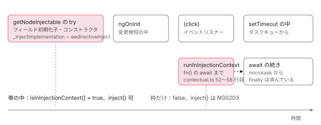

[目次](../README.md) › [DI の内側](README.md) › 第 3 回 / 全 16 回

# 注入コンテキスト：いつ inject() が呼べて、いつ NG0203 になるか

> 注入コンテキストとは「\_currentInjector が undefined でない、または \_injectImplementation がある」区間のこと（isInInjectionContext の 1 行）。コンストラクタ・フィールド初期化子・factory・runInInjectionContext の中で立つ理由、setTimeout や await の後で消える理由、null のときの limp mode（injectRootLimpMode）、assertInInjectionContext を使う API（effect、toSignal、takeUntilDestroyed など）。デモで実際に NG0203 を捕まえて表示する。

angular/angular · 読了 約 13 分 · 中核 · [サイトで読む（デモが動きます）](https://angular-deep-dive-cyan.vercel.app/chapter/di-injection-context)

---

「`inject()` は注入コンテキストの中でしか呼べない」とよく言われます。この章では、その「注入コンテキスト」がソース上では **`isInInjectionContext` の 1 行**で定義されていることを確かめ、[第 2 回](02-di-inject-function.md)の 2 つのスイッチが**どの区間で立ち、どの `finally` で消えるか**を行で追います。`setTimeout` や `await` の後で NG0203 になる理由、スイッチが `null` のときの limp mode、`effect` や `toSignal` が入口で行う検査も読み、最後に実際に NG0203 を捕まえて表示します。

読む対象は `packages/core/src/di/contextual.ts`、`injector_compatibility.ts`、`inject_switch.ts`、`r3_injector.ts`、`packages/core/primitives/di/src/injector.ts`、`packages/core/src/errors.ts`、そして検査を呼ぶ側の `render3/reactivity/effect.ts`、`rxjs-interop/src/to_signal.ts`、`take_until_destroyed.ts`、`render3/after_render/hooks.ts`、`authoring/input/input.ts` です。

1. [1. 概観](01-di-overview.md)
2. [2. inject() の実装](02-di-inject-function.md)
3. **3. 注入コンテキスト**（この章）
4. [4. ɵfac の生成](04-di-factory.md)
5. [5. @Injectable と @Service](05-di-injectable-compile.md)
6. [6. InjectionToken と特殊トークン](06-di-injection-token.md)
7. [7. provider の 4 つの形](07-di-provider-to-factory.md)
8. [8. R3Injector.get の全手順](08-di-r3-injector-get.md)
9. [9. multi: true](09-di-multi-providers.md)
10. [10. ブルームフィルタ](10-di.md)
11. [11. NodeInjector の探索](11-di-node-injector-lookup.md)
12. [12. self・skipSelf・host・optional](12-di-resolution-flags.md)
13. [13. provider 無しで取れるトークン](13-di-special-tokens.md)
14. [14. DestroyRef と破棄](14-di-destroy.md)
15. [15. injectAsync と onIdle](15-di-inject-async.md)
16. [16. DevTools と injector profiler](16-di-debug.md)

## 1. 注入コンテキストの定義は 1 行

📄 `angular/packages/core/src/di/contextual.ts` L61–88 （▶ の行: 64–65, 77–82, 84–85）

```ts
61 │ /**
62 │  * Whether the current stack frame is inside an injection context.
63 │  */
64 ▶ export function isInInjectionContext(): boolean {
65 ▶   return getInjectImplementation() !== undefined || getCurrentInjector() != null;
66 │ }
67 │ /**
68 │  * Asserts that the current stack frame is within an [injection
69 │  * context](guide/di/dependency-injection-context) and has access to `inject`.
70 │  *
71 │  * @param debugFn a reference to the function making the assertion (used for the error message).
72 │  *
73 │  * @see [Asserts the context](guide/di/dependency-injection-context#asserts-the-context)
74 │  *
75 │  * @publicApi
76 │  */
77 ▶ export function assertInInjectionContext(debugFn: Function): void {
78 ▶   // Taking a `Function` instead of a string name here prevents the unminified name of the function
79 ▶   // from being retained in the bundle regardless of minification.
80 ▶   if (!isInInjectionContext()) {
81 ▶     throw new RuntimeError(
82 ▶       RuntimeErrorCode.MISSING_INJECTION_CONTEXT,
83 │       ngDevMode &&
84 ▶         debugFn.name +
85 ▶           '() can only be used within an injection context such as a constructor, a factory function, a field initializer, or a function used with `runInInjectionContext`',
86 │     );
87 │   }
88 │ }
```

65 行目が定義そのものです。**`_injectImplementation` が `undefined` でない、または `_currentInjector` が `null` でも `undefined` でもない**。`!= null`（等号 1 つ）は `null` と `undefined` の両方を弾く書き方です。「注入コンテキスト」という特別なオブジェクトがあるわけではなく、第 2 回の 2 つのグローバル変数を読んでいるだけです。

77 行目の `assertInInjectionContext` は、80 行目でこの 1 行を呼び、偽なら 81〜82 行目で `MISSING_INJECTION_CONTEXT` を投げます。84〜85 行目のメッセージは「`debugFn.name` + () can only be used within an injection context ...」。78〜79 行目のコメントのとおり、関数名を文字列で受け取らず関数で受け取るのは、文字列だと縮小（minify）後もバンドルに名前が残るからです。

📄 `angular/packages/core/src/di/index.ts` L15–24 （▶ の行: 15）

```ts
15 ▶ export {assertInInjectionContext, runInInjectionContext} from './contextual';
16 │ export {forwardRef, ForwardRefFn, resolveForwardRef} from './forward_ref';
17 │ export {HostAttributeToken} from './host_attribute_token';
18 │ export {HOST_TAG_NAME} from './host_tag_name_token';
19 │ export {ENVIRONMENT_INITIALIZER} from './initializer_token';
20 │ export {injectAsync, InjectAsyncOptions, onIdle, PrefetchTrigger} from './inject_async';
21 │ export {Injectable, InjectableDecorator, InjectableProvider} from './injectable';
22 │ export {InjectionToken} from './injection_token';
23 │ export {DestroyableInjector, Injector} from './injector';
24 │ export {inject, ɵɵinject, ɵɵinvalidFactoryDep} from './injector_compatibility';
```

15 行目、`@angular/core` が公開しているのは `assertInInjectionContext` と `runInInjectionContext` の 2 つで、`isInInjectionContext` は公開されていません （core の中では `EventEmitter` や `Testability` が直接 import して使っています）。アプリから「今コンテキストの中か」を知りたいときは、`assertInInjectionContext` を `try/catch` します。80 行目で同じ 1 行を呼ぶので、結果は同じです。この章のデモもそうしています。

📄 `angular/packages/core/src/errors.ts` L37–46 （▶ の行: 41）

```ts
37 │   // Dependency Injection Errors
38 │   CYCLIC_DI_DEPENDENCY = -200,
39 │   PROVIDER_NOT_FOUND = -201,
40 │   INVALID_FACTORY_DEPENDENCY = 202,
41 ▶   MISSING_INJECTION_CONTEXT = -203,
42 │   INVALID_INJECTION_TOKEN = -204,
43 │   INJECTOR_ALREADY_DESTROYED = -205,
44 │   PROVIDER_IN_WRONG_CONTEXT = -207,
45 │   MISSING_INJECTION_TOKEN = 208,
46 │   INVALID_MULTI_PROVIDER = -209,
```

41 行目、`MISSING_INJECTION_CONTEXT = -203`。表示は `NG0203` です。`inject()` 自身が投げる NG0203 は、第 2 回で読んだ `injectInjectorOnly` のここです。

📄 `angular/packages/core/src/di/injector_compatibility.ts` L97–105 （▶ の行: 97–102, 104）

```ts
 97 ▶   const currentInjector = getCurrentInjector();
 98 ▶   if (currentInjector === undefined) {
 99 ▶     throw new RuntimeError(
100 ▶       RuntimeErrorCode.MISSING_INJECTION_CONTEXT,
101 ▶       ngDevMode &&
102 ▶         `The \`${stringify(token)}\` token injection failed. \`inject()\` function must be called from an injection context such as a constructor, a factory function, a field initializer, or a function used with \`runInInjectionContext\`.`,
103 │     );
104 ▶   } else if (currentInjector === null) {
105 │     return injectRootLimpMode(token, undefined, flags);
```

98 行目、`_currentInjector` が `undefined` のときだけ投げます。ここに来るのは 1 つ目のスイッチ `_injectImplementation` が無いときだけなので （第 2 回 3 節の `ɵɵinject`）、結局「2 つのスイッチがどちらも立っていない」ときに NG0203 になります。65 行目の否定と同じ条件です。102 行目のメッセージが挙げる 4 つ、「コンストラクタ、factory 関数、フィールド初期化子、`runInInjectionContext` に渡した関数」が、次の節で見るスイッチの立つ区間です。

## 2. いつ立つか：3 つの try の中

### (a) ディレクティブ・コンポーネントの factory 実行中

`getNodeInjectable` が `factory.injectImpl`（`ɵɵdirectiveInject`）を入れてから factory を呼び、`finally` で戻します （[第 2 回](02-di-inject-function.md) 6 節で引用）。factory は `new MyComponent()` なので、**コンストラクタの本体とフィールド初期化子**がこの区間に入ります。入っているのは 1 つ目のスイッチだけです。

### (b) R3Injector の中（get・runInContext・環境の初期化）

`R3Injector.get` は provider の factory を呼ぶ前に 2 つのスイッチを (`this`, `undefined`) にします（第 2 回 6 節）。`useFactory` の関数や `InjectionToken` の `factory`、サービスのコンストラクタがこの区間です。同じ形がもう 1 つ、`EnvironmentInjector.runInContext` です。

📄 `angular/packages/core/src/di/r3_injector.ts` L303–321 （▶ の行: 304, 306–307, 314–318）

```ts
303 │   override runInContext<ReturnT>(fn: () => ReturnT): ReturnT {
304 ▶     assertNotDestroyed(this);
305 │ 
306 ▶     const previousInjector = setCurrentInjector(this);
307 ▶     const previousInjectImplementation = setInjectImplementation(undefined);
308 │ 
309 │     let prevInjectContext: InjectorProfilerContext | undefined;
310 │     if (ngDevMode) {
311 │       prevInjectContext = setInjectorProfilerContext({injector: this, token: null});
312 │     }
313 │ 
314 ▶     try {
315 ▶       return fn();
316 ▶     } finally {
317 ▶       setCurrentInjector(previousInjector);
318 ▶       setInjectImplementation(previousInjectImplementation);
319 │       ngDevMode && setInjectorProfilerContext(prevInjectContext!);
320 │     }
321 │   }
```

304 行目で破棄済みでないかを確かめ、306〜307 行目で 2 つのスイッチを入れ、**314 行目の `try` で `fn()` を呼び、316〜318 行目の `finally` で戻す**。この「setter の戻り値を取る → try → finally で書き戻す」が、コンテキストを作るすべての場所に共通の形です。`ENVIRONMENT_INITIALIZER` を呼ぶ `resolveInjectorInitializers` も同じ形です（[boot-app-initializer](../boot/09-boot-app-initializer.md)）。

### (c) runInInjectionContext

📄 `angular/packages/core/src/di/contextual.ts` L21–59 （▶ の行: 26–27, 37, 39–41, 43, 50–55, 57）

```ts
21 │ /**
22 │  * Runs the given function in the [context](guide/di/dependency-injection-context) of the given
23 │  * `Injector`.
24 │  *
25 │  * Within the function's stack frame, [`inject`](api/core/inject) can be used to inject dependencies
26 ▶  * from the given `Injector`. Note that `inject` is only usable synchronously, and cannot be used in
27 ▶  * any asynchronous callbacks or after any `await` points.
28 │  *
29 │  * @see [Run within an injection context](guide/di/dependency-injection-context#run-within-an-injection-context)
30 │  *
31 │  * @param injector the injector which will satisfy calls to [`inject`](api/core/inject) while `fn`
32 │  *     is executing
33 │  * @param fn the closure to be run in the context of `injector`
34 │  * @returns the return value of the function, if any
35 │  * @publicApi
36 │  */
37 ▶ export function runInInjectionContext<ReturnT>(injector: Injector, fn: () => ReturnT): ReturnT {
38 │   let internalInjector: PrimitivesInjector;
39 ▶   if (injector instanceof R3Injector) {
40 ▶     assertNotDestroyed(injector);
41 ▶     internalInjector = injector;
42 │   } else {
43 ▶     internalInjector = new RetrievingInjector(injector);
44 │   }
45 │ 
46 │   let prevInjectorProfilerContext: InjectorProfilerContext;
47 │   if (ngDevMode) {
48 │     prevInjectorProfilerContext = setInjectorProfilerContext({injector, token: null});
49 │   }
50 ▶   const prevInjector = setCurrentInjector(internalInjector);
51 ▶   const previousInjectImplementation = setInjectImplementation(undefined);
52 ▶   try {
53 ▶     return fn();
54 ▶   } finally {
55 ▶     setCurrentInjector(prevInjector);
56 │     ngDevMode && setInjectorProfilerContext(prevInjectorProfilerContext!);
57 ▶     setInjectImplementation(previousInjectImplementation);
58 │   }
59 │ }
```

1. **39〜41 行目：`R3Injector` ならそのまま使う**

   40 行目で破棄済みなら投げます（`INJECTOR_ALREADY_DESTROYED`、NG0205）。`R3Injector` は自分で `retrieve` を持っています（第 2 回 4 節）。
2. **43 行目：それ以外は `RetrievingInjector` で包む**

   `inject(Injector)` で取った `NodeInjector` を渡すと、ここで包まれます。中の `inject()` は `NodeInjector.get` 経由で、その要素から探します。
3. **50〜51 行目：2 つのスイッチを (渡した注入器, `undefined`) に**

   51 行目で 1 つ目を `undefined` にするので、外側が `getNodeInjectable` の中（`ɵɵdirectiveInject`）でも、`fn` の中の `inject()` は必ず `injectInjectorOnly` → 渡した注入器の `retrieve` を通ります。
4. **52〜53 行目：`try { return fn(); }`**

   `fn` が**同期的に**走っている間だけがコンテキストです。
5. **54〜57 行目：`finally` で両方を前の値に戻す**

   `fn` が値を返しても throw しても戻ります。26〜27 行目の doc が「同期的にしか使えない。非同期のコールバックや `await` の後では使えない」と書いているのは、この `finally` のことです。

## 3. いつ消えるか：finally の後に走るコード

3 つの区間はどれも `try` / `finally` で、`finally` を抜けた瞬間に 2 つのスイッチは外側の値に戻ります。一番外側の値は初期値の `undefined` です（`_currentInjector` は 4 節で引用する primitives の 22 行目、`_injectImplementation` は初期化していない `let`。第 2 回 3 節）。だから、**どの `try` のスタックの上にもいないコードは、すべてコンテキストの外**です。



*時間を左から右へ。濃い帯がスイッチの立っている区間（try の中）。ngOnInit・クリック・setTimeout・await の続きは、どれも finally を抜けた後に別のスタックで走る。*

`await` の場合を 1 ステップずつ見ます。`runInInjectionContext(injector, async () => { ...; await x; inject(Foo); })` と書いたとします。

1. **50〜51 行目でスイッチが立ち、53 行目で `fn()` を呼ぶ**

   async 関数は、最初の `await` までは普通の関数と同じく同期的に走ります。ここまでの `inject()` は成功します。
2. **`await` で async 関数が中断し、Promise を返す**

   53 行目の `return fn()` はその Promise を返すので、`try` が終わります。
3. **54〜57 行目の `finally` が走り、スイッチが外側の値に戻る**

   外側が何も無い場所なら、どちらも `undefined`。
4. **後で microtask から `await` の続きが走る**

   スタックに `runInInjectionContext` はもういません。ここの `inject()` は 98 行目で NG0203 です。

`ngOnInit` も同じ理由で外です。`ngOnInit` は `getNodeInjectable` の `finally` が済んだ後、変更検知（[ivy-hooks](../ivy/13-ivy-hooks.md)）の中で呼ばれます。変更検知を動かす `ApplicationRef.tick` はスイッチを立てません。`setCurrentInjector` を呼ぶのは `R3Injector` の 3 か所と `runInInjectionContext` だけです（core/src を `grep` した結果）。

## 4. null のとき：limp mode

📄 `angular/packages/core/primitives/di/src/injector.ts` L16–26 （▶ の行: 19, 22）

```ts
16 │ /**
17 │  * Current injector value used by `inject`.
18 │  * - `undefined`: it is an error to call `inject`
19 ▶  * - `null`: `inject` can be called but there is no injector (limp-mode).
20 │  * - Injector instance: Use the injector for resolution.
21 │  */
22 ▶ let _currentInjector: Injector | undefined | null = undefined;
23 │ 
24 │ export function getCurrentInjector(): Injector | undefined | null {
25 │   return _currentInjector;
26 │ }
```

19 行目、`_currentInjector` が `null` のときは「`inject` は呼べるが注入器が無い（limp-mode）」。limp は「足を引きずる」、つまり不完全な動き方です。65 行目の定義では `null` はコンテキストに数えませんが、`injectInjectorOnly` は `null` を NG0203 にせず、この関数に回します。

📄 `angular/packages/core/src/di/inject_switch.ts` L43–67 （▶ の行: 46–48, 55–59, 61–63）

```ts
43 │ /**
44 │  * Injects `root` tokens in limp mode.
45 │  *
46 ▶  * If no injector exists, we can still inject tree-shakable providers which have `providedIn` set to
47 ▶  * `"root"`. This is known as the limp mode injection. In such case the value is stored in the
48 ▶  * injectable definition.
49 │  */
50 │ export function injectRootLimpMode<T>(
51 │   token: ProviderToken<T>,
52 │   notFoundValue: T | undefined,
53 │   flags: InternalInjectFlags,
54 │ ): T | null {
55 ▶   const injectableDef: ɵɵInjectableDeclaration<T> | null = getInjectableDef(token);
56 ▶   if (injectableDef && injectableDef.providedIn == 'root') {
57 ▶     return injectableDef.value === undefined
58 ▶       ? (injectableDef.value = injectableDef.factory())
59 ▶       : injectableDef.value;
60 │   }
61 ▶   if (flags & InternalInjectFlags.Optional) return null;
62 ▶   if (notFoundValue !== undefined) return notFoundValue;
63 ▶   throwProviderNotFoundError(
64 │     token,
65 │     typeof ngDevMode !== 'undefined' && ngDevMode ? 'Injector' : '',
66 │   );
67 │ }
```

1. **55〜56 行目：トークンの `ɵprov` が `providedIn: 'root'` か**

   注入器が無いので、トークン自身に付いた定義だけが頼りです。
2. **57〜59 行目：値を**定義オブジェクトに**キャッシュする**

   初回は `factory()` を呼んで `injectableDef.value` に入れ、2 回目からそれを返します。47〜48 行目のコメントのとおり、値は注入器ではなく定義（クラスの静的フィールド）に保存されます。どの `R3Injector` の records にも入らず、破棄もされません。
3. **61〜63 行目：root でなければ optional なら null、notFoundValue があればそれ、無ければ NG0201**

では `_currentInjector` に `null` を入れるのは誰か。`packages/core/src` と `primitives` を `setCurrentInjector(` で `grep` すると、呼び出しは r3\_injector.ts の 3 つのメソッド（2 節の `runInContext` の 306 行目、`get`、`resolveInjectorInitializers`）とそれぞれの `finally`、それに contextual.ts の 50・55 行目だけで、どれも `this` か渡された注入器か前の値を入れています。`setCurrentInjector(null)` を書いているのはテスト（`packages/core/test/render3/ivy/jit_spec.ts`）だけです。つまり `injectInjectorOnly` 側の limp mode は、19 行目の doc コメント上の状態で、アプリの実行では通りません。`injectRootLimpMode` を呼ぶ場所はもう 1 つあります。

📄 `angular/packages/core/src/render3/di.ts` L431–439 （▶ の行: 431–432, 434–435）

```ts
431 ▶       } else {
432 ▶         return injectRootLimpMode(token, notFoundValue, flags & InternalInjectFlags.Optional);
433 │       }
434 ▶     } finally {
435 ▶       setInjectImplementation(previousInjectImplementation);
436 │     }
437 │   }
438 │   return notFoundValueOrThrow<T>(notFoundValue, token, flags);
439 │ }
```

`lookupTokenUsingModuleInjector` の後半です。431〜432 行目、要素から環境へ降りようとして `lView[INJECTOR]` が無かったとき、limp mode で root のトークンだけを作ります。`lView[INJECTOR]` は `createLView`（`render3/view/construction.ts`）で「渡された注入器、無ければ親 LView のもの、それも無ければ `null`」と決まるので、注入器を渡さずに作ったビューでだけ起きます。434〜435 行目は第 2 回で見た 1 つ目のスイッチの書き戻しです。

## 5. assertInInjectionContext を入口で呼ぶ API

`inject()` を内部で呼ぶ API の多くは、`inject()` の NG0203 より先に、自分の名前入りのエラーを出すために `assertInInjectionContext` を呼びます。

📄 `angular/packages/core/src/render3/reactivity/effect.ts` L137–157 （▶ の行: 148–150）

```ts
137 │ export function effect(
138 │   effectFn: (onCleanup: EffectCleanupRegisterFn) => void,
139 │   options?: CreateEffectOptions,
140 │ ): EffectRef {
141 │   ngDevMode &&
142 │     assertNotInReactiveContext(
143 │       effect,
144 │       'Call `effect` outside of a reactive context. For example, schedule the ' +
145 │         'effect inside the component constructor.',
146 │     );
147 │ 
148 ▶   if (ngDevMode && !options?.injector) {
149 ▶     assertInInjectionContext(effect);
150 ▶   }
151 │ 
152 │   if (ngDevMode && options?.allowSignalWrites !== undefined) {
153 │     console.warn(
154 │       `The 'allowSignalWrites' flag is deprecated and no longer impacts effect() (writes are always allowed)`,
155 │     );
156 │   }
157 │ 
```

148 行目、`effect` は **`ngDevMode` かつ `options.injector` が無いとき**だけ 149 行目で検査します。この直後で `options?.injector ?? inject(Injector)` と注入器を決めます（[cd-effects](../cd/09-cd-effects.md) で引用）。本番ビルドでは検査は消えますが、`injector` を渡さなければその `inject(Injector)` が NG0203 を投げます。

📄 `angular/packages/core/rxjs-interop/src/to_signal.ts` L140–148 （▶ の行: 140, 142–143, 146–147）

```ts
140 ▶   const requiresCleanup = !options?.manualCleanup;
141 │ 
142 ▶   if (ngDevMode && requiresCleanup && !options?.injector) {
143 ▶     assertInInjectionContext(toSignal);
144 │   }
145 │ 
146 ▶   const cleanupRef = requiresCleanup
147 ▶     ? (options?.injector?.get(DestroyRef) ?? inject(DestroyRef))
148 │     : null;
```

`toSignal` は少し条件が違います。140 行目、検査するのは「後片付けが必要なとき」（`manualCleanup` でないとき）だけ。146〜147 行目、要るのは `DestroyRef`（[第 14 回](14-di-destroy.md)）で、`options.injector` があればそこから、無ければ `inject(DestroyRef)` で取ります。

📄 `angular/packages/core/rxjs-interop/src/take_until_destroyed.ts` L17–29 （▶ の行: 25–28）

```ts
17 │  * @param destroyRef optionally, the `DestroyRef` representing the current context. This can be
18 │  *     passed explicitly to use `takeUntilDestroyed` outside of an [injection
19 │  * context](guide/di/dependency-injection-context). Otherwise, the current `DestroyRef` is injected.
20 │  *
21 │  * @see [Unsubscribing with takeUntilDestroyed](ecosystem/rxjs-interop/take-until-destroyed)
22 │  *
23 │  * @publicApi 19.0
24 │  */
25 ▶ export function takeUntilDestroyed<T>(destroyRef?: DestroyRef): MonoTypeOperatorFunction<T> {
26 ▶   if (!destroyRef) {
27 ▶     ngDevMode && assertInInjectionContext(takeUntilDestroyed);
28 ▶     destroyRef = inject(DestroyRef);
29 │   }
```

`takeUntilDestroyed` は引数で `DestroyRef` を受け取れます。26 行目、渡されなかったときだけ 27 行目で検査し、28 行目で `inject(DestroyRef)` します。

📄 `angular/packages/core/src/render3/after_render/hooks.ts` L385–399 （▶ の行: 395–396, 399）

```ts
385 │   callbackOrSpec:
386 │     | VoidFunction
387 │     | {
388 │         earlyRead?: () => unknown;
389 │         write?: (r?: unknown) => unknown;
390 │         mixedReadWrite?: (r?: unknown) => unknown;
391 │         read?: (r?: unknown) => void;
392 │       },
393 │   options?: AfterRenderOptions,
394 │ ): AfterRenderRef {
395 ▶   if (ngDevMode && !options?.injector) {
396 ▶     assertInInjectionContext(afterNextRender);
397 │   }
398 │ 
399 ▶   const injector = options?.injector ?? inject(Injector);
```

`afterNextRender` も `effect` と同じく、395 行目で `options.injector` が無いときだけ検査し、399 行目で注入器を決めます。

📄 `angular/packages/core/src/authoring/input/input.ts` L21–34 （▶ の行: 25–26, 32）

```ts
21 │ export function inputFunction<ReadT, WriteT>(
22 │   initialValue?: ReadT,
23 │   opts?: InputOptions<ReadT, WriteT>,
24 │ ): InputSignalWithTransform<ReadT | undefined, WriteT> {
25 ▶   ngDevMode && assertInInjectionContext(input);
26 ▶   return createInputSignal(initialValue, opts);
27 │ }
28 │ 
29 │ export function inputRequiredFunction<ReadT, WriteT = ReadT>(
30 │   opts?: InputOptions<ReadT, WriteT>,
31 │ ): InputSignalWithTransform<ReadT, WriteT> {
32 ▶   ngDevMode && assertInInjectionContext(input);
33 │   return createInputSignal(REQUIRED_UNSET_VALUE as never, opts);
34 │ }
```

`input()` は 25・32 行目で検査しますが、26 行目の `createInputSignal` は注入器を使いません。検査は `ngDevMode &&` 付きなので、本番ビルドではコンテキストの外で呼んでも何も投げません。開発ビルドで「フィールド初期化子に書く」ことを強制するための検査です。

| API | 検査する条件 | コンテキストの外で使う方法 | 本番ビルドで検査が消えた後 |
| --- | --- | --- | --- |
| `effect` | 開発ビルドで `injector` 無し（effect.ts 148 行目） | `{ injector }` を渡す | 直後の `inject(Injector)` が NG0203 |
| `toSignal` | 開発ビルドで後片付けが必要かつ `injector` 無し（to\_signal.ts 142 行目） | `{ injector }` か `{ manualCleanup: true }` | 147 行目の `inject(DestroyRef)` が NG0203 |
| `takeUntilDestroyed` | 開発ビルドで引数無し（take\_until\_destroyed.ts 26〜27 行目） | `DestroyRef` を引数で渡す | 28 行目の `inject(DestroyRef)` が NG0203 |
| `afterNextRender` | 開発ビルドで `injector` 無し（hooks.ts 395 行目） | `{ injector }` を渡す | 399 行目の `inject(Injector)` が NG0203 |
| `input` | 開発ビルドで常に（input.ts 25 行目） | 無い（フィールド初期化子に書く） | 何も起きない |

## 6. DEMO：NG0203 を捕まえる

> **🧪 DEMO — 同じ inject(CTX\_TOKEN, { optional: true }) を場所を変えて呼ぶ**
>
> 章コンポーネントは `providers: [{ provide: CTX_TOKEN, useValue: 'element' }]` を持ちます。最初の 3 行はページを開いた時点で記録したものです。ボタンを押すと行が増えます。NG0203 は `try/catch` で捕まえて表示しているので、コンソールには出ません。本番ビルドではメッセージが短く `NG0203` だけになります（`ngDevMode` が偽のため 101 行目の文が消える）。
>
> ▶ [このデモはサイトで動かせます](https://angular-deep-dive-cyan.vercel.app/chapter/di-injection-context)

(2) の 2 行の違いは 2 節 (c) の 39〜43 行目です。`inject(Injector)`（`NodeInjector`）を渡すと `RetrievingInjector` に包まれ、要素から探すので `'element'`。`inject(EnvironmentInjector)`（`R3Injector`）を渡すとそのまま使われ、要素の providers は見ないので `null` です。(3) は await 前が `true`、後が `false` と NG0203 になります。`optional: true` を付けていても NG0203 は投げられます。98 行目の検査は optional を見る前にあるからです。

## 聞かれそうな質問

**Q. await の後で inject() できないのはなぜですか？**

コンテキストは「`try` の中にいる間」だけだからです。`runInInjectionContext` は contextual.ts 53 行目で `fn()` を呼び、async 関数は最初の `await` で Promise を返すので、54〜57 行目の `finally` がすぐ走ってスイッチを戻します。`await` の続きは後で microtask から走り、そのときは 65 行目の 2 条件がどちらも偽です（DEMO (3)）。コンストラクタの中の `await` も同じで、`getNodeInjectable` や `R3Injector.get` の `finally` が先に走ります。続きで必要なものは、`await` の前に `inject()` して変数に取っておくか、`inject(Injector)` を取っておいて `runInInjectionContext` で包み直します。

**Q. ngOnInit の中で inject() できますか？**

できません（DEMO の ngOnInit の行）。コンストラクタとフィールド初期化子は `getNodeInjectable` の `try` の中で走りますが、`ngOnInit` はその `finally` が済んだ後に変更検知から呼ばれます。変更検知はスイッチを立てないので、98 行目で NG0203 になります。ngOnInit で必要なものはフィールド初期化子で `inject()` しておきます。

**Q. effect をコンストラクタの外で作るにはどうしますか？**

`effect(fn, { injector })` と注入器を渡します。effect.ts 148 行目の条件が `!options?.injector` なので検査を飛ばし、直後で `inject(Injector)` の代わりに渡した注入器を使います。注入器はフィールド初期化子で `inject(Injector)` して取っておきます。`runInInjectionContext(this.injector, () => effect(fn))` でも動きます。50〜51 行目でスイッチが立つので、148 行目の検査も通ります。

**Q. runInInjectionContext に渡す注入器は何でもよいのですか？**

`get` を持つものなら何でも受け付けます。`R3Injector` なら 39〜41 行目でそのまま、それ以外は 43 行目で `RetrievingInjector` に包まれて `get` が呼ばれます。ただし渡した注入器から探すので、`NodeInjector` と `EnvironmentInjector` では見えるものが違います（DEMO (2)）。破棄済みの `R3Injector` を渡すと 40 行目の `assertNotDestroyed` が NG0205 を投げます。

**Q. isInInjectionContext() が true なら、inject() は必ず成功しますか？**

NG0203 にならないことだけが保証されます。65 行目が真なら、`ɵɵdirectiveInject` か `retrieve` のどちらかに進むからです。その先でトークンが見つからなければ NG0201（`PROVIDER_NOT_FOUND`）で、これは注入コンテキストとは別の失敗です。

## 読み終えて

- 注入コンテキスト = `getInjectImplementation() !== undefined || getCurrentInjector() != null`（contextual.ts 65 行目）。特別なオブジェクトは無い
- スイッチが立つのは、`getNodeInjectable`（コンストラクタとフィールド初期化子）、`R3Injector.get` / `runInContext`（factory）、`runInInjectionContext`（50〜51 行目）の `try` の中だけ
- どれも `finally` で戻すので、`ngOnInit`・イベント・`setTimeout`・`await` の後は外。`inject()` は 98 行目で NG0203
- limp mode（`_currentInjector === null`）は root のトークンを定義にキャッシュする経路。アプリで `null` を入れるコードは無く、実際に通るのは `lView[INJECTOR]` が無いときの di.ts 432 行目
- `effect`・`toSignal`・`takeUntilDestroyed`・`afterNextRender` は開発ビルドで入口検査し、`injector` や `DestroyRef` を渡せば外でも使える

---

← 前: [inject() の実装：ɵɵinject と 2 つのスイッチ（\_currentInjector と \_injectImplementation）](02-di-inject-function.md)  
次: [ɵfac の生成：コンストラクタ引数が ɵɵinject / ɵɵdirectiveInject の呼び出しになるまで](04-di-factory.md) →
