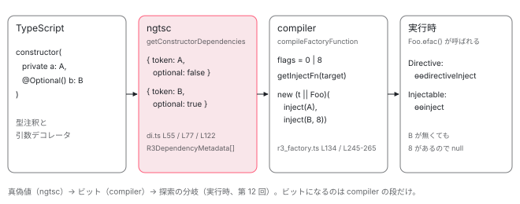

[目次](../README.md) › [DI の内側](README.md) › 第 4 回 / 全 16 回

# ɵfac の生成：コンストラクタ引数が ɵɵinject / ɵɵdirectiveInject の呼び出しになるまで

> ngtsc の getConstructorDependencies が引数の型と @Inject / @Optional / @Self / @SkipSelf / @Host / @Attribute を読み、compiler の compileFactoryFunction が target（Injectable / Directive / Component / Pipe / NgModule）ごとに ɵɵinject か ɵɵdirectiveInject かを選ぶ。デコレータがビットになる行、型が解決できないとき AOT では NG2003 か ɵɵinvalidFactory()、JIT では ɵɵinvalidFactoryDep（NG0202）になる違い、親クラスの ɵfac を使う ɵɵgetInheritedFactory。実際の出力例を読む。

angular/angular · 読了 約 14 分 · 中核 · [サイトで読む（デモが動きます）](https://angular-deep-dive-cyan.vercel.app/chapter/di-factory)

---

`constructor(private a: A, @Optional() b: B)` と書いたクラスは、コンパイル後に `static ɵfac` という関数を持ちます。中身は `new (__ngFactoryType__ || Foo)(ɵɵinject(A), ɵɵinject(B, 8))` のような 1 行で、この章ではその 1 行が**どの関数で、どの順で組み立てられるか**を、ngtsc（Angular の TypeScript コンパイラ）→ compiler → 実行時の順に追います。デコレータがビットに変わる行、`ɵɵinject` と `ɵɵdirectiveInject` を選ぶ行、型が解決できないときの 2 種類のエラー、親クラスの ɵfac を借りる `ɵɵgetInheritedFactory` まで読みます。

読む対象は `packages/compiler-cli/src/ngtsc/annotations/common/src/di.ts`（引数を読む側）、`packages/compiler/src/render3/r3_factory.ts`（ɵfac を書き出す側）、`packages/core/src/render3/di.ts` と `packages/core/src/di/injector_compatibility.ts`（実行時）、出力例として `packages/compiler-cli/test/compliance/test_cases/` の fixture（コンパイラの期待出力を固定したテストデータ）です。

1. [1. 概観](01-di-overview.md)
2. [2. inject() の実装](02-di-inject-function.md)
3. [3. 注入コンテキスト](03-di-injection-context.md)
4. **4. ɵfac の生成**（この章）
5. [5. @Injectable と @Service](05-di-injectable-compile.md)
6. [6. InjectionToken と特殊トークン](06-di-injection-token.md)
7. [7. provider の 4 つの形](07-di-provider-to-factory.md)
8. [8. R3Injector.get の全手順](08-di-r3-injector-get.md)
9. [9. multi: true](09-di-multi-providers.md)
10. [10. ブルームフィルタ](10-di.md)
11. [11. NodeInjector の探索](11-di-node-injector-lookup.md)
12. [12. self・skipSelf・host・optional](12-di-resolution-flags.md)
13. [13. provider 無しで取れるトークン](13-di-special-tokens.md)
14. [14. DestroyRef と破棄](14-di-destroy.md)
15. [15. injectAsync と onIdle](15-di-inject-async.md)
16. [16. DevTools と injector profiler](16-di-debug.md)

## 1. 先にゴールを見る：fixture の入力と出力

コンパイラのテストには「この TypeScript を入れたら、この JavaScript が出る」という組が置いてあります。コンストラクタ引数にデコレータを全種類付けたコンポーネントの例です。

📄 `angular/packages/compiler-cli/test/compliance/test_cases/r3_view_compiler_di/di/component_factory.ts` L11–26 （▶ の行: 17–24）

```ts
11 │ @Component({
12 │     selector: 'my-component', template: ``,
13 │     standalone: false
14 │ })
15 │ export class MyComponent {
16 │   constructor(
17 ▶       @Attribute('name') name: string,
18 ▶       @Attribute(dynamicAttrName()) other: string,
19 ▶       s1: MyService,
20 ▶       @Host() s2: MyService,
21 ▶       @Self() s4: MyService,
22 ▶       @SkipSelf() s3: MyService,
23 ▶       @Optional() s5: MyService,
24 ▶       @Self() @Optional() s6: MyService,
25 │   ) {}
26 │ }
```

📄 `angular/packages/compiler-cli/test/compliance/test_cases/r3_view_compiler_di/di/component_factory.js` L1–8 （▶ の行: 3–5）

```js
1 │ export class MyComponent {
2 │   // ...
3 ▶   static ɵfac = function MyComponent_Factory(__ngFactoryType__) {
4 ▶     /* @ts-ignore */
5 ▶     return new (__ngFactoryType__ || MyComponent)($r3$.ɵɵinjectAttribute('name'), $r3$.ɵɵinjectAttribute(dynamicAttrName()), $r3$.ɵɵdirectiveInject(MyService), $r3$.ɵɵdirectiveInject(MyService, 1), $r3$.ɵɵdirectiveInject(MyService, 2), $r3$.ɵɵdirectiveInject(MyService, 4), $r3$.ɵɵdirectiveInject(MyService, 8), $r3$.ɵɵdirectiveInject(MyService, 10));
6 │   }
7 │   // ...
8 │ }
```
*出力（fixture の .js）。1 行に収まっているのを読みやすさのため頭の中で引数ごとに分けて読む。*

3 行目、ɵfac は `MyComponent_Factory` という名前の関数で、引数を 1 つ（`__ngFactoryType__`）取ります。5 行目がこの章の主役です。入力の 17〜24 行目の 8 引数が、左から順にこう変わっています。

| 入力（行） | 出力の引数 | 第 2 引数の意味 |
| --- | --- | --- |
| 17 `@Attribute('name') name: string` | `ɵɵinjectAttribute('name')` | フラグなし。関数自体が違う |
| 18 `@Attribute(dynamicAttrName())` | `ɵɵinjectAttribute(dynamicAttrName())` | 式がそのまま入る |
| 19 `s1: MyService` | `ɵɵdirectiveInject(MyService)` | 省略（Default = 0） |
| 20 `@Host()` | `ɵɵdirectiveInject(MyService, 1)` | Host = 1 |
| 21 `@Self()` | `ɵɵdirectiveInject(MyService, 2)` | Self = 2 |
| 22 `@SkipSelf()` | `ɵɵdirectiveInject(MyService, 4)` | SkipSelf = 4 |
| 23 `@Optional()` | `ɵɵdirectiveInject(MyService, 8)` | Optional = 8 |
| 24 `@Self() @Optional()` | `ɵɵdirectiveInject(MyService, 10)` | 2 \| 8 = 10 |

以下、この変換を 3 段に分けて読みます。**(1) ngtsc が引数を `R3DependencyMetadata` に読む**、**(2) compiler がそれを `ɵɵdirectiveInject(...)` 式に変える**、**(3) 実行時にその式が呼ばれる**です。

## 2. ngtsc：getConstructorDependencies が引数を 1 つずつ読む

📄 `angular/packages/compiler-cli/src/ngtsc/annotations/common/src/di.ts` L39–62 （▶ の行: 46–49, 51, 55, 57–61）

```ts
39 │ export function getConstructorDependencies(
40 │   clazz: ClassDeclaration,
41 │   reflector: ReflectionHost,
42 │   isCore: boolean,
43 │ ): ConstructorDeps | null {
44 │   const deps: R3DependencyMetadata[] = [];
45 │   const errors: ConstructorDepError[] = [];
46 ▶   let ctorParams = reflector.getConstructorParameters(clazz);
47 ▶   if (ctorParams === null) {
48 ▶     if (reflector.hasBaseClass(clazz)) {
49 ▶       return null;
50 │     } else {
51 ▶       ctorParams = [];
52 │     }
53 │   }
54 │   ctorParams.forEach((param, idx) => {
55 ▶     let token = valueReferenceToExpression(param.typeValueReference);
56 │ 
57 ▶     let attributeNameType: Expression | null = null;
58 ▶     let optional = false,
59 ▶       self = false,
60 ▶       skipSelf = false,
61 ▶       host = false;
62 │ 
```

1. **46 行目：コンストラクタの引数一覧を取る**

   `reflector.getConstructorParameters(clazz)` は、クラス**自身**のコンストラクタの引数を返します。コンストラクタを書いていないクラスでは `null` です（継承したコンストラクタは見ません）。
2. **47〜52 行目：コンストラクタが無いときの 2 通り**

   親クラスがあれば 49 行目で `null` を返して終わり。これが「親の ɵfac を使え」という合図になり、6 節の `ɵɵgetInheritedFactory` につながります。親が無ければ 51 行目で空配列、つまり「引数 0 個のコンストラクタ」として扱います。
3. **55 行目：まず型注釈をトークンにする**

   `param.typeValueReference` は「型注釈 `MyService` を、実行時に値として参照できる式」です。クラスなら値があるので式になり、`interface` や `type` のように値が無ければ `null` になります。
4. **57〜61 行目：4 つのフラグと属性名を false / null で用意する**

   ここから下のデコレータ処理が、これらを書き換えます。

📄 `angular/packages/compiler-cli/src/ngtsc/annotations/common/src/di.ts` L63–100 （▶ の行: 64, 66–67, 75–78, 80–82, 84, 93–95）

```ts
 63 │     (param.decorators || [])
 64 ▶       .filter((dec) => isCore || isAngularCore(dec))
 65 │       .forEach((dec) => {
 66 ▶         const name = isCore || dec.import === null ? dec.name : dec.import!.name;
 67 ▶         if (name === 'Inject') {
 68 │           if (dec.args === null || dec.args.length !== 1) {
 69 │             throw new FatalDiagnosticError(
 70 │               ErrorCode.DECORATOR_ARITY_WRONG,
 71 │               dec.node,
 72 │               `Unexpected number of arguments to @Inject().`,
 73 │             );
 74 │           }
 75 ▶           token = new WrappedNodeExpr(dec.args[0]);
 76 ▶         } else if (name === 'Optional') {
 77 ▶           optional = true;
 78 ▶         } else if (name === 'SkipSelf') {
 79 │           skipSelf = true;
 80 ▶         } else if (name === 'Self') {
 81 ▶           self = true;
 82 ▶         } else if (name === 'Host') {
 83 │           host = true;
 84 ▶         } else if (name === 'Attribute') {
 85 │           if (dec.args === null || dec.args.length !== 1) {
 86 │             throw new FatalDiagnosticError(
 87 │               ErrorCode.DECORATOR_ARITY_WRONG,
 88 │               dec.node,
 89 │               `Unexpected number of arguments to @Attribute().`,
 90 │             );
 91 │           }
 92 │           const attributeName = dec.args[0];
 93 ▶           token = new WrappedNodeExpr(attributeName);
 94 ▶           if (ts.isStringLiteralLike(attributeName)) {
 95 ▶             attributeNameType = new LiteralExpr(attributeName.text);
 96 │           } else {
 97 │             attributeNameType = new WrappedNodeExpr(
 98 │               ts.factory.createKeywordTypeNode(ts.SyntaxKind.UnknownKeyword),
 99 │             );
100 │           }
```

64 行目、見るのは `@angular/core` から import したデコレータだけです（`isAngularCore`）。66 行目で名前を取り、67〜75 行目、`@Inject(X)` なら**55 行目で決めたトークンを `X` で上書き**します。型注釈よりも `@Inject` が勝つのはこの代入のためです。76〜83 行目、`@Optional` / `@SkipSelf` / `@Self` / `@Host` は真偽値を立てるだけです。ビットにするのは次の compiler の仕事です。84〜95 行目、`@Attribute('name')` はトークンを属性名の式にし（93 行目）、文字列リテラルなら 95 行目で `attributeNameType` に型用のリテラルを入れます。この `attributeNameType` が null でないことが、後で「`ɵɵinjectAttribute` を使え」という印になります。

📄 `angular/packages/compiler-cli/src/ngtsc/annotations/common/src/di.ts` L110–131 （▶ の行: 110, 116–119, 122, 126–127, 129–130）

```ts
110 ▶     if (token === null) {
111 │       if (param.typeValueReference.kind !== TypeValueReferenceKind.UNAVAILABLE) {
112 │         throw new Error(
113 │           'Illegal state: expected value reference to be unavailable if no token is present',
114 │         );
115 │       }
116 ▶       errors.push({
117 ▶         index: idx,
118 ▶         param,
119 ▶         reason: param.typeValueReference.reason,
120 │       });
121 │     } else {
122 ▶       deps.push({token, attributeNameType, optional, self, skipSelf, host});
123 │     }
124 │   });
125 │ 
126 ▶   if (errors.length === 0) {
127 ▶     return {deps};
128 │   } else {
129 ▶     return {deps: null, errors};
130 ▶   }
131 │ }
```

110 行目、デコレータを全部見てもトークンが `null` のまま（型が interface で、`@Inject` も無い）なら、116〜120 行目でその引数を `errors` に積みます。トークンがあれば 122 行目で 1 件の `R3DependencyMetadata``{token, attributeNameType, optional, self, skipSelf, host}` として `deps` に積みます。126〜130 行目、1 つでもエラーがあれば `deps: null` と `errors` を返します。**ここではまだ例外を投げません。**

### エラーにするか、'invalid' にして先送りするか

戻り値を受け取った側が 2 つの関数のどちらかを選びます。

📄 `angular/packages/compiler-cli/src/ngtsc/annotations/common/src/di.ts` L139–151 （▶ の行: 142–143, 146, 149）

```ts
139 │ export function unwrapConstructorDependencies(
140 │   deps: ConstructorDeps | null,
141 │ ): R3DependencyMetadata[] | 'invalid' | null {
142 ▶   if (deps === null) {
143 ▶     return null;
144 │   } else if (deps.deps !== null) {
145 │     // These constructor dependencies are valid.
146 ▶     return deps.deps;
147 │   } else {
148 │     // These deps are invalid.
149 ▶     return 'invalid';
150 │   }
151 │ }
```

📄 `angular/packages/compiler-cli/src/ngtsc/annotations/common/src/di.ts` L171–184 （▶ の行: 178, 181–182）

```ts
171 │ export function validateConstructorDependencies(
172 │   clazz: ClassDeclaration,
173 │   deps: ConstructorDeps | null,
174 │ ): R3DependencyMetadata[] | null {
175 │   if (deps === null) {
176 │     return null;
177 │   } else if (deps.deps !== null) {
178 ▶     return deps.deps;
179 │   } else {
180 │     // There is at least one error.
181 ▶     const error = deps.errors[0];
182 ▶     throw createUnsuitableInjectionTokenError(clazz, error);
183 │   }
184 │ }
```

`unwrapConstructorDependencies` は 149 行目でエラーを文字列 `'invalid'` に変えて先へ進めます（コンパイルは通る）。`validateConstructorDependencies` は 181〜182 行目で最初のエラーを診断（`createUnsuitableInjectionTokenError`、コード `ErrorCode.PARAM_MISSING_TOKEN`。画面には NG2003 と出る）にして投げます（コンパイルが止まる）。どちらも 142〜143 行目 / 178 行目で、「コンストラクタが無くて親がある」`null` はそのまま返します。

📄 `angular/packages/compiler-cli/src/ngtsc/annotations/directive/src/shared.ts` L359–367 （▶ の行: 364–367）

```ts
359 │   const rawCtorDeps = getConstructorDependencies(clazz, reflector, isCore);
360 │ 
361 │   // Non-abstract directives (those with a selector) require valid constructor dependencies, whereas
362 │   // abstract directives are allowed to have invalid dependencies, given that a subclass may call
363 │   // the constructor explicitly.
364 ▶   const ctorDeps =
365 ▶     selector !== null
366 ▶       ? validateConstructorDependencies(clazz, rawCtorDeps)
367 ▶       : unwrapConstructorDependencies(rawCtorDeps);
```

ディレクティブ / コンポーネントの場合の選び方です。364〜367 行目、`selector` があれば（＝テンプレートで実際に使われる）`validate`、selector の無い抽象ディレクティブは `unwrap`。サブクラスが自分で `super(...)` を呼ぶかもしれないので、親の段階では止めません。`@Injectable` 側の選び方（`strictInjectionParameters` と引数の有無）は[第 5 回](05-di-injectable-compile.md)で読みます。

## 3. compiler：compileFactoryFunction が関数の形を決める

ngtsc は各デコレータのハンドラ（`@Component` なら `FactoryTarget.Component`、`@Injectable` なら `FactoryTarget.Injectable`）で `{name, type, deps, target}` を作り、compiler の `compileFactoryFunction` に渡します。

📄 `angular/packages/compiler/src/render3/r3_factory.ts` L104–140 （▶ の行: 105, 113–114, 126–128, 131, 133–134, 136, 138–139）

```ts
104 │ export function compileFactoryFunction(meta: R3FactoryMetadata): R3CompiledExpression {
105 ▶   const t = o.variable('__ngFactoryType__');
106 │   let baseFactoryVar: o.ReadVarExpr | null = null;
107 │ 
108 │   // The type to instantiate via constructor invocation. If there is no delegated factory, meaning
109 │   // this type is always created by constructor invocation, then this is the type-to-create
110 │   // parameter provided by the user (t) if specified, or the current type if not. If there is a
111 │   // delegated factory (which is used to create the current type) then this is only the type-to-
112 │   // create parameter (t).
113 ▶   const typeForCtor = !isDelegatedFactoryMetadata(meta)
114 ▶     ? new o.BinaryOperatorExpr(o.BinaryOperator.Or, t, meta.type.value)
115 │     : t;
116 │ 
117 │   let ctorExpr: o.Expression | null = null;
118 │ 
119 │   // If the factory has invalid dependencies (e.g. trying to inject an interface), we normally mark
120 │   // the `deps` as invalid so we can emit an invalid factory. In some environments we may not
121 │   // be able to determine if the dependency is invalid, because that depends on information in
122 │   // other files. To ensure that cases like that still compile, we need to add a `@ts-ignore`
123 │   // comment which allows the code to compile and then error at runtime. Note that it's important
124 │   // to put the comment on a statement, because it includes a new line which may break `return`
125 │   // statements if the comment is set on the expression.
126 ▶   const factoryComments =
127 ▶     meta.deps !== null && meta.deps !== 'invalid' && meta.deps.length > 0
128 ▶       ? [tsIgnoreComment()]
129 │       : undefined;
130 │ 
131 ▶   if (meta.deps !== null) {
132 │     // There is a constructor (either explicitly or implicitly defined).
133 ▶     if (meta.deps !== 'invalid') {
134 ▶       ctorExpr = new o.InstantiateExpr(typeForCtor, injectDependencies(meta.deps, meta.target));
135 │     }
136 ▶   } else {
137 │     // There is no constructor, use the base class' factory to construct typeForCtor.
138 ▶     baseFactoryVar = o.variable(`ɵ${meta.name}_BaseFactory`);
139 ▶     ctorExpr = baseFactoryVar.callFn([typeForCtor]);
140 │   }
```

1. **105 行目：引数の名前は `__ngFactoryType__`**

   出力の `function MyComponent_Factory(__ngFactoryType__)` の引数はここで決まります。
2. **113〜114 行目：`new` する相手は `__ngFactoryType__ || MyComponent`**

   呼び出し側がサブクラスを渡せば、そのサブクラスを `new` します。渡さなければ自分自身。これがあるので、親の ɵfac をサブクラスの生成に使い回せます（6 節）。
3. **126〜128 行目：引数が 1 つ以上あるときだけ `/* @ts-ignore */`**

   出力 4 行目のコメントです。別ファイルの情報次第で型が合わない場合でもコンパイルを通し、問題があれば実行時に出すためです（直前のコメントにある理由）。
4. **131〜135 行目：deps が配列なら `new typeForCtor(...injectDependencies(deps))`**

   `InstantiateExpr` は「`new X(args)`」を表す出力 AST（出力するコードを表す木）のノードです。deps が `'invalid'` なら 133 行目の if に入らず、`ctorExpr` は `null` のまま残ります。
5. **136〜139 行目：deps が `null`（コンストラクタが無く親がある）なら親の factory を呼ぶ式**

   `ɵMyComponent_BaseFactory(typeForCtor)` という変数呼び出しを作ります。変数の中身は 6 節で埋まります。

📄 `angular/packages/compiler/src/render3/r3_factory.ts` L173–211 （▶ の行: 173, 175–176, 178, 180–183, 185–186, 188, 196, 199, 202, 210）

```ts
173 ▶   if (retExpr === null) {
174 │     // The expression cannot be formed so render an `ɵɵinvalidFactory()` call.
175 ▶     body.push(o.importExpr(R3.invalidFactory).callFn([]).toStmt());
176 ▶   } else if (baseFactoryVar !== null) {
177 │     // This factory uses a base factory, so call `ɵɵgetInheritedFactory()` to compute it.
178 ▶     const getInheritedFactoryCall = o.importExpr(R3.getInheritedFactory).callFn([meta.type.value]);
179 │     // Memoize the base factoryFn: `baseFactory || (baseFactory = ɵɵgetInheritedFactory(...))`
180 ▶     const baseFactory = new o.BinaryOperatorExpr(
181 ▶       o.BinaryOperator.Or,
182 ▶       baseFactoryVar,
183 ▶       baseFactoryVar.set(getInheritedFactoryCall),
184 │     );
185 ▶     body.push(new o.ReturnStatement(baseFactory.callFn([typeForCtor])));
186 ▶   } else {
187 │     // This is straightforward factory, just return it.
188 ▶     body.push(new o.ReturnStatement(retExpr, null, factoryComments));
189 │   }
190 │ 
191 │   let factoryFn: o.Expression = o.fn(
192 │     [new o.FnParam(t.name, o.DYNAMIC_TYPE)],
193 │     body,
194 │     o.INFERRED_TYPE,
195 │     undefined,
196 ▶     `${meta.name}_Factory`,
197 │   );
198 │ 
199 ▶   if (baseFactoryVar !== null) {
200 │     // There is a base factory variable so wrap its declaration along with the factory function into
201 │     // an IIFE.
202 ▶     factoryFn = o
203 │       .arrowFn(
204 │         [],
205 │         [
206 │           new o.DeclareVarStmt(baseFactoryVar.name!, undefined, o.DYNAMIC_TYPE),
207 │           new o.ReturnStatement(factoryFn),
208 │         ],
209 │       )
210 ▶       .callFn([], /* sourceSpan */ undefined, /* pure */ true);
211 │   }
```

（この 2 つの引用の間にある `makeConditionalFactory` は `useClass` / `useFactory` 付きの `@Injectable` 用で、[第 5 回](05-di-injectable-compile.md)で読みます。普通のクラスでは `retExpr` に `ctorExpr` がそのまま入ります。）

173〜175 行目、`retExpr` が `null`（＝ deps が `'invalid'`）なら、本体は `ɵɵinvalidFactory()` の呼び出しだけになります。176〜185 行目、親の factory を使う場合は `ɵɵgetInheritedFactory(MyType)` を 1 回だけ呼んで変数に覚える `baseFactory || (baseFactory = ɵɵgetInheritedFactory(...))` を作ります。186〜188 行目、それ以外は `return new (...)(...)`。196 行目で関数名を `${name}_Factory` にし、199〜210 行目、親の factory を使うときだけ変数宣言ごと即時実行関数（IIFE）で包み、`pure`（副作用なし。使われなければバンドラが消してよい）の印を付けます。

## 4. 引数 1 つ → ɵɵdirectiveInject(Token, flags) 1 つ

📄 `angular/packages/compiler/src/render3/r3_factory.ts` L231–265 （▶ の行: 232, 241–242, 245–251, 256–257, 260, 262, 264–265）

```ts
231 │ function injectDependencies(deps: R3DependencyMetadata[], target: FactoryTarget): o.Expression[] {
232 ▶   return deps.map((dep, index) => compileInjectDependency(dep, target, index));
233 │ }
234 │ 
235 │ function compileInjectDependency(
236 │   dep: R3DependencyMetadata,
237 │   target: FactoryTarget,
238 │   index: number,
239 │ ): o.Expression {
240 │   // Interpret the dependency according to its resolved type.
241 ▶   if (dep.token === null) {
242 ▶     return o.importExpr(R3.invalidFactoryDep).callFn([o.literal(index)]);
243 │   } else if (dep.attributeNameType === null) {
244 │     // Build up the injection flags according to the metadata.
245 ▶     const flags =
246 ▶       InjectFlags.Default |
247 ▶       (dep.self ? InjectFlags.Self : 0) |
248 ▶       (dep.skipSelf ? InjectFlags.SkipSelf : 0) |
249 ▶       (dep.host ? InjectFlags.Host : 0) |
250 ▶       (dep.optional ? InjectFlags.Optional : 0) |
251 ▶       (target === FactoryTarget.Pipe ? InjectFlags.ForPipe : 0);
252 │ 
253 │     // If this dependency is optional or otherwise has non-default flags, then additional
254 │     // parameters describing how to inject the dependency must be passed to the inject function
255 │     // that's being used.
256 ▶     let flagsParam: o.LiteralExpr | null =
257 ▶       flags !== InjectFlags.Default || dep.optional ? o.literal(flags) : null;
258 │ 
259 │     // Build up the arguments to the injectFn call.
260 ▶     const injectArgs = [dep.token];
261 │     if (flagsParam) {
262 ▶       injectArgs.push(flagsParam);
263 │     }
264 ▶     const injectFn = getInjectFn(target);
265 ▶     return o.importExpr(injectFn).callFn(injectArgs);
```

1. **232 行目：deps を順に 1 つずつ式にする**

   コンストラクタ引数の順番がそのまま出力の引数の順番になります。`index` はエラー用です。
2. **241〜242 行目：トークンが `null` の依存は `ɵɵinvalidFactoryDep(index)`**

   2 節の ngtsc はトークン null を `deps` に入れない（110 行目で errors へ回す）ので、AOT ではここに来ません。来るのは JIT です（5 節）。
3. **245〜251 行目：真偽値をビットにする**

   `Self` / `SkipSelf` / `Host` / `Optional` を OR で重ね、251 行目、**Pipe のときだけ `ForPipe`** を足します。`@Self() @Optional()` が `10` になるのはこの OR です。
4. **256〜257 行目：フラグが 0 なら第 2 引数を出さない**

   出力を短くするためです。fixture の `ɵɵdirectiveInject(MyService)` が 1 引数なのはこのためです。
5. **264〜265 行目：呼ぶ関数は target で決める**

   下の `getInjectFn` です。

📄 `angular/packages/compiler/src/core.ts` L85–104 （▶ の行: 92, 94, 96, 98, 103）

```ts
 85 │ export const enum InjectFlags {
 86 │   Default = 0,
 87 │ 
 88 │   /**
 89 │    * Specifies that an injector should retrieve a dependency from any injector until reaching the
 90 │    * host element of the current component. (Only used with Element Injector)
 91 │    */
 92 ▶   Host = 1 << 0,
 93 │   /** Don't descend into ancestors of the node requesting injection. */
 94 ▶   Self = 1 << 1,
 95 │   /** Skip the node that is requesting injection. */
 96 ▶   SkipSelf = 1 << 2,
 97 │   /** Inject `defaultValue` instead if token not found. */
 98 ▶   Optional = 1 << 3,
 99 │   /**
100 │    * This token is being injected into a pipe.
101 │    * @internal
102 │    */
103 ▶   ForPipe = 1 << 4,
104 │ }
```
*compiler 側の InjectFlags。core の InternalInjectFlags と同じ値（core 側は第 2 回）。*

📄 `angular/packages/compiler/src/render3/r3_factory.ts` L331–342 （▶ の行: 333–340）

```ts
331 │ function getInjectFn(target: FactoryTarget): o.ExternalReference {
332 │   switch (target) {
333 ▶     case FactoryTarget.Component:
334 ▶     case FactoryTarget.Directive:
335 ▶     case FactoryTarget.Pipe:
336 ▶       return R3.directiveInject;
337 ▶     case FactoryTarget.NgModule:
338 ▶     case FactoryTarget.Injectable:
339 ▶     default:
340 ▶       return R3.inject;
341 │   }
342 │ }
```

333〜336 行目、Component / Directive / Pipe は `ɵɵdirectiveInject`、337〜340 行目、NgModule / Injectable と `default`（`@Service` の `FactoryTarget.Service` もここ）は `ɵɵinject`。理由は実行時の居場所です。ディレクティブは要素の上で作られるので `NodeInjector`（要素ごとの注入器）から探す必要があり、`ɵɵdirectiveInject` は今の `LView` / `TNode` を使って探します （[standalone 第 8 回](../standalone/08-standalone-providers-two-injectors.md)）。サービスは環境注入器（`R3Injector`）の中で作られるので、`ɵɵinject` が現在の注入器を使います（[第 2 回](02-di-inject-function.md)）。

📄 `angular/packages/compiler/src/render3/r3_factory.ts` L266–276 （▶ の行: 274）

```ts
266 │   } else {
267 │     // The `dep.attributeTypeName` value is defined, which indicates that this is an `@Attribute()`
268 │     // type dependency. For the generated JS we still want to use the `dep.token` value in case the
269 │     // name given for the attribute is not a string literal. For example given `@Attribute(foo())`,
270 │     // we want to generate `ɵɵinjectAttribute(foo())`.
271 │     //
272 │     // The `dep.attributeTypeName` is only actually used (in `createCtorDepType()`) to generate
273 │     // typings.
274 ▶     return o.importExpr(R3.injectAttribute).callFn([dep.token]);
275 │   }
276 │ }
```

274 行目、`@Attribute` はフラグも target も見ず `ɵɵinjectAttribute(token)` 一択です。中で何をしているか（`TNode.attrs` を読む）は[第 6 回](06-di-injection-token.md)の `HostAttributeToken` と同じ関数なので、そちらで読みます。



*constructor の 1 引数が、ngtsc の R3DependencyMetadata → compiler の出力 AST → 実行時の呼び出しへ。左から右へ情報が変わる。*

## 5. 型が解決できないとき：2 つのエラー関数

「この引数は注入できない」が分かったとき、出力に入る関数は 2 種類あります。どちらも実行時に投げるだけの関数です。

📄 `angular/packages/core/src/render3/instructions/di.ts` L80–85 （▶ の行: 80–82, 84）

```ts
80 ▶ export function ɵɵinvalidFactory(): never {
81 ▶   const msg = ngDevMode
82 ▶     ? `This constructor was not compatible with Dependency Injection.`
83 │     : 'invalid';
84 ▶   throw new Error(msg);
85 │ }
```

📄 `angular/packages/core/src/di/injector_compatibility.ts` L159–168 （▶ の行: 159–161, 163）

```ts
159 ▶ export function ɵɵinvalidFactoryDep(index: number): never {
160 ▶   throw new RuntimeError(
161 ▶     RuntimeErrorCode.INVALID_FACTORY_DEPENDENCY,
162 │     ngDevMode &&
163 ▶       `This constructor is not compatible with Angular Dependency Injection because its dependency at index ${index} of the parameter list is invalid.
164 │ This can happen if the dependency type is a primitive like a string or if an ancestor of this class is missing an Angular decorator.
165 │ 
166 │ Please check that 1) the type for the parameter at index ${index} is correct and 2) the correct Angular decorators are defined for this class and its ancestors.`,
167 │   );
168 │ }
```

|   | `ɵɵinvalidFactory()` | `ɵɵinvalidFactoryDep(index)` |
| --- | --- | --- |
| 出力される条件 | deps が `'invalid'`（r3\_factory.ts 173〜175 行目） | 1 つの dep のトークンが `null`（241〜242 行目） |
| 誰が作る | AOT。2 節の `unwrap` を選んだクラス | JIT。下の `reflectDependency` |
| 何を投げる | ただの `Error`（84 行目）。本番では `'invalid'` | `RuntimeError(INVALID_FACTORY_DEPENDENCY)`（160〜161 行目）＝ NG0202。何番目の引数かがメッセージに出る（163 行目） |
| いつ投げる | ɵfac が呼ばれた瞬間（作ろうとしたとき） | 同じ。その引数の番が来たとき |

クラス名がメッセージに無いのは、出力の関数名 `Foo_Factory`（3 節 196 行目）がスタックトレースに出るからです（ɵɵinvalidFactoryDep の直前の doc コメントにそう書かれています）。

### JIT では同じ compileFactoryFunction に、実行時に集めた deps を渡す

📄 `angular/packages/core/src/di/jit/util.ts` L40–77 （▶ の行: 50, 52, 54, 56, 58–60, 67–69, 72–73, 75）

```ts
40 │   if (Array.isArray(dep) && dep.length > 0) {
41 │     for (let j = 0; j < dep.length; j++) {
42 │       const param = dep[j];
43 │       if (param === undefined) {
44 │         // param may be undefined if type of dep is not set by ngtsc
45 │         continue;
46 │       }
47 │ 
48 │       const proto = Object.getPrototypeOf(param);
49 │ 
50 ▶       if (param instanceof Optional || proto.ngMetadataName === 'Optional') {
51 │         meta.optional = true;
52 ▶       } else if (param instanceof SkipSelf || proto.ngMetadataName === 'SkipSelf') {
53 │         meta.skipSelf = true;
54 ▶       } else if (param instanceof Self || proto.ngMetadataName === 'Self') {
55 │         meta.self = true;
56 ▶       } else if (param instanceof Host || proto.ngMetadataName === 'Host') {
57 │         meta.host = true;
58 ▶       } else if (param instanceof Inject) {
59 ▶         meta.token = param.token;
60 ▶       } else if (param instanceof Attribute) {
61 │         if (param.attributeName === undefined) {
62 │           throw new RuntimeError(
63 │             RuntimeErrorCode.INVALID_INJECTION_TOKEN,
64 │             ngDevMode && `Attribute name must be defined.`,
65 │           );
66 │         }
67 ▶         meta.attribute = param.attributeName;
68 ▶       } else {
69 ▶         meta.token = param;
70 │       }
71 │     }
72 ▶   } else if (dep === undefined || (Array.isArray(dep) && dep.length === 0)) {
73 ▶     meta.token = null;
74 │   } else {
75 ▶     meta.token = dep;
76 │   }
77 │   return meta;
```

JIT（ブラウザでデコレータを実行してコンパイルする方式。TestBed など）では、引数ごとのメタデータは `getReflect().parameters(type)` が実行時に集めた配列です。50〜57 行目、各要素が `Optional` などの**インスタンス**か（`instanceof`）、プロトタイプの `ngMetadataName` が一致するかで真偽値を立てます。58〜59 行目、`@Inject` ならその `token`、60〜67 行目、`@Attribute` なら属性名、68〜69 行目、どれでもなければ要素そのもの（型）をトークンにします。72〜73 行目、メタデータが `undefined`（型情報が出力されていない）ならトークンは `null`。これが 4 節 241 行目の `ɵɵinvalidFactoryDep` になります。

📄 `angular/packages/compiler/src/jit_compiler_facade.ts` L402–413 （▶ の行: 407, 411–412）

```ts
402 │   compileFactory(
403 │     angularCoreEnv: CoreEnvironment,
404 │     sourceMapUrl: string,
405 │     meta: R3FactoryDefMetadataFacade,
406 │   ) {
407 ▶     const factoryRes = compileFactoryFunction({
408 │       name: meta.name,
409 │       type: wrapReference(meta.type),
410 │       typeArgumentCount: meta.typeArgumentCount,
411 ▶       deps: convertR3DependencyMetadataArray(meta.deps),
412 ▶       target: meta.target,
413 │     });
```

407 行目、JIT も AOT と**同じ `compileFactoryFunction`** を呼びます。違うのは 411 行目の deps の出どころだけです。

### JIT のデコレータに付いている \_\_NG\_DI\_FLAG\_\_ は何のため？

📄 `angular/packages/core/src/di/metadata.ts` L112–115 （▶ の行: 115）

```ts
112 │ export const Optional: OptionalDecorator =
113 │   // Disable tslint because `InternalInjectFlags` is a const enum which gets inlined.
114 │   // tslint:disable-next-line: no-toplevel-property-access
115 ▶   attachInjectFlag(makeParamDecorator('Optional'), InternalInjectFlags.Optional);
```

📄 `angular/packages/core/src/di/injector_compatibility.ts` L374–387 （▶ の行: 375–376, 386）

```ts
374 │ export function attachInjectFlag(decorator: any, flag: InternalInjectFlags | DecoratorFlags): any {
375 ▶   decorator[DI_DECORATOR_FLAG] = flag;
376 ▶   decorator.prototype[DI_DECORATOR_FLAG] = flag;
377 │   return decorator;
378 │ }
379 │ 
380 │ /**
381 │  * Reads monkey-patched property that contains InjectFlag attached to a decorator.
382 │  *
383 │  * @param token Token that may contain monkey-patched DI flags property.
384 │  */
385 │ export function getInjectFlag(token: any): number | undefined {
386 ▶   return token[DI_DECORATOR_FLAG];
387 │ }
```

115 行目、`Optional` デコレータ関数には `attachInjectFlag` で `Optional` のビット（8）が付いています。375〜376 行目、付け先は**関数自身とその prototype の両方**なので、`Optional` でも `new Optional()` でも 386 行目の `getInjectFlag` で読めます。これを読むのは、上の `reflectDependency`（instanceof で判定）ではなく、`{provide, useFactory, deps: [[new Optional(), Dep]]}` の `deps` 配列を処理する `injectArgs` です。ビットを取り出す行は[第 7 回](07-di-provider-to-factory.md)で読みます。

## 6. コンストラクタを書かないサブクラス：ɵɵgetInheritedFactory

📄 `angular/packages/compiler-cli/test/compliance/test_cases/r3_compiler_compliance/ng_modules/inheritance.ts` L1–14 （▶ の行: 9, 13）

```ts
 1 │ import {Injectable, NgModule} from '@angular/core';
 2 │ 
 3 │ @Injectable()
 4 │ export class Service {
 5 │ }
 6 │ 
 7 │ @NgModule({providers: [Service]})
 8 │ export class BaseModule {
 9 ▶   constructor(private service: Service) {}
10 │ }
11 │ 
12 │ @NgModule({})
13 ▶ export class BasicModule extends BaseModule {
14 │ }
```

📄 `angular/packages/compiler-cli/test/compliance/test_cases/r3_compiler_compliance/ng_modules/inheritance.js` L18–24 （▶ の行: 19–20, 22）

```js
18 │ export class BasicModule extends BaseModule {
19 ▶   static ɵfac = /*@__PURE__*/ (() => {
20 ▶     let ɵBasicModule_BaseFactory;
21 │     return function BasicModule_Factory(__ngFactoryType__) {
22 ▶       return (ɵBasicModule_BaseFactory || (ɵBasicModule_BaseFactory = i0.ɵɵgetInheritedFactory(BasicModule)))(__ngFactoryType__ || BasicModule);
23 │     };
24 │   })();
```

入力 13 行目の `BasicModule` はコンストラクタを書かず、親 `BaseModule` の 9 行目に引数があります。2 節 49 行目で deps が `null` になり、3 節 136〜139 行目と 176〜185 行目、199〜210 行目がそろって、出力 19〜22 行目の形になります。20 行目の変数 `ɵBasicModule_BaseFactory` は最初の呼び出しで 22 行目の `ɵɵgetInheritedFactory(BasicModule)` の結果を覚えます。

📄 `angular/packages/core/src/render3/di.ts` L915–946 （▶ の行: 919–920, 922, 925–926, 933–934, 937, 940, 944）

```ts
915 │ export function ɵɵgetInheritedFactory<T>(
916 │   type: Type<any> | AbstractType<any>,
917 │ ): (type: Type<T>) => T {
918 │   return noSideEffects(() => {
919 ▶     const ownConstructor = type.prototype.constructor;
920 ▶     const ownFactory = ownConstructor[NG_FACTORY_DEF] || getFactoryOf(ownConstructor);
921 │     const objectPrototype = Object.prototype;
922 ▶     let parent = Object.getPrototypeOf(type.prototype).constructor;
923 │ 
924 │     // Go up the prototype until we hit `Object`.
925 ▶     while (parent && parent !== objectPrototype) {
926 ▶       const factory = parent[NG_FACTORY_DEF] || getFactoryOf(parent);
927 │ 
928 │       // If we hit something that has a factory and the factory isn't the same as the type,
929 │       // we've found the inherited factory. Note the check that the factory isn't the type's
930 │       // own factory is redundant in most cases, but if the user has custom decorators on the
931 │       // class, this lookup will start one level down in the prototype chain, causing us to
932 │       // find the own factory first and potentially triggering an infinite loop downstream.
933 ▶       if (factory && factory !== ownFactory) {
934 ▶         return factory;
935 │       }
936 │ 
937 ▶       parent = Object.getPrototypeOf(parent);
938 │     }
939 │ 
940 ▶     // There is no factory defined. Either this was improper usage of inheritance
941 │     // (no Angular decorator on the superclass) or there is no constructor at all
942 │     // in the inheritance chain. Since the two cases cannot be distinguished, the
943 │     // latter has to be assumed.
944 ▶     return (t: Type<T>) => new t();
945 │   });
946 │ }
```

1. **919〜920 行目：自分の ɵfac を控える**

   自分の ɵfac を「親の factory」と取り違えないための比較用です（933 行目）。
2. **922〜937 行目：prototype をたどって親へ登る**

   926 行目、親クラスの `ɵfac` を探し、933〜934 行目、**自分の ɵfac と違う最初の factory**を返します。返った親の ɵfac は 3 節 113〜114 行目の `__ngFactoryType__ || BaseModule` の形なので、出力 22 行目が `(__ngFactoryType__ || BasicModule)` を渡すと**親の引数（`ɵɵinject(Service)`）で子のクラスが new されます**。
3. **944 行目：最後まで見つからなければ `new t()`**

   どの祖先にも ɵfac が無い場合です。祖先に Angular のデコレータが付いていないのか、本当にどこにもコンストラクタが無いのかは区別できないので（940〜943 行目のコメント）、引数 0 個で `new` します。親に引数があってもデコレータが無ければ、ここで**引数なしで作られてしまいます**。

## 7. DEMO：この章のクラスの ɵfac を直接呼ぶ

この章の `.ts` には、次の 3 つのクラスがあります（どれも `@Injectable` なので target は Injectable、関数は `ɵɵinject`）。

- `FacDep`：`providedIn: 'root'`
- `FacService`：`constructor(readonly dep: FacDep, @Optional() readonly missing: FacMissing | null)`。`FacMissing` はどこにも provide していない
- `FacServiceSub extends FacService`：コンストラクタを書かない

ɵfac は公開 API ではありません。ここでは学習用に `(FacService as any).ɵfac` を覗いて呼びます。ボタンのクリック処理は注入コンテキストの外で走ります。

> **🧪 DEMO — ɵfac を 4 通りに呼ぶ**
>
> 本番ビルドでもクラス名ではなく固定の文字列を表示するので、結果は同じです。
>
> 出力の `ɵɵinject(FacDep)` が、現在の注入器も inject 実装も無い状態で呼ばれ NG0203（注入コンテキストの外）。ɵfac は「注入器の中で呼ばれる前提の関数」です（[第 3 回](03-di-injection-context.md)）。
>
> `ɵɵinject(FacDep)` は環境注入器から root のインスタンスを取り、`ɵɵinject(FacMissing, 8)` は見つからなくてもフラグ 8（Optional）なので `null`。
>
> 第 1 引数が 3 節 113〜114 行目の `__ngFactoryType__` に入り、`new (FacServiceSub)(...)` になります。
>
> サブクラスの ɵfac は親とは別の関数（IIFE で包んだ方）ですが、中で `ɵɵgetInheritedFactory` が親の ɵfac を見つけ、親の引数で子を作ります。
>
> ▶ [このデモはサイトで動かせます](https://angular-deep-dive-cyan.vercel.app/chapter/di-factory)

## ここまでの呼び出し

- 👤 `constructor(a: A, @Optional() b: B)` — あなたのクラス
  - `getConstructorDependencies(clazz, reflector, isCore)` — compiler-cli/src/ngtsc/annotations/common/src/di.ts L39 — *型注釈 → token（L55）、@Inject で上書き（L75）、フラグは真偽値（L76-83）*
    - `validateConstructorDependencies` / `unwrapConstructorDependencies` — di.ts L171 / L139 — *トークンが無い引数があれば NG2003 か 'invalid'*
  - `compileNgFactoryDefField(toFactoryMetadata(meta, FactoryTarget.X))` — annotations/common/src/factory.ts
    - `compileFactoryFunction(meta)` — compiler/src/render3/r3\_factory.ts L104 — *new (t || Type)(...)、'invalid' なら ɵɵinvalidFactory、deps null なら ɵɵgetInheritedFactory*
      - `compileInjectDependency(dep, target, index)` — r3\_factory.ts L235 — *ビットを OR（L245-251）、getInjectFn（L331）*
  - `Foo.ɵfac()` — 実行時。R3Injector / NodeInjector が呼ぶ
    - `ɵɵinject(A)` / `ɵɵdirectiveInject(A, flags)` — 第 2 回 / 第 11 回
    - `ɵɵgetInheritedFactory(Sub)` — core/src/render3/di.ts L915 — *コンストラクタが無いサブクラスだけ*

## 聞かれそうな質問

**Q. inject() で書いたときとコンストラクタ注入で書いたときで、生成コードはどう違いますか？**

`inject()` は ɵfac に出てきません。フィールドで `inject()` するクラスはコンストラクタ引数が 0 個なので、di.ts 51 行目（または引数 0 個の配列）で deps が `[]` になり、r3\_factory.ts 134 行目で `new (__ngFactoryType__ || Foo)()` だけが出ます。`inject()` の呼び出しはあなたが書いたフィールド初期化子のまま残り、ɵfac がその `new` を注入コンテキストの中で実行するので動きます。フラグも ɵfac ではなく `inject(X, {optional: true})` のオブジェクトから実行時に作られます（[第 2 回](02-di-inject-function.md)）。

**Q. interface 型をコンストラクタ引数にするとどうなりますか？**

interface には実行時の値が無いので、di.ts 55 行目のトークンが `null`、110 行目で errors に入ります。selector のあるコンポーネント / ディレクティブなら shared.ts 365 行目で `validate` が選ばれ、di.ts 181〜182 行目で **コンパイルエラー NG2003**（No suitable injection token）です。引数なしの `@Injectable()` で `strictInjectionParameters` が false なら `'invalid'` になり、r3\_factory.ts 175 行目で `ɵɵinvalidFactory()` が出て、**作ろうとした瞬間に実行時エラー**です。解決策はどちらも `@Inject(TOKEN)`（di.ts 75 行目でトークンを上書き）か、`inject(TOKEN)` に書き換えることです。

**Q. NG0202 はどんなときに出ますか？**

出力に `ɵɵinvalidFactoryDep(index)` が入ったときで、それは r3\_factory.ts 241 行目、dep のトークンが `null` のときだけです。AOT の ngtsc はトークン null の dep を作らないので（di.ts 110〜120 行目で errors へ）、主に JIT で、型メタデータが `undefined` の引数（jit/util.ts 72〜73 行目）があるときです。AOT で注入できない引数は NG2003（コンパイル時）か `ɵɵinvalidFactory` の `Error`（実行時）になります。

**Q. 親クラスを継承したら、親の依存はどうなりますか？**

子がコンストラクタを**書かなければ**、di.ts 49 行目で deps が `null`、ɵfac は `ɵɵgetInheritedFactory` 経由で親の ɵfac を使い、親の引数がそのまま注入されます（render3/di.ts 933〜934 行目、DEMO ④）。子がコンストラクタを**書けば**、子の引数だけが ɵfac に出ます。`super(...)` に何を渡すかはあなたのコードの責任です。親に Angular のデコレータが無く ɵfac が見つからないと、944 行目の `new t()` で引数なしで作られます。

**Q. @Self() @Optional() の 10 はどこで足されますか？**

ngtsc は `self = true` と `optional = true` の真偽値を持つだけで（di.ts 77・81 行目）、足すのは compiler の r3\_factory.ts 245〜251 行目の OR です。値は compiler/src/core.ts 94 行目の Self = 2 と 98 行目の Optional = 8。Pipe なら 251 行目でさらに ForPipe = 16 が足されます。

## 読み終えて

- ɵfac は `new (__ngFactoryType__ || Foo)(引数ごとの inject 呼び出し)` の 1 行。形を決めるのは r3\_factory.ts の `compileFactoryFunction`（113〜114・134 行目）
- ngtsc の `getConstructorDependencies` が型注釈をトークンにし（55 行目）、`@Inject` で上書き（75 行目）、フラグは真偽値のまま渡す。ビットにするのは compiler（245〜251 行目）
- Component / Directive / Pipe は `ɵɵdirectiveInject`、それ以外は `ɵɵinject`（getInjectFn 333〜340 行目）。`@Attribute` は `ɵɵinjectAttribute`
- 注入できない引数は、AOT ならコンパイル時の NG2003 か実行時の `ɵɵinvalidFactory`、JIT なら `ɵɵinvalidFactoryDep`（NG0202）
- コンストラクタを書かないサブクラスは `ɵɵgetInheritedFactory` で親の ɵfac を借り、`__ngFactoryType__` に自分を渡して作られる

---

← 前: [注入コンテキスト：いつ inject() が呼べて、いつ NG0203 になるか](03-di-injection-context.md)  
次: [@Injectable と @Service が ɵprov になるまで：providedIn・useFactory・autoProvided](05-di-injectable-compile.md) →
