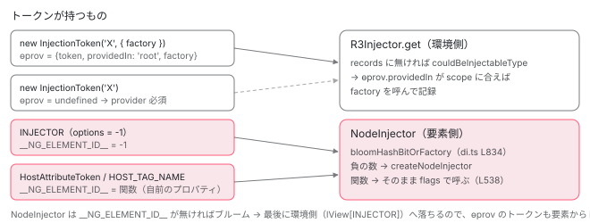

[目次](../README.md) › [DI の内側](README.md) › 第 6 回 / 全 16 回

# InjectionToken の中身と特殊トークン：factory 付きトークン、HostAttributeToken、HOST\_TAG\_NAME

> InjectionToken のコンストラクタが options.factory から ɵprov を作る行、\_\_NG\_ELEMENT\_ID\_\_ を持つトークンが NodeInjector で特別扱いされる仕組み、HostAttributeToken が injectAttributeImpl で要素の属性を読む手順、HOST\_TAG\_NAME がタグ名を返す行、primitives/di の InjectionToken との関係。文字列トークンは型で拒否されるだけで実行時は Map のキーとして動くこと、NG0204 になる本当の条件。

angular/angular · 読了 約 12 分 · 中核 · [サイトで読む（デモが動きます）](https://angular-deep-dive-cyan.vercel.app/chapter/di-injection-token)

---

`new InjectionToken('API_URL')` は「クラスではない値」を DI のキーにするための小さなオブジェクトです。この章では `InjectionToken` のコンストラクタが `options.factory` から `ɵprov` を作る行、数値を渡したときだけ `__NG_ELEMENT_ID__` を持つ裏口、そして `__NG_ELEMENT_ID__` に関数を持たせた 2 つの特殊トークン `HostAttributeToken`（ホスト要素の静的属性を読む）と `HOST_TAG_NAME`（タグ名を読む）を、実行される行まで追います。最後に `@angular/core/primitives/di` の `InjectionToken`（型だけ）との関係と、文字列をトークンにしたとき実際に何が起きるかを確かめます。

読む対象は `packages/core/src/di/injection_token.ts`、`host_attribute_token.ts`、`host_tag_name_token.ts`、`injector_marker.ts`、`injector_token.ts`、`internal_tokens.ts`、`packages/core/src/render3/di.ts`、`packages/core/primitives/di/src/` です。

1. [1. 概観](01-di-overview.md)
2. [2. inject() の実装](02-di-inject-function.md)
3. [3. 注入コンテキスト](03-di-injection-context.md)
4. [4. ɵfac の生成](04-di-factory.md)
5. [5. @Injectable と @Service](05-di-injectable-compile.md)
6. **6. InjectionToken と特殊トークン**（この章）
7. [7. provider の 4 つの形](07-di-provider-to-factory.md)
8. [8. R3Injector.get の全手順](08-di-r3-injector-get.md)
9. [9. multi: true](09-di-multi-providers.md)
10. [10. ブルームフィルタ](10-di.md)
11. [11. NodeInjector の探索](11-di-node-injector-lookup.md)
12. [12. self・skipSelf・host・optional](12-di-resolution-flags.md)
13. [13. provider 無しで取れるトークン](13-di-special-tokens.md)
14. [14. DestroyRef と破棄](14-di-destroy.md)
15. [15. injectAsync と onIdle](15-di-inject-async.md)
16. [16. DevTools と injector profiler](16-di-debug.md)

## 1. InjectionToken はフィールド 3 つのオブジェクト

📄 `angular/packages/core/src/di/injection_token.ts` L65–69 （▶ の行: 67, 69）

```ts
65 │ export class InjectionToken<T> {
66 │   /** @internal */
67 ▶   readonly ngMetadataName = 'InjectionToken';
68 │ 
69 ▶   readonly ɵprov: unknown;
```

📄 `angular/packages/core/src/di/injection_token.ts` L96–117 （▶ の行: 97, 103–104, 109–114）

```ts
 96 │   constructor(
 97 ▶     protected _desc: string,
 98 │     options?: {
 99 │       providedIn?: Type<any> | 'root' | 'platform' | 'any' | null;
100 │       factory: () => T;
101 │     },
102 │   ) {
103 ▶     this.ɵprov = undefined;
104 ▶     if (typeof options == 'number') {
105 │       (typeof ngDevMode === 'undefined' || ngDevMode) &&
106 │         assertLessThan(options, 0, 'Only negative numbers are supported here');
107 │       // This is a special hack to assign __NG_ELEMENT_ID__ to this instance.
108 │       // See `InjectorMarkers`
109 ▶       (this as any).__NG_ELEMENT_ID__ = options;
110 ▶     } else if (options !== undefined) {
111 ▶       this.ɵprov = ɵɵdefineInjectable({
112 ▶         token: this,
113 ▶         providedIn: options.providedIn || 'root',
114 ▶         factory: options.factory,
115 │       });
116 │     }
117 │   }
```

1. **97 行目：description は `_desc` に保存するだけ**

   キーとしては使いません。使い道は 2 節の `toString` だけです。
2. **103 行目：まず `ɵprov = undefined`**

   options を渡さなければこのまま。**factory の無いトークンは ɵprov を持たない**ので、provider を書かない限りどの注入器も作れません。
3. **110〜116 行目：options があれば `ɵɵdefineInjectable` で ɵprov を作る**

   [第 5 回](05-di-injectable-compile.md)でコンパイラがクラスに付けたのと**同じ関数を、実行時にトークン自身へ**付けています。112 行目の `token: this` でトークン自身がキー、113 行目、`providedIn` を省略すると `'root'`、114 行目の `factory` は渡した関数そのものです。クラスの ɵprov と同じ形になるので、`R3Injector` は「`providedIn: 'root'` のクラス」と同じ手順で、root 注入器の records に無ければ factory を呼んで作ります （[NgModule 第 10 回](../ngmodule/10-ngmodule-provided-in.md)の `injectableDefInScope`）。
4. **104〜109 行目：options が*数値*なら `__NG_ELEMENT_ID__` に入れる**

   型定義には無い裏口で、Angular 内部だけが使います。3 節で読みます。

### ngMetadataName は R3Injector の型判定に使われる

📄 `angular/packages/core/src/di/r3_injector.ts` L718–723 （▶ の行: 720–721）

```ts
718 │ function couldBeInjectableType(value: any): value is ProviderToken<any> {
719 │   return (
720 ▶     typeof value === 'function' ||
721 ▶     (typeof value === 'object' && value.ngMetadataName === 'InjectionToken')
722 │   );
723 │ }
```

67 行目の `ngMetadataName = 'InjectionToken'` を読むのがここです。`R3Injector.get` は records に無いトークンについて、「ɵprov を持ち得るか」をこの関数で見てから `getInjectableDef` を呼びます（呼び出し側の行は[NgModule 第 10 回](../ngmodule/10-ngmodule-provided-in.md)）。720 行目のクラス（関数）か、721 行目の `ngMetadataName` が一致するオブジェクトだけが通ります。`instanceof InjectionToken` ではなく文字列で比べるので、別バンドルに入った `InjectionToken` クラスのインスタンスでも通ります。

## 2. multi と toString

📄 `angular/packages/core/src/di/injection_token.ts` L119–128 （▶ の行: 122–123, 126–127）

```ts
119 │   /**
120 │    * @internal
121 │    */
122 ▶   get multi(): InjectionToken<Array<T>> {
123 ▶     return this as InjectionToken<Array<T>>;
124 │   }
125 │ 
126 ▶   toString(): string {
127 ▶     return `InjectionToken ${this._desc}`;
128 │   }
```

122〜124 行目の `multi` は `this` を返すだけの getter で、型を `InjectionToken<Array<T>>` に変える**型のための**道具です（`@internal`）。実行時の動きはありません。126〜128 行目、`toString` が `InjectionToken 説明文` を返します。NG0201（provider が見つからない）のメッセージに出るトークン名はこれです（DEMO 3）。

## 3. 数値の \_\_NG\_ELEMENT\_ID\_\_：INJECTOR トークン

📄 `angular/packages/core/src/di/injector_marker.ts` L9–24 （▶ の行: 16–17, 23）

```ts
 9 │ /**
10 │  * Special markers which can be left on `Type.__NG_ELEMENT_ID__` which are used by the Ivy's
11 │  * `NodeInjector`. Usually these markers contain factory functions. But in case of this special
12 │  * marker we can't leave behind a function because it would create tree shaking problem.
13 │  *
14 │  * Currently only `Injector` is special.
15 │  *
16 ▶  * NOTE: the numbers here must be negative, because positive numbers are used as IDs for bloom
17 ▶  * filter.
18 │  */
19 │ export const enum InjectorMarkers {
20 │   /**
21 │    * Marks that the current type is `Injector`
22 │    */
23 ▶   Injector = -1,
24 │ }
```

📄 `angular/packages/core/src/di/injector_token.ts` L21–26 （▶ の行: 21–22, 25）

```ts
21 ▶ export const INJECTOR = new InjectionToken<Injector>(
22 ▶   typeof ngDevMode !== 'undefined' && ngDevMode ? 'INJECTOR' : '',
23 │   // Disable tslint because this is const enum which gets inlined not top level prop access.
24 │   // tslint:disable-next-line: no-toplevel-property-access
25 ▶   InjectorMarkers.Injector as any, // Special value used by Ivy to identify `Injector`.
26 │ );
```

数値で作られるトークンは 25 行目の `INJECTOR` だけです。22 行目、description は開発モードのときだけ `'INJECTOR'`、本番では空文字にして文字列をバンドルから消します。25 行目の `-1` がコンストラクタ 104〜109 行目に入り、`__NG_ELEMENT_ID__ = -1` になります。ɵprov は作られません。16〜17 行目、負の数なのは**正の数がブルームフィルタ（要素の注入器が持つ、トークンの有無を高速に判定するビット列）の ID だから**です。NodeInjector がこの値を読む側は次の 2 行です。

📄 `angular/packages/core/src/render3/di.ts` L829–843 （▶ の行: 829–830, 834, 836–839, 842）

```ts
829 ▶   if (typeof token === 'string') {
830 ▶     return token.charCodeAt(0) || 0;
831 │   }
832 │   const tokenId: number | undefined =
833 │     // First check with `Object.hasOwn` so we don't get an inherited ID.
834 ▶     Object.hasOwn(token, NG_ELEMENT_ID) ? (token as any)[NG_ELEMENT_ID] : undefined;
835 │   // Negative token IDs are used for special objects such as `Injector`
836 ▶   if (typeof tokenId === 'number') {
837 ▶     if (tokenId >= 0) {
838 ▶       return tokenId & BLOOM_MASK;
839 ▶     } else {
840 │       ngDevMode &&
841 │         assertEqual(tokenId, InjectorMarkers.Injector, 'Expecting to get Special Injector Id');
842 ▶       return createNodeInjector;
843 │     }
```

834 行目、`__NG_ELEMENT_ID__` は**自分自身のプロパティ**（`Object.hasOwn`）だけを見ます。836〜838 行目、0 以上ならブルームのビット番号（ディレクティブが持つ ID。[第 10 回](10-di.md)）、839〜842 行目、負なら `createNodeInjector` という**関数**を返します。数値でない場合（関数か `undefined`）は、この直後の行でそのまま返されます（その行と、ブルームを読む側は[第 10 回](10-di.md)で引用済み）。829〜830 行目、文字列トークンは先頭文字の文字コードをビット番号にします（7 節）。

📄 `angular/packages/core/src/render3/di.ts` L513–516 （▶ の行: 513, 516）

```ts
513 ▶   const bloomHash = bloomHashBitOrFactory(token);
514 │   // If the ID stored here is a function, this is a special object like ElementRef or TemplateRef
515 │   // so just call the factory function to create it.
516 ▶   if (typeof bloomHash === 'function') {
```

📄 `angular/packages/core/src/render3/di.ts` L538–545 （▶ の行: 538, 541–542, 544）

```ts
538 ▶         value = bloomHash(flags);
539 │       }
540 │ 
541 ▶       if (value == null && !(flags & InternalInjectFlags.Optional)) {
542 ▶         throwProviderNotFoundError(token);
543 │       } else {
544 ▶         return value;
545 │       }
```

516 行目、戻り値が関数なら、ブルームフィルタも providers も見ずに 538 行目で **その関数に flags を渡して呼び**、544 行目でその戻り値を返します。541〜542 行目、戻り値が `null` で Optional でなければ NG0201 です。`inject(INJECTOR)` がその場の `NodeInjector` を返すのはこの道です。`ElementRef` や `ChangeDetectorRef` などクラスに関数の `__NG_ELEMENT_ID__` を持たせたトークンの一覧は[第 13 回](13-di-special-tokens.md)で読みます。ここから先は、**インスタンスのフィールド**として関数を持たせた 2 つのトークンです。

## 4. HostAttributeToken：属性名を閉じ込めた関数

📄 `angular/packages/core/src/di/host_attribute_token.ts` L33–42 （▶ の行: 33–34, 37, 39–40）

```ts
33 ▶ export class HostAttributeToken {
34 ▶   constructor(private attributeName: string) {}
35 │ 
36 │   /** @internal */
37 ▶   __NG_ELEMENT_ID__ = () => ɵɵinjectAttribute(this.attributeName);
38 │ 
39 ▶   toString(): string {
40 ▶     return `HostAttributeToken ${this.attributeName}`;
41 │   }
42 │ }
```

33 行目、`HostAttributeToken` は `InjectionToken` を継承しない普通のクラスで、`ngMetadataName` も ɵprov もありません。37 行目、**インスタンスのフィールド**として `__NG_ELEMENT_ID__` に矢印関数を持ちます。インスタンスごとの自前のプロパティなので、3 節 834 行目の `Object.hasOwn` を通り、516 行目で呼ばれます。関数の中身は 34 行目で受け取った属性名で `ɵɵinjectAttribute` を呼ぶだけです。flags は受け取りません（Optional の扱いは 541 行目に任せる）。

📄 `angular/packages/core/src/render3/instructions/di_attr.ts` L16–18 （▶ の行: 17）

```ts
16 │ export function ɵɵinjectAttribute(attrNameToInject: string): string | null {
17 ▶   return injectAttributeImpl(getCurrentTNode()!, attrNameToInject);
18 │ }
```

17 行目、`getCurrentTNode()`、つまり**今インスタンス化しているディレクティブのホスト要素の TNode**（テンプレートの要素 1 つぶんの静的情報）を渡します。この関数は第 4 回で見た `@Attribute('name')` の ɵfac 出力 `ɵɵinjectAttribute('name')` と同じものです。

📄 `angular/packages/core/src/render3/di.ts` L343–384 （▶ の行: 346–347, 349–350, 353, 361, 364, 369–370, 372, 376–377, 379, 383）

```ts
343 │ export function injectAttributeImpl(tNode: TNode, attrNameToInject: string): string | null {
344 │   ngDevMode && assertTNodeType(tNode, TNodeType.AnyContainer | TNodeType.AnyRNode);
345 │   ngDevMode && assertDefined(tNode, 'expecting tNode');
346 ▶   if (attrNameToInject === 'class') {
347 ▶     return tNode.classes;
348 │   }
349 ▶   if (attrNameToInject === 'style') {
350 ▶     return tNode.styles;
351 │   }
352 │ 
353 ▶   const attrs = tNode.attrs;
354 │   if (attrs) {
355 │     const attrsLength = attrs.length;
356 │     let i = 0;
357 │     while (i < attrsLength) {
358 │       const value = attrs[i];
359 │ 
360 │       // If we hit a `Bindings` or `Template` marker then we are done.
361 ▶       if (isNameOnlyAttributeMarker(value)) break;
362 │ 
363 │       // Skip namespaced attributes
364 ▶       if (value === AttributeMarker.NamespaceURI) {
365 │         // we skip the next two values
366 │         // as namespaced attributes looks like
367 │         // [..., AttributeMarker.NamespaceURI, 'http://someuri.com/test', 'test:exist',
368 │         // 'existValue', ...]
369 ▶         i = i + 2;
370 ▶       } else if (typeof value === 'number') {
371 │         // Skip to the first value of the marked attribute.
372 ▶         i++;
373 │         while (i < attrsLength && typeof attrs[i] === 'string') {
374 │           i++;
375 │         }
376 ▶       } else if (value === attrNameToInject) {
377 ▶         return attrs[i + 1] as string;
378 │       } else {
379 ▶         i = i + 2;
380 │       }
381 │     }
382 │   }
383 ▶   return null;
384 │ }
```

1. **346〜351 行目：`class` と `style` は別の場所**

   静的な `class="a b"` は `tNode.classes`、`style` は `tNode.styles` に文字列でまとまっているので、それを返します。
2. **353 行目：それ以外は `tNode.attrs`**

   テンプレートに書いた静的属性が `['data-x', 'hello', 'title', 'hi', マーカー, ...]` のように名前と値の交互で並んだ配列です （作られ方は [ivy-tnode](../ivy/04-ivy-tnode.md)）。`[attr.data-x]="..."` のようなバインディングは入りません。
3. **361 行目：名前だけのマーカーに当たったら終わり**

   マーカー（`AttributeMarker` という数値）以降はバインディング名やテンプレート属性で、静的な値ではないからです。
4. **364〜375 行目：名前空間付き属性とその他のマーカーを飛ばす**

   369 行目は名前空間 URI と名前の 2 つ、370〜375 行目は次の数値（マーカー）まで文字列を読み飛ばします。
5. **376〜377 行目：名前が一致したら次の要素（値）を返す。379 行目、違えば 2 つ進む**
6. **383 行目：見つからなければ `null`**

   3 節 541〜542 行目に戻り、`{optional: true}` なら `null`、そうでなければ NG0201。

## 5. HOST\_TAG\_NAME：トークンを作ってから関数を後付け

📄 `angular/packages/core/src/di/host_tag_name_token.ts` L40–80 （▶ の行: 40, 46–47, 53–57, 63–64, 66–67, 69–70）

```ts
40 ▶ export const HOST_TAG_NAME: InjectionToken<string> = /* @__PURE__ */ (() => {
41 │   // Wrapped in a `@__PURE__` IIFE so this token stays tree-shakable.
42 │   // If nothing ever injects `HOST_TAG_NAME`, the IIFE result is unused and
43 │   // the bundler can drop the whole block. If we set `__NG_ELEMENT_ID__` at
44 │   // the top level instead, the mutation would look like a side effect,
45 │   // forcing the bundler to keep it even when unused.
46 ▶   const HOST_TAG_NAME_TOKEN = new InjectionToken<string>(
47 ▶     typeof ngDevMode !== 'undefined' && ngDevMode ? 'HOST_TAG_NAME' : '',
48 │   );
49 │ 
50 │   // HOST_TAG_NAME should be resolved at the current node, similar to e.g. ElementRef,
51 │   // so we manually specify __NG_ELEMENT_ID__ here, instead of using a factory.
52 │   // tslint:disable-next-line:no-toplevel-property-access
53 ▶   (HOST_TAG_NAME_TOKEN as any).__NG_ELEMENT_ID__ = (flags: InternalInjectFlags) => {
54 ▶     const tNode = getCurrentTNode();
55 ▶     if (tNode === null) {
56 ▶       throw new RuntimeError(
57 ▶         RuntimeErrorCode.INVALID_INJECTION_TOKEN,
58 │         ngDevMode &&
59 │           'HOST_TAG_NAME can only be injected in directives and components ' +
60 │             'during construction time (in a class constructor or as a class field initializer)',
61 │       );
62 │     }
63 ▶     if (tNode.type & TNodeType.Element) {
64 ▶       return tNode.value;
65 │     }
66 ▶     if (flags & InternalInjectFlags.Optional) {
67 ▶       return null;
68 │     }
69 ▶     throw new RuntimeError(
70 ▶       RuntimeErrorCode.INVALID_INJECTION_TOKEN,
71 │       ngDevMode &&
72 │         `HOST_TAG_NAME was used on ${getDevModeNodeName(
73 │           tNode,
74 │         )} which doesn't have an underlying element in the DOM. ` +
75 │           `This is invalid, and so the dependency should be marked as optional.`,
76 │     );
77 │   };
78 │ 
79 │   return HOST_TAG_NAME_TOKEN;
80 │ })();
```

1. **40 行目と 41〜45 行目：`/* @__PURE__ */` の即時実行関数で包む**

   トップレベルで 53 行目の代入をすると副作用とみなされ、誰も使わなくてもバンドルに残るので、IIFE の中に閉じ込めています。
2. **46〜48 行目：options 無しの普通の `InjectionToken`**

   ɵprov は無く、description は開発モードだけ `'HOST_TAG_NAME'`。本番の `String(HOST_TAG_NAME)` は `InjectionToken `（説明が空）です。
3. **53 行目：インスタンスに `__NG_ELEMENT_ID__` を後から代入**

   HostAttributeToken と同じく自前のプロパティなので 3 節 516 行目で呼ばれます。こちらは flags を受け取ります。
4. **54〜62 行目：`getCurrentTNode()` が `null` なら NG0204**

   今作っている要素が無いときです。メッセージは「コンストラクタかフィールド初期化子で」使えと言っています。
5. **63〜65 行目：要素なら `tNode.value`（タグ名）**
6. **66〜76 行目：`<ng-container>` などで要素が無ければ、Optional なら `null`、そうでなければ NG0204**

📄 `angular/packages/core/src/errors.ts` L37–46 （▶ の行: 39, 42）

```ts
37 │   // Dependency Injection Errors
38 │   CYCLIC_DI_DEPENDENCY = -200,
39 ▶   PROVIDER_NOT_FOUND = -201,
40 │   INVALID_FACTORY_DEPENDENCY = 202,
41 │   MISSING_INJECTION_CONTEXT = -203,
42 ▶   INVALID_INJECTION_TOKEN = -204,
43 │   INJECTOR_ALREADY_DESTROYED = -205,
44 │   PROVIDER_IN_WRONG_CONTEXT = -207,
45 │   MISSING_INJECTION_TOKEN = 208,
46 │   INVALID_MULTI_PROVIDER = -209,
```
*DI のエラーコード。errors.ts 冒頭のコメントのとおり、マイナス符号は angular.dev に詳しいエラーガイドがある印*

42 行目の `INVALID_INJECTION_TOKEN` を投げるのは、core では HOST\_TAG\_NAME の 2 か所と、`R3Injector` の 3 か所 （ɵprov の無い InjectionToken、引数のある未デコレートクラス、それ以外の `'unreachable'`。[第 5 回](05-di-injectable-compile.md) 6 節）、JIT の `@Attribute` 名なしの 1 か所です（grep した結果）。39 行目の `PROVIDER_NOT_FOUND`（NG0201）とは別物です。



*同じ inject() でも、トークンが何を持っているかで行き先が変わる。ɵprov は R3Injector が、\_\_NG\_ELEMENT\_ID\_\_ は NodeInjector が読む。*

## 6. primitives/di の InjectionToken は「ɵprov を持つもの」という型

📄 `angular/packages/core/primitives/di/src/injection_token.ts` L66–81 （▶ の行: 66–67, 70, 77）

```ts
66 ▶ export interface InjectionToken<T> {
67 ▶   ɵprov: ɵɵInjectableDeclaration<T>;
68 │ }
69 │ 
70 ▶ export function defineInjectable<T>(opts: {
71 │   token: unknown;
72 │   providedIn?: Type<any> | 'root' | 'platform' | 'any' | 'environment' | null;
73 │   factory: () => T;
74 │ }): ɵɵInjectableDeclaration<T> {
75 │   return {
76 │     token: opts.token,
77 ▶     providedIn: (opts.providedIn as any) || null,
78 │     factory: opts.factory,
79 │     value: undefined,
80 │   } as ɵɵInjectableDeclaration<T>;
81 │ }
```

📄 `angular/packages/core/primitives/di/src/injector.ts` L36–49 （▶ の行: 41–42, 45–46, 48）

```ts
36 │ export function inject<T>(token: InjectionToken<T> | Constructor<T>): T;
37 │ export function inject<T>(
38 │   token: InjectionToken<T> | Constructor<T>,
39 │   options?: unknown,
40 │ ): T | NotFound {
41 ▶   const currentInjector = getCurrentInjector();
42 ▶   if (!currentInjector) {
43 │     throw new Error('Current injector is not set.');
44 │   }
45 ▶   if (!(token as InjectionToken<T>).ɵprov) {
46 ▶     throw new Error('Token is not an injectable');
47 │   }
48 ▶   return currentInjector.retrieve(token as InjectionToken<T>, options);
49 │ }
```

`@angular/core/primitives/di` は、フレームワークに依存しない小さな DI の部品です。66〜68 行目の `InjectionToken` は**クラスではなく interface**で、条件は「`ɵprov` を持つこと」だけ。core のクラス `InjectionToken` は 1 節 69 行目で `ɵprov` を宣言しているので、構造的にこの型を満たします。45〜47 行目、primitives の `inject` は ɵprov の無いトークンを拒み、48 行目で現在の注入器の `retrieve` を呼びます。core の `R3Injector` と `RetrievingInjector` は、この `retrieve` を実装して primitives 側から呼ばれる側になっています（[第 2 回](02-di-inject-function.md)）。70〜81 行目の `defineInjectable` は core の `ɵɵdefineInjectable` と同じ形のオブジェクトを返す別実装で、core/src からは import されていません（grep で確認。core/src が primitives/di から import しているのは Injector / InjectionToken の型と NotFound 系、current injector の get/set だけ）。

## 7. 文字列をトークンにしたら？

📄 `angular/packages/core/src/di/provider_token.ts` L12–19 （▶ の行: 19）

```ts
12 │ /**
13 │  * @description
14 │  *
15 │  * Token that can be used to retrieve an instance from an injector or through a query.
16 │  *
17 │  * @publicApi
18 │  */
19 ▶ export type ProviderToken<T> = Type<T> | AbstractType<T> | InjectionToken<T>;
```

19 行目、`inject()` や `Injector.get()` の引数の型 `ProviderToken` はクラス・抽象クラス・`InjectionToken` だけで、**文字列は型で拒否されます**。実行時はどうかというと、`R3Injector` の records は `Map` なので、`{provide: 'API_URL', useValue: '/api'}` を書いて `as any` で `get('API_URL')` すれば**値は返ります**（DEMO 3）。困るのは次の 3 点です。

- 型 `T` を運べないので、`inject` の戻り値に型が付かない（`InjectionToken<T>` はこの `T` のためにある）
- 同じ文字列を書いた別のライブラリと衝突する。`InjectionToken` はインスタンスの同一性で比べるので、description が同じでも衝突しない（DEMO 3）
- factory を持てない。`{provide: 'X'}` のように use\* を書き忘れると、`providerToFactory` が文字列をクラスとして扱い、[第 5 回](05-di-injectable-compile.md) 6 節で読んだ `injectableDefOrInjectorDefFactory` の最後で **NG0204（unreachable）**。NodeInjector 側では 3 節 829〜830 行目で先頭 1 文字の文字コードがブルームのビットになり、他のトークンと区別が付かない

📄 `angular/packages/core/src/di/internal_tokens.ts` L13–15 （▶ の行: 13–14）

```ts
13 ▶ export const INJECTOR_DEF_TYPES = new InjectionToken<ReadonlyArray<Type<unknown>>>(
14 ▶   typeof ngDevMode !== 'undefined' && ngDevMode ? 'INJECTOR_DEF_TYPES' : '',
15 │ );
```
*内部用トークンの例。description は開発モードだけ。factory が無いので、walkProviderTree が provider として積んだときだけ値がある*

## 8. DEMO

> **🧪 DEMO 1 — factory 付きトークンを provider 無しで inject**
>
> `GREETING = new InjectionToken('GREETING', {providedIn: 'root', factory: () => ...inject(TokenDemoClock)...})`。章のどこにも provider を書いていません。ɵprov / `__NG_ELEMENT_ID__` は学習用に覗いた値です。
>
> ▶ [このデモはサイトで動かせます](https://angular-deep-dive-cyan.vercel.app/chapter/di-injection-token)

> **🧪 DEMO 2 — ホストの属性とタグ名を読む**
>
> 下の子コンポーネントは `<app-tok-attr-child data-x="hello" class="chip a">` と置いてあります。子のフィールド初期化子で `inject(new HostAttributeToken(...))` と `inject(HOST_TAG_NAME)` を呼んでいます。`class` は 4 節 346〜347 行目で `tNode.classes` から読まれます。
>
> `<ng-container appTokTag>` に付けたディレクティブで `inject(HOST_TAG_NAME, {optional: true})`（5 節 66〜68 行目）と、`<span appTokTag>` に付けた同じディレクティブ（63〜65 行目）：
>
> ▶ [このデモはサイトで動かせます](https://angular-deep-dive-cyan.vercel.app/chapter/di-injection-token)

> **🧪 DEMO 3 — 同じ description のトークン 2 つ、文字列トークン**
>
> `SAME_A` と `SAME_B` はどちらも `new InjectionToken('SAME')`。`SAME_A` だけを provide した注入器を作って比べます。エラーは try/catch で捕まえて 1 行目だけ表示します（本番ビルドではメッセージ本文が削られ、コードだけになることがあります）。
>
> ▶ [このデモはサイトで動かせます](https://angular-deep-dive-cyan.vercel.app/chapter/di-injection-token)

## ここまでの呼び出し

- 👤 `inject(new HostAttributeToken('data-x'))` — あなたのコンポーネントのフィールド初期化子
  - `ɵɵinject(token, flags)` → `ɵɵdirectiveInject` — 第 2 回 — *インスタンス化中は inject 実装が ɵɵdirectiveInject*
    - `getOrCreateInjectable(tNode, lView, token, flags)` — render3/di.ts L457
      - `lookupTokenUsingNodeInjector` — render3/di.ts L506
        - `bloomHashBitOrFactory(token)` — render3/di.ts L825 — *自前の \_\_NG\_ELEMENT\_ID\_\_ が関数 → それを返す*
        - `bloomHash(flags)` — render3/di.ts L538 — *enterDI の後、ブルームも providers も見ない*
          - `ɵɵinjectAttribute('data-x')` — instructions/di\_attr.ts L16
            - `injectAttributeImpl(getCurrentTNode(), 'data-x')` — render3/di.ts L343 — *tNode.attrs を名前・値の組で走査。無ければ null → L541 で NG0201 か null*

## 聞かれそうな質問

**Q. なぜ文字列をトークンにできないのですか？**

まず型で禁止されています（provider\_token.ts 19 行目の `ProviderToken` に string が無い）。実行時の `R3Injector` は Map なので文字列キーでも値は返りますが（DEMO 3）、型 `T` を運べない、別ライブラリと同じ文字列で衝突する、factory を持てないので `providedIn: 'root'` のような自動提供ができない、NodeInjector では先頭 1 文字がブルームのビットになる（render3/di.ts 829〜830 行目）、と困ることばかりです。use\* を書き忘れた `{provide: 'X'}` は NG0204（unreachable）になります。`InjectionToken` はこれを全部解決するための専用オブジェクトです。

**Q. InjectionToken の description は何に使われますか？**

`toString`（injection\_token.ts 126〜128 行目）だけです。NG0201 のメッセージや DevTools の表示に出ます。キーとしては使われないので、一意である必要はありません（コンストラクタの doc コメントにも「unique であるべきだが必須ではない」とあります）。Angular 自身のトークンは `INJECTOR` や `HOST_TAG_NAME` のように、本番では空文字を渡してバンドルを小さくしています（injector\_token.ts 22 行目、host\_tag\_name\_token.ts 47 行目）。

**Q. new InjectionToken を同じ description で 2 回作ると、別物ですか？**

別物です。records の Map のキーはトークンのオブジェクトそのもので、ɵprov の `token` も `this`（112 行目）です。DEMO 3 で `SAME_A` を provide した注入器から `SAME_B` を取ると、`String()` は同じ `InjectionToken SAME` なのに見つかりません。injection\_token.ts の doc コメントが「provider と inject で同じインスタンスを使え。同じ description でも別のインスタンスは別トークン」と警告しているのはこのためです。

**Q. HostAttributeToken と @Attribute() の違いは？**

最後に呼ばれる関数は同じ `ɵɵinjectAttribute` → `injectAttributeImpl` です。`@Attribute` はコンパイラが ɵfac に直接 `ɵɵinjectAttribute('name')` を書き（第 4 回）、見つからなければ `null` が渡ります。`HostAttributeToken` は `inject()` の普通の探索に乗り、37 行目の関数が 3 節 538 行目で呼ばれるので、見つからないと 541〜542 行目で **NG0201**、`{optional: true}` なら `null` です。どちらも静的な属性だけで、バインディングした属性値は読めません（4 節 361 行目）。

**Q. サービスの中で inject(HOST\_TAG\_NAME) するとどうなりますか？**

`__NG_ELEMENT_ID__` を読むのは NodeInjector だけです（3 節 834 行目）。`providedIn: 'root'` のサービスは `R3Injector` の中で作られ、`HOST_TAG_NAME` は ɵprov の無いトークン（46〜48 行目）なので、root 注入器にも見つからず NG0201 になります。要素の情報は要素の上で作られるもの（ディレクティブ・コンポーネント）からしか取れません。

## 読み終えて

- `InjectionToken` はキーにするためのオブジェクト。options を渡すと 111〜115 行目で `ɵɵdefineInjectable({token: this, providedIn: 'root' 既定, factory})` を自分に付け、クラスの ɵprov と同じ扱いになる
- R3Injector は ɵprov を、NodeInjector は自前の `__NG_ELEMENT_ID__` を読む。負の数（INJECTOR の -1）は `createNodeInjector`、関数はそのまま flags 付きで呼ばれる（render3/di.ts 834〜842・538 行目）
- `HostAttributeToken` はインスタンスのフィールドに `() => ɵɵinjectAttribute(name)` を持ち、`injectAttributeImpl` が `tNode.attrs` を名前・値の組で走査する（class / style は別フィールド）
- `HOST_TAG_NAME` は普通のトークンに関数を後付けし、要素なら `tNode.value`、要素でなければ Optional で `null`、それ以外は NG0204
- 文字列トークンは型で拒否される。実行時に動いても、型・衝突・factory・ブルームの面で `InjectionToken` に劣る

---

← 前: [@Injectable と @Service が ɵprov になるまで：providedIn・useFactory・autoProvided](05-di-injectable-compile.md)  
次: [provider の 4 つの形が関数になるまで：providerToFactory・providerToRecord・injectArgs](07-di-provider-to-factory.md) →
