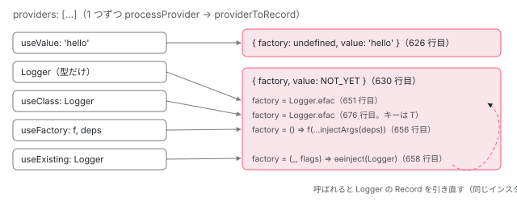

[目次](../README.md) › [DI の内側](README.md) › 第 7 回 / 全 16 回

# provider の 4 つの形が関数になるまで：providerToFactory・providerToRecord・injectArgs

> useValue / useClass / useExisting / useFactory（と deps）、クラスそのもの。R3Injector.processProvider が providerToRecord で Record { factory, value } に変え、providerToFactory が形ごとに作る関数を 1 行ずつ読む。deps 配列の要素に \[new Optional(), Token\] と書いたときの injectArgs のビット変換、useExisting が別名になる理由、useClass と型だけの provider の違い。

angular/angular · 読了 約 13 分 · 中核 · [サイトで読む（デモが動きます）](https://angular-deep-dive-cyan.vercel.app/chapter/di-provider-to-factory)

---

`providers` 配列には `{provide, useValue}`、`{provide, useClass}`、`{provide, useExisting}`、`{provide, useFactory, deps}`、そしてクラスそのものを書けます。注入器はこの 5 通りの書き方を覚えておくのではなく、登録した瞬間に**「値」か「値を作る関数」の 2 つに変換**してしまいます。この章では、その変換をする `providerToRecord` と `providerToFactory` を 1 行ずつ読み、`deps` の `[new Optional(), Token]` が `injectArgs` でビットに変わる行、`useExisting` が「別名」になる理由、`useClass` と型だけの provider の違いを確かめます。

読む対象は `packages/core/src/di/r3_injector.ts`（`providerToRecord`・`providerToFactory`・`makeRecord`）、`di/provider_collection.ts`（形を見分ける関数）、`di/injector_compatibility.ts`（`injectArgs`）、`di/interface/provider.ts`（型の定義）です。provider 配列が平らにされて `processProvider` に 1 つずつ届くまでは [NgModule シリーズの walkProviderTree の章](../ngmodule/08-ngmodule-walk-provider-tree.md)で読んだので、ここでは繰り返しません。

1. [1. 概観](01-di-overview.md)
2. [2. inject() の実装](02-di-inject-function.md)
3. [3. 注入コンテキスト](03-di-injection-context.md)
4. [4. ɵfac の生成](04-di-factory.md)
5. [5. @Injectable と @Service](05-di-injectable-compile.md)
6. [6. InjectionToken と特殊トークン](06-di-injection-token.md)
7. **7. provider の 4 つの形**（この章）
8. [8. R3Injector.get の全手順](08-di-r3-injector-get.md)
9. [9. multi: true](09-di-multi-providers.md)
10. [10. ブルームフィルタ](10-di.md)
11. [11. NodeInjector の探索](11-di-node-injector-lookup.md)
12. [12. self・skipSelf・host・optional](12-di-resolution-flags.md)
13. [13. provider 無しで取れるトークン](13-di-special-tokens.md)
14. [14. DestroyRef と破棄](14-di-destroy.md)
15. [15. injectAsync と onIdle](15-di-inject-async.md)
16. [16. DevTools と injector profiler](16-di-debug.md)

## 1. Provider 型は 7 つの書き方の合併

📄 `angular/packages/core/src/di/interface/provider.ts` L328–343 （▶ の行: 336–343）

```ts
328 │ /**
329 │  * Describes how the `Injector` should be configured.
330 │  * @see [Dependency Injection Guide](guide/di)
331 │  *
332 │  * @see {@link StaticProvider}
333 │  *
334 │  * @publicApi
335 │  */
336 ▶ export type Provider =
337 ▶   | TypeProvider
338 ▶   | ValueProvider
339 ▶   | ClassProvider
340 ▶   | ConstructorProvider
341 ▶   | ExistingProvider
342 ▶   | FactoryProvider
343 ▶   | any[];
```

336〜343 行目、`Provider` は 7 つの型の合併（union、「どれか 1 つ」という型）です。337 行目の `TypeProvider` はクラスそのもの、343 行目の `any[]` は「provider の配列をさらに入れ子にしてよい」という意味です。入れ子の配列は登録前に平らにされるので（`forEachSingleProvider`、[boot-injectors](../boot/08-boot-injectors.md)）、この章の関数に届くのは**配列ではない 1 つの provider**（コード中の名前は `SingleProvider`）です。340 行目の `ConstructorProvider` は `{provide: SomeClass, deps: [...]}` の形で、`useClass` を省いたクラス provider です。

型の定義で、実装の意図がそのまま書かれているのが `useExisting` と `useFactory` です。

📄 `angular/packages/core/src/di/interface/provider.ts` L153–166 （▶ の行: 163, 165）

```ts
153 │ /**
154 │  * Configures the `Injector` to return a value of another `useExisting` token.
155 │  *
156 │  * @see {@link ExistingProvider}
157 │  * @see [Dependency Injection Guide](guide/di)
158 │  *
159 │  * @publicApi
160 │  */
161 │ export interface ExistingSansProvider {
162 │   /**
163 ▶    * Existing `token` to return. (Equivalent to `injector.get(useExisting)`)
164 │    */
165 ▶   useExisting: any;
166 │ }
```

📄 `angular/packages/core/src/di/interface/provider.ts` L204–216 （▶ の行: 206–207, 209, 212–213, 215）

```ts
204 │ export interface FactorySansProvider {
205 │   /**
206 ▶    * A function to invoke to create a value for this `token`. The function is invoked with
207 ▶    * resolved values of `token`s in the `deps` field.
208 │    */
209 ▶   useFactory: Function;
210 │ 
211 │   /**
212 ▶    * A list of `token`s to be resolved by the injector. The list of values is then
213 ▶    * used as arguments to the `useFactory` function.
214 │    */
215 ▶   deps?: any[];
216 │ }
```

163 行目、`useExisting` は「`injector.get(useExisting)` と同じ」とドキュメントに書かれています。4 節でその通りの実装を見ます。206〜207 行目と 212〜213 行目、`useFactory` は「`deps` のトークンを解決した値を引数にして呼ぶ」。215 行目の `deps` は省略可能（`?`）です。

## 2. 形を見分ける 5 つの関数

注入器は provider の型を TypeScript の型としては知りません。実行時にプロパティの有無で見分けます。

📄 `angular/packages/core/src/di/provider_collection.ts` L404–427 （▶ の行: 404–406, 410, 414, 418, 422, 426）

```ts
404 ▶ export const USE_VALUE: string = getClosureSafeProperty<ValueProvider>({
405 ▶   provide: String,
406 ▶   useValue: getClosureSafeProperty,
407 │ });
408 │ 
409 │ export function isValueProvider(value: SingleProvider): value is ValueProvider {
410 ▶   return value !== null && typeof value == 'object' && USE_VALUE in value;
411 │ }
412 │ 
413 │ export function isExistingProvider(value: SingleProvider): value is ExistingProvider {
414 ▶   return !!(value && (value as ExistingProvider).useExisting);
415 │ }
416 │ 
417 │ export function isFactoryProvider(value: SingleProvider): value is FactoryProvider {
418 ▶   return !!(value && (value as FactoryProvider).useFactory);
419 │ }
420 │ 
421 │ export function isTypeProvider(value: SingleProvider): value is TypeProvider {
422 ▶   return typeof value === 'function';
423 │ }
424 │ 
425 │ export function isClassProvider(value: SingleProvider): value is ClassProvider {
426 ▶   return !!(value as StaticClassProvider | ClassProvider).useClass;
427 │ }
```

1. **404〜406 行目：`USE_VALUE` は文字列 `'useValue'`**

   `getClosureSafeProperty` はオブジェクトの最初のキー名を返す関数で、Closure Compiler がプロパティ名を短縮しても壊れないための書き方です。中身は `'useValue'` という文字列です。
2. **410 行目：`useValue` だけは `in` で判定**

   値そのものではなく「キーがあるか」を見ます。だから `{provide: T, useValue: undefined}` も `useValue: 0` も値 provider です。
3. **414・418・426 行目：残りは `!!` で真偽値判定**

   `useExisting`・`useFactory`・`useClass` は、値が falsy（`undefined` など）だと「その形ではない」と判定されます。
4. **422 行目：関数ならクラスそのもの**

   `typeof value === 'function'`。クラスは JavaScript では関数なので、`providers: [Logger]` がここに当たります。

## 3. providerToRecord：値か、関数か

`R3Injector`（環境インジェクタ。[第 1 回](01-di-overview.md)）は、コンストラクタで provider を 1 つずつ `processProvider` に渡し、その中で `providerToRecord(provider)` を呼んで `records` という `Map` に入れます（その行は [ngmodule-injector-def](../ngmodule/07-ngmodule-injector-def.md) で引用済み）。

📄 `angular/packages/core/src/di/r3_injector.ts` L624–638 （▶ の行: 625–626, 628–630）

```ts
624 │ function providerToRecord(provider: SingleProvider): Record<any> {
625 ▶   if (isValueProvider(provider)) {
626 ▶     return makeRecord(undefined, provider.useValue);
627 │   } else {
628 ▶     const factory: ((type?: Type<unknown>, flags?: InternalInjectFlags) => any) | undefined =
629 ▶       providerToFactory(provider);
630 ▶     return makeRecord(factory, NOT_YET);
631 │   }
632 │ }
633 │ 
634 │ /**
635 │  * Converts a `SingleProvider` into a factory function.
636 │  *
637 │  * @param provider provider to convert to factory
638 │  */
```

📄 `angular/packages/core/src/di/r3_injector.ts` L692–708 （▶ の行: 697–700, 707）

```ts
692 │ function makeRecord<T>(
693 │   factory: (() => T) | undefined,
694 │   value: T | {},
695 │   multi: boolean = false,
696 │ ): Record<T> {
697 ▶   return {
698 ▶     factory: factory,
699 ▶     value: value,
700 ▶     multi: multi ? [] : undefined,
701 │   };
702 │ }
703 │ 
704 │ function hasDeps(
705 │   value: ClassProvider | ConstructorProvider | StaticClassProvider,
706 │ ): value is ClassProvider & {deps: any[]} {
707 ▶   return !!(value as any).deps;
708 │ }
```

625〜626 行目、`useValue` なら `makeRecord(undefined, provider.useValue)`。697〜701 行目のとおり `Record` は `{factory, value, multi}` の 3 つだけのオブジェクトなので、値 provider は**factory が無く、最初から value に値が入った Record**になります。628〜630 行目、それ以外は `providerToFactory` で関数を作り、value には `NOT_YET`（「まだ作っていない」という目印のオブジェクト）を入れます。`NOT_YET` が最初に `get` されたとき実体に書き換わる流れは [第 8 回](08-di-r3-injector-get.md)で読みます。700 行目の `multi` は [第 9 回](09-di-multi-providers.md)です。

## 4. providerToFactory：形ごとの関数

📄 `angular/packages/core/src/di/r3_injector.ts` L648–682 （▶ の行: 649–651, 653–662, 666–668, 673–674, 676）

```ts
648 │ 
649 ▶   if (isTypeProvider(provider)) {
650 ▶     const unwrappedProvider = resolveForwardRef(provider);
651 ▶     return getFactoryDef(unwrappedProvider) || injectableDefOrInjectorDefFactory(unwrappedProvider);
652 │   } else {
653 ▶     if (isValueProvider(provider)) {
654 ▶       factory = () => resolveForwardRef(provider.useValue);
655 ▶     } else if (isFactoryProvider(provider)) {
656 ▶       factory = () => provider.useFactory(...injectArgs(provider.deps || []));
657 ▶     } else if (isExistingProvider(provider)) {
658 ▶       factory = (_, flags) =>
659 ▶         ɵɵinject(
660 ▶           resolveForwardRef(provider.useExisting),
661 ▶           flags !== undefined && flags & InternalInjectFlags.Optional
662 ▶             ? InternalInjectFlags.Optional
663 │             : undefined,
664 │         );
665 │     } else {
666 ▶       const classRef = resolveForwardRef(
667 ▶         provider &&
668 ▶           ((provider as StaticClassProvider | ClassProvider).useClass || provider.provide),
669 │       );
670 │       if (ngDevMode && !classRef) {
671 │         throwInvalidProviderError(ngModuleType, providers, provider);
672 │       }
673 ▶       if (hasDeps(provider)) {
674 ▶         factory = () => new classRef(...injectArgs(provider.deps));
675 │       } else {
676 ▶         return getFactoryDef(classRef) || injectableDefOrInjectorDefFactory(classRef);
677 │       }
678 │     }
679 │   }
680 │   return factory;
681 │ }
682 │ 
```

1. **649〜651 行目：クラスそのもの → そのクラスの `ɵfac`**

   `getFactoryDef` はクラスの静的フィールド `ɵfac`（コンパイラが生成するファクトリ関数。[第 4 回](04-di-factory.md)）を返します。**新しい関数は作らず、`ɵfac` をそのまま返す**のがポイントです（651 行目は `return`）。`ɵfac` が無いときだけ `injectableDefOrInjectorDefFactory` に進みます（5 節）。
2. **653〜654 行目：`useValue` → 値を返すだけの関数**

   3 節で見たとおり `R3Injector` は値 provider をここに通しません（625 行目で先に分岐）。この分岐を使うのは、同じ `providerToFactory` を呼ぶ要素側の `resolveProvider`（di\_setup.ts。[standalone シリーズ第 8 回](../standalone/08-standalone-providers-two-injectors.md)）です。要素側には「値だけの Record」という形が無いので、値も関数に包みます。
3. **655〜656 行目：`useFactory` → `useFactory(...injectArgs(deps))`**

   `deps` が無ければ空配列。`injectArgs` がトークンを値の配列に変え、スプレッドで引数に並べます。順番は `deps` の順のまま（6 節）。
4. **657〜664 行目：`useExisting` → `ɵɵinject(別トークン)`**

   値を持たず、呼ばれるたびに別トークンを注入し直す関数です。163 行目の「`injector.get(useExisting)` と同じ」の実装がこれです。660〜663 行目、受け取ったフラグのうち**引き継ぐのは `Optional` だけ**で、`self` や `skipSelf` は別トークン側には渡りません。
5. **666〜669 行目：残りはクラス provider。`useClass` が無ければ `provide` をクラスとみなす**

   668 行目の `useClass || provider.provide` で、`ConstructorProvider`（`{provide: Logger, deps: []}`）もここに来ます。
6. **673〜674 行目：`deps` があれば `new classRef(...injectArgs(deps))`**

   `hasDeps`（707 行目）は `!!deps` なので、`deps: []` でも true です。このとき **クラスの `ɵfac` は使われず**、`new` を直接呼びます。コンストラクタ引数は `deps` から来ます。
7. **676 行目：`deps` が無ければ `useClass` の `ɵfac`**

   651 行目と同じ式です。つまり `{provide: A, useClass: B}` は「トークンが A、作り方は B の `ɵfac`」で、型だけの `B` との違いは**トークン（records のキー）だけ**です。

> [!NOTE]
> **さらに深く**
>
> 654 行目は `resolveForwardRef(provider.useValue)` ですが、3 節 626 行目は `provider.useValue` をそのまま value に入れています。つまり `useValue: forwardRef(() => X)` は、要素の `providers` では `X` に解かれ、環境インジェクタでは forwardRef の関数のまま入ります。`forwardRef` 自体は [standalone シリーズ第 5 回](../standalone/05-standalone-forward-ref.md)。

## 5. ɵfac が無いクラス

651・676 行目の `getFactoryDef(...) || injectableDefOrInjectorDefFactory(...)` の右側は、`ɵfac` が無いときです。この関数の前半（`ɵprov.factory` か `ɵfac` を探す部分）は [ngmodule-provided-in](../ngmodule/10-ngmodule-provided-in.md) で読んだので、後半だけ見ます。

📄 `angular/packages/core/src/di/r3_injector.ts` L589–622 （▶ の行: 590–591, 600–602, 605, 616–618, 620）

```ts
589 │   // Undecorated types can sometimes be created if they have no constructor arguments.
590 ▶   if (token instanceof Function) {
591 ▶     return getUndecoratedInjectableFactory(token);
592 │   }
593 │ 
594 │   // There was no way to resolve a factory for this token.
595 │   throw new RuntimeError(RuntimeErrorCode.INVALID_INJECTION_TOKEN, ngDevMode && 'unreachable');
596 │ }
597 │ 
598 │ function getUndecoratedInjectableFactory(token: Function) {
599 │   // If the token has parameters then it has dependencies that we cannot resolve implicitly.
600 ▶   const paramLength = token.length;
601 ▶   if (paramLength > 0) {
602 ▶     throw new RuntimeError(
603 │       RuntimeErrorCode.INVALID_INJECTION_TOKEN,
604 │       ngDevMode &&
605 ▶         `Can't resolve all parameters for ${stringify(token)}: (${newArray(paramLength, '?').join(
606 │           ', ',
607 │         )}).`,
608 │     );
609 │   }
610 │ 
611 │   // The constructor function appears to have no parameters.
612 │   // This might be because it inherits from a super-class. In which case, use an injectable
613 │   // def from an ancestor if there is one.
614 │   // Otherwise this really is a simple class with no dependencies, so return a factory that
615 │   // just instantiates the zero-arg constructor.
616 ▶   const inheritedInjectableDef = getInheritedInjectableDef(token);
617 ▶   if (inheritedInjectableDef !== null) {
618 ▶     return () => inheritedInjectableDef.factory(token as Type<any>);
619 │   } else {
620 ▶     return () => new (token as Type<any>)();
621 │   }
622 │ }
```

590〜591 行目、関数（クラス）なら `getUndecoratedInjectableFactory`。600〜602 行目、`token.length`（コンストラクタの引数の数）が 1 以上ならエラーです。デコレーターが無いクラスは、引数に何を入れるべきかという情報（`ɵfac`）を持たないからです。605 行目のメッセージが有名な「Can't resolve all parameters for X: (?, ?)」です。616〜618 行目、引数が 0 個なら親クラスの `ɵprov` を探し、620 行目、それも無ければ `new token()` を呼ぶだけの関数を返します。

## 6. injectArgs：deps 配列を値の配列に

📄 `angular/packages/core/src/di/injector_compatibility.ts` L327–362 （▶ の行: 329–331, 341–344, 346–347, 349, 352, 356, 358）

```ts
327 │ export function injectArgs(types: (ProviderToken<any> | any[])[]): any[] {
328 │   const args: any[] = [];
329 ▶   for (let i = 0; i < types.length; i++) {
330 ▶     const arg = resolveForwardRef(types[i]);
331 ▶     if (Array.isArray(arg)) {
332 │       if (arg.length === 0) {
333 │         throw new RuntimeError(
334 │           RuntimeErrorCode.INVALID_DIFFER_INPUT,
335 │           ngDevMode && 'Arguments array must have arguments.',
336 │         );
337 │       }
338 │       let type: Type<any> | undefined = undefined;
339 │       let flags: InternalInjectFlags = InternalInjectFlags.Default;
340 │ 
341 ▶       for (let j = 0; j < arg.length; j++) {
342 ▶         const meta = arg[j];
343 ▶         const flag = getInjectFlag(meta);
344 ▶         if (typeof flag === 'number') {
345 │           // Special case when we handle @Inject decorator.
346 ▶           if (flag === DecoratorFlags.Inject) {
347 ▶             type = meta.token;
348 │           } else {
349 ▶             flags |= flag;
350 │           }
351 │         } else {
352 ▶           type = meta;
353 │         }
354 │       }
355 │ 
356 ▶       args.push(ɵɵinject(type!, flags));
357 │     } else {
358 ▶       args.push(ɵɵinject(arg));
359 │     }
360 │   }
361 │   return args;
362 │ }
```

1. **329〜330 行目：deps を先頭から順に**

   結果の `args` も先頭から push するので、**deps の順番 = 引数の順番**です。
2. **358 行目：配列でなければトークンとして `ɵɵinject(arg)`**

   フラグ無し（Default = 0）で注入します。`ɵɵinject` は [第 2 回](02-di-inject-function.md)で読んだ関数です。
3. **331・341〜343 行目：配列なら要素ごとに `getInjectFlag(meta)`**

   `getInjectFlag` は `meta['__NG_DI_FLAG__']` を読むだけです。この印を貼っているのが `attachInjectFlag` で、`Optional` 関数そのもの（静的プロパティ）と、その `prototype`（`new Optional()` の実体が継承する）の両方に貼ります （[第 4 回](04-di-factory.md)で引用）。だから `[Optional, T]` でも `[new Optional(), T]` でも同じ結果になります。
4. **344・349 行目：数値ならビット OR**

   `Optional` は 8、`Self` は 2、`SkipSelf` は 4、`Host` は 1（[第 12 回](12-di-resolution-flags.md)）。`[new Optional(), new Self(), T]` なら `flags = 8 | 2 = 10` です。
5. **346〜347 行目：`@Inject` だけは特別扱い**

   印が `DecoratorFlags.Inject` なら、その中の `token` をトークンにします（下の引用の 15 行目、値は -1）。
6. **352 行目：印が無ければ、それがトークン**

   `InjectionToken` やクラスには印が無いので `type = meta`。要素の順番は関係なく、`[T, new Optional()]` でも同じです（印の無いものが 2 つあれば後の方が勝つ）。
7. **356 行目：`ɵɵinject(type, flags)`**

   まとめたトークンとビットで 1 回だけ注入します。

📄 `angular/packages/core/src/di/interface/injector.ts` L9–16 （▶ の行: 14–15）

```ts
 9 │ /**
10 │  * Special flag indicating that a decorator is of type `Inject`. It's used to make `Inject`
11 │  * decorator tree-shakable (so we don't have to rely on the `instanceof` checks).
12 │  * Note: this flag is not included into the `InjectFlags` since it's an internal-only API.
13 │  */
14 ▶ export const enum DecoratorFlags {
15 ▶   Inject = -1,
16 │ }
```

## 7. 形 × 作られるもの

| 書き方 | 判定（provider\_collection.ts） | R3Injector の Record | factory の中身（r3\_injector.ts） | インスタンス |
| --- | --- | --- | --- | --- |
| `{provide: T, useValue: v}` | 410 行目（`'useValue' in`） | `{factory: undefined, value: v}`（626 行目） | 要素側だけ `() => v`（654 行目） | v そのもの |
| `Logger`（型だけ） | 422 行目 | `{factory, value: NOT_YET}` | `Logger.ɵfac` そのもの（651 行目） | Logger 用に 1 つ |
| `{provide: T, useClass: Logger}` | 426 行目 | 同上 | `Logger.ɵfac` そのもの（676 行目） | T 用に別の 1 つ |
| `{provide: T, useClass: Logger, deps: [...]}` | 426 行目 | 同上 | `() => new Logger(...injectArgs(deps))`（674 行目） | T 用に別の 1 つ |
| `{provide: T, useExisting: Logger}` | 414 行目 | 同上 | `(_, flags) => ɵɵinject(Logger, Optional?)`（658〜664 行目） | Logger と同じもの |
| `{provide: T, useFactory: f, deps: [...]}` | 418 行目 | 同上 | `() => f(...injectArgs(deps))`（656 行目） | f の戻り値 |



*5 つの書き方が、Record の 2 つの形（値だけ / factory + NOT\_YET）に畳まれる。useExisting は値を持たず、別トークンの Record を指す。*

## 8. DEMO：同じ配列を 2 つのインジェクタに渡す

この章のコンポーネントは、次の 8 つの provider を `@Component({ providers })` に持っています。同じ配列を `Injector.create({providers, name: 'provider-demo'})` にも渡しています （`Injector.create` が `R3Injector` を作ることは [boot-injectors](../boot/08-boot-injectors.md)）。`DemoLogger` は引数なしの `@Injectable()` クラス、`MISSING` はどこにも provide していない `InjectionToken` です。インスタンスは本番ビルドでクラス名が短縮されるので、表示の中で初めて見た順に ① ② … と番号を付けています。

> **🧪 DEMO 1 — 章コンポーネントの providers（要素の NodeInjector）から inject()**
>
> 要素側も `resolveProvider` が同じ `providerToFactory` を呼ぶので、形ごとの振る舞いは環境インジェクタと同じです。「DemoLogger と同じ?」は `inject(トークン) === inject(DemoLogger)` の結果です。
>
> ▶ [このデモはサイトで動かせます](https://angular-deep-dive-cyan.vercel.app/chapter/di-provider-to-factory)

> **🧪 DEMO 2 — 同じ配列で Injector.create（R3Injector）から get()**
>
> こちらは `processProvider` → `providerToRecord` を通ります。インスタンス番号は DEMO 1 と別に数えています（別のインジェクタなので DEMO 1 のインスタンスとは別物です）。
>
> ▶ [このデモはサイトで動かせます](https://angular-deep-dive-cyan.vercel.app/chapter/di-provider-to-factory)

どちらの表でも `ALIAS_LOGGER`（useExisting）だけが ① と同じで、`CLASS_LOGGER` と `STATIC_CLASS_LOGGER`（useClass）はそれぞれ別のインスタンスです。`CONFIG` と `CONFIG_BARE` は `MISSING=null`。`[new Optional(), MISSING]` が 349 行目で `flags = 8` になり、見つからなくても `null` で済んでいます。

## ここまでの呼び出し

- 👤 `Injector.create({ providers: [...] })` / `@Component({ providers })` — あなたのコード
  - `new R3Injector(providers, parent, source, scopes)` — di/r3\_injector.ts — *forEachSingleProvider で 1 つずつ*
    - `processProvider(provider)` — r3\_injector.ts L473
      - `providerToRecord(provider)` — r3\_injector.ts L624 — *useValue なら value だけ（L626）*
        - `providerToFactory(provider)` — r3\_injector.ts L639 — *型 / useFactory / useExisting / useClass ごとに関数（L649〜676）*
        - `makeRecord(factory, NOT_YET)` — r3\_injector.ts L692
  - `injector.get(T)` → `hydrate` → `record.factory(undefined, flags)` — 第 8 回 — *初めて取られたときだけ*
    - `injectArgs(deps)` — di/injector\_compatibility.ts L327 — *\[new Optional(), T\] → ɵɵinject(T, 8)（L356）*

## 聞かれそうな質問

**Q. useExisting と useClass は何が違うのですか？**

インスタンスの数です。`useClass: Logger` は 676 行目で `Logger.ɵfac` を factory にした**別の Record**を作るので、`Logger` とは別に 1 つ作られます。`useExisting: Logger` は 658〜664 行目で「`ɵɵinject(Logger)` を呼ぶ関数」になり、自分では何も作らず `Logger` の Record を引き直すので、インスタンスは 1 つです（DEMO の `ALIAS_LOGGER` と `CLASS_LOGGER`）。抽象クラスをトークンにして実装を差し替えつつ、具象クラスのトークンでも同じものを取りたいときは useExisting を使います。

**Q. useFactory の中で inject() を使ってよいですか？**

使えます。factory は `R3Injector.get` が `setCurrentInjector(this)` した後に `hydrate` から呼ばれ（[第 8 回](08-di-r3-injector-get.md)）、要素側では `getNodeInjectable` が inject 実装を立てた後に呼ばれます。どちらも注入コンテキストの中です（[第 3 回](03-di-injection-context.md)）。DEMO の `INJECTED` がその例で、656 行目の `useFactory(...injectArgs(deps || []))` が `deps` 無しで呼んだ関数の中で `inject(GREETING)` が動いています。ただし同期的な間だけで、`setTimeout` の中などでは使えません。

**Q. deps の順番には意味がありますか？\[Optional, T\] と \[T, Optional\] は？**

外側の deps の順番は、そのまま factory の引数の順番です（329 行目で先頭から回し、push する）。内側の配列 `[new Optional(), T]` の中の順番は関係ありません。341〜354 行目で、印（数値）のあるものはビット OR に、印の無いものはトークンになるだけだからです。

**Q. {provide: Logger, useClass: Logger} と、ただの Logger は同じですか？**

`deps` が無ければ同じです。651 行目と 676 行目はどちらも `getFactoryDef(Logger) || injectableDefOrInjectorDefFactory(Logger)` で、トークンも同じ `Logger` になります。違いが出るのは `deps` を書いたときで、674 行目で `new Logger(...injectArgs(deps))` になり、`Logger.ɵfac`（コンパイラが生成したコンストラクタ引数の注入）は使われません。

**Q. useExisting で取る別トークンには、self や skipSelf が引き継がれますか？**

引き継がれません。660〜663 行目で、受け取った `flags` のうち `Optional` のビットだけを見て、`Optional` か `undefined` を渡します。`inject(ALIAS, {optional: true})` で別トークンが無ければ `null` になりますが、`{self: true}` は別名を見つけるところまでにしか効きません。

## 読み終えて

- `providerToRecord`（r3\_injector.ts 624 行目）は、useValue なら値だけの Record、それ以外は `providerToFactory` の関数 + `NOT_YET` の Record を作る
- 型だけと `useClass`（deps なし）はクラスの `ɵfac` をそのまま factory にする（651・676 行目）。違いはトークンだけ
- `useExisting` は `ɵɵinject(別トークン)` を呼ぶ関数で、インスタンスを持たない。引き継ぐフラグは Optional だけ（658〜664 行目）
- `useFactory` と `deps` 付き `useClass` は `injectArgs` で deps を値にする。`[new Optional(), T]` は印を読んで `ɵɵinject(T, 8)` になる（343・349・356 行目）
- 要素の `providers` も同じ `providerToFactory` を通るので、形ごとの振る舞いはどちらのインジェクタでも同じ

---

← 前: [InjectionToken の中身と特殊トークン：factory 付きトークン、HostAttributeToken、HOST\_TAG\_NAME](06-di-injection-token.md)  
次: [R3Injector.get の全手順：records、NOT\_YET と CIRCULAR、親への委譲、NullInjector](08-di-r3-injector-get.md) →
