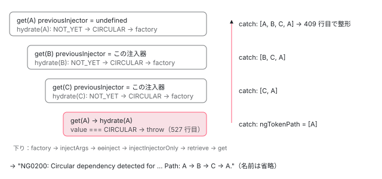

[目次](../README.md) › [DI の内側](README.md) › 第 8 回 / 全 16 回

# R3Injector.get の全手順：records、NOT\_YET と CIRCULAR、親への委譲、NullInjector

> get が setCurrentInjector で自分を current にしてから records を引き、無ければ injectableDefInScope で tree-shakable な provider をその場で登録し、それも無ければ parent.get へ委ねる順番。hydrate が value を NOT\_YET → CIRCULAR → 実体に書き換えて循環依存（NG0200）を検出する行、エラーが get を抜けるたびに prependTokenToDependencyPath が ngTokenPath の先頭へトークンを積み、一番外側の get だけが「A -&gt; B -&gt; C」の経路に整形する仕組み、NullInjector が NG0201 を投げる行。

angular/angular · 読了 約 14 分 · 中核 · [サイトで読む（デモが動きます）](https://angular-deep-dive-cyan.vercel.app/chapter/di-r3-injector-get)

---

`injector.get(Token)` を 1 回呼ぶと、`R3Injector` は「自分を current にする → records を引く → 無ければ tree-shakable な provider をその場で登録 → それも無ければ親へ」の順に進みます。この章ではその順番を `get` の行で追い、`hydrate` が value を `NOT_YET` → `CIRCULAR` → 実体と書き換えて循環依存（NG0200）を見つける行、例外が `get` を 1 段抜けるたびにトークンを先頭へ積んで「A -&gt; B -&gt; C」の経路を作る行、`NullInjector` が NG0201 を投げる行を読みます。

読む対象は `packages/core/src/di/r3_injector.ts`（`get`・`retrieve`・`hydrate`）、`render3/errors_di.ts`（経路の組み立て）、`di/null_injector.ts`、`errors.ts` です。`get` の前半（records → `injectableDefInScope` → 親）は [NgModule シリーズ第 10 回](../ngmodule/10-ngmodule-provided-in.md)で引用したので、ここでは短く再掲するだけにし、**入口・出口（catch と finally）とエラー経路**を中心に読みます。

1. [1. 概観](01-di-overview.md)
2. [2. inject() の実装](02-di-inject-function.md)
3. [3. 注入コンテキスト](03-di-injection-context.md)
4. [4. ɵfac の生成](04-di-factory.md)
5. [5. @Injectable と @Service](05-di-injectable-compile.md)
6. [6. InjectionToken と特殊トークン](06-di-injection-token.md)
7. [7. provider の 4 つの形](07-di-provider-to-factory.md)
8. **8. R3Injector.get の全手順**（この章）
9. [9. multi: true](09-di-multi-providers.md)
10. [10. ブルームフィルタ](10-di.md)
11. [11. NodeInjector の探索](11-di-node-injector-lookup.md)
12. [12. self・skipSelf・host・optional](12-di-resolution-flags.md)
13. [13. provider 無しで取れるトークン](13-di-special-tokens.md)
14. [14. DestroyRef と破棄](14-di-destroy.md)
15. [15. injectAsync と onIdle](15-di-inject-async.md)
16. [16. DevTools と injector profiler](16-di-debug.md)

## 1. 2 つの目印と、最後の親

📄 `angular/packages/core/src/di/r3_injector.ts` L86–110 （▶ の行: 89, 94–96, 98, 103, 105–107, 109）

```ts
 86 │ /**
 87 │  * Marker which indicates that a value has not yet been created from the factory function.
 88 │  */
 89 ▶ const NOT_YET = {};
 90 │ 
 91 │ /**
 92 │  * Marker which indicates that the factory function for a token is in the process of being called.
 93 │  *
 94 ▶  * If the injector is asked to inject a token with its value set to CIRCULAR, that indicates
 95 ▶  * injection of a dependency has recursively attempted to inject the original token, and there is
 96 ▶  * a circular dependency among the providers.
 97 │  */
 98 ▶ const CIRCULAR = {};
 99 │ 
100 │ /**
101 │  * A lazily initialized NullInjector.
102 │  */
103 ▶ let NULL_INJECTOR: Injector | undefined = undefined;
104 │ 
105 ▶ export function getNullInjector(): Injector {
106 ▶   if (NULL_INJECTOR === undefined) {
107 ▶     NULL_INJECTOR = new NullInjector();
108 │   }
109 ▶   return NULL_INJECTOR;
110 │ }
```

89 行目の `NOT_YET` と 98 行目の `CIRCULAR` は、どちらも中身の無い空オブジェクト `{}` です。値として使うのではなく、`===` で「これと同じ物か」を比べるための目印です（ほかのどんな値とも一致しないので、利用者の値と取り違えません）。[第 7 回](07-di-provider-to-factory.md)で見たとおり、factory を持つ Record は value = `NOT_YET` で作られます。94〜96 行目のコメントが `CIRCULAR` の意味です。「value が `CIRCULAR` のトークンを注入しようとしたら、それは自分自身を再帰的に注入しようとしている」。

103〜110 行目の `getNullInjector` は、親を指定せずに作った `R3Injector` の親になる `NullInjector` を 1 つだけ作って使い回します （`parent || getNullInjector()` の行は [boot-injectors](../boot/08-boot-injectors.md)）。

## 2. 入口：current を自分にする

📄 `angular/packages/core/src/di/r3_injector.ts` L323–342 （▶ の行: 325, 328, 330–331, 334, 341–342）

```ts
323 │   override get<T>(
324 │     token: ProviderToken<T>,
325 ▶     notFoundValue: any = THROW_IF_NOT_FOUND,
326 │     options?: InjectOptions,
327 │   ): T {
328 ▶     assertNotDestroyed(this);
329 │ 
330 ▶     if (Object.hasOwn(token, NG_ENV_ID)) {
331 ▶       return (token as any)[NG_ENV_ID](this);
332 │     }
333 │ 
334 ▶     const flags = convertToBitFlags(options) as InternalInjectFlags;
335 │ 
336 │     // Set the injection context.
337 │     let prevInjectContext: InjectorProfilerContext;
338 │     if (ngDevMode) {
339 │       prevInjectContext = setInjectorProfilerContext({injector: this, token: token as Type<T>});
340 │     }
341 ▶     const previousInjector = setCurrentInjector(this);
342 ▶     const previousInjectImplementation = setInjectImplementation(undefined);
```

1. **325 行目：`notFoundValue` の既定値は `THROW_IF_NOT_FOUND`**

   「見つからなければ投げる」を表す目印です。`get(T, null)` と書けば、見つからないとき `null` が返ります。
2. **328 行目：破棄済みなら NG0205**

   `assertNotDestroyed` は `destroyed` が true なら `INJECTOR_ALREADY_DESTROYED` を投げます（破棄は [第 14 回](14-di-destroy.md)）。
3. **330〜331 行目：`NG_ENV_ID` を持つトークンは自分で答えを作る**

   静的フィールド `__NG_ENV_ID__` を持つトークンは records を見ず、その関数に注入器を渡した戻り値を返します。v22.2 の core でこれを持つのは `DestroyRef` だけで、環境インジェクタ自身を返します（[第 14 回](14-di-destroy.md)）。
4. **334 行目：`{optional, self, ...}` をビットに**

   `convertToBitFlags` は [第 2 回](02-di-inject-function.md)で読んだ関数です。
5. **341〜342 行目：current injector を自分に、inject 実装を `undefined` に**

   戻り値の `previousInjector` は「この `get` を呼んだときに current だった注入器」です。外から（クリックハンドラなどから）呼べば `undefined`、別の `get` の factory の中から呼ばれれば**その注入器**になります。この違いが 5 節のエラー整形で効きます。

## 3. 本体：records → その場で登録 → 親（再掲）

📄 `angular/packages/core/src/di/r3_injector.ts` L343–352 （▶ の行: 345, 347–348, 351–352）

```ts
343 │     try {
344 │       // Check for the SkipSelf flag.
345 ▶       if (!(flags & InternalInjectFlags.SkipSelf)) {
346 │         // SkipSelf isn't set, check if the record belongs to this injector.
347 ▶         let record: Record<T> | undefined | null = this.records.get(token);
348 ▶         if (record === undefined) {
349 │           // No record, but maybe the token is scoped to this injector. Look for an injectable
350 │           // def with a scope matching this injector.
351 ▶           const def = couldBeInjectableType(token) && getInjectableDef(token);
352 ▶           if (def && this.injectableDefInScope(def)) {
```

📄 `angular/packages/core/src/di/r3_injector.ts` L366–383 （▶ の行: 366, 369–370, 376, 379–381, 383）

```ts
366 ▶           this.records.set(token, record);
367 │         }
368 │         // If a record was found, get the instance for it and return it.
369 ▶         if (record != null /* NOT null || undefined */) {
370 ▶           return this.hydrate(token, record, flags);
371 │         }
372 │       }
373 │ 
374 │       // Select the next injector based on the Self flag - if self is set, the next injector is
375 │       // the NullInjector, otherwise it's the parent.
376 ▶       const nextInjector = !(flags & InternalInjectFlags.Self) ? this.parent : getNullInjector();
377 │       // Set the notFoundValue based on the Optional flag - if optional is set and notFoundValue
378 │       // is undefined, the value is null, otherwise it's the notFoundValue.
379 ▶       notFoundValue =
380 ▶         flags & InternalInjectFlags.Optional && notFoundValue === THROW_IF_NOT_FOUND
381 ▶           ? null
382 │           : notFoundValue;
383 ▶       return nextInjector.get(token, notFoundValue);
```

1. **345・347 行目：skipSelf でなければ `records.get(token)`**

   Record は第 7 回の `{factory, value, multi}`。`undefined` は「まだ調べていない」、`null` は「調べて無かった」です。
2. **351〜352 行目：まだ調べていなければ、`providedIn` がこの注入器に合うか**

   `@Injectable({providedIn: 'root'})` のように provider 配列に書かれていないトークンは、ここで `injectableDefInScope` が true なら その場で Record を作ります（[第 10 回](../ngmodule/10-ngmodule-provided-in.md)）。
3. **366 行目：結果を records に書く。無ければ `null` を**

   見つからなかったことも覚えておくので、同じトークンをもう一度聞かれたとき 351 行目の判定をやり直しません。DEMO 3 でこの `null` を覗きます。
4. **369〜370 行目：Record があれば `hydrate`**

   ここで値を作るか、作ってあれば返します（4 節）。
5. **376 行目：次の注入器は、self なら `NullInjector`、そうでなければ `parent`**

   self のときも親は見ずに `NullInjector` へ行くので、「見つからない」処理は同じ経路になります。
6. **379〜383 行目：optional なら `notFoundValue` を `null` にして `nextInjector.get(token, notFoundValue)`**

   383 行目は**第 3 引数（フラグ）を渡しません**。`skipSelf` は「この 1 段を飛ばす」だけで、親から上は普通に探します。optional は `notFoundValue = null` という形で親に伝わります。

## 4. hydrate：NOT\_YET → CIRCULAR → 実体

📄 `angular/packages/core/src/di/r3_injector.ts` L524–531 （▶ の行: 527–530）

```ts
524 │   private hydrate<T>(token: ProviderToken<T>, record: Record<T>, flags: InternalInjectFlags): T {
525 │     const prevConsumer = setActiveConsumer(null);
526 │     try {
527 ▶       if (record.value === CIRCULAR) {
528 ▶         throw cyclicDependencyError(ngDevMode ? stringify(token) : '');
529 ▶       } else if (record.value === NOT_YET) {
530 ▶         record.value = CIRCULAR;
531 │ 
```

`hydrate` の全体（factory を呼ぶ行と、`ngOnDestroy` を持つ値を覚える行）は [第 10 回](../ngmodule/10-ngmodule-provided-in.md)で引用したので、循環検出の 4 行だけ見ます。

1. **529〜530 行目：`NOT_YET` なら、factory を呼ぶ**前**に value を `CIRCULAR` にする**

   「いまこのトークンを作っている最中」という印です。この後で `record.factory!(undefined, flags)` を呼び、戻り値で value を上書きします。
2. **factory の中で、別のトークンを get する**

   factory の中の `injectArgs` → `ɵɵinject` → `injectInjectorOnly` → `retrieve` → `get`（5 節）と進み、同じ注入器の別のトークンの `hydrate` に入ります。そのトークンの value も `CIRCULAR` になります。
3. **527〜528 行目：作っている最中のトークンに戻ってきたら `cyclicDependencyError`**

   A の factory → B の factory → C の factory → A の `get` と戻ってくると、A の value はまだ `CIRCULAR` なので 527 行目が真になり、NG0200 を投げます。**循環は「作る瞬間」に、2 回目の hydrate で見つかります**。provider を登録した時点では何も調べていません。

> [!WARNING]
> **ハマりどころ**
>
> factory が例外で抜けたとき、530 行目で入れた `CIRCULAR` を戻す行はありません（`CIRCULAR` を書く行は r3\_injector.ts の中で 530 行目だけ）。そのため、**一度 factory が失敗したトークンを同じ注入器でもう一度 get すると、本当の原因が何であれ 527 行目の NG0200 になります**。DEMO 2b で確かめられます。

## 5. factory の中の inject が、もう一度 get に入るまで

factory の中の `ɵɵinject(B)` は、2 節 342 行目で inject 実装が `undefined` になっているので `injectInjectorOnly` に進み、current injector（341 行目で自分にした）の `retrieve` を呼びます（[第 2 回](02-di-inject-function.md)）。

📄 `angular/packages/core/src/di/injector_compatibility.ts` L109–119 （▶ の行: 110, 112–114, 116）

```ts
109 │     // `token` can be a multi: true provider definition, which is considered as a Token but not represented in the typings
110 ▶     const value = currentInjector.retrieve(token as PrimitivesInjectionToken<T>, options) as T;
111 │     ngDevMode && emitInjectEvent(token as Type<unknown>, value, flags);
112 ▶     if (isNotFound(value)) {
113 ▶       if (options.optional) {
114 ▶         return null;
115 │       }
116 ▶       throw value;
117 │     }
118 │     return value;
119 │   }
```

📄 `angular/packages/core/src/di/r3_injector.ts` L246–262 （▶ の行: 250, 253–254, 257–258）

```ts
246 │   retrieve<T>(token: PrimitivesInjectionToken<T>, options?: unknown): T | NotFound {
247 │     const flags: InternalInjectFlags =
248 │       convertToBitFlags(options as InjectOptions | undefined) || InternalInjectFlags.Default;
249 │     try {
250 ▶       return (this as BackwardsCompatibleInjector).get(
251 │         token as unknown as InjectionToken<T>,
252 │         // When a dependency is requested with an optional flag, DI returns null as the default value.
253 ▶         THROW_IF_NOT_FOUND as T,
254 ▶         flags,
255 │       );
256 │     } catch (e: any) {
257 ▶       if (isNotFound(e)) {
258 ▶         return e;
259 │       }
260 │       throw e;
261 │     }
262 │   }
```

250〜254 行目、`retrieve` は自分の `get(token, THROW_IF_NOT_FOUND, flags)` を呼ぶだけです。257〜258 行目、投げられたのが「見つからない」エラー（`name === 'ɵNotFound'`）なら投げずに**戻り値として**返し、112〜116 行目の `injectInjectorOnly` が optional なら `null`、そうでなければ同じエラーを投げ直します。どちらにしても、**内側の get で投げられた同じ Error オブジェクト**が外側の get まで上がっていきます。

## 6. 出口：catch でトークンを先頭に積む

📄 `angular/packages/core/src/di/r3_injector.ts` L384–423 （▶ の行: 391–394, 396–402, 404, 406, 409, 412, 415, 419–420）

```ts
384 │     } catch (error: any) {
385 │       // If there was a cyclic dependency error or a token was not found,
386 │       // an error is thrown at the level where the problem was detected.
387 │       // The error propagates up the call stack and the code below appends
388 │       // the current token into the path. As a result, the full path is assembled
389 │       // at the very top of the call stack, so the final error message can be
390 │       // formatted to include that path.
391 ▶       const errorCode = getRuntimeErrorCode(error);
392 ▶       if (
393 ▶         errorCode === RuntimeErrorCode.CYCLIC_DI_DEPENDENCY ||
394 ▶         errorCode === RuntimeErrorCode.PROVIDER_NOT_FOUND
395 │       ) {
396 ▶         // Note: we use `if (ngDevMode) { ... }` instead of an early return.
397 ▶         // ESBuild is conservative about removing dead code that follows `return;`
398 ▶         // inside a function body, so the block may remain in the bundle.
399 ▶         // Using a conditional ensures the dev-only logic is reliably tree-shaken
400 ▶         // in production builds.
401 ▶         if (ngDevMode) {
402 ▶           prependTokenToDependencyPath(error, token);
403 │ 
404 ▶           if (previousInjector) {
405 │             // We still have a parent injector, keep throwing
406 ▶             throw error;
407 │           } else {
408 │             // Format & throw the final error message when we don't have any previous injector
409 ▶             throw augmentRuntimeError(error, this.source);
410 │           }
411 │         } else {
412 ▶           throw new RuntimeError(errorCode, null);
413 │         }
414 │       } else {
415 ▶         throw error;
416 │       }
417 │     } finally {
418 │       // Lastly, restore the previous injection context.
419 ▶       setInjectImplementation(previousInjectImplementation);
420 ▶       setCurrentInjector(previousInjector);
421 │       ngDevMode && setInjectorProfilerContext(prevInjectContext!);
422 │     }
423 │   }
```

1. **391〜395 行目：NG0200 と NG0201 だけを扱う**

   `getRuntimeErrorCode` はエラーに貼られた `ngErrorCode` を読みます（下の errors\_di.ts 144〜146 行目）。循環（-200）と未登録（-201）以外の例外は 415 行目でそのまま投げ直し、経路は付きません。
2. **401〜402 行目：開発ビルドなら `prependTokenToDependencyPath(error, token)`**

   この `get` が探していたトークンを、エラーの経路の**先頭**に足します（7 節）。
3. **404〜406 行目：呼び出し元がまだいれば、そのまま投げ直す**

   `previousInjector` があるのは「この get が別の get の factory の中から呼ばれた」とき。外側の get の catch がまたトークンを積みます。
4. **409 行目：一番外側で、メッセージを組み立てる**

   `previousInjector` が無い（外から呼ばれた最初の get）ときだけ、`augmentRuntimeError(error, this.source)` で経路と注入器の名前を message に入れます。`this.source` は `Injector.create({name})` の `name` などです。
5. **412 行目：本番ビルドでは、コードだけの新しいエラー**

   経路を積まず、`new RuntimeError(errorCode, null)` を投げます。メッセージは「NG0200」「NG0201」だけになります（8 節）。
6. **419〜420 行目：finally で current を元に戻す**

   成功しても例外でも、341〜342 行目で入れ替えた inject 実装と current injector を戻します。これで呼び出し元の注入コンテキストが壊れません。

## 7. 経路の組み立て（errors\_di.ts）

📄 `angular/packages/core/src/render3/errors_di.ts` L17–27 （▶ の行: 19–21, 24–26）

```ts
17 │ import {stringifyForError} from './util/stringify_utils';
18 │ 
19 ▶ const NG_RUNTIME_ERROR_CODE = getClosureSafeProperty({'ngErrorCode': getClosureSafeProperty});
20 ▶ const NG_RUNTIME_ERROR_MESSAGE = getClosureSafeProperty({'ngErrorMessage': getClosureSafeProperty});
21 ▶ const NG_TOKEN_PATH = getClosureSafeProperty({'ngTokenPath': getClosureSafeProperty});
22 │ 
23 │ /** Creates a circular dependency runtime error. */
24 ▶ export function cyclicDependencyError(token: string, path?: string[]): Error {
25 ▶   const message = ngDevMode ? `Circular dependency detected for \`${token}\`.` : '';
26 ▶   return createRuntimeError(message, RuntimeErrorCode.CYCLIC_DI_DEPENDENCY, path);
27 │ }
```

📄 `angular/packages/core/src/render3/errors_di.ts` L107–139 （▶ の行: 116, 118–119, 130, 133–136）

```ts
107 │ /**
108 │  * Modifies an Error instance with an updated error message
109 │  * based on the accumulated dependency path.
110 │  *
111 │  * @param error Current instance of the Error class.
112 │  * @param source Extra info about the injector which started
113 │  *    the resolution process, which eventually failed.
114 │  */
115 │ export function augmentRuntimeError(error: any, source: string | null): Error {
116 ▶   const tokenPath: string[] = error[NG_TOKEN_PATH];
117 │   const errorCode = error[NG_RUNTIME_ERROR_CODE];
118 ▶   const message = error[NG_RUNTIME_ERROR_MESSAGE] || error.message;
119 ▶   error.message = formatErrorMessage(message, errorCode, tokenPath, source);
120 │   return error;
121 │ }
122 │ 
123 │ /**
124 │  * Creates an initial RuntimeError instance when a problem is detected.
125 │  * Monkey-patches extra info in the RuntimeError instance, so that it can
126 │  * be reused later, before throwing the final error.
127 │  */
128 │ export function createRuntimeError(message: string, code: number, path?: string[]): Error {
129 │   // Cast to `any`, so that extra info can be monkey-patched onto this instance.
130 ▶   const error = new RuntimeError(code, message) as any;
131 │ 
132 │   // Monkey-patch a runtime error code and a path onto an Error instance.
133 ▶   error[NG_RUNTIME_ERROR_CODE] = code;
134 ▶   error[NG_RUNTIME_ERROR_MESSAGE] = message;
135 ▶   if (path) {
136 ▶     error[NG_TOKEN_PATH] = path;
137 │   }
138 │   return error;
139 │ }
```

19〜21 行目、エラーに貼るプロパティ名は `'ngErrorCode'`・`'ngErrorMessage'`・`'ngTokenPath'` です。24〜26 行目、`cyclicDependencyError` は `createRuntimeError` を呼び、130 行目で `RuntimeError` を作って 133〜134 行目でコードと元のメッセージを貼ります。6 節 391 行目はこの 133 行目の貼り紙を読んでいます。

📄 `angular/packages/core/src/render3/errors_di.ts` L78–105 （▶ の行: 89, 92, 95, 97, 99, 102–103）

```ts
 78 │ /**
 79 │  * Given an Error instance and the current token - update the monkey-patched
 80 │  * dependency path info to include that token.
 81 │  *
 82 │  * @param error Current instance of the Error class.
 83 │  * @param token Extra token that should be appended.
 84 │  */
 85 │ export function prependTokenToDependencyPath(
 86 │   error: any,
 87 │   token: ProviderToken<unknown> | {multi: true; provide: ProviderToken<unknown>},
 88 │ ): void {
 89 ▶   error[NG_TOKEN_PATH] ??= [];
 90 │   // Append current token to the current token path. Since the error
 91 │   // is bubbling up, add the token in front of other tokens.
 92 ▶   const currentPath = error[NG_TOKEN_PATH];
 93 │   // Do not append the same token multiple times.
 94 │   let pathStr: string;
 95 ▶   if (typeof token === 'object' && 'multi' in token && token?.multi === true) {
 96 │     assertDefined(token.provide, 'Token with multi: true should have a provide property');
 97 ▶     pathStr = stringifyForError(token.provide);
 98 │   } else {
 99 ▶     pathStr = stringifyForError(token);
100 │   }
101 │ 
102 ▶   if (currentPath[0] !== pathStr) {
103 ▶     (error[NG_TOKEN_PATH] as string[]).unshift(pathStr);
104 │   }
105 │ }
```

1. **89 行目：経路の配列が無ければ作る**

   最初に catch した get（一番内側）でだけ作られます。
2. **95〜97 行目：multi provider のトークンなら `provide` の名前で**

   multi の Record は provider オブジェクトそのものをキーにするので、ここで名前に戻します（[第 9 回](09-di-multi-providers.md)）。
3. **102〜103 行目：先頭が同じ名前でなければ `unshift`**

   `unshift` は配列の**先頭**に足す操作です。例外は内側から外側へ上がるので、内側のトークンから順に積まれ、先頭に足し続けた結果、最後には**外側（最初に get したトークン）が先頭**に来ます。102 行目の比較は、同じトークンが続けて積まれるのを防ぎます（子の注入器の get が親の get に委ねると、両方の catch が同じトークンを積もうとするため）。

📄 `angular/packages/core/src/render3/errors_di.ts` L141–162 （▶ の行: 144–146, 157–158, 160–161）

```ts
141 │ /**
142 │  * Reads monkey-patched error code from the given Error instance.
143 │  */
144 ▶ export function getRuntimeErrorCode(error: any): number | undefined {
145 ▶   return error[NG_RUNTIME_ERROR_CODE];
146 ▶ }
147 │ 
148 │ function formatErrorMessage(
149 │   text: string,
150 │   code: number,
151 │   path: string[] = [],
152 │   source: string | null = null,
153 │ ): string {
154 │   let pathDetails = '';
155 │   // If the path is empty or contains only one element (self) -
156 │   // do not append additional info the error message.
157 ▶   if (path && path.length > 1) {
158 ▶     pathDetails = ` Path: ${path.join(' -> ')}.`;
159 │   }
160 ▶   const sourceDetails = source ? ` Source: ${source}.` : '';
161 ▶   return formatRuntimeError(code, `${text}${sourceDetails}${pathDetails}`);
162 │ }
```

157〜158 行目、経路が 2 つ以上のときだけ `Path: A -> B -> C` を付けます（1 つだけなら自分自身なので付けない）。160 行目で `Source: 名前.`、161 行目で `formatRuntimeError` に渡して先頭に `NG0200:` を付けます。

> [!NOTE]
> **ポイント**
>
> `injector_compatibility.ts` には `NG_TEMP_TOKEN_PATH = 'ngTempTokenPath'` という定数も残っていますが、v22.2 の `packages/core/src` には それを読み書きする行がありません（grep で見つかるのは定義だけ）。経路は上の `'ngTokenPath'`（21 行目）に積まれます。

## 8. NG0201 を投げるのは NullInjector

📄 `angular/packages/core/src/di/null_injector.ts` L17–28 （▶ の行: 18–20, 23, 25, 27）

```ts
17 │   get(token: any, notFoundValue: any = THROW_IF_NOT_FOUND): any {
18 ▶     if (notFoundValue === THROW_IF_NOT_FOUND) {
19 ▶       const message = ngDevMode ? `No provider found for \`${stringify(token)}\`.` : '';
20 ▶       const error = createRuntimeError(message, RuntimeErrorCode.PROVIDER_NOT_FOUND);
21 │ 
22 │       // Note: This is the name used by the primitives to identify a not found error.
23 ▶       error.name = 'ɵNotFound';
24 │ 
25 ▶       throw error;
26 │     }
27 ▶     return notFoundValue;
28 │   }
```

18 行目、`notFoundValue` が `THROW_IF_NOT_FOUND` のときだけ投げます。3 節 379〜382 行目で optional なら `null` に変わっているので、optional ならここで 27 行目の `return notFoundValue`（= `null`）です。20 行目、同じ `createRuntimeError` でコード -201 を貼り、23 行目で `name` を `'ɵNotFound'` にします。これが 5 節 257 行目・112 行目で「見つからない」と判定される印です。

📄 `angular/packages/core/src/errors.ts` L37–46 （▶ の行: 38–39）

```ts
37 │   // Dependency Injection Errors
38 ▶   CYCLIC_DI_DEPENDENCY = -200,
39 ▶   PROVIDER_NOT_FOUND = -201,
40 │   INVALID_FACTORY_DEPENDENCY = 202,
41 │   MISSING_INJECTION_CONTEXT = -203,
42 │   INVALID_INJECTION_TOKEN = -204,
43 │   INJECTOR_ALREADY_DESTROYED = -205,
44 │   PROVIDER_IN_WRONG_CONTEXT = -207,
45 │   MISSING_INJECTION_TOKEN = 208,
46 │   INVALID_MULTI_PROVIDER = -209,
```

📄 `angular/packages/core/src/errors.ts` L181–215 （▶ の行: 186, 194, 207, 209, 212）

```ts
181 │ export class RuntimeError<T extends number = RuntimeErrorCode> extends Error {
182 │   constructor(
183 │     public code: T,
184 │     message: null | false | string,
185 │   ) {
186 ▶     super(formatRuntimeError<T>(code, message));
187 │   }
188 │ }
189 │ 
190 │ export function formatRuntimeErrorCode<T extends number = RuntimeErrorCode>(code: T): string {
191 │   // Error code might be a negative number, which is a special marker that instructs the logic to
192 │   // generate a link to the error details page on angular.io.
193 │   // We also prepend `0` to non-compile-time errors.
194 ▶   return `NG0${Math.abs(code)}`;
195 │ }
196 │ 
197 │ /**
198 │  * Called to format a runtime error.
199 │  * See additional info on the `message` argument type in the `RuntimeError` class description.
200 │  */
201 │ export function formatRuntimeError<T extends number = RuntimeErrorCode>(
202 │   code: T,
203 │   message: null | false | string,
204 │ ): string {
205 │   const fullCode = formatRuntimeErrorCode(code);
206 │ 
207 ▶   let errorMessage = `${fullCode}${message ? ': ' + message : ''}`;
208 │ 
209 ▶   if (ngDevMode && code < 0) {
210 │     const addPeriodSeparator = !errorMessage.match(/[.,;!?\n]$/);
211 │     const separator = addPeriodSeparator ? '.' : '';
212 ▶     errorMessage = `${errorMessage}${separator} Find more at ${ERROR_DETAILS_PAGE_BASE_URL}/${fullCode}`;
213 │   }
214 │   return errorMessage;
215 │ }
```

38〜39 行目、コードは負の数です。194 行目で絶対値に `NG0` を付けて `NG0200` にし、207 行目でメッセージを繋げます。209〜212 行目、開発ビルドかつ負のコードのときだけ「Find more at https://v22.angular.dev/errors/NG0200」を足します（URL の先頭は Angular のバージョンで変わり、プレリリース版なら `next`）。本番ビルドでは 6 節 412 行目の `new RuntimeError(errorCode, null)` が 186 行目を通るので、message は `NG0200` の 5 文字だけになります。



*A → B → C → A の循環。例外は一番内側の hydrate(A) で生まれ、get を 1 段抜けるたびに catch がトークンを先頭へ積む。previousInjector が無い一番外側の get で message が組み立てられる。*

## 9. DEMO：経路の付いたエラーを捕まえる

ボタンを押すたびに `Injector.create({name, providers})` で新しい `R3Injector` を作り、`get` を try/catch して、捕まえたものをそのまま表示します。このサイトは本番ビルドで配信されているので、message は 8 節のとおり `NG0200` / `NG0201` だけ、`ngTokenPath` は貼られません。`ng serve`（開発ビルド）で開くと、6 節 402・409 行目が動いて経路付きのメッセージになります。

> **🧪 DEMO — R3Injector.get の例外**
>
> 1: A は B に、B は C に、C は A に依存（`useFactory` + `deps`）。2: SERVICE は MISSING に依存し、MISSING はどこにも無い。2b: 2 と同じ注入器で SERVICE を 2 回 get した 2 回目。3: optional で MISSING を get し、private の `records` を学習用に覗く。
>
> ボタンを押すと結果が出ます（新しいものが上）。
>
> ▶ [このデモはサイトで動かせます](https://angular-deep-dive-cyan.vercel.app/chapter/di-r3-injector-get)

| ボタン | 開発ビルドの message（このサイトの @angular/core 22.1.6 を開発モードで実行して確認） | 本番ビルド |
| --- | --- | --- |
| 1 | ``NG0200: Circular dependency detected for `InjectionToken A`. Source: cycle-demo. Path: InjectionToken A -> InjectionToken B -> InjectionToken C -> InjectionToken A. Find more at https://v22.angular.dev/errors/NG0200`` | `NG0200`、code = -200、name = Error |
| 2 | ``NG0201: No provider found for `InjectionToken MISSING`. Source: missing-demo. Path: InjectionToken SERVICE -> InjectionToken MISSING. Find more at https://v22.angular.dev/errors/NG0201``（name は `ɵNotFound`） | `NG0201`、code = -201、name = Error（412 行目で作り直すので ɵNotFound ではない） |
| 2b | ``NG0200: Circular dependency detected for `InjectionToken SERVICE`. Source: missing-twice-demo. Find more at …``（経路が 1 つなので Path なし。158 行目） | `NG0200` |
| 3 | 値 `null`。records に MISSING → `null`（366 行目） | 同じ |

## ここまでの呼び出し

- 👤 `injector.get(A)` — あなたのコード（クリックハンドラ）
  - `R3Injector.get(A)` — r3\_injector.ts L323 — *setCurrentInjector(this) → previous = undefined（L341）*
    - `records.get(A)` → `hydrate(A)` — L347 / L370 — *NOT\_YET → CIRCULAR（L530）→ factory*
      - `injectArgs([B])` → `ɵɵinject(B)` → `injectInjectorOnly` — injector\_compatibility.ts — *current.retrieve（L110）*
        - `R3Injector.retrieve(B)` → `get(B)` — L250 — *previous = この注入器*
          - `… get(C) … get(A)` → `hydrate(A)` — L527 — *CIRCULAR → cyclicDependencyError*
        - `catch` × 4 段 — L391〜406 — *prependTokenToDependencyPath で先頭に積んで投げ直す*
  - `catch`（一番外側） — L409 — *augmentRuntimeError(error, 'cycle-demo') → formatErrorMessage*
  - `finally` — L419〜420 — *inject 実装と current injector を戻す*

## 聞かれそうな質問

**Q. 循環依存はどの時点で検出されますか？アプリの起動時ですか？**

値を**初めて作るとき**です。provider の登録（`processProvider`）では何も調べません。hydrate の 530 行目で「作っている最中」の印 `CIRCULAR` を付け、factory の中から同じトークンに戻ってきたときに 527 行目で見つかります。だから、循環しているサービスでも誰も inject しなければエラーは出ません。

**Q. エラーの経路はなぜ逆順（内側が先）にならないのですか？**

各段の catch が errors\_di.ts 103 行目で `unshift`（先頭に追加）するからです。例外は内側の get から外側へ上がるので、内側のトークンが最初に入り、外側のトークンほど後から先頭に入ります。最後に一番外側の get が 409 行目で整形するとき、配列は「最初に get したもの → … → 問題のトークン」の順です。

**Q. 本番ビルドだと経路が出ないのはなぜですか？**

401 行目の `if (ngDevMode)` の中に経路の処理がまとまっていて、本番では 412 行目の `new RuntimeError(errorCode, null)` だけになるからです。396〜400 行目のコメントのとおり、`return` ではなく `if` にしてあるのは、esbuild が開発用のコードを確実に消せるようにするためです。経路を見たいときは開発ビルドで再現します。

**Q. 親に委ねる前に、providedIn: 'root' のサービスを自分に登録するのはどんなときですか？**

records に無く（348 行目）、トークンに `ɵprov` があり、`injectableDefInScope` が true のときです（351〜352 行目）。`'root'` なら、この注入器の `scopes` に `'root'` があるかで決まります。条件の中身は [ngmodule-provided-in](../ngmodule/10-ngmodule-provided-in.md) で読みました。合わなければ 366 行目で `null` を記録して、376〜383 行目で親へ進みます。

**Q. skipSelf を付けると、親から上もずっと skipSelf ですか？**

いいえ。345 行目で自分の records を見ないだけで、383 行目の `nextInjector.get(token, notFoundValue)` にはフラグを渡しません。親は普通の get として、自分の records から探します。

## 読み終えて

- `get` は 341〜342 行目で自分を current にし、records → `injectableDefInScope` → 親（self なら NullInjector）の順に探して、419〜420 行目の finally で必ず戻す
- `hydrate` は factory を呼ぶ前に value を `CIRCULAR` にする（530 行目）。作っている最中のトークンに戻ると 527 行目で NG0200
- factory の中の inject は `injectInjectorOnly` → `retrieve` → 同じ注入器の `get` に入る。だから例外は get を何段も通って上がる
- catch はトークンを `ngTokenPath` の先頭に積み（errors\_di.ts 103 行目）、`previousInjector` が無い一番外側の get だけが message を組み立てる（409 行目）
- NG0201 の発生源は `NullInjector`（null\_injector.ts 20・23 行目）。本番ビルドの message はコードだけ

---

← 前: [provider の 4 つの形が関数になるまで：providerToFactory・providerToRecord・injectArgs](07-di-provider-to-factory.md)  
次: [multi: true の仕組み：環境インジェクタの配列と、要素の multiFactory](09-di-multi-providers.md) →
