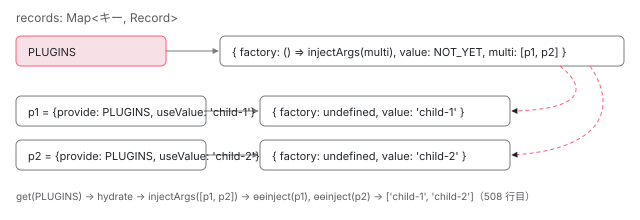

[目次](../README.md) › [DI の内側](README.md) › 第 9 回 / 全 16 回

# multi: true の仕組み：環境インジェクタの配列と、要素の multiFactory

> R3Injector では multi の provider が multiRecord の配列に積まれ、hydrate で injectArgs により全部を作って配列で返す。NodeInjector では di\_setup.ts の multiFactory が providers と viewProviders の分を別々に持ち、コンポーネントのビューから見えるかどうかで返す配列が変わる。multi と非 multi を混ぜたときの挙動（開発ビルドではコード無しの Error、本番では順番次第で TypeError か上書き）と、受け取る側が配列でないと気づいたときの NG0209、HTTP\_INTERCEPTORS・APP\_INITIALIZER など実在の multi トークン。

angular/angular · 読了 約 13 分 · 発展 · [サイトで読む（デモが動きます）](https://angular-deep-dive-cyan.vercel.app/chapter/di-multi-providers)

---

`{provide: T, useValue: x, multi: true}` と書くと、同じトークン `T` に何個 provider を書いても上書きされず、`inject(T)` が**配列**を返します。この章では、環境インジェクタ（`R3Injector`）が multi の provider を `multiRecord` の配列に積んで `injectArgs` で全部作る行と、要素側（`NodeInjector`）の `di_setup.ts` が providers と viewProviders の分を**別々の multi factory**に持ち、ビューの中から見たときだけ 2 つを繋ぐ行を読みます。最後に、multi と非 multi を混ぜたときのエラーと、Angular 自身が使っている multi トークンを見ます。

読む対象は `packages/core/src/di/r3_injector.ts`（`processProvider` の multi 分岐）、`render3/di_setup.ts`（`resolveProvider` の multi 分岐と `multiFactory` 一式）、`render3/interfaces/injector.ts`（`NodeInjectorFactory`）です。provider の形が関数になるところは [第 7 回](07-di-provider-to-factory.md)、要素の providers が `tView.data` の区間に積まれる仕組みは [standalone シリーズ第 8 回](../standalone/08-standalone-providers-two-injectors.md)で読んだので、ここでは multi の差分だけを見ます。

1. [1. 概観](01-di-overview.md)
2. [2. inject() の実装](02-di-inject-function.md)
3. [3. 注入コンテキスト](03-di-injection-context.md)
4. [4. ɵfac の生成](04-di-factory.md)
5. [5. @Injectable と @Service](05-di-injectable-compile.md)
6. [6. InjectionToken と特殊トークン](06-di-injection-token.md)
7. [7. provider の 4 つの形](07-di-provider-to-factory.md)
8. [8. R3Injector.get の全手順](08-di-r3-injector-get.md)
9. **9. multi: true**（この章）
10. [10. ブルームフィルタ](10-di.md)
11. [11. NodeInjector の探索](11-di-node-injector-lookup.md)
12. [12. self・skipSelf・host・optional](12-di-resolution-flags.md)
13. [13. provider 無しで取れるトークン](13-di-special-tokens.md)
14. [14. DestroyRef と破棄](14-di-destroy.md)
15. [15. injectAsync と onIdle](15-di-inject-async.md)
16. [16. DevTools と injector profiler](16-di-debug.md)

## 1. R3Injector：トークンには配列の Record、provider には個別の Record

`processProvider` の multi 分岐です。全体は [ngmodule-injector-def](../ngmodule/07-ngmodule-injector-def.md) で引用したので、配列を作る部分だけ再掲します。

📄 `angular/packages/core/src/di/r3_injector.ts` L500–521 （▶ の行: 500–501, 503–504, 507–509, 511–512, 515–517, 521）

```ts
500 ▶       let multiRecord = this.records.get(token);
501 ▶       if (multiRecord) {
502 │         // It has. Throw a nice error if
503 ▶         if (ngDevMode && multiRecord.multi === undefined) {
504 ▶           throwMixedMultiProviderError();
505 │         }
506 │       } else {
507 ▶         multiRecord = makeRecord(undefined, NOT_YET, true);
508 ▶         multiRecord.factory = () => injectArgs(multiRecord!.multi!);
509 ▶         this.records.set(token, multiRecord);
510 │       }
511 ▶       token = provider;
512 ▶       multiRecord.multi!.push(provider);
513 │     } else {
514 │       if (ngDevMode) {
515 ▶         const existing = this.records.get(token);
516 ▶         if (existing && existing.multi !== undefined) {
517 ▶           throwMixedMultiProviderError();
518 │         }
519 │       }
520 │     }
521 ▶     this.records.set(token, record);
```

1. **500 行目：トークンの Record がもうあるか**

   同じトークンの 2 つ目以降の multi provider なら、1 つ目のときに作った `multiRecord` が見つかります。
2. **507 行目：無ければ `makeRecord(undefined, NOT_YET, true)`**

   第 3 引数 `true` で `multi: []`（空の配列）を持つ Record になります（`makeRecord` は第 7 回）。
3. **508 行目：factory は `() => injectArgs(multiRecord.multi)`**

   配列の中身を `injectArgs`（第 7 回 6 節）に渡し、要素を 1 つずつ `ɵɵinject` した結果の配列を返す関数です。509 行目でトークンのキーに置きます。
4. **511〜512 行目：キーを **provider オブジェクトそのもの**に変え、配列には provider を push**

   `multi` 配列に入るのはトークンではなく `{provide, useValue, multi}` のオブジェクトです。そして 521 行目、`providerToRecord` で作った普通の Record を、**その provider オブジェクトをキーにして** records に入れます。

つまり records には「トークン → multiRecord」と「provider オブジェクト → その provider の Record」が並びます。`get(T)` が multiRecord を hydrate すると、508 行目の `injectArgs` が配列の provider オブジェクトを 1 つずつ `ɵɵinject(providerObj)` し、それが `get(providerObj)` として同じ注入器の records から**provider ごとの Record**を引いて値を作ります。provider ごとに Record があるので、`useClass` や `useFactory` の multi もそれぞれ 1 回だけ作られます。出来た配列は multiRecord の value になるので、2 回目からは同じ配列が返ります（DEMO 2）。エラーの経路に provider オブジェクトが出てきたとき名前に戻す行は [第 8 回](08-di-r3-injector-get.md) 7 節で読みました。



*R3Injector の records。トークン PLUGINS には multi 配列だけを持つ multiRecord、provider オブジェクトごとに普通の Record が入る。*

## 2. multi と非 multi を混ぜたとき

📄 `angular/packages/core/src/render3/errors_di.ts` L33–36 （▶ の行: 34–35）

```ts
33 │ 
34 ▶ export function throwMixedMultiProviderError() {
35 ▶   throw new Error(`Cannot mix multi providers and regular providers`);
36 │ }
```

1 節の 503〜504 行目（非 multi の後に multi）と 515〜517 行目（multi の後に非 multi）が、この関数を呼びます。35 行目のとおり投げるのは**コードの付かない普通の Error**「Cannot mix multi providers and regular providers」です。どちらの呼び出しも `ngDevMode &&` / `if (ngDevMode)` の中なので、本番ビルドでは調べません。その場合は行がそのまま進みます。

- 非 multi → multi：501 行目で普通の Record が見つかり、512 行目の `multiRecord.multi!.push` が `multi: undefined` に対して呼ばれて TypeError になる
- multi → 非 multi：521 行目の `records.set(token, record)` がトークンのキーを普通の Record で上書きし、`get` は配列ではなく最後の値を返す

概要にある NG0209（`INVALID_MULTI_PROVIDER`）は、この混在とは別のエラーです。multi で配列になるはずのトークンを**受け取る側**が、配列でなかったときに投げます（5 節の `ApplicationInitStatus`、[boot-app-initializer](../boot/09-boot-app-initializer.md) の `ENVIRONMENT_INITIALIZER`）。

## 3. NodeInjector：providers 用と viewProviders 用の 2 つの multi factory

要素の `providers` / `viewProviders` は `resolveProvider` が 1 つずつ処理します。非 multi の分岐は standalone シリーズ第 8 回で読みました。その後ろが multi です。

📄 `angular/packages/core/src/render3/di_setup.ts` L148–187 （▶ の行: 150–152, 154–157, 170, 173, 176, 179–180, 182–186）

```ts
148 │     } else {
149 │       // Multi provider case:
150 ▶       // We create a multi factory which is going to aggregate all the values.
151 ▶       // Since the output of such a factory depends on content or view injection,
152 ▶       // we create two of them, which are linked together.
153 │       //
154 ▶       // The first one (for view providers) is always in the first block of the injectables array,
155 ▶       // and the second one (for providers) is always in the second block.
156 ▶       // This is important because view providers have higher priority. When a multi token
157 ▶       // is being looked up, the view providers should be found first.
158 │       // Note that it is not possible to have a multi factory in the third block (directive block).
159 │       //
160 │       // The algorithm to process multi providers is as follows:
161 │       // 1) If the multi provider comes from the `viewProviders` of the component:
162 │       //   a) If the special view providers factory doesn't exist, it is created and pushed.
163 │       //   b) Else, the multi provider is added to the existing multi factory.
164 │       // 2) If the multi provider comes from the `providers` of the component or of another
165 │       // directive:
166 │       //   a) If the multi factory doesn't exist, it is created and provider pushed into it.
167 │       //      It is also linked to the multi factory for view providers, if it exists.
168 │       //   b) Else, the multi provider is added to the existing multi factory.
169 │ 
170 ▶       const existingProvidersFactoryIndex = indexOf(
171 │         token,
172 │         tInjectables,
173 ▶         beginIndex + cptViewProvidersCount,
174 │         endIndex,
175 │       );
176 ▶       const existingViewProvidersFactoryIndex = indexOf(
177 │         token,
178 │         tInjectables,
179 ▶         beginIndex,
180 ▶         beginIndex + cptViewProvidersCount,
181 │       );
182 ▶       const doesProvidersFactoryExist =
183 ▶         existingProvidersFactoryIndex >= 0 && lInjectablesBlueprint[existingProvidersFactoryIndex];
184 ▶       const doesViewProvidersFactoryExist =
185 ▶         existingViewProvidersFactoryIndex >= 0 &&
186 ▶         lInjectablesBlueprint[existingViewProvidersFactoryIndex];
187 │ 
```

150〜152 行目のコメントが設計です。「値はコンテンツ注入かビュー注入かで変わるので、multi factory を 2 つ作って繋ぐ」。154〜157 行目、viewProviders 用は区間の 1 つ目（viewProviders 区間）、providers 用は 2 つ目（providers 区間）に置き、viewProviders 用が先に見つかるようにします。170〜181 行目、同じトークンの multi factory を、providers 区間（173 行目 `beginIndex + cptViewProvidersCount` から）と viewProviders 区間（179〜180 行目）で**別々に**探します。

📄 `angular/packages/core/src/render3/di_setup.ts` L188–220 （▶ の行: 188–190, 201–203, 209–210, 213, 216–217, 219）

```ts
188 ▶       if (
189 ▶         (isViewProvider && !doesViewProvidersFactoryExist) ||
190 ▶         (!isViewProvider && !doesProvidersFactoryExist)
191 │       ) {
192 │         // Cases 1.a and 2.a
193 │         diPublicInInjector(
194 │           getOrCreateNodeInjectorForNode(
195 │             tNode as TElementNode | TContainerNode | TElementContainerNode,
196 │             lView,
197 │           ),
198 │           tView,
199 │           token,
200 │         );
201 ▶         const factory = multiFactory(
202 ▶           isViewProvider ? multiViewProvidersFactoryResolver : multiProvidersFactoryResolver,
203 ▶           lInjectablesBlueprint.length,
204 │           isViewProvider,
205 │           isComponent,
206 │           providerFactory,
207 │           provider,
208 │         );
209 ▶         if (!isViewProvider && doesViewProvidersFactoryExist) {
210 ▶           lInjectablesBlueprint[existingViewProvidersFactoryIndex].providerFactory = factory;
211 │         }
212 │         registerDestroyHooksIfSupported(tView, provider, tInjectables.length, 0);
213 ▶         tInjectables.push(token);
214 │         tNode.directiveStart++;
215 │         tNode.directiveEnd++;
216 ▶         if (isViewProvider) {
217 ▶           tNode.providerIndexes += TNodeProviderIndexes.CptViewProvidersCountShifter;
218 │         }
219 ▶         lInjectablesBlueprint.push(factory);
220 │         lView.push(factory);
```

1. **188〜190 行目：自分の側の multi factory がまだ無ければ新しく作る**

   viewProviders なら viewProviders 用、providers なら providers 用。もう片方があるかどうかは関係ありません。
2. **201〜203 行目：`multiFactory(resolver, lInjectablesBlueprint.length, ...)`**

   解決関数は viewProviders なら `multiViewProvidersFactoryResolver`、providers なら `multiProvidersFactoryResolver`（4 節）。第 2 引数は、これから push される位置（自分の index）です。
3. **209〜210 行目：providers 用を作るとき、viewProviders 用が先にあれば `providerFactory` で繋ぐ**

   [standalone シリーズ第 8 回](../standalone/08-standalone-providers-two-injectors.md)で見たとおり viewProviders → providers の順に処理されるので、コンポーネントが両方に同じ multi トークンを書くと、ここで viewProviders 用 → providers 用のリンクができます。
4. **213〜219 行目：トークンを `tView.data` に、factory を blueprint に push**

   非 multi と同じ積み方です。216〜217 行目で viewProviders なら個数を +1。

📄 `angular/packages/core/src/render3/di_setup.ts` L221–244 （▶ の行: 223–228, 239–240）

```ts
221 │       } else {
222 │         // Cases 1.b and 2.b
223 ▶         const indexInFactory = multiFactoryAdd(
224 ▶           lInjectablesBlueprint![
225 ▶             isViewProvider ? existingViewProvidersFactoryIndex : existingProvidersFactoryIndex
226 ▶           ],
227 ▶           providerFactory,
228 ▶           !isViewProvider && isComponent,
229 │         );
230 │         registerDestroyHooksIfSupported(
231 │           tView,
232 │           provider,
233 │           existingProvidersFactoryIndex > -1
234 │             ? existingProvidersFactoryIndex
235 │             : existingViewProvidersFactoryIndex,
236 │           indexInFactory,
237 │         );
238 │       }
239 ▶       if (!isViewProvider && isComponent && doesViewProvidersFactoryExist) {
240 ▶         lInjectablesBlueprint[existingViewProvidersFactoryIndex].componentProviders!++;
241 │       }
242 │     }
243 │   }
244 │ }
```

📄 `angular/packages/core/src/render3/di_setup.ts` L292–305 （▶ の行: 301–302, 304）

```ts
292 │ /**
293 │  * Add a factory in a multi factory.
294 │  * @returns Index at which the factory was inserted.
295 │  */
296 │ function multiFactoryAdd(
297 │   multiFactory: NodeInjectorFactory,
298 │   factory: () => any,
299 │   isComponentProvider: boolean,
300 │ ): number {
301 ▶   if (isComponentProvider) {
302 ▶     multiFactory.componentProviders!++;
303 │   }
304 ▶   return multiFactory.multi!.push(factory) - 1;
305 │ }
```

223〜228 行目、自分の側の multi factory がもうあれば、`multiFactoryAdd` で 304 行目の `multi.push(factory)`。3 番目の引数 `!isViewProvider && isComponent` が true（コンポーネントの providers）のときだけ、301〜302 行目で `componentProviders` を +1 します。239〜240 行目、コンポーネントの providers を足したとき viewProviders 用 factory があれば、そちらの `componentProviders` も +1 します。

📄 `angular/packages/core/src/render3/di_setup.ts` L381–410 （▶ の行: 399–402, 405–408）

```ts
381 │ /**
382 │  * Creates a multi factory.
383 │  */
384 │ function multiFactory(
385 │   factoryFn: (
386 │     this: NodeInjectorFactory,
387 │     _: undefined,
388 │     flags: InternalInjectFlags | undefined,
389 │     tData: TData,
390 │     lData: LView,
391 │     tNode: TDirectiveHostNode,
392 │   ) => any,
393 │   index: number,
394 │   isViewProvider: boolean,
395 │   isComponent: boolean,
396 │   f: () => any,
397 │   provider: Provider,
398 │ ): NodeInjectorFactory {
399 ▶   const factory = new NodeInjectorFactory(
400 ▶     factoryFn,
401 ▶     isViewProvider,
402 ▶     ɵɵdirectiveInject,
403 │     ngDevMode ? providerName(provider) : null,
404 │   );
405 ▶   factory.multi = [];
406 ▶   factory.index = index;
407 ▶   factory.componentProviders = 0;
408 ▶   multiFactoryAdd(factory, f, isComponent && !isViewProvider);
409 │   return factory;
410 │ }
```

399〜402 行目、multi factory も普通の `NodeInjectorFactory` です。違いは 400 行目の factory 関数が「解決関数」であることと、405〜408 行目で `multi`（個々の provider の factory の配列）、`index`、`componentProviders` を持つことです。408 行目で最初の 1 つを入れて返します。

## 4. 解決関数：ビューから見たときだけ 2 つを繋ぐ

📄 `angular/packages/core/src/render3/di_setup.ts` L317–329 （▶ の行: 328）

```ts
317 │ /**
318 │  * Use this with `multi` `providers`.
319 │  */
320 │ function multiProvidersFactoryResolver(
321 │   this: NodeInjectorFactory,
322 │   _: undefined,
323 │   flags: InternalInjectFlags | undefined,
324 │   tData: TData,
325 │   lData: LView,
326 │   tNode: TDirectiveHostNode,
327 │ ): any[] {
328 ▶   return multiResolve(this.multi!, []);
329 │ }
```

📄 `angular/packages/core/src/render3/di_setup.ts` L370–379 （▶ の行: 374–376）

```ts
370 │ /**
371 │  * Maps an array of factories into an array of values.
372 │  */
373 │ function multiResolve(factories: Array<() => any>, result: any[]): any[] {
374 ▶   for (let i = 0; i < factories.length; i++) {
375 ▶     const factory = factories[i]! as () => null;
376 ▶     result.push(factory());
377 │   }
378 │   return result;
379 │ }
```

328 行目、providers 用は自分の `multi` を 374〜376 行目の `multiResolve` で順に呼んで、新しい配列に並べるだけです。

📄 `angular/packages/core/src/render3/di_setup.ts` L331–368 （▶ の行: 346–353, 355, 357, 359–360, 363, 365）

```ts
331 │ /**
332 │  * Use this with `multi` `viewProviders`.
333 │  *
334 │  * This factory knows how to concatenate itself with the existing `multi` `providers`.
335 │  */
336 │ function multiViewProvidersFactoryResolver(
337 │   this: NodeInjectorFactory,
338 │   _: undefined,
339 │   _flags: InternalInjectFlags | undefined,
340 │   _tData: TData,
341 │   lView: LView,
342 │   tNode: TDirectiveHostNode,
343 │ ): any[] {
344 │   const factories = this.multi!;
345 │   let result: any[];
346 ▶   if (this.providerFactory) {
347 ▶     const componentCount = this.providerFactory.componentProviders!;
348 ▶     const multiProviders = getNodeInjectable(
349 ▶       lView,
350 ▶       lView[TVIEW],
351 ▶       this.providerFactory!.index!,
352 ▶       tNode,
353 ▶     );
354 │     // Copy the section of the array which contains `multi` `providers` from the component
355 ▶     result = multiProviders.slice(0, componentCount);
356 │     // Insert the `viewProvider` instances.
357 ▶     multiResolve(factories, result);
358 │     // Copy the section of the array which contains `multi` `providers` from other directives
359 ▶     for (let i = componentCount; i < multiProviders.length; i++) {
360 ▶       result.push(multiProviders[i]);
361 │     }
362 │   } else {
363 ▶     result = [];
364 │     // Insert the `viewProvider` instances.
365 ▶     multiResolve(factories, result);
366 │   }
367 │   return result;
368 │ }
```

1. **346〜353 行目：providers 用が繋がっていれば、まずそれを `getNodeInjectable` で取る**

   providers 用 factory の index で同じ要素の値を取ります。`getNodeInjectable` は作った値を `lView` に置き換えて覚えるので （[ivy-blueprint](../ivy/07-ivy-blueprint.md) で引用済みの行）、providers 側の値は**1 回だけ作られ、コンテンツ側と共有**されます。
2. **355 行目：先頭の `componentCount` 個（コンポーネントの providers の分）をコピー**
3. **357 行目：その後ろに viewProviders の値**
4. **359〜360 行目：残り（他のディレクティブの providers の分）を後ろに**
5. **363〜365 行目：providers 用が無ければ viewProviders の分だけ**

📄 `angular/packages/core/src/render3/interfaces/injector.ts` L198–227 （▶ の行: 209–210, 213, 219–220, 223–225）

````ts
198 │   /**
199 │    * Number of `multi`-providers which belong to the component.
200 │    *
201 │    * This is needed because when multiple components and directives declare the `multi` provider
202 │    * they have to be concatenated in the correct order.
203 │    *
204 │    * Example:
205 │    *
206 │    * If we have a component and directive active an a single element as declared here
207 │    * ```ts
208 │    * component:
209 ▶    *   providers: [ {provide: String, useValue: 'component', multi: true} ],
210 ▶    *   viewProviders: [ {provide: String, useValue: 'componentView', multi: true} ],
211 │    *
212 │    * directive:
213 ▶    *   providers: [ {provide: String, useValue: 'directive', multi: true} ],
214 │    * ```
215 │    *
216 │    * Then the expected results are:
217 │    *
218 │    * ```ts
219 ▶    * providers: ['component', 'directive']
220 ▶    * viewProviders: ['component', 'componentView', 'directive']
221 │    * ```
222 │    *
223 ▶    * The way to think about it is that the `viewProviders` have been inserted after the component
224 ▶    * but before the directives, which is why we need to know how many `multi`s have been declared by
225 ▶    * the component.
226 │    */
227 │   componentProviders?: number;
````

この並びの理由が `componentProviders` のドキュメントにあります。209〜213 行目の例で、219 行目がコンテンツ側（providers 用）の答え、220 行目がビュー側の答えです。223〜225 行目、「viewProviders はコンポーネントの後、ディレクティブの前に差し込まれたと考える」。

どちらの multi factory が見つかるかは、探しにきた側が viewProviders 区間を見てよいかで決まります。

📄 `angular/packages/core/src/render3/view/directives.ts` L453–463 （▶ の行: 458–460）

```ts
453 │   const directiveFactory =
454 │     def.factory || ((def as Writable<DirectiveDef<T>>).factory = getFactoryDef(def.type, true));
455 │   // Even though `directiveFactory` will already be using `ɵɵdirectiveInject` in its generated code,
456 │   // we also want to support `inject()` directly from the directive constructor context so we set
457 │   // `ɵɵdirectiveInject` as the inject implementation here too.
458 ▶   const nodeInjectorFactory = new NodeInjectorFactory(
459 ▶     directiveFactory,
460 ▶     isComponentDef(def),
461 │     ɵɵdirectiveInject,
462 │     ngDevMode ? def.type.name : null,
463 │   );
```

460 行目、ディレクティブ自身の `NodeInjectorFactory` の `isViewProvider` は `isComponentDef(def)`。コンポーネントのコンストラクタからの inject は viewProviders 区間を見られ、同じ要素のディレクティブからは見られません。テンプレート内の子は「子のビューから親のビューへ跨いだ直後」の条件で見られ、`<ng-content>` で投影された子は見られません （`canAccessViewProviders`、[standalone シリーズ第 8 回](../standalone/08-standalone-providers-two-injectors.md) 4 節）。見られる側は viewProviders 区間で viewProviders 用 multi factory に先に当たり、見られない側は providers 区間の providers 用に当たります。

| inject した場所 | 見つかる multi factory | 返る配列 | 根拠 |
| --- | --- | --- | --- |
| コンポーネント自身 | viewProviders 用 | \[コンポーネントの providers, viewProviders, 他ディレクティブの providers\] | directives.ts 460 行目、di\_setup.ts 355〜360 行目 |
| テンプレート内の子 | viewProviders 用 | 同上 | canAccessViewProviders、355〜360 行目 |
| 同じ要素の他のディレクティブ | providers 用 | \[コンポーネントの providers, 他ディレクティブの providers\] | 460 行目が false、328 行目 |
| &lt;ng-content&gt; で投影された子 | providers 用 | 同上 | canAccessViewProviders が false、328 行目 |

## 5. Angular 自身の multi トークン

📄 `angular/packages/core/src/application/application_init.ts` L192–202 （▶ の行: 195, 197–199）

```ts
192 │ export function provideAppInitializer(
193 │   initializerFn: () => Observable<unknown> | Promise<unknown> | void,
194 │ ): EnvironmentProviders {
195 ▶   return makeEnvironmentProviders([
196 │     {
197 ▶       provide: APP_INITIALIZER,
198 ▶       multi: true,
199 ▶       useValue: initializerFn,
200 │     },
201 │   ]);
202 │ }
```

📄 `angular/packages/core/src/application/application_init.ts` L223–236 （▶ の行: 223, 227–229）

```ts
223 ▶   private readonly appInits = inject(APP_INITIALIZER, {optional: true}) ?? [];
224 │   private readonly injector = inject(Injector);
225 │ 
226 │   constructor() {
227 ▶     if ((typeof ngDevMode === 'undefined' || ngDevMode) && !Array.isArray(this.appInits)) {
228 ▶       throw new RuntimeError(
229 ▶         RuntimeErrorCode.INVALID_MULTI_PROVIDER,
230 │         'Unexpected type of the `APP_INITIALIZER` token value ' +
231 │           `(expected an array, but got ${typeof this.appInits}). ` +
232 │           'Please check that the `APP_INITIALIZER` token is configured as a ' +
233 │           '`multi: true` provider.',
234 │       );
235 │     }
236 │   }
```

197〜199 行目、`provideAppInitializer(fn)` は `APP_INITIALIZER` の multi provider を 1 つ返すだけです。何度呼んでも 1 節のとおり配列に積まれます。223 行目、受け取る `ApplicationInitStatus` は `inject(APP_INITIALIZER, {optional: true}) ?? []`。227〜229 行目、開発ビルドで配列でなければ `INVALID_MULTI_PROVIDER`（NG0209）。誰かが `multi: true` を付け忘れると、1 節 521 行目で配列が単一の値に置き換わるので、ここで捕まります。実行される順番は [boot-app-initializer](../boot/09-boot-app-initializer.md)。

📄 `angular/packages/common/http/src/provider.ts` L185–202 （▶ の行: 186–189, 193–194, 197–199）

```ts
185 │ export function withInterceptorsFromDi(): HttpFeature<HttpFeatureKind.LegacyInterceptors> {
186 ▶   // Note: the legacy interceptor function is provided here via an intermediate token
187 ▶   // (`LEGACY_INTERCEPTOR_FN`), using a pattern which guarantees that if these providers are
188 ▶   // included multiple times, all of the multi-provider entries will have the same instance of the
189 ▶   // interceptor function. That way, the `HttpINterceptorHandler` will dedup them and legacy
190 │   // interceptors will not run multiple times.
191 │   return makeHttpFeature(HttpFeatureKind.LegacyInterceptors, [
192 │     {
193 ▶       provide: LEGACY_INTERCEPTOR_FN,
194 ▶       useFactory: legacyInterceptorFnFactory,
195 │     },
196 │     {
197 ▶       provide: HTTP_INTERCEPTOR_FNS,
198 ▶       useExisting: LEGACY_INTERCEPTOR_FN,
199 ▶       multi: true,
200 │     },
201 │   ]);
202 │ }
```

📄 `angular/packages/common/http/src/interceptor.ts` L227–241 （▶ の行: 232, 237）

```ts
227 │ export function legacyInterceptorFnFactory(): HttpInterceptorFn {
228 │   let chain: ChainedInterceptorFn<any> | null = null;
229 │ 
230 │   return (req, handler) => {
231 │     if (chain === null) {
232 ▶       const interceptors = inject(HTTP_INTERCEPTORS, {optional: true}) ?? [];
233 │       // Note: interceptors are wrapped right-to-left so that final execution order is
234 │       // left-to-right. That is, if `interceptors` is the array `[a, b, c]`, we want to
235 │       // produce a chain that is conceptually `c(b(a(end)))`, which we build from the inside
236 │       // out.
237 ▶       chain = interceptors.reduceRight(
238 │         adaptLegacyInterceptorToChain,
239 │         interceptorChainEndFn as ChainedInterceptorFn<any>,
240 │       );
241 │     }
```

クラス型の `HTTP_INTERCEPTORS` は、`withInterceptorsFromDi()` が `HTTP_INTERCEPTOR_FNS` の multi に 1 本の関数を足す形で繋がっています。197〜199 行目は **multi + useExisting** で、186〜189 行目のコメントのとおり「何度含めても同じ関数インスタンスになる」ようにしています。useExisting はインスタンスを持たない別名なので（第 7 回 4 節）、何本 multi に入っても中身は 193〜194 行目の 1 つです。232 行目、その関数が初めて呼ばれたとき `inject(HTTP_INTERCEPTORS, {optional: true}) ?? []` で配列を取り、237 行目の `reduceRight` で配列の順に実行されるよう組み立てます。

📄 `angular/packages/forms/src/directives/validators.ts` L340–349 （▶ の行: 344–347）

```ts
340 │ /**
341 │  * @description
342 │  * Provider which adds `RequiredValidator` to the `NG_VALIDATORS` multi-provider list.
343 │  */
344 ▶ export const REQUIRED_VALIDATOR: Provider = {
345 ▶   provide: NG_VALIDATORS,
346 ▶   useExisting: forwardRef(() => RequiredValidator),
347 ▶   multi: true,
348 │ };
349 │ 
```

forms の `NG_VALIDATORS` は要素側の multi です。`RequiredValidator` ディレクティブが `providers: [REQUIRED_VALIDATOR]` を持ち、344〜347 行目で「自分自身（`useExisting: forwardRef(() => RequiredValidator)`）を `NG_VALIDATORS` に足す」。同じ要素の `NgModel` が `@Self() @Inject(NG_VALIDATORS)` で受け取るので、その要素に付いたバリデータディレクティブだけの配列になります。`ENVIRONMENT_INITIALIZER`（`provideEnvironmentInitializer`）も同じ形の multi で、[ngmodule-import-providers-from](../ngmodule/14-ngmodule-import-providers-from.md) で読みました。

## 6. DEMO

> **🧪 DEMO 1 — 要素側：providers / viewProviders / ディレクティブ / 親**
>
> 章コンポーネントは `providers: [{provide: PLUGINS, useValue: '章の providers', multi: true}]`。その中の `<app-multi-host appMultiExtra>` は providers と viewProviders に 1 つずつ、`appMultiExtra` ディレクティブは providers に 1 つ、PLUGINS の multi を持ちます。host のテンプレートに `<app-multi-reader>` を 1 つ置き、章のテンプレートから `<ng-content>` にもう 1 つ投影しています。どの子も `inject(PLUGINS, {optional: true})` を表示するだけです。
>
> ▶ [このデモはサイトで動かせます](https://angular-deep-dive-cyan.vercel.app/chapter/di-multi-providers)

「app-multi-host 自身」と「テンプレート内の子」は 220 行目の並び、「同じ要素の appMultiExtra」と「投影された子」は 219 行目の並びになります。どれにも `'章の providers'` は入りません。章のノードまで登る前に host のノードで multi factory が見つかり、そこで探索が終わるからです。

> **🧪 DEMO 2 — 環境インジェクタ：親子の Injector.create**
>
> `multi-parent` に `'parent'`、その子 `multi-child` に `'child-1'` と `'child-2'` を multi で入れています。下の表は、学習用に `multi-child` の private な `records` を覗いたものです（公開 API ではありません）。
>
> 最後の 3 行は Angular 内部のトークンで、順に `INJECTOR`（コンストラクタが自分自身を値として入れる）、`INJECTOR_DEF_TYPES` と `ENVIRONMENT_INITIALIZER`（コンストラクタと初期化処理が `{self: true}` で get して見つからず、[第 8 回](08-di-r3-injector-get.md) 3 節のとおり `null` を記録したもの）です。
>
> ▶ [このデモはサイトで動かせます](https://angular-deep-dive-cyan.vercel.app/chapter/di-multi-providers)

> **🧪 DEMO 3 — multi と非 multi を混ぜる（try/catch で捕まえて表示）**
>
> このサイトは本番ビルドなので、2 節の箇条書きのとおり開発用のチェックは動きません。`ng serve` で開くと両方とも「Cannot mix multi providers and regular providers」になります。
>
> ▶ [このデモはサイトで動かせます](https://angular-deep-dive-cyan.vercel.app/chapter/di-multi-providers)

## ここまでの呼び出し

- 👤 `providers: [{provide: T, useValue: x, multi: true}, ...]` — あなたのコード
  - `R3Injector.processProvider(p)` — r3\_injector.ts — *T → multiRecord（L507〜509）、p → p の Record（L511・L521）*
    - `get(T)` → `hydrate` → `injectArgs([p1, p2])` — L508 — *ɵɵinject(p1) → get(p1) → p1 の Record*
  - `resolveProvider(p, ..., isViewProvider)` — di\_setup.ts — *要素の providers / viewProviders*
    - `multiFactory(resolver, index, ...)` / `multiFactoryAdd` — L201 / L223 — *providers 用と viewProviders 用を別々に。L209〜210 で繋ぐ*
  - `inject(T)` → `getNodeInjectable` — render3/di.ts — *canSeeViewProviders で区間が決まる*
    - `multiProvidersFactoryResolver` / `multiViewProvidersFactoryResolver` — L320 / L336 — *コンテンツ側は自分だけ、ビュー側は providers 用と結合（L355〜360）*

## 聞かれそうな質問

**Q. multi の配列の順番は何で決まりますか？**

環境インジェクタでは、provider が `processProvider` に届いた順です。512 行目で `multi` に push し、508 行目の `injectArgs` が先頭から作るからです。届く順は provider 配列を平らにした順（imports の中が先、など。[ngmodule-walk-provider-tree](../ngmodule/08-ngmodule-walk-provider-tree.md)）。要素側では、コンポーネントの providers → 他のディレクティブの providers の順で、ビューから見たときだけコンポーネントの providers の直後に viewProviders が入ります（355〜360 行目）。

**Q. multi と非 multi を混ぜるとどうなりますか？NG0209 ですか？**

環境インジェクタでは、開発ビルドならコードの無い Error「Cannot mix multi providers and regular providers」（errors\_di.ts 35 行目）です。NG0209 ではありません。本番ビルドではチェックが無く、非 multi → multi は 512 行目で TypeError、multi → 非 multi は 521 行目で上書きされて配列でなくなります（DEMO 3）。NG0209 は、受け取る側が配列でないことに気づいたときのエラーです（application\_init.ts 227〜229 行目）。要素側の `resolveProvider` には混在を調べる呼び出しがありません（`throwMixedMultiProviderError` を呼ぶのは r3\_injector.ts だけ）。

**Q. 親の multi と子の multi は合算されますか？**

どちらのインジェクタでも合算されません。環境インジェクタは自分の records でトークンが見つかれば hydrate して返し、親の `get` は呼びません（DEMO 2 で child は parent の値を含まない）。要素側も、見つかった multi factory は自分の `multi` と、同じ要素の providers 用（348〜353 行目の `lView[TVIEW]` と同じ `tNode`）しか見ません（DEMO 1 で `'章の providers'` が出ない）。親の分も欲しいときは、非 multi の `useFactory` の中で `inject(T, {skipSelf: true, optional: true})` を取り、自分の値を足した配列を返すように自分で書きます。

**Q. viewProviders に書いた multi は、ng-content で投影された子から見えますか？**

見えません。投影された子は viewProviders 区間を見られないので、providers 区間の providers 用 multi factory に当たり、328 行目で providers の分だけを返します。DEMO 1 の「投影された子」がそれで、`'host の viewProviders'` が入りません。

**Q. multi の useClass は、inject するたびに新しく作られますか？**

作られません。環境インジェクタでは provider ごとの Record（521 行目）が 1 回だけ hydrate され、配列そのものも multiRecord の value として残ります（DEMO 2 の `===` が true）。要素側でも multi factory の値は `getNodeInjectable` が lView に置き換えるので、その要素では 1 回だけです。

## 読み終えて

- R3Injector はトークンに `multiRecord`（factory = `injectArgs(multi)`）、provider オブジェクトに個別の Record を置く（r3\_injector.ts 507〜512・521 行目）
- multi と非 multi の混在は開発ビルドだけ普通の Error で止まる。NG0209 は受け取り側の「配列でない」チェック
- 要素側は providers 用と viewProviders 用の multi factory を別の区間に作り、`providerFactory` で繋ぐ（di\_setup.ts 201〜210 行目）
- ビューから見ると \[コンポーネントの providers, viewProviders, 他ディレクティブ\]、コンテンツから見ると viewProviders 抜き（355〜360 行目 / 328 行目）
- 親の multi とは合算されない。最初に見つかった注入器・ノードで終わる

---

← 前: [R3Injector.get の全手順：records、NOT\_YET と CIRCULAR、親への委譲、NullInjector](08-di-r3-injector-get.md)  
次: [NodeInjector のブルームフィルタ：256 ビットで「この要素には無い」を即答する](10-di.md) →
