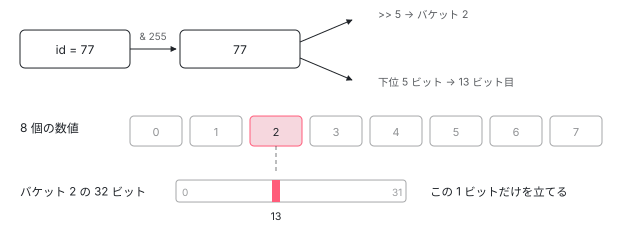
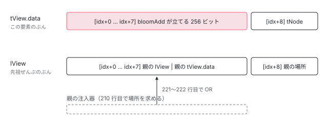

[目次](../README.md) › [DI の内側](README.md) › 第 10 回 / 全 16 回

# NodeInjector のブルームフィルタ：256 ビットで「この要素には無い」を即答する

> NodeInjector は要素ごとに 8 個の 32 ビット整数を持ち、トークンの ID の下位 8 ビットで 1 ビットを立てる。bloomAdd で登録し、bloomHasToken で探すときに「確実に無い」なら親へ飛ぶ。データ構造の実用例として読み、NodeInjector の探索（次章）の前提を作る。

angular/angular · 読了 約 10 分 · 発展 · [サイトで読む（デモが動きます）](https://angular-deep-dive-cyan.vercel.app/chapter/di)

---

この章で分かること：`inject()` が要素をさかのぼって探すとき、各要素で最初に見るのは providers の配列ではなく **8 個の 32 ビット整数（256 ビット）**です。トークンの番号をどう振り、どのビットを立て、どう読めば 「この要素には確実に無い」を配列アクセス 1 回で言えるのかを、定数の定義から順に追います。要素ごとに「自分のぶん」と「先祖ぜんぶのぶん」の 2 組があることも見ます。これが次章の探索ループの前提になります。

読む対象は `packages/core/src/render3/di.ts` の `bloomAdd`（152 行目）、`getOrCreateNodeInjectorForNode`（193 行目）、`bloomHashBitOrFactory`（825 行目）、`bloomHasToken`（849 行目）、`shouldSearchParent`（870 行目）です。

1. [1. 概観](01-di-overview.md)
2. [2. inject() の実装](02-di-inject-function.md)
3. [3. 注入コンテキスト](03-di-injection-context.md)
4. [4. ɵfac の生成](04-di-factory.md)
5. [5. @Injectable と @Service](05-di-injectable-compile.md)
6. [6. InjectionToken と特殊トークン](06-di-injection-token.md)
7. [7. provider の 4 つの形](07-di-provider-to-factory.md)
8. [8. R3Injector.get の全手順](08-di-r3-injector-get.md)
9. [9. multi: true](09-di-multi-providers.md)
10. **10. ブルームフィルタ**（この章）
11. [11. NodeInjector の探索](11-di-node-injector-lookup.md)
12. [12. self・skipSelf・host・optional](12-di-resolution-flags.md)
13. [13. provider 無しで取れるトークン](13-di-special-tokens.md)
14. [14. DestroyRef と破棄](14-di-destroy.md)
15. [15. injectAsync と onIdle](15-di-inject-async.md)
16. [16. DevTools と injector profiler](16-di-debug.md)

> [!TIP]
> **新卒エンジニアへ**
>
> **ブルームフィルタ**は「集合に入っているか」を少ないビットで判定するデータ構造です。答えは「確実に入っていない」か「入っているかもしれない」の 2 種類しかありません。Angular では、要素に紐づく注入器（`NodeInjector`）ごとに 1 つ持っています。

## 1. まず定数を見る

📄 `angular/packages/core/src/render3/di.ts` L122–139 （▶ の行: 128–129, 136, 139）

```ts
122 │ 
123 │ /**
124 │  * The number of slots in each bloom filter (used by DI). The larger this number, the fewer
125 │  * directives that will share slots, and thus, the fewer false positives when checking for
126 │  * the existence of a directive.
127 │  */
128 ▶ const BLOOM_SIZE = 256;
129 ▶ const BLOOM_MASK = BLOOM_SIZE - 1;
130 │ 
131 │ /**
132 │  * The number of bits that is represented by a single bloom bucket. JS bit operations are 32 bits,
133 │  * so each bucket represents 32 distinct tokens which accounts for log2(32) = 5 bits of a bloom hash
134 │  * number.
135 │  */
136 ▶ const BLOOM_BUCKET_BITS = 5;
137 │ 
138 │ /** Counter used to generate unique IDs for directives. */
139 ▶ let nextNgElementId = 0;
```

128 行目、**256**。これがビットの総数です。129 行目の `BLOOM_MASK` は 255（2 進数で 8 個の 1）です。136 行目のコメントが、なぜ 5 なのかを説明しています。JavaScript のビット演算は 32 ビットなので、1 つの数値で 32 個ぶんを持てます。`log2(32) = 5` なので、下位 5 ビットが「どのビットか」、残りが「どの数値か」を表す、という分担です。

256 ÷ 32 = 8。つまり**数値 8 個で 256 ビット**を表します。139 行目の `nextNgElementId` はモジュールの最上位にある変数で、アプリ全体で 1 本の連番です。次節で、この連番がトークンに振られる瞬間を見ます。

## 2. 登録するとき：番号を振り、1 ビット立てる

📄 `angular/packages/core/src/render3/di.ts` L152–183 （▶ の行: 157, 161–162, 167–168, 173, 178, 183）

```ts
152 │ export function bloomAdd(
153 │   injectorIndex: number,
154 │   tView: TView,
155 │   type: ProviderToken<any> | string,
156 │ ): void {
157 ▶   ngDevMode && assertEqual(tView.firstCreatePass, true, 'expected firstCreatePass to be true');
158 │   let id: number | undefined;
159 │   if (typeof type === 'string') {
160 │     id = type.charCodeAt(0) || 0;
161 ▶   } else if (Object.hasOwn(type, NG_ELEMENT_ID)) {
162 ▶     id = (type as any)[NG_ELEMENT_ID];
163 │   }
164 │ 
165 │   // Set a unique ID on the directive type, so if something tries to inject the directive,
166 │   // we can easily retrieve the ID and hash it into the bloom bit that should be checked.
167 ▶   if (id == null) {
168 ▶     id = (type as any)[NG_ELEMENT_ID] = nextNgElementId++;
169 │   }
170 │ 
171 │   // We only have BLOOM_SIZE (256) slots in our bloom filter (8 buckets * 32 bits each),
172 │   // so all unique IDs must be modulo-ed into a number from 0 - 255 to fit into the filter.
173 ▶   const bloomHash = id & BLOOM_MASK;
174 │ 
175 │   // Create a mask that targets the specific bit associated with the directive.
176 │   // JS bit operations are 32 bits, so this will be a number between 2^0 and 2^31, corresponding
177 │   // to bit positions 0 - 31 in a 32 bit integer.
178 ▶   const mask = 1 << bloomHash;
179 │ 
180 │   // Each bloom bucket in `tData` represents `BLOOM_BUCKET_BITS` number of bits of `bloomHash`.
181 │   // Any bits in `bloomHash` beyond `BLOOM_BUCKET_BITS` indicate the bucket offset that the mask
182 │   // should be written to.
183 ▶   (tView.data as number[])[injectorIndex + (bloomHash >> BLOOM_BUCKET_BITS)] |= mask;
```

1. **番号を読む（161〜162 行目）**

   トークン（クラスや `InjectionToken`）自身が `__NG_ELEMENT_ID__` という静的プロパティを持っていれば、それを使います。`Object.hasOwn` なので、親クラスから継承した番号は使いません。
2. **無ければ番号を振る（167〜168 行目）**

   まだ番号が無いトークンには、139 行目の連番 `nextNgElementId++` を**トークンそのものに書き込みます**。以後そのトークンはどの要素で登録されても同じ番号です。157 行目の assert のとおり、ここに来るのは `tView.firstCreatePass`（テンプレートの最初の作成パス）だけです。
3. **256 で割った余りを取る（173 行目）**

   `id & BLOOM_MASK` は `id % 256` と同じです。
4. **1 ビットだけ立てる（178・183 行目）**

   178 行目でそのビットだけが立った数値を作り、183 行目で 8 個のうちの 1 個に `|=` します。`bloomHash >> BLOOM_BUCKET_BITS` が「8 個のうち何番目か」の計算です。5 ビット右にずらすと、32 で割った商になります。`1 << bloomHash` は JavaScript のシフトが右辺の下位 5 ビットしか使わないので、結果として「32 で割った余り」番目のビットになります。

書き込み先は 183 行目の `tView.data` です。`TView` はテンプレート 1 つにつき 1 個の設計図なので、このビットは**同じテンプレートから作られたすべてのインスタンスで共有**されます。呼び出し元は、ディレクティブなら `view/directives.ts` の `diPublicInInjector`、providers なら `di_setup.ts` の `resolveProvider` です（[standalone シリーズ第 8 回](../standalone/08-standalone-providers-two-injectors.md)）。



*id を 256 で割った余りが、どの数値の何ビット目かを決める。下位 5 ビットがビット位置、残りがバケット番号。8 個の数値で 256 ビットを表す。*

## 3. 要素ごとに 2 組のブルームがある

ブルームを置く 8 個の枠は、要素の注入器を最初に作るときに確保されます。

📄 `angular/packages/core/src/render3/di.ts` L193–232 （▶ の行: 203–207, 210, 221–222, 226, 231）

```ts
193 │ export function getOrCreateNodeInjectorForNode(
194 │   tNode: TElementNode | TContainerNode | TElementContainerNode,
195 │   lView: LView,
196 │ ): number {
197 │   const existingInjectorIndex = getInjectorIndex(tNode, lView);
198 │   if (existingInjectorIndex !== -1) {
199 │     return existingInjectorIndex;
200 │   }
201 │ 
202 │   const tView = lView[TVIEW];
203 ▶   if (tView.firstCreatePass) {
204 ▶     tNode.injectorIndex = lView.length;
205 ▶     insertBloom(tView.data, tNode); // foundation for node bloom
206 ▶     insertBloom(lView, null); // foundation for cumulative bloom
207 ▶     insertBloom(tView.blueprint, null);
208 │   }
209 │ 
210 ▶   const parentLoc = getParentInjectorLocation(tNode, lView);
211 │   const injectorIndex = tNode.injectorIndex;
212 │ 
213 │   // If a parent injector can't be found, its location is set to -1.
214 │   // In that case, we don't need to set up a cumulative bloom
215 │   if (hasParentInjector(parentLoc)) {
216 │     const parentIndex = getParentInjectorIndex(parentLoc);
217 │     const parentLView = getParentInjectorView(parentLoc, lView);
218 │     const parentData = parentLView[TVIEW].data as any;
219 │     // Creates a cumulative bloom filter that merges the parent's bloom filter
220 │     // and its own cumulative bloom (which contains tokens for all ancestors)
221 ▶     for (let i = 0; i < NodeInjectorOffset.BLOOM_SIZE; i++) {
222 ▶       lView[injectorIndex + i] = parentLView[parentIndex + i] | parentData[parentIndex + i];
223 │     }
224 │   }
225 │ 
226 ▶   lView[injectorIndex + NodeInjectorOffset.PARENT] = parentLoc;
227 │   return injectorIndex;
228 │ }
229 │ 
230 │ function insertBloom(arr: any[], footer: TNode | null): void {
231 ▶   arr.push(0, 0, 0, 0, 0, 0, 0, 0, footer);
232 │ }
```

1. **9 個ずつ 3 か所に枠を足す（203〜207 行目、231 行目）**

   231 行目の `insertBloom` は 0 を 8 個と、9 個目に footer を push します。204 行目で、その先頭位置（いまの `lView.length`）を `tNode.injectorIndex` に記録し、205 行目で `tView.data`、206 行目で `lView`、207 行目で `tView.blueprint`（`LView` を作るときの型紙）の **同じ位置**に 9 個ずつ足します。
2. **tView.data 側は「この要素のぶん」**

   205 行目は 9 個目に `tNode` を入れます。前節の `bloomAdd` が書くのはこの 8 個です。この要素に登録されたトークンだけのビットが立ちます。
3. **lView 側は「先祖ぜんぶのぶん」（221〜222 行目）**

   210 行目で親の注入器の場所を求め、221〜222 行目で **親の lView 側（親の先祖ぜんぶ）| 親の tView.data 側（親自身）**を 8 個ぶん OR して書きます。つまり `lView[injectorIndex + 0〜7]` には、この要素より上の全要素に登録されたトークンのビットが集まります。これを **cumulative bloom**（累積ブルーム）と呼んでいます。
4. **9 個目は親の場所（226 行目）**

   `lView[injectorIndex + 8]`（`NodeInjectorOffset.PARENT`）に親の場所を入れます。場所の数値の作り方（何ビュー上がるか + 位置）は[次章](11-di-node-injector-lookup.md)で読みます。

累積ブルームが `tView.data` ではなく `lView` にある理由は 221〜222 行目にあります。同じコンポーネント（同じ `TView`）でも、置かれた場所によって先祖が違います。先祖の情報はインスタンスごとに違うので、インスタンスごとの配列である `LView` に置くしかありません。



*注入器 1 つは tView.data と lView の同じ位置に 9 枠ずつ。tView.data の 8 枠は自分の要素のトークン、lView の 8 枠は先祖ぜんぶのトークン（親の 2 組を OR したもの）。9 枠目は tNode と、親の場所。*

## 4. 探すとき：トークンから番号を読む

探す側はまず、トークンからビット位置を取り出します。

📄 `angular/packages/core/src/render3/di.ts` L825–847 （▶ の行: 834, 836–838, 842, 845）

```ts
825 │ export function bloomHashBitOrFactory(
826 │   token: ProviderToken<any> | string,
827 │ ): number | Function | undefined {
828 │   ngDevMode && assertDefined(token, 'token must be defined');
829 │   if (typeof token === 'string') {
830 │     return token.charCodeAt(0) || 0;
831 │   }
832 │   const tokenId: number | undefined =
833 │     // First check with `Object.hasOwn` so we don't get an inherited ID.
834 ▶     Object.hasOwn(token, NG_ELEMENT_ID) ? (token as any)[NG_ELEMENT_ID] : undefined;
835 │   // Negative token IDs are used for special objects such as `Injector`
836 ▶   if (typeof tokenId === 'number') {
837 ▶     if (tokenId >= 0) {
838 ▶       return tokenId & BLOOM_MASK;
839 │     } else {
840 │       ngDevMode &&
841 │         assertEqual(tokenId, InjectorMarkers.Injector, 'Expecting to get Special Injector Id');
842 ▶       return createNodeInjector;
843 │     }
844 │   } else {
845 ▶     return tokenId;
846 │   }
847 │ }
```

戻り値は 3 種類あります。

| トークンの状態 | 戻り値 | 意味 |
| --- | --- | --- |
| 0 以上の番号を持つ（どこかの要素で登録されたことがある） | 838 行目 `tokenId & BLOOM_MASK` | 0〜255 のビット位置。ブルームで調べる |
| 負の番号を持つ（`Injector` の `-1`） | 842 行目 `createNodeInjector` | 関数。ブルームを使わず、その場で作る（[第 13 回](13-di-special-tokens.md)） |
| 番号を持たない | 845 行目 `undefined` | どの要素にも一度も登録されていない。要素の探索そのものを飛ばす |

表の最後のケースが実用上いちばん効きます。`providedIn: 'root'` のサービスを要素の providers に一度も書かなければ、2 節の 168 行目は一度も走らないので番号が付きません。すると 845 行目で `undefined` が返り、要素を 1 つも見ずに環境インジェクタへ進みます。なお `ElementRef` のように `__NG_ELEMENT_ID__` に**関数**を持つクラスは、836 行目の `number` 判定に入らず、845 行目でその関数がそのまま返ります。こちらは[第 13 回](13-di-special-tokens.md)で読みます。

## 5. 探すとき：1 ビット読む

📄 `angular/packages/core/src/render3/di.ts` L849–867 （▶ の行: 852, 857, 862, 864–866）

```ts
849 │ export function bloomHasToken(
850 │   bloomHash: number,
851 │   injectorIndex: number,
852 ▶   injectorView: LView | TData,
853 │ ) {
854 │   // Create a mask that targets the specific bit associated with the directive we're looking for.
855 │   // JS bit operations are 32 bits, so this will be a number between 2^0 and 2^31, corresponding
856 │   // to bit positions 0 - 31 in a 32 bit integer.
857 ▶   const mask = 1 << bloomHash;
858 │ 
859 │   // Each bloom bucket in `injectorView` represents `BLOOM_BUCKET_BITS` number of bits of
860 │   // `bloomHash`. Any bits in `bloomHash` beyond `BLOOM_BUCKET_BITS` indicate the bucket offset
861 │   // that should be used.
862 ▶   const value = injectorView[injectorIndex + (bloomHash >> BLOOM_BUCKET_BITS)];
863 │ 
864 ▶   // If the bloom filter value has the bit corresponding to the directive's bloomBit flipped on,
865 ▶   // this injector is a potential match.
866 ▶   return !!(value & mask);
867 │ }
```

やっていることは登録の逆です。857 行目でマスクを作り、862 行目で該当する数値を取り出し、866 行目で `&` を取ります。**配列アクセス 1 回とビット演算 2 回**で答えが出ます。852 行目の引数の型が `LView | TData` になっているのは、3 節の 2 組のどちらにも使うからです。`tView.data` を渡せば「この要素にあるか」、`lView` を渡せば「先祖のどこかにあるか」を答えます。

この関数の答えは 2 種類の意味を持ちます。

| 戻り値 | 意味 | 次にすること |
| --- | --- | --- |
| `false` | **絶対に無い**（確実） | この要素の providers とディレクティブを調べずに飛ばす |
| `true` | あるかもしれない（不確実） | 実際に配列を調べて確認する |

864〜865 行目のコメントも「potential match（候補）」と書いています。**偽陽性（無いのに「あるかも」）はあるが、偽陰性（あるのに「無い」）はない**ので、正しさは保たれます。空振りの探索では大半が「絶対に無い」側に倒れるので、配列を調べる回数が減ります。

## 6. 手を動かして確かめる

下は 173 行目・178 行目・862 行目と同じ計算を再現したものです。登録済みの id に 256 を足した数（3 に対して 259）を検索すると、偽陽性が起きます。

> **🧪 DEMO — ブルームフィルタの判定**
>
> 登録済みトークン id: 3, 40, 77
>
> ▶ [このデモはサイトで動かせます](https://angular-deep-dive-cyan.vercel.app/chapter/di)

> [!NOTE]
> **さらに深く**
>
> 番号が 256 を超えると、別々のトークンが同じビットを共有し始めます。でも壊れません。共有されたビットが立っているときは「あるかもしれない」と判定され、実際の配列を調べる処理に進むだけだからです。**速度は落ちるが、間違った答えは返さない**という設計になっています。

## 7. 探索を止める指定

📄 `angular/packages/core/src/render3/di.ts` L869–877 （▶ の行: 874–875）

```ts
869 │ /** Returns true if flags prevent parent injector from being searched for tokens */
870 │ function shouldSearchParent(
871 │   flags: InternalInjectFlags,
872 │   isFirstHostTNode: boolean,
873 │ ): boolean | number {
874 ▶   return (
875 ▶     !(flags & InternalInjectFlags.Self) && !(flags & InternalInjectFlags.Host && isFirstHostTNode)
876 │   );
877 │ }
```

ブルームが「先祖にあるかも」と言っても、親へ上がらない場合があります。875 行目です。`Self` ビットが立っていれば親に行きません。`Host` ビットが立っていて、いまいる要素がホスト要素なら止まります。この関数を呼ぶ場所と 4 つのフラグ全体は[第 12 回](12-di-resolution-flags.md)で読みます。

## 8. 次章へ：2 組のブルームが探索ループでどう使われるか

ここまでで部品はそろいました。`bloomHashBitOrFactory` がトークンをビット位置に変え、`bloomHasToken` がそのビットを `tView.data`（自分）か `lView`（先祖ぜんぶ）で読みます。[第 11 回](11-di-node-injector-lookup.md)の `lookupTokenUsingNodeInjector` は、各要素でまず自分側を読み、無ければ先祖側を読んで「上がる価値があるか」を決め、226 行目に入れた親の場所をたどって 1 つ上へ移ります。先祖側のビットが立っていなければ、残りの要素を全部飛ばして環境インジェクタへ進みます。

## 聞かれそうな質問

**Q. 偽陽性はあるのに偽陰性が無いと言い切れるのはなぜですか？**

ビットを書く場所は 2 節 183 行目の `|=` と 3 節 222 行目の OR だけで、どちらもビットを**立てるだけで消しません**。探す側の 857・862 行目は、登録の 173・178・183 行目と同じ計算（同じ番号 → 同じバケット・同じビット）をします。登録されたトークンのビットは必ず立っているので「無い」とは答えられません。逆に、173 行目で 256 で割った余りを取るため、別のトークンが同じビットを立てていれば「あるかも」と答えます。これが偽陽性です。

**Q. トークンの番号はいつ、誰が振るのですか？**

2 節 167〜168 行目です。`bloomAdd` が呼ばれたとき、トークン自身に `__NG_ELEMENT_ID__` が無ければ 139 行目の連番を書き込みます。`bloomAdd` は要素にディレクティブか provider を登録するとき（最初の作成パス）にだけ呼ばれるので、番号は「初めてどこかの要素に登録された順」です。161 行目と 834 行目が `Object.hasOwn` なのは、静的プロパティが子クラスに継承されて、親クラスと同じ番号を名乗るのを防ぐためです。

**Q. トークンが 256 個を超えたらどうなりますか？**

壊れません。173 行目と 838 行目で `& 255` するので、番号 3 と 259 は同じビットになります。その結果「あるかも」が増え、要素の providers とディレクティブを実際に調べる回数が増えます（遅くなる）。答えは配列を調べて決まるので、間違ったものは返りません。

**Q. providedIn: 'root' のサービスを inject したとき、要素のブルームは見られますか？**

そのサービスを要素の providers に一度も書いていなければ、見られません。168 行目が一度も走らず番号が無いので、845 行目で `undefined` が返り、要素の探索を丸ごと飛ばして環境インジェクタへ行きます。どこかの要素の providers に一度でも書くと番号が付き、以後はブルームを調べるようになります。

## 読み終えて

- 各要素の注入器は `tView.data` と `lView` の同じ位置に 9 枠ずつ持つ。8 枠が 256 ビットのブルーム、9 枠目が tNode と親の場所。
- トークンの番号は初めて要素に登録されたとき 168 行目で振られ、下位 8 ビットでビットが決まる（173 行目）。
- `tView.data` 側は「この要素のぶん」、`lView` 側は 222 行目で作る「先祖ぜんぶのぶん」。
- 判定は配列アクセス 1 回とビット演算 2 回（857〜866 行目）。偽陽性はあるが偽陰性は無い。
- 番号の無いトークンは 845 行目で要素の探索を丸ごと飛ばす。続きの探索ループは[第 11 回](11-di-node-injector-lookup.md)へ。

---

← 前: [multi: true の仕組み：環境インジェクタの配列と、要素の multiFactory](09-di-multi-providers.md)  
次: [NodeInjector の探索：getOrCreateInjectable から環境インジェクタへ落ちるまで](11-di-node-injector-lookup.md) →
