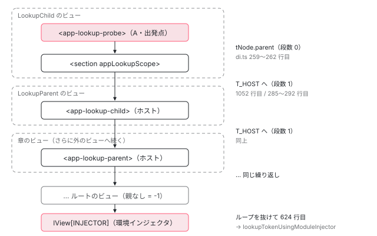

[目次](../README.md) › [DI の内側](README.md) › 第 11 回 / 全 16 回

# NodeInjector の探索：getOrCreateInjectable から環境インジェクタへ落ちるまで

> ɵɵdirectiveInject → getOrCreateInjectable → lookupTokenUsingNodeInjector が、自分の要素 → 親要素 → コンポーネントの境界を越えて宣言元ビューへと RelativeInjectorLocation を辿る手順。searchTokensOnInjector と locateDirectiveOrProvider が tView.data の範囲を見る行、getNodeInjectable が factory を実体に置き換える行、要素で見つからなかったときの lookupTokenUsingModuleInjector と embedded view の注入器。

angular/angular · 読了 約 15 分 · 発展 · [サイトで読む（デモが動きます）](https://angular-deep-dive-cyan.vercel.app/chapter/di-node-injector-lookup)

---

この章で分かること：コンポーネントのコンストラクタで `inject(TOKEN)` と書いたとき、Angular は**自分の要素 → 親要素 → コンポーネントの境界を越えて 1 つ外のビューの要素 → …**と、要素の注入器（`NodeInjector`）を 1 つずつさかのぼります。その「1 つ上」がどの数値で表され、どの関数で計算され、どこで打ち切られて環境インジェクタへ落ちるのかを、`lookupTokenUsingNodeInjector` のループを 3 つに割って読みます。最後に `ng-template` の中（embedded view）では「宣言元」と「挿入先」のどちらをたどるのかを確かめます。

読む対象は `packages/core/src/render3/di.ts`（`getOrCreateInjectable`、`lookupTokenUsingNodeInjector`、`getParentInjectorLocation`、`searchTokensOnInjector`、`lookupTokenUsingModuleInjector`、`lookupTokenUsingEmbeddedInjector`）、`render3/util/injector_utils.ts`、`render3/interfaces/injector.ts`、`render3/view/construction.ts`、`linker/template_ref.ts`、`common/src/directives/ng_template_outlet.ts` です。

1. [1. 概観](01-di-overview.md)
2. [2. inject() の実装](02-di-inject-function.md)
3. [3. 注入コンテキスト](03-di-injection-context.md)
4. [4. ɵfac の生成](04-di-factory.md)
5. [5. @Injectable と @Service](05-di-injectable-compile.md)
6. [6. InjectionToken と特殊トークン](06-di-injection-token.md)
7. [7. provider の 4 つの形](07-di-provider-to-factory.md)
8. [8. R3Injector.get の全手順](08-di-r3-injector-get.md)
9. [9. multi: true](09-di-multi-providers.md)
10. [10. ブルームフィルタ](10-di.md)
11. **11. NodeInjector の探索**（この章）
12. [12. self・skipSelf・host・optional](12-di-resolution-flags.md)
13. [13. provider 無しで取れるトークン](13-di-special-tokens.md)
14. [14. DestroyRef と破棄](14-di-destroy.md)
15. [15. injectAsync と onIdle](15-di-inject-async.md)
16. [16. DevTools と injector profiler](16-di-debug.md)

> [!TIP]
> **新卒エンジニアへ**
>
> この章に出てくる 3 つの言葉：**TNode** はテンプレート上の要素 1 個ぶんの設計図（全インスタンスで共有）、**LView** はビュー（テンプレート 1 個ぶん）のインスタンスの配列、**宣言元ビュー**（`DECLARATION_VIEW`）はそのビューのテンプレートが書かれていた外側のビューです。詳しくは [TNode](../ivy/04-ivy-tnode.md)・[LView](../ivy/06-ivy-lview.md) の章を見てください。

## 1. 入口：getOrCreateInjectable

コンストラクタの `inject(TOKEN)` は `ɵɵinject` を経て `ɵɵdirectiveInject` に入り、いまの `TNode` と `LView` を持って `getOrCreateInjectable` を呼びます。ここまでの道筋は [第 2 回](02-di-inject-function.md) と [standalone シリーズ第 8 回](../standalone/08-standalone-providers-two-injectors.md)（`instructions/di.ts` 45〜66 行目）で読みました。この章はその先から始めます。

📄 `angular/packages/core/src/render3/di.ts` L457–483 （▶ の行: 464, 467–468, 471, 473, 480）

```ts
457 │ export function getOrCreateInjectable<T>(
458 │   tNode: TDirectiveHostNode | null,
459 │   lView: LView,
460 │   token: ProviderToken<T>,
461 │   flags: InternalInjectFlags = InternalInjectFlags.Default,
462 │   notFoundValue?: any,
463 │ ): T | null {
464 ▶   if (tNode !== null) {
465 │     // If the view or any of its ancestors have an embedded
466 │     // view injector, we have to look it up there first.
467 ▶     if (
468 ▶       lView[FLAGS] & LViewFlags.HasEmbeddedViewInjector &&
469 │       // The token must be present on the current node injector when the `Self`
470 │       // flag is set, so the lookup on embedded view injector(s) can be skipped.
471 ▶       !(flags & InternalInjectFlags.Self)
472 │     ) {
473 ▶       const embeddedInjectorValue = lookupTokenUsingEmbeddedInjector(
474 │         tNode,
475 │         lView,
476 │         token,
477 │         flags,
478 │         NOT_FOUND,
479 │       );
480 ▶       if (embeddedInjectorValue !== NOT_FOUND) {
481 │         return embeddedInjectorValue;
482 │       }
483 │     }
```

464 行目、`tNode` が無い（ビューの外から呼ばれた）ときは要素を見ずに環境インジェクタへ行きます。467〜468 行目、ビューかその先祖が **embedded view 用の注入器**を持っているときだけ、先に `lookupTokenUsingEmbeddedInjector` で探します（7 節）。471 行目、`Self` フラグのときは飛ばします。このあと（standalone シリーズ第 8 回で引用した範囲）で `lookupTokenUsingNodeInjector` を呼び、`NOT_FOUND` なら `lookupTokenUsingModuleInjector`（6 節）へ落ちます。

## 2. lookupTokenUsingNodeInjector：まずトークンの種類で分ける

📄 `angular/packages/core/src/render3/di.ts` L506–516 （▶ の行: 513–516）

```ts
506 │ function lookupTokenUsingNodeInjector<T>(
507 │   tNode: TDirectiveHostNode,
508 │   lView: LView,
509 │   token: ProviderToken<T>,
510 │   flags: InternalInjectFlags,
511 │   notFoundValue?: any,
512 │ ) {
513 ▶   const bloomHash = bloomHashBitOrFactory(token);
514 ▶   // If the ID stored here is a function, this is a special object like ElementRef or TemplateRef
515 ▶   // so just call the factory function to create it.
516 ▶   if (typeof bloomHash === 'function') {
```

513 行目、[第 10 回](10-di.md)で読んだ `bloomHashBitOrFactory` でトークンをビット位置に変えます。戻り値で 3 つに分かれます。

| bloomHash | 行 | すること |
| --- | --- | --- |
| 関数（`ElementRef`・`Injector` など） | 516 行目 | 要素をさかのぼらず、その関数を呼んで作る。[第 13 回](13-di-special-tokens.md) |
| 数値（0〜255） | 549 行目〜 | この章の本題。要素の注入器をさかのぼる（4 節） |
| `undefined` | 624 行目 | どちらの分岐にも入らず `notFoundValue`（`NOT_FOUND`）を返す。要素は 1 つも見ない |

516 行目の関数の分岐の中身（`enterDI` してから関数を呼ぶ）は[第 13 回](13-di-special-tokens.md)、そこでの `SkipSelf` / `Host` の扱いは[第 12 回](12-di-resolution-flags.md)で読みます。

## 3. 「1 つ上」はどこか：RelativeInjectorLocation

ループを読む前に、「親の注入器の場所」がどう表されているかを見ます。[第 10 回](10-di.md)で見たとおり、注入器は `lView[injectorIndex + 8]` に親の場所を 1 つの数値で持っています。

📄 `angular/packages/core/src/render3/interfaces/injector.ts` L63–79 （▶ の行: 66–67, 74–75, 79）

```ts
63 │ /**
64 │  * Represents a relative location of parent injector.
65 │  *
66 ▶  * The interfaces encodes number of parents `LView`s to traverse and index in the `LView`
67 ▶  * pointing to the parent injector.
68 │  */
69 │ export type RelativeInjectorLocation = number & {
70 │   __brand__: 'RelativeInjectorLocationFlags';
71 │ };
72 │ 
73 │ export const enum RelativeInjectorLocationFlags {
74 ▶   InjectorIndexMask = 0b111111111111111,
75 ▶   ViewOffsetShift = 16,
76 │   NO_PARENT = -1,
77 │ }
78 │ 
79 ▶ export const NO_PARENT_INJECTOR = -1 as RelativeInjectorLocation;
```

66〜67 行目のコメントどおり、1 つの数値に「何個 `LView` を上がるか」と「その `LView` の何番目か」を詰めています。74 行目のマスク（1 が 15 個）が位置、75 行目の `16` がビューの段数を入れる位置です。79 行目、親が無ければ `-1`。

📄 `angular/packages/core/src/render3/util/injector_utils.ts` L22–39 （▶ の行: 34, 38）

```ts
22 │ export function getParentInjectorIndex(parentLocation: RelativeInjectorLocation): number {
23 │   if (ngDevMode) {
24 │     assertNumber(parentLocation, 'Number expected');
25 │     assertNotEqual(parentLocation as any, -1, 'Not a valid state.');
26 │     const parentInjectorIndex = parentLocation & RelativeInjectorLocationFlags.InjectorIndexMask;
27 │ 
28 │     assertGreaterThan(
29 │       parentInjectorIndex,
30 │       HEADER_OFFSET,
31 │       'Parent injector must be pointing past HEADER_OFFSET.',
32 │     );
33 │   }
34 ▶   return parentLocation & RelativeInjectorLocationFlags.InjectorIndexMask;
35 │ }
36 │ 
37 │ export function getParentInjectorViewOffset(parentLocation: RelativeInjectorLocation): number {
38 ▶   return parentLocation >> RelativeInjectorLocationFlags.ViewOffsetShift;
39 │ }
```

📄 `angular/packages/core/src/render3/util/injector_utils.ts` L41–62 （▶ の行: 51, 57–59）

```ts
41 │ /**
42 │  * Unwraps a parent injector location number to find the view offset from the current injector,
43 │  * then walks up the declaration view tree until the view is found that contains the parent
44 │  * injector.
45 │  *
46 │  * @param location The location of the parent injector, which contains the view offset
47 │  * @param startView The LView instance from which to start walking up the view tree
48 │  * @returns The LView instance that contains the parent injector
49 │  */
50 │ export function getParentInjectorView(location: RelativeInjectorLocation, startView: LView): LView {
51 ▶   let viewOffset = getParentInjectorViewOffset(location);
52 │   let parentView = startView;
53 │   // For most cases, the parent injector can be found on the host node (e.g. for component
54 │   // or container), but we must keep the loop here to support the rarer case of deeply nested
55 │   // <ng-template> tags or inline views, where the parent injector might live many views
56 │   // above the child injector.
57 ▶   while (viewOffset > 0) {
58 ▶     parentView = parentView[DECLARATION_VIEW]!;
59 ▶     viewOffset--;
60 │   }
61 │   return parentView;
62 │ }
```

34 行目は下位 15 ビットを取り出すだけ、38 行目は 16 ビット右へずらして段数を取り出すだけです。`getParentInjectorView` は 57〜59 行目で、段数の回数だけ `DECLARATION_VIEW`（宣言元ビュー）へ上がります。**`PARENT`（挿入先）ではなく `DECLARATION_VIEW` を使う**ことが、7 節の答えにつながります。

### 親の場所を計算する：getParentInjectorLocation

この数値は、要素の注入器を作るとき（[第 10 回](10-di.md) 3 節の `getOrCreateNodeInjectorForNode`）に計算されます。その前に、「注入器を持たない要素」の扱いを見ておきます。

📄 `angular/packages/core/src/render3/tnode_manipulation.ts` L284–298 （▶ の行: 286, 297）

```ts
284 │   ngDevMode && assertNotSame(attrs, undefined, "'undefined' is not valid value for 'attrs'");
285 │   ngDevMode && tParent && assertTNodeForTView(tParent, tView);
286 ▶   let injectorIndex = tParent ? tParent.injectorIndex : -1;
287 │   let flags = 0;
288 │   if (isInSkipHydrationBlock()) {
289 │     flags |= TNodeFlags.inSkipHydrationBlock;
290 │   }
291 │ 
292 │   // TODO: would it be helpful to use a prototypal inheritance here, similar to the way we do so with signals?
293 │   const tNode = {
294 │     type,
295 │     index,
296 │     insertBeforeIndex: null,
297 ▶     injectorIndex,
298 │     directiveStart: -1,
```

📄 `angular/packages/core/src/render3/di.ts` L234–249 （▶ の行: 236, 239, 242, 244, 247）

```ts
234 │ export function getInjectorIndex(tNode: TNode, lView: LView): number {
235 │   if (
236 ▶     tNode.injectorIndex === -1 ||
237 │     // If the injector index is the same as its parent's injector index, then the index has been
238 │     // copied down from the parent node. No injector has been created yet on this node.
239 ▶     (tNode.parent && tNode.parent.injectorIndex === tNode.injectorIndex) ||
240 │     // After the first template pass, the injector index might exist but the parent values
241 │     // might not have been calculated yet for this instance
242 ▶     lView[tNode.injectorIndex + NodeInjectorOffset.PARENT] === null
243 │   ) {
244 ▶     return -1;
245 │   } else {
246 │     ngDevMode && assertIndexInRange(lView, tNode.injectorIndex);
247 ▶     return tNode.injectorIndex;
248 │   }
249 │ }
```

`tnode_manipulation.ts` 286 行目、`TNode` を作るとき `injectorIndex` は**親の値をそのまま写します**。ディレクティブも providers も無い `<div>` は、自分の注入器を作らないので親の番号を持ったままです。`getInjectorIndex` の 239 行目は「親と同じ番号なら、それは写しただけ」と判断して `-1`（注入器なし）を返します。242 行目は、`TView` には番号があるがこの `LView` ではまだ親の場所を計算していない場合です。

📄 `angular/packages/core/src/render3/di.ts` L258–296 （▶ の行: 259, 262, 275–276, 280, 285–286, 288, 290–292）

```ts
258 │ export function getParentInjectorLocation(tNode: TNode, lView: LView): RelativeInjectorLocation {
259 ▶   if (tNode.parent && tNode.parent.injectorIndex !== -1) {
260 │     // If we have a parent `TNode` and there is an injector associated with it we are done, because
261 │     // the parent injector is within the current `LView`.
262 ▶     return tNode.parent.injectorIndex as RelativeInjectorLocation; // ViewOffset is 0
263 │   }
264 │ 
265 │   // When parent injector location is computed it may be outside of the current view. (ie it could
266 │   // be pointing to a declared parent location). This variable stores number of declaration parents
267 │   // we need to walk up in order to find the parent injector location.
268 │   let declarationViewOffset = 0;
269 │   let parentTNode: TNode | null = null;
270 │   let lViewCursor: LView | null = lView;
271 │ 
272 │   // The parent injector is not in the current `LView`. We will have to walk the declared parent
273 │   // `LView` hierarchy and look for it. If we walk of the top, that means that there is no parent
274 │   // `NodeInjector`.
275 ▶   while (lViewCursor !== null) {
276 ▶     parentTNode = getTNodeFromLView(lViewCursor);
277 │ 
278 │     if (parentTNode === null) {
279 │       // If we have no parent, than we are done.
280 ▶       return NO_PARENT_INJECTOR;
281 │     }
282 │ 
283 │     ngDevMode && parentTNode && assertTNodeForLView(parentTNode!, lViewCursor[DECLARATION_VIEW]!);
284 │     // Every iteration of the loop requires that we go to the declared parent.
285 ▶     declarationViewOffset++;
286 ▶     lViewCursor = lViewCursor[DECLARATION_VIEW];
287 │ 
288 ▶     if (parentTNode.injectorIndex !== -1) {
289 │       // We found a NodeInjector which points to something.
290 ▶       return (parentTNode.injectorIndex |
291 ▶         (declarationViewOffset <<
292 ▶           RelativeInjectorLocationFlags.ViewOffsetShift)) as RelativeInjectorLocation;
293 │     }
294 │   }
295 │   return NO_PARENT_INJECTOR;
296 │ }
```

1. **同じビューに親の注入器がある（259〜262 行目）**

   `tNode.parent` に注入器があれば、その番号をそのまま返します。段数は 0 です。`tNode.parent` は「同じテンプレート内の親要素」です。注入器の無い要素の番号は親から写されているので（286 行目）、「いちばん近い、注入器を持つ先祖」の番号が自然に入っています。
2. **同じビューに無い：ビューの外へ（275〜286 行目）**

   276 行目、いまのビューが「どの要素に置かれたか」を `getTNodeFromLView` で取ります（下の引用）。280 行目、それが無ければ（ルートのビュー）親なし。285〜286 行目で段数を 1 足して、宣言元ビューへ上がります。
3. **見つかったら番号と段数を詰める（288〜292 行目）**

   その要素に注入器があれば、290〜292 行目で `injectorIndex | (段数 << 16)` を返します。無ければループを続けて、さらに外のビューへ上がります。

📄 `angular/packages/core/src/render3/di.ts` L1040–1056 （▶ の行: 1046, 1048–1052, 1055）

```ts
1040 │ /** Gets the TNode associated with an LView inside of the declaration view. */
1041 │ function getTNodeFromLView(lView: LView): TElementNode | TElementContainerNode | null {
1042 │   const tView = lView[TVIEW];
1043 │   const tViewType = tView.type;
1044 │ 
1045 │   // The parent pointer differs based on `TView.type`.
1046 ▶   if (tViewType === TViewType.Embedded) {
1047 │     ngDevMode && assertDefined(tView.declTNode, 'Embedded TNodes should have declaration parents.');
1048 ▶     return tView.declTNode as TElementContainerNode;
1049 ▶   } else if (tViewType === TViewType.Component) {
1050 ▶     // Components don't have `TView.declTNode` because each instance of component could be
1051 ▶     // inserted in different location, hence `TView.declTNode` is meaningless.
1052 ▶     return lView[T_HOST] as TElementNode;
1053 │   }
1054 │ 
1055 ▶   return null;
1056 │ }
```

「ビューが置かれた要素」はビューの種類で違います。1046〜1048 行目、`ng-template` から作られた embedded view なら `tView.declTNode`、つまり**テンプレートが書かれていた `<ng-template>` の TNode**です。1049〜1052 行目、コンポーネントのビューなら `lView[T_HOST]`、つまりコンポーネントのホスト要素です。1050〜1051 行目のコメントのとおり、コンポーネントはどこに置かれるか分からないので TView ではなく LView から取ります。どちらでもなければ（ルートのビュー）1055 行目で `null`。

## 4. 探索ループ：3 つに割って読む

### 4-1. 出発点を決める

📄 `angular/packages/core/src/render3/di.ts` L549–574 （▶ の行: 553–557, 561–565, 570–572）

```ts
549 │   } else if (typeof bloomHash === 'number') {
550 │     // A reference to the previous injector TView that was found while climbing the element
551 │     // injector tree. This is used to know if viewProviders can be accessed on the current
552 │     // injector.
553 ▶     let previousTView: TView | null = null;
554 ▶     let injectorIndex = getInjectorIndex(tNode, lView);
555 ▶     let parentLocation = NO_PARENT_INJECTOR;
556 ▶     let hostTElementNode: TNode | null =
557 ▶       flags & InternalInjectFlags.Host ? lView[DECLARATION_COMPONENT_VIEW][T_HOST] : null;
558 │ 
559 │     // If we should skip this injector, or if there is no injector on this node, start by
560 │     // searching the parent injector.
561 ▶     if (injectorIndex === -1 || flags & InternalInjectFlags.SkipSelf) {
562 ▶       parentLocation =
563 ▶         injectorIndex === -1
564 ▶           ? getParentInjectorLocation(tNode, lView)
565 ▶           : lView[injectorIndex + NodeInjectorOffset.PARENT];
566 │ 
567 │       if (parentLocation === NO_PARENT_INJECTOR || !shouldSearchParent(flags, false)) {
568 │         injectorIndex = -1;
569 │       } else {
570 ▶         previousTView = lView[TVIEW];
571 ▶         injectorIndex = getParentInjectorIndex(parentLocation);
572 ▶         lView = getParentInjectorView(parentLocation, lView);
573 │       }
574 │     }
```

1. **変数を 4 つ用意する（553〜557 行目）**

   `previousTView` は「直前に見た注入器の TView」。viewProviders が見えるかの判定（5 節）に使います。554 行目、いまの要素の注入器の番号。556 行目の `hostTElementNode` は `Host` フラグのときだけ使います（第 12 回）。
2. **自分に注入器が無ければ、親から始める（561〜565 行目）**

   注入器を持たない要素（例えば素の `<div>` の上で動くもの）や `SkipSelf` のときは、564 行目で `getParentInjectorLocation` を計算するか、565 行目で保存済みの親の場所を読みます。
3. **親へ移る（570〜572 行目）**

   570 行目で `previousTView` を記録し、571 行目で番号を、572 行目で `LView` を親のものに入れ替えます。572 行目の `getParentInjectorView` が 3 節の `DECLARATION_VIEW` 上り（57〜59 行目）です。

### 4-2. この要素にあるか

📄 `angular/packages/core/src/render3/di.ts` L576–600 （▶ の行: 578, 582, 585, 589, 597–598）

```ts
576 │     // Traverse up the injector tree until we find a potential match or until we know there
577 │     // *isn't* a match.
578 ▶     while (injectorIndex !== -1) {
579 │       ngDevMode && assertNodeInjector(lView, injectorIndex);
580 │ 
581 │       // Check the current injector. If it matches, see if it contains token.
582 ▶       const tView = lView[TVIEW];
583 │       ngDevMode &&
584 │         assertTNodeForLView(tView.data[injectorIndex + NodeInjectorOffset.TNODE] as TNode, lView);
585 ▶       if (bloomHasToken(bloomHash, injectorIndex, tView.data)) {
586 │         // At this point, we have an injector which *may* contain the token, so we step through
587 │         // the providers and directives associated with the injector's corresponding node to get
588 │         // the instance.
589 ▶         const instance: T | {} | null = searchTokensOnInjector<T>(
590 │           injectorIndex,
591 │           lView,
592 │           token,
593 │           previousTView,
594 │           flags,
595 │           hostTElementNode,
596 │         );
597 ▶         if (instance !== NOT_FOUND) {
598 ▶           return instance;
599 │         }
600 │       }
```

578 行目、`injectorIndex` が `-1` になるまで回ります。585 行目で **`tView.data` 側のブルーム（この要素のぶん）**を読みます。ビットが立っていれば「あるかも」なので、589 行目の `searchTokensOnInjector` で実際に providers とディレクティブの配列を調べます（5 節）。見つかれば 597〜598 行目で返して終わりです。ビットが立っていなければ配列は見ません。

### 4-3. 上がる価値があるか

📄 `angular/packages/core/src/render3/di.ts` L601–625 （▶ の行: 601, 603–604, 608, 612–614, 619, 624）

```ts
601 ▶       parentLocation = lView[injectorIndex + NodeInjectorOffset.PARENT];
602 │       if (
603 ▶         parentLocation !== NO_PARENT_INJECTOR &&
604 ▶         shouldSearchParent(
605 │           flags,
606 │           lView[TVIEW].data[injectorIndex + NodeInjectorOffset.TNODE] === hostTElementNode,
607 │         ) &&
608 ▶         bloomHasToken(bloomHash, injectorIndex, lView)
609 │       ) {
610 │         // The def wasn't found anywhere on this node, so it was a false positive.
611 │         // Traverse up the tree and continue searching.
612 ▶         previousTView = tView;
613 ▶         injectorIndex = getParentInjectorIndex(parentLocation);
614 ▶         lView = getParentInjectorView(parentLocation, lView);
615 │       } else {
616 │         // If we should not search parent OR If the ancestor bloom filter value does not have the
617 │         // bit corresponding to the directive we can give up on traversing up to find the specific
618 │         // injector.
619 ▶         injectorIndex = -1;
620 │       }
621 │     }
622 │   }
623 │ 
624 ▶   return notFoundValue;
625 │ }
```

601 行目でこの注入器の親の場所を読みます。上がる条件は 3 つの `&&` です。

1. **親がある（603 行目）**

   ルートまで来ていれば止まる。
2. **フラグが止めていない（604 行目）**

   `shouldSearchParent`。`Self` と `Host` の話なので[第 12 回](12-di-resolution-flags.md)で読みます。
3. **先祖のどこかにあるかも（608 行目）**

   今度は **`lView` 側のブルーム（先祖ぜんぶのぶん）**を読みます。ここが 0 なら、先祖のどの要素にも無いことが確定するので、619 行目で `-1` にして**残りの要素を一気に飛ばします**。

3 つとも満たせば 612〜614 行目で親へ移って次の周回です（4-1 の 570〜572 行目と同じ 3 行）。ループを抜けたら 624 行目で `notFoundValue`（呼び出し元が渡した `NOT_FOUND`）を返します。**この関数は、数値の分岐では例外を投げません**。投げるかどうかは環境インジェクタ側か第 12 回の `notFoundValueOrThrow` が決めます。



*孫（A）から inject したときにたどる注入器。同じビューの中は tNode.parent、ビューの境界は getTNodeFromLView（コンポーネントなら T\_HOST、ng-template なら declTNode）で上がり、段数を 1 足す。最後まで無ければ lView\[INJECTOR\]（環境インジェクタ）。*

## 5. 1 つの要素の中を調べる：searchTokensOnInjector

ブルームが「あるかも」と言った要素では、`searchTokensOnInjector` が配列を調べます。前半の `canAccessViewProviders`（viewProviders が見えるかの判定、635〜655 行目）と、中で呼ぶ `locateDirectiveOrProvider`（`tView.data` の providers 区間とディレクティブ区間を線形に探す、692〜713 行目）は [standalone シリーズ第 8 回](../standalone/08-standalone-providers-two-injectors.md)で読みました。ここでは後半だけ見ます。

📄 `angular/packages/core/src/render3/di.ts` L656–673 （▶ の行: 659, 661, 668–669, 671）

```ts
656 │ 
657 │   // This special case happens when there is a @host on the inject and when we are searching
658 │   // on the host element node.
659 ▶   const isHostSpecialCase = flags & InternalInjectFlags.Host && hostTElementNode === tNode;
660 │ 
661 ▶   const injectableIdx = locateDirectiveOrProvider(
662 │     tNode,
663 │     currentTView,
664 │     token,
665 │     canAccessViewProviders,
666 │     isHostSpecialCase,
667 │   );
668 ▶   if (injectableIdx !== null) {
669 ▶     return getNodeInjectable(lView, currentTView, injectableIdx, tNode as TElementNode, flags);
670 │   } else {
671 ▶     return NOT_FOUND;
672 │   }
673 │ }
```

661 行目で `tView.data` の中の位置（index）を探し、見つかれば 669 行目の `getNodeInjectable` へ渡します。`lView[index]` にまだ `NodeInjectorFactory`（作り方）が入っていればその場で factory を呼び、結果で上書きして返します。2 回目以降は上書き済みの実体がそのまま返ります。`getNodeInjectable` の中身は [ディレクティブの章](../ivy/14-ivy-directives.md)で読みました。見つからなければ 671 行目で `NOT_FOUND` を返し、4-3 の「上がる価値があるか」へ進みます。659 行目の `isHostSpecialCase` は[第 12 回](12-di-resolution-flags.md)で読みます。

## 6. 要素で見つからなかったら：lView\[INJECTOR\]

📄 `angular/packages/core/src/render3/di.ts` L419–439 （▶ の行: 419–423, 425–426, 429, 432, 435, 438）

```ts
419 ▶     const moduleInjector = lView[INJECTOR];
420 ▶     // switch to `injectInjectorOnly` implementation for module injector, since module injector
421 ▶     // should not have access to Component/Directive DI scope (that may happen through
422 ▶     // `directiveInject` implementation)
423 ▶     const previousInjectImplementation = setInjectImplementation(undefined);
424 │     try {
425 ▶       if (moduleInjector) {
426 ▶         return (moduleInjector as BackwardsCompatibleInjector).get(
427 │           token,
428 │           notFoundValue,
429 ▶           flags & InternalInjectFlags.Optional,
430 │         );
431 │       } else {
432 ▶         return injectRootLimpMode(token, notFoundValue, flags & InternalInjectFlags.Optional);
433 │       }
434 │     } finally {
435 ▶       setInjectImplementation(previousInjectImplementation);
436 │     }
437 │   }
438 ▶   return notFoundValueOrThrow<T>(notFoundValue, token, flags);
439 │ }
```

419 行目、環境インジェクタは `lView[INJECTOR]` にあります（この行に入る手前の条件は第 12 回で読みます）。423 行目で `setInjectImplementation(undefined)` にしてから 426 行目で `get` します。環境インジェクタの中で作られるサービスが `inject()` したとき、`ɵɵdirectiveInject` のまま要素の注入器を見てしまわないようにするためです （420〜422 行目のコメント）。435 行目の `finally` で元に戻します。429 行目、環境インジェクタへ渡すフラグは `Optional` ビットだけです。`lView[INJECTOR]` が無いときは 432 行目の `injectRootLimpMode`（[第 2 回](02-di-inject-function.md)）です。

`lView[INJECTOR]` は `createLView` でビューを作るときに決まります。

📄 `angular/packages/core/src/render3/view/construction.ts` L195–213 （▶ の行: 196–197, 199, 203, 209, 213）

```ts
195 │   if (
196 ▶     embeddedViewInjector !== null ||
197 ▶     (parentLView && parentLView[FLAGS] & LViewFlags.HasEmbeddedViewInjector)
198 │   ) {
199 ▶     lView[FLAGS] |= LViewFlags.HasEmbeddedViewInjector;
200 │   }
201 │   resetPreOrderHookFlags(lView);
202 │   ngDevMode && tView.declTNode && parentLView && assertTNodeForLView(tView.declTNode, parentLView);
203 ▶   lView[PARENT] = lView[DECLARATION_VIEW] = parentLView;
204 │   lView[CONTEXT] = context;
205 │   lView[ENVIRONMENT] = (environment || (parentLView && parentLView[ENVIRONMENT]))!;
206 │   ngDevMode && assertDefined(lView[ENVIRONMENT], 'LViewEnvironment is required');
207 │   lView[RENDERER] = (renderer || (parentLView && parentLView[RENDERER]))!;
208 │   ngDevMode && assertDefined(lView[RENDERER], 'Renderer is required');
209 ▶   lView[INJECTOR as any] = injector || (parentLView && parentLView[INJECTOR]) || null;
210 │   lView[T_HOST] = tHostNode;
211 │   lView[ID] = getUniqueLViewId();
212 │   lView[HYDRATION] = hydrationInfo;
213 ▶   lView[EMBEDDED_VIEW_INJECTOR as any] = embeddedViewInjector;
```

209 行目、引数で `injector` を渡されなければ**親の `LView` の `INJECTOR` を受け継ぎます**。203 行目のとおり、作るときの親（`PARENT`）は宣言元ビュー（`DECLARATION_VIEW`）と同じものです。だからテンプレートの中のコンポーネントは、ふつうはルートコンポーネントと同じ環境インジェクタを見ます。ルートコンポーネントの `lView[INJECTOR]` がどう作られるかは [standalone シリーズ第 8 回](../standalone/08-standalone-providers-two-injectors.md)で読みました。

## 7. embedded view（ng-template の中）の注入器

`@if` や `<ng-template>` の中身は embedded view という別の `LView` になります。ここには注入器に関わる口が 2 つあります。

| 口 | 入れる人 | 読む人 |
| --- | --- | --- |
| `lView[INJECTOR]`（209 行目） | `@defer`（下の `rendering.ts` 282〜284 行目） | 6 節の `lookupTokenUsingModuleInjector` |
| `lView[EMBEDDED_VIEW_INJECTOR]`（213 行目） | `TemplateRef.createEmbeddedView(ctx, injector)`、`ngTemplateOutletInjector` | `lookupTokenUsingEmbeddedInjector`（1 節の 467〜483 行目から） |

📄 `angular/packages/core/src/defer/rendering.ts` L271–285 （▶ の行: 274, 282–284）

```ts
271 │       const tDetails = getTDeferBlockDetails(hostTView, tNode);
272 │       const providers = tDetails.providers;
273 │       if (providers && providers.length > 0) {
274 ▶         injector = createDeferBlockInjector(hostLView[INJECTOR], tDetails, providers);
275 │       }
276 │     }
277 │     const {dehydratedView, dehydratedViewIx} = findMatchingDehydratedViewForDeferBlock(
278 │       lContainer,
279 │       lDetails,
280 │     );
281 │ 
282 ▶     const embeddedLView = createAndRenderEmbeddedLView(hostLView, activeBlockTNode, null, {
283 ▶       injector,
284 ▶       dehydratedView,
285 │     });
```

`@defer` は、遅延読み込みした依存の NgModule が providers を持つとき、274 行目で環境インジェクタを作り、283 行目でそれを `injector`（= `lView[INJECTOR]`）として渡します。このサイトの「シリーズを 1 ページで読む」画面は 各章を `@defer` で読み込んでいるので、下のデモの環境インジェクタはその画面ではこれ（`DeferBlock Injector`）になります。

📄 `angular/packages/core/src/linker/template_ref.ts` L99–111 （▶ の行: 105, 108）

```ts
 99 │   createEmbeddedViewImpl(
100 │     context: C,
101 │     injector?: Injector,
102 │     dehydratedView?: DehydratedContainerView | null,
103 │   ): EmbeddedViewRef<C> {
104 │     const embeddedLView = createAndRenderEmbeddedLView(
105 ▶       this._declarationLView,
106 │       this._declarationTContainer,
107 │       context,
108 ▶       {embeddedViewInjector: injector, dehydratedView},
109 │     );
110 │     return new ViewRef<C>(embeddedLView);
111 │   }
```

📄 `angular/packages/common/src/directives/ng_template_outlet.ts` L90–107 （▶ の行: 93–94, 103–104, 106）

```ts
 90 │       // Create a context forward `Proxy` that will always bind to the user-specified context,
 91 │       // without having to destroy and re-create views whenever the context changes.
 92 │       const viewContext = this._createContextForwardProxy();
 93 ▶       this._viewRef = viewContainerRef.createEmbeddedView(this.ngTemplateOutlet, viewContext, {
 94 ▶         injector: this._getInjector(),
 95 │       });
 96 │     }
 97 │   }
 98 │ 
 99 │   /**
100 │    * Gets the injector to use for the template outlet based on ngTemplateOutletInjector.
101 │    */
102 │   private _getInjector(): Injector | undefined {
103 ▶     if (this.ngTemplateOutletInjector === 'outlet') {
104 ▶       return this.injector;
105 │     }
106 ▶     return this.ngTemplateOutletInjector ?? undefined;
107 │   }
```

一方 `TemplateRef.createEmbeddedView` に渡した injector は、108 行目で `embeddedViewInjector` として渡され、`createLView` の 213 行目で `EMBEDDED_VIEW_INJECTOR` に入ります。197〜199 行目で、そのビューと子孫のビューに `HasEmbeddedViewInjector` フラグが立ちます。`NgTemplateOutlet` は 93〜94 行目でこの口を使います。103〜104 行目、`ngTemplateOutletInjector` に `'outlet'` を渡すと、**アウトレットを置いた場所（挿入先）の NodeInjector** を渡します。

📄 `angular/packages/core/src/render3/di.ts` L978–1008 （▶ の行: 980–983, 987–988, 995, 999, 1002, 1008）

```ts
 978 │   // When an LView with an embedded view injector is inserted, it'll likely be interlaced with
 979 │   // nodes who may have injectors (e.g. node injector -> embedded view injector -> node injector).
 980 ▶   // Since the bloom filters for the node injectors have already been constructed and we don't
 981 ▶   // have a way of extracting the records from an injector, the only way to maintain the correct
 982 ▶   // hierarchy when resolving the value is to walk it node-by-node while attempting to resolve
 983 ▶   // the token at each level.
 984 │   while (
 985 │     currentTNode !== null &&
 986 │     currentLView !== null &&
 987 ▶     currentLView[FLAGS] & LViewFlags.HasEmbeddedViewInjector &&
 988 ▶     !isRootView(currentLView)
 989 │   ) {
 990 │     ngDevMode && assertTNodeForLView(currentTNode, currentLView);
 991 │ 
 992 │     // Note that this lookup on the node injector is using the `Self` flag, because
 993 │     // we don't want the node injector to look at any parent injectors since we
 994 │     // may hit the embedded view injector first.
 995 ▶     const nodeInjectorValue = lookupTokenUsingNodeInjector(
 996 │       currentTNode,
 997 │       currentLView,
 998 │       token,
 999 ▶       flags | InternalInjectFlags.Self,
1000 │       NOT_FOUND,
1001 │     );
1002 ▶     if (nodeInjectorValue !== NOT_FOUND) {
1003 │       return nodeInjectorValue;
1004 │     }
1005 │ 
1006 │     // The injector of the node we started from has been checked at this point, so everything
1007 │     // we look at from here on is a parent and must not be skipped by the `SkipSelf` flag.
1008 ▶     flags &= ~InternalInjectFlags.SkipSelf;
```

📄 `angular/packages/core/src/render3/di.ts` L1010–1037 （▶ の行: 1011, 1015, 1017, 1019, 1024, 1030–1031）

```ts
1010 │     // Has an explicit type due to a TS bug: https://github.com/microsoft/TypeScript/issues/33191
1011 ▶     let parentTNode: TElementNode | TContainerNode | null = currentTNode.parent;
1012 │ 
1013 │     // `TNode.parent` includes the parent within the current view only. If it doesn't exist,
1014 │     // it means that we've hit the view boundary and we need to go up to the next view.
1015 ▶     if (!parentTNode) {
1016 │       // Before we go to the next LView, check if the token exists on the current embedded injector.
1017 ▶       const embeddedViewInjector = currentLView[EMBEDDED_VIEW_INJECTOR];
1018 │       if (embeddedViewInjector) {
1019 ▶         const embeddedViewInjectorValue = (embeddedViewInjector as BackwardsCompatibleInjector).get(
1020 │           token,
1021 │           NOT_FOUND as T | {},
1022 │           flags,
1023 │         );
1024 ▶         if (embeddedViewInjectorValue !== NOT_FOUND) {
1025 │           return embeddedViewInjectorValue;
1026 │         }
1027 │       }
1028 │ 
1029 │       // Otherwise keep going up the tree.
1030 ▶       parentTNode = getTNodeFromLView(currentLView);
1031 ▶       currentLView = currentLView[DECLARATION_VIEW];
1032 │     }
1033 │ 
1034 │     currentTNode = parentTNode;
1035 │   }
1036 │ 
1037 │   return notFoundValue;
```

1. **1 要素ずつ、親へ上がらずに調べる（995〜999 行目）**

   980〜983 行目のコメントのとおり、各要素の累積ブルームは embedded view の注入器を知らないので、ブルームで一気に飛ばせません。999 行目で `Self` を付け、要素 1 つだけを `lookupTokenUsingNodeInjector` で調べます。
2. **ビューの端で、embedded view の注入器を見る（1015〜1024 行目）**

   1011 行目の `tNode.parent` が無い = ビューの先頭まで来たら、1017 行目でそのビューの `EMBEDDED_VIEW_INJECTOR` を読み、1019 行目で `get` します。
3. **宣言元へ上がる（1030〜1031 行目）**

   3 節の `getTNodeFromLView`（`ng-template` の TNode）と `DECLARATION_VIEW` で上がります。987 行目、フラグを持つビューが続く限り繰り返します。

ここで見つからなければ、1 節に戻って通常の `lookupTokenUsingNodeInjector`（宣言元をたどる探索）が走ります。つまり embedded view の中は **①渡された注入器 → ②宣言元の要素**の順で、**挿入先の要素は（`'outlet'` を渡さない限り）見ません**。

## 8. DEMO：孫から inject して、どこで見つかったか

下は 3 段の入れ子です。`LookupParent`（providers）のテンプレートに `LookupChild`（viewProviders）があり、そのテンプレートに孫 `<app-lookup-probe>` が 4 か所あります。孫はコンストラクタで 5 つのトークンを `inject` し（無いものは `{ optional: true }` で `null`）、値をそのまま表示します。値には「どこで provide したか」を書いてあります。

- `WHERE`：`<section>`・`<article>`・`LookupChild` の viewProviders・`LookupParent` の providers の 4 か所に置いた。いちばん近い段が勝つ。
- `AT_SCOPE`：`<section appLookupScope>` だけ。`AT_CHILD_VIEW`：`LookupChild` の viewProviders だけ。`AT_PARENT`：`LookupParent` の providers だけ。`AT_ENV`：章の `imports` の NgModule だけ。

> **🧪 DEMO — 3 段の入れ子と 4 つの孫**
>
> A は `<section>` の中、B は外。C と D は `<section>` の中に**書いた**`ng-template` を、`<article>` の中の `ngTemplateOutlet` で**表示**したものです。D だけ `ngTemplateOutletInjector="outlet"`。
>
> ▶ [このデモはサイトで動かせます](https://angular-deep-dive-cyan.vercel.app/chapter/di-node-injector-lookup)

| 孫 | WHERE の値 | 通った行 |
| --- | --- | --- |
| A | section（宣言元） | 自分 → 259〜262 行目で同じビューの section。585 行目のブルームが立ち、661 行目で見つかる |
| B | LookupChild の viewProviders | 同じビューに注入器のある親が無いので 1052 行目で子のホストへ（段数 1）。子ビューから跨いだ直後なので viewProviders が見える |
| C | section（宣言元） | embedded view の親は 1048 行目の declTNode（`ng-template`）。その番号は 286 行目で section から写したもの |
| D | article（挿入先） | 467 行目のフラグが立っているので、1019 行目で先にアウトレットの NodeInjector を見る |

D の `AT_SCOPE` も section の値になっているのを確かめてください。1019 行目のアウトレット側では見つからず、そのあと通常の探索が宣言元の section をたどるからです。B だけ `AT_SCOPE` が `null` です。

## ここまでの呼び出し

- 👤 `inject(WHERE)` — 孫のコンストラクタ
  - `ɵɵdirectiveInject(WHERE, flags)` — instructions/di.ts L45 — *getNodeInjectable が立てた injectImpl*
    - `getOrCreateInjectable(tNode, lView, WHERE, flags)` — di.ts L457
      - `lookupTokenUsingEmbeddedInjector(...)` — di.ts L968 — *HasEmbeddedViewInjector のときだけ（L467）。要素ごとに Self で調べ、ビューの端で EMBEDDED\_VIEW\_INJECTOR.get（L1019）*
      - `lookupTokenUsingNodeInjector(tNode, lView, WHERE, flags, NOT_FOUND)` — di.ts L506
        - `bloomHashBitOrFactory(WHERE)` — di.ts L825 — *数値なら L549 以降へ*
        - `getInjectorIndex` / `getParentInjectorLocation` — di.ts L234 / L258 — *出発点（L554〜573）*
        - `bloomHasToken(hash, idx, tView.data)` — di.ts L585 — *この要素のぶん*
          - `searchTokensOnInjector` → `locateDirectiveOrProvider` → `getNodeInjectable` — di.ts L627 / L685 / L735
        - `bloomHasToken(hash, idx, lView)` — di.ts L608 — *先祖ぜんぶのぶん。0 なら L619 で打ち切り*
        - `getParentInjectorIndex` / `getParentInjectorView` — injector\_utils.ts L22 / L50 — *DECLARATION\_VIEW を段数だけ上がる（L613〜614）*
      - `lookupTokenUsingModuleInjector(lView, WHERE, flags)` — di.ts L407 — *NOT\_FOUND のとき。lView\[INJECTOR\].get（L426）*

## 聞かれそうな質問

**Q. 親コンポーネントの providers は、子コンポーネントのテンプレートの中から見えますか？**

見えます。子のテンプレートの要素から上がると、ビューの先頭で 1052 行目の `lView[T_HOST]`（子のホスト要素）へ、さらにその先頭で親のホスト要素へと、3 節 285〜292 行目のループで外のビューへ上がり続けるからです。DEMO の `AT_PARENT` が A〜D すべてで見えています。親の **viewProviders** も見えます。子のホストは親のビューの中にあるので、親のホストへ上がるときが 「子ビューから親ビューへ跨いだ直後」になり、viewProviders の判定（655 行目、[standalone 第 8 回](../standalone/08-standalone-providers-two-injectors.md)）を満たします。

**Q. ng-template の中は、宣言元と挿入先のどちらをたどりますか？**

**宣言元**です。ビューの境界で上がる先は 1046〜1048 行目の `tView.declTNode`（テンプレートを書いた `<ng-template>`）で、ビューは 286 行目と `injector_utils.ts` 58 行目の `DECLARATION_VIEW` です。DEMO の C は `<article>` の中に表示されていても section の値になります。例外は embedded view の注入器を渡したときで、467〜483 行目から `lookupTokenUsingEmbeddedInjector` が先に走り、1019 行目でその注入器を見ます。`ngTemplateOutletInjector="outlet"`（103〜104 行目）は挿入先の NodeInjector を渡すので、DEMO の D は article の値になります。

**Q. 1 回の探索で、ブルームは何回見られますか？**

訪れる注入器 1 つにつき**最大 2 回**です。585 行目で `tView.data`（その要素のぶん）、見つからなければ 608 行目で `lView`（先祖ぜんぶのぶん）。608 行目は `&&` の最後なので、親が無いときやフラグで止めるときは読まれません。608 行目が 0 なら 619 行目で残りの先祖を全部飛ばすので、無いトークンの探索は 1 つ目の注入器で終わることがほとんどです。注入器を持たない要素は、286 行目と 239 行目の仕組みで最初から数に入りません。

**Q. ディレクティブも providers も無い div は、探索の途中に出てきますか？**

出てきません。その div は注入器を作らないので、`injectorIndex` は 286 行目で親から写した値のままです。子の要素が親の場所を計算するとき（259〜262 行目）にはその写した番号、つまり「注入器を持ついちばん近い先祖」が入ります。探索は保存された親の場所（601 行目）をたどるだけなので、div は飛ばされます。

**Q. 要素のどこにも無かったとき、エラーはどこで投げられますか？**

`lookupTokenUsingNodeInjector` の数値の分岐では投げません（624 行目で `NOT_FOUND` を返すだけ）。そのあと 426 行目で環境インジェクタの `get` を呼び、そこでも無ければ `NullInjector` が NG0201 を投げます。`Self` / `Host` で環境へ行かない場合は 438 行目の `notFoundValueOrThrow` が投げます（[第 12 回](12-di-resolution-flags.md)）。

## 読み終えて

- 探索の本体は `lookupTokenUsingNodeInjector` の while ループ。各注入器で「自分のブルーム（585 行目）→ 配列 → 先祖のブルーム（608 行目）→ 親へ」。
- 親の場所は 1 つの数値（下位 15 ビットが位置、16 ビット目から上が段数）。段数は `DECLARATION_VIEW` を上がる回数。
- ビューの境界では、コンポーネントならホスト要素（`T_HOST`）、embedded view なら `ng-template` の TNode（`declTNode`）へ上がる。だから宣言元をたどる。
- 要素に無ければ `lView[INJECTOR]` へ。渡すフラグは `Optional` だけで、`inject` の実装を `undefined` に戻してから呼ぶ。
- embedded view に注入器を渡すと（`createEmbeddedView` の injector、`ngTemplateOutletInjector`）、それが宣言元より先に見られる。

---

← 前: [NodeInjector のブルームフィルタ：256 ビットで「この要素には無い」を即答する](10-di.md)  
次: [self・skipSelf・host・optional：4 つのビットが探索のどこを止めるか](12-di-resolution-flags.md) →
