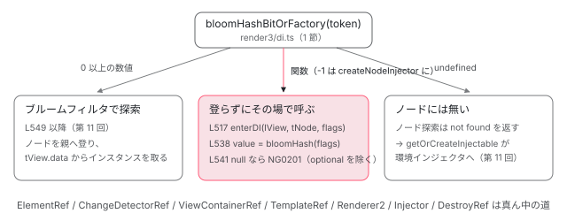

[目次](../README.md) › [DI の内側](README.md) › 第 13 回 / 全 16 回

# ElementRef・ChangeDetectorRef・ViewContainerRef・TemplateRef・Injector が provider 無しで取れる理由

> これらのクラスは static \_\_NG\_ELEMENT\_ID\_\_ を持ち、bloomHashBitOrFactory が数値ではなく関数を返したとき lookupTokenUsingNodeInjector がその関数を直接呼ぶ。injectElementRef / injectChangeDetectorRef / injectViewContainerRef / injectTemplateRef / createNodeInjector / injectDestroyRef が LView と TNode から何を作るかを 1 つずつ読む。環境インジェクタで ElementRef を取ろうとすると NG0201 になる理由。

angular/angular · 読了 約 13 分 · 中核 · [サイトで読む（デモが動きます）](https://angular-deep-dive-cyan.vercel.app/chapter/di-special-tokens)

---

`ElementRef`・`ChangeDetectorRef`・`ViewContainerRef`・`TemplateRef`・`Injector` は、どこにも `providers` を書いていないのに、コンポーネントのコンストラクタで `inject()` すると取れます。これらのクラスは `static __NG_ELEMENT_ID__` に**関数**を持っていて、`bloomHashBitOrFactory` がその関数を返し、`lookupTokenUsingNodeInjector` が探索をせずに**その場で呼ぶ**からです。この章では、その分岐の行を読み、関数ごとに「LView と TNode から何を作るか」を 1 つずつ確かめ、最後に環境インジェクタで `ElementRef` を取ると `NG0201` になる理由を `R3Injector.get` の行で示します。

読む対象は `packages/core/src/render3/di.ts`、`render3/state.ts`、`linker/element_ref.ts`・`view_container_ref.ts`・`template_ref.ts`、`change_detection/change_detector_ref.ts`、`render/api.ts`、`di/r3_injector.ts` です。

1. [1. 概観](01-di-overview.md)
2. [2. inject() の実装](02-di-inject-function.md)
3. [3. 注入コンテキスト](03-di-injection-context.md)
4. [4. ɵfac の生成](04-di-factory.md)
5. [5. @Injectable と @Service](05-di-injectable-compile.md)
6. [6. InjectionToken と特殊トークン](06-di-injection-token.md)
7. [7. provider の 4 つの形](07-di-provider-to-factory.md)
8. [8. R3Injector.get の全手順](08-di-r3-injector-get.md)
9. [9. multi: true](09-di-multi-providers.md)
10. [10. ブルームフィルタ](10-di.md)
11. [11. NodeInjector の探索](11-di-node-injector-lookup.md)
12. [12. self・skipSelf・host・optional](12-di-resolution-flags.md)
13. **13. provider 無しで取れるトークン**（この章）
14. [14. DestroyRef と破棄](14-di-destroy.md)
15. [15. injectAsync と onIdle](15-di-inject-async.md)
16. [16. DevTools と injector profiler](16-di-debug.md)

## 1. \_\_NG\_ELEMENT\_ID\_\_ は 3 種類の値をとる

`__NG_ELEMENT_ID__` はクラス（またはトークン）に付く static プロパティです。[第 10 回](10-di.md)で見たとおり、`providers` に書かれたクラスには、ブルームフィルタのビット番号として**0 以上の数値**が後から書き込まれます。このプロパティを読むのが `bloomHashBitOrFactory` です。後半の分岐だけを見ます。

📄 `angular/packages/core/src/render3/di.ts` L832–846 （▶ の行: 834, 836–838, 840, 842, 845）

```ts
832 │   const tokenId: number | undefined =
833 │     // First check with `Object.hasOwn` so we don't get an inherited ID.
834 ▶     Object.hasOwn(token, NG_ELEMENT_ID) ? (token as any)[NG_ELEMENT_ID] : undefined;
835 │   // Negative token IDs are used for special objects such as `Injector`
836 ▶   if (typeof tokenId === 'number') {
837 ▶     if (tokenId >= 0) {
838 ▶       return tokenId & BLOOM_MASK;
839 │     } else {
840 ▶       ngDevMode &&
841 │         assertEqual(tokenId, InjectorMarkers.Injector, 'Expecting to get Special Injector Id');
842 ▶       return createNodeInjector;
843 │     }
844 │   } else {
845 ▶     return tokenId;
846 │   }
```

1. **834 行目：自分自身のプロパティだけを読む**

   `Object.hasOwn` なので、親クラスから継承した `__NG_ELEMENT_ID__` は無視します。持っていなければ `tokenId` は `undefined`。
2. **837〜838 行目：0 以上の数値ならビット番号**

   `BLOOM_MASK` で切り詰めて返します。呼び出し側はこの数値でブルームフィルタを引きながら親へ登ります（[第 11 回](11-di-node-injector-lookup.md)）。
3. **840〜842 行目：負の数値は `Injector` だけ**

   負の値は `InjectorMarkers.Injector`（`-1`）しか無いことを assert し、`createNodeInjector` という**関数**に置き換えて返します。`Injector` クラスの `__NG_ELEMENT_ID__` が関数ではなく `-1` になっているのは、`injector_marker.ts` のコメントにあるとおり tree-shaking のためです（[第 1 回](01-di-overview.md)）。
4. **845 行目：それ以外はそのまま返す**

   ここに来るのは「関数」か「`undefined`」です。`ElementRef` などはクラス定義に関数を書いてあるので、この行で**関数がそのまま**呼び出し側へ渡ります。



*bloomHashBitOrFactory の戻り値で lookupTokenUsingNodeInjector の道が 3 本に分かれる。関数のときは木を登らず、enterDI で今のノードに合わせてから呼ぶだけ。*

## 2. 関数なら enterDI して呼ぶだけ

戻り値を受け取るのは `lookupTokenUsingNodeInjector` の先頭です。ブルームフィルタを使う通常の探索（数値の場合）は [第 11 回](11-di-node-injector-lookup.md)で読みました。ここでは**その手前**の分岐を見ます。

📄 `angular/packages/core/src/render3/di.ts` L513–549 （▶ の行: 513, 516–517, 520–522, 527, 538, 541–542, 544, 547, 549）

```ts
513 ▶   const bloomHash = bloomHashBitOrFactory(token);
514 │   // If the ID stored here is a function, this is a special object like ElementRef or TemplateRef
515 │   // so just call the factory function to create it.
516 ▶   if (typeof bloomHash === 'function') {
517 ▶     if (!enterDI(lView, tNode, flags)) {
518 │       // Failed to enter DI, try module injector instead. If a token is injected with the @Host
519 │       // flag, the module injector is not searched for that token in Ivy.
520 ▶       return flags & InternalInjectFlags.Host
521 ▶         ? notFoundValueOrThrow<T>(notFoundValue, token, flags)
522 ▶         : lookupTokenUsingModuleInjector<T>(lView, token, flags, notFoundValue);
523 │     }
524 │     try {
525 │       let value: unknown;
526 │ 
527 ▶       if (ngDevMode) {
528 │         runInInjectorProfilerContext(
529 │           new NodeInjector(getCurrentTNode() as TElementNode, getLView()),
530 │           token as Type<T>,
531 │           () => {
532 │             emitInjectorToCreateInstanceEvent(token);
533 │             value = bloomHash(flags);
534 │             emitInstanceCreatedByInjectorEvent(value);
535 │           },
536 │         );
537 │       } else {
538 ▶         value = bloomHash(flags);
539 │       }
540 │ 
541 ▶       if (value == null && !(flags & InternalInjectFlags.Optional)) {
542 ▶         throwProviderNotFoundError(token);
543 │       } else {
544 ▶         return value;
545 │       }
546 │     } finally {
547 ▶       leaveDI();
548 │     }
549 ▶   } else if (typeof bloomHash === 'number') {
```

1. **513・516 行目：関数かどうか**

   516 行目のコメントがそのまま答えです。「ここに入っている ID が関数なら、ElementRef や TemplateRef のような特別なオブジェクトなので、その factory 関数を呼んで作る」。`tView.data` も `providers` も見ません。
2. **517 行目：`enterDI(lView, tNode, flags)`**

   呼ぶ前に、新しい LFrame（実行中の命令の状態を持つ枠。[ivy-lframe](../ivy/15-ivy-lframe.md)）を積み、「今のノード」と「今の LView」を探索の起点に合わせます。中身は次の引用です。失敗するのは `skipSelf` で親が見つからないときだけで、そのときは 520〜522 行目で `host` なら not found、そうでなければ環境インジェクタ（`lookupTokenUsingModuleInjector`）へ行きます。
3. **538 行目：`value = bloomHash(flags)`**

   ここで `injectElementRef` などが呼ばれます。引数は `flags` だけで、LView と TNode は渡しません。各関数は `getCurrentTNode()` と `getLView()` で、517 行目が設定した値を読みます。527 行目からの `ngDevMode` の枝は同じ呼び出しを profiler のイベントで挟んでいるだけです（[第 16 回](16-di-debug.md)）。
4. **541〜544 行目：`null` なら NG0201**

   関数が `null` を返し、`optional` でなければ `throwProviderNotFoundError`。`optional` なら `null` がそのまま返ります。`TemplateRef` がこの道を通ります（5 節）。
5. **547 行目：`leaveDI()`**

   `finally` で LFrame を戻します。値が取れても例外でも必ず戻ります。

📄 `angular/packages/core/src/render3/state.ts` L606–621 （▶ の行: 606, 608, 610–611, 616–618）

```ts
606 ▶     if (parentTNode === null) {
607 │       // If we failed to find a parent TNode this means that we should use module injector.
608 ▶       return false;
609 │     } else {
610 ▶       tNode = parentTNode;
611 ▶       lView = parentLView;
612 │     }
613 │   }
614 │ 
615 │   ngDevMode && assertTNodeForLView(tNode, lView);
616 ▶   const lFrame = (instructionState.lFrame = allocLFrame());
617 ▶   lFrame.currentTNode = tNode;
618 ▶   lFrame.lView = lView;
619 │ 
620 │   return true;
621 │ }
```

610〜611 行目は `skipSelf` のときだけ通る部分の最後で、起点を親の要素に移します（親の探し方は [第 12 回](12-di-resolution-flags.md)）。616〜618 行目、新しい LFrame の `currentTNode` と `lView` を書き込みます。だから `inject(ElementRef, { skipSelf: true })` は**親要素の**`ElementRef` を返します。下の DEMO の表の 2 段目がそれです。

## 3. Injector：-1 が createNodeInjector になる

📄 `angular/packages/core/src/render3/di.ts` L907–910 （▶ の行: 909）

```ts
907 │ /** Creates a `NodeInjector` for the current node. */
908 │ export function createNodeInjector(): Injector {
909 ▶   return new NodeInjector(getCurrentTNode()! as TDirectiveHostNode, getLView()) as any;
910 │ }
```

909 行目、今のノードと今の LView で `new NodeInjector` するだけです。`NodeInjector` は `_tNode` と `_lView` の 2 つしか持たないので、**呼ぶたびに新しいオブジェクト**ですが、`get` すると同じノードから探索が始まります。DEMO の `inject(Injector).get(ElementRef)` が自分と同じ要素を返すのはそのためです。

## 4. ElementRef・ChangeDetectorRef：クラスに関数を書いておく

📄 `angular/packages/core/src/linker/element_ref.ts` L72–81 （▶ の行: 76, 79–80）

```ts
72 │   /**
73 │    * @internal
74 │    * @nocollapse
75 │    */
76 ▶   static __NG_ELEMENT_ID__: () => ElementRef = injectElementRef;
77 │ }
78 │ 
79 ▶ if (typeof ngDevMode === 'undefined' || ngDevMode) {
80 ▶   registerSpecialProvider(ElementRef);
81 │ }
```

76 行目、`ElementRef.__NG_ELEMENT_ID__ = injectElementRef`。`injectElementRef` は `getCurrentTNode()` と `getLView()` からネイティブ要素を取り、`new ElementRef(...)` します（中身は [ivy-refs](../ivy/16-ivy-refs.md) の 7 節）。79〜80 行目、開発モードのときだけ `registerSpecialProvider(ElementRef)` で「特別なトークン」の一覧に登録します。この一覧は DevTools がノードの providers を表示するときに混ぜて出すためのものです（[第 16 回](16-di-debug.md)）。

📄 `angular/packages/core/src/change_detection/change_detector_ref.ts` L109–128 （▶ の行: 113–114, 122–126）

```ts
109 │   /**
110 │    * @internal
111 │    * @nocollapse
112 │    */
113 ▶   static __NG_ELEMENT_ID__: (flags: InternalInjectFlags) => ChangeDetectorRef =
114 ▶     injectChangeDetectorRef;
115 │ }
116 │ 
117 │ if (typeof ngDevMode === 'undefined' || ngDevMode) {
118 │   registerSpecialProvider(ChangeDetectorRef);
119 │ }
120 │ 
121 │ /** Returns a ChangeDetectorRef (a.k.a. a ViewRef) */
122 ▶ export function injectChangeDetectorRef(flags: InternalInjectFlags): ChangeDetectorRef {
123 ▶   return createViewRef(
124 ▶     getCurrentTNode()!,
125 ▶     getLView(),
126 ▶     (flags & InternalInjectFlags.ForPipe) === InternalInjectFlags.ForPipe,
127 │   );
128 │ }
```

113〜114 行目、`ChangeDetectorRef` だけは関数が `flags` を受け取ります。2 節 538 行目の `bloomHash(flags)` がここに届きます。126 行目、`ForPipe` フラグ（コンパイラがパイプのコンストラクタ引数の inject に付けるビット）を見て、`createViewRef` の第 3 引数にします。`createViewRef` は「ホストがコンポーネントならそのコンポーネントの LView、それ以外は宣言元コンポーネントの LView」で `new ViewRef` します（[ivy-refs](../ivy/16-ivy-refs.md) の 2 節）。つまり `ChangeDetectorRef` というクラスのインスタンスは存在せず、返るのは毎回新しい `ViewRef` です。

## 5. ViewContainerRef と TemplateRef：ノードの種類で結果が変わる

📄 `angular/packages/core/src/linker/view_container_ref.ts` L297–317 （▶ の行: 301, 314–316）

```ts
297 │   /**
298 │    * @internal
299 │    * @nocollapse
300 │    */
301 ▶   static __NG_ELEMENT_ID__: () => ViewContainerRef = injectViewContainerRef;
302 │ }
303 │ 
304 │ if (typeof ngDevMode === 'undefined' || ngDevMode) {
305 │   registerSpecialProvider(ViewContainerRef);
306 │ }
307 │ 
308 │ /**
309 │  * Creates a ViewContainerRef and stores it on the injector. Or, if the ViewContainerRef
310 │  * already exists, retrieves the existing ViewContainerRef.
311 │  *
312 │  * @returns The ViewContainerRef instance to use
313 │  */
314 ▶ export function injectViewContainerRef(): ViewContainerRef {
315 ▶   const previousTNode = getCurrentTNode() as TElementNode | TElementContainerNode | TContainerNode;
316 ▶   return createContainerRef(previousTNode, getLView());
317 │ }
```

📄 `angular/packages/core/src/linker/view_container_ref.ts` L692–714 （▶ の行: 699–700, 702, 707–709, 711, 713）

```ts
692 │ export function createContainerRef(
693 │   hostTNode: TElementNode | TContainerNode | TElementContainerNode,
694 │   hostLView: LView,
695 │ ): ViewContainerRef {
696 │   ngDevMode && assertTNodeType(hostTNode, TNodeType.AnyContainer | TNodeType.AnyRNode);
697 │ 
698 │   let lContainer: LContainer;
699 ▶   const slotValue = hostLView[hostTNode.index];
700 ▶   if (isLContainer(slotValue)) {
701 │     // If the host is a container, we don't need to create a new LContainer
702 ▶     lContainer = slotValue;
703 │   } else {
704 │     // An LContainer anchor can not be `null`, but we set it here temporarily
705 │     // and update to the actual value later in this function (see
706 │     // `_locateOrCreateAnchorNode`).
707 ▶     lContainer = createLContainer(slotValue, hostLView, null!, hostTNode);
708 ▶     hostLView[hostTNode.index] = lContainer;
709 ▶     addToEndOfViewTree(hostLView, lContainer);
710 │   }
711 ▶   _locateOrCreateAnchorNode(lContainer, hostLView, hostTNode, slotValue);
712 │ 
713 ▶   return new R3ViewContainerRef(lContainer, hostTNode, hostLView);
714 │ }
```

1. **699〜702 行目：スロットがもう LContainer なら使い回す**

   `hostLView[hostTNode.index]` は、普通の要素ならその DOM 要素です。`<ng-template>` や `@if` のように最初から LContainer（埋め込みビューを並べる配列。[ivy-lcontainer](../ivy/11-ivy-lcontainer.md)）があるノードなら、それをそのまま使います。
2. **707〜709 行目：普通の要素なら LContainer を作って**スロットを差し替える****

   `createLContainer` で新しい LContainer を作り、元の DOM 要素をその中に包んでスロットに置き直し、ビューの木（[ivy-view-tree](../ivy/12-ivy-view-tree.md)）の末尾に繋ぎます。**inject しただけで LView の形が変わる**唯一の特殊トークンです。
3. **711 行目：アンカーのコメントを用意する**

   普通の要素の場合、ホスト要素の**直後**にコメントノードを挿し、後で `createEmbeddedView` したビューはそのコメントの前に入ります。開発モードではコメントの中身が `container`、本番ビルドでは空です。DEMO の「次の兄弟ノード」がこれです。
4. **713 行目：`new R3ViewContainerRef`**

   ラッパーは毎回新しく作りますが、中の LContainer は 2 回目からは 700 行目で同じものが見つかります。

📄 `angular/packages/core/src/linker/template_ref.ts` L54–58 （▶ の行: 58）

```ts
54 │   /**
55 │    * @internal
56 │    * @nocollapse
57 │    */
58 ▶   static __NG_ELEMENT_ID__: () => TemplateRef<any> | null = injectTemplateRef;
```

📄 `angular/packages/core/src/linker/template_ref.ts` L114–140 （▶ の行: 119–120, 131, 133–136, 139）

```ts
114 │ /**
115 │  * Creates a TemplateRef given a node.
116 │  *
117 │  * @returns The TemplateRef instance to use
118 │  */
119 ▶ export function injectTemplateRef<T>(): TemplateRef<T> | null {
120 ▶   return createTemplateRef<T>(getCurrentTNode()!, getLView());
121 │ }
122 │ 
123 │ /**
124 │  * Creates a TemplateRef and stores it on the injector.
125 │  *
126 │  * @param hostTNode The node on which a TemplateRef is requested
127 │  * @param hostLView The `LView` to which the node belongs
128 │  * @returns The TemplateRef instance or null if we can't create a TemplateRef on a given node type
129 │  */
130 │ export function createTemplateRef<T>(hostTNode: TNode, hostLView: LView): TemplateRef<T> | null {
131 ▶   if (hostTNode.type & TNodeType.Container) {
132 │     ngDevMode && assertDefined(hostTNode.tView, 'TView must be allocated');
133 ▶     return new TemplateRef(
134 ▶       hostLView,
135 ▶       hostTNode as TContainerNode,
136 ▶       createElementRef(hostTNode, hostLView),
137 │     );
138 │   }
139 ▶   return null;
140 │ }
```

58 行目の型が `TemplateRef<any> | null` になっているのがポイントです。131 行目、今のノードが `TNodeType.Container`（`<ng-template>` から作られたノード）のときだけ、133〜136 行目で宣言元の LView・そのノード・ElementRef から `TemplateRef` を作ります。それ以外のノードでは 139 行目で `null`。すると 2 節 541〜542 行目で NG0201 になります。コンポーネントのコンストラクタで `inject(TemplateRef)` が失敗し、`<ng-template myDir>` に付けたディレクティブでは成功するのはこの 1 行の違いです。

## 6. Renderer2：コンポーネントのビューのレンダラ

📄 `angular/packages/core/src/render/api.ts` L245–264 （▶ の行: 249, 258–259, 262–263）

```ts
245 │   /**
246 │    * @internal
247 │    * @nocollapse
248 │    */
249 ▶   static __NG_ELEMENT_ID__: () => Renderer2 = () => injectRenderer2();
250 │ }
251 │ 
252 │ if (typeof ngDevMode === 'undefined' || ngDevMode) {
253 │   registerSpecialProvider(Renderer2);
254 │ }
255 │ 
256 │ /** Injects a Renderer2 for the current component. */
257 │ export function injectRenderer2(): Renderer2 {
258 ▶   // We need the Renderer to be based on the component that it's being injected into, however since
259 ▶   // DI happens before we've entered its view, `getLView` will return the parent view instead.
260 │   const lView = getLView();
261 │   const tNode = getCurrentTNode()!;
262 ▶   const nodeAtIndex = getComponentLViewByIndex(tNode.index, lView);
263 ▶   return (isLView(nodeAtIndex) ? nodeAtIndex : lView)[RENDERER] as Renderer2;
264 │ }
```

258〜259 行目のコメントが、この章の全関数に共通する事情を説明しています。「DI はコンポーネントのビューに入る**前**に起きるので、`getLView` は親のビューを返す」。だから 262 行目で「このノードにコンポーネントの LView がぶら下がっているか」を見て、あればそちらの `RENDERER`、無ければ今の LView の `RENDERER` を返します（263 行目）。コンポーネントごとに別のレンダラ（たとえば `ViewEncapsulation` の違うもの）を持てるので、自分の側のものを返す必要があります。

## 7. 一覧：トークン × \_\_NG\_ELEMENT\_ID\_\_ × 返すもの

| トークン | \_\_NG\_ELEMENT\_ID\_\_ | 返すもの | 読んだ場所 |
| --- | --- | --- | --- |
| `ElementRef` | `injectElementRef` | 今のノードのネイティブ要素を包んだ新しい `ElementRef` | 4 節 76 行目、[ivy-refs](../ivy/16-ivy-refs.md) |
| `ChangeDetectorRef` | `injectChangeDetectorRef(flags)` | 新しい `ViewRef`（ホストがコンポーネントならその LView） | 4 節 113〜126 行目 |
| `ViewContainerRef` | `injectViewContainerRef` | `R3ViewContainerRef`（必要なら LContainer とアンカーを作る） | 5 節 301・707〜713 行目 |
| `TemplateRef` | `injectTemplateRef` | `<ng-template>` のノードなら `TemplateRef`、それ以外は `null` | 5 節 58・131・139 行目 |
| `Renderer2` | `() => injectRenderer2()` | コンポーネントの LView（無ければ今の LView）の `RENDERER` | 6 節 249・263 行目 |
| `Injector` | `-1`（`InjectorMarkers.Injector`） | 840〜842 行目で `createNodeInjector` に置き換わり、新しい `NodeInjector` | 1 節・3 節 909 行目 |
| `DestroyRef` | `injectDestroyRef` | 今の LView に紐づく `NodeInjectorDestroyRef` | [第 14 回](14-di-destroy.md) |
| `ViewContext`（内部用） | `injectViewContext` | 今の LView と TNode を持つ `ViewContext`。`effect()` が使う | [cd-effects](../cd/09-cd-effects.md) |
| `HOST_TAG_NAME` / `HostAttributeToken` | トークンのインスタンスに関数を付ける | ホストのタグ名 / 属性値 | [第 6 回](06-di-injection-token.md) |

## 8. 環境インジェクタは \_\_NG\_ELEMENT\_ID\_\_ を見ない

ここまでの分岐はすべて `lookupTokenUsingNodeInjector`、つまり **NodeInjector 側**の関数の中です。環境インジェクタ（`R3Injector`）の `get` の入口はこうなっています。

📄 `angular/packages/core/src/di/r3_injector.ts` L323–342 （▶ の行: 328, 330–331, 341–342）

```ts
323 │   override get<T>(
324 │     token: ProviderToken<T>,
325 │     notFoundValue: any = THROW_IF_NOT_FOUND,
326 │     options?: InjectOptions,
327 │   ): T {
328 ▶     assertNotDestroyed(this);
329 │ 
330 ▶     if (Object.hasOwn(token, NG_ENV_ID)) {
331 ▶       return (token as any)[NG_ENV_ID](this);
332 │     }
333 │ 
334 │     const flags = convertToBitFlags(options) as InternalInjectFlags;
335 │ 
336 │     // Set the injection context.
337 │     let prevInjectContext: InjectorProfilerContext;
338 │     if (ngDevMode) {
339 │       prevInjectContext = setInjectorProfilerContext({injector: this, token: token as Type<T>});
340 │     }
341 ▶     const previousInjector = setCurrentInjector(this);
342 ▶     const previousInjectImplementation = setInjectImplementation(undefined);
```

330〜331 行目で特別扱いしているのは `NG_ENV_ID`（`__NG_ENV_ID__`）で、`__NG_ELEMENT_ID__` ではありません。`r3_injector.ts` を `NG_ELEMENT_ID` で grep しても 1 件も出てきません。`__NG_ENV_ID__` を持つのは `DestroyRef` だけです（[第 14 回](14-di-destroy.md)）。この後は [第 8 回](08-di-r3-injector-get.md)で読んだとおり、`records` を引き、無ければ `ɵprov` を探します。`ElementRef` には `records` も `ɵprov` も無いので、親へ、さらに親へと渡り、最後の `NullInjector` が NG0201 を投げます。

だから `providedIn: 'root'` のサービスのコンストラクタで `inject(ElementRef)` と書くと NG0201 です。サービスの `inject()` は `injectInjectorOnly` → `R3Injector.get` の道（[第 2 回](02-di-inject-function.md)）を通り、2 節の `lookupTokenUsingNodeInjector` を一度も通らないからです。逆に、同じサービスをコンポーネントの `providers` に書けば、NodeInjector が factory を呼ぶときに inject 実装が `ɵɵdirectiveInject` になり（第 11 回）、ホスト要素の `ElementRef` が取れます。

> [!WARNING]
> **ハマりどころ**
>
> 「特殊トークンは provider が要らない」は**NodeInjector から探したときだけ**の話です。`inject(EnvironmentInjector).get(ElementRef)`、`providedIn: 'root'` のサービス、`runInInjectionContext(environmentInjector, ...)` の中、いずれも 330 行目以降の `R3Injector` の手順になり、見つかりません。

## 9. DEMO：子コンポーネントから特殊トークンを取る

> **🧪 DEMO — &lt;div class="probe-box"&gt; の中の &lt;app-st-probe&gt;**
>
> `<app-st-probe>` はこのページのテンプレートで `<div class="probe-box">` の子として置いています。上の 9 段はコンポーネントの NodeInjector 側、下の 2 段は環境インジェクタで試した結果です（どれもコンストラクタ時点で実行）。`context === this` とアンカーは描画後（`afterNextRender`）に読みます。本番ビルドではアンカーのコメントが空（`<!---->`）になります。
>
> ▶ [このデモはサイトで動かせます](https://angular-deep-dive-cyan.vercel.app/chapter/di-special-tokens)

- **1 段目**：`APP-ST-PROBE`。enterDI がホストの TNode を今のノードにしたので、ホスト要素です。
- **2 段目**：`probe-box`。`skipSelf` で enterDI の 610〜611 行目が起点を親要素に移しました。
- **3・4 段目**：`true` と `false`。`NodeInjector` から取っても同じ要素を指しますが、`ElementRef` は毎回新しいオブジェクトです。
- **5・6 段目**：`false` と `true`。`ChangeDetectorRef` も毎回新しい `ViewRef` ですが、`context`（`lView[CONTEXT]`）はこのコンポーネント自身です。
- **7 段目**：コメントノード。5 節 711 行目のアンカーです。
- **8・9 段目**：`null` と NG0201。ホストは `<ng-template>` ではないので 139 行目で `null`、optional でなければ 541〜542 行目で例外です。
- **10・11 段目**：`null` と NG0201。`R3Injector` は `__NG_ELEMENT_ID__` を見ないので、親を辿り切って見つかりません。

## ここまでの呼び出し

- 👤 `el = inject(ElementRef)` — あなたのコンポーネントのフィールド初期化子
  - `ɵɵdirectiveInject(ElementRef)` — render3/instructions/di.ts — *ディレクティブ生成中の inject 実装*
    - `getOrCreateInjectable(tNode, lView, ElementRef, flags)` — render3/di.ts L486 — *まず NodeInjector 側*
      - `lookupTokenUsingNodeInjector(...)` — render3/di.ts L507
        - `bloomHashBitOrFactory(ElementRef)` — render3/di.ts L845 — *static \_\_NG\_ELEMENT\_ID\_\_ = injectElementRef をそのまま返す*
        - `enterDI(lView, tNode, flags)` — render3/state.ts L616-618 — *新しい LFrame に currentTNode と lView を書く（skipSelf なら親）*
        - `bloomHash(flags)` = `injectElementRef()` — render3/di.ts L538
          - `createElementRef(getCurrentTNode(), getLView())` — linker/element\_ref.ts L23 — *new ElementRef(ネイティブ要素)*
        - `leaveDI()` — render3/di.ts L547

## 聞かれそうな質問

**Q. ElementRef を providers に書いていないのに、なぜ取れるのですか？**

`ElementRef` の `static __NG_ELEMENT_ID__` が `injectElementRef`（element\_ref.ts 76 行目）で、`bloomHashBitOrFactory` の 845 行目がそれをそのまま返し、`lookupTokenUsingNodeInjector` の 516 行目で「関数なら呼ぶ」に入るからです。`tView.data` の providers 区間は一度も見ていません。provider の代わりに「今のノードから作る関数」がクラス自身に付いています。

**Q. providedIn: 'root' のサービスで inject(ElementRef) すると？**

NG0201 です。サービスの `inject()` は `R3Injector.get` を通り、330 行目で見るのは `__NG_ENV_ID__` だけで `__NG_ELEMENT_ID__` は見ません。`ElementRef` は records にも `ɵprov` にも無いので NullInjector まで行って失敗します。DEMO の最後の行と同じです。要素が欲しければ、サービスをコンポーネントの `providers` に書くか、呼び出し側から要素を引数で渡します。

**Q. inject(ElementRef) を 2 回呼ぶと同じオブジェクトですか？**

違います。`injectElementRef` は呼ばれるたびに `new ElementRef` し、`createNodeInjector`（909 行目）、`createViewRef`、`R3ViewContainerRef`（713 行目）も同様に毎回 `new` です。provider と違ってインスタンスを LView に保存する処理がありません。中身（ネイティブ要素や LView）は同じなので、`nativeElement` で比べれば一致します（DEMO の 3・4 段目）。

**Q. コンポーネントで inject(TemplateRef) するとエラーになるのはなぜですか？**

`createTemplateRef` の 131 行目が「ノードが `<ng-template>` 由来（`TNodeType.Container`）か」を見て、違えば 139 行目で `null` を返し、`lookupTokenUsingNodeInjector` の 541〜542 行目が `null` を not found として NG0201 にするからです。`{ optional: true }` なら 544 行目で `null` が返ります。

**Q. inject(ViewContainerRef) だけで DOM が変わるのは本当ですか？**

本当です。普通の要素がホストのとき、`createContainerRef` の 707〜709 行目が LContainer を作ってスロットを差し替え、711 行目でホストの直後にアンカーのコメントノードを挿します。DEMO の 7 段目はそのコメントを読んでいます。`<ng-template>` や `<ng-container>` がホストなら既存の LContainer やコメントを使うので増えません。

## 読み終えて

- 特殊トークンはクラス自身の `static __NG_ELEMENT_ID__` に「今のノードから作る関数」を持つ。`Injector` だけは `-1` で、842 行目で `createNodeInjector` に置き換わる
- `lookupTokenUsingNodeInjector` は 516 行目で関数なら木を登らず、517 行目の `enterDI` で今のノードを合わせて 538 行目で呼ぶ
- 各関数は `getCurrentTNode()` / `getLView()` を読むだけ。`skipSelf` なら enterDI が親を起点にする
- `TemplateRef` は `<ng-template>` のノードでしか作れず、それ以外は `null` → NG0201。`ViewContainerRef` は inject するだけで LContainer とアンカーを作る
- `R3Injector.get` は `__NG_ELEMENT_ID__` を見ない。環境インジェクタやルートのサービスからは特殊トークンは取れない

---

← 前: [self・skipSelf・host・optional：4 つのビットが探索のどこを止めるか](12-di-resolution-flags.md)  
次: [DestroyRef と破棄：R3Injector.destroy、サービスの ngOnDestroy、NodeInjectorDestroyRef](14-di-destroy.md) →
