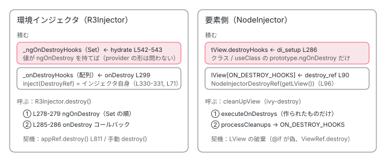

[目次](../README.md) › [DI の内側](README.md) › 第 14 回 / 全 16 回

# DestroyRef と破棄：R3Injector.destroy、サービスの ngOnDestroy、NodeInjectorDestroyRef

> R3Injector.destroy が onDestroy に積んだサービスの ngOnDestroy とコールバックを呼ぶ順番、hasOnDestroy で登録される行、destroy 後に get すると NG0205 になる行。要素側では provider の ngOnDestroy が registerDestroyHooksIfSupported で TView の destroyHooks に積まれ、inject(DestroyRef) は NodeInjectorDestroyRef（LView の破棄に連動）になる。takeUntilDestroyed がそれを使う行。

angular/angular · 読了 約 13 分 · 中核 · [サイトで読む（デモが動きます）](https://angular-deep-dive-cyan.vercel.app/chapter/di-destroy)

---

サービスの `ngOnDestroy` と `inject(DestroyRef).onDestroy(...)` は、どちらも「片付けの登録」ですが、**どのインジェクタで作られたか**によって、積まれる場所も呼ばれる契機もまったく違います。環境インジェクタ（`R3Injector`）では `_ngOnDestroyHooks` と `_onDestroyHooks` に積まれ、`R3Injector.destroy()` で呼ばれます。要素側（NodeInjector）では `TView.destroyHooks` と `LView` の `ON_DESTROY_HOOKS` に積まれ、**LView が破棄されたとき**に呼ばれます。この章では、両方の「積む行」と「呼ぶ行」を順番付きで読み、`destroy` 後に触ると NG0205 になる行、`takeUntilDestroyed` がそれを使う行まで追います。

読む対象は `packages/core/src/di/r3_injector.ts`、`linker/destroy_ref.ts`、`render3/di_setup.ts`、`application/application_ref.ts`、`errors.ts`、`rxjs-interop/src/take_until_destroyed.ts` です。LView の破棄そのもの（`destroyViewTree` → `cleanUpView` → `executeOnDestroys` → `processCleanups`）は [ivy-destroy](../ivy/17-ivy-destroy.md) で読んだので行は繰り返しません。

1. [1. 概観](01-di-overview.md)
2. [2. inject() の実装](02-di-inject-function.md)
3. [3. 注入コンテキスト](03-di-injection-context.md)
4. [4. ɵfac の生成](04-di-factory.md)
5. [5. @Injectable と @Service](05-di-injectable-compile.md)
6. [6. InjectionToken と特殊トークン](06-di-injection-token.md)
7. [7. provider の 4 つの形](07-di-provider-to-factory.md)
8. [8. R3Injector.get の全手順](08-di-r3-injector-get.md)
9. [9. multi: true](09-di-multi-providers.md)
10. [10. ブルームフィルタ](10-di.md)
11. [11. NodeInjector の探索](11-di-node-injector-lookup.md)
12. [12. self・skipSelf・host・optional](12-di-resolution-flags.md)
13. [13. provider 無しで取れるトークン](13-di-special-tokens.md)
14. **14. DestroyRef と破棄**（この章）
15. [15. injectAsync と onIdle](15-di-inject-async.md)
16. [16. DevTools と injector profiler](16-di-debug.md)

## 1. DestroyRef はトークンで、中身は 2 種類

📄 `angular/packages/core/src/linker/destroy_ref.ts` L26–31 （▶ の行: 26, 29–30）

```ts
26 ▶ export abstract class DestroyRef {
27 │   // Here the `DestroyRef` acts primarily as a DI token. There are (currently) types of objects that
28 │   // can be returned from the injector when asking for this token:
29 ▶   // - `NodeInjectorDestroyRef` when retrieved from a node injector;
30 ▶   // - `EnvironmentInjector` when retrieved from an environment injector
31 │ 
```

26 行目、`DestroyRef` は抽象クラスです。29〜30 行目のコメントどおり、`inject(DestroyRef)` で返るのは 「NodeInjector から取ったら `NodeInjectorDestroyRef`」「環境インジェクタから取ったら `EnvironmentInjector` そのもの」の 2 種類です。どちらに分かれるかは、クラスに付いた 2 つの static で決まります。

📄 `angular/packages/core/src/linker/destroy_ref.ts` L61–76 （▶ の行: 65, 71）

```ts
61 │   /**
62 │    * @internal
63 │    * @nocollapse
64 │    */
65 ▶   static __NG_ELEMENT_ID__: () => DestroyRef = injectDestroyRef;
66 │ 
67 │   /**
68 │    * @internal
69 │    * @nocollapse
70 │    */
71 ▶   static __NG_ENV_ID__: (injector: EnvironmentInjector) => DestroyRef = (injector) => injector;
72 │ }
73 │ 
74 │ if (typeof ngDevMode === 'undefined' || ngDevMode) {
75 │   registerSpecialProvider(DestroyRef);
76 │ }
```

- 65 行目 `__NG_ELEMENT_ID__ = injectDestroyRef` は、[第 13 回](13-di-special-tokens.md)で読んだ「NodeInjector が見つけたらその場で呼ぶ関数」です。`ElementRef` と同じ仕組みで、`lookupTokenUsingNodeInjector` がこれを呼びます。
- 71 行目 `__NG_ENV_ID__ = (injector) => injector` は、`R3Injector` 側の入口が見る、もう 1 つの static です。`__NG_ENV_ID__` を持つクラスは core の中で `DestroyRef` だけです。

📄 `angular/packages/core/src/di/r3_injector.ts` L323–332 （▶ の行: 328, 330–331）

```ts
323 │   override get<T>(
324 │     token: ProviderToken<T>,
325 │     notFoundValue: any = THROW_IF_NOT_FOUND,
326 │     options?: InjectOptions,
327 │   ): T {
328 ▶     assertNotDestroyed(this);
329 │ 
330 ▶     if (Object.hasOwn(token, NG_ENV_ID)) {
331 ▶       return (token as any)[NG_ENV_ID](this);
332 │     }
```

330〜331 行目、`R3Injector.get` は records を見るより前に `__NG_ENV_ID__` を調べ、あれば `this`（自分自身）を渡して呼びます。`DestroyRef` では 71 行目の関数が `injector` をそのまま返すので、**環境インジェクタから取った DestroyRef はそのインジェクタ自身**です。`providers` にも `records` にも `DestroyRef` は出てきません。328 行目の `assertNotDestroyed` は 5 節で読みます。

## 2. R3Injector：2 つの入れ物

📄 `angular/packages/core/src/di/r3_injector.ts` L197–212 （▶ の行: 202, 204, 212）

```ts
197 │   private records = new Map<ProviderToken<any>, Record<any> | null>();
198 │ 
199 │   /**
200 │    * Set of values instantiated by this injector which contain `ngOnDestroy` lifecycle hooks.
201 │    */
202 ▶   private _ngOnDestroyHooks = new Set<OnDestroy>();
203 │ 
204 ▶   private _onDestroyHooks: Array<() => void> = [];
205 │ 
206 │   /**
207 │    * Flag indicating that this injector was previously destroyed.
208 │    */
209 │   override get destroyed(): boolean {
210 │     return this._destroyed;
211 │   }
212 ▶   private _destroyed = false;
```

202 行目の `_ngOnDestroyHooks` は**インスタンスの Set**、204 行目の `_onDestroyHooks` は**コールバックの配列**、212 行目の `_destroyed` は破棄済みフラグです。前者に入るのは「このインジェクタが作った、`ngOnDestroy` を持つ値」、後者に入るのは `onDestroy(cb)` で渡された関数です。

### ngOnDestroy を持つ値は hydrate で Set に入る

📄 `angular/packages/core/src/di/r3_injector.ts` L539–545 （▶ の行: 539, 542–543）

```ts
539 ▶           record.value = record.factory!(undefined, flags);
540 │         }
541 │       }
542 ▶       if (typeof record.value === 'object' && record.value && hasOnDestroy(record.value)) {
543 ▶         this._ngOnDestroyHooks.add(record.value);
544 │       }
545 │       return record.value as T;
```

539 行目で factory を呼んで値を作った直後、542〜543 行目で「オブジェクトで、`ngOnDestroy` が関数なら」Set に足します（`hydrate` の全体は [第 8 回](08-di-r3-injector-get.md)）。見ているのは**できあがった値**であって、provider の形ではありません。だから `useClass` でも `useFactory` でも `useValue` でも、取り出された値が `ngOnDestroy` を持っていれば対象になります。逆に、一度も `get` されなかった provider は `hydrate` を通らないので Set に入りません。また Set なので、入る順番は「最初に作られた順」です。依存先は依存元の factory の中で先に作られ終わるので、依存先のほうが先に入ります。

### onDestroy(cb) は配列に push

📄 `angular/packages/core/src/di/r3_injector.ts` L297–307 （▶ の行: 298–300, 304）

```ts
297 │   override onDestroy(callback: () => void): () => void {
298 ▶     assertNotDestroyed(this);
299 ▶     this._onDestroyHooks.push(callback);
300 ▶     return () => this.removeOnDestroy(callback);
301 │   }
302 │ 
303 │   override runInContext<ReturnT>(fn: () => ReturnT): ReturnT {
304 ▶     assertNotDestroyed(this);
305 │ 
306 │     const previousInjector = setCurrentInjector(this);
307 │     const previousInjectImplementation = setInjectImplementation(undefined);
```

298 行目で破棄済みでないことを確かめ、299 行目で配列に足し、300 行目で「外すための関数」を返します。`inject(DestroyRef).onDestroy(cb)` を環境インジェクタで呼ぶと、1 節のとおり `DestroyRef` はインジェクタ自身なので、この関数がそのまま呼ばれます。

## 3. R3Injector.destroy：ngOnDestroy が先、コールバックが後

📄 `angular/packages/core/src/di/r3_injector.ts` L271–294 （▶ の行: 271, 274–275, 278–279, 284–286, 290–291）

```ts
271 ▶     assertNotDestroyed(this);
272 │ 
273 │     // Set destroyed = true first, in case lifecycle hooks re-enter destroy().
274 ▶     this._destroyed = true;
275 ▶     const prevConsumer = setActiveConsumer(null);
276 │     try {
277 │       // Call all the lifecycle hooks.
278 ▶       for (const service of this._ngOnDestroyHooks) {
279 ▶         service.ngOnDestroy();
280 │       }
281 │       const onDestroyHooks = this._onDestroyHooks;
282 │       // Reset the _onDestroyHooks array before iterating over it to prevent hooks that unregister
283 │       // themselves from mutating the array during iteration.
284 ▶       this._onDestroyHooks = [];
285 ▶       for (const hook of onDestroyHooks) {
286 ▶         hook();
287 │       }
288 │     } finally {
289 │       // Release all references.
290 ▶       this.records.clear();
291 ▶       this._ngOnDestroyHooks.clear();
292 │       this.injectorDefTypes.clear();
293 │       setActiveConsumer(prevConsumer);
294 │     }
```

1. **274 行目：最初に `_destroyed = true`**

   フックの中から `destroy()` がもう一度呼ばれても、冒頭 271 行目の `assertNotDestroyed` で止まるようにするためです（273 行目のコメント）。フック実行中に `get` しても NG0205 になります。
2. **275 行目：`setActiveConsumer(null)`**

   フックの中で signal を読んでも、外側の computed や effect の依存にならないようにします（[signals](../signals/01-signals.md)）。
3. **278〜279 行目：Set の順に `ngOnDestroy()`**

   2 節で積んだインスタンスを、入った順に呼びます。
4. **284〜286 行目：配列を空にしてからコールバックを呼ぶ**

   先に `this._onDestroyHooks = []` と差し替えるのは、コールバックが自分で登録解除（300 行目の関数）しても、走査中の配列が変わらないようにするためです（282〜283 行目のコメント）。
5. **290〜291 行目：`finally` で records と Set を空にする**

   途中のフックが例外を投げても、参照は必ず解放されます。

つまり環境インジェクタでは**「全サービスの `ngOnDestroy`」→「全 `onDestroy` コールバック」**の順です。サービス A の `ngOnDestroy` と、サービス A のコンストラクタで登録した `DestroyRef` のコールバックは、間に他のサービスの `ngOnDestroy` を挟んで別々に呼ばれます。

## 4. アプリ全体が終わるとき：ApplicationRef.destroy から

📄 `angular/packages/core/src/application/application_ref.ts` L797–813 （▶ の行: 805, 808, 811）

```ts
797 │   destroy(): void {
798 │     if (this._destroyed) {
799 │       throw new RuntimeError(
800 │         RuntimeErrorCode.APPLICATION_REF_ALREADY_DESTROYED,
801 │         ngDevMode && 'This instance of the `ApplicationRef` has already been destroyed.',
802 │       );
803 │     }
804 │ 
805 ▶     const injector = this._injector as R3Injector;
806 │ 
807 │     // Check that this injector instance supports destroy operation.
808 ▶     if (injector.destroy && !injector.destroyed) {
809 │       // Destroying an underlying injector will trigger the `ngOnDestroy` lifecycle
810 │       // hook, which invokes the remaining cleanup actions.
811 ▶       injector.destroy();
812 │     }
813 │   }
```

📄 `angular/packages/core/src/application/application_ref.ts` L761–778 （▶ の行: 761, 766, 769）

```ts
761 ▶   ngOnDestroy() {
762 │     if (this._destroyed) return;
763 │ 
764 │     try {
765 │       // Call all the lifecycle hooks.
766 ▶       this._destroyListeners.forEach((listener) => listener());
767 │ 
768 │       // Destroy all registered views.
769 ▶       this._views.slice().forEach((view) => view.destroy());
770 │     } finally {
771 │       // Indicate that this instance is destroyed.
772 │       this._destroyed = true;
773 │ 
774 │       // Release all references.
775 │       this._views = [];
776 │       this._destroyListeners = [];
777 │     }
778 │   }
```

1. **`appRef.destroy()` → 811 行目 `injector.destroy()`**

   805 行目の `_injector` はアプリのルートの環境インジェクタです。`ApplicationRef` 自身は何も片付けず、インジェクタに任せます（809〜810 行目のコメント）。
2. **`R3Injector.destroy()` → 278〜279 行目の Set に `ApplicationRef` 自身がいる**

   `ApplicationRef` はルートインジェクタが作ったサービスで、761 行目に `ngOnDestroy` があるので、2 節の 542〜543 行目で Set に入っています。
3. **766 行目：`appRef.onDestroy` のリスナー、769 行目：全ビューの `destroy()`**

   ルートコンポーネントのビューが破棄され、そこから下のコンポーネントの `ngOnDestroy` と `DestroyRef` コールバックが 6 節の手順で呼ばれます。
4. **ルートの残りの `ngOnDestroy` → `onDestroy` コールバック → records を空に**

   3 節の手順の続きです。

プラットフォームごと `platformRef.destroy()` した場合も、`bootstrapApplication` の中で `PLATFORM_DESTROY_LISTENERS` に「`envInjector.destroy()` を呼ぶ関数」が登録されているので、同じ `R3Injector.destroy()` に入ります （`bootstrap.ts` のその部分は [boot-bootstrap-application](../boot/07-boot-bootstrap-application.md) で引用済み）。

## 5. destroy の後に触ると NG0205

📄 `angular/packages/core/src/di/r3_injector.ts` L683–690 （▶ の行: 684–686）

```ts
683 │ export function assertNotDestroyed(injector: R3Injector): void {
684 ▶   if (injector.destroyed) {
685 ▶     throw new RuntimeError(
686 ▶       RuntimeErrorCode.INJECTOR_ALREADY_DESTROYED,
687 │       ngDevMode && 'Injector has already been destroyed.',
688 │     );
689 │   }
690 │ }
```

📄 `angular/packages/core/src/errors.ts` L37–46 （▶ の行: 43）

```ts
37 │   // Dependency Injection Errors
38 │   CYCLIC_DI_DEPENDENCY = -200,
39 │   PROVIDER_NOT_FOUND = -201,
40 │   INVALID_FACTORY_DEPENDENCY = 202,
41 │   MISSING_INJECTION_CONTEXT = -203,
42 │   INVALID_INJECTION_TOKEN = -204,
43 ▶   INJECTOR_ALREADY_DESTROYED = -205,
44 │   PROVIDER_IN_WRONG_CONTEXT = -207,
45 │   MISSING_INJECTION_TOKEN = 208,
46 │   INVALID_MULTI_PROVIDER = -209,
```

684 行目、`destroyed`（3 節 274 行目で立てたフラグ）を見て、686 行目の `INJECTOR_ALREADY_DESTROYED`、errors.ts 43 行目の `-205`、つまり `NG0205` を投げます（負の値は「エラー詳細ページへのリンクを付ける」印）。呼んでいるのは 1 節の `get`（328 行目）、2 節の `onDestroy`（298 行目）と `runInContext`（304 行目）、3 節の `destroy` の先頭です。破棄済みのインジェクタには、取り出しも登録も再破棄もできません。

## 6. 要素側：provider の ngOnDestroy は TView.destroyHooks へ

コンポーネントの `providers` に書いたサービスは NodeInjector が作ります（[providers の 2 つの行き先](../standalone/08-standalone-providers-two-injectors.md)）。こちらでは、値ができたときではなく、**最初の作成パスで provider を登録するとき**に ngOnDestroy を積みます。`resolveProvider` が新しいトークンを `tView.data` に push する直前に呼ぶのがこの関数です（push の部分は前掲の章で引用済み）。

📄 `angular/packages/core/src/render3/di_setup.ts` L254–290 （▶ の行: 260–261, 263, 265–267, 270, 281, 286）

```ts
254 │ function registerDestroyHooksIfSupported(
255 │   tView: TView,
256 │   provider: Exclude<Provider, any[]>,
257 │   contextIndex: number,
258 │   indexInFactory?: number,
259 │ ) {
260 ▶   const providerIsTypeProvider = isTypeProvider(provider);
261 ▶   const providerIsClassProvider = isClassProvider(provider);
262 │ 
263 ▶   if (providerIsTypeProvider || providerIsClassProvider) {
264 │     // Resolve forward references as `useClass` can hold a forward reference.
265 ▶     const classToken = providerIsClassProvider ? resolveForwardRef(provider.useClass) : provider;
266 ▶     const prototype = classToken.prototype;
267 ▶     const ngOnDestroy = prototype.ngOnDestroy;
268 │ 
269 │     if (ngOnDestroy) {
270 ▶       const hooks = tView.destroyHooks || (tView.destroyHooks = []);
271 │ 
272 │       if (!providerIsTypeProvider && (provider as ClassProvider).multi) {
273 │         ngDevMode &&
274 │           assertDefined(
275 │             indexInFactory,
276 │             'indexInFactory when registering multi factory destroy hook',
277 │           );
278 │         const existingCallbacksIndex = hooks.indexOf(contextIndex);
279 │ 
280 │         if (existingCallbacksIndex === -1) {
281 ▶           hooks.push(contextIndex, [indexInFactory, ngOnDestroy]);
282 │         } else {
283 │           (hooks[existingCallbacksIndex + 1] as DestroyHookData).push(indexInFactory!, ngOnDestroy);
284 │         }
285 │       } else {
286 ▶         hooks.push(contextIndex, ngOnDestroy);
287 │       }
288 │     }
289 │   }
290 │ }
```

1. **260〜263 行目：クラスそのもの、または `useClass` のときだけ**

   `useValue`・`useFactory`・`useExisting` はここで何もしません。値ができる前なので、「どのクラスか」が分かる形しか扱えないからです。2 節の `R3Injector`（値を見る）との大きな違いです。
2. **265〜267 行目：`prototype.ngOnDestroy` を取る**

   `useClass` は `forwardRef` を解きます。インスタンスではなく prototype を見るのは、まだインスタンスが無いからです。
3. **270・286 行目：`tView.destroyHooks.push(contextIndex, ngOnDestroy)`**

   `contextIndex` はトークンが入る `tView.data` の位置（呼び出し側が渡す `tInjectables.length`）で、同じ位置の LView のスロットにインスタンスが入ります。281 行目の `multi` の場合は、同じ位置に `[factory 内の番号, ngOnDestroy, ...]` の配列を作ります。

`TView` はテンプレートの型紙なので、同じ `@if` の中身が何回作り直されても登録は 1 回です。呼ぶ側の `executeOnDestroys` は「その LView のスロットがまだ `NodeInjectorFactory`（= 一度も inject されていない）なら呼ばない」ので、作られなかったサービスの `ngOnDestroy` は呼ばれません（[ivy-destroy](../ivy/17-ivy-destroy.md)）。コンポーネントやディレクティブ自身の `ngOnDestroy` も同じ `tView.destroyHooks` に、要素の終わり（`registerPostOrderHooks`）で積まれるので、同じ要素の上では**providers の ngOnDestroy が先、コンポーネントの ngOnDestroy が後**に並びます。

## 7. 要素側：inject(DestroyRef) は今の LView に登録する

📄 `angular/packages/core/src/linker/destroy_ref.ts` L78–97 （▶ の行: 79, 84, 90–91, 95–96）

```ts
78 │ export class NodeInjectorDestroyRef extends DestroyRef {
79 ▶   constructor(readonly _lView: LView) {
80 │     super();
81 │   }
82 │ 
83 │   override get destroyed() {
84 ▶     return isDestroyed(this._lView);
85 │   }
86 │ 
87 │   override onDestroy(callback: () => void): () => void {
88 │     const lView = this._lView;
89 │ 
90 ▶     storeLViewOnDestroy(lView, callback);
91 ▶     return () => removeLViewOnDestroy(lView, callback);
92 │   }
93 │ }
94 │ 
95 ▶ function injectDestroyRef(): DestroyRef {
96 ▶   return new NodeInjectorDestroyRef(getLView());
97 │ }
```

1. **95〜96 行目：`new NodeInjectorDestroyRef(getLView())`**

   `getLView()` は[第 13 回](13-di-special-tokens.md)の `enterDI` が設定した「今の LView」、つまり**ホスト要素が置かれている側の LView**です（コンポーネント自身のビューではありません）。`@if` の中に置いた子コンポーネントなら `@if` の埋め込みビュー、親テンプレートに直接置いたなら親のビューです。どちらもそのコンポーネントと一緒に破棄されるので、寿命は揃います。
2. **90 行目：`storeLViewOnDestroy(lView, callback)`**

   LView の `ON_DESTROY_HOOKS` 配列に push します。既に破棄済みなら NG0911（`VIEW_ALREADY_DESTROYED`）を投げます（[ivy-destroy](../ivy/17-ivy-destroy.md)）。91 行目は登録解除用の関数を返します。
3. **84 行目：`destroyed` は LView のフラグ**

   `isDestroyed(this._lView)`。`cleanUpView` がフックを呼ぶ前に立てる `LViewFlags.Destroyed` を見ます。

LView の破棄では、`cleanUpView` が `executeOnDestroys`（`tView.destroyHooks`、つまり 6 節の ngOnDestroy）を先に、`processCleanups`（リスナー解除、その後に `ON_DESTROY_HOOKS`、つまりこの節のコールバック）を後に呼びます（[ivy-destroy](../ivy/17-ivy-destroy.md)）。要素側でも**「ngOnDestroy が先、DestroyRef コールバックが後」**で、環境インジェクタと同じ並びになります。



*同じ「片付けの登録」でも、環境インジェクタはインジェクタの中に、要素側は TView と LView に積む。どちらも ngOnDestroy が先、DestroyRef コールバックが後。*

## 8. takeUntilDestroyed は DestroyRef.onDestroy の薄い包み

📄 `angular/packages/core/rxjs-interop/src/take_until_destroyed.ts` L25–43 （▶ の行: 26–28, 32–33, 36–37, 41）

```ts
25 │ export function takeUntilDestroyed<T>(destroyRef?: DestroyRef): MonoTypeOperatorFunction<T> {
26 ▶   if (!destroyRef) {
27 ▶     ngDevMode && assertInInjectionContext(takeUntilDestroyed);
28 ▶     destroyRef = inject(DestroyRef);
29 │   }
30 │ 
31 │   const destroyed$ = new Observable<void>((subscriber) => {
32 ▶     if (destroyRef.destroyed) {
33 ▶       subscriber.next();
34 │       return;
35 │     }
36 ▶     const unregisterFn = destroyRef.onDestroy(subscriber.next.bind(subscriber));
37 ▶     return unregisterFn;
38 │   });
39 │ 
40 │   return <T>(source: Observable<T>) => {
41 ▶     return source.pipe(takeUntil(destroyed$));
42 │   };
43 │ }
```

1. **26〜28 行目：引数が無ければ注入コンテキストで `inject(DestroyRef)`**

   27 行目の `assertInInjectionContext` は開発モードだけです（[第 3 回](03-di-injection-context.md)）。本番でも 28 行目の `inject` が注入コンテキスト外なら NG0203 を投げるので、結果は同じです。コンポーネントのフィールドで書けば `NodeInjectorDestroyRef`、ルートのサービスで書けばルートの `R3Injector` が返ります。
2. **32〜33 行目：購読した時点で破棄済みなら即 `next()`**

   破棄済みに `onDestroy` を呼ぶと例外（5 節・7 節）なので、先に `destroyed` を確かめます。
3. **36〜37 行目：`destroyRef.onDestroy(subscriber.next)`**

   破棄されたら `destroyed$` が値を 1 つ出します。`complete` を直接呼ぶのではなく、41 行目の `takeUntil` がその値を見て元の Observable を完了させます。37 行目で解除関数を返すので、先に元の Observable が終わって購読が外れれば、DestroyRef への登録も外れます。

## 9. DEMO

> **🧪 DEMO 1 — 要素側：@if で子コンポーネントを出し入れする**
>
> `<app-destroy-child>` は `providers: [NodeScopedService]` を持ち、フィールドで先にサービスを inject し、その後で自分の `inject(DestroyRef).onDestroy` を登録します。サービスもコンストラクタで `inject(DestroyRef).onDestroy` を登録します。「隠す」を押すと `@if` の埋め込みビューが破棄され、呼ばれた順にログが並びます。
>
> ▶ [このデモはサイトで動かせます](https://angular-deep-dive-cyan.vercel.app/chapter/di-destroy)

- ①② が `executeOnDestroys`：`tView.destroyHooks` の並び（di\_setup.ts 286 行目で provider が先に、要素の終わりでコンポーネントが後に積まれた）
- ③④ が `processCleanups` の `ON_DESTROY_HOOKS`：`storeLViewOnDestroy`（destroy\_ref.ts 90 行目）で登録した順。サービスが先に作られたので ③ が先
- 2 回目以降に出し入れしても、6 節の登録は `TView` に 1 回だけで、並びは変わりません

> **🧪 DEMO 2 — 環境インジェクタ側：createEnvironmentInjector して destroy する**
>
> `createEnvironmentInjector([EnvScopedService, ...], 章の環境インジェクタ)` で子のインジェクタを作り、`get` でサービスを作らせてから 外からも `env.get(DestroyRef).onDestroy(...)` で登録し（`EnvironmentInjector.onDestroy` は `@internal` なので公開 API の `DestroyRef` 経由。1 節のとおり中身は同じインジェクタ）、`destroy()` します。その後で `get` と `onDestroy` を試します（例外は捕まえて表示）。
>
> ▶ [このデモはサイトで動かせます](https://angular-deep-dive-cyan.vercel.app/chapter/di-destroy)

- 最初の行の `true`：R3Injector.get の 330〜331 行目と destroy\_ref.ts 71 行目で、`DestroyRef` はインジェクタ自身
- ① が 278〜279 行目、②③ が 285〜286 行目。②（サービスが登録）と ③（外から登録）は `onDestroy` を呼んだ順
- 最後の 2 行が NG0205：684〜686 行目。`get` は 328 行目、`onDestroy` は 298 行目で止まる

## ここまでの呼び出し

- 👤 `inject(DestroyRef).onDestroy(cb)` — あなたのコンポーネント / サービス
  - `NodeInjector から` → `injectDestroyRef()` — linker/destroy\_ref.ts L95-96 — *new NodeInjectorDestroyRef(getLView())*
    - `storeLViewOnDestroy(lView, cb)` — destroy\_ref.ts L90 — *lView\[ON\_DESTROY\_HOOKS\] に push*
  - `R3Injector から` → `DestroyRef.__NG_ENV_ID__(this)` — di/r3\_injector.ts L330-331 — *インジェクタ自身が返る*
    - `R3Injector.onDestroy(cb)` — r3\_injector.ts L297-300 — *\_onDestroyHooks に push*
- 👤 `@if` が偽になる / `appRef.destroy()` — 破棄の契機
  - `cleanUpView(tView, lView)` — render3/node\_manipulation.ts（ivy-destroy） — *executeOnDestroys（provider → コンポーネントの ngOnDestroy）→ processCleanups（ON\_DESTROY\_HOOKS）*
  - `ApplicationRef.destroy()` → `injector.destroy()` — application/application\_ref.ts L811
    - `R3Injector.destroy()` — r3\_injector.ts L274-291 — *\_destroyed = true → ngOnDestroy（ApplicationRef.ngOnDestroy がビューを破棄）→ onDestroy コールバック → records.clear()*

## 聞かれそうな質問

**Q. サービスの ngOnDestroy と inject(DestroyRef).onDestroy は、どちらが先に呼ばれますか？**

どちらのインジェクタでも `ngOnDestroy` が先です。環境インジェクタは `R3Injector.destroy` の 278〜279 行目（Set）が 285〜286 行目（配列）より前、要素側は `cleanUpView` が `executeOnDestroys` を `processCleanups` より前に呼びます。同じサービスの 2 つが続けて呼ばれるわけではなく、**全員の ngOnDestroy が終わってから全員のコールバック**です（DEMO 1 の ①② → ③④）。

**Q. コンポーネントの providers に useFactory で書いたサービスの ngOnDestroy は呼ばれますか？**

呼ばれません。`registerDestroyHooksIfSupported` の 260〜263 行目がクラスそのものか `useClass` のときしか `destroyHooks` に積まないからです。片付けが必要なら、factory の中で `inject(DestroyRef).onDestroy(...)` を登録します。同じ provider を環境インジェクタ（`bootstrapApplication` の providers やルートの `providers`）に書いた場合は、hydrate の 542〜543 行目が値を見るので呼ばれます。

**Q. providedIn: 'root' のサービスで inject(DestroyRef) すると、いつ呼ばれますか？**

ルートの環境インジェクタが破棄されたときです。`R3Injector.get` の 330〜331 行目で `DestroyRef` はルートの `R3Injector` そのものになり、`onDestroy` は 299 行目で `_onDestroyHooks` に積まれます。普通のアプリでは `appRef.destroy()`（811 行目）か `platformRef.destroy()` までは呼ばれません。コンポーネントの寿命で片付けたいなら、サービスをコンポーネントの `providers` に書くか、コンポーネント側の `DestroyRef` を引数で渡します。

**Q. destroy した後のインジェクタを使うと何が起きますか？**

`get`（328 行目）・`onDestroy`（298 行目）・`runInContext`（304 行目）・`destroy` がいずれも `assertNotDestroyed`（684〜686 行目）で NG0205（errors.ts 43 行目の `INJECTOR_ALREADY_DESTROYED = -205`）を投げます。`destroyed` は 274 行目で**フックを呼ぶ前に**`true` になるので、ngOnDestroy の中から自分のインジェクタを `get` しても NG0205 です。DEMO 2 の最後の 2 行がこれです。

**Q. takeUntilDestroyed() を ngOnInit の中で書くとどうなりますか？**

`ngOnInit` は注入コンテキストではないので、28 行目の `inject(DestroyRef)` が NG0203 を投げます（開発モードではその前に 27 行目の assert）。`ngOnInit` で使うなら、フィールドで `destroyRef = inject(DestroyRef)` を取っておき、`takeUntilDestroyed(this.destroyRef)` と渡します。26 行目で引数があれば inject しません。

## 読み終えて

- `DestroyRef` は 2 つの static を持つトークン。NodeInjector からは `NodeInjectorDestroyRef(getLView())`、環境インジェクタからは 330〜331 行目でインジェクタ自身
- R3Injector は値ができたとき（hydrate 542〜543 行目）に ngOnDestroy を Set に、`onDestroy` を配列に積み、`destroy` で Set → 配列の順に呼ぶ
- 要素側は最初の作成パスで、クラス / `useClass` の provider だけ ngOnDestroy を `tView.destroyHooks` に積む。DestroyRef は `lView[ON_DESTROY_HOOKS]`
- どちらも「ngOnDestroy が先、DestroyRef コールバックが後」。破棄後の R3Injector は NG0205
- `takeUntilDestroyed` は `inject(DestroyRef)` と `onDestroy(subscriber.next)` と `takeUntil` の 3 つでできている

---

← 前: [ElementRef・ChangeDetectorRef・ViewContainerRef・TemplateRef・Injector が provider 無しで取れる理由](13-di-special-tokens.md)  
次: [injectAsync と onIdle：サービスを遅延読み込みする新しい API](15-di-inject-async.md) →
