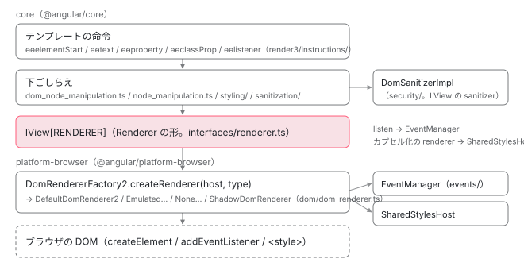

[目次](../README.md) › [DOM レンダラーとイベントの内側](README.md) › 第 1 回 / 全 20 回

# DOM レンダラーの全体像：命令・Renderer2・DomRendererFactory2・EventManager

> テンプレートの命令（ɵɵelementStart・ɵɵproperty・ɵɵclassProp・ɵɵlistener）が DOM を直接触らず、LView に入った Renderer を通して書く分担。core の dom\_node\_manipulation.ts と node\_manipulation.ts、platform-browser の dom\_renderer.ts・shared\_styles\_host.ts・events/、core の styling/ と sanitization/ の場所。ページの上で本物のコンポーネントを描いて、renderer に届いた呼び出しを順に並べるデモ。

angular/angular · 読了 約 12 分 · 基礎 · [サイトで読む（デモが動きます）](https://angular-deep-dive-cyan.vercel.app/chapter/domr-overview)

---

テンプレートに `<p [class.on]="on()">` と書くと、画面の `<p>` に class が付きます。けれども Angular のテンプレートの命令（`ɵɵelementStart`・`ɵɵproperty`・`ɵɵclassProp`・`ɵɵlistener`）は、`document.createElement` も `classList.add` も自分では呼びません。必ず **LView に入った renderer**（DOM を書く役のオブジェクト）を通して書きます。この章では、その分担がどのファイルのどの行で決まっているかを確かめ、ページの上で本物のコンポーネントを描いて、renderer に届いた呼び出しを 1 行ずつ並べます。

読む対象は core の `render3/dom_node_manipulation.ts`・`render3/interfaces/renderer.ts` と、platform-browser の `browser.ts`・`platform-browser.ts`・`private_export.ts` です（../angular、22.2.0-next.7、8576f161ae4）。

1. **1. 全体像**（この章）
2. [2. Renderer2 の約束](02-domr-renderer-api.md)
3. [3. DomRendererFactory2](03-domr-renderer-factory.md)
4. [4. 要素とテキスト](04-domr-default-renderer.md)
5. [5. 属性とプロパティ](05-domr-attributes-properties.md)
6. [6. カプセル化](06-domr-encapsulation.md)
7. [7. SharedStylesHost](07-domr-shared-styles.md)
8. [8. CSS 変数の名前空間](08-domr-css-var-namespacing.md)
9. [9. クラスとスタイル](09-domr-styling-overview.md)
10. [10. 優先順位のリスト](10-domr-style-binding-list.md)
11. [11. 値を決めて書く](11-domr-styling-apply.md)
12. [12. \[class\] と \[style\]](12-domr-styling-maps.md)
13. [13. EventManager](13-domr-event-manager.md)
14. [14. listen](14-domr-listen.md)
15. [15. キーのイベント](15-domr-key-events.md)
16. [16. 自分のプラグイン](16-domr-custom-plugin.md)
17. [17. サニタイズ](17-domr-sanitization.md)
18. [18. 信頼の印](18-domr-trusted-types.md)
19. [19. Title と Meta](19-domr-title-meta.md)
20. [20. issue と PR を読む](20-domr-issues.md)

## 1. 命令は renderer の 1 メソッドを呼ぶだけ

テキストの `hi {{ n() }}` を例にします。作るときの命令 `ɵɵtext` と、値を書き換える命令 `ɵɵtextInterpolate2`（`ɵɵtextInterpolate` の仲間。値が 2 つなので 2）は、最後に core の `dom_node_manipulation.ts` の小さな関数を呼びます。

📄 `angular/packages/core/src/render3/dom_node_manipulation.ts` L16–22 （▶ の行: 16–17, 20–21）

```ts
16 ▶ export function createTextNode(renderer: Renderer, value: string): RText {
17 ▶   return renderer.createText(value);
18 │ }
19 │ 
20 ▶ export function updateTextNode(renderer: Renderer, rNode: RText, value: string): void {
21 ▶   renderer.setValue(rNode, value);
22 │ }
```

16〜17 行目、テキストのノードを作るのは `renderer.createText(value)`。20〜21 行目、値を書き換えるのは `renderer.setValue(rNode, value)`。どちらも第 1 引数の `renderer` に頼むだけで、`document` という語はこのファイルに 1 度も出てきません。要素を作る `createElementNode`・差し込む `nativeAppendOrInsertBefore`・外す `nativeRemoveNode` も同じ形です （命令の側から追う話は [作成の命令](../ivy/09-ivy-create-instructions.md)と [テンプレートと DOM](../template/05-dom.md) にあります）。

渡される `renderer` は、命令がいま描いているビューの `lView[RENDERER]` です。コンポーネントのビューを作るときに 1 回だけ決まり、そのビューの命令は最後まで同じものを使います。決まる行は[第 2 回](02-domr-renderer-api.md)で読みます。

## 2. core が知っているのは「DOM の API の一部」という形だけ

📄 `angular/packages/core/src/render3/interfaces/renderer.ts` L15–26 （▶ の行: 16–18, 20–21）

```ts
15 │ /**
16 ▶  * The goal here is to make sure that the browser DOM API is the Renderer.
17 ▶  * We do this by defining a subset of DOM API to be the renderer and then
18 ▶  * use that at runtime for rendering.
19 │  *
20 ▶  * At runtime we can then use the DOM api directly, in server or web-worker
21 ▶  * it will be easy to implement such API.
22 │  */
23 │ 
24 │ export type GlobalTargetName = 'document' | 'window' | 'body';
25 │ 
26 │ export type GlobalTargetResolver = (element: any) => EventTarget;
```

16〜18 行目のコメントが設計の意図です。「ブラウザの DOM の API を renderer にする。DOM の API の一部を renderer と定めて、実行時にそれを使う」。20〜21 行目、サーバーや web worker でも同じ形を実装すれば動く、とあります。core の `render3/` は、この形（`Renderer` インターフェース）だけを見て書かれています。中身を持つクラスは core には無く、ブラウザ用の実装は platform-browser の `DomRendererFactory2` と、それが返す renderer たちです。

## 3. 本物の renderer はどこから来るか

📄 `angular/packages/platform-browser/src/browser.ts` L274–280 （▶ の行: 275–276, 279–280）

```ts
274 │   {provide: EVENT_MANAGER_PLUGINS, useClass: KeyEventsPlugin, multi: true},
275 ▶   DomRendererFactory2,
276 ▶   {provide: SHARED_STYLES_HOST, useClass: SharedStylesHost},
277 │   // Only remains for backwards compatibility, should be removed once g3 no longer needs it.
278 │   {provide: SharedStylesHost, useExisting: SHARED_STYLES_HOST},
279 ▶   EventManager,
280 ▶   {provide: RendererFactory2, useExisting: DomRendererFactory2},
```

platform-browser の `BROWSER_MODULE_PROVIDERS` の一部です。`bootstrapApplication` でも `BrowserModule` でも、この配列がアプリのインジェクタに入ります （配列の全体と入り方は [BrowserModule の providers](../ngmodule/12-ngmodule-browser-module.md)）。

1. **275 行目：`DomRendererFactory2`**

   レンダラーの工場（factory）。コンポーネントごとに renderer を作って返します（[第 3 回](03-domr-renderer-factory.md)）。
2. **276 行目：`SHARED_STYLES_HOST` → `SharedStylesHost`**

   コンポーネントの CSS の `<style>` を `<head>` に足し引きする係（[第 7 回](07-domr-shared-styles.md)）。工場のコンストラクタが受け取ります。
3. **279 行目：`EventManager`**

   イベント名でプラグインに振り分ける係（[第 13 回](13-domr-event-manager.md)）。renderer の `listen` がこれに頼みます。
4. **280 行目：`RendererFactory2` → `useExisting: DomRendererFactory2`**

   core が探すのは抽象クラス `RendererFactory2` のトークンです。ここで platform-browser の実装に結びつきます。



*命令から DOM までの層。core は Renderer の形だけを知り、platform-browser が中身を持つ。イベント・スタイル・サニタイズは横の係に分かれている。*

## 4. ディレクトリの分担

このシリーズで読むファイルを、置き場所ごとに並べます（行数は 8576f161ae4 の実物を `wc -l` で数えたもの）。

| 場所 | 主なファイル（行数） | 役目 | 章 |
| --- | --- | --- | --- |
| core `render/` | `api.ts`（285）・`api_flags.ts`（65） | 公開の約束 `RendererFactory2`・`Renderer2`・`RendererType2`・`RendererStyleFlags2` | [2](02-domr-renderer-api.md) |
| core `render3/` | `interfaces/renderer.ts`（86）・`dom_node_manipulation.ts`（155）・`node_manipulation.ts`（1166） | core の中の型 `Renderer` と、それを呼ぶ小さな関数。ビューの差し込み・取り外し | [2](02-domr-renderer-api.md)・[4](04-domr-default-renderer.md) |
| core `render3/instructions/` | `element.ts`（414）・`text.ts`（96）・`property.ts`（67）・`attribute.ts`（42）・`styling.ts`（1052）・`listener.ts`（179） | テンプレートの命令 | [5](05-domr-attributes-properties.md)・[9〜12](09-domr-styling-overview.md)・[14](14-domr-listen.md) |
| core `render3/styling/` | `style_binding_list.ts`（465）・`styling_parser.ts`（332）・`static_styling.ts`（52）・`class_differ.ts`（46） | \[class\]・\[style\] の優先順位と文字列の分解 | [10](10-domr-style-binding-list.md)・[12](12-domr-styling-maps.md) |
| core `sanitization/`・`util/security/` | `sanitization.ts`（414）・`html_sanitizer.ts`（355）・`bypass.ts`（199）・`trusted_types.ts`（83）ほか | 危ない値を止める・信頼の印 | [17](17-domr-sanitization.md)・[18](18-domr-trusted-types.md) |
| platform-browser `dom/` | `dom_renderer.ts`（730）・`shared_styles_host.ts`（253）・`css_var_namespacer.ts`（47） | 工場と 4 種類の renderer、`<style>` の係 | [3](03-domr-renderer-factory.md)・[6](06-domr-encapsulation.md)・[7](07-domr-shared-styles.md)・[8](08-domr-css-var-namespacing.md) |
| platform-browser `dom/events/` | `event_manager.ts`（114）・`dom_events.ts`（43）・`key_events.ts`（200）・`event_manager_plugin.ts`（43） | イベントの振り分けとプラグイン | [13](13-domr-event-manager.md)〜[16](16-domr-custom-plugin.md) |
| platform-browser `security/`・`browser/` | `dom_sanitization_service.ts`（231）・`meta.ts`（227）・`title.ts`（39）・`browser_adapter.ts`（97） | `DomSanitizer` の実装、`<head>` を触る小さなサービス | [17](17-domr-sanitization.md)・[19](19-domr-title-meta.md) |

## 5. 外から使える名前

📄 `angular/packages/platform-browser/src/platform-browser.ts` L17–24 （▶ の行: 21, 23–24）

```ts
17 │ export {Meta, MetaDefinition} from './browser/meta';
18 │ export {Title} from './browser/title';
19 │ export {disableDebugTools, enableDebugTools} from './browser/tools/tools';
20 │ export {By} from './dom/debug/by';
21 ▶ export {provideCssVarNamespacing, REMOVE_STYLES_ON_COMPONENT_DESTROY} from './dom/dom_renderer';
22 │ export {CssVarNamespacer} from './dom/css_var_namespacer';
23 ▶ export {EVENT_MANAGER_PLUGINS, EventManager} from './dom/events/event_manager';
24 ▶ export {EventManagerPlugin} from './dom/events/event_manager_plugin';
```

📄 `angular/packages/platform-browser/src/private_export.ts` L9–17 （▶ の行: 12–15, 17）

```ts
 9 │ export {ɵgetDOM} from '@angular/common';
10 │ export {BrowserDomAdapter as ɵBrowserDomAdapter} from './browser/browser_adapter';
11 │ export {BrowserGetTestability as ɵBrowserGetTestability} from './browser/testability';
12 ▶ export {DomRendererFactory2 as ɵDomRendererFactory2} from './dom/dom_renderer';
13 ▶ export {DomEventsPlugin as ɵDomEventsPlugin} from './dom/events/dom_events';
14 ▶ export {KeyEventsPlugin as ɵKeyEventsPlugin} from './dom/events/key_events';
15 ▶ export {SharedStylesHost as ɵSharedStylesHost} from './dom/shared_styles_host';
16 │ export {RuntimeErrorCode as ɵRuntimeErrorCode} from './errors';
17 ▶ export {DomSanitizerImpl as ɵDomSanitizerImpl} from './security/dom_sanitization_service';
```

公開 API（`platform-browser.ts`）に出ているのは、21 行目の `REMOVE_STYLES_ON_COMPONENT_DESTROY`・`provideCssVarNamespacing` と、23〜24 行目の `EventManager`・`EventManagerPlugin` などです。**`DomRendererFactory2` そのものは公開されていません**。`private_export.ts` の 12 行目で `ɵDomRendererFactory2` という ɵ 付きの名前（Angular の中の人どうしで使う名前）で出ています。13〜15 行目のプラグインと `SharedStylesHost`、17 行目の `DomSanitizerImpl` も同じです。core のテスト `renderer_factory_spec.ts` や、このシリーズのデモが使うのはこの ɵ の名前です。

## 6. デモ：renderer に届いた呼び出しを並べる

次のデモは、章の中で定義した本物のコンポーネント（AOT でコンパイル済み）を描きます。テンプレートは次の 1 行と、ShadowDom の子コンポーネントです。

📄 `domr-overview.ts（DomrOvTarget の template）`

```
<p class="box" [class.on]="on()" [style.width.px]="w()" [attr.data-n]="n()"
   (click)="clicks.update(add1)">hi {{ n() }} / click {{ clicks() }}</p>
@if (on()) {<domr-ov-child />}
```

renderer に届く呼び出しを見るために、共通部品 `domr-probe.ts` の `mountWithLog` を使います。これは**このサイトの本物の `DomRendererFactory2`**（@angular/platform-browser 22.1.6）を薄い記録係で包み、工場と renderer のメソッドが呼ばれるたびに 1 行を記録してから、本物をそのまま呼びます。記録に出るのは core から renderer への呼び出しだけで、renderer が中で自分のメソッドを呼ぶ分（Emulated の renderer が `_ngcontent-…` を付けるなど）は出ません。

> **🧪 DEMO — 本物のコンポーネントを描いて、renderer に届いた呼び出しを並べる**
>
> ボタンは 1 から順に押せます。4 の destroy のあとは 1 からやり直せます。表の「相手」は factory（工場）か、工場が返した renderer の番号（r1, r2, …）です。
>
> ▶ [このデモはサイトで動かせます](https://angular-deep-dive-cyan.vercel.app/chapter/domr-overview)

開発ビルドを headless Chrome で 4 段とも押したときの記録（#1〜#42 の 42 回）を、段ごとに読みます。#の番号は表の左の列です。

1. **1 段目の #1〜#3：工場が 2 回呼ばれる**

   #1 の `createRenderer(null, …)` が `r1` を返し、#2 で `r1` がホスト要素 `<domr-ov-target>` を作ります。#3、ホスト要素ができてから `createRenderer(<domr-ov-target>, …)` がもう 1 回呼ばれ、`r2` を返します。以後、テンプレートの中身は全部 `r2` に届きます。1 回目の引数が `null` なので工場が既定の renderer を返す行と、2 回目にカプセル化で renderer を選ぶ行は[第 3 回](03-domr-renderer-factory.md)で読みます。
2. **#4〜#11：作成（creation）**

   `createElement("p")` → 静的な `class="box"` を `setAttribute` → `appendChild` → `listen(<p>, "click", ƒ)` → 空のテキストを `createText("")` → `@if` の目印の `createComment("container")`。作成の段では、テキストは空、クラスやスタイルのバインディングはまだ何も書かれていません。`listen` は作成のときに 1 回だけです（[第 14 回](14-domr-listen.md)）。
3. **#12〜#17：最初の変更検知は `begin` と `end` に挟まれる**

   `setStyle(<p>, "width", "160px")`・`removeClass(<p>, "on")`・`setAttribute(<p>, "data-n", "0")`・`setValue(#text, "hi 0 / click 0")`。バインディングの値はここで初めて書かれます。`[class.on]` が `false` のときに `removeClass` が来るのは、クラスのバインディングが「付ける・外す」の 2 択で値を書くからです（[第 11 回](11-domr-styling-apply.md)）。`begin`・`end` がどこで呼ばれるかは[第 2 回](02-domr-renderer-api.md)。
4. **2 段目：入力を変えると、変わった所だけ**

   `setStyle`（200px）・`addClass("on")`・`setAttribute("data-n", "1")`・`setValue` の 4 つに続いて、`@if` の中身が作られます。`r2.createElement("domr-ov-child")` のあと、子のために `createRenderer(<domr-ov-child>, … ShadowDom)` が `r3` を返し、`r3.createElement("svg", "svg")`・`r3.createElement("circle", "svg")` と、第 2 引数に名前空間が付きます（[第 4 回](04-domr-default-renderer.md)）。最後に `r2.parentNode(<!--container-->)` で目印の親を聞き、`r2.insertBefore(<domr-ov-target>, <domr-ov-child>, <!--container-->, true)` で目印の前に差し込みます。子の svg の `appendChild` は記録ではホスト要素あてですが、ShadowDom の renderer が中で shadow root に向け直します（[第 6 回](06-domr-encapsulation.md)）。
5. **3 段目：クリックそのものは renderer を呼ばない**

   `<p>` の `click()` でリスナーが走り、`clicks` の signal が 1 増えます。その後の変更検知で届いたのは `begin`・`setValue`・`end` の 3 行だけでした。リスナーは 1 段目の `listen` で DOM に付いていて、クリックのたびに renderer を通ることはありません。
6. **4 段目：destroy で `destroy()` が 2 回**

   `r3.destroy()`（子）→ `r2.destroy()`（親）。`r1` には来ません。core は**コンポーネントのビューを片付けるときだけ** renderer の `destroy()` を呼ぶからです（[第 2 回](02-domr-renderer-api.md)）。`removeChild` も来ません。どの `ApplicationRef` にも `ViewContainerRef` にも付いていない根のビューは、destroy しても DOM から外されないためです（[ビューの破棄](../ivy/17-ivy-destroy.md)）。デモはそのあと自分でホスト要素を外しています。

> [!TIP]
> **新卒エンジニアへ**
>
> 表の「章」の列は、その呼び出しの中身を読む回です。たとえば `setStyle` は第 11 回、`listen` は第 14 回。この表 1 枚が、このシリーズの目次になっています。

## ここまでの呼び出し

- 👤 `createComponent(DomrOvTarget, { environmentInjector, elementInjector })` — domr-probe.ts
  - `rendererFactory.createRenderer(null, def)` — core/src/render3/component\_ref.ts L339 — *→ r1。ホスト要素を作る renderer*
  - `rendererFactory.createRenderer(host, def)` — core/src/render3/view/construction.ts L247 — *→ r2。コンポーネントのビューの lView\[RENDERER\]*
    - `ɵɵelementStart` → `createElementNode(r2, "p", null)` — core/src/render3/dom\_node\_manipulation.ts L35
    - `ɵɵtext` → `createTextNode(r2, "")` — dom\_node\_manipulation.ts L16
- 👤 `changeDetectorRef.detectChanges()`
  - `rendererFactory.begin?.()` — core/src/render3/instructions/change\_detection.ts L100
    - `ɵɵtextInterpolate…` → `updateTextNode(r2, text, "hi 0 / click 0")` — dom\_node\_manipulation.ts L20 — *→ r2.setValue*
  - `rendererFactory.end?.()` — change\_detection.ts L107
  - `DefaultDomRenderer2.setValue → node.nodeValue = value` — platform-browser/src/dom/dom\_renderer.ts — *本物の DOM を書くのはここ*

## テストと直し方

### 層ごとの spec

| 層 | spec | bazel のターゲット |
| --- | --- | --- |
| platform-browser の renderer | `packages/platform-browser/test/dom/dom_renderer_spec.ts`（describe `DefaultDomRendererV2`、22 行目）・`shadow_dom_spec.ts`・`shared_styles_host_spec.ts` | `//packages/platform-browser/test:test_web`（ブラウザ） |
| platform-browser のイベント | `test/dom/events/event_manager_spec.ts`・`key_events_spec.ts` | `//packages/platform-browser/test:test`・`:test_web` |
| core と renderer のつなぎ目 | `packages/core/test/acceptance/renderer_factory_spec.ts`・`dom_node_manipulation_spec.ts` | `//packages/core/test/acceptance:acceptance` |
| core の styling・sanitization | `core/test/render3/styling_next/`・`core/test/sanitization/`・`acceptance/styling_spec.ts`・`security_spec.ts` | `//packages/core/test/render3:render3`・`//packages/core/test:test` |

📄 `angular/packages/platform-browser/test/dom/dom_renderer_spec.ts` L22–33 （▶ の行: 23, 25–26, 32）

```ts
22 │ describe('DefaultDomRendererV2', () => {
23 ▶   if (isNode) {
24 │     // Jasmine will throw if there are no tests.
25 ▶     it('should pass', () => {});
26 ▶     return;
27 │   }
28 │ 
29 │   let renderer: Renderer2;
30 │ 
31 │   beforeEach(() => {
32 ▶     renderer = TestBed.createComponent(TestCmp).componentInstance.renderer;
33 │   });
```

23〜26 行目に注意してください。**Node で走るターゲット（`:test`）では、`DefaultDomRendererV2` の中身は 1 つも走りません**。`isNode` のときは空の `it('should pass')` を 1 つ置いて `return` するからです。中身の it を走らせるには、ブラウザで走る `:test_web`（Chromium と Firefox の 2 つ）を使います。32 行目、各 it は `TestBed.createComponent(TestCmp)` で作ったコンポーネントが inject した `Renderer2`（本物の renderer）を使います。

### 手元で走らせた結果

📄 `ターミナル（../angular で）`

```
cd ~/angular-research/angular
git status --short          # 走らせる前と後で同じか（ソースは変えない）
# Node で走る方（dom_renderer_spec の中身は走らない）
pnpm bazel test //packages/platform-browser/test:test --nocache_test_results \
  --test_output=all '--test_arg=--filter=DefaultDomRendererV2'
# ブラウザで走る方（Chromium と Firefox）
pnpm bazel test //packages/platform-browser/test:test_web --nocache_test_results --test_output=all
# エラー番号の表と公開 API の形
pnpm bazel test //packages/platform-browser:platform-browser_errors \
  //packages/platform-browser:platform-browser_api --nocache_test_results
```

📄 `出力（2026-11-04 に実行。抜粋。ログは scratchpad/domr-logs/a-pb-node.log・a-web.log・a-golden.log）`

```
Ran 1 of 159 specs
1 spec, 0 failures
//packages/platform-browser/test:test                     PASSED in 0.7s

Chromium: 1/1 test files | 253 passed, 0 failed, 5 skipped
Firefox:  1/1 test files | 253 passed, 0 failed, 5 skipped
//packages/platform-browser/test:test_web_chromium        PASSED in 2.1s
//packages/platform-browser/test:test_web_firefox         PASSED in 6.5s

//packages/platform-browser:platform-browser_api          PASSED in 4.2s
//packages/platform-browser:platform-browser_errors       PASSED in 3.8s
```

- Node の `:test` に `--filter=DefaultDomRendererV2` を付けると `Ran 1 of 159 specs`。その 1 つが 25 行目の空の it です。
- ブラウザの `:test_web` はフィルタを付けずに全部で、Chromium・Firefox とも 253 passed・5 skipped（2.1 秒・6.5 秒）。
- エラー番号の表と公開 API の形を比べる `platform-browser_errors`・`platform-browser_api` も PASSED（3.8 秒・4.2 秒）。走らせる前と後で `git status --short` は同じでした。

### 直すとしたら、どこから

- まず**どの層の不具合か**を決めます。デモのような記録で「core が renderer に何を頼んだか」を見て、頼み方がおかしければ core（`render3/`）、頼まれたことの実行がおかしければ platform-browser（`dom/`）です。
- platform-browser の renderer を直したら `dom_renderer_spec.ts` に it を足し、`:test_web` で確かめます（Node では走らないため）。
- core と renderer の間（何がどの順で呼ばれるか）を確かめる it は `core/test/acceptance/renderer_factory_spec.ts` の形が手本です（[第 2 回](02-domr-renderer-api.md)）。
- エラー番号を足したら `errors.ts` と `goldens/public-api/platform-browser/errors.api.md` の両方が変わります（2026-08 の 1cb3d606bf5、PR #70186 がその例。[第 4 回](04-domr-default-renderer.md)）。
- このディレクトリの 2026 年の修正（1cb3d606bf5 insertBefore のエラー、fb6b354fbd3 ReDoS、f98547675cd・8c8b2f77831 CSS 変数の名前空間）は [第 20 回](20-domr-issues.md)で issue と並べて読みます。本家に PR を出すことは勧めません。手元で spec を走らせて、issue を読むときの手がかりにします。

## 聞かれそうな質問

**Q. Angular はテンプレートを innerHTML で DOM にしているのですか？**

いいえ。命令が 1 ノードずつ renderer に頼みます。テキストなら dom\_node\_manipulation.ts 17 行目の `renderer.createText`、値の書き換えは 21 行目の `renderer.setValue`。デモの 1 段目の記録も `createElement`・`createText`・`appendChild` の繰り返しでした。

**Q. テンプレートを描くとき、core が document.createElement を呼ぶことは無いのですか？**

テンプレートの要素・テキスト・コメントを作る道では、dom\_node\_manipulation.ts の関数を通して必ず renderer に頼みます。interfaces/renderer.ts 16〜18 行目のとおり、core は「DOM の API の一部」という形（`Renderer`）だけを知り、中身は platform-browser の `DomRendererFactory2` が返す renderer です。browser.ts 280 行目で `RendererFactory2` がそれに結びつきます。

**Q. DomRendererFactory2 を import して使えますか？**

公開 API（platform-browser.ts）にはありません。private\_export.ts 12 行目の `ɵDomRendererFactory2` は Angular の中のテストなどのための名前で、版が変わると予告なく変わります。アプリから renderer が要るときは `inject(Renderer2)` か `inject(RendererFactory2)` を使います（[第 2 回](02-domr-renderer-api.md)）。

**Q. (click) のハンドラが走るたびに renderer が呼ばれますか？**

呼ばれません。デモの 3 段目のとおり、クリックで届いたのはその後の変更検知の `begin`・`setValue`・`end` だけです。`listen` は作成のときに 1 回だけ呼ばれ、ブラウザの `addEventListener` まで進みます（[第 14 回](14-domr-listen.md)）。

**Q. dom\_renderer\_spec.ts を Node で走らせたのに、何も確かめていないのはなぜ？**

dom\_renderer\_spec.ts 23〜26 行目で、Node のときは空の it を 1 つ置いて戻るからです。`--filter=DefaultDomRendererV2` の結果も `Ran 1 of 159 specs` でした。中身を走らせるのは `//packages/platform-browser/test:test_web` です。

## 読み終えて

- テンプレートの命令は DOM を直接触らず、`lView[RENDERER]` のメソッドを 1 つ呼ぶ（dom\_node\_manipulation.ts 17・21 行目）
- core が知っているのは `Renderer` という形だけ。中身は platform-browser の `DomRendererFactory2` が返す renderer で、browser.ts 280 行目で結びつく
- 作成では `createElement`・`createText`・`listen`、変更検知では `begin` と `end` に挟まれて `setStyle`・`addClass`・`setValue` が届く
- renderer のテストは Node では走らない。`:test_web` で確かめる

---

← 前: [issue と PR を読む：Service Worker の今](../sw/20-sw-issues.md)  
次: [Renderer2 と RendererFactory2：窓口の約束](02-domr-renderer-api.md) →
