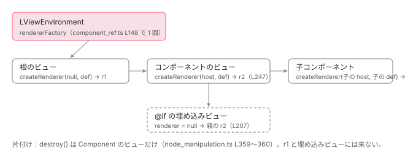

[目次](../README.md) › [DOM レンダラーとイベントの内側](README.md) › 第 2 回 / 全 20 回

# Renderer2 と RendererFactory2：窓口の約束

> render/api.ts の RendererFactory2（createRenderer・begin・end・whenRenderingDone）と Renderer2 の各メソッド、RendererType2（id・encapsulation・styles・data）、RendererStyleFlags2。core の中の型 Renderer（interfaces/renderer.ts）と、LViewEnvironment に入った rendererFactory がルートから子のビューに受け継がれる行。ディレクティブに inject(Renderer2) したときに渡されるもの。

angular/angular · 読了 約 12 分 · 中核 · [サイトで読む（デモが動きます）](https://angular-deep-dive-cyan.vercel.app/chapter/domr-renderer-api)

---

core と platform-browser の間の約束は、`@angular/core` の `render/api.ts` にある 2 つの抽象クラス `RendererFactory2`（renderer を作る工場）と `Renderer2`（DOM を書く役）でできています。この章では、約束の 1 メソッドずつの意味、工場に渡す `RendererType2`、core の中で使う型 `Renderer` との違い、工場がルートで 1 回だけ取り出されて子のビューへ受け継がれる行、`begin`・`end` が呼ばれる場所、そして `inject(Renderer2)` で渡されるものを、行番号で確かめます。

読む対象は core の `render/api.ts`・`render/api_flags.ts`・`render3/interfaces/renderer.ts`・`render3/view/construction.ts`・`render3/instructions/change_detection.ts` です（../angular、22.2.0-next.7、8576f161ae4）。

1. [1. 全体像](01-domr-overview.md)
2. **2. Renderer2 の約束**（この章）
3. [3. DomRendererFactory2](03-domr-renderer-factory.md)
4. [4. 要素とテキスト](04-domr-default-renderer.md)
5. [5. 属性とプロパティ](05-domr-attributes-properties.md)
6. [6. カプセル化](06-domr-encapsulation.md)
7. [7. SharedStylesHost](07-domr-shared-styles.md)
8. [8. CSS 変数の名前空間](08-domr-css-var-namespacing.md)
9. [9. クラスとスタイル](09-domr-styling-overview.md)
10. [10. 優先順位のリスト](10-domr-style-binding-list.md)
11. [11. 値を決めて書く](11-domr-styling-apply.md)
12. [12. \[class\] と \[style\]](12-domr-styling-maps.md)
13. [13. EventManager](13-domr-event-manager.md)
14. [14. listen](14-domr-listen.md)
15. [15. キーのイベント](15-domr-key-events.md)
16. [16. 自分のプラグイン](16-domr-custom-plugin.md)
17. [17. サニタイズ](17-domr-sanitization.md)
18. [18. 信頼の印](18-domr-trusted-types.md)
19. [19. Title と Meta](19-domr-title-meta.md)
20. [20. issue と PR を読む](20-domr-issues.md)

## 1. RendererFactory2：工場の約束は 4 つ

📄 `angular/packages/core/src/render/api.ts` L22–43 （▶ の行: 22, 29, 33, 37, 42）

```ts
22 ▶ export abstract class RendererFactory2 {
23 │   /**
24 │    * Creates and initializes a custom renderer for a host DOM element.
25 │    * @param hostElement The element to render.
26 │    * @param type The base class to implement.
27 │    * @returns The new custom renderer instance.
28 │    */
29 ▶   abstract createRenderer(hostElement: any, type: RendererType2 | null): Renderer2;
30 │   /**
31 │    * A callback invoked when rendering has begun.
32 │    */
33 ▶   abstract begin?(): void;
34 │   /**
35 │    * A callback invoked when rendering has completed.
36 │    */
37 ▶   abstract end?(): void;
38 │   /**
39 │    * Use with animations test-only mode. Notifies the test when rendering has completed.
40 │    * @returns The asynchronous result of the developer-defined function.
41 │    */
42 ▶   abstract whenRenderingDone?(): Promise<any>;
43 │ }
```

1. **29 行目：`createRenderer(hostElement, type)`**

   ホスト要素（そのコンポーネントの要素）と `RendererType2`（3 節）を受け取り、`Renderer2` を返します。両方 `null` のこともあります（[第 3 回](03-domr-renderer-factory.md)）。
2. **33・37 行目：`begin?()` と `end?()`**

   名前のあとの `?` は「無くてもよい」の印です。変更検知の前後に呼ばれます（7 節）。
3. **42 行目：`whenRenderingDone?()`**

   コメントのとおりアニメーションのテスト用で、描画が終わるのを待つ Promise を返します。

22 行目が `abstract class`（中身の無いクラス）であることに注意してください。DI のトークンとしてそのまま使えるので、platform-browser は `{provide: RendererFactory2, useExisting: DomRendererFactory2}` で実装を結びつけます（[第 1 回](01-domr-overview.md)）。

## 2. Renderer2：DOM を書く役の約束

📄 `angular/packages/core/src/render/api.ts` L68–104 （▶ の行: 68, 74, 79, 86, 92, 99, 101–102, 104）

```ts
 68 ▶ export abstract class Renderer2 {
 69 │   /**
 70 │    * Use to store arbitrary developer-defined data on a renderer instance,
 71 │    * as an object containing key-value pairs.
 72 │    * This is useful for renderers that delegate to other renderers.
 73 │    */
 74 ▶   abstract get data(): {[key: string]: any};
 75 │ 
 76 │   /**
 77 │    * Implement this callback to destroy the renderer or the host element.
 78 │    */
 79 ▶   abstract destroy(): void;
 80 │   /**
 81 │    * Implement this callback to create an instance of the host element.
 82 │    * @param name An identifying name for the new element, unique within the namespace.
 83 │    * @param namespace The namespace for the new element.
 84 │    * @returns The new element.
 85 │    */
 86 ▶   abstract createElement(name: string, namespace?: string | null): any;
 87 │   /**
 88 │    * Implement this callback to add a comment to the DOM of the host element.
 89 │    * @param value The comment text.
 90 │    * @returns The modified element.
 91 │    */
 92 ▶   abstract createComment(value: string): any;
 93 │ 
 94 │   /**
 95 │    * Implement this callback to add text to the DOM of the host element.
 96 │    * @param value The text string.
 97 │    * @returns The modified element.
 98 │    */
 99 ▶   abstract createText(value: string): any;
100 │   /**
101 ▶    * If null or undefined, the view engine won't call it.
102 ▶    * This is used as a performance optimization for production mode.
103 │    */
104 ▶   destroyNode: ((node: any) => void) | null = null;
```

1. **74 行目：`data`**

   renderer に好きなものを持たせる箱です。72 行目のコメントのとおり、別の renderer に仕事を回す renderer（アニメーションの renderer など）のためのものです。
2. **79 行目：`destroy()`**

   renderer の片付け。core は**コンポーネントのビューを片付けるときにだけ**呼びます（6 節の終わり）。
3. **86・92・99 行目：`createElement(name, namespace?)`・`createComment`・`createText`**

   ノードを作るだけで、どこにも差し込みません。`namespace` は `'svg'` などの短い名前です（[第 4 回](04-domr-default-renderer.md)）。
4. **104 行目：`destroyNode` はメソッドではなく、関数か `null` のプロパティ**

   101〜102 行目、`null` なら core はこれを呼ぶための木の走査そのものを省きます（本番の速さのため）。ブラウザ用の renderer は `null` です（[第 4 回](04-domr-default-renderer.md)）。

📄 `angular/packages/core/src/render/api.ts` L105–137 （▶ の行: 110, 117–118, 123, 128–129, 132–136）

```ts
105 │   /**
106 │    * Appends a child to a given parent node in the host element DOM.
107 │    * @param parent The parent node.
108 │    * @param newChild The new child node.
109 │    */
110 ▶   abstract appendChild(parent: any, newChild: any): void;
111 │   /**
112 │    * Implement this callback to insert a child node at a given position in a parent node
113 │    * in the host element DOM.
114 │    * @param parent The parent node.
115 │    * @param newChild The new child nodes.
116 │    * @param refChild The existing child node before which `newChild` is inserted.
117 ▶    * @param isMove Optional argument which signifies if the current `insertBefore` is a result of a
118 ▶    *     move. Animation uses this information to trigger move animations. In the past the Animation
119 │    *     would always assume that any `insertBefore` is a move. This is not strictly true because
120 │    *     with runtime i18n it is possible to invoke `insertBefore` as a result of i18n and it should
121 │    *     not trigger an animation move.
122 │    */
123 ▶   abstract insertBefore(parent: any, newChild: any, refChild: any, isMove?: boolean): void;
124 │   /**
125 │    * Implement this callback to remove a child node from the host element's DOM.
126 │    * @param parent The parent node.
127 │    * @param oldChild The child node to remove.
128 ▶    * @param isHostElement Optionally signal to the renderer whether this element is a host element
129 ▶    * @param requireSynchronousElementRemoval Optionally signal to the renderer whether this element
130 │    * needs synchronous removal
131 │    */
132 ▶   abstract removeChild(
133 ▶     parent: any,
134 ▶     oldChild: any,
135 ▶     isHostElement?: boolean,
136 ▶     requireSynchronousElementRemoval?: boolean,
137 │   ): void;
```

110 行目の `appendChild` は親の最後に足し、123 行目の `insertBefore` は `refChild` の前に差し込みます。123 行目の 4 番目の引数 `isMove` は、117〜121 行目のとおり「動かしただけ」をアニメーションに伝えるためのものです。132〜137 行目の `removeChild` には、ホスト要素かどうか（`isHostElement`）と、アニメーションを待たずにすぐ外すか（`requireSynchronousElementRemoval`）の 2 つの印が付きます。ブラウザ用の renderer はこの 2 つを使いません（[第 4 回](04-domr-default-renderer.md)）。

残りのメソッドは、core のどこが呼ぶかと、読む章だけを表にします。

| メソッド | core で呼ぶ所 | 章 |
| --- | --- | --- |
| `selectRootElement(selectorOrNode, preserveContent?)` | ルートのホスト要素を探す `locateHostElement` | [ApplicationRef](../boot/10-boot-application-ref.md) |
| `parentNode(node)`・`nextSibling(node)` | ビューを差し込む位置を決める `node_manipulation.ts` | [4](04-domr-default-renderer.md) |
| `setAttribute`・`removeAttribute`・`setProperty`・`setValue` | `[attr.x]`・静的な属性・`[x]`・テキストの補間 | [5](05-domr-attributes-properties.md) |
| `addClass`・`removeClass`・`setStyle`・`removeStyle` | `[class.x]`・`[style.x]` を書く `applyStyling` | [11](11-domr-styling-apply.md) |
| `listen(target, eventName, callback, options?)` | `(click)` などの `ɵɵlistener`。外す関数を返す | [14](14-domr-listen.md) |

## 3. RendererType2：工場に渡す「どのコンポーネントか」

📄 `angular/packages/core/src/render/api_flags.ts` L16–47 （▶ の行: 16, 21, 25–26, 32, 36, 41, 46）

```ts
16 ▶ export interface RendererType2 {
17 │   /**
18 │    * A unique identifying string for the new renderer, used when creating
19 │    * unique styles for encapsulation.
20 │    */
21 ▶   id: string;
22 │   /**
23 │    * The view encapsulation type, which determines how styles are applied to
24 │    * DOM elements. One of
25 ▶    * - `Emulated` (default): Emulate native scoping of styles.
26 ▶    * - `Native`: Use the native encapsulation mechanism of the renderer.
27 │    * - `ShadowDom`: Use modern [Shadow
28 │    * DOM](https://w3c.github.io/webcomponents/spec/shadow/) and
29 │    * create a ShadowRoot for component's host element.
30 │    * - `None`: Do not provide any template or style encapsulation.
31 │    */
32 ▶   encapsulation: ViewEncapsulation;
33 │   /**
34 │    * Defines CSS styles to be stored on a renderer instance.
35 │    */
36 ▶   styles: string[];
37 │   /**
38 │    * Defines arbitrary developer-defined data to be stored on a renderer instance.
39 │    * This is useful for renderers that delegate to other renderers.
40 │    */
41 ▶   data: {[kind: string]: any};
42 │ 
43 │   /**
44 │    * A function used by the framework to create the list of external runtime style URLs.
45 │    */
46 ▶   getExternalStyles?: ((encapsulationId?: string) => string[]) | null;
47 │ }
```

21 行目の `id`、32 行目の `encapsulation`、36 行目の `styles`、41 行目の `data`、46 行目の `getExternalStyles`。26 行目のコメントに残る `Native` は今の `ViewEncapsulation` にはありません（core の `metadata/view.ts` に「1 は昔の Native で、v11 で消えた」とあります）。では、この形の値は誰が作るのでしょうか。core の中で `createRenderer` に渡されているのは、**コンポーネントの定義（`ComponentDef`）そのもの**です。

📄 `angular/packages/core/src/render3/definition.ts` L361–367 （▶ の行: 361, 363–365）

```ts
361 ▶       getExternalStyles: null,
362 │       signals: componentDefinition.signals ?? false,
363 ▶       data: componentDefinition.data || {},
364 ▶       encapsulation: componentDefinition.encapsulation || ViewEncapsulation.Emulated,
365 ▶       styles: componentDefinition.styles || EMPTY_ARRAY,
366 │       _: null,
367 │       schemas: componentDefinition.schemas || null,
```

📄 `angular/packages/core/src/render3/definition.ts` L378–383 （▶ の行: 381）

```ts
378 │     const dependencies = componentDefinition.dependencies;
379 │     def.directiveDefs = extractDefListOrFactory(dependencies, extractDirectiveDef);
380 │     def.pipeDefs = extractDefListOrFactory(dependencies, getPipeDef);
381 ▶     def.id = getComponentId(def);
382 │ 
383 │     return def;
```

`ɵɵdefineComponent` が作る定義には、361 行目の `getExternalStyles`、363 行目の `data`、364 行目の `encapsulation`（指定が無ければ `Emulated`）、365 行目の `styles` があり、381 行目で `id` が入ります。`RendererType2` の 5 つの名前が全部そろうので、定義をそのまま `RendererType2` として渡せます。`id` は定義の中身から作るハッシュに `c` を付けた文字列で（[Emulated の CSS の書き換え](../compiler/18-compiler-shadow-css.md)）、デモの表の `c…` がそれです。

> [!WARNING]
> **ハマりどころ**
>
> デモの `DomrApiHost` と `DomrApiItem` は `encapsulation` を書いていないのに、記録では `None` になっています。CSS を 1 つも持たない `Emulated` のコンポーネントは、コンパイラが `None` に変えて出力するからです（[第 6 回](06-domr-encapsulation.md)）。

## 4. RendererStyleFlags2

📄 `angular/packages/core/src/render/api_flags.ts` L49–65 （▶ の行: 53, 60, 64）

```ts
49 │ /**
50 │  * Flags for renderer-specific style modifiers.
51 │  * @publicApi
52 │  */
53 ▶ export enum RendererStyleFlags2 {
54 │   // TODO(misko): This needs to be refactored into a separate file so that it can be imported from
55 │   // `node_manipulation.ts` Currently doing the import cause resolution order to change and fails
56 │   // the tests. The work around is to have hard coded value in `node_manipulation.ts` for now.
57 │   /**
58 │    * Marks a style as important.
59 │    */
60 ▶   Important = 1 << 0,
61 │   /**
62 │    * Marks a style as using dash case naming (this-is-dash-case).
63 │    */
64 ▶   DashCase = 1 << 1,
65 │ }
```

`setStyle`・`removeStyle` の最後の引数です。60 行目の `Important` は `!important` を付ける印、64 行目の `DashCase` は名前が `background-color` のようなダッシュ区切りであることの印。ビットの印なので `Important | DashCase` のように重ねられます。core の `applyStyling` がどちらを立てるかは[第 11 回](11-domr-styling-apply.md)で読みます。

## 5. core の中の型 Renderer：Renderer2 との違い

core の `render3/` は `Renderer2` ではなく、`interfaces/renderer.ts` の `Renderer` という型で renderer を扱います。34 行目から始まる前半は[作成の命令](../ivy/09-ivy-create-instructions.md)の章で引用しました。ここでは後半です。

📄 `angular/packages/core/src/render3/interfaces/renderer.ts` L47–86 （▶ の行: 54, 56–57, 59, 62, 74–75, 82–85）

```ts
47 │   // TODO(thePunderWoman): remove the requireSynchronousElementRemoval flag once the animations package has been deleted after v23.
48 │   removeChild(
49 │     parent: RElement | null,
50 │     oldChild: RNode,
51 │     isHostElement?: boolean,
52 │     requireSynchronousElementRemoval?: boolean,
53 │   ): void;
54 ▶   selectRootElement(selectorOrNode: string | any, preserveContent?: boolean): RElement;
55 │ 
56 ▶   parentNode(node: RNode): RElement | null;
57 ▶   nextSibling(node: RNode): RNode | null;
58 │ 
59 ▶   setAttribute(
60 │     el: RElement,
61 │     name: string,
62 ▶     value: string | TrustedHTML | TrustedScript | TrustedScriptURL,
63 │     namespace?: string | null,
64 │   ): void;
65 │   removeAttribute(el: RElement, name: string, namespace?: string | null): void;
66 │   addClass(el: RElement, name: string): void;
67 │   removeClass(el: RElement, name: string): void;
68 │   setStyle(el: RElement, style: string, value: any, flags?: RendererStyleFlags2): void;
69 │   removeStyle(el: RElement, style: string, flags?: RendererStyleFlags2): void;
70 │   setProperty(el: RElement, name: string, value: any): void;
71 │   setValue(node: RText | RComment, value: string): void;
72 │ 
73 │   // TODO(misko): Deprecate in favor of addEventListener/removeEventListener
74 ▶   listen(
75 ▶     target: GlobalTargetName | RNode,
76 │     eventName: string,
77 │     callback: (event: any) => boolean | void,
78 │     options?: ListenerOptions,
79 │   ): () => void;
80 │ }
81 │ 
82 ▶ export interface RendererFactory {
83 ▶   createRenderer(hostElement: RElement | null, rendererType: RendererType2 | null): Renderer;
84 ▶   begin?(): void;
85 ▶   end?(): void;
86 │ }
```

1. **同じ名前のメソッドが並ぶ**

   54〜57 行目の `selectRootElement`・`parentNode`・`nextSibling`、74〜79 行目の `listen` まで、`Renderer2` と同じ名前と引数の順です。だから platform-browser の `Renderer2` の実装を、core はそのまま `Renderer` として受け取れます（TypeScript は形が合えば同じ型とみなします）。
2. **引数の型が細かい**

   `Renderer2` の引数は `any` でしたが、こちらは `RElement`・`RNode`（core が使う DOM の最小の形）です。62 行目、`setAttribute` の値には `TrustedHTML`・`TrustedScript`・`TrustedScriptURL` も入ります（[第 18 回](18-domr-trusted-types.md)）。
3. **`data` が無く、DI の印も無い**

   core は `data` を読みません。`Renderer` は interface（型だけ）なので、`inject` のトークンにもなれません。`inject(Renderer2)` ができるのは、`Renderer2` がクラスで、`__NG_ELEMENT_ID__` を持つからです（8 節）。
4. **82〜86 行目：`RendererFactory`**

   工場も同じ形の型があります。`whenRenderingDone` だけが無く、core は 3 つしか使いません。

## 6. 工場はルートで 1 回取り出され、子のビューへ受け継がれる

📄 `angular/packages/core/src/render3/component_ref.ts` L147–153 （▶ の行: 147–149, 151）

```ts
147 ▶ function createRootLViewEnvironment(rootLViewInjector: Injector): LViewEnvironment {
148 ▶   const rendererFactory = rootLViewInjector.get(RendererFactory2, null);
149 ▶   if (rendererFactory === null) {
150 │     throw new RuntimeError(
151 ▶       RuntimeErrorCode.RENDERER_NOT_FOUND,
152 │       ngDevMode &&
153 │         'Angular was not able to inject a renderer (RendererFactory2). ' +
```

`createComponent`（`ApplicationRef.bootstrap` も同じ道）が根のビューを作るとき、148 行目で **インジェクタから `RendererFactory2` を 1 回だけ**取り出します。見つからなければ 151 行目の `RENDERER_NOT_FOUND`（NG0407）です。取り出した工場は、サニタイザやスケジューラと一緒に `LViewEnvironment`（ビューの木の全体で共有する小さなオブジェクト）に入ります （残りの行は[ApplicationRef の章](../boot/10-boot-application-ref.md)）。デモが記録係を差し込めるのも、この 1 か所で探すからです（`domr-probe.ts` は `elementInjector` に記録係の工場を置きます）。

📄 `angular/packages/core/src/render3/view/construction.ts` L203–209 （▶ の行: 205, 207）

```ts
203 │   lView[PARENT] = lView[DECLARATION_VIEW] = parentLView;
204 │   lView[CONTEXT] = context;
205 ▶   lView[ENVIRONMENT] = (environment || (parentLView && parentLView[ENVIRONMENT]))!;
206 │   ngDevMode && assertDefined(lView[ENVIRONMENT], 'LViewEnvironment is required');
207 ▶   lView[RENDERER] = (renderer || (parentLView && parentLView[RENDERER]))!;
208 │   ngDevMode && assertDefined(lView[RENDERER], 'Renderer is required');
209 │   lView[INJECTOR as any] = injector || (parentLView && parentLView[INJECTOR]) || null;
```

`createLView` の中です。205 行目、`environment` が渡されなければ親のビューの `lView[ENVIRONMENT]` をそのまま使い、207 行目、`renderer` が渡されなければ親の `lView[RENDERER]` を使います。`@if` や `@for` の中身（埋め込みビュー）を作るときは、`environment` も `renderer` も `null` で呼ばれるので（[LContainer の章](../ivy/11-ivy-lcontainer.md)）、**埋め込みビューは、それを宣言したコンポーネントの renderer をそのまま使います**。

📄 `angular/packages/core/src/render3/view/construction.ts` L241–247 （▶ の行: 247）

```ts
241 │       tView,
242 │       null,
243 │       getInitialLViewFlagsFromDef(def),
244 │       native,
245 │       hostTNode as TElementNode,
246 │       null,
247 ▶       rendererFactory.createRenderer(native, def),
```

子のコンポーネントのビューだけは別です。247 行目で `rendererFactory.createRenderer(native, def)` を呼び、**そのコンポーネント用の renderer**を渡します。`native` はホスト要素、`def` は 3 節の `ComponentDef`。`rendererFactory` は 205 行目で受け継いだ `lView[ENVIRONMENT].rendererFactory` です。

📄 `angular/packages/core/src/render3/node_manipulation.ts` L355–361 （▶ の行: 358–360）

```ts
355 │ 
356 │     executeOnDestroys(tView, lView);
357 │     processCleanups(tView, lView);
358 ▶     // For component views only, the local renderer is destroyed at clean up time.
359 ▶     if (lView[TVIEW].type === TViewType.Component) {
360 ▶       lView[RENDERER].destroy();
361 │     }
```

片付けも対になっています。358〜360 行目、`destroy()` を呼ぶのはビューの種類が `Component` のときだけ。埋め込みビューは親の renderer を借りているだけなので、消えても `destroy()` を呼びません（呼ぶと親の renderer を壊してしまいます）。



*工場は根で 1 回取り出され LViewEnvironment で木全体に共有される。renderer はコンポーネントのビューごとに createRenderer で作られ、埋め込みビューは親のものを借りる。*

## 7. begin と end：変更検知 1 回を挟む

📄 `angular/packages/core/src/render3/instructions/change_detection.ts` L97–103 （▶ の行: 97, 99–100）

```ts
 97 ▶   const checkNoChangesMode = !!ngDevMode && isInCheckNoChangesMode();
 98 │ 
 99 ▶   if (!checkNoChangesMode) {
100 ▶     rendererFactory.begin?.();
101 │   }
102 │ 
103 │   try {
```

📄 `angular/packages/core/src/render3/instructions/change_detection.ts` L104–110 （▶ の行: 104, 106–107）

```ts
104 ▶     detectChangesInViewWhileDirty(lView, mode);
105 │   } finally {
106 ▶     if (!checkNoChangesMode) {
107 ▶       rendererFactory.end?.();
108 │     }
109 │   }
110 │ }
```

`detectChangesInternal`（`detectChanges()` と `ApplicationRef.tick()` の両方がここに来ます）です。100 行目で `rendererFactory.begin?.()`、104 行目でビューの木を走査し、107 行目で `finally` の中の `end?.()`。`?.` なので、工場が `begin` を持っていなければ何も起きません。97〜99 行目、開発モードの「変わっていないか確かめる」走査（[checkNoChanges](../cd/07-cd-check-no-changes.md)）では呼びません。

ここで大事な事実が 1 つあります。**platform-browser の `DomRendererFactory2` には `begin` も `end` もありません**（クラスの全体は[第 3 回](03-domr-renderer-factory.md)）。この 2 つを使うのはアニメーションの工場で、`end` で溜めたアニメーションを流します（[旧アニメーションの準備](../animations/14-animations-legacy-setup.md)）。デモの記録に `begin`・`end` が出るのは、記録係が 2 つとも持っていて、本物には `begin?.()` の形で回しているからです。

📄 `angular/packages/core/src/application/application_ref.ts` L673–678 （▶ の行: 673, 676–677）

```ts
673 ▶     if (!ranDetectChanges) {
674 │       // If we skipped refreshing views above, there might still be unflushed animations
675 │       // because we never called `detectChangesInternal` on the views.
676 ▶       this._rendererFactory?.begin?.();
677 ▶       this._rendererFactory?.end?.();
678 │     }
```

`ApplicationRef` の側にも 1 か所あります。673 行目、どのビューも走査しなかった tick でも、676〜677 行目で `begin`・`end` を 1 回ずつ呼びます。溜まったアニメーションを流し損ねないためです（674〜675 行目のコメント）。

## 8. inject(Renderer2) で渡されるもの

📄 `angular/packages/core/src/render/api.ts` L257–263 （▶ の行: 260–263）

```ts
257 │ export function injectRenderer2(): Renderer2 {
258 │   // We need the Renderer to be based on the component that it's being injected into, however since
259 │   // DI happens before we've entered its view, `getLView` will return the parent view instead.
260 ▶   const lView = getLView();
261 ▶   const tNode = getCurrentTNode()!;
262 ▶   const nodeAtIndex = getComponentLViewByIndex(tNode.index, lView);
263 ▶   return (isLView(nodeAtIndex) ? nodeAtIndex : lView)[RENDERER] as Renderer2;
```

`Renderer2` の `__NG_ELEMENT_ID__`（ノードのインジェクタが特別扱いする印）がこの関数を呼びます。仕組みの全体は[特別なトークン](../di/13-di-special-tokens.md)の章です。262 行目で「いま inject しているノードに、コンポーネントのビューがぶら下がっているか」を見て、あればその `lView[RENDERER]`、無ければ今のビューの `lView[RENDERER]` を返します（263 行目）。つまり新しい renderer は作りません。6 節で作った renderer のどれかが返ります。

1. **ふつうの要素（`<span myDir>`）のディレクティブ**

   その要素を描いているコンポーネントのビューの renderer。
2. **コンポーネントのホスト要素（`<my-cmp myDir>`）のディレクティブ**

   ホスト要素にはそのコンポーネントのビューがぶら下がっているので、**そのコンポーネントの renderer**。
3. **コンポーネント自身**

   同じく自分の renderer（258〜259 行目のとおり、DI のときはまだ親のビューにいるので、262 行目で自分のビューを探します）。

## 9. デモ：数えて、見分ける

章の中で定義した本物のコンポーネント `DomrApiHost`（中に `<span domrApiTap>` と `<domr-api-item>` が 2 つ）を、共通部品 `domr-probe.ts` の記録係で包んだ**このサイトの本物の `DomRendererFactory2`** で描きます。2 のボタンは、`inject(Renderer2)` したディレクティブとコンポーネントが自分の要素で `parentNode` を 1 回呼び、記録に出た renderer の名前を表にします。

> **🧪 DEMO — createRenderer と begin / end を数え、inject(Renderer2) の正体を見る**
>
> 1 で描いてから 2〜4 を押します。1 をもう一度押すと描き直します。
>
> ▶ [このデモはサイトで動かせます](https://angular-deep-dive-cyan.vercel.app/chapter/domr-renderer-api)

headless Chrome の開発ビルドで 1・2・3・4・4 と押した結果です。

- **createRenderer は 4 回**：根のホスト用（`null` → `r1`）、`DomrApiHost` のビュー（`r2`）、`domr-api-item` の A と B。**A と B は同じ `r3`**（2 回目に「前と同じ」）でした。同じ定義の renderer を工場が覚えて使い回すからです（[第 3 回](03-domr-renderer-factory.md)）。
- **inject(Renderer2)**：`<span>` のディレクティブは `r2`、`domr-api-item` A のホストに付けたディレクティブは `r3`、A・B 自身も `r3`。8 節の 3 通りのとおりです。
- **begin / end**：最初の描画で 1 回ずつ（作成の間は 0 回で、その後の最初の変更検知で 1 回）。何も変えない `detectChanges()` でも 1 回ずつ呼ばれ、ほかの呼び出しは 0。入力を変えると間に `r2.setValue` が 1 つ入りました。

## ここまでの呼び出し

- 👤 `createComponent(Cmp, { environmentInjector, elementInjector })`
  - `createRootLViewEnvironment(rootViewInjector)` — core/src/render3/component\_ref.ts L147 — *get(RendererFactory2) を 1 回*
  - `environment.rendererFactory.createRenderer(null, cmpDef)` — component\_ref.ts L339 — *根のホスト用*
  - `createLView(…, environment, hostRenderer, …)` — core/src/render3/view/construction.ts L205・L207
    - `createComponentLView` → `rendererFactory.createRenderer(native, def)` — construction.ts L247 — *コンポーネントごと*
      - `createLView(…, null, null, …)`（埋め込みビュー） — core/src/render3/view\_manipulation.ts — *親の renderer を借りる*
- 👤 `inject(Renderer2)`
  - `injectRenderer2()` — core/src/render/api.ts L257 — *コンポーネントの lView\[RENDERER\] か今の lView\[RENDERER\]*
- 👤 `detectChanges()` / `ApplicationRef.tick()`
  - `detectChangesInternal` — core/src/render3/instructions/change\_detection.ts L90 — *begin?.() → 走査 → end?.()*

## テストと直し方

### spec と describe

| spec | describe / it | bazel のターゲット |
| --- | --- | --- |
| `packages/core/test/acceptance/renderer_factory_spec.ts` | describe `renderer factory lifecycle`（45 行目）の it `should work with a component`（139）・`should not invoke renderer destroy method for embedded views`（252）ほか、describe `custom renderer`（449）、`Renderer2 destruction hooks`（499） | `//packages/core/test/acceptance:acceptance` |

📄 `angular/packages/core/test/acceptance/renderer_factory_spec.ts` L99–114 （▶ の行: 100–101, 104–105, 110–111）

```ts
 99 │   /** Creates a patched renderer factory that pushes entries to the test log */
100 ▶   function createPatchedRendererFactory(document: any) {
101 ▶     let rendererFactory = getRendererFactory2(document);
102 │     const createRender = rendererFactory.createRenderer;
103 │ 
104 ▶     rendererFactory.createRenderer = (hostElement: any, type: RendererType2 | null) => {
105 ▶       logs.push('create');
106 │       lastCapturedType = type;
107 │       return createRender.apply(rendererFactory, [hostElement, type]);
108 │     };
109 │ 
110 ▶     rendererFactory.begin = () => logs.push('begin');
111 ▶     rendererFactory.end = () => logs.push('end');
112 │ 
113 │     return rendererFactory;
114 │   }
```

📄 `angular/packages/core/test/acceptance/renderer_factory_spec.ts` L139–155 （▶ の行: 142–147, 150, 154）

```ts
139 │   it('should work with a component', () => {
140 │     const fixture = TestBed.createComponent(SomeComponent);
141 │     fixture.componentRef.changeDetectorRef.detectChanges();
142 ▶     expect(logs).toEqual([
143 ▶       'create',
144 ▶       'create',
145 ▶       'begin',
146 ▶       'end',
147 ▶       'begin',
148 │       'some_component create',
149 │       'some_component update',
150 ▶       'end',
151 │     ]);
152 │     logs = [];
153 │     fixture.componentRef.changeDetectorRef.detectChanges();
154 ▶     expect(logs).toEqual(['begin', 'some_component update', 'end']);
155 │   });
```

104〜111 行目で、本物の工場の `createRenderer`・`begin`・`end` を、log に 1 語を足す関数に差し替えています。このシリーズの記録係と同じ考え方です。154 行目、2 回目の `detectChanges()` は `begin` → コンポーネントの `ngDoCheck` → `end` の 3 つ。7 節の 100・107 行目がそのまま確かめられています。142〜150 行目の最初の分には `create` が 2 つ（根のホスト用と、コンポーネントのビュー用）並んでいます。

📄 `angular/packages/core/test/acceptance/renderer_factory_spec.ts` L281–301 （▶ の行: 281–282, 285–286, 297, 300）

```ts
281 ▶     const fixture = TestBed.createComponent(Comp);
282 ▶     fixture.detectChanges();
283 │ 
284 │     const comp = fixture.componentInstance;
285 ▶     comp!.visible = false;
286 ▶     fixture.detectChanges();
287 │ 
288 │     comp!.visible = true;
289 │     fixture.detectChanges();
290 │ 
291 │     const renderer = rendererFactory.lastRenderer!;
292 │     const destroySpy = renderer.spies['destroy'];
293 │     const createElementSpy = renderer.spies['createElement'];
294 │ 
295 │     // we should never see `destroy` method being called
296 │     // in case child views are created/removed.
297 ▶     expect(destroySpy.calls.count()).toBe(0);
298 │ 
299 │     // Make sure other methods on the renderer were invoked.
300 ▶     expect(createElementSpy.calls.count() > 0).toBe(true);
301 │   });
```

`*ngIf` を消して（285〜286 行目）また出しても、297 行目で `destroy` は 0 回。6 節の 359 行目の「Component のときだけ」を確かめる it です。

### 手元で走らせた結果

📄 `ターミナル（../angular で）`

```
cd ~/angular-research/angular
git status --short          # 走らせる前と後で同じか（ソースは変えない）
pnpm bazel test //packages/core/test/acceptance:acceptance --nocache_test_results --test_output=all \
  '--test_arg=--filter=renderer factory lifecycle|custom renderer|Renderer2 destruction hooks|animation renderer factory'
```

📄 `出力（2026-11-04 に実行。抜粋。ログは scratchpad/domr-logs/a-acc-factory.log）`

```
Randomized with seed 54144
Started
.........NG0912: Component ID generation collision detected. Components 'SimpleApp' and 'AppWithComponents'
with selector 'some-component' generated the same component ID. …
..

Ran 11 of 2693 specs
11 specs, 0 failures
Finished in 0.105 seconds
//packages/core/test/acceptance:acceptance                               PASSED in 1.3s
```

- 11 件 = `renderer factory lifecycle` 7・`animation renderer factory` 1・`custom renderer` 1・`Renderer2 destruction hooks` 2。`animation renderer factory` のもう 1 つの it（385）は `isBrowser &&` が前に付いていて、Node では登録されません。
- 出力の途中に `NG0912: Component ID generation collision detected` の警告が 1 行出ます。spec の中の `SimpleApp` と `AppWithComponents`（どちらも selector が `some-component`）の `id` が同じになったという開発モードの警告で、テストは通っています。`id` が同じだと何が困るかは[第 3 回](03-domr-renderer-factory.md)で読みます。

### 直すとしたら

- 工場が取り出される所・受け継がれる所は `component_ref.ts` の `createRootLViewEnvironment` と `construction.ts` の `createLView`・`createComponentLView`。it は `renderer_factory_spec.ts` の 99〜114 行目の形（呼ばれた順を log で比べる）で足します。
- `begin`・`end` の呼ばれ方を変えるなら `change_detection.ts` の `detectChangesInternal` と `application_ref.ts` の 673〜678 行目。アニメーションの工場が影響を受けるので、`animation renderer factory` の describe も走らせます。
- `Renderer2` の形（公開 API）を変えると `goldens/public-api/core/index.api.md` が変わります（[公開 API の変え方](../contrib/08-contrib-public-api.md)）。本家に PR を出すことは勧めません。issue を読むときに「どの層の話か」を見分ける手がかりにします（[第 20 回](20-domr-issues.md)）。

## 聞かれそうな質問

**Q. Renderer2 は 1 つのアプリに 1 つですか？**

いいえ。工場（`RendererFactory2`）はルートで 1 回取り出されて木全体で共有されますが（component\_ref.ts 148 行目）、renderer はコンポーネントのビューごとに construction.ts 247 行目の `createRenderer(native, def)` で渡されます。ただし工場が同じ定義の renderer を使い回すので、デモの A と B は同じ `r3` でした。

**Q. @if の中の要素は、別の renderer で作られますか？**

作られません。埋め込みビューは `renderer` を `null` で作られ、construction.ts 207 行目で親の `lView[RENDERER]` を使います。消えるときも 359〜360 行目のとおり `destroy()` は呼ばれません（renderer\_factory\_spec.ts 297 行目で確かめています）。

**Q. ディレクティブで inject(Renderer2) すると、どのコンポーネントの renderer が来ますか？**

api.ts 262〜263 行目のとおり、付いている要素がコンポーネントのホストならそのコンポーネントの renderer、ふつうの要素ならその要素を描いているビューの renderer です。デモでも `<span>` のディレクティブは `r2`、`<domr-api-item>` のホストのディレクティブは `r3` でした。カプセル化が違うと結果も変わります（Emulated の renderer なら `createElement` した要素に `_ngcontent-…` が付く）。

**Q. begin と end は何に使われていますか？**

変更検知 1 回の前後に呼ばれる（change\_detection.ts 100・107 行目）だけで、`DomRendererFactory2` は持っていません。使っているのはアニメーションの工場で、`end` で溜めたアニメーションを流します。何も走査しなかった tick でも application\_ref.ts 676〜677 行目で 1 回ずつ呼ばれます。

**Q. core の Renderer と Renderer2 は何が違いますか？**

メソッドの名前と並びは同じで、core の `Renderer`（interfaces/renderer.ts）は引数の型が `RElement`・`RNode` と細かく、`setAttribute` の値に Trusted Types の型が入り（62 行目）、`data` がありません。interface なので DI のトークンにはなれず、`inject` するのはクラスの `Renderer2` です。

## 読み終えて

- `RendererFactory2` の約束は `createRenderer` と、無くてもよい `begin`・`end`・`whenRenderingDone`
- `RendererType2` として渡されるのはコンポーネントの定義そのもの（`id`・`encapsulation`・`styles`・`data`）
- 工場は根で 1 回取り出され、renderer はコンポーネントのビューごと。埋め込みビューは親のものを借り、`destroy()` もされない
- `inject(Renderer2)` は新しく作らず、コンポーネントのビューの `lView[RENDERER]` を返す

---

← 前: [DOM レンダラーの全体像：命令・Renderer2・DomRendererFactory2・EventManager](01-domr-overview.md)  
次: [DomRendererFactory2：コンポーネントごとの renderer](03-domr-renderer-factory.md) →
