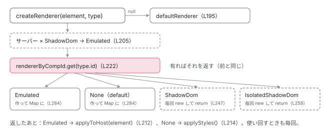

[目次](../README.md) › [DOM レンダラーとイベントの内側](README.md) › 第 3 回 / 全 20 回

# DomRendererFactory2：コンポーネントごとの renderer

> DomRendererFactory2 のコンストラクタ（EventManager・SharedStylesHost・APP\_ID・REMOVE\_STYLES\_ON\_COMPONENT\_DESTROY・DOCUMENT・NgZone・CSP\_NONCE・TracingService・CSS\_VAR\_NAMESPACE）と、そこで 1 つだけ作る defaultRenderer。createRenderer は element か type が無ければ defaultRenderer、サーバーでは ShadowDom を Emulated に替え、Emulated と None の renderer だけを rendererByCompId に覚える（ShadowDom の 2 つは毎回作る）。id がぶつかったときの NG0912、HMR の componentReplaced。ページの上で 4 つのカプセル化を 2 つずつ描いて比べるデモ。

angular/angular · 読了 約 12 分 · 中核 · [サイトで読む（デモが動きます）](https://angular-deep-dive-cyan.vercel.app/chapter/domr-renderer-factory)

---

[第 2 回](02-domr-renderer-api.md)で、core はコンポーネントのビューを作るたびに `rendererFactory.createRenderer(host, def)` を呼ぶと確かめました。この章はその相手、platform-browser の `DomRendererFactory2` です。コンストラクタが受け取る 9 つのもの、`createRenderer` の分かれ道、renderer を覚える `rendererByCompId` と ShadowDom を覚えない理由、サーバーでの読み替え、HMR の `componentReplaced` を、行番号で 1 つずつ見ます。

読む対象は `packages/platform-browser/src/dom/dom_renderer.ts` の `DomRendererFactory2` のクラス全体と、それを呼ぶ core の `component_ref.ts`・`hmr.ts` です（../angular、22.2.0-next.7、8576f161ae4）。

1. [1. 全体像](01-domr-overview.md)
2. [2. Renderer2 の約束](02-domr-renderer-api.md)
3. **3. DomRendererFactory2**（この章）
4. [4. 要素とテキスト](04-domr-default-renderer.md)
5. [5. 属性とプロパティ](05-domr-attributes-properties.md)
6. [6. カプセル化](06-domr-encapsulation.md)
7. [7. SharedStylesHost](07-domr-shared-styles.md)
8. [8. CSS 変数の名前空間](08-domr-css-var-namespacing.md)
9. [9. クラスとスタイル](09-domr-styling-overview.md)
10. [10. 優先順位のリスト](10-domr-style-binding-list.md)
11. [11. 値を決めて書く](11-domr-styling-apply.md)
12. [12. \[class\] と \[style\]](12-domr-styling-maps.md)
13. [13. EventManager](13-domr-event-manager.md)
14. [14. listen](14-domr-listen.md)
15. [15. キーのイベント](15-domr-key-events.md)
16. [16. 自分のプラグイン](16-domr-custom-plugin.md)
17. [17. サニタイズ](17-domr-sanitization.md)
18. [18. 信頼の印](18-domr-trusted-types.md)
19. [19. Title と Meta](19-domr-title-meta.md)
20. [20. issue と PR を読む](20-domr-issues.md)

## 1. コンストラクタ：9 つを受け取り、defaultRenderer を 1 つ作る

`DomRendererFactory2` は `@Injectable()` だけのクラスで、`BROWSER_MODULE_PROVIDERS` に入ってアプリに 1 つできます（クラスの頭と providers の並びは[BrowserModule の providers](../ngmodule/12-ngmodule-browser-module.md)で引用しました）。

📄 `angular/packages/platform-browser/src/dom/dom_renderer.ts` L171–191 （▶ の行: 171–177, 181, 183–184）

```ts
171 ▶     private readonly eventManager: EventManager,
172 ▶     @Inject(SHARED_STYLES_HOST) private readonly sharedStylesHost: SharedStylesHost,
173 ▶     @Inject(APP_ID) private readonly appId: string,
174 ▶     @Inject(REMOVE_STYLES_ON_COMPONENT_DESTROY) private removeStylesOnCompDestroy: boolean,
175 ▶     @Inject(DOCUMENT) private readonly doc: Document,
176 ▶     readonly ngZone: NgZone,
177 ▶     @Inject(CSP_NONCE) private readonly nonce: string | null = null,
178 │     @Inject(TracingService)
179 │     @Optional()
180 │     private readonly tracingService: TracingService<TracingSnapshot> | null = null,
181 ▶     @Inject(CSS_VAR_NAMESPACE) @Optional() cssVarNamespace: string | null = null,
182 │   ) {
183 ▶     this.cssVarNamespace = cssVarNamespace ?? '';
184 ▶     this.defaultRenderer = new DefaultDomRenderer2(
185 │       eventManager,
186 │       doc,
187 │       ngZone,
188 │       this.tracingService,
189 │       this.cssVarNamespace,
190 │     );
191 │   }
```

1. **171〜172 行目：`EventManager` と `SHARED_STYLES_HOST`**

   作る renderer に配る係です。`listen` は `EventManager` へ（[第 13 回](13-domr-event-manager.md)）、`<style>` の足し引きは `SharedStylesHost` へ（[第 7 回](07-domr-shared-styles.md)）。
2. **173 行目：`APP_ID`**

   既定は `'ng'`。Emulated の renderer が付ける `_ngcontent-ng-c…` の `ng` がこれです（[第 6 回](06-domr-encapsulation.md)）。
3. **174 行目：`REMOVE_STYLES_ON_COMPONENT_DESTROY`**

   既定は `true`。コンポーネントが全部消えたら `<style>` も消すか（[第 7 回](07-domr-shared-styles.md)）。デモの「片付ける」のあと、デモの `<style>` が `<head>` から 0 個になるのはこの既定のためです。
4. **175〜176 行目：`DOCUMENT` と `NgZone`**

   要素を作る `document`。`NgZone` は zoneless の既定なら `NoopNgZone` です（[zoneless の既定](../zoneless/01-zoneless-default.md)）。
5. **177 行目：`CSP_NONCE`**

   下の引用のとおり、このトークンの既定の factory はページの中の `ngCspNonce` 属性を探します。工場の中でこれを使うのは ShadowDom の 2 つの renderer だけです（3 節の 265 行目の `this.nonce` など）。
6. **178〜181 行目：`TracingService` と `CSS_VAR_NAMESPACE`（どちらも `@Optional()`）**

   無ければ `null`。183 行目で CSS 変数の名前空間は空文字になります（[第 8 回](08-domr-css-var-namespacing.md)）。
7. **184〜190 行目：`defaultRenderer` をここで 1 つだけ作る**

   `DefaultDomRenderer2`（カプセル化を何もしない素の renderer）です。2 節の `null` の分かれは、いつもこの 1 つを返します。

📄 `angular/packages/core/src/application/application_tokens.ts` L120–146 （▶ の行: 120, 123, 141–142）

```ts
120 ▶ export const CSP_NONCE = new InjectionToken<string | null>(
121 │   typeof ngDevMode !== 'undefined' && ngDevMode ? 'CSP nonce' : '',
122 │   {
123 ▶     factory: () => {
124 │       // Ideally we wouldn't have to use `querySelector` here since we know that the nonce will be on
125 │       // the root node, but because the token value is used in renderers, it has to be available
126 │       // *very* early in the bootstrapping process. This should be a fairly shallow search, because
127 │       // the app won't have been added to the DOM yet. Some approaches that were considered:
128 │       // 1. Find the root node through `ApplicationRef.components[i].location` - normally this would
129 │       // be enough for our purposes, but the token is injected very early so the `components` array
130 │       // isn't populated yet.
131 │       // 2. Find the root `LView` through the current `LView` - renderers are a prerequisite to
132 │       // creating the `LView`. This means that no `LView` will have been entered when this factory is
133 │       // invoked for the root component.
134 │       // 3. Have the token factory return `() => string` which is invoked when a nonce is requested -
135 │       // the slightly later execution does allow us to get an `LView` reference, but the fact that
136 │       // it is a function means that it could be executed at *any* time (including immediately) which
137 │       // may lead to weird bugs.
138 │       // 4. Have the `ComponentFactory` read the attribute and provide it to the injector under the
139 │       // hood - has the same problem as #1 and #2 in that the renderer is used to query for the root
140 │       // node and the nonce value needs to be available when the renderer is created.
141 ▶       return (
142 ▶         inject(DOCUMENT).body?.querySelector('[ngCspNonce]')?.getAttribute('ngCspNonce') || null
143 │       );
144 │     },
145 │   },
146 │ );
```

123 行目の factory は、トークンが初めて inject されたときに 1 回だけ動きます。`DomRendererFactory2` は 177 行目で受け取るので、工場ができる時点で 142 行目の `document.body.querySelector('[ngCspNonce]')` が走ります。124〜140 行目のコメントは「renderer は根のビューより前に要るので、ここまで早く値が決まっていないといけない」という事情を 4 つの案と一緒に書いています。

## 2. createRenderer：3 つの分かれ道

📄 `angular/packages/platform-browser/src/dom/dom_renderer.ts` L193–214 （▶ の行: 194–195, 199–202, 205, 208, 211–214）

```ts
193 │   createRenderer(element: any, type: RendererType2 | null): Renderer2 {
194 ▶     if (!element || !type) {
195 ▶       return this.defaultRenderer;
196 │     }
197 │ 
198 │     if (
199 ▶       typeof ngServerMode !== 'undefined' &&
200 ▶       ngServerMode &&
201 ▶       (type.encapsulation === ViewEncapsulation.ShadowDom ||
202 ▶         type.encapsulation === ViewEncapsulation.ExperimentalIsolatedShadowDom)
203 │     ) {
204 │       // Domino does not support shadow DOM.
205 ▶       type = {...type, encapsulation: ViewEncapsulation.Emulated};
206 │     }
207 │ 
208 ▶     const renderer = this.getOrCreateRenderer(element, type);
209 │     // Renderers have different logic due to different encapsulation behaviours.
210 │     // Ex: for emulated, an attribute is added to the element.
211 ▶     if (renderer instanceof EmulatedEncapsulationDomRenderer2) {
212 ▶       renderer.applyToHost(element);
213 ▶     } else if (renderer instanceof NoneEncapsulationDomRenderer) {
214 ▶       renderer.applyStyles();
```

1. **194〜196 行目：`element` か `type` が無ければ `defaultRenderer`**

   1 節の 184 行目で作った 1 つを返します。どちらか片方が `null` なら同じです（デモの「直接呼ぶ」で `createRenderer(<div>, null)` も `r1` でした）。
2. **198〜206 行目：サーバーでは ShadowDom を Emulated に読み替える**

   `ngServerMode`（サーバーで描くときに立つ大域の印）が真で、カプセル化が `ShadowDom` か `ExperimentalIsolatedShadowDom` なら、205 行目で `encapsulation` だけを `Emulated` にした**新しいオブジェクト**を作ります。204 行目のコメントのとおり、サーバーの DOM（Domino）に shadow DOM が無いからです。元の定義は書き換えません。
3. **208〜214 行目：renderer を取り出して、毎回ホストに手を入れる**

   208 行目の `getOrCreateRenderer`（3 節）で renderer を決めたあと、Emulated なら 212 行目の `applyToHost(element)`（中で `applyStyles()` も呼んでから、ホストに `_nghost-…` を付ける）、None なら 214 行目の `applyStyles()`（`SharedStylesHost` にこのコンポーネントの CSS の使用を 1 回分足す）。この 2 つは**覚えた renderer を使い回すときも、createRenderer のたびに**呼ばれます。コンポーネントのビューが 1 つ消えるたびに renderer の `destroy()` が使用を 1 回分引くので（[第 2 回](02-domr-renderer-api.md)の 6 節の終わり）、足す側も 1 回ずつでないと数が合いません。中身は[第 6 回](06-domr-encapsulation.md)と[Emulated の CSS の書き換え](../compiler/18-compiler-shadow-css.md)の章です。

core の中で `element` に `null` を渡しているのは、根のホスト要素を作る所です。

📄 `angular/packages/core/src/render3/component_ref.ts` L339–343 （▶ の行: 339–342）

```ts
339 ▶     const hostRenderer = environment.rendererFactory.createRenderer(null, cmpDef);
340 ▶     const hostElement = rootSelectorOrNode
341 ▶       ? locateHostElement(hostRenderer, rootSelectorOrNode, cmpDef.encapsulation, rootViewInjector)
342 ▶       : createHostElement(cmpDef, hostRenderer, hostElementNamespace ?? null);
343 │     assertNotScriptHostElement(hostElement);
```

339 行目の `createRenderer(null, cmpDef)` は 194 行目で `defaultRenderer` になり、340〜342 行目でホスト要素を探す（`selectRootElement`）か作る（`createElement`）のに使われます。根のビューの `lView[RENDERER]` もこれです（[ApplicationRef の章](../boot/10-boot-application-ref.md)）。どのデモでも最初の行が `createRenderer(null, …) → r1` なのはこのためです。

## 3. getOrCreateRenderer：覚えるものと、覚えないもの

📄 `angular/packages/platform-browser/src/dom/dom_renderer.ts` L220–226 （▶ の行: 220–222, 224）

```ts
220 ▶   private getOrCreateRenderer(element: any, type: RendererType2): Renderer2 {
221 ▶     const rendererByCompId = this.rendererByCompId;
222 ▶     let renderer = rendererByCompId.get(type.id);
223 │ 
224 ▶     if (!renderer) {
225 │       const doc = this.doc;
226 │       const ngZone = this.ngZone;
```

222 行目、`rendererByCompId`（クラスの頭で宣言した `Map`）から `type.id` で探します。見つかれば 224 行目の `if` を飛ばして、それを返します。無ければカプセル化で分かれます。`Emulated` の分かれは `EmulatedEncapsulationDomRenderer2` を作って `break` します（中身は[スタイルの後片付け](../animations/13-animations-styles-teardown.md)の章で引用済み）。

📄 `angular/packages/platform-browser/src/dom/dom_renderer.ts` L246–252 （▶ の行: 246–247, 249）

```ts
246 ▶         case ViewEncapsulation.ShadowDom:
247 ▶           return new ShadowDomRenderer(
248 │             eventManager,
249 ▶             element,
250 │             type,
251 │             doc,
252 │             ngZone,
```

📄 `angular/packages/platform-browser/src/dom/dom_renderer.ts` L258–268 （▶ の行: 258–259, 261, 265）

```ts
258 ▶         case ViewEncapsulation.ExperimentalIsolatedShadowDom:
259 ▶           return new ShadowDomRenderer(
260 │             eventManager,
261 ▶             element,
262 │             type,
263 │             doc,
264 │             ngZone,
265 ▶             this.nonce,
266 │             tracingService,
267 │             this.cssVarNamespace,
268 │           );
```

ShadowDom の 2 つは **`break` ではなく `return`** です（247・259 行目）。`Map` に入れる 284 行目まで行かないので、**毎回新しい renderer** になります。理由は 249・261 行目の `element` にあります。`ShadowDomRenderer` はホスト要素を受け取り、コンストラクタでその要素に `attachShadow` して `<style>` を入れます（[第 6 回](06-domr-encapsulation.md)）。renderer 1 つがホスト要素 1 つに結びついているので、同じ定義でも使い回せません。`ShadowDom` の方は引数の最後にもう 1 つ `sharedStylesHost` を渡し、`ExperimentalIsolatedShadowDom` は渡しません。デモの shadowRoot の中の `<style>` の数が、ShadowDom では 10 個前後、Isolated では 1 個に分かれるのはこの差です（ページで使われている他のコンポーネントの CSS も shadow root に配られるかどうか。[第 7 回](07-domr-shared-styles.md)）。

📄 `angular/packages/platform-browser/src/dom/dom_renderer.ts` L284–301 （▶ の行: 284, 287, 290–291, 298–299）

```ts
284 ▶       rendererByCompId.set(type.id, renderer);
285 │     }
286 │ 
287 ▶     return renderer;
288 │   }
289 │ 
290 ▶   ngOnDestroy() {
291 ▶     this.rendererByCompId.clear();
292 │   }
293 │ 
294 │   /**
295 │    * Used during HMR to clear any cached data about a component.
296 │    * @param componentId ID of the component that is being replaced.
297 │    */
298 ▶   protected componentReplaced(componentId: string) {
299 ▶     this.rendererByCompId.delete(componentId);
300 │   }
301 │ }
```

284 行目で、Emulated と None（`default` の分かれ）の renderer だけが `type.id` をキーに覚えられます。この 2 つはホスト要素を持たず（ホストへの手入れは 2 節の 212・214 行目で毎回する）、同じ定義なら何個目のコンポーネントでも同じ renderer でよいからです。290〜292 行目、工場が壊れるとき（アプリの破棄）に全部忘れ、298〜300 行目の `componentReplaced` は 1 つだけ忘れます（5 節）。



*createRenderer(element, type) の分かれ道。Emulated と None だけが rendererByCompId に覚えられ、ShadowDom の 2 つは毎回作られる。*

## 4. id がぶつかると renderer もぶつかる

3 節のキーは `type.id`、つまりコンポーネントの定義から作るハッシュです。2 つの違うコンポーネントの `id` が同じになると、2 つ目は 1 つ目の renderer を受け取ります。Emulated なら同じ `_ngcontent-…` の属性を使うことになり、片方の CSS がもう片方にも当たります。core はこれを開発モードで知らせます。

📄 `angular/packages/core/src/render3/definition.ts` L749–772 （▶ の行: 750, 754, 756, 758–759, 761, 771）

```ts
749 │   if (
750 ▶     (typeof ngDevMode === 'undefined' || ngDevMode) &&
751 │     // Skip the check on the server since we can't guarantee the same component instance between
752 │     // requests. Note that we can't use DI to check if we're on the server, because the component
753 │     // hasn't been instantiated yet.
754 ▶     (typeof ngServerMode === 'undefined' || !ngServerMode)
755 │   ) {
756 ▶     if (GENERATED_COMP_IDS.has(compId)) {
757 │       const previousCompDefType = GENERATED_COMP_IDS.get(compId)!;
758 ▶       if (previousCompDefType !== componentDef.type) {
759 ▶         console.warn(
760 │           formatRuntimeError(
761 ▶             RuntimeErrorCode.COMPONENT_ID_COLLISION,
762 │             `Component ID generation collision detected. Components '${
763 │               previousCompDefType.name
764 │             }' and '${componentDef.type.name}' with selector '${stringifyCSSSelectorList(
765 │               componentDef.selectors,
766 │             )}' generated the same component ID. To fix this, you can change the selector of one of those components or add an extra host attribute to force a different ID.`,
767 │           ),
768 │         );
769 │       }
770 │     } else {
771 ▶       GENERATED_COMP_IDS.set(compId, componentDef.type);
772 │     }
```

756 行目、作った `id` が前にも出ていて、758 行目でそれが別のクラスなら、759 行目で `NG0912` の警告を出します。750 行目のとおり開発モードだけで、754 行目のとおりサーバーでは確かめません。[第 2 回](02-domr-renderer-api.md)で走らせた spec の出力に出ていた警告がこれでした。

## 5. HMR の componentReplaced

📄 `angular/packages/core/src/render3/hmr.ts` L205–217 （▶ の行: 212–216）

```ts
205 │ /**
206 │  * Removes any cached renderers from the factory for the provided type.
207 │  * This is currently used by the HMR logic to ensure Renderers are kept
208 │  * synchronized with any definition metadata updates.
209 │  * @param factory A RendererFactory2 instance.
210 │  * @param def A ComponentDef instance.
211 │  */
212 ▶ function clearRendererCache(factory: RendererFactory, def: ComponentDef<unknown>) {
213 ▶   // Cast to read a private field.
214 ▶   // NOTE: This must be kept synchronized with the renderer factory implementation in
215 ▶   // platform-browser and platform-browser/animations.
216 ▶   (factory as {componentReplaced?: (id: string) => void}).componentReplaced?.(def.id);
217 │ }
```

📄 `angular/packages/core/src/render3/hmr.ts` L290–296 （▶ の行: 291–292, 296）

```ts
290 │     // stays consistent with the new component definition by clearing any old ached factories.
291 ▶     const rendererFactory = lView[ENVIRONMENT].rendererFactory;
292 ▶     clearRendererCache(rendererFactory, oldDef);
293 │ 
294 │     // Patch a brand-new renderer onto the new view only after the old
295 │     // view is destroyed so that the runtime doesn't try to reuse it.
296 ▶     newLView[RENDERER] = rendererFactory.createRenderer(host, newDef);
```

開発サーバーの HMR（ページを読み直さずにコンポーネントを入れ替える仕組み）で定義が新しくなると、core の `hmr.ts` は 292 行目で `clearRendererCache` を呼び、216 行目で工場の `componentReplaced(def.id)`（3 節の 298〜300 行目）を呼びます。`protected` で型に無いメソッドなので、213 行目のとおり型を崩して呼び、`?.` で「無ければ何もしない」にしています。214〜215 行目のコメントは「platform-browser とアニメーションの工場の実装と合わせておくこと」。そのあと 296 行目で新しい定義の renderer を作り直します。`Map` から消しておかないと、296 行目で古い CSS を持った renderer が返ってきてしまいます。HMR の全体は [CLI の HMR の章](../cli/11-cli-hmr.md)です。

## 6. サーバーでの ShadowDom

📄 `angular/packages/platform-server/test/integration_spec.ts` L879–891 （▶ の行: 880, 885–886, 889）

```ts
879 │           it(
880 ▶             'should handle ViewEncapsulation.ShadowDom' +
881 │               `(standalone:${isStandalone}, zoneless:${zoneless})`,
882 │             async () => {
883 │               const options = {document: doc};
884 │               const bootstrap = isStandalone
885 ▶                 ? renderApplication(ShadowDomEncapsulationAppStandalone, options)
886 ▶                 : renderModule(ShadowDomExampleModule, options);
887 │               const output = await bootstrap;
888 │               expect(output).not.toBe('');
889 ▶               expect(output).toContain('color: red');
890 │             },
891 │           );
```

platform-server の spec です。`ShadowDom` のコンポーネントをサーバーで描いても例外にならず、889 行目で CSS（`color: red`）が出力に入っていることを確かめています。2 節の 205 行目で `Emulated` に読み替えているので、CSS は shadow root ではなく `<head>` の `<style>` に入ります。

## 7. デモ：4 つのカプセル化を 2 つずつ描く

章の中で定義した、カプセル化だけが違う 4 つの本物のコンポーネント（`Emulated`・`None`・`ShadowDom`・`ExperimentalIsolatedShadowDom`）を、親のテンプレートに 2 つずつ置いて描きます。共通部品 `domr-probe.ts` の `createLoggingRendererFactory` で**このサイトの本物の `DomRendererFactory2`** を包み、同じ記録係で何回でも描けるようにしてあります。記録係は本物の工場が前に返したのと同じ renderer を受け取ると「（前と同じ）」と書きます。

> **🧪 DEMO — 4 つのカプセル化を 2 つずつ描いて、createRenderer が返すものを見る**
>
> 「描く」を押すたびに、同じ記録係でもう 1 回描きます。「片付ける」で全部 destroy して記録係も捨てます。
>
> ▶ [このデモはサイトで動かせます](https://angular-deep-dive-cyan.vercel.app/chapter/domr-renderer-factory)

headless Chrome の開発ビルドで「描く」を 2 回、「直接呼ぶ」を 1 回押した結果です。

- **1 回目**：`Emulated` の 2 つ目は `r3（前と同じ）`、`None` の 2 つ目は `r4（前と同じ）`。`ShadowDom` は `r5`・`r6`、`ExperimentalIsolatedShadowDom` は `r7`・`r8` と毎回新しい。3 節の 284 行目と 247・259 行目のとおりです。
- **2 回目**：`Emulated` と `None` は 1 回目の `r3`・`r4` がそのまま返りました（前のコンポーネントを destroy していなくても、工場の `Map` はアプリが続く限り覚えている）。ShadowDom の 4 つは `r9`〜`r12`。
- **親の `DomrFacHost`** は CSS を持たないので、コンパイラが `None` にしています（[第 6 回](06-domr-encapsulation.md)）。その `r2` も 2 回目に「前と同じ」でした。
- **ホスト要素**：`Emulated` だけに `_nghost-ng-c…`（2 節の 212 行目）。ShadowDom の 2 つは shadowRoot を持ち、中の `<style>` は ShadowDom が 8〜10 個（そのときページで使われているコンポーネントの CSS の数で変わる。試した 2 回で 8 個と 10 個）、Isolated はいつも 1 個でした。
- **直接呼ぶ**：`createRenderer(null, null)` も `createRenderer(<div>, null)` も、根のホスト用と同じ `r1`（194〜196 行目の `defaultRenderer`）。

## ここまでの呼び出し

- 👤 `bootstrapApplication(App)` / `createComponent(Cmp, …)`
  - `new DomRendererFactory2(eventManager, sharedStylesHost, appId, …)` — platform-browser/src/dom/dom\_renderer.ts L170 — *defaultRenderer を 1 つ作る（L184）。CSP\_NONCE の factory もここで動く*
  - `createRenderer(null, cmpDef)` — core/src/render3/component\_ref.ts L339 — *→ defaultRenderer（L195）*
  - `createRenderer(host, def)` — core/src/render3/view/construction.ts L247
    - `getOrCreateRenderer(host, def)` — dom\_renderer.ts L220 — *Map に有ればそれ。無ければ new（ShadowDom は Map に入れない）*
    - `renderer.applyToHost(host)` / `renderer.applyStyles()` — dom\_renderer.ts L212・L214
- 👤 HMR で定義が変わる
  - `clearRendererCache` → `componentReplaced(def.id)` — core/src/render3/hmr.ts L216 → dom\_renderer.ts L298

## テストと直し方

### spec と describe

| spec | describe / it | bazel のターゲット |
| --- | --- | --- |
| `packages/core/test/acceptance/renderer_factory_spec.ts` | describe `renderer factory lifecycle`（45）の it `should pass in the component styles directly into the underlying renderer`（165）。工場は 418 行目の `getRendererFactory2` で作る | `//packages/core/test/acceptance:acceptance` |
| `packages/platform-server/test/integration_spec.ts` | describe `platform-server integration`（649）の it `should handle ViewEncapsulation.ShadowDom`（879、standalone と zoneless の組み合わせで 4 つ） | `//packages/platform-server/test:test` |
| `packages/platform-browser/test/dom/dom_renderer_spec.ts` | カプセル化の違うコンポーネントを並べる it（105〜162）は[第 6 回](06-domr-encapsulation.md)で読みます | `//packages/platform-browser/test:test_web` |

📄 `angular/packages/core/test/acceptance/renderer_factory_spec.ts` L418–438 （▶ の行: 420, 422–426, 429, 433–434）

```ts
418 │ function getRendererFactory2(document: Document): RendererFactory2 {
419 │   const fakeNgZone: NgZone = new NoopNgZone();
420 ▶   const eventManager = new EventManager([], fakeNgZone);
421 │   const appId = 'app-id';
422 ▶   const rendererFactory = new DomRendererFactory2(
423 ▶     eventManager,
424 ▶     new ɵSharedStylesHost(document, appId),
425 ▶     appId,
426 ▶     true,
427 │     document,
428 │     fakeNgZone,
429 ▶     null,
430 │   );
431 │   const origCreateRenderer = rendererFactory.createRenderer;
432 │   rendererFactory.createRenderer = function (element: any, type: RendererType2 | null) {
433 ▶     const renderer = origCreateRenderer.call(this, element, type);
434 ▶     renderer.destroyNode = () => {};
435 │     return renderer;
436 │   };
437 │   return rendererFactory;
438 │ }
```

core の spec は、`DomRendererFactory2` を DI を通さずに new しています。422〜430 行目、引数は 7 つで、8・9 番目の `TracingService` と `CSS_VAR_NAMESPACE` は省いて既定の `null`。426 行目の `true` が `REMOVE_STYLES_ON_COMPONENT_DESTROY`、429 行目の `null` が `CSP_NONCE` です。433〜434 行目で、返った renderer の `destroyNode` を空の関数にしています（ブラウザ用の renderer は `null`。[第 4 回](04-domr-default-renderer.md)）。

### 手元で走らせた結果

📄 `ターミナル（../angular で）`

```
cd ~/angular-research/angular
git status --short          # 走らせる前と後で同じか（ソースは変えない）
pnpm bazel test //packages/platform-server/test:test --nocache_test_results --test_output=all \
  '--test_arg=--filter=should handle ViewEncapsulation.ShadowDom'
pnpm bazel test //packages/core/test/acceptance:acceptance --nocache_test_results --test_output=all \
  '--test_arg=--filter=renderer factory lifecycle'
```

📄 `出力（2026-11-04 に実行。抜粋。ログは scratchpad/domr-logs/a-server-shadow.log・a-acc-lifecycle.log）`

```
Ran 4 of 399 specs
4 specs, 0 failures
//packages/platform-server/test:test                                     PASSED in 1.1s

Ran 7 of 2693 specs
7 specs, 0 failures
//packages/core/test/acceptance:acceptance                               PASSED in 1.5s
```

### 直すとしたら

- renderer の選び方・覚え方を変えるなら `dom_renderer.ts` の `createRenderer` と `getOrCreateRenderer`。it は `dom_renderer_spec.ts`（ブラウザで走る）か、core の `renderer_factory_spec.ts` の 418 行目の形で工場を new して足します。
- コンストラクタの引数を足すと、DI の外で new している所（core の spec の 422 行目など）も直します。2025-11 の 5343001835a（コンストラクタから `PLATFORM_ID` を外した）と 2025-12 の 2ccdf50fba9（renderer に渡していた `platformIsServer` を外した）が、引数を減らした例です（`git log -- packages/platform-browser/src/dom/dom_renderer.ts`）。
- HMR の `componentReplaced` は core の `hmr.ts` と名前で結ばれているだけなので（213〜216 行目）、名前を変えると何も言わずに効かなくなります。
- ShadowDom が遅いという issue #43477（開いている、`core: CSS encapsulation`）は、3 節の「毎回 new してスタイルを入れる」の行を手がかりに読めます（[第 20 回](20-domr-issues.md)）。本家に PR を出すことは勧めません。

## 聞かれそうな質問

**Q. 同じコンポーネントを 100 個並べると、renderer は 100 個できますか？**

Emulated と None なら 1 個です。dom\_renderer.ts 222 行目で `type.id` から探し、284 行目で覚えたものを返すからです。デモの 2 つ目も「前と同じ」でした。ShadowDom と ExperimentalIsolatedShadowDom は 247・259 行目で `return` するので 100 個できます。

**Q. ShadowDom の renderer を使い回さないのはなぜ？**

249・261 行目でホスト要素を受け取り、その要素に shadow root を作って `<style>` を入れる renderer だからです。1 つの renderer が 1 つのホスト要素に結びついているので、別のホストには使えません。

**Q. サーバーで ShadowDom のコンポーネントを描くとどうなりますか？**

198〜206 行目で `ngServerMode` のときだけ `encapsulation` を `Emulated` にした写しを作るので、Emulated と同じく属性で CSS を閉じ込め、`<style>` は文書に入ります。platform-server の it `should handle ViewEncapsulation.ShadowDom`（integration\_spec.ts 879 行目）が、出力に CSS が入ることを確かめています。

**Q. CSP の nonce を設定しないとどうなりますか？**

`CSP_NONCE` の factory（application\_tokens.ts 142 行目）が `ngCspNonce` 属性を探し、無ければ `null`。工場は 177 行目でそれを受け取り、ShadowDom の renderer に渡します。`<head>` の `<style>` の nonce は `SharedStylesHost` の側の話です（[第 7 回](07-domr-shared-styles.md)）。

**Q. HMR でコンポーネントの CSS を変えると、古い renderer はどうなりますか？**

hmr.ts 292 行目の `clearRendererCache` が 216 行目で `componentReplaced(def.id)` を呼び、dom\_renderer.ts 299 行目で `Map` から消えます。そのあと 296 行目で新しい定義の renderer を作るので、新しい CSS を持った renderer になります。

## 読み終えて

- 工場はアプリに 1 つ。コンストラクタで 9 つを受け取り、`defaultRenderer` を 1 つ作る（dom\_renderer.ts 184 行目）
- `element` か `type` が無ければ `defaultRenderer`。根のホスト要素はこれで作られる（component\_ref.ts 339 行目）
- Emulated と None は `type.id` で覚えて使い回し、ShadowDom の 2 つは毎回作る。ホストへの手入れ（`applyToHost`・`applyStyles`）は毎回
- サーバーでは ShadowDom を Emulated に読み替え、HMR では `componentReplaced` で 1 つ忘れる

---

← 前: [Renderer2 と RendererFactory2：窓口の約束](02-domr-renderer-api.md)  
次: [DefaultDomRenderer2：要素とテキストを作って差し込む](04-domr-default-renderer.md) →
