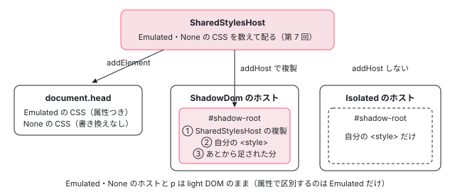

[目次](../README.md) › [DOM レンダラーとイベントの内側](README.md) › 第 6 回 / 全 20 回

# Emulated・None・ShadowDom：renderer ごとのカプセル化

> EmulatedEncapsulationDomRenderer2 が \_nghost-%COMP% と \_ngcontent-%COMP% を付ける行（shimHostAttribute・shimContentAttribute・applyToHost・createElement）、NoneEncapsulationDomRenderer の applyStyles、ShadowDomRenderer が attachShadow して SharedStylesHost の分を複製してから自分の &lt;style&gt; を shadow root に入れる行と、SharedStylesHost を渡さない ExperimentalIsolatedShadowDom。styles の無いコンポーネントが None になる行。ページの上で 4 つのモードの本物のコンポーネントを描き比べるデモ。

angular/angular · 読了 約 13 分 · 中核 · [サイトで読む（デモが動きます）](https://angular-deep-dive-cyan.vercel.app/chapter/domr-encapsulation)

---

`ViewEncapsulation` の 4 つの値（Emulated・None・ShadowDom・ExperimentalIsolatedShadowDom）は、実行時には**どの Renderer2 のクラスが作られるか**の違いです。この章では 3 つのクラス（`EmulatedEncapsulationDomRenderer2`・`NoneEncapsulationDomRenderer`・`ShadowDomRenderer`）のコンストラクタと上書きしたメソッドを 1 つずつ読み、属性が付く行、`<style>` がどこに入るかが決まる行、ExperimentalIsolatedShadowDom が ShadowDom と 1 引数だけ違うことを確かめます。最後に、同じテンプレートの本物のコンポーネント 4 つを描き比べます。

読む対象は platform-browser の `dom/dom_renderer.ts`（558〜730 行目）と、core の `metadata/view.ts` です。CSS のセレクタに `[_ngcontent-%COMP%]` を足す書き換えそのものは [compiler-shadow-css](../compiler/18-compiler-shadow-css.md) で読みました。ここは「その文字列を受け取ったあと」の話です。

1. [1. 全体像](01-domr-overview.md)
2. [2. Renderer2 の約束](02-domr-renderer-api.md)
3. [3. DomRendererFactory2](03-domr-renderer-factory.md)
4. [4. 要素とテキスト](04-domr-default-renderer.md)
5. [5. 属性とプロパティ](05-domr-attributes-properties.md)
6. **6. カプセル化**（この章）
7. [7. SharedStylesHost](07-domr-shared-styles.md)
8. [8. CSS 変数の名前空間](08-domr-css-var-namespacing.md)
9. [9. クラスとスタイル](09-domr-styling-overview.md)
10. [10. 優先順位のリスト](10-domr-style-binding-list.md)
11. [11. 値を決めて書く](11-domr-styling-apply.md)
12. [12. \[class\] と \[style\]](12-domr-styling-maps.md)
13. [13. EventManager](13-domr-event-manager.md)
14. [14. listen](14-domr-listen.md)
15. [15. キーのイベント](15-domr-key-events.md)
16. [16. 自分のプラグイン](16-domr-custom-plugin.md)
17. [17. サニタイズ](17-domr-sanitization.md)
18. [18. 信頼の印](18-domr-trusted-types.md)
19. [19. Title と Meta](19-domr-title-meta.md)
20. [20. issue と PR を読む](20-domr-issues.md)

## 1. 4 つの値と、styles が無いときの None

📄 `angular/packages/core/src/metadata/view.ts` L41–54 （▶ の行: 46, 48–50, 54）

```ts
41 │   /**
42 │    * Uses the browser's native Shadow DOM API to encapsulate CSS styles, meaning that it creates
43 │    * a ShadowRoot for the component's host element which is then used to encapsulate
44 │    * all the Component's styling.
45 │    */
46 ▶   ShadowDom = 3,
47 │   /**
48 ▶    * Similar to `ShadowDom`, but prevents any external styles from leaking into the
49 ▶    * component's ShadowRoot. This is useful when you want to ensure that the component's
50 ▶    * styles are completely isolated from the rest of the application, including global styles.
51 │    *
52 │    * @experimental 21.0
53 │    */
54 ▶   ExperimentalIsolatedShadowDom = 4,
```

値は `Emulated = 0`・`None = 2`・`ShadowDom = 3`（46 行目）・`ExperimentalIsolatedShadowDom = 4`（54 行目）です。48〜50 行目のコメントのとおり、4 は「外のスタイルが shadow root に漏れ込まない ShadowDom」で、21.0 からの実験的な値です。

📄 `angular/packages/compiler/src/render3/view/compiler.ts` L290–293 （▶ の行: 290, 292）

```ts
290 ▶   if (!hasStyles && meta.encapsulation === core.ViewEncapsulation.Emulated) {
291 │     // If there is no style, don't generate css selectors on elements
292 ▶     meta.encapsulation = core.ViewEncapsulation.None;
293 │   }
```

コンパイラの側に 1 つ落とし穴があります。Emulated（既定）でも、styles が 1 つも無いコンポーネントは 292 行目で None に書き換えられます。属性を付けても合わせる CSS が無いからです。[第 5 回](05-domr-attributes-properties.md)のデモのコンポーネントは styles が無いので、記録の `createRenderer` に `None` と出ていました。

## 2. どの値でどのクラスが作られるか

`DomRendererFactory2.createRenderer(host, type)` が `type.encapsulation` で分かれ、Emulated と None のレンダラーは型の ID ごとに 1 つ作って使い回す、という全体の形は [第 3 回](03-domr-renderer-factory.md)で読みます。ここでは ShadowDom と ExperimentalIsolatedShadowDom の分かれ目だけを見ます。

ShadowDom のときは `new ShadowDomRenderer(…)` の最後の引数に `sharedStylesHost` を渡し、ExperimentalIsolatedShadowDom のときは同じクラスをその引数**なし**で作ります （その 2 つの `case` は第 3 回で引用）。違いはこの 1 引数だけで、受け取る側の 570 行目と 577 行目を 5 節で読みます。

もう 1 つ、サーバー（`ngServerMode`）では Domino に shadow DOM が無いので、`createRenderer` の先頭で ShadowDom と ExperimentalIsolatedShadowDom を Emulated に置き換えてから作ります（これも第 3 回）。プリレンダーした HTML の中では、ShadowDom のコンポーネントも `_nghost-…` の属性つきで出てきます。

| encapsulation | 作られるクラス | 使い回し | 自分の &lt;style&gt; の行き先 |
| --- | --- | --- | --- |
| Emulated | `EmulatedEncapsulationDomRenderer2` | 型ごとに 1 つ | SharedStylesHost（`document.head` など） |
| None | `NoneEncapsulationDomRenderer` | 型ごとに 1 つ | SharedStylesHost（同上） |
| ShadowDom | `ShadowDomRenderer`（SharedStylesHost あり） | ホストごとに new | そのホストの shadow root。SharedStylesHost の分も複製される |
| ExperimentalIsolatedShadowDom | `ShadowDomRenderer`（SharedStylesHost なし） | ホストごとに new | そのホストの shadow root だけ |



*4 つの値で、自分の CSS がどこに入るか。Emulated と None は SharedStylesHost を通って head へ。ShadowDom は shadow root に自分の分を直接足し、SharedStylesHost の分も複製される。Isolated は自分の分だけ*

## 3. Emulated：2 つの属性を付ける

📄 `angular/packages/platform-browser/src/dom/dom_renderer.ts` L49–55 （▶ の行: 49, 53–55）

```ts
49 ▶ const COMPONENT_REGEX = /%COMP%/g;
50 │ const SOURCEMAP_URL_REGEXP = /\/\*#\s*sourceMappingURL=([^\s*]+)\s*\*\//;
51 │ const PROTOCOL_REGEXP = /^https?:/;
52 │ 
53 ▶ export const COMPONENT_VARIABLE = '%COMP%';
54 ▶ export const HOST_ATTR = `_nghost-${COMPONENT_VARIABLE}`;
55 ▶ export const CONTENT_ATTR = `_ngcontent-${COMPONENT_VARIABLE}`;
```

📄 `angular/packages/platform-browser/src/dom/dom_renderer.ts` L103–109 （▶ の行: 104, 108）

```ts
103 │ export function shimContentAttribute(componentShortId: string): string {
104 ▶   return CONTENT_ATTR.replace(COMPONENT_REGEX, componentShortId);
105 │ }
106 │ 
107 │ export function shimHostAttribute(componentShortId: string): string {
108 ▶   return HOST_ATTR.replace(COMPONENT_REGEX, componentShortId);
109 │ }
```

属性の名前は 54〜55 行目の雛形 `_nghost-%COMP%`・`_ngcontent-%COMP%` の `%COMP%`（49 行目の正規表現）を、104・108 行目で ID に置き換えて作ります。コンパイラが CSS のセレクタに埋め込んだのも同じ `%COMP%` なので、同じ ID に置き換われば CSS と属性が合います（CSS の側の置き換えは [compiler-shadow-css](../compiler/18-compiler-shadow-css.md) の 5 節）。

📄 `angular/packages/platform-browser/src/dom/dom_renderer.ts` L703–709 （▶ の行: 704–705）

```ts
703 │   ) {
704 ▶     const compId = appId + '-' + component.id;
705 ▶     super(
706 │       eventManager,
707 │       sharedStylesHost,
708 │       component,
709 │       removeStylesOnCompDestroy,
```

📄 `angular/packages/platform-browser/src/dom/dom_renderer.ts` L716–722 （▶ の行: 716–717, 720–722）

```ts
716 ▶     this.contentAttr = shimContentAttribute(compId);
717 ▶     this.hostAttr = shimHostAttribute(compId);
718 │   }
719 │ 
720 ▶   applyToHost(element: any): void {
721 ▶     this.applyStyles();
722 ▶     this.setAttribute(element, this.hostAttr, '');
```

📄 `angular/packages/platform-browser/src/dom/dom_renderer.ts` L724–729 （▶ の行: 725–727）

```ts
724 │ 
725 ▶   override createElement(parent: any, name: string): Element {
726 ▶     const el = super.createElement(parent, name);
727 ▶     super.setAttribute(el, this.contentAttr, '');
728 │     return el;
729 │   }
```

1. **704 行目：ID は `APP_ID` + `-` + 型の ID**

   `APP_ID` の既定は `ng`、型の ID（`component.id`）は core がコンポーネントの定義から作る `c` と数字の文字列（作り方と、ぶつかったときの警告は[第 3 回](03-domr-renderer-factory.md)）なので、`ng-c2588498140` のようになります。705 行目で親の `NoneEncapsulationDomRenderer` にこの ID を渡すので、None の側で CSS の `%COMP%` が置き換えられます（4 節の 670 行目）。
2. **716〜717 行目：属性の名前をコンストラクタで 1 回だけ作る**

   レンダラーは型ごとに 1 つなので、`_ngcontent-ng-c…` と `_nghost-ng-c…` の文字列もコンポーネントの型ごとに 1 回だけ作られます。
3. **720〜722 行目：`applyToHost` でスタイルとホストの属性**

   `createRenderer` がインスタンスを作るたびに呼びます（`createRenderer` の中で、レンダラーが Emulated なら `applyToHost`、None なら `applyStyles` を呼ぶ分かれ。[compiler-shadow-css](../compiler/18-compiler-shadow-css.md) の 5 節で引用）。721 行目の `applyStyles` は親クラスのもので `SharedStylesHost.addStyles` を呼び（[第 7 回](07-domr-shared-styles.md)）、722 行目でホスト要素に値が空の `_nghost-…` を付けます。
4. **725〜727 行目：作る要素の全部に `_ngcontent-…`**

   このコンポーネントのテンプレートの要素は、全部このレンダラーの `createElement` で作られるので、全部に `_ngcontent-…` が付きます。子のコンポーネントのホスト要素も親のテンプレートの要素なので、親の `_ngcontent-…` と自分の `_nghost-…` の 2 つを持つことになります。725 行目の引数名は `(parent, name)` ですが、`Renderer2.createElement` の引数は `(name, namespace)` です。726 行目で同じ順に親へ渡しているので動きは正しく、名前が紛らわしいだけです。

> [!NOTE]
> **ポイント**
>
> 722 行目と 727 行目は、レンダラーが**自分の中で**`setAttribute` を呼んでいます。外から包んだ記録係（`domr-probe.ts`）は外から来た呼び出ししか見ないので、6 節のデモの記録にはこの 2 つの `setAttribute` が出てきません。出来た DOM には付いています。

## 4. None：書き換えずに head へ

📄 `angular/packages/platform-browser/src/dom/dom_renderer.ts` L670–676 （▶ の行: 670–672, 675–676）

```ts
670 ▶     const shimmed = compId ? shimStylesContent(compId, styles) : styles;
671 ▶     this.styles = shimmed.map((s) => s.replace(/%NS%/g, cssVarNamespace));
672 ▶     this.styleUrls = component.getExternalStyles?.(compId);
673 │   }
674 │ 
675 ▶   applyStyles(): void {
676 ▶     this.sharedStylesHost.addStyles(this.styles, this.styleUrls);
```

None のレンダラーは Emulated の親クラスでもあります。670 行目、`compId` を受け取ったとき（Emulated から呼ばれたとき）だけ `%COMP%` を置き換え、None として直接作られたときは CSS をそのまま使います。671 行目の `%NS%` は [第 8 回](08-domr-css-var-namespacing.md)、672 行目の外部スタイルの URL と 675〜676 行目の `applyStyles` の先は [第 7 回](07-domr-shared-styles.md)です。None は要素に何の属性も付けないので、CSS のセレクタはページ全体の要素に当たります。`destroy` でスタイルを外す行も第 7 回で読みます。

## 5. ShadowDom：attachShadow と、shadow root への付け替え

📄 `angular/packages/platform-browser/src/dom/dom_renderer.ts` L558–586 （▶ の行: 559, 563, 570, 573, 575–578, 581, 584）

```ts
558 │ class ShadowDomRenderer extends DefaultDomRenderer2 {
559 ▶   private shadowRoot: any;
560 │ 
561 │   constructor(
562 │     eventManager: EventManager,
563 ▶     private hostEl: any,
564 │     component: RendererType2,
565 │     doc: Document,
566 │     ngZone: NgZone,
567 │     nonce: string | null,
568 │     tracingService: TracingService<TracingSnapshot> | null,
569 │     cssVarNamespace: string,
570 ▶     private sharedStylesHost?: SharedStylesHost,
571 │   ) {
572 │     super(eventManager, doc, ngZone, tracingService, cssVarNamespace);
573 ▶     this.shadowRoot = (hostEl as any).attachShadow({mode: 'open'});
574 │ 
575 ▶     // SharedStylesHost is used to add styles to the shadow root by ShadowDom.
576 ▶     // This is optional as it is not used by ExperimentalIsolatedShadowDom.
577 ▶     if (this.sharedStylesHost) {
578 ▶       this.sharedStylesHost.addHost(this.shadowRoot);
579 │     }
580 │     let styles = component.styles;
581 ▶     if (ngDevMode) {
582 │       // We only do this in development, as for production users should not add CSS sourcemaps to components.
583 │       const baseHref = getDOM().getBaseHref(doc) ?? '';
584 ▶       styles = addBaseHrefToCssSourceMap(baseHref, styles);
585 │     }
586 │ 
```

1. **573 行目：ホストに shadow root を付ける**

   `attachShadow({mode: 'open'})` で、ホスト要素の `shadowRoot` から外の JavaScript が中を見られる形です。559 行目のフィールドに覚えるので、**1 つのインスタンスが 1 つの shadow root を持ちます**。Emulated や None のように型ごとに使い回せないのはこのためで、ファクトリはホストごとに `new` します。
2. **577〜578 行目：SharedStylesHost の配り先に足す**

   ShadowDom のときだけ（2 節のとおりファクトリが 570 行目の引数を渡したとき）、shadow root を SharedStylesHost の `addHost` に渡します。`addHost` は**その時点で SharedStylesHost が持っているスタイルを全部**新しい配り先に複製し、以後に足されるスタイルも配ります（[第 7 回](07-domr-shared-styles.md)）。ページ全体の Emulated・None のスタイルが shadow root の中にも入るので、ShadowDom の中に置いた Emulated の子コンポーネントにもスタイルが効きます。575〜576 行目のコメントのとおり、ExperimentalIsolatedShadowDom ではここを通らず、shadow root には自分のスタイルしか入りません。
3. **581〜584 行目：開発モードだけ source map の URL を直す**

   同じファイルの `addBaseHrefToCssSourceMap` で、`sourceMappingURL` の相対パスを `<base href>` 基準にします。本番のビルドでは通りません。

📄 `angular/packages/platform-browser/src/dom/dom_renderer.ts` L591–597 （▶ の行: 591–592, 594–595）

```ts
591 ▶     for (const style of styles) {
592 ▶       const styleEl = document.createElement('style');
593 │ 
594 ▶       if (nonce) {
595 ▶         styleEl.setAttribute('nonce', nonce);
596 │       }
597 │ 
```

自分のスタイルは SharedStylesHost を通さず、591 行目の `for` で 1 つずつ `<style>` にし、594〜595 行目で `CSP_NONCE` があれば `nonce` を付け、続く 2 行で中身を入れて shadow root に `appendChild` します（その 2 行は [animations-styles-teardown](../animations/13-animations-styles-teardown.md) の 6 節で引用）。578 行目の複製のあとに足すので、shadow root の中では**SharedStylesHost の分が先、自分の分が後**に並びます。

> [!NOTE]
> **さらに深く**
>
> 592 行目は `doc.createElement` ではなく、グローバルの `document.createElement` です。コンストラクタは 565 行目で DI の `DOCUMENT` を `doc` として受け取っていて、外部スタイルの `<link>`（下の 611 行目）は `createLinkElement(styleUrl, doc)` で `doc` から作ります。`git blame` では、この行は 2017 年のコミット `0fa3895d5bd` から変わっていません。
>
> 違いが出るのは `DOCUMENT` とグローバルの `document` が別の Document のときだけです。サーバーでは 2 節のとおり Emulated になるので、このコンストラクタは動きません。ブラウザで別の Document（たとえば iframe の Document）を `DOCUMENT` に渡した場合も、DOM の `appendChild` は別の Document のノードを自分の Document に取り込んで（adopt して）から入れるので、`<style>` は効きます。ふだんの使い方で困ることはなく、読むときに「ここだけ `doc` でない」と知っておけば足ります。

📄 `angular/packages/platform-browser/src/dom/dom_renderer.ts` L601–618 （▶ の行: 603–604, 608, 611, 613, 615）

```ts
601 │ 
602 │     // Apply any external component styles to the shadow root for the component's element.
603 ▶     // The ShadowDOM renderer uses an alternative execution path for component styles that
604 ▶     // does not use the SharedStylesHost that other encapsulation modes leverage. Much like
605 │     // the manual addition of embedded styles directly above, any external stylesheets
606 │     // must be manually added here to ensure ShadowDOM components are correctly styled.
607 │     // TODO: Consider reworking the DOM Renderers to consolidate style handling.
608 ▶     const styleUrls = component.getExternalStyles?.();
609 │     if (styleUrls) {
610 │       for (const styleUrl of styleUrls) {
611 ▶         const linkEl = createLinkElement(styleUrl, doc);
612 │         if (nonce) {
613 ▶           linkEl.setAttribute('nonce', nonce);
614 │         }
615 ▶         this.shadowRoot.appendChild(linkEl);
616 │       }
617 │     }
618 │   }
```

603〜606 行目のコメントのとおり、外部スタイル（開発サーバーの HMR などで CSS を URL のまま読むときの `getExternalStyles`）も、shadow root に直接 `<link rel="stylesheet">` を足します。この経路は 2024-11 のコミット `c22b5accdd0`（#58482）で足されました。

📄 `angular/packages/platform-browser/src/dom/dom_renderer.ts` L620–639 （▶ の行: 621, 625, 629, 633, 637）

```ts
620 │   private nodeOrShadowRoot(node: any): any {
621 ▶     return node === this.hostEl ? this.shadowRoot : node;
622 │   }
623 │ 
624 │   override appendChild(parent: any, newChild: any): void {
625 ▶     return super.appendChild(this.nodeOrShadowRoot(parent), newChild);
626 │   }
627 │ 
628 │   override insertBefore(parent: any, newChild: any, refChild: any): void {
629 ▶     return super.insertBefore(this.nodeOrShadowRoot(parent), newChild, refChild);
630 │   }
631 │ 
632 │   override removeChild(_parent: any, oldChild: any): void {
633 ▶     return super.removeChild(null, oldChild);
634 │   }
635 │ 
636 │   override parentNode(node: any): any {
637 ▶     return this.nodeOrShadowRoot(super.parentNode(this.nodeOrShadowRoot(node)));
638 │   }
639 │ 
```

上書きしたメソッドは「ホスト要素」と「shadow root」を付け替えるだけです。621 行目の `nodeOrShadowRoot` は、渡されたノードがホスト要素なら shadow root を返します。core はテンプレートの最上位の要素を「ホスト要素の子」として `appendChild(host, child)` で足しますが、625 行目で実際の親は shadow root になります。637 行目の `parentNode` は逆向きで、shadow root の直下の要素の親を聞かれたらホスト要素を返します。core から見ると、shadow root は存在しないのと同じ形になります。633 行目の `removeChild` は親を見ずに `oldChild.remove()` するので付け替えが要りません。

📄 `angular/packages/platform-browser/src/dom/dom_renderer.ts` L640–645 （▶ の行: 641–642）

```ts
640 │   override destroy() {
641 ▶     if (this.sharedStylesHost) {
642 ▶       this.sharedStylesHost.removeHost(this.shadowRoot);
643 │     }
644 │   }
645 │ }
```

`destroy` は 578 行目の逆で、shadow root を SharedStylesHost の配り先から外すだけです（ExperimentalIsolatedShadowDom では何もしません）。自分の `<style>` は shadow root の中に残り、ホスト要素と一緒に捨てられます。

## 6. 4 つを描き比べる

> **🧪 DEMO — encapsulation だけが違う本物のコンポーネント 4 つを描く**
>
> テンプレートは `<p class="domr-encp-text">同じテンプレート</p>`、styles は `:host { display: block; } .domr-encp-text { … color: #c3002f; … }` で 4 つとも同じです。Emulated → None → ShadowDom → ExperimentalIsolatedShadowDom の順に、このサイトの本物の DomRendererFactory2 で描き、共通部品 `domr-probe.ts` の記録係が Renderer2 への呼び出しを残します。
>
> ▶ [このデモはサイトで動かせます](https://angular-deep-dive-cyan.vercel.app/chapter/domr-encapsulation)

ヘッドレスの Chrome（開発ビルド、2026-11-04）で「4 つを描く」を押したときの結果です。

|   | ホストの属性 | p の属性 | 自分の &lt;style&gt; | shadow root の中の &lt;style&gt; |
| --- | --- | --- | --- | --- |
| Emulated | `_nghost-ng-c2588498140` | `_ngcontent-ng-c2588498140`・`class` | head に 1 つ（セレクタに属性つき） | （shadow root なし） |
| None | なし | `class` だけ | head に 1 つ（書き換えなし） | （shadow root なし） |
| ShadowDom | なし | `class` だけ | shadow root の最後 | 11 個。うち印を含むもの 3 個（Emulated の複製・None の複製・自分） |
| ExperimentalIsolatedShadowDom | なし | `class` だけ | shadow root の中 | 1 個（自分だけ） |

- ShadowDom の shadow root の 11 個のうち 8 個は、このページの他のコンポーネント（ページの枠・章の本文・コードの枠・図など）のスタイルです（数はページに出ているコンポーネントで変わります）。578 行目の `addHost` で、SharedStylesHost が持っていたものが全部複製されました。ExperimentalIsolatedShadowDom は 1 個で、これが 2 節の 1 引数の違いです。
- 記録は 4 つとも同じ形で、`factory.createRenderer(null, …)` → `r1.createElement("domr-encp-…")` → `factory.createRenderer(<domr-encp-…>, …)` → `r2.createElement("p", null)` → `r2.setAttribute(<p>, "class", "domr-encp-text")` → `r2.appendChild(<domr-encp-…>, <p>)` → テキスト → `factory.begin()` → `factory.end()` です。ShadowDom でも `appendChild` の親はホスト要素と記録されます（625 行目の付け替えはレンダラーの中）。
- 枠の中の、コンポーネントの外の `<p class="domr-encp-text">` も赤くなります（`rgb(195, 0, 47)`）。None のスタイルが head に入り、ページ全体に当たったからです。「全部を破棄」すると None の `<style>` が head から消え、元の色に戻ります。
- None のスタイルの先頭の `/* angular:styles/component:scss;… */` は、Angular CLI の中の esbuild がスタイルをまとめるときに付けた、元のファイルを示すコメントです（開発ビルド）。Emulated の側に無いのは、`ShadowCss` の書き換えがコメントを扱う処理を通るからです（[compiler-shadow-css](../compiler/18-compiler-shadow-css.md) の 2 節）。

## ここまでの呼び出し

- `DomRendererFactory2.createRenderer(host, type)` — dom\_renderer.ts — *第 3 回*
  - `Emulated → new EmulatedEncapsulationDomRenderer2(… appId …)` — dom\_renderer.ts:704・716-717 — *型ごとに 1 つ*
    - `applyToHost(host) → applyStyles() + setAttribute(host, _nghost-…, '')` — dom\_renderer.ts:720-722
    - `createElement(name) → setAttribute(el, _ngcontent-…, '')` — dom\_renderer.ts:725-727
  - `None → new NoneEncapsulationDomRenderer → applyStyles()` — dom\_renderer.ts:670-676 — *第 7 回*
  - `ShadowDom → new ShadowDomRenderer(…, sharedStylesHost)` — dom\_renderer.ts（第 3 回） — *ホストごと*
    - `attachShadow → addHost(shadowRoot) → 自分の <style>` — dom\_renderer.ts:573・578・591
    - `appendChild(host, …) → shadowRoot.appendChild(…)` — dom\_renderer.ts:621・625
  - `ExperimentalIsolatedShadowDom → new ShadowDomRenderer(…)` — dom\_renderer.ts（第 3 回） — *addHost しない*

## テストと直し方

### spec と describe

| spec | describe / it | bazel のターゲット |
| --- | --- | --- |
| platform-browser/test/dom/dom\_renderer\_spec.ts | describe `DefaultDomRendererV2` の it `should style non-descendant components correctly with different types of encapsulation`（105）・ `should encapsulate shadow DOM components, with child components inheriting from shadow styles not global styles`（121）・ `child components of shadow components should inherit browser defaults rather than their component styles`（137）・ `shadow components should not be polluted by child components styles when using ExperimentalIsolatedShadowDom`（153） | `//packages/platform-browser/test:test_web_chromium`（どちらもブラウザだけ） |
| platform-browser/test/dom/shadow\_dom\_spec.ts | describe `ShadowDOM Support`（15）の it 7 つ。`should attach and use a shadowRoot when ViewEncapsulation.ShadowDom is set`（30）・`should use the shadow root to encapsulate styles`（35）・`<slot>` の 2 つ・shadow root の下での起動の 3 つ |   |

📄 `angular/packages/platform-browser/test/dom/dom_renderer_spec.ts` L121–162 （▶ の行: 122, 131, 134, 147, 150, 160–161）

```ts
121 │   it('should encapsulate shadow DOM components, with child components inheriting from shadow styles not global styles', async () => {
122 ▶     const fixture = TestBed.createComponent(IsolatedShadowComponentParentApp);
123 │     await fixture.whenStable();
124 │     const shadowcmp = fixture.debugElement.query(By.css('cmp-shadow-children')).nativeElement;
125 │     const shadowRoot = shadowcmp.shadowRoot;
126 │ 
127 │     const shadow = shadowRoot.querySelector('.shadow');
128 │     expect(window.getComputedStyle(shadow).color).toEqual('rgb(255, 0, 0)');
129 │ 
130 │     const emulated = fixture.debugElement.query(By.css('.emulated')).nativeElement;
131 ▶     expect(window.getComputedStyle(emulated).color).toEqual('rgb(255, 0, 0)');
132 │ 
133 │     const none = fixture.debugElement.query(By.css('.none')).nativeElement;
134 ▶     expect(window.getComputedStyle(none).color).toEqual('rgb(255, 0, 0)');
135 │   });
136 │ 
137 │   it('child components of shadow components should inherit browser defaults rather than their component styles', async () => {
138 │     const fixture = TestBed.createComponent(IsolatedShadowComponentParentApp);
139 │     await fixture.whenStable();
140 │ 
141 │     const shadowcmp = fixture.debugElement.query(By.css('cmp-shadow-children')).nativeElement;
142 │     const shadowRoot = shadowcmp.shadowRoot;
143 │     const shadow = shadowRoot.querySelector('.shadow');
144 │     expect(window.getComputedStyle(shadow).backgroundColor).toEqual('rgba(0, 0, 0, 0)');
145 │ 
146 │     const emulated = fixture.debugElement.query(By.css('.emulated')).nativeElement;
147 ▶     expect(window.getComputedStyle(emulated).backgroundColor).toEqual('rgba(0, 0, 0, 0)');
148 │ 
149 │     const none = fixture.debugElement.query(By.css('.none')).nativeElement;
150 ▶     expect(window.getComputedStyle(none).backgroundColor).toEqual('rgba(0, 0, 0, 0)');
151 │   });
152 │ 
153 │   it('shadow components should not be polluted by child components styles when using ExperimentalIsolatedShadowDom', async () => {
154 │     const fixture = TestBed.createComponent(IsolatedShadowComponentParentApp);
155 │     await fixture.whenStable();
156 │ 
157 │     const cmp = fixture.debugElement.query(By.css('cmp-shadow-children')).nativeElement;
158 │     const shadowRoot = cmp.shadowRoot;
159 │     const shadow = shadowRoot.querySelector('.shadow');
160 ▶     expect(window.getComputedStyle(shadow).backgroundColor).not.toEqual('rgb(0, 0, 255)');
161 ▶     expect(window.getComputedStyle(shadow).backgroundColor).not.toEqual('rgb(0, 255, 0)');
162 │   });
```

122 行目の `IsolatedShadowComponentParentApp` は、ExperimentalIsolatedShadowDom のコンポーネントの中に Emulated（`color: blue`）と None（`color: lime`）の子を置いたアプリです（spec のファイルの下のほうで定義）。131・134 行目で子の色が親の `.shadow` の赤になっていること、147・150 行目で子の背景色が付いていないことを見て、**子のスタイルが shadow root に入っていない**（5 節の 577 行目を通らない）ことを確かめています。

📄 `angular/packages/platform-browser/test/dom/shadow_dom_spec.ts` L15–45 （▶ の行: 16, 18–19, 32, 43）

```ts
15 │ describe('ShadowDOM Support', () => {
16 ▶   if (isNode) {
17 │     // Jasmine will throw if there are no tests.
18 ▶     it('should pass', () => {});
19 ▶     return;
20 │   }
21 │ 
22 │   beforeEach(() => {
23 │     TestBed.configureTestingModule({imports: [TestModule]});
24 │   });
25 │ 
26 │   beforeEach(() => {
27 │     for (const node of Array.from(document.body.childNodes)) node.remove();
28 │   });
29 │ 
30 │   it('should attach and use a shadowRoot when ViewEncapsulation.ShadowDom is set', () => {
31 │     const compEl = TestBed.createComponent(ShadowComponent).nativeElement;
32 ▶     expect(compEl.shadowRoot!.textContent).toEqual('Hello World');
33 │   });
34 │ 
35 │   it('should use the shadow root to encapsulate styles', () => {
36 │     const compEl = TestBed.createComponent(StyledShadowComponent).nativeElement;
37 │     // Firefox and Chrome return different computed styles. Chrome supports CSS property
38 │     // shorthands in the computed style object while Firefox expects explicit CSS properties.
39 │     // e.g. we can't use the "border" CSS property for this test as "border" is a shorthand
40 │     // property and therefore would not work within Firefox.
41 │     expect(window.getComputedStyle(compEl).backgroundColor).toEqual('rgb(0, 0, 0)');
42 │     const redDiv = compEl.shadowRoot.querySelector('div.red');
43 ▶     expect(window.getComputedStyle(redDiv).backgroundColor).toEqual('rgb(255, 0, 0)');
44 │   });
45 │ 
```

16〜19 行目のとおり、Node では `should pass` の 1 件だけになります。32 行目でテンプレートの中身が shadow root に入ったこと（625 行目）、43 行目で shadow root の中の要素に自分のスタイルが効いたこと（591 行目）を見ています。

### 手元で走らせた結果

📄 `ターミナル（../angular で）`

```
cd ~/angular-research/angular
# dom_renderer_spec.ts と shadow_dom_spec.ts は Node では "should pass" だけになる（isNode で抜ける）
pnpm bazel test //packages/platform-browser/test:test_web_chromium --nocache_test_results --test_output=all
# Node 側で走るのは "should pass" の 2 件だけ、を確かめる
pnpm bazel test //packages/platform-browser/test:test --nocache_test_results --test_output=all \
  '--test_arg=--filter=DefaultDomRendererV2|ShadowDOM Support'
```

📄 `出力（2026-11-04 に実行。抜粋。ログは scratchpad/domr-logs/b-web-chromium.log・b-node-skip.log）`

```
//packages/platform-browser/test:test_web_chromium
Chromium: 1/1 test files | 253 passed, 0 failed, 5 skipped
//packages/platform-browser/test:test_web_chromium PASSED in 2.1s
```

- Node の `:test` で `--test_arg=--filter=DefaultDomRendererV2|ShadowDOM Support` を付けると「Ran 2 of 159 specs」（PASSED in 0.7s）で、2 件は両方の `should pass` です。カプセル化の it は `:test_web_chromium` の 253 件（0 failed、5 skipped、PASSED in 2.1s）の中でだけ走ります。

### 直すとしたら

- ShadowDom の shadow root に入るものを変えるなら `ShadowDomRenderer` のコンストラクタ（561 行目から）で、it は `dom_renderer_spec.ts` の 121〜162 行目の形（`getComputedStyle` で色を見る）でブラウザに足します。
- どの値でどのクラスを作るかを変えるなら `getOrCreateRenderer`（[第 3 回](03-domr-renderer-factory.md)）です。
- 関係する issue。**#45462**（ShadowDom の中のスタイルの順序が、外に None のコンポーネントがあるかどうかで変わる）は 2026-10-30 に「NOT\_PLANNED」で閉じました。5 節のとおり shadow root の中は「addHost の時点で SharedStylesHost にあった分 → 自分 → あとから足された分」の順に並ぶので、同じ詳細度のセレクタはどれが勝つかが描いた順で変わります。**#43477**（ShadowDom の描画が他のモードより遅い。2021 年から開いたまま）も ShadowDom の話です。この issue の原因はこの章では確かめていませんが、ShadowDom のホストごとにページのスタイルが全部複製されることは、6 節のデモの 11 個で見えます。2026-09 の **#71050**（22.2.0 で `:host` の中の入れ子の `&` に `_ngcontent` が付く）は CSS の書き換えの側です（[compiler-shadow-css](../compiler/18-compiler-shadow-css.md)）。一覧は [第 20 回](20-domr-issues.md)。
- 本家に PR を出すことは勧めません。issue の「ShadowDom の中だけスタイルが違う」を読むとき、578 行目の複製と 591 行目の自分の分のどちらの話かを切り分ける手がかりにします。

## 聞かれそうな質問

**Q. `_ngcontent-ng-c1234` の名前はどこで決まる？**

`EmulatedEncapsulationDomRenderer2` のコンストラクタの 704 行目で `APP_ID`（既定 `ng`）+ `-` + 型の ID を作り、716〜717 行目で 54〜55 行目の雛形の `%COMP%` に入れます。同じ ID で CSS の `%COMP%` も置き換えるので（670 行目）、属性とセレクタが合います。

**Q. None のスタイルは ShadowDom のコンポーネントの中にも効く？**

効きます。None のスタイルは SharedStylesHost に入り、ShadowDom の shadow root は 578 行目で SharedStylesHost の配り先になっているので、同じ `<style>` が shadow root の中にも複製されます。効かないのは ExperimentalIsolatedShadowDom だけで、SharedStylesHost を渡されず（570 行目が `undefined`）、577 行目の `if` を通らないからです。

**Q. ShadowDom の中に置いた Emulated の子コンポーネントのスタイルは？**

子のスタイルも SharedStylesHost に入るので、ShadowDom なら 578 行目の配り先として shadow root にも入り、効きます。ExperimentalIsolatedShadowDom では入らず、spec の 131・134 行目のとおり子は親の色を受け継ぐだけになります。

**Q. SSR すると ShadowDom はどうなる？**

サーバーでは `DomRendererFactory2.createRenderer` の先頭で、ShadowDom と ExperimentalIsolatedShadowDom を Emulated に置き換えて描きます（Domino に shadow DOM が無い。[第 3 回](03-domr-renderer-factory.md)）。プリレンダーした HTML には shadow root ではなく `_nghost-…` の属性が出ます。

**Q. ShadowDom のレンダラーはなぜコンポーネントの型ごとに使い回されない？**

1 つのインスタンスが 559 行目のフィールドに 1 つの shadow root を持ち、621 行目でその shadow root へ付け替えるからです。ホストが違えば shadow root も違うので、ファクトリはホストごとに `new` します。

## 読み終えて

- カプセル化の 4 つの値は、実行時には 3 つのレンダラーのクラスと、`ShadowDomRenderer` に SharedStylesHost を渡すかどうかの違い。
- Emulated は `APP_ID` + 型の ID で 2 つの属性名を作り、ホストに `_nghost-…`、自分が作る要素の全部に `_ngcontent-…` を付ける。
- None は CSS を書き換えずに SharedStylesHost へ。ページ全体の要素に当たる。
- ShadowDom は `attachShadow` し、SharedStylesHost の分を複製してから自分の `<style>` を足す。ホスト要素と shadow root の付け替えで、core からは shadow root が見えない。
- ExperimentalIsolatedShadowDom は `addHost` をしないので、shadow root には自分のスタイルしか入らない。

---

← 前: [属性とプロパティ：ɵɵattribute・ɵɵproperty から setAttribute・setProperty へ](05-domr-attributes-properties.md)  
次: [SharedStylesHost：&lt;style&gt; を数えて足し引きする](07-domr-shared-styles.md) →
