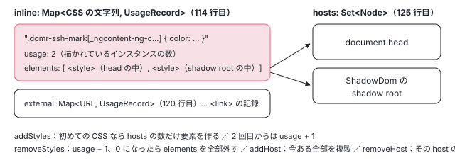

[目次](../README.md) › [DOM レンダラーとイベントの内側](README.md) › 第 7 回 / 全 20 回

# SharedStylesHost：&lt;style&gt; を数えて足し引きする

> SharedStylesHost の inline と external（&lt;link&gt;）の表と使用回数、addStyles・removeStyles、addHost で shadow root にも配る仕組み、サーバーが出した &lt;style ng-app-id&gt; を再利用する addServerStyles、CSP\_NONCE。REMOVE\_STYLES\_ON\_COMPONENT\_DESTROY が true（既定）のとき最後の 1 つが消えると &lt;style&gt; も消える行。

angular/angular · 読了 約 12 分 · 中核 · [サイトで読む（デモが動きます）](https://angular-deep-dive-cyan.vercel.app/chapter/domr-shared-styles)

---

Emulated と None のコンポーネントの CSS は、`SharedStylesHost` が `<style>` 要素にして入れます。同じコンポーネントを 100 個描いても `<style>` は 1 つで、最後の 1 つを壊すと消えます。この章では、それを実現している **「CSS の文字列 → 使用回数と要素」の表**と、**「&lt;style&gt; を入れる先（host）」の集合**の 2 つを、足す行・引く行・配る行の順に読みます。サーバーが出した `<style ng-app-id>` を使い回す仕組みと、`nonce` の付け方も見ます。

読む対象は platform-browser の `dom/shared_styles_host.ts`（全 253 行）と、配り先を足す core の `render3/component_ref.ts` の一部です。`destroy` とアニメーションの関係は [animations-styles-teardown](../animations/13-animations-styles-teardown.md) で、CLI から `<style>` までの全体は [cli-component-styles](../cli/04-cli-component-styles.md) で読みました。ここは SharedStylesHost の中身の全体を 1 つの表と 1 つの集合として読み直します。

1. [1. 全体像](01-domr-overview.md)
2. [2. Renderer2 の約束](02-domr-renderer-api.md)
3. [3. DomRendererFactory2](03-domr-renderer-factory.md)
4. [4. 要素とテキスト](04-domr-default-renderer.md)
5. [5. 属性とプロパティ](05-domr-attributes-properties.md)
6. [6. カプセル化](06-domr-encapsulation.md)
7. **7. SharedStylesHost**（この章）
8. [8. CSS 変数の名前空間](08-domr-css-var-namespacing.md)
9. [9. クラスとスタイル](09-domr-styling-overview.md)
10. [10. 優先順位のリスト](10-domr-style-binding-list.md)
11. [11. 値を決めて書く](11-domr-styling-apply.md)
12. [12. \[class\] と \[style\]](12-domr-styling-maps.md)
13. [13. EventManager](13-domr-event-manager.md)
14. [14. listen](14-domr-listen.md)
15. [15. キーのイベント](15-domr-key-events.md)
16. [16. 自分のプラグイン](16-domr-custom-plugin.md)
17. [17. サニタイズ](17-domr-sanitization.md)
18. [18. 信頼の印](18-domr-trusted-types.md)
19. [19. Title と Meta](19-domr-title-meta.md)
20. [20. issue と PR を読む](20-domr-issues.md)

## 1. 2 つの表と 1 つの集合

📄 `angular/packages/platform-browser/src/dom/shared_styles_host.ts` L108–137 （▶ の行: 114, 120, 125, 128–130, 133, 135–136）

```ts
108 │ @Injectable()
109 │ export class SharedStylesHost implements ɵSharedStylesHost, OnDestroy {
110 │   /**
111 │    * Provides usage information for active inline style content and associated HTML <style> elements.
112 │    * Embedded styles typically originate from the `styles` metadata of a rendered component.
113 │    */
114 ▶   private readonly inline = new Map<string /** content */, UsageRecord<HTMLStyleElement>>();
115 │ 
116 │   /**
117 │    * Provides usage information for active external style URLs and the associated HTML <link> elements.
118 │    * External styles typically originate from the `ɵɵExternalStylesFeature` of a rendered component.
119 │    */
120 ▶   private readonly external = new Map<string /** URL */, UsageRecord<HTMLLinkElement>>();
121 │ 
122 │   /**
123 │    * Set of host DOM nodes that will have styles attached.
124 │    */
125 ▶   private readonly hosts = new Set<Node>();
126 │ 
127 │   constructor(
128 ▶     @Inject(DOCUMENT) private readonly doc: Document,
129 ▶     @Inject(APP_ID) private readonly appId: string,
130 ▶     @Inject(CSP_NONCE) @Optional() private readonly nonce?: string | null,
131 │     // Cannot remove it due to backward compatibility
132 │     // (it seems some TGP targets might be calling this constructor directly).
133 ▶     @Inject(PLATFORM_ID) platformId: object = {},
134 │   ) {
135 ▶     const added = addServerStyles(doc, appId, this.inline, this.external);
136 ▶     if (added) this.hosts.add(doc.head);
137 │   }
```

- **114 行目 `inline`**：CSS の文字列そのものをキーにした表です。コンポーネントの `styles` から来るものが入ります。
- **120 行目 `external`**：URL をキーにした表です。`<link rel="stylesheet">` で読む外部スタイル（開発サーバーの HMR など、CSS を URL のまま渡すとき）が入ります。
- **125 行目 `hosts`**：`<style>` を入れる先のノードの集合です。ふつうは `document.head` だけで、ShadowDom の shadow root が増えたり減ったりします。

コンストラクタは 128〜130 行目で `DOCUMENT`・`APP_ID`・`CSP_NONCE`（無くてもよい）を受け取ります。133 行目の `PLATFORM_ID` は使っていない引数で、131〜132 行目のコメントのとおり、このコンストラクタを直接呼んでいるコードとの互換のために残っています。135〜136 行目は 4 節です。

📄 `angular/packages/platform-browser/src/dom/shared_styles_host.ts` L21–54 （▶ の行: 22, 29–30, 38–39, 50–51）

```ts
21 │ /** The style elements attribute name used to set value of `APP_ID` token. */
22 ▶ const APP_ID_ATTRIBUTE_NAME = 'ng-app-id';
23 │ 
24 │ /**
25 │  * A record of usage for a specific style including all elements added to the DOM
26 │  * that contain a given style.
27 │  */
28 │ interface UsageRecord<T> {
29 ▶   elements: T[];
30 ▶   usage: number;
31 │ }
32 │ 
33 │ /**
34 │  * Removes all provided elements from the document.
35 │  * @param elements An array of HTML Elements.
36 │  */
37 │ function removeElements(elements: Iterable<HTMLElement>): void {
38 ▶   for (const element of elements) {
39 ▶     element.remove();
40 │   }
41 │ }
42 │ 
43 │ /**
44 │  * Creates a `style` element with the provided inline style content.
45 │  * @param style A string of the inline style content.
46 │  * @param doc A DOM Document to use to create the element.
47 │  * @returns An HTMLStyleElement instance.
48 │  */
49 │ function createStyleElement(style: string, doc: Document): HTMLStyleElement {
50 ▶   const styleElement = doc.createElement('style');
51 ▶   styleElement.textContent = style;
52 │ 
53 │   return styleElement;
54 │ }
```

表の値は 29〜30 行目の `UsageRecord` で、`elements`（その CSS で作った要素。host ごとに 1 つ）と `usage`（使っている数）の 2 つだけです。消すときは 38〜39 行目で要素を 1 つずつ `remove()`、作るときは 50〜51 行目で `doc.createElement('style')` に `textContent` を入れるだけです。22 行目の `ng-app-id` は 4 節で使う属性名です。



*SharedStylesHost の中身。CSS の文字列ごとの記録（usage と elements）と、host の集合。elements は host ごとに 1 つずつ作られる*

## 2. 足す：addStyles → addUsage

呼ぶのは `NoneEncapsulationDomRenderer.applyStyles` で、Emulated・None のコンポーネントのインスタンスが作られるたびに呼ばれます（[第 6 回](06-domr-encapsulation.md)の 3・4 節）。

📄 `angular/packages/platform-browser/src/dom/shared_styles_host.ts` L139–145 （▶ の行: 140–141, 144）

```ts
139 │   addStyles(styles: string[], urls?: string[]): void {
140 ▶     for (const value of styles) {
141 ▶       this.addUsage(value, this.inline, createStyleElement);
142 │     }
143 │ 
144 ▶     urls?.forEach((value) => this.addUsage(value, this.external, createLinkElement));
145 │   }
```

📄 `angular/packages/platform-browser/src/dom/shared_styles_host.ts` L174–180 （▶ の行: 174, 177–179）

```ts
174 ▶       record.usage++;
175 │     } else {
176 │       // Otherwise, create an entry to track the elements and add element for each host
177 ▶       usages.set(value, {
178 ▶         usage: 1,
179 ▶         elements: [...this.hosts].map((host) => this.addElement(host, creator(value, this.doc))),
180 │       });
```

1. **141 行目：CSS の文字列 1 つごとに `addUsage`**

   `styles` は配列で、1 つのコンポーネントが複数の文字列を持つこともあります。外部スタイルの URL は 144 行目で `external` の表に、`createLinkElement` を作り方として渡します。
2. **174 行目：もう表にあれば数を 1 足すだけ**

   表引きと、サーバーが出したものだったときに開発モードで `ng-style-reused` を付ける直前の数行は [cli-component-styles](../cli/04-cli-component-styles.md) の 8 節で読みました。2 つ目のインスタンスからは、DOM には何も足しません。
3. **177〜179 行目：初めてなら、host の数だけ要素を作る**

   `usage: 1` で記録を作り、179 行目で `hosts` の 1 つずつに `addElement`（6 節）で要素を足します。ShadowDom のコンポーネントが 2 つ出ていれば、host は head と 2 つの shadow root の 3 つで、要素も 3 つです。**キーは CSS の文字列そのもの**なので、別のコンポーネントでも中身が一字一句同じなら 1 つにまとまります。

## 3. 引く：removeStyles → removeUsage と、destroy

📄 `angular/packages/platform-browser/src/dom/dom_renderer.ts` L680–686 （▶ の行: 680, 683–684）

```ts
680 ▶     if (!this.removeStylesOnCompDestroy) {
681 │       return;
682 │     }
683 ▶     if (allLeavingAnimations.size === 0) {
684 ▶       this.sharedStylesHost.removeStyles(this.styles, this.styleUrls);
685 │     }
686 │   }
```

引くのは `NoneEncapsulationDomRenderer.destroy` で、コンポーネントのビューが壊されるたびに呼ばれます（[ivy-destroy](../ivy/17-ivy-destroy.md)）。680 行目の `REMOVE_STYLES_ON_COMPONENT_DESTROY`（既定 `true`）が `false` なら何もせず、683 行目で leave のアニメーション中のビューがあれば飛ばします。この 2 つの分かれは [animations-styles-teardown](../animations/13-animations-styles-teardown.md) の 2 節で詳しく読みました。684 行目が次の `removeStyles` です。

📄 `angular/packages/platform-browser/src/dom/shared_styles_host.ts` L193–199 （▶ の行: 194–197）

```ts
193 │     if (record) {
194 ▶       record.usage--;
195 ▶       if (record.usage <= 0) {
196 ▶         removeElements(record.elements);
197 ▶         usages.delete(value);
198 │       }
199 │     }
```

194 行目で 1 引き、195 行目で 0 以下になったときだけ、196 行目でその CSS の要素を**全部の host から**外し、197 行目で表から消します。次にそのコンポーネントが描かれると、2 節の 177 行目で最初から作り直します。

## 4. サーバーが出した &lt;style&gt; を使い回す

このサイトのようにプリレンダーした HTML の `<head>` には、サーバーで描いたときの `<style ng-app-id="ng">` がもう入っています。1 節の 135 行目、コンストラクタの `addServerStyles` が、それを表に入れます（全体は [cli-component-styles](../cli/04-cli-component-styles.md) の 8 節）。

📄 `angular/packages/platform-browser/src/dom/shared_styles_host.ts` L81–87 （▶ の行: 82–83, 86–87）

```ts
81 │       // The href is build time generated with a unique value to prevent duplicates.
82 ▶       external.set(styleElement.href.slice(styleElement.href.lastIndexOf('/') + 1), {
83 ▶         usage: 0,
84 │         elements: [styleElement],
85 │       });
86 ▶     } else if (styleElement.textContent) {
87 ▶       inline.set(styleElement.textContent, {usage: 0, elements: [styleElement]});
```

82〜83 行目と 87 行目で、**`usage: 0`** の記録として表に入れます。まだ誰も使っていないが、要素はもうある、という印です。ブラウザのコンポーネントが同じ CSS で `addStyles` を呼ぶと 2 節の 174 行目で 1 になり、新しい `<style>` は作られません。外部スタイルは 82 行目でファイル名だけをキーにします。1 節の 136 行目で、使い回す要素が 1 つでもあれば `document.head` を host に入れます。

ヘッドレスの Chrome でこの章の開発ビルドを開くと、`<head>` の `<style>` 7 つが全部 `ng-style-reused` の属性つきで、`ng-app-id` の付いたものは 0 でした（`ng-style-reused` は開発モードだけ付く印。`ng-app-id` は表に入れるときに外す）。`usage: 0` のまま使われなかった要素は、3 節の `removeUsage` を通らないので、ページを離れるまで残ります。

## 5. 配り先：addHost と removeHost

📄 `angular/packages/platform-browser/src/dom/shared_styles_host.ts` L202–237 （▶ の行: 203–204, 206, 210, 212, 215–216, 218–219, 224, 226, 229–230, 235）

```ts
202 │   ngOnDestroy(): void {
203 ▶     for (const [, {elements}] of [...this.inline, ...this.external]) {
204 ▶       removeElements(elements);
205 │     }
206 ▶     this.hosts.clear();
207 │   }
208 │ 
209 │   addHost(hostNode: Node): void {
210 ▶     if (this.hosts.has(hostNode)) return;
211 │ 
212 ▶     this.hosts.add(hostNode);
213 │ 
214 │     // Add existing styles to new host
215 ▶     for (const [style, {elements}] of this.inline) {
216 ▶       elements.push(this.addElement(hostNode, createStyleElement(style, this.doc)));
217 │     }
218 ▶     for (const [url, {elements}] of this.external) {
219 ▶       elements.push(this.addElement(hostNode, createLinkElement(url, this.doc)));
220 │     }
221 │   }
222 │ 
223 │   removeHost(hostNode: Node): void {
224 ▶     this.hosts.delete(hostNode);
225 │ 
226 ▶     for (const record of [...this.inline.values(), ...this.external.values()]) {
227 │       const remaining: Array<HTMLStyleElement | HTMLLinkElement> = [];
228 │       for (const element of record.elements) {
229 ▶         if (element.parentNode === hostNode) {
230 ▶           element.remove();
231 │         } else {
232 │           remaining.push(element);
233 │         }
234 │       }
235 ▶       record.elements = remaining;
236 │     }
237 │   }
```

1. **210 行目：同じ host は 2 回足さない**

   2026-04 のコミット `e77fb5a1251` で入った確認です。head が何度 `addHost` されても `<style>` は増えません。
2. **215〜220 行目：足した host に、今ある全部を複製する**

   表の全部の CSS について新しい要素を作り、その記録の `elements` に足します。`usage` は変えません。ShadowDom の shadow root にページのスタイルが全部入るのはこの行です（[第 6 回](06-domr-encapsulation.md)の 5 節）。
3. **224〜235 行目：外した host の中の要素だけを外す**

   229 行目で、要素の親がその host のものだけを `remove()` し、残りを 235 行目で `elements` に戻します。表の記録と `usage` は残ります。2026-03 のコミット `d45b7a91f96`（host が外されたら、その中のスタイルも外す）の形です。
4. **203〜206 行目：アプリが終わるとき**

   SharedStylesHost 自体が壊されると（アプリの破棄）、全部の要素を外して host を空にします。

### 誰が addHost を呼ぶか

platform-browser の中で呼ぶのは ShadowDom のレンダラーだけです。head を足すのは core の側で、ルートのコンポーネントを作るときです。

📄 `angular/packages/core/src/render3/component_ref.ts` L345–350 （▶ の行: 345–346, 350）

```ts
345 ▶     const sharedStylesHost = rootViewInjector.get(SHARED_STYLES_HOST, null);
346 ▶     const styleHost = getStyleHost(
347 │       hostElement,
348 │       () => rootViewInjector.get(DOCUMENT, null) ?? getDocument(),
349 │     );
350 ▶     if (sharedStylesHost) sharedStylesHost.addHost(styleHost);
```

📄 `angular/packages/core/src/render3/component_ref.ts` L532–544 （▶ の行: 533, 535–542）

```ts
532 │ function getStyleHost(node: RNode, doc: () => Document): Node {
533 ▶   const rootNode = node.getRootNode?.();
534 │ 
535 ▶   if (documentSupported && rootNode instanceof Document) {
536 ▶     return rootNode.head; // Connected to document.
537 ▶   } else if (!rootNode) {
538 ▶     return doc().head; // `getRootNode` not supported, Node.js use case.
539 ▶   } else if (shadowRootSupported && rootNode instanceof ShadowRoot) {
540 ▶     return rootNode; // Shadow root
541 ▶   } else {
542 ▶     return doc().head; // Disconnected element, use fallback document.
543 │   }
544 │ }
```

345 行目で SharedStylesHost を（あれば）取り、346 行目の `getStyleHost` でホスト要素の `getRootNode()` を見ます。ページの Document につながっていれば 536 行目で `head`、shadow root の中に置かれていれば 540 行目でその shadow root、どこにもつながっていない要素なら 542 行目で `DOCUMENT` の `head` です。`bootstrapApplication` で `<app-root>` を描くときも、デモのように `createComponent` でホストごと作るときも（542 行目）、結局 head が host になります。shadow root を返す 539〜540 行目は、2026-03 のコミット `cdda51a3b2f`（shadow root の下でアプリを起動する）で入りました。

📄 `angular/packages/core/src/render3/component_ref.ts` L370–382 （▶ の行: 370–371, 374–376, 378, 380）

```ts
370 ▶     // Since we don't reference count host usage, calling `removeHost` is potentially
371 ▶     // breaking since other root components on the page might rely on it (ex. a dialog,
372 │     // multiple `ApplicationRef.prototype.bootstrap` calls, etc.).
373 │     //
374 ▶     // Instead we only remove shadow roots, under the assumption that a shadow root will
375 ▶     // only contain one Angular root component. This is true for MicA, but not in general.
376 ▶     // Styles in the document light DOM are effectively leaked, since we can't easily
377 │     // assume no other components exist on the page outside this one root.
378 ▶     if (sharedStylesHost && shadowRootSupported && styleHost instanceof ShadowRoot) {
379 │       storeLViewOnDestroy(rootLView, () => {
380 ▶         sharedStylesHost.removeHost(styleHost);
381 │       });
382 │     }
```

外すほうは、378 行目のとおり host が shadow root のときだけです。370〜377 行目のコメントのとおり、host の使用回数は数えていないので、head を外すと同じページの別のルート（ダイアログなど）のスタイルまで消えてしまうからです。head のスタイルは「漏れる（leaked）」ままにする、と書いてあります。

## 6. 要素を入れる：addElement と nonce

📄 `angular/packages/platform-browser/src/dom/shared_styles_host.ts` L241–247 （▶ の行: 241–242, 246–247）

```ts
241 ▶     if (this.nonce) {
242 ▶       element.setAttribute('nonce', this.nonce);
243 │     }
244 │ 
245 │     // Add application identifier when on the server to support client-side reuse
246 ▶     if (typeof ngServerMode !== 'undefined' && ngServerMode) {
247 ▶       element.setAttribute(APP_ID_ATTRIBUTE_NAME, this.appId);
```

241〜242 行目で、`CSP_NONCE` があれば全部の要素に `nonce` を付けます。Content Security Policy の `style-src 'nonce-…'` で `<style>` を許すための属性です。値の決まり方（`CSP_NONCE` を provide するか、ルートの要素の `ngCspNonce` 属性を読むか）は [第 3 回](03-domr-renderer-factory.md)で読みます。ShadowDom の自分の `<style>` は SharedStylesHost を通らないので、[第 6 回](06-domr-encapsulation.md)の 5 節で読んだとおり、コンストラクタの中で別に付けています。246〜247 行目、サーバーでは `ng-app-id` を付けます。これが 4 節でブラウザが探す印です。

## 7. 1 手ずつ数える

> **🧪 DEMO — 本物の SharedStylesHost の使用回数を 1 手ずつ見る**
>
> Emulated のコンポーネント（styles は `.domr-ssh-mark { color: #c3002f; }`）と ShadowDom のコンポーネントを、このサイトの本物の DomRendererFactory2 で描いたり破棄したりします（描くのは共通部品 `domr-probe.ts` の `mountWithLog`）。手ごとに、`document.head` と shadow root の中で `domr-ssh-mark` を含む `<style>` の数と、SharedStylesHost の private な表 `inline` の `usage` を読みます（読むだけで、書き換えません）。
>
> ▶ [このデモはサイトで動かせます](https://angular-deep-dive-cyan.vercel.app/chapter/domr-shared-styles)

ヘッドレスの Chrome（開発ビルド、2026-11-04）で 8 手を進めた結果です。

| 手 | head の中 | shadow root の中 | usage | elements の親 | 効いた行 |
| --- | --- | --- | --- | --- | --- |
| 1. Emulated を 1 つ描く | 1 | （まだ無い） | 1 | head | 177〜179 |
| 2. Emulated をもう 1 つ描く | 1 | （まだ無い） | 2 | head | 174 |
| 3. ShadowDom を 1 つ描く | 1 | 1 | 2 | head, shadow root | 215〜216 |
| 4. Emulated を 1 つ破棄 | 1 | 1 | 1 | head, shadow root | 194 |
| 5. Emulated をもう 1 つ破棄 | 0 | 0 | （表に無い） |   | 195〜197（両方の host から） |
| 6. Emulated をもう一度描く | 1 | 1 | 1 | head, shadow root | 177〜179（host が 2 つ） |
| 7. ShadowDom を破棄 | 1 | 0 | 1 | head | 226〜235 |
| 8. Emulated を破棄 | 0 | 0 | （表に無い） |   | 195〜197 |

- 手 3 で ShadowDom を描いたとき、Emulated の CSS の要素が shadow root にも 1 つ増え、`usage` は 2 のままです（215〜216 行目は `usage` を変えない）。
- 手 5 で `usage` が 0 になると、head と shadow root の両方の要素が消えます（196 行目は記録の `elements` を全部外す）。
- 手 6 は、shadow root が host の集合に残っているので、新しく作るときに 179 行目で 2 つ作られます。
- 手 7 の ShadowDom の破棄（`ShadowDomRenderer.destroy` → `removeHost`）では `usage` は 1 のままで、shadow root の中の要素だけが外れます。
- デモは破棄したあと、ホスト要素を枠から外す処理をこの章のコードでしています。`createComponent` でホストごと作ったコンポーネントは、`destroy()` してもホスト要素が DOM に残るからです（`mountWithLog` が `appendChild` したのはこの章の側）。

## ここまでの呼び出し

- `new SharedStylesHost(doc, appId, nonce) → addServerStyles()` — shared\_styles\_host.ts:135 — *usage 0 で表に*
- `ComponentFactory.create → addHost(getStyleHost(host))` — component\_ref.ts:345-350 — *ふつうは head*
- `createRenderer → applyStyles() → addStyles(styles, urls)` — dom\_renderer.ts / shared\_styles\_host.ts:139
  - `addUsage → usage++ ／ hosts の数だけ addElement` — shared\_styles\_host.ts:174・179
- `new ShadowDomRenderer → addHost(shadowRoot)` — dom\_renderer.ts / shared\_styles\_host.ts:209 — *今ある分を複製*
- `cleanUpView → renderer.destroy() → removeStyles` — dom\_renderer.ts:684
  - `removeUsage → usage-- → 0 なら全部の host から外す` — shared\_styles\_host.ts:194-197
- `ShadowDomRenderer.destroy → removeHost(shadowRoot)` — shared\_styles\_host.ts:223

## テストと直し方

### spec と describe

| spec | describe / it | bazel のターゲット |
| --- | --- | --- |
| platform-browser/test/dom/shared\_styles\_host\_spec.ts | describe `SharedStylesHost`（13）の中の `inline`（24、it 9 つ）・`external`（111、it 10 個）・`removeHost`（210、it 3 つ） | `//packages/platform-browser/test:test`（Node） |
| platform-browser/test/dom/shadow\_dom\_spec.ts | it `should not leak styles into previously used shadow roots`（176）ほか shadow root の下での起動の 3 つ | `//packages/platform-browser/test:test_web_chromium`（ブラウザだけ） |
| platform-browser/test/dom/dom\_renderer\_spec.ts | describe `` should not cleanup styles of destroyed components when `REMOVE_STYLES_ON_COMPONENT_DESTROY` is `false` ``（220）・`should cleanup styles of destroyed components by default`（288） |   |

📄 `angular/packages/platform-browser/test/dom/shared_styles_host_spec.ts` L24–51 （▶ の行: 27–28, 33–34, 38, 40–41, 49–50）

```ts
24 │   describe('inline', () => {
25 │     it('should add existing styles to new hosts', () => {
26 │       ssh.addStyles(['a {};']);
27 ▶       ssh.addHost(someHost);
28 ▶       expect(someHost.innerHTML).toEqual('<style>a {};</style>');
29 │     });
30 │ 
31 │     it('should add new styles to hosts', () => {
32 │       ssh.addHost(someHost);
33 ▶       ssh.addStyles(['a {};']);
34 ▶       expect(someHost.innerHTML).toEqual('<style>a {};</style>');
35 │     });
36 │ 
37 │     it('should add styles only once to hosts', () => {
38 ▶       ssh.addStyles(['a {};']);
39 │       ssh.addHost(someHost);
40 ▶       ssh.addStyles(['a {};']);
41 ▶       expect(someHost.innerHTML).toEqual('<style>a {};</style>');
42 │     });
43 │ 
44 │     it('should remove style nodes on destroy', () => {
45 │       ssh.addStyles(['a {};']);
46 │       ssh.addHost(someHost);
47 │       expect(someHost.innerHTML).toEqual('<style>a {};</style>');
48 │ 
49 ▶       ssh.ngOnDestroy();
50 ▶       expect(someHost.innerHTML).toEqual('');
51 │     });
```

SharedStylesHost はコンストラクタに Document を渡せば単独で動くので、DOM を作れる Node の環境で走ります。27〜28 行目は 5 節の 215〜216 行目（あとから足した host に複製）、33〜34 行目は 2 節の 179 行目（足したあとに来た CSS も配る）、38〜41 行目は 174 行目（2 回目は増えない）、49〜50 行目は 203〜206 行目です。

📄 `angular/packages/platform-browser/test/dom/shared_styles_host_spec.ts` L53–70 （▶ の行: 54, 57, 62, 66, 68–69）

```ts
53 │     it(`should add 'nonce' attribute when a nonce value is provided`, () => {
54 ▶       ssh = new SharedStylesHost(doc, 'app-id', '');
55 │       ssh.addStyles(['a {};']);
56 │       ssh.addHost(someHost);
57 ▶       expect(someHost.innerHTML).toEqual('<style nonce="">a {};</style>');
58 │     });
59 │ 
60 │     it(`should reuse SSR generated element`, () => {
61 │       const style = doc.createElement('style');
62 ▶       style.setAttribute('ng-app-id', 'app-id');
63 │       style.textContent = 'a {};';
64 │       doc.head.appendChild(style);
65 │ 
66 ▶       ssh = new SharedStylesHost(doc, 'app-id');
67 │       ssh.addStyles(['a {};']);
68 ▶       expect(doc.head.innerHTML).toContain('<style ng-style-reused="">a {};</style>');
69 ▶       expect(doc.head.innerHTML).not.toContain('ng-app-id');
70 │     });
```

54・57 行目が 6 節の `nonce`、62〜69 行目が 4 節の使い回しです。62 行目で `ng-app-id` を付けた要素を先に置き、68 行目で `ng-style-reused` が付いたこと、69 行目で `ng-app-id` が外れたことを確かめます。

📄 `angular/packages/platform-browser/test/dom/shared_styles_host_spec.ts` L210–235 （▶ の行: 216–217, 231–233）

```ts
210 │   describe('removeHost', () => {
211 │     it('should remove inline style nodes from the host', () => {
212 │       ssh.addStyles(['a {}']);
213 │       ssh.addHost(someHost);
214 │       expect(someHost.innerHTML).toEqual('<style>a {}</style>');
215 │ 
216 ▶       ssh.removeHost(someHost);
217 ▶       expect(someHost.innerHTML).toEqual('');
218 │     });
219 │ 
220 │     it('should remove external style nodes from the host', () => {
221 │       ssh.addStyles([], ['component.css']);
222 │       ssh.addHost(someHost);
223 │       expect(someHost.innerHTML).toEqual('<link rel="stylesheet" href="component.css">');
224 │ 
225 │       ssh.removeHost(someHost);
226 │       expect(someHost.innerHTML).toEqual('');
227 │     });
228 │ 
229 │     it('should not add new styles to the host after removal', () => {
230 │       ssh.addHost(someHost);
231 ▶       ssh.removeHost(someHost);
232 ▶       ssh.addStyles(['a {}']);
233 ▶       expect(someHost.innerHTML).toEqual('');
234 │     });
235 │   });
```

📄 `angular/packages/platform-browser/test/dom/shadow_dom_spec.ts` L176–207 （▶ の行: 200, 202–204, 206）

```ts
176 │   it('should not leak styles into previously used shadow roots', async () => {
177 │     const container1 = document.createElement('div');
178 │     container1.attachShadow({mode: 'open'});
179 │     document.body.append(container1);
180 │ 
181 │     const container2 = document.createElement('div');
182 │     container2.attachShadow({mode: 'open'});
183 │     document.body.append(container2);
184 │ 
185 │     const appRef = await createApplication();
186 │ 
187 │     {
188 │       @Component({
189 │         selector: 'app-root',
190 │         template: '<div>Hello, World!</div>',
191 │         styles: `
192 │           div {
193 │             color: red;
194 │           }
195 │         `,
196 │       })
197 │       class Root {}
198 │ 
199 │       const rootEl = document.createElement('app-root');
200 ▶       container1.shadowRoot!.append(rootEl);
201 │ 
202 ▶       const root = appRef.bootstrap(Root, rootEl);
203 ▶       expect(getComputedStyle(rootEl.querySelector('div')!).color).toBe('rgb(255, 0, 0)');
204 ▶       root.destroy();
205 │ 
206 ▶       expect(container1.shadowRoot!.innerHTML).not.toContain('<style>');
207 │     }
```

こちらはブラウザだけの it です。200 行目でアプリのルートを shadow root の中に置いて起動し（5 節の 540 行目で host が shadow root になる）、204 行目で壊したあと、206 行目で shadow root に `<style>` が残っていないこと（380 行目の `removeHost`）を確かめます。

### 手元で走らせた結果

📄 `ターミナル（../angular で）`

```
cd ~/angular-research/angular
pnpm bazel test //packages/platform-browser/test:test --nocache_test_results --test_output=all \
  '--test_arg=--filter=SharedStylesHost|CssVarNamespacer'
# REMOVE_STYLES_ON_COMPONENT_DESTROY と shadow root の it はブラウザでだけ走る
pnpm bazel test //packages/platform-browser/test:test_web_chromium --nocache_test_results --test_output=all
```

📄 `出力（2026-11-04 に実行。抜粋。ログは scratchpad/domr-logs/b-styles-node.log・b-web-chromium.log）`

```
//packages/platform-browser/test:test
Ran 26 of 159 specs
26 specs, 0 failures
//packages/platform-browser/test:test             PASSED in 0.7s

//packages/platform-browser/test:test_web_chromium
Chromium: 1/1 test files | 253 passed, 0 failed, 5 skipped
//packages/platform-browser/test:test_web_chromium PASSED in 2.1s
```

- 26 件 = SharedStylesHost 22（inline 9・external 10・removeHost 3）+ CssVarNamespacer 4（[第 8 回](08-domr-css-var-namespacing.md)）。

### 直すとしたら

- 数え方や配り方を変えるなら `addUsage` / `removeUsage` / `addHost` / `removeHost` で、it は `shared_styles_host_spec.ts` に足します。Node で 1 秒足らずで走るので、手元で試しやすい場所です。
- head を host にする条件を変えるなら core の `getStyleHost`（532〜544 行目）で、it は `shadow_dom_spec.ts`（ブラウザ）です。
- 関係する issue。**#59651**（使われなくなった `<style>` を外す代わりに無効にする変更を入れ直してほしい。開いている）は 3 節の 196 行目の「外す」の話、**#62545**（`REMOVE_STYLES_ON_COMPONENT_DESTROY` を `false` にすると HMR で古いスタイルが残る。開いている）の手順（このトークンを `false` にする）では、3 節の 680 行目で帰るので 196 行目に届きません。**#54689**・**#26152**（CSP の `nonce`）は 6 節の行です。一覧は [第 20 回](20-domr-issues.md)。
- 本家に PR を出すことは勧めません。issue の「スタイルが消えない」「二重に入る」を読むとき、表の `usage` と host の集合のどちらの話かを切り分ける手がかりにします。

## 聞かれそうな質問

**Q. 同じコンポーネントを 100 個出すと &lt;style&gt; も 100 個？**

1 個です（host が head だけなら）。2 個目からは 174 行目で `usage` を 1 足すだけです。要素を作るのは 177〜179 行目の、表に無かったときだけです。

**Q. コンポーネントを壊したらスタイルはいつ消える？**

最後の 1 つが壊れたときです。`NoneEncapsulationDomRenderer.destroy` の 684 行目 → `removeUsage` の 194 行目で 1 引き、195 行目で 0 以下になったら 196 行目で外します。ただし 680 行目で `REMOVE_STYLES_ON_COMPONENT_DESTROY` が `false` なら外さず、683 行目で leave のアニメーション中なら飛ばします。

**Q. SSR したページで、ブラウザはスタイルを入れ直す？**

入れ直しません。コンストラクタの 135 行目で `style[ng-app-id="…"]` を集めて `usage: 0` で表に入れ（87 行目）、同じ CSS の `addStyles` は 174 行目で数を足すだけになります。サーバーの側で `ng-app-id` を付けているのは 246〜247 行目です。

**Q. ShadowDom のコンポーネントの中に、ページ全体のスタイルが入っているのはなぜ？**

`ShadowDomRenderer` のコンストラクタが shadow root を `addHost` し、215〜220 行目がそのとき表にある CSS を全部複製するからです。以後に足される CSS も 179 行目で配られます。ExperimentalIsolatedShadowDom は `addHost` を呼ばないので入りません（[第 6 回](06-domr-encapsulation.md)）。

**Q. アプリを壊しても head のスタイルが残るのはなぜ？**

ルートのコンポーネントを壊しても、core は 378 行目のとおり host が shadow root のときしか `removeHost` しません。370〜377 行目のコメントが、同じページの別のルートが使っていることがある head は外せない、と理由を書いています。コンポーネントごとのスタイルは、それぞれの `destroy` の 684 行目で引かれます。

## 読み終えて

- SharedStylesHost は「CSS の文字列（または URL）→ 使用回数と要素」の表 2 つと、「&lt;style&gt; を入れる先」の集合 1 つでできている。
- 足すのは `applyStyles`、引くのは `destroy`。初めての CSS だけ要素を作り、数が 0 になったら全部の host から外す。
- host を足すと、今ある CSS が全部その host に複製される。ShadowDom の shadow root がその例。
- サーバーが出した `<style ng-app-id>` は `usage: 0` の記録になり、ブラウザは同じ CSS を作り直さない。
- head を host にするのは core のルートのコンポーネントの作成で、外すのは shadow root のときだけ。

---

← 前: [Emulated・None・ShadowDom：renderer ごとのカプセル化](06-domr-encapsulation.md)  
次: [CSS 変数の名前空間：provideCssVarNamespacing と %NS%](08-domr-css-var-namespacing.md) →
