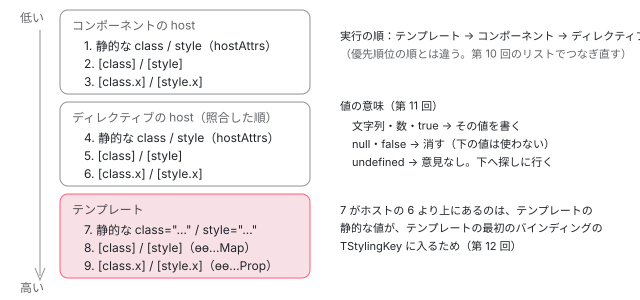

[目次](../README.md) › [DOM レンダラーとイベントの内側](README.md) › 第 9 回 / 全 20 回

# クラスとスタイルのバインディング：命令と静的なスタイル

> \[class.a\]・\[style.width.px\]・\[class\]・\[style\] がコンパイルで ɵɵclassProp・ɵɵstyleProp・ɵɵclassMap・ɵɵstyleMap になる対応と、class="x" や style="..." の静的な値を最初に集める static\_styling.ts（computeStaticStyling）。テンプレート・ホストのバインディング・ディレクティブのホストのバインディングが同じ要素に書くときの優先順位。ページの上で本物のコンポーネントにぶつかるバインディングを置いて結果を見るデモ。

angular/angular · 読了 約 13 分 · 中核 · [サイトで読む（デモが動きます）](https://angular-deep-dive-cyan.vercel.app/chapter/domr-styling-overview)

---

`[class.on]="x"` と書いた要素に、コンポーネントの `host` も、付けたディレクティブの `host` も `class` を書くとき、最後に DOM に残るのはどれでしょう。この章では、テンプレートのクラスとスタイルの書き方が、コンパイルでどの命令（`ɵɵclassProp`・`ɵɵstyleProp`・`ɵɵclassMap`・`ɵɵstyleMap`）になるのか、静的な `class="…"` と `style="…"` がいつどこに集められて書かれるのか、そして同じ要素に書く 3 つの場所（テンプレート・ディレクティブのホスト・コンポーネントのホスト）の優先順位を、実物の行と本物のコンポーネントで確かめます。

読む対象は core の `packages/core/src/render3/instructions/styling.ts`・`render3/styling/static_styling.ts`・`render3/styling/style_binding_list.ts` の先頭のコメント・`render3/dom_node_manipulation.ts`、コンパイラの `packages/compiler/src/template/pipeline/src/phases/ordering.ts` です（../angular、22.2.0-next.7、8576f161ae4）。第 9〜12 回はこの 4 つの命令の中を順に読みます。

1. [1. 全体像](01-domr-overview.md)
2. [2. Renderer2 の約束](02-domr-renderer-api.md)
3. [3. DomRendererFactory2](03-domr-renderer-factory.md)
4. [4. 要素とテキスト](04-domr-default-renderer.md)
5. [5. 属性とプロパティ](05-domr-attributes-properties.md)
6. [6. カプセル化](06-domr-encapsulation.md)
7. [7. SharedStylesHost](07-domr-shared-styles.md)
8. [8. CSS 変数の名前空間](08-domr-css-var-namespacing.md)
9. **9. クラスとスタイル**（この章）
10. [10. 優先順位のリスト](10-domr-style-binding-list.md)
11. [11. 値を決めて書く](11-domr-styling-apply.md)
12. [12. \[class\] と \[style\]](12-domr-styling-maps.md)
13. [13. EventManager](13-domr-event-manager.md)
14. [14. listen](14-domr-listen.md)
15. [15. キーのイベント](15-domr-key-events.md)
16. [16. 自分のプラグイン](16-domr-custom-plugin.md)
17. [17. サニタイズ](17-domr-sanitization.md)
18. [18. 信頼の印](18-domr-trusted-types.md)
19. [19. Title と Meta](19-domr-title-meta.md)
20. [20. issue と PR を読む](20-domr-issues.md)

## 1. 書き方と命令の対応

まず、どの書き方がどの命令になるのかを、実物のコンパイルで確かめます。このサイトの `node_modules` の `@angular/compiler-cli` 22.1.6 の `ngc` で、下の 2 つのコンポーネントをコンパイルした出力です（抜粋。インデントだけ整えました）。

📄 `ngc の出力（scratchpad で compilationMode: full。出力の .js から抜粋）`

```
// 入力（Stage のテンプレート）
//   <domr-so-box domrSoDir class="a tpl-static" style="width: 8px"
//     [class]="m()" [class.a]="a()" [style]="s()" [style.width.px]="w()" [style.height.%]="h()" />
//   <p class="x {{ name() }} y" style="color: {{ c() }}"></p>
decls: 2, vars: 16,
consts: [["domrSoDir", "", 1, "a", "tpl-static", 2, "width", "8px"]],
template: function Stage_Template(rf, ctx) {
  if (rf & 1) {
    i0.ɵɵelement(0, "domr-so-box", 0)(1, "p");
  }
  if (rf & 2) {
    i0.ɵɵstyleMap(ctx.s());
    i0.ɵɵclassMap(ctx.m());
    i0.ɵɵstyleProp("width", ctx.w(), "px")("height", ctx.h(), "%");
    i0.ɵɵclassProp("a", ctx.a());
    i0.ɵɵadvance();
    i0.ɵɵstyleMap(i0.ɵɵinterpolate1("color: ", ctx.c()));
    i0.ɵɵclassMap(i0.ɵɵinterpolate1("x ", ctx.name(), " y"));
  }
}

// 入力（Box の host）
//   host: { class: 'cmp-static', '[class.a]': 'cmpA()', '[style.width.px]': 'cmpW()' }
hostAttrs: [1, "cmp-static"],
hostVars: 4,
hostBindings: function Box_HostBindings(rf, ctx) {
  if (rf & 2) {
    i0.ɵɵstyleProp("width", ctx.cmpW(), "px");
    i0.ɵɵclassProp("a", ctx.cmpA());
  }
}
```

| テンプレートの書き方 | コンパイル結果 | 読む回 |
| --- | --- | --- |
| `class="a tpl-static"`・`style="width: 8px"` | 命令にならず、`consts` の配列に `1`（`AttributeMarker.Classes`）・`2`（`Styles`）の印のあとに並ぶ | この回の 3 節 |
| `[class.a]="a()"` | `ɵɵclassProp("a", ctx.a())` | 第 11 回 |
| `[style.width.px]="w()"` | `ɵɵstyleProp("width", ctx.w(), "px")`（単位は 3 つ目の引数） |   |
| `[class]="m()"`・`[style]="s()"` | `ɵɵclassMap(ctx.m())`・`ɵɵstyleMap(ctx.s())` | 第 12 回 |
| `class="x {{ name() }} y"`（補間） | `ɵɵclassMap(ɵɵinterpolate1("x ", ctx.name(), " y"))`。補間で 1 本の文字列にしてから map の命令に渡す |   |
| `host: { class: 'cmp-static' }` | `hostAttrs: [1, "cmp-static"]` | この回の 3 節 |
| `host: { '[class.a]': 'cmpA()' }` | `hostBindings` 関数の中の `ɵɵclassProp("a", ctx.cmpA())` | 第 10 回 |

出力の中で目を引くのは命令の順番です。テンプレートに書いた順は `[class]`・`[class.a]`・`[style]`・`[style.width.px]`・`[style.height.%]` でしたが、出力は `ɵɵstyleMap` → `ɵɵclassMap` → `ɵɵstyleProp` → `ɵɵclassProp` です。並べ替えているのはコンパイラの `orderOps` です。

📄 `angular/packages/compiler/src/template/pipeline/src/phases/ordering.ts` L56–83 （▶ の行: 61–64, 79–82）

```ts
56 │ /**
57 │  * Defines the groups based on `OpKind` that ops will be divided into, for the various update
58 │  * op kinds.
59 │  */
60 │ const UPDATE_ORDERING: Array<Rule<ir.UpdateOp>> = [
61 ▶   {test: kindTest(ir.OpKind.StyleMap), transform: keepLast},
62 ▶   {test: kindTest(ir.OpKind.ClassMap), transform: keepLast},
63 ▶   {test: kindTest(ir.OpKind.StyleProp)},
64 ▶   {test: kindTest(ir.OpKind.ClassProp)},
65 │   {test: kindWithInterpolationTest(ir.OpKind.Attribute, true)},
66 │   {test: kindWithInterpolationTest(ir.OpKind.Property, true)},
67 │   {test: nonInterpolationPropertyKindTest},
68 │   {test: kindWithInterpolationTest(ir.OpKind.Attribute, false)},
69 │   {test: kindTest(ir.OpKind.Control)},
70 │ ];
71 │ 
72 │ /**
73 │  * Host bindings have their own update ordering.
74 │  */
75 │ const UPDATE_HOST_ORDERING: Array<Rule<ir.UpdateOp>> = [
76 │   {test: kindWithInterpolationTest(ir.OpKind.DomProperty, true)},
77 │   {test: kindWithInterpolationTest(ir.OpKind.DomProperty, false)},
78 │   {test: kindTest(ir.OpKind.Attribute)},
79 ▶   {test: kindTest(ir.OpKind.StyleMap), transform: keepLast},
80 ▶   {test: kindTest(ir.OpKind.ClassMap), transform: keepLast},
81 ▶   {test: kindTest(ir.OpKind.StyleProp)},
82 ▶   {test: kindTest(ir.OpKind.ClassProp)},
83 │ ];
```

1. **61〜64 行目：テンプレートの更新の命令は map → prop の順**

   `StyleMap`・`ClassMap`・`StyleProp`・`ClassProp` の順に、命令を組に分けて並べ直します。第 10 回で読むとおり、テンプレートの中では**あとに実行したバインディングほど優先順位が高い**ので、この並べ替えのおかげで、属性を書いた順に関係なく `[style.width]` が `[style]` の `width` に勝ちます。
2. **61・62 行目の `keepLast`：map は 1 つの要素に 1 つだけ**

   `[class]="…"` と `class="x {{ y }}"`（これも `ɵɵclassMap` になる）を同じ要素に書くと、最後の 1 つだけが残ります。
3. **79〜82 行目：ホストのバインディングも同じ順**

   `host` に書いたバインディングは、別の表 `UPDATE_HOST_ORDERING` で、プロパティと属性のあとに同じ map → prop の順で並びます。出力の `Box_HostBindings` も `ɵɵstyleProp` → `ɵɵclassProp` でした。

出力の `vars: 16` にも理由があります。クラスとスタイルの命令は、1 つのバインディングで LView の枠を 2 つ使います（第 11 回）。`<domr-so-box>` の 5 つで 10、`<p>` の 2 つで 4、補間 2 つで 2、合わせて 16 です。

## 2. 命令の入口は 1 行

📄 `angular/packages/core/src/render3/instructions/styling.ts` L83–110 （▶ の行: 83, 86, 88–89, 107–109）

```ts
 83 ▶ export function ɵɵstyleProp(
 84 │   prop: string,
 85 │   value: string | number | SafeValue | undefined | null,
 86 ▶   suffix?: string | null,
 87 │ ): typeof ɵɵstyleProp {
 88 ▶   checkStylingProperty(prop, value, suffix, false);
 89 ▶   return ɵɵstyleProp;
 90 │ }
 91 │ 
 92 │ /**
 93 │  * Update a class binding on an element with the provided value.
 94 │  *
 95 │  * This instruction is meant to handle the `[class.foo]="exp"` case and,
 96 │  * therefore, the class binding itself must already be allocated using
 97 │  * `styling` within the creation block.
 98 │  *
 99 │  * @param prop A valid CSS class (only one).
100 │  * @param value A true/false value which will turn the class on or off.
101 │  *
102 │  * Note that this will apply the provided class value to the host element if this function
103 │  * is called within a host binding function.
104 │  *
105 │  * @codeGenApi
106 │  */
107 ▶ export function ɵɵclassProp(className: string, value: any): typeof ɵɵclassProp {
108 ▶   checkStylingProperty(className, value, null, true);
109 ▶   return ɵɵclassProp;
110 │ }
```

88 行目、`ɵɵstyleProp` は `checkStylingProperty(prop, value, suffix, false)` を呼ぶだけです。最後の `false` は「クラスではない」という印です。108 行目の `ɵɵclassProp` は単位を `null`、印を `true` にして同じ関数を呼びます。89・109 行目で自分自身を返すのは、出力の `ɵɵstyleProp("width", …)("height", …)` のように呼び出しをつなげるためです。この関数の中（値が変わったかの確認、優先順位の高い値探し、renderer の呼び出し）は[第 11 回](11-domr-styling-apply.md)で 1 行ずつ読みます。

## 3. 静的な class と style は作るときに 1 回だけ書く

`class="a tpl-static"` のような静的な値は、更新の命令になりません。要素を作る命令 `ɵɵelement` の初回（firstCreatePass。[firstCreatePass の章](../ivy/08-ivy-first-create-pass.md)）で、TNode に文字列として集めます。

📄 `angular/packages/core/src/render3/view/elements.ts` L57–63 （▶ の行: 58, 62）

```ts
57 │   if (tNode.attrs !== null) {
58 ▶     computeStaticStyling(tNode, tNode.attrs, false);
59 │   }
60 │ 
61 │   if (tNode.mergedAttrs !== null) {
62 ▶     computeStaticStyling(tNode, tNode.mergedAttrs, true);
63 │   }
```

58 行目はテンプレートに書いた属性 `tNode.attrs` だけ、62 行目はホストの `hostAttrs` とテンプレートの属性を混ぜた `tNode.mergedAttrs` で、2 回呼びます。`mergedAttrs` を混ぜる順番は、ディレクティブを解決するループの中にあります。

📄 `angular/packages/core/src/render3/view/directives.ts` L197–200 （▶ の行: 198–200）

```ts
197 │     const def = directives[i];
198 ▶     // Merge the attrs in the order of matches. This assumes that the first directive is the
199 ▶     // component itself, so that the component has the least priority.
200 ▶     tNode.mergedAttrs = mergeHostAttrs(tNode.mergedAttrs, def.hostAttrs);
```

198・199 行目のコメントのとおり、照合した順に混ぜ、先頭はコンポーネント自身なので**コンポーネントがいちばん低い**優先順位になります（並べ方は[ディレクティブの章](../ivy/14-ivy-directives.md)）。テンプレートの属性はこのループのあとで最後に混ぜます。同じ名前のスタイルは後から来たもので上書きされるので、デモで `width: 2px`（コンポーネント）・`4px`（ディレクティブ）・`8px`（テンプレート）を書くと、`mergedAttrs` には `8px` だけが残ります。

📄 `angular/packages/core/src/render3/styling/static_styling.ts` L26–52 （▶ の行: 33–34, 39–40, 42, 46, 50–51）

```ts
26 │ export function computeStaticStyling(
27 │   tNode: TNode,
28 │   attrs: TAttributes | null,
29 │   writeToHost: boolean,
30 │ ): void {
31 │   ngDevMode &&
32 │     assertFirstCreatePass(getTView(), 'Expecting to be called in first template pass only');
33 ▶   let styles: string | null = writeToHost ? tNode.styles : null;
34 ▶   let classes: string | null = writeToHost ? tNode.classes : null;
35 │   let mode: AttributeMarker | 0 = 0;
36 │   if (attrs !== null) {
37 │     for (let i = 0; i < attrs.length; i++) {
38 │       const value = attrs[i];
39 ▶       if (typeof value === 'number') {
40 ▶         mode = value;
41 │       } else if (mode == AttributeMarker.Classes) {
42 ▶         classes = concatStringsWithSpace(classes, value as string);
43 │       } else if (mode == AttributeMarker.Styles) {
44 │         const style = value as string;
45 │         const styleValue = attrs[++i] as string;
46 ▶         styles = concatStringsWithSpace(styles, style + ': ' + styleValue + ';');
47 │       }
48 │     }
49 │   }
50 ▶   writeToHost ? (tNode.styles = styles) : (tNode.stylesWithoutHost = styles);
51 ▶   writeToHost ? (tNode.classes = classes) : (tNode.classesWithoutHost = classes);
52 │ }
```

1. **33・34 行目：書き先を選ぶ**

   `writeToHost` が `true`（62 行目の呼び出し）なら `tNode.styles` / `tNode.classes` に、`false`（58 行目）なら 50・51 行目で `stylesWithoutHost` / `classesWithoutHost` に書きます。ホストを除いた方は、`@Input('class')` を持つディレクティブにテンプレートの値だけを渡すために使います（[第 12 回](12-domr-styling-maps.md)）。
2. **39・40 行目：数は印、文字列は値**

   配列の中の数（`1` や `2`）は「ここから後ろは何か」の印です（印の一覧は[定数配列の章](../compiler/14-compiler-consts-pure.md)）。
3. **42・46 行目：空白区切りと `名前: 値;` の 1 本の文字列にする**

   クラスは空白でつなぎ、スタイルは `width: 8px;` の形に組み立ててつなぎます。この時点では解析も重複の確認もしません。重複はもう `mergedAttrs` で取り除かれています。

集めた文字列を DOM に書くのは、要素を作った直後の `setupStaticAttributes`（[DOM を組む命令の章](../ivy/09-ivy-create-instructions.md)で引用）が呼ぶ 2 つの関数です。

📄 `angular/packages/core/src/render3/dom_node_manipulation.ts` L115–138 （▶ の行: 117, 123–124, 132, 134, 136）

```ts
115 │ function writeDirectStyle(renderer: Renderer, element: RElement, newValue: string) {
116 │   ngDevMode && assertString(newValue, "'newValue' should be a string");
117 ▶   renderer.setAttribute(element, 'style', newValue);
118 │ }
119 │ 
120 │ /**
121 │  * Write `className` to `RElement`.
122 │  *
123 ▶  * This function does direct write without any reconciliation. Used for writing initial values, so
124 ▶  * that static styling values do not pull in the style parser.
125 │  *
126 │  * @param renderer Renderer to use
127 │  * @param element The element which needs to be updated.
128 │  * @param newValue The new class list to write.
129 │  */
130 │ function writeDirectClass(renderer: Renderer, element: RElement, newValue: string) {
131 │   ngDevMode && assertString(newValue, "'newValue' should be a string");
132 ▶   if (newValue === '') {
133 │     // There are tests in `google3` which expect `element.getAttribute('class')` to be `null`.
134 ▶     renderer.removeAttribute(element, 'class');
135 │   } else {
136 ▶     renderer.setAttribute(element, 'class', newValue);
137 │   }
138 │ }
```

117 行目、スタイルは `setAttribute(element, 'style', …)` で丸ごと書きます。136 行目、クラスも `setAttribute(element, 'class', …)` です。132〜134 行目、クラスが空文字のときだけ属性を消します。`addClass` や `setStyle` を 1 つずつ呼ばないのは、123〜124 行目のコメントのとおり、静的な値のためにスタイルの解析器（[第 12 回](12-domr-styling-maps.md)）をバンドルに入れないためです。デモの最初の記録の `setAttribute(<domr-so-box>, "class", "cmp-static dir-static a tpl-static")` と `setAttribute(…, "style", "width: 8px;")` がこの 2 行です（属性の書き方そのものは[第 5 回](05-domr-attributes-properties.md)）。

## 4. 3 つの場所の優先順位

更新の命令は、テンプレートの分が先に、ホストの分があとに実行されます（[refreshView の章](../cd/03-cd-refresh-view.md)）。実行の順と優先順位の順は一致しません。正しい順番は `style_binding_list.ts` の先頭のコメントに書いてあります。

📄 `angular/packages/core/src/render3/styling/style_binding_list.ts` L123–147 （▶ の行: 126, 129, 132, 135, 142–143, 146–147）

````ts
123 │  * The correct priority order of concatenation is:
124 │  *
125 │  * ```ts
126 ▶  * // MyComponent
127 │  *     ɵɵstyleMap({color: '#003'});   // Binding index: 20
128 │  *     ɵɵstyleProp('color', '#004');  // Binding index: 22
129 ▶  * // Style1Directive
130 │  *     ɵɵstyleMap({color: '#005'});   // Binding index: 24
131 │  *     ɵɵstyleProp('color', '#006');  // Binding index: 26
132 ▶  * // Style2Directive
133 │  *     ɵɵstyleMap({color: '#007'});   // Binding index: 28
134 │  *     ɵɵstyleProp('color', '#008');  // Binding index: 30
135 ▶  * // Template: (ExampleComponent)
136 │  *     ɵɵstyleMap({color: '#001'});   // Binding index: 10
137 │  *     ɵɵstyleProp('color', '#002');  // Binding index: 12
138 │  * ```
139 │  *
140 │  * What color should be rendered?
141 │  *
142 ▶  * Once the items are correctly sorted in the list, the answer is simply the last item in the
143 ▶  * concatenation list which is `#002`.
144 │  *
145 │  * To do so we keep a linked list of all of the bindings which pertain to this element.
146 ▶  * Notice that the bindings are inserted in the order of execution, but the `TView.data` allows
147 ▶  * us to traverse them in the order of priority.
````

126〜137 行目は、優先順位の低い順に、コンポーネント（126）→ 1 つ目のディレクティブ（129）→ 2 つ目のディレクティブ（132）→ テンプレート（135）と並べた表です。それぞれの中では map → prop の順です。142〜143 行目、答えは「並べた最後に値を持っているもの」、つまりテンプレートの `#002` です。146〜147 行目、実行した順に足していくが、`TView.data` の上で優先順位の順にたどれるようにつなぐ、というのが[第 10 回](10-domr-style-binding-list.md)の連結リストです。

このコメントには静的な値が出てきません。デモで確かめた結果も合わせて、低い順に全部を並べるとこうなります。



*同じ要素の class と style の優先順位（下ほど強い）。静的な値は、その場所のバインディングのすぐ下に入る。undefined は「意見なし」で下を見に行き、null・false は「消す」。*

> [!WARNING]
> **ハマりどころ**
>
> 7 の「テンプレートの静的な値」が、ホストの動的なバインディング（2〜6）より強いことに注意してください。`<my-cmp class="a">` と書いておくと、`my-cmp` 自身が `host: {'[class.a]': 'false'}` で消そうとしても消えません。デモの「静的あり」で、コンポーネントの `[class.a]` を false にしても呼び出しが 0 件なのがそれです。

> **🧪 DEMO — 1 つの要素に 5 か所から class の a と width を書かせる**
>
> この章の中で定義した本物のコンポーネント `DomrSoBox`（host に静的な `cmp-static`・`width: 2px` と `[class.a]`・`[style.width.px]`）と ディレクティブ `DomrSoDir`（host に `dir-static`・`width: 4px` と同じ 2 つ）を、ステージのテンプレートの 1 つの要素に重ねて描きます。描くのは共通部品 `domr-probe.ts` の `mountWithLog` で、このサイトの本物の `DomRendererFactory2` を記録係で包んでいます。下の「呼び出し」は、本物の renderer に届いた呼び出しのうち class・style・属性に関係するものです。
>
> ▶ [このデモはサイトで動かせます](https://angular-deep-dive-cyan.vercel.app/chapter/domr-styling-overview)

デモで確かめられることを、押す順に並べます（2026-11-04 に headless Chrome の開発ビルドで記録したものと同じになります）。

1. **静的ありで描く**

   最初の記録は `setAttribute(…, "class", "cmp-static dir-static a tpl-static")`・`setAttribute(…, "style", "width: 8px;")`（3 節）。続く `setStyle(…, "width", "8px")` と `addClass(…, "a")` は更新の命令からです。テンプレートの `[style.width.px]` と `[class.a]` が `undefined` なので、下にある静的な値を探して書き直しています（第 11 回）。ホストの `width` の 20・10 は書かれません。
2. **コンポーネントの `[class.a]` を false**

   呼び出しは 0 件。上にテンプレートの静的な `a` があるからです。
3. **テンプレートの `[class.a]` を false → undefined**

   false で `removeClass(…, "a")`、undefined に戻すと静的な `a` まで下りて `addClass(…, "a")`。
4. **テンプレートの `[style.width.px]` を 30 → null → undefined**

   30 で `setStyle(…, "30px")`。**null では `removeStyle(…, "width")` で、静的な 8px も戻りません**。undefined にすると `setStyle(…, "8px")`。
5. **静的なしで描く**

   `class` は `"cmp-static dir-static"`、`style` は `"width: 4px;"`（ディレクティブの 4px がコンポーネントの 2px を上書き）。更新の命令でディレクティブの 10 が書かれ、コンポーネントの 20 は書かれません。ディレクティブの `[style.width.px]` を undefined にすると、ディレクティブ自身の静的な 4px に戻ります。
6. **テンプレートの `[class]` を `{a: false}`**

   コンポーネントの `[class.a]` が true でも `removeClass(…, "a")`。テンプレートの map はホストの prop より上です。

## ここまでの呼び出し

- 👤 `<domr-so-box domrSoDir class="a tpl-static" [class.a]="a()" …>` — あなたのテンプレート
  - `orderOps(job)` — compiler …/phases/ordering.ts L109 — *map → prop に並べ替え（L61-64）*
  - `ɵɵelement(0, "domr-so-box", 0)` — 生成コード（作成）
    - `computeStaticStyling(tNode, attrs / mergedAttrs, false / true)` — styling/static\_styling.ts L26 — *firstCreatePass だけ*
    - `setupStaticAttributes → writeDirectClass / writeDirectStyle` — dom\_node\_manipulation.ts L130 / L115 — *setAttribute('class' / 'style')*
  - `ɵɵstyleMap → ɵɵclassMap → ɵɵstyleProp → ɵɵclassProp` — 生成コード（更新）
    - `checkStylingProperty(prop, value, suffix, isClassBased)` — instructions/styling.ts L206 — *第 10・11 回*
  - `hostBindings(RenderFlags.Update, ctx)` — コンポーネント → ディレクティブの順 — *テンプレートのあとに実行*
    - `ɵɵstyleProp / ɵɵclassProp` — 同じ関数に入る — *リストではテンプレートより前（低い）に差し込む*

## テストと直し方

### spec と describe

| spec | describe / it | bazel のターゲット |
| --- | --- | --- |
| core/test/render3/styling\_next/static\_styling\_spec.ts | describe `static styling`（16）の it 3 つ（23・29・43） | `//packages/core/test/render3:render3` |
| core/test/acceptance/styling\_spec.ts | describe `styling` の中の describe `apply in prioritization order`（39、it 10）、it `should prioritize host bindings for templates first, then directives and finally components`（3492）・`should prioritize directive static bindings over components`（3561）・ `should combine all styling across the template, directive and component host bindings`（1909）・`should resolve styling collisions across templates, directives and components for prop and map-based entries`（2092） | `//packages/core/test/acceptance:acceptance` |

📄 `angular/packages/core/test/render3/styling_next/static_styling_spec.ts` L29–58 （▶ の行: 32, 34, 38–40, 56–57）

```ts
29 │   it('should initialize from attrs', () => {
30 │     const tAttrs: TAttributes = [
31 │       'ignore', //
32 ▶       AttributeMarker.Classes,
33 │       'my-class', //
34 ▶       AttributeMarker.Styles,
35 │       'color',
36 │       'red', //
37 │     ];
38 ▶     computeStaticStyling(tNode, tAttrs, true);
39 ▶     expect(tNode.classes).toEqual('my-class');
40 ▶     expect(tNode.styles).toEqual('color: red;');
41 │   });
42 │ 
43 │   it('should initialize from attrs when multiple', () => {
44 │     const tAttrs: TAttributes = [
45 │       'ignore', //
46 │       AttributeMarker.Classes,
47 │       'my-class',
48 │       'other', //
49 │       AttributeMarker.Styles,
50 │       'color',
51 │       'red',
52 │       'width',
53 │       '100px', //
54 │     ];
55 │     computeStaticStyling(tNode, tAttrs, true);
56 ▶     expect(tNode.classes).toEqual('my-class other');
57 ▶     expect(tNode.styles).toEqual('color: red; width: 100px;');
58 │   });
```

32・34 行目の `AttributeMarker.Classes` / `Styles` のあとの値が、39・40 行目でそれぞれ 1 本の文字列になることを確かめています。56・57 行目は複数のとき（空白でつなぐ・`; ` でつなぐ）。コンパイラを通さずに TAttributes の配列を手で作り、`computeStaticStyling` を直接呼ぶ形です。

📄 `angular/packages/core/test/acceptance/styling_spec.ts` L3534–3558 （▶ の行: 3538–3539, 3541–3542, 3544–3545, 3547–3548, 3550–3551）

```ts
3534 │     const fixture = TestBed.createComponent(MyComp);
3535 │     const comp = fixture.componentInstance;
3536 │     const elm = fixture.nativeElement.querySelector('my-comp-with-styling')!;
3537 │ 
3538 ▶     fixture.detectChanges();
3539 ▶     expect(elm.style.width).toEqual('100px');
3540 │     expect(elm.style.height).toEqual('100px');
3541 ▶ 
3542 ▶     comp.myStyles = {};
3543 │     comp.myHeight = undefined;
3544 ▶     fixture.detectChanges();
3545 ▶     expect(elm.style.width).toEqual('2px');
3546 │     expect(elm.style.height).toEqual('1px');
3547 ▶ 
3548 ▶     comp.comp.myStyles = {};
3549 │     comp.comp.myHeight = undefined;
3550 ▶     fixture.detectChanges();
3551 ▶     expect(elm.style.width).toEqual('2px');
3552 │     expect(elm.style.height).toEqual('1px');
3553 │ 
3554 │     comp.dir.myStyles = {};
3555 │     comp.dir.myHeight = undefined;
3556 │     fixture.detectChanges();
3557 │     expect(elm.style.width).toEqual('2px');
3558 │     expect(elm.style.height).toEqual('1px');
```

この it の要素には、テンプレートに `style="height:1px; width:2px"` と `[style.height]`・`[style]`、ディレクティブとコンポーネントの host に `[style]`・`[style.height]` があります（it の前半で定義）。3538〜3539 行目でテンプレートの 100px が勝ち、3541〜3546 行目でテンプレートの 2 つを `{}` と `undefined` にすると、**ディレクティブの 200px ではなくテンプレートの静的な 2px / 1px** になります。3547〜3551 行目でコンポーネントの値を空にしても変わらないことまで見ています。図の 7 が 2〜6 より上、という順番を確かめている it です。

### 手元で走らせた結果

📄 `ターミナル（../angular で）`

```
cd ~/angular-research/angular
pnpm bazel test //packages/core/test/acceptance:acceptance \
  --nocache_test_results --test_output=all \
  '--test_arg=--filter=^styling (apply in prioritization order|should prioritize|should combine all styling|should resolve styling collisions)'
pnpm bazel test //packages/core/test/render3:render3 \
  --nocache_test_results --test_output=all \
  '--test_arg=--filter=^static styling'
```

📄 `出力（2026-11-04 に実行。抜粋。ログは scratchpad/domr-logs/c-so-acc.log・c-so-r3.log）`

```
# acceptance
Ran 14 of 2693 specs
14 specs, 0 failures
//packages/core/test/acceptance:acceptance                               PASSED in 1.5s
# render3
Ran 3 of 574 specs
3 specs, 0 failures
//packages/core/test/render3:render3                                     PASSED in 0.8s
```

- acceptance の 14 件 = `apply in prioritization order` 10・`should prioritize` 2・`should combine all styling` 1・`should resolve styling collisions` 1。
- render3 の 3 件 = `static styling` の 3 つ。

### 直すとしたら

- 静的な値の組み立て（空白や `;` のつなぎ方）は `computeStaticStyling`（static\_styling.ts 42・46 行目）で、it は static\_styling\_spec.ts に TAttributes を手で作る形で足します。
- 命令の順番は compiler の ordering.ts の 61〜64 行目と 79〜82 行目です。ここを変えると優先順位が変わるので、出力を固定しているコンパイラの compliance テスト（`packages/compiler-cli/test/compliance/test_cases/r3_view_compiler_styling/` など）と acceptance の styling\_spec.ts の両方に影響します。
- 優先順位そのものは[第 10 回](10-domr-style-binding-list.md)（リストのつなぎ方）と[第 12 回](12-domr-styling-maps.md)（静的な値をどのバインディングに持たせるか）の関数です。どちらも it は acceptance の styling\_spec.ts に、`should prioritize host bindings…` の it の形（テンプレート・ディレクティブ・コンポーネントを 1 つの要素に重ね、1 つずつ値を外していく）で足します。
- 関係する issue: 開いている #67519（2026-03、feature request）は、ホストに複数の場所から来るクラスを「つなぐ」以外の方法（Tailwind の `tailwind-merge` など）で決めたい、という提案です。この章の優先順位と、クラスは足し合わせ・同じ名前のものだけが優先順位で決まる、という今の動きが前提の議論です。2026 年の styling の修正のコミット（4831a9f676c・a786862c541・e43eb96341b・779f67777d1）は第 11・12 回の「直すとしたら」で読みます。一覧は[第 20 回](20-domr-issues.md)。本家に PR を出すことは勧めません。手元で it を走らせて、issue を読むときの手がかりにします。

## 聞かれそうな質問

**Q. 同じ要素に `[style]="{width: '10px'}"` と `[style.width.px]="20"` を書いたら、どちらが勝ちますか？**

`[style.width.px]` です。コンパイラが ordering.ts の 61〜64 行目で map の命令を prop の命令より前に並べ、テンプレートの中ではあとに実行したものが高い優先順位になる（style\_binding\_list.ts 142〜143 行目の「最後の値」）ためです。属性を書いた順は関係ありません。

**Q. コンポーネントとディレクティブが同じ要素の host で同じクラスを書き合ったら？**

ディレクティブが勝ちます。directives.ts の 198〜199 行目のとおりコンポーネントは照合の先頭（いちばん低い）で、style\_binding\_list.ts の 126〜134 行目の表もコンポーネント → ディレクティブの順です。どちらもテンプレートには負けます。

**Q. テンプレートに `class="a"` と書いた要素で、そのコンポーネントが host から a を消せないのはなぜ？**

テンプレートの静的な値は、テンプレートの最初のバインディングに持たせるので、ホストのどのバインディングよりも上になるためです（図の 7。持たせ方は第 12 回）。spec の 3541〜3546 行目でも、テンプレートの値を外すとディレクティブの 200px ではなく静的な 2px になります。消したいなら、テンプレートの側を `[class.a]` にします。

**Q. 静的な class はいつ、どの renderer のメソッドで書かれますか？**

要素を作った直後に 1 回だけ、`setAttribute(el, 'class', …)` です（dom\_node\_manipulation.ts 136 行目）。文字列は firstCreatePass に `computeStaticStyling`（static\_styling.ts 42 行目）が空白でつないで `tNode.classes` に置いたもので、更新の命令は関わりません。

**Q. `class="x {{ y }}"` は静的ですか？**

いいえ。`ɵɵclassMap(ɵɵinterpolate1("x ", …))` になる map のバインディングです（1 節の出力）。同じ要素に `[class]` も書くと、ordering.ts 62 行目の `keepLast` でどちらか最後の 1 つしか残りません。

## 読み終えて

- クラスとスタイルの書き方は 4 つの命令と、命令にならない静的な値（consts の 1・2 の印）に分かれる。
- コンパイラは map → prop の順に並べ替える（ordering.ts 61〜64 行目）。同じ要素の map は最後の 1 つだけ。
- 静的な値は firstCreatePass に `computeStaticStyling` が文字列にし、作った直後に `setAttribute` で 1 回書く。
- 優先順位は低い順にコンポーネント → ディレクティブ → テンプレート、それぞれ静的な値 → map → prop。テンプレートの静的な値はホストのバインディングより強い。
- undefined は「意見なし」、null と false は「消す」。この違いは第 11 回で行を読む。

---

← 前: [CSS 変数の名前空間：provideCssVarNamespacing と %NS%](08-domr-css-var-namespacing.md)  
次: [優先順位の連結リスト：style\_binding\_list.ts](10-domr-style-binding-list.md) →
