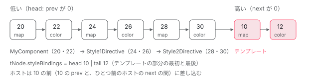

[目次](../README.md) › [DOM レンダラーとイベントの内側](README.md) › 第 10 回 / 全 20 回

# 優先順位の連結リスト：style\_binding\_list.ts

> TNode の classBindings・styleBindings と TData に置く TStylingRange（前と次の番号を 1 つの数に詰める）、insertTStylingBinding が新しいバインディングをどこに差し込むか、同じ名前を持つ前後のバインディングに重複の印を付ける markDuplicates。初回のテンプレートの実行で 1 回だけ作られる表。

angular/angular · 読了 約 13 分 · 発展 · [サイトで読む（デモが動きます）](https://angular-deep-dive-cyan.vercel.app/chapter/domr-style-binding-list)

---

[第 9 回](09-domr-styling-overview.md)で、クラスとスタイルのバインディングは「実行の順」と「優先順位の順」が違うことを見ました。テンプレートが先に実行されるのに、優先順位はホストより上です。この章では、その食い違いを解くために初回の更新（firstUpdatePass）で 1 回だけ作る表、つまり `TView.data` の上の双方向の連結リストを読みます。前と次の番号と 2 つの「重複の印」を 1 つの数に詰める `TStylingRange`、新しいバインディングを差し込む `insertTStylingBinding`、同じ名前の相手に印を付ける `markDuplicates` です。

読む対象は `packages/core/src/render3/interfaces/styling.ts`・`render3/styling/style_binding_list.ts`・`render3/instructions/styling.ts` の `stylingFirstUpdatePass` です（../angular、22.2.0-next.7、8576f161ae4）。

1. [1. 全体像](01-domr-overview.md)
2. [2. Renderer2 の約束](02-domr-renderer-api.md)
3. [3. DomRendererFactory2](03-domr-renderer-factory.md)
4. [4. 要素とテキスト](04-domr-default-renderer.md)
5. [5. 属性とプロパティ](05-domr-attributes-properties.md)
6. [6. カプセル化](06-domr-encapsulation.md)
7. [7. SharedStylesHost](07-domr-shared-styles.md)
8. [8. CSS 変数の名前空間](08-domr-css-var-namespacing.md)
9. [9. クラスとスタイル](09-domr-styling-overview.md)
10. **10. 優先順位のリスト**（この章）
11. [11. 値を決めて書く](11-domr-styling-apply.md)
12. [12. \[class\] と \[style\]](12-domr-styling-maps.md)
13. [13. EventManager](13-domr-event-manager.md)
14. [14. listen](14-domr-listen.md)
15. [15. キーのイベント](15-domr-key-events.md)
16. [16. 自分のプラグイン](16-domr-custom-plugin.md)
17. [17. サニタイズ](17-domr-sanitization.md)
18. [18. 信頼の印](18-domr-trusted-types.md)
19. [19. Title と Meta](19-domr-title-meta.md)
20. [20. issue と PR を読む](20-domr-issues.md)

## 1. 1 つの数に 4 つを詰める：TStylingRange

📄 `angular/packages/core/src/render3/interfaces/styling.ts` L93–123 （▶ の行: 99–101, 104–105, 107–110, 112–114, 119）

```ts
 93 │ /**
 94 │  * This is a branded number which contains previous and next index.
 95 │  *
 96 │  * When we come across styling instructions we need to store the `TStylingKey` in the correct
 97 │  * order so that we can re-concatenate the styling value in the desired priority.
 98 │  *
 99 ▶  * The insertion can happen either at the:
100 ▶  * - end of template as in the case of coming across additional styling instruction in the template
101 ▶  * - in front of the template in the case of coming across additional instruction in the
102 │  *   `hostBindings`.
103 │  *
104 ▶  * We use `TStylingRange` to store the previous and next index into the `TData` where the template
105 ▶  * bindings can be found.
106 │  *
107 ▶  * - bit 0 is used to mark that the previous index has a duplicate for current value.
108 ▶  * - bit 1 is used to mark that the next index has a duplicate for the current value.
109 ▶  * - bits 2-16 are used to encode the next/tail of the template.
110 ▶  * - bits 17-32 are used to encode the previous/head of template.
111 │  *
112 ▶  * NODE: *duplicate* false implies that it is statically known that this binding will not collide
113 ▶  * with other bindings and therefore there is no need to check other bindings. For example the
114 ▶  * bindings in `<div [style.color]="exp" [style.width]="exp">` will never collide and will have
115 │  * their bits set accordingly. Previous duplicate means that we may need to check previous if the
116 │  * current binding is `null`. Next duplicate means that we may need to check next bindings if the
117 │  * current binding is not `null`.
118 │  *
119 ▶  * NOTE: `0` has special significance and represents `null` as in no additional pointer.
120 │  */
121 │ export type TStylingRange = number & {
122 │   __brand__: 'TStylingRange';
123 │ };
```

99〜102 行目、新しいバインディングは「テンプレートの末尾」か「テンプレートの前」のどちらかに入ります。104〜105 行目、その位置を覚えるのが `TStylingRange` です。107〜110 行目が 1 つの数の中の割り当てで、112〜117 行目が重複の印の意味です。`<div [style.color]="exp" [style.width]="exp">` の 2 つは名前が違うので、印は立たず、ほかのバインディングを探しに行かずに済みます。119 行目、番号の `0` は「その先は無い」です（バインディングの番号は LView のヘッダー（`HEADER_OFFSET`、28 個）より後ろなので、本物の番号が 0 になることはありません）。

📄 `angular/packages/core/src/render3/interfaces/styling.ts` L128–158 （▶ の行: 130, 132, 135, 137, 140, 149, 157）

```ts
128 │ export const enum StylingRange {
129 │   /// Number of bits to shift for the previous pointer
130 ▶   PREV_SHIFT = 17,
131 │   /// Previous pointer mask.
132 ▶   PREV_MASK = 0xfffe0000,
133 │ 
134 │   /// Number of bits to shift for the next pointer
135 ▶   NEXT_SHIFT = 2,
136 │   /// Next pointer mask.
137 ▶   NEXT_MASK = 0x001fffc,
138 │ 
139 │   // Mask to remove negative bit. (interpret number as positive)
140 ▶   UNSIGNED_MASK = 0x7fff,
141 │ 
142 │   /**
143 │    * This bit is set if the previous bindings contains a binding which could possibly cause a
144 │    * duplicate. For example: `<div [style]="map" [style.width]="width">`, the `width` binding will
145 │    * have previous duplicate set. The implication is that if `width` binding becomes `null`, it is
146 │    * necessary to defer the value to `map.width`. (Because `width` overwrites `map.width`.)
147 │    */
148 │   /* tslint:disable-next-line:no-duplicate-enum-values */
149 ▶   PREV_DUPLICATE = 0x02,
150 │ 
151 │   /**
152 │    * This bit is set to if the next binding contains a binding which could possibly cause a
153 │    * duplicate. For example: `<div [style]="map" [style.width]="width">`, the `map` binding will
154 │    * have next duplicate set. The implication is that if `map.width` binding becomes not `null`, it
155 │    * is necessary to defer the value to `width`. (Because `width` overwrites `map.width`.)
156 │    */
157 ▶   NEXT_DUPLICATE = 0x01,
158 │ }
```

| ビット | 中身 | 定数（行） |
| --- | --- | --- |
| 31〜17 | prev（前の番号。15 ビット） | `PREV_SHIFT = 17`・`PREV_MASK`（130・132） |
| 16〜2 | next（次の番号。15 ビット） | `NEXT_SHIFT = 2`・`NEXT_MASK`（135・137） |
| 1 | prev の側に重複がある | `PREV_DUPLICATE = 0x02`（149） |
| 0 | next の側に重複がある | `NEXT_DUPLICATE = 0x01`（157） |

> [!WARNING]
> **ハマりどころ**
>
> 107〜108 行目のコメントは「bit 0 が previous、bit 1 が next」と書いていますが、149・157 行目の実際の値は逆です（`PREV_DUPLICATE` が `0x02` で bit 1、`NEXT_DUPLICATE` が `0x01` で bit 0）。動きは定数で決まるので、コメントのほうがずれています。デモの最後の列も定数どおりに出しています。

📄 `angular/packages/core/src/render3/interfaces/styling.ts` L160–194 （▶ の行: 161–163, 168, 173, 182–183, 188, 193）

```ts
160 │ export function toTStylingRange(prev: number, next: number): TStylingRange {
161 ▶   ngDevMode && assertNumberInRange(prev, 0, StylingRange.UNSIGNED_MASK);
162 ▶   ngDevMode && assertNumberInRange(next, 0, StylingRange.UNSIGNED_MASK);
163 ▶   return ((prev << StylingRange.PREV_SHIFT) | (next << StylingRange.NEXT_SHIFT)) as TStylingRange;
164 │ }
165 │ 
166 │ export function getTStylingRangePrev(tStylingRange: TStylingRange): number {
167 │   ngDevMode && assertNumber(tStylingRange, 'expected number');
168 ▶   return (tStylingRange >> StylingRange.PREV_SHIFT) & StylingRange.UNSIGNED_MASK;
169 │ }
170 │ 
171 │ export function getTStylingRangePrevDuplicate(tStylingRange: TStylingRange): boolean {
172 │   ngDevMode && assertNumber(tStylingRange, 'expected number');
173 ▶   return (tStylingRange & StylingRange.PREV_DUPLICATE) == StylingRange.PREV_DUPLICATE;
174 │ }
175 │ 
176 │ export function setTStylingRangePrev(
177 │   tStylingRange: TStylingRange,
178 │   previous: number,
179 │ ): TStylingRange {
180 │   ngDevMode && assertNumber(tStylingRange, 'expected number');
181 │   ngDevMode && assertNumberInRange(previous, 0, StylingRange.UNSIGNED_MASK);
182 ▶   return ((tStylingRange & ~StylingRange.PREV_MASK) |
183 ▶     (previous << StylingRange.PREV_SHIFT)) as TStylingRange;
184 │ }
185 │ 
186 │ export function setTStylingRangePrevDuplicate(tStylingRange: TStylingRange): TStylingRange {
187 │   ngDevMode && assertNumber(tStylingRange, 'expected number');
188 ▶   return (tStylingRange | StylingRange.PREV_DUPLICATE) as TStylingRange;
189 │ }
190 │ 
191 │ export function getTStylingRangeNext(tStylingRange: TStylingRange): number {
192 │   ngDevMode && assertNumber(tStylingRange, 'expected number');
193 ▶   return (tStylingRange & StylingRange.NEXT_MASK) >> StylingRange.NEXT_SHIFT;
194 │ }
```

1. **163 行目：作る**

   prev を 17 ビット、next を 2 ビットずらして `|` で合わせます。重複の印は 0 から始まります。161・162 行目、開発モードでは 0〜0x7fff（32767）の外を assert で止めます。
2. **168 行目：prev を読む**

   prev が 0x4000 以上だとビット 31 が立ち、JavaScript のビット演算では負の数になります。`>>` のあとに 140 行目の `UNSIGNED_MASK`（0x7fff）を掛けて正の数に戻すのはそのためです。
3. **182〜183・188 行目：書き換える**

   prev を差し替えるときは、prev の 15 ビットだけを消してから入れ直します。重複の印は `|` で立てるだけで、消す関数はありません（一度立てた印は消えません）。
4. **173・193 行目：印と next を読む**

   どれも数のビット演算だけで、配列もオブジェクトも作りません。

## 2. どこに置くか：TNode と TData と LView

📄 `angular/packages/core/src/render3/interfaces/node.ts` L695–708 （▶ の行: 697–701, 708）

```ts
695 │   /**
696 │    * Stores the head/tail index of the class bindings.
697 ▶    *
698 ▶    * - If no bindings, the head and tail will both be 0.
699 ▶    * - If there are template bindings, stores the head/tail of the class bindings in the template.
700 ▶    * - If no template bindings but there are host bindings, the head value will point to the last
701 ▶    *   host binding for "class" (not the head of the linked list), tail will be 0.
702 │    *
703 │    * See: `style_binding_list.ts` for details.
704 │    *
705 │    * This is used by `insertTStylingBinding` to know where the next styling binding should be
706 │    * inserted so that they can be sorted in priority order.
707 │    */
708 ▶   classBindings: TStylingRange;
```

要素ごとの入口は TNode（[TNode の章](../ivy/04-ivy-tnode.md)）の `classBindings` と `styleBindings` です。中身は同じ `TStylingRange` ですが、ここでは prev と next を**テンプレートの部分の head（最初）と tail（最後）**として使います。698 行目、何も無ければ両方 0。700〜701 行目、テンプレートのバインディングが無くホストだけのときは、head が「最後に足したホストのバインディング」を指し、tail が 0 です。

バインディング 1 つは、`TView.data`（[TData の章](../ivy/07-ivy-blueprint.md)）の 2 つの枠を使います。`tData[i]` に名前（`TStylingKey`：`'color'` のような文字列、map なら `null`）、`tData[i + 1]` にこの章の `TStylingRange`（今度は prev と next の意味）です。同じ番号の `lView[i]` と `lView[i + 1]` には値が入ります（[第 11 回](11-domr-styling-apply.md)）。

📄 `angular/packages/core/src/render3/instructions/styling.ts` L340–349 （▶ の行: 347–348）

```ts
340 │ /**
341 │  * Determines when the binding is in `hostBindings` section
342 │  *
343 │  * @param tView Current `TView`
344 │  * @param bindingIndex index of binding which we would like if it is in `hostBindings`
345 │  */
346 │ function isInHostBindings(tView: TView, bindingIndex: number): boolean {
347 ▶   // All host bindings are placed after the expando section.
348 ▶   return bindingIndex >= tView.expandoStartIndex;
349 │ }
```

347〜348 行目、ホストのバインディングかどうかは番号だけで分かります。ホストのバインディングの枠は、LView の expando（ディレクティブのインスタンスとホストのバインディングの値を置く後ろの区画）より後ろにあるからです。ホストのバインディングが走るとき、番号の起点をその区画に移すのが次の行です。

📄 `angular/packages/core/src/render3/instructions/change_detection.ts` L591–597 （▶ の行: 594–597）

```ts
591 │         setSelectedIndex(~opCode);
592 │       } else {
593 │         // Positive numbers are NumberTuple which store bindingRootIndex and directiveIndex.
594 ▶         const directiveIdx = opCode;
595 ▶         const bindingRootIndx = hostBindingOpCodes[++i] as number;
596 ▶         const hostBindingFn = hostBindingOpCodes[++i] as HostBindingsFunction<any>;
597 ▶         setBindingRootForHostBindings(bindingRootIndx, directiveIdx);
```

`processHostBindingOpCodes`（[refreshView の章](../cd/03-cd-refresh-view.md)で全体を引用）の中で、597 行目の `setBindingRootForHostBindings` が binding の番号を 595 行目の `bindingRootIndx`（expando の中）に移し、今どのディレクティブかを覚えます。この関数は refreshView の中でテンプレートの関数のあとに呼ばれるので、**ホストのバインディングはいつもテンプレートより後に実行され、番号も大きい**、という 2 つの前提がそろいます。

## 3. リストに入れる入口：stylingFirstUpdatePass

📄 `angular/packages/core/src/render3/instructions/styling.ts` L360–387 （▶ の行: 366, 368, 374, 376–377, 382, 384–385）

```ts
360 │ function stylingFirstUpdatePass(
361 │   tView: TView,
362 │   tStylingKey: TStylingKey,
363 │   bindingIndex: number,
364 │   isClassBased: boolean,
365 │ ): void {
366 ▶   ngDevMode && assertFirstUpdatePass(tView);
367 │   const tData = tView.data;
368 ▶   if (tData[bindingIndex + 1] === null) {
369 │     // The above check is necessary because we don't clear first update pass until first successful
370 │     // (no exception) template execution. This prevents the styling instruction from double adding
371 │     // itself to the list.
372 │     // `getSelectedIndex()` should be here (rather than in instruction) so that it is guarded by the
373 │     // if so as not to read unnecessarily.
374 ▶     const tNode = tData[getSelectedIndex()] as TNode;
375 │     ngDevMode && assertDefined(tNode, 'TNode expected');
376 ▶     const isHostBindings = isInHostBindings(tView, bindingIndex);
377 ▶     if (hasStylingInputShadow(tNode, isClassBased) && tStylingKey === null && !isHostBindings) {
378 │       // `tStylingKey === null` implies that we are either `[style]` or `[class]` binding.
379 │       // If there is a directive which uses `@Input('style')` or `@Input('class')` than
380 │       // we need to neutralize this binding since that directive is shadowing it.
381 │       // We turn this into a noop by setting the key to `false`
382 ▶       tStylingKey = false;
383 │     }
384 ▶     tStylingKey = wrapInStaticStylingKey(tData, tNode, tStylingKey, isClassBased);
385 ▶     insertTStylingBinding(tData, tNode, tStylingKey, bindingIndex, isHostBindings, isClassBased);
386 │   }
387 │ }
```

1. **366・368 行目：最初の 1 回だけ**

   4 つの命令（`ɵɵstyleProp` など）は、`tView.firstUpdatePass` のときだけこの関数を呼びます。368 行目の `tData[bindingIndex + 1] === null` は、初回のテンプレートの実行が例外で止まり、firstUpdatePass が下りないまま 2 回目が来たときに、同じバインディングを 2 回足さないための確認です（369〜371 行目のコメント）。
2. **374・376 行目：どの要素の、どちら側か**

   選ばれている要素の TNode と、2 節の `isInHostBindings` の結果を取ります。
3. **377〜382 行目：`@Input('class')` に奪われた map**

   `[class]` を input として受け取るディレクティブがいるとき、テンプレートの `[class]` の名前を `false` にしてリストの計算から外します（[第 12 回](12-domr-styling-maps.md)）。
4. **384〜385 行目：静的な値を包んで、差し込む**

   `wrapInStaticStylingKey` は、名前に静的な値（第 9 回の `class="…"` など）を添えた配列を作ることがあります（[第 12 回](12-domr-styling-maps.md)）。この章では名前だけの場合で読みます。385 行目で次の節の `insertTStylingBinding` に、番号とホストかどうかを渡します。

## 4. できあがる形：コメントの例

`style_binding_list.ts` の先頭のコメント（第 9 回で読んだ優先順位の表の続き）に、テンプレートの `ɵɵstyleMap`(10)・`ɵɵstyleProp`(12)、MyComponent の 20・22、2 つのディレクティブの 24〜30 を足し終えた形があります。

📄 `angular/packages/core/src/render3/styling/style_binding_list.ts` L149–169 （▶ の行: 152–153, 155, 157–158, 168）

```ts
149 │  * |Idx|`TView.data`|`LView`          | Notes
150 │  * |---|------------|-----------------|--------------
151 │  * |...|            |                 |
152 ▶  * |10 |`null`      |`{color: '#001'}`| `ɵɵstyleMap('color', {color: '#001'})`
153 ▶  * |11 |`30 | 12`   | ...             |
154 │  * |12 |`color`     |`'#002'`         | `ɵɵstyleProp('color', '#002')`
155 ▶  * |13 |`10 | 0`    | ...             |
156 │  * |...|            |                 |
157 ▶  * |20 |`null`      |`{color: '#003'}`| `ɵɵstyleMap('color', {color: '#003'})`
158 ▶  * |21 |`0 | 22`    | ...             |
159 │  * |22 |`color`     |`'#004'`         | `ɵɵstyleProp('color', '#004')`
160 │  * |23 |`20 | 24`   | ...             |
161 │  * |24 |`null`      |`{color: '#005'}`| `ɵɵstyleMap('color', {color: '#005'})`
162 │  * |25 |`22 | 26`   | ...             |
163 │  * |26 |`color`     |`'#006'`         | `ɵɵstyleProp('color', '#006')`
164 │  * |27 |`24 | 28`   | ...             |
165 │  * |28 |`null`      |`{color: '#007'}`| `ɵɵstyleMap('color', {color: '#007'})`
166 │  * |29 |`26 | 30`   | ...             |
167 │  * |30 |`color`     |`'#008'`         | `ɵɵstyleProp('color', '#008')`
168 ▶  * |31 |`28 | 10`   | ...             |
169 │  *
```

範囲は名前の次の枠（11・13・21…）に入っていて、153 行目の `30 | 12` は「10 の prev が 30、next が 12」です。158 行目のとおり 20 は prev が 0 なので、リスト全体の先頭（いちばん低い）です。そこから next をたどると 20 → 22 → 24 → 26 → 28 → 30 → 10 → 12 で、155 行目のとおり 12 の next が 0 なので終わりです。168 行目、ホストの最後の 30 の next は 10 です。153 行目、テンプレートの先頭 10 の prev は、最後に足したホストのバインディング 30 を指しています。**番号の並びは実行の順、next のたどり方は優先順位の順**です。下のデモの「コメントの例」は、この表と同じ数を出します。



*コメントの例のリスト。箱は TData の番号。矢印は next（優先順位の高い方へ）。テンプレートの 10・12 は番号は小さいが、リストではホストの後ろ（高い側）にいる。*

## 5. 差し込む：insertTStylingBinding

📄 `angular/packages/core/src/render3/styling/style_binding_list.ts` L183–193 （▶ の行: 187, 189–192）

```ts
183 │ /**
184 │  * Insert new `tStyleValue` at `TData` and link existing style bindings such that we maintain linked
185 │  * list of styles and compute the duplicate flag.
186 │  *
187 ▶  * Note: this function is executed during `firstUpdatePass` only to populate the `TView.data`.
188 │  *
189 ▶  * The function works by keeping track of `tStylingRange` which contains two pointers pointing to
190 ▶  * the head/tail of the template portion of the styles.
191 ▶  *  - if `isHost === false` (we are template) then insertion is at tail of `TStylingRange`
192 ▶  *  - if `isHost === true` (we are host binding) then insertion is at head of `TStylingRange`
193 │  *
```

189〜192 行目が方針のすべてです。TNode の head / tail（テンプレートの部分）を目印にして、テンプレートなら tail の後ろ、ホストなら head の前に入れます。187 行目、firstUpdatePass だけで呼ばれます。

📄 `angular/packages/core/src/render3/styling/style_binding_list.ts` L203–233 （▶ の行: 212–214, 216, 219, 222, 224–226, 229）

```ts
203 │ export function insertTStylingBinding(
204 │   tData: TData,
205 │   tNode: TNode,
206 │   tStylingKeyWithStatic: TStylingKey,
207 │   index: number,
208 │   isHostBinding: boolean,
209 │   isClassBinding: boolean,
210 │ ): void {
211 │   ngDevMode && assertFirstUpdatePass(getTView());
212 ▶   let tBindings = isClassBinding ? tNode.classBindings : tNode.styleBindings;
213 ▶   let tmplHead = getTStylingRangePrev(tBindings);
214 ▶   let tmplTail = getTStylingRangeNext(tBindings);
215 │ 
216 ▶   tData[index] = tStylingKeyWithStatic;
217 │   let isKeyDuplicateOfStatic = false;
218 │   let tStylingKey: TStylingKeyPrimitive;
219 ▶   if (Array.isArray(tStylingKeyWithStatic)) {
220 │     // We are case when the `TStylingKey` contains static fields as well.
221 │     const staticKeyValueArray = tStylingKeyWithStatic as KeyValueArray<any>;
222 ▶     tStylingKey = staticKeyValueArray[1]; // unwrap.
223 │     // We need to check if our key is present in the static so that we can mark it as duplicate.
224 ▶     if (
225 ▶       tStylingKey === null ||
226 ▶       keyValueArrayIndexOf(staticKeyValueArray, tStylingKey as string) > 0
227 │     ) {
228 │       // tStylingKey is present in the statics, need to mark it as duplicate.
229 ▶       isKeyDuplicateOfStatic = true;
230 │     }
231 │   } else {
232 │     tStylingKey = tStylingKeyWithStatic;
233 │   }
```

212〜214 行目で TNode から head と tail を取り出し、216 行目で名前を `tData[index]` に置きます。219〜230 行目は、名前が静的な値と一緒に配列で包まれているときに中身を取り出し、自分の名前が静的な値の中にもあれば「静的な値と重複」と覚えておく処理です（静的な値は自分より低いので、あとで prev の印にします）。

📄 `angular/packages/core/src/render3/styling/style_binding_list.ts` L234–266 （▶ の行: 238, 241, 243–244, 247, 249, 255, 257, 260, 262, 265）

```ts
234 │   if (isHostBinding) {
235 │     // We are inserting host bindings
236 │ 
237 │     // If we don't have template bindings then `tail` is 0.
238 ▶     const hasTemplateBindings = tmplTail !== 0;
239 │     // This is important to know because that means that the `head` can't point to the first
240 │     // template bindings (there are none.) Instead the head points to the tail of the template.
241 ▶     if (hasTemplateBindings) {
242 │       // template head's "prev" will point to last host binding or to 0 if no host bindings yet
243 ▶       const previousNode = getTStylingRangePrev(tData[tmplHead + 1] as TStylingRange);
244 ▶       tData[index + 1] = toTStylingRange(previousNode, tmplHead);
245 │       // if a host binding has already been registered, we need to update the next of that host
246 │       // binding to point to this one
247 ▶       if (previousNode !== 0) {
248 │         // We need to update the template-tail value to point to us.
249 ▶         tData[previousNode + 1] = setTStylingRangeNext(
250 │           tData[previousNode + 1] as TStylingRange,
251 │           index,
252 │         );
253 │       }
254 │       // The "previous" of the template binding head should point to this host binding
255 ▶       tData[tmplHead + 1] = setTStylingRangePrev(tData[tmplHead + 1] as TStylingRange, index);
256 │     } else {
257 ▶       tData[index + 1] = toTStylingRange(tmplHead, 0);
258 │       // if a host binding has already been registered, we need to update the next of that host
259 │       // binding to point to this one
260 ▶       if (tmplHead !== 0) {
261 │         // We need to update the template-tail value to point to us.
262 ▶         tData[tmplHead + 1] = setTStylingRangeNext(tData[tmplHead + 1] as TStylingRange, index);
263 │       }
264 │       // if we don't have template, the head points to template-tail, and needs to be advanced.
265 ▶       tmplHead = index;
266 │     }
```

1. **238・241 行目：テンプレートのバインディングがあるとき**

   243 行目、テンプレートの head の prev（＝今いちばん後ろのホスト。まだ無ければ 0）を取ります。244 行目、自分の prev をそれ、next をテンプレートの head にします。247〜252 行目、前のホストがいればその next を自分に、255 行目、テンプレートの head の prev を自分に付け替えます。**「最後のホスト」と「テンプレートの head」の間に入る**ので、あとから実行したホスト（ディレクティブ）ほどテンプレートに近い、つまり高い側に並びます。
2. **256〜266 行目：ホストだけのとき**

   257 行目、自分の prev を「今の head」（ホストだけのときは最後のホスト）に、next を 0 にします。260〜263 行目でその相手の next を自分に、265 行目で head を自分に進めます。tail は 0 のままです。TNode の説明の 700〜701 行目「head が最後のホストを指す」はこの行のことです。

📄 `angular/packages/core/src/render3/styling/style_binding_list.ts` L267–301 （▶ の行: 270, 273, 275, 277–278, 281, 283, 288–289, 291–293, 295, 297, 299）

```ts
267 │   } else {
268 │     // We are inserting in template section.
269 │     // We need to set this binding's "previous" to the current template tail
270 ▶     tData[index + 1] = toTStylingRange(tmplTail, 0);
271 │     ngDevMode &&
272 │       assertEqual(
273 ▶         tmplHead !== 0 && tmplTail === 0,
274 │         false,
275 ▶         'Adding template bindings after hostBindings is not allowed.',
276 │       );
277 ▶     if (tmplHead === 0) {
278 ▶       tmplHead = index;
279 │     } else {
280 │       // We need to update the previous value "next" to point to this binding
281 ▶       tData[tmplTail + 1] = setTStylingRangeNext(tData[tmplTail + 1] as TStylingRange, index);
282 │     }
283 ▶     tmplTail = index;
284 │   }
285 │ 
286 │   // Now we need to update / compute the duplicates.
287 │   // Starting with our location search towards head (least priority)
288 ▶   if (isKeyDuplicateOfStatic) {
289 ▶     tData[index + 1] = setTStylingRangePrevDuplicate(tData[index + 1] as TStylingRange);
290 │   }
291 ▶   markDuplicates(tData, tStylingKey, index, true);
292 ▶   markDuplicates(tData, tStylingKey, index, false);
293 ▶   markDuplicateOfResidualStyling(tNode, tStylingKey, tData, index, isClassBinding);
294 │ 
295 ▶   tBindings = toTStylingRange(tmplHead, tmplTail);
296 │   if (isClassBinding) {
297 ▶     tNode.classBindings = tBindings;
298 │   } else {
299 ▶     tNode.styleBindings = tBindings;
300 │   }
301 │ }
```

1. **270・281・283 行目：テンプレートは末尾へ**

   自分の prev を今の tail に、next を 0 に。前の tail の next を自分にして、283 行目で tail を自分に進めます。277〜278 行目、最初のテンプレートのバインディングなら head も自分です。
2. **271〜276 行目：ホストのあとにテンプレートは来ない**

   開発モードの assert です。ただし調べている条件は「head はあるのに tail が 0」、つまりホストだけがある形だけです。テンプレートが先に実行される（2 節）ので、本物ではテンプレートのバインディングがあとから来ることはありません。デモでは、この assert をすり抜ける形もデモの側で止めています。
3. **288〜293 行目：重複の印**

   289 行目、静的な値と重複していれば自分の prev の印を立てます。291・292 行目、前（低い側）と後ろ（高い側）の両方向に `markDuplicates` を呼びます。293 行目の residual（ホストより強いテンプレートの静的な値の残り）との重複は[第 12 回](12-domr-styling-maps.md)です。
4. **295〜300 行目：TNode に戻す**

   新しい head と tail を 1 つの数に詰めて、クラスなら `classBindings`、スタイルなら `styleBindings` に書きます。

spec の「テンプレートだけ」の it の後半で、ホストを 2 つ足すときの動きを見ておきます。

📄 `angular/packages/core/test/render3/styling_next/style_binding_list_spec.ts` L53–80 （▶ の行: 53–54, 59, 63, 66–67, 72, 76, 78）

```ts
53 ▶       insertTStylingBinding(tData, tNode, 'host1', 6, true, true);
54 ▶       expectRange(tNode.classBindings).toEqual([2, 4]);
55 │       expectTData(tData).toEqual([
56 │         null,
57 │         null, // 0
58 │         'tmpl1',
59 ▶         [false, 6, false, 4], // 2
60 │         'tmpl2',
61 │         [false, 2, false, 0], // 4
62 │         'host1',
63 ▶         [false, 0, false, 2], // 6
64 │       ]);
65 │ 
66 ▶       insertTStylingBinding(tData, tNode, 'host2', 8, true, true);
67 ▶       expectRange(tNode.classBindings).toEqual([2, 4]);
68 │       expectTData(tData).toEqual([
69 │         null,
70 │         null, // 0
71 │         'tmpl1',
72 ▶         [false, 8, false, 4], // 2
73 │         'tmpl2',
74 │         [false, 2, false, 0], // 4
75 │         'host1',
76 ▶         [false, 0, false, 8], // 6
77 │         'host2',
78 ▶         [false, 6, false, 2], // 8
79 │       ]);
80 │     });
```

tmpl1（2）・tmpl2（4）のあと、53 行目で host1（6）を足すと、59 行目の tmpl1 の prev が 6 になり、63 行目の host1 は prev 0・next 2 です。66 行目で host2（8）を足すと、host2 は 78 行目のとおり host1 と tmpl1 の間（prev 6・next 2）に入り、72 行目の tmpl1 の prev が 8、76 行目の host1 の next が 8 に付け替わります。54・67 行目の TNode の head / tail は 2・4 のまま動きません。

## 6. 重複の印：markDuplicates

📄 `angular/packages/core/src/render3/styling/style_binding_list.ts` L387–424 （▶ の行: 394–397, 404, 408, 410–412, 418, 420–422）

```ts
387 │ function markDuplicates(
388 │   tData: TData,
389 │   tStylingKey: TStylingKeyPrimitive,
390 │   index: number,
391 │   isPrevDir: boolean,
392 │ ) {
393 │   const tStylingAtIndex = tData[index + 1] as TStylingRange;
394 ▶   const isMap = tStylingKey === null;
395 ▶   let cursor = isPrevDir
396 ▶     ? getTStylingRangePrev(tStylingAtIndex)
397 ▶     : getTStylingRangeNext(tStylingAtIndex);
398 │   let foundDuplicate = false;
399 │   // We keep iterating as long as we have a cursor
400 │   // AND either:
401 │   // - we found what we are looking for, OR
402 │   // - we are a map in which case we have to continue searching even after we find what we were
403 │   //   looking for since we are a wild card and everything needs to be flipped to duplicate.
404 ▶   while (cursor !== 0 && (foundDuplicate === false || isMap)) {
405 │     ngDevMode && assertIndexInRange(tData, cursor);
406 │     const tStylingValueAtCursor = tData[cursor] as TStylingKey;
407 │     const tStyleRangeAtCursor = tData[cursor + 1] as TStylingRange;
408 ▶     if (isStylingMatch(tStylingValueAtCursor, tStylingKey)) {
409 │       foundDuplicate = true;
410 ▶       tData[cursor + 1] = isPrevDir
411 ▶         ? setTStylingRangeNextDuplicate(tStyleRangeAtCursor)
412 ▶         : setTStylingRangePrevDuplicate(tStyleRangeAtCursor);
413 │     }
414 │     cursor = isPrevDir
415 │       ? getTStylingRangePrev(tStyleRangeAtCursor)
416 │       : getTStylingRangeNext(tStyleRangeAtCursor);
417 │   }
418 ▶   if (foundDuplicate) {
419 │     // if we found a duplicate, than mark ourselves.
420 ▶     tData[index + 1] = isPrevDir
421 ▶       ? setTStylingRangePrevDuplicate(tStylingAtIndex)
422 ▶       : setTStylingRangeNextDuplicate(tStylingAtIndex);
423 │   }
424 │ }
```

1. **395〜397 行目：向きを決めて歩く**

   `isPrevDir` が true なら prev（低い側）へ、false なら next（高い側）へ、0 になるまでたどります。
2. **404 行目：見つけたら止まる。ただし map は止まらない**

   名前のバインディングは、同じ名前を 1 つ見つければ十分です。394 行目で自分が map（名前が `null`）なら、どの名前とも重なり得るので、端まで歩いて全員に印を付けます。
3. **408〜413 行目：相手に印を付ける**

   低い側の相手には「next に重複あり」、高い側の相手には「prev に重複あり」を立てます。相手から見て自分がどちら側にいるか、です。
4. **418〜422 行目：自分にも印を付ける**

   1 つでも見つかれば、自分の側の印（低い側なら prev、高い側なら next）を立てます。

📄 `angular/packages/core/src/render3/styling/style_binding_list.ts` L444–465 （▶ の行: 452, 454, 456, 459, 462）

```ts
444 │ function isStylingMatch(tStylingKeyCursor: TStylingKey, tStylingKey: TStylingKeyPrimitive) {
445 │   ngDevMode &&
446 │     assertNotEqual(
447 │       Array.isArray(tStylingKey),
448 │       true,
449 │       "Expected that 'tStylingKey' has been unwrapped",
450 │     );
451 │   if (
452 ▶     tStylingKeyCursor === null || // If the cursor is `null` it means that we have map at that
453 │     // location so we must assume that we have a match.
454 ▶     tStylingKey == null || // If `tStylingKey` is `null` then it is a map therefor assume that it
455 │     // contains a match.
456 ▶     (Array.isArray(tStylingKeyCursor) ? tStylingKeyCursor[1] : tStylingKeyCursor) === tStylingKey // If the keys match explicitly than we are a match.
457 │   ) {
458 │     return true;
459 ▶   } else if (Array.isArray(tStylingKeyCursor) && typeof tStylingKey === 'string') {
460 │     // if we did not find a match, but `tStylingKeyCursor` is `KeyValueArray` that means cursor has
461 │     // statics and we need to check those as well.
462 ▶     return keyValueArrayIndexOf(tStylingKeyCursor, tStylingKey) >= 0; // see if we are matching the key
463 │   }
464 │   return false;
465 │ }
```

452 行目、相手が map なら一致。454 行目、自分が map でも一致。456 行目、名前が同じなら一致（相手が静的な値と包まれた配列なら `[1]` の名前で比べる）。459〜462 行目、相手が配列なら静的な値の中の名前も探します。つまり、**同じ要素に `[style]` が 1 つでもあると、スタイルのバインディングは全部が重複の印を持ちます**。印があるバインディングは、値を書くたびに第 11 回の `findStylingValue` でほかの値を探すので、そのぶん重くなります。

📄 `angular/packages/core/test/render3/styling_next/style_binding_list_spec.ts` L439–471 （▶ の行: 450, 453–455, 462–464, 467–469）

```ts
439 │     it('should treat maps as matching all', () => {
440 │       const tNode = createTNode(null!, null!, TNodeType.Element, 0, '', null);
441 │       const tData: TData = [null, null];
442 │       insertTStylingBinding(tData, tNode, 'color', 2, false, false);
443 │       insertTStylingBinding(tData, tNode, 'height', 4, true, false);
444 │       expectPriorityOrder(tData, tNode, false).toEqual([
445 │         //            PREV,  NEXT
446 │         [4, 'height', false, false],
447 │         [2, 'color', false, false],
448 │       ]);
449 │ 
450 ▶       insertTStylingBinding(tData, tNode, null /*Map*/, 6, true, false);
451 │       expectPriorityOrder(tData, tNode, false).toEqual([
452 │         //            PREV,  NEXT
453 ▶         [4, 'height', false, true],
454 ▶         [6, null, true, true],
455 ▶         [2, 'color', true, false],
456 │       ]);
457 │     });
458 │ 
459 │     it('should mark all things after map as duplicate', () => {
460 │       const tNode = createTNode(null!, null!, TNodeType.Element, 0, '', null);
461 │       const tData: TData = [null, null];
462 ▶       insertTStylingBinding(tData, tNode, null, 2, false, false);
463 ▶       insertTStylingBinding(tData, tNode, 'height', 4, false, false);
464 ▶       insertTStylingBinding(tData, tNode, 'color', 6, true, false);
465 │       expectPriorityOrder(tData, tNode, false).toEqual([
466 │         //            PREV,  NEXT
467 ▶         [6, 'color', false, true],
468 ▶         [2, null, true, true],
469 ▶         [4, 'height', true, false],
470 │       ]);
471 │     });
```

450 行目、color（テンプレート）と height（ホスト）の間にホストの map を足すと、453〜455 行目のとおり height は next、color は prev、map 自身は両方の印を持ちます。462〜464 行目は map が最初からある場合で、あとから来た height も、その前に入ったホストの color も、map との重複になります（467〜469 行目）。

> **🧪 DEMO — insertTStylingBinding を 1 つずつ呼んだときの TData（移植）**
>
> core の内部の関数なので、`interfaces/styling.ts` の 160〜217 行目と、この章で読んだ 203〜301 行目・387〜424 行目・444〜465 行目を、この章の `.ts` に書き写して動かしています（**移植**。静的な値の配列と residual は省きました。第 12 回）。番号はテンプレートのバインディングを 10・12・14…、ホストのバインディングを 20・22・24… に置きます（本物でもホストの番号はテンプレートより後ろです。2 節）。上から実行した順に足します。
>
> 優先順位の低い順（head から next をたどる）: 20 → 22 → 24 → 26 → 28 → 30 → 10 → 12
>
> ▶ [このデモはサイトで動かせます](https://angular-deep-dive-cyan.vercel.app/chapter/domr-style-binding-list)

## ここまでの呼び出し

- 👤 `ɵɵstyleProp('color', ctx.c)` — 生成コード（更新・初回）
  - `checkStylingProperty → stylingFirstUpdatePass(tView, 'color', bindingIndex, false)` — instructions/styling.ts L206 / L360 — *tView.firstUpdatePass のときだけ*
    - `isInHostBindings(tView, bindingIndex)` — styling.ts L346 — *bindingIndex ≥ expandoStartIndex*
    - `wrapInStaticStylingKey(tData, tNode, key, false)` — styling.ts L403 — *第 12 回*
    - `insertTStylingBinding(tData, tNode, key, index, isHost, false)` — styling/style\_binding\_list.ts L203
      - `toTStylingRange / setTStylingRangePrev / setTStylingRangeNext` — interfaces/styling.ts L160-201 — *テンプレートは tail の後ろ、ホストは head の前*
      - `markDuplicates(tData, key, index, true / false)` — style\_binding\_list.ts L387 — *isStylingMatch L444*
      - `tNode.styleBindings = toTStylingRange(head, tail)` — style\_binding\_list.ts L295-300
  - `processHostBindingOpCodes → setBindingRootForHostBindings` — instructions/change\_detection.ts L597 — *テンプレートのあと。番号は expando の中*

## テストと直し方

### spec と describe

| spec | describe / it | bazel のターゲット |
| --- | --- | --- |
| core/test/render3/styling\_next/style\_binding\_list\_spec.ts | describe `TNode styling linked list`（24）の describe `insertTStylingBinding`（28、it 4：`should append template only` 29・`should append host only` 82・`should append template and host` 107・`should support example in 'tnode_linked_list.ts' documentation` 132）と describe `markDuplicates`（389、it 6） | `//packages/core/test/render3:render3` |
| core/test/render3/instructions/styling\_spec.ts | describe `styling` の describe `TStylingRange`（484、it 4） |   |

📄 `angular/packages/core/test/render3/instructions/styling_spec.ts` L484–501 （▶ の行: 485, 488–489, 493–494, 498–500）

```ts
484 │   describe('TStylingRange', () => {
485 ▶     const MAX_VALUE = StylingRange.UNSIGNED_MASK;
486 │ 
487 │     it('should throw on negative values', () => {
488 ▶       expect(() => toTStylingRange(0, -1)).toThrow();
489 ▶       expect(() => toTStylingRange(-1, 0)).toThrow();
490 │     });
491 │ 
492 │     it('should throw on overflow', () => {
493 ▶       expect(() => toTStylingRange(0, MAX_VALUE + 1)).toThrow();
494 ▶       expect(() => toTStylingRange(MAX_VALUE + 1, 0)).toThrow();
495 │     });
496 │ 
497 │     it('should retrieve the same value which went in just below overflow', () => {
498 ▶       const range = toTStylingRange(MAX_VALUE, MAX_VALUE);
499 ▶       expect(getTStylingRangePrev(range)).toEqual(MAX_VALUE);
500 ▶       expect(getTStylingRangeNext(range)).toEqual(MAX_VALUE);
501 │     });
```

485 行目の上限 `UNSIGNED_MASK`（0x7fff）を 1 つでも超える番号や負の数は、493〜494・488〜489 行目のとおり投げます（開発モードの assert。interfaces/styling.ts の 161〜162 行目）。498〜500 行目は上限ちょうどの番号が prev にも next にもそのまま戻ること、つまり 168 行目の符号の処理が効いていることの確認です。

### 手元で走らせた結果

📄 `ターミナル（../angular で）`

```
cd ~/angular-research/angular
pnpm bazel test //packages/core/test/render3:render3 \
  --nocache_test_results --test_output=all \
  '--test_arg=--filter=^(TNode styling linked list|styling TStylingRange)'
```

📄 `出力（2026-11-04 に実行。抜粋。ログは scratchpad/domr-logs/c-sb-r3.log）`

```
Ran 14 of 574 specs
14 specs, 0 failures
//packages/core/test/render3:render3                                     PASSED in 1.0s
```

- 14 件 = `insertTStylingBinding` 4・`markDuplicates` 6・`TStylingRange` 4。
- spec は TNode を `createTNode` で直接作り、`insertTStylingBinding` を番号付きで呼んで、結果を `expectTData`（番号の並び）か `expectPriorityOrder`（head から next をたどった順と 2 つの印）で比べます。デモの表の 2 つの見方と同じです。

### 直すとしたら

- リストのつなぎ方は `insertTStylingBinding`（style\_binding\_list.ts 203〜301 行目）、印の付け方は `markDuplicates`（387〜424 行目）と `isStylingMatch`（444〜465 行目）です。it は style\_binding\_list\_spec.ts に `expectPriorityOrder` の形で足すと、番号に左右されずに順番と印だけを確かめられます。
- コメントのずれが 2 つあります。interfaces/styling.ts の 107〜108 行目（ビットの割り当てが定数と逆）と、style\_binding\_list.ts の先頭のコメントの終わりが参照している `tnode_linked_list_spec.ts`（今の名前は `style_binding_list_spec.ts`。it の名前にも古い `tnode_linked_list.ts` が残っている）です。また TNode の `styleBindings` の説明の最初の文も、`classBindings` と同じ「class bindings」のままです。動きには関係しないので、issue を読むときに迷わないための注意として覚えておきます。
- このリストに直接かかわる開いた issue は、2026-11-04 の時点で見つかりませんでした（ラベル `core: styling bindings` の open 3 件はどれも別の場所。[第 20 回](20-domr-issues.md)）。本家に PR を出すことは勧めません。

## 聞かれそうな質問

**Q. なぜ配列の順番ではなく、連結リストにしているのですか？**

実行の順（テンプレート → コンポーネント → ディレクティブ）と優先順位の順（コンポーネント → ディレクティブ → テンプレート）が違い、しかも番号（枠の場所）は実行の順で決まってしまうからです。番号はそのままに、prev と next だけで優先順位の順につなぎ直します（style\_binding\_list.ts 189〜192 行目。4 節の表では番号 10・12 がリストの最後）。

**Q. TStylingRange の 1 つの数には何が入っていますか？**

prev の番号 15 ビット（ビット 31〜17）、next の番号 15 ビット（16〜2）、prev 側の重複の印（ビット 1、`0x02`）、next 側の重複の印（ビット 0、`0x01`）です（interfaces/styling.ts 130〜157 行目）。TNode の `styleBindings` では同じ形を head と tail に使います。

**Q. 重複の印は何のためにありますか？**

値を書くときに、ほかのバインディングを探しに行く必要があるかどうかを、名前を比べずに数のビットだけで決めるためです。印が無ければ探しません（interfaces/styling.ts 112〜117 行目）。探す処理は第 11 回の `updateStyling` と `findStylingValue` です。

**Q. `[style]` を 1 つ足すと何が変わりますか？**

map はどの名前とも一致する扱いなので（444〜465 行目の 452・454 行目）、`markDuplicates` が 404 行目で止まらずに端まで歩き、同じ要素のスタイルのバインディング全部に印が立ちます。以後、どのバインディングも値を書くたびに上下を探します。

**Q. このリストはいつ作られ、いつ作り直されますか？**

TView ごとに初回の更新（firstUpdatePass）で 1 回だけです（stylingFirstUpdatePass の 366・368 行目、insertTStylingBinding の 187 行目のコメント）。TView は同じテンプレートの全部のインスタンスで共有されるので、2 つ目以降のインスタンスはできあがったリストを使うだけです。

## 読み終えて

- 1 つのバインディングは `tData[i]` に名前、`tData[i + 1]` に prev・next・2 つの印を詰めた数を持つ。
- TNode の `classBindings` / `styleBindings` はテンプレートの部分の head と tail。テンプレートは tail の後ろ、ホストは head の前に入る。
- ホストは「最後のホスト」と「テンプレートの head」の間に入るので、あとで実行したディレクティブほど高い。
- 同じ名前か map があると重複の印が立ち、その印があるときだけ値を探しに行く。map が 1 つあると全部に印が立つ。
- interfaces/styling.ts の 107〜108 行目のコメントはビットの割り当てが逆。読むときは定数を信じる。

---

← 前: [クラスとスタイルのバインディング：命令と静的なスタイル](09-domr-styling-overview.md)  
次: [値を決めて DOM に書く：checkStylingProperty から applyStyling まで](11-domr-styling-apply.md) →
