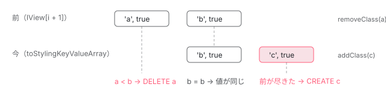

[目次](../README.md) › [DOM レンダラーとイベントの内側](README.md) › 第 12 回 / 全 20 回

# \[class\] と \[style\] のマップ：文字列・配列・オブジェクト

> \[class\] に文字列・配列・オブジェクト・Set、\[style\] に文字列・オブジェクトを渡したときの扱い（toStylingKeyValueArray、classStringParser・styleStringParser と styling\_parser.ts の parseClassName・parseStyle）、名前の順に並んだ KeyValueArray を前の値と 1 回なめて比べる updateStylingMap と、その順番のせいで起きる issue #37224（padding と padding-left）、静的なクラスと混ざるとき（TStylingStatic と residual）。class\_differ.ts は今は差分を取らず、セレクタの照合の classIndexOf だけであること。

angular/angular · 読了 約 12 分 · 発展 · [サイトで読む（デモが動きます）](https://angular-deep-dive-cyan.vercel.app/chapter/domr-styling-maps)

---

`[class]` には文字列も配列もオブジェクトも `Set` も渡せて、`[style]` には文字列もオブジェクトも渡せます。中で何が起きているかを一言で言うと、**どれも「名前の辞書順に並んだ配列」に直してから、前の配列と 1 回なめて差分だけを renderer に送る**です。この章では、その配列 `KeyValueArray`、文字列を読む `styling_parser.ts`、差分を取る `updateStylingMap`、静的な `class="…"` と混ざるときの扱い（`TStylingStatic` と residual）を読み、差分の取り方のせいで起きる開いた issue #37224（padding と padding-left）をページの上で再現します。

読む対象は `packages/core/src/render3/instructions/styling.ts`・`render3/styling/styling_parser.ts`・`util/array_utils.ts`・`render3/interfaces/styling.ts`・`render3/styling/class_differ.ts` です（../angular、22.2.0-next.7、8576f161ae4）。1 つの名前の値をどう決めて書くかは[第 11 回](11-domr-styling-apply.md)で読んだ `updateStyling` のままです。

1. [1. 全体像](01-domr-overview.md)
2. [2. Renderer2 の約束](02-domr-renderer-api.md)
3. [3. DomRendererFactory2](03-domr-renderer-factory.md)
4. [4. 要素とテキスト](04-domr-default-renderer.md)
5. [5. 属性とプロパティ](05-domr-attributes-properties.md)
6. [6. カプセル化](06-domr-encapsulation.md)
7. [7. SharedStylesHost](07-domr-shared-styles.md)
8. [8. CSS 変数の名前空間](08-domr-css-var-namespacing.md)
9. [9. クラスとスタイル](09-domr-styling-overview.md)
10. [10. 優先順位のリスト](10-domr-style-binding-list.md)
11. [11. 値を決めて書く](11-domr-styling-apply.md)
12. **12. \[class\] と \[style\]**（この章）
13. [13. EventManager](13-domr-event-manager.md)
14. [14. listen](14-domr-listen.md)
15. [15. キーのイベント](15-domr-key-events.md)
16. [16. 自分のプラグイン](16-domr-custom-plugin.md)
17. [17. サニタイズ](17-domr-sanitization.md)
18. [18. 信頼の印](18-domr-trusted-types.md)
19. [19. Title と Meta](19-domr-title-meta.md)
20. [20. issue と PR を読む](20-domr-issues.md)

## 1. 2 つの命令と、渡す関数

📄 `angular/packages/core/src/render3/instructions/styling.ts` L131–150 （▶ の行: 132, 134, 140–141, 147–148）

```ts
131 │ export function ɵɵstyleMap(
132 ▶   styles: {[styleName: string]: any} | string | undefined | null | NO_CHANGE,
133 │ ): void {
134 ▶   checkStylingMap(styleKeyValueArraySet, styleStringParser, styles, false);
135 │ }
136 │ 
137 │ /**
138 │  * Parse text as style and add values to KeyValueArray.
139 │  *
140 ▶  * This code is pulled out to a separate function so that it can be tree shaken away if it is not
141 ▶  * needed. It is only referenced from `ɵɵstyleMap`.
142 │  *
143 │  * @param keyValueArray KeyValueArray to add parsed values to.
144 │  * @param text text to parse.
145 │  */
146 │ export function styleStringParser(keyValueArray: KeyValueArray<any>, text: string): void {
147 ▶   for (let i = parseStyle(text); i >= 0; i = parseStyleNext(text, i)) {
148 ▶     styleKeyValueArraySet(keyValueArray, getLastParsedKey(text), getLastParsedValue(text));
149 │   }
150 │ }
```

📄 `angular/packages/core/src/render3/instructions/styling.ts` L170–196 （▶ の行: 172–175, 180, 186–187, 193–194）

```ts
170 │ export function ɵɵclassMap(
171 │   classes:
172 ▶     | {[className: string]: boolean | undefined | null}
173 ▶     | string
174 ▶     | string[]
175 ▶     | Set<string>
176 │     | undefined
177 │     | null
178 │     | NO_CHANGE,
179 │ ): void {
180 ▶   checkStylingMap(classKeyValueArraySet, classStringParser, classes, true);
181 │ }
182 │ 
183 │ /**
184 │  * Parse text as class and add values to KeyValueArray.
185 │  *
186 ▶  * This code is pulled out to a separate function so that it can be tree shaken away if it is not
187 ▶  * needed. It is only referenced from `ɵɵclassMap`.
188 │  *
189 │  * @param keyValueArray KeyValueArray to add parsed values to.
190 │  * @param text text to parse.
191 │  */
192 │ export function classStringParser(keyValueArray: KeyValueArray<any>, text: string): void {
193 ▶   for (let i = parseClassName(text); i >= 0; i = parseClassNameNext(text, i)) {
194 ▶     keyValueArraySet(keyValueArray, getLastParsedKey(text), true);
195 │   }
196 │ }
```

134・180 行目、どちらも `checkStylingMap` を呼びます。違いは渡す 2 つの関数で、`[style]` は `styleKeyValueArraySet` と `styleStringParser`、`[class]` は `classKeyValueArraySet` と `classStringParser` です。140〜141・186〜187 行目のコメントのとおり、関数を引数で渡すのは、`[style]` を使わないアプリからスタイルの解析器を tree shaking で落とすためです。172〜175 行目の型が、`[class]` に渡せるものの一覧です（`Set` は 2026-01 の commit 4831a9f676c「fix(core): handle Set in class bindings」で、`[ngClass]` からの移行のために足されました）。147〜148・193〜194 行目、文字列は解析器で 1 つずつ取り出して配列に足します（4 節）。

## 2. checkStylingMap

📄 `angular/packages/core/src/render3/instructions/styling.ts` L279–295 （▶ の行: 286–288, 291, 294–295）

```ts
279 │ export function checkStylingMap(
280 │   keyValueArraySet: (keyValueArray: KeyValueArray<any>, key: string, value: any) => void,
281 │   stringParser: (styleKeyValueArray: KeyValueArray<any>, text: string) => void,
282 │   value: any | NO_CHANGE,
283 │   isClassBased: boolean,
284 │ ): void {
285 │   const tView = getTView();
286 ▶   const bindingIndex = incrementBindingIndex(2);
287 ▶   if (tView.firstUpdatePass) {
288 ▶     stylingFirstUpdatePass(tView, null, bindingIndex, isClassBased);
289 │   }
290 │   const lView = getLView();
291 ▶   if (value !== NO_CHANGE && bindingUpdated(lView, bindingIndex, value)) {
292 │     // `getSelectedIndex()` should be here (rather than in instruction) so that it is guarded by the
293 │     // if so as not to read unnecessarily.
294 ▶     const tNode = tView.data[getSelectedIndex()] as TNode;
295 ▶     if (hasStylingInputShadow(tNode, isClassBased) && !isInHostBindings(tView, bindingIndex)) {
```

286〜289 行目は `checkStylingProperty`（第 11 回）と同じで、枠を 2 つ取り、初回なら名前を `null`（map の印）にしてリストに入れます（[第 10 回](10-domr-style-binding-list.md)）。291 行目、`bindingUpdated` は `Object.is` なので、**同じオブジェクトの中身を書き換えて渡しても、何も起きません**。毎回新しいオブジェクトか文字列を渡す必要があります。

📄 `angular/packages/core/src/render3/instructions/styling.ts` L306–324 （▶ の行: 313, 318, 320, 324）

```ts
306 │       // VE does not concatenate the static portion like we are doing here.
307 │       // Instead VE just ignores the static completely if dynamic binding is present.
308 │       // Because of locality we have already set the static portion because we don't know if there
309 │       // is a dynamic portion until later. If we would ignore the static portion it would look like
310 │       // the binding has removed it. This would confuse `[ngStyle]`/`[ngClass]` to do the wrong
311 │       // thing as it would think that the static portion was removed. For this reason we
312 │       // concatenate it so that `[ngStyle]`/`[ngClass]`  can continue to work on changed.
313 ▶       let staticPrefix = isClassBased ? tNode.classesWithoutHost : tNode.stylesWithoutHost;
314 │       ngDevMode &&
315 │         isClassBased === false &&
316 │         staticPrefix !== null &&
317 │         assertEqual(staticPrefix.endsWith(';'), true, "Expecting static portion to end with ';'");
318 ▶       if (staticPrefix !== null) {
319 │         // We want to make sure that falsy values of `value` become empty strings.
320 ▶         value = concatStringsWithSpace(staticPrefix, value ? value : '');
321 │       }
322 │       // Given `<div [style] my-dir>` such that `my-dir` has `@Input('style')`.
323 │       // This takes over the `[style]` binding. (Same for `[class]`)
324 ▶       setDirectiveInputsWhichShadowsStyling(tView, tNode, lView, value, isClassBased);
```

これは `@Input('class')` や `@Input('style')` を持つディレクティブが同じ要素にいるときの分かれ道です（判定は 295 行目の `hasStylingInputShadow`。上の引用の最後の行）。そのときは DOM に書かず、324 行目でディレクティブの input に値を渡します。313・318〜321 行目、テンプレートの静的な値（[第 9 回](09-domr-styling-overview.md)の `classesWithoutHost`。ホストの分を含まない）を前につないでから渡すので、input は `class="a"` と `[class]` を合わせた文字列を受け取ります。

📄 `angular/packages/core/src/render3/instructions/styling.ts` L325–338 （▶ の行: 326, 331–332）

```ts
325 │     } else {
326 ▶       updateStylingMap(
327 │         tView,
328 │         tNode,
329 │         lView,
330 │         lView[RENDERER],
331 ▶         lView[bindingIndex + 1],
332 ▶         (lView[bindingIndex + 1] = toStylingKeyValueArray(keyValueArraySet, stringParser, value)),
333 │         isClassBased,
334 │         bindingIndex,
335 │       );
336 │     }
337 │   }
338 │ }
```

ふつうの場合は 326 行目の `updateStylingMap` です。331 行目が前の配列（`lView[bindingIndex + 1]`）、332 行目が今の値を `toStylingKeyValueArray` で直した配列で、同時に `lView[bindingIndex + 1]` に保存します。次の回はこれが「前の配列」になります。

## 3. どんな値も KeyValueArray に

📄 `angular/packages/core/src/render3/instructions/styling.ts` L718–750 （▶ の行: 723, 725, 727, 729, 731, 733, 735, 737–738, 741–742, 744, 746）

```ts
718 │ export function toStylingKeyValueArray(
719 │   keyValueArraySet: (keyValueArray: KeyValueArray<any>, key: string, value: any) => void,
720 │   stringParser: (styleKeyValueArray: KeyValueArray<any>, text: string) => void,
721 │   value: string | string[] | Set<string> | {[key: string]: any} | SafeValue | null | undefined,
722 │ ): KeyValueArray<any> {
723 ▶   if (value == null /*|| value === undefined */ || value === '') return EMPTY_ARRAY as any;
724 │   const styleKeyValueArray: KeyValueArray<any> = [] as any;
725 ▶   const unwrappedValue = unwrapSafeValue(value) as
726 │     string | string[] | Set<string> | {[key: string]: any};
727 ▶   if (Array.isArray(unwrappedValue)) {
728 │     for (let i = 0; i < unwrappedValue.length; i++) {
729 ▶       keyValueArraySet(styleKeyValueArray, unwrappedValue[i], true);
730 │     }
731 ▶   } else if (unwrappedValue instanceof Set) {
732 │     for (const current of unwrappedValue) {
733 ▶       keyValueArraySet(styleKeyValueArray, current, true);
734 │     }
735 ▶   } else if (typeof unwrappedValue === 'object') {
736 │     for (const key in unwrappedValue) {
737 ▶       if (Object.hasOwn(unwrappedValue, key)) {
738 ▶         keyValueArraySet(styleKeyValueArray, key, unwrappedValue[key]);
739 │       }
740 │     }
741 ▶   } else if (typeof unwrappedValue === 'string') {
742 ▶     stringParser(styleKeyValueArray, unwrappedValue);
743 │   } else {
744 ▶     ngDevMode &&
745 │       throwError(
746 ▶         'Unsupported styling type: ' + typeof unwrappedValue + ' (' + unwrappedValue + ')',
747 │       );
748 │   }
749 │   return styleKeyValueArray;
750 │ }
```

| 渡した値 | 行 | できる配列 |
| --- | --- | --- |
| `null`・`undefined`・`''` | 723 | 空（共有の `EMPTY_ARRAY`） |
| `['b', 'a']` | 727〜730 | `['a', true, 'b', true]` |
| `new Set(['e'])` | 731〜734 | `['e', true]` |
| `{d: true, s1: false}` | 735〜740 | `['d', true, 's1', false]`（値はそのまま） |
| `'b a'`・`'color: red'` | 741〜742 | 解析器で `['a', true, 'b', true]`・`['color', 'red']` |
| 数・真偽値など | 743〜747 | 空。開発モードだけ「Unsupported styling type」を投げる |

725 行目、`SafeValue` の包みはここで外します。737 行目の `Object.hasOwn` は 2026-06 の commit a786862c541 で `hasOwnProperty` から変わりました。`Object.create(null)` で作ったプロトタイプの無いオブジェクトには `hasOwnProperty` が無く、投げていたためです。

📄 `angular/packages/core/src/render3/instructions/styling.ts` L761–785 （▶ の行: 762–763, 781–783）

```ts
761 │ export function styleKeyValueArraySet(keyValueArray: KeyValueArray<any>, key: string, value: any) {
762 ▶   ngDevMode && warnInvalidStylePropValue(key, value);
763 ▶   keyValueArraySet(keyValueArray, key, unwrapSafeValue(value));
764 │ }
765 │ 
766 │ /**
767 │  * Class-binding-specific function for setting the `value` for a `key`.
768 │  *
769 │  * See: `keyValueArraySet` for details
770 │  *
771 │  * @param keyValueArray KeyValueArray to add to.
772 │  * @param key Style key to add.
773 │  * @param value The value to set.
774 │  */
775 │ export function classKeyValueArraySet(keyValueArray: KeyValueArray<any>, key: unknown, value: any) {
776 │   // We use `classList.add` to eventually add the CSS classes to the DOM node. Any value passed into
777 │   // `add` is stringified and added to the `class` attribute, e.g. even null, undefined or numbers
778 │   // will be added. Stringify the key here so that our internal data structure matches the value in
779 │   // the DOM. The only exceptions are empty strings and strings that contain spaces for which
780 │   // the browser throws an error. We ignore such values, because the error is somewhat cryptic.
781 ▶   const stringKey = String(key);
782 ▶   if (stringKey !== '' && !stringKey.includes(' ')) {
783 ▶     keyValueArraySet(keyValueArray, stringKey, value);
784 │   }
785 │ }
```

762〜763 行目、スタイルは値を 1 つずつ開発モードで確かめ（第 11 回の NG0318）、包みを外して入れます。781〜783 行目、クラスは名前を `String()` で文字列にし、空文字と空白を含む名前は捨てます。776〜780 行目のコメントのとおり、`classList.add` が数や `null` も文字列にして付けてしまい、空文字や空白入りでは例外を投げるので、内部の配列を DOM に合わせるためです。デモの `['x y', '', 0]` は `'0'` だけが残ります。

## 4. KeyValueArray：並べた配列を二分探索

📄 `angular/packages/core/src/util/array_utils.ts` L196–226 （▶ の行: 201–202, 204, 206–207, 220, 223）

```ts
196 │ export function keyValueArraySet<V>(
197 │   keyValueArray: KeyValueArray<V>,
198 │   key: string,
199 │   value: V,
200 │ ): number {
201 ▶   let index = keyValueArrayIndexOf(keyValueArray, key);
202 ▶   if (index >= 0) {
203 │     // if we found it set it.
204 ▶     keyValueArray[index | 1] = value;
205 │   } else {
206 ▶     index = ~index;
207 ▶     arrayInsert2(keyValueArray, index, key, value);
208 │   }
209 │   return index;
210 │ }
211 │ 
212 │ /**
213 │  * Retrieve a `value` for a `key` (on `undefined` if not found.)
214 │  *
215 │  * @param keyValueArray to search.
216 │  * @param key The key to locate.
217 │  * @return The `value` stored at the `key` location or `undefined if not found.
218 │  */
219 │ export function keyValueArrayGet<V>(keyValueArray: KeyValueArray<V>, key: string): V | undefined {
220 ▶   const index = keyValueArrayIndexOf(keyValueArray, key);
221 │   if (index >= 0) {
222 │     // if we found it retrieve it.
223 ▶     return keyValueArray[index | 1] as V;
224 │   }
225 │   return undefined;
226 │ }
```

📄 `angular/packages/core/src/util/array_utils.ts` L278–294 （▶ の行: 281, 283–285, 287, 293）

```ts
278 │ function _arrayIndexOfSorted(array: string[], value: string, shift: number): number {
279 │   ngDevMode && assertEqual(Array.isArray(array), true, 'Expecting an array');
280 │   let start = 0;
281 ▶   let end = array.length >> shift;
282 │   while (end !== start) {
283 ▶     const middle = start + ((end - start) >> 1); // find the middle.
284 ▶     const current = array[middle << shift];
285 ▶     if (value === current) {
286 │       return middle << shift;
287 ▶     } else if (current > value) {
288 │       end = middle;
289 │     } else {
290 │       start = middle + 1; // We already searched middle so make it non-inclusive by adding 1
291 │     }
292 │   }
293 ▶   return ~(end << shift);
294 │ }
```

`KeyValueArray` は、偶数番目に名前、奇数番目に値を並べたただの配列です。201 行目で場所を探し、あれば 204 行目で値を上書き、無ければ 206〜207 行目で「あるべき場所」に名前と値の 2 つを差し込みます。だから**配列はいつも名前の順に並んでいます**。探すのは 281〜292 行目の二分探索で、284 行目の `middle << shift` で偶数番目だけを見ます。見つからなければ 293 行目、差し込む場所をビット反転した負の数で返します。287 行目の比べ方は JavaScript の文字列の `>` なので、文字コードの順です。`-`（0x2d）は英字より前、大文字は小文字より前、`'padding'` は `'padding-left'` より前です。この順番が 6 節の話につながります。

## 5. 文字列を読む：styling\_parser.ts

📄 `angular/packages/core/src/render3/styling/styling_parser.ts` L81–108 （▶ の行: 82–83, 103–104, 106–107）

````ts
 81 │ export function parseClassName(text: string): number {
 82 ▶   resetParserState(text);
 83 ▶   return parseClassNameNext(text, consumeWhitespace(text, 0, parserState.textEnd));
 84 │ }
 85 │ 
 86 │ /**
 87 │  * Parses next `className` token.
 88 │  *
 89 │  * This function is intended to be used in this format:
 90 │  * ```ts
 91 │  * for (let i = parseClassName(text); i >= 0; i = parseClassNameNext(text, i)) {
 92 │  *   const key = getLastParsedKey();
 93 │  *   ...
 94 │  * }
 95 │  * ```
 96 │  *
 97 │  * @param text `className` to parse
 98 │  * @param index where the parsing should resume.
 99 │  * @returns index where the next invocation of `parseClassNameNext` should resume.
100 │  */
101 │ export function parseClassNameNext(text: string, index: number): number {
102 │   const end = parserState.textEnd;
103 ▶   if (end === index) {
104 ▶     return -1;
105 │   }
106 ▶   index = parserState.keyEnd = consumeClassToken(text, (parserState.key = index), end);
107 ▶   return consumeWhitespace(text, index, end);
108 │ }
````

クラスは単純です。83 行目で先頭の空白を飛ばし、106 行目で空白（文字コード 32 以下）まで進んだところを 1 つの名前とし、107 行目でその後の空白を飛ばした位置を返します。103〜104 行目、終わりなら `-1` で、`classStringParser` の for を抜けます。取り出した場所は、ファイルの先頭にある 1 つだけの `parserState` に書くので、この解析器は入れ子で呼べません（その宣言のコメントにも non-reentrant と書いてあります）。

📄 `angular/packages/core/src/render3/styling/styling_parser.ts` L144–156 （▶ の行: 146, 151–155）

```ts
144 │ export function parseStyleNext(text: string, startIndex: number): number {
145 │   const end = parserState.textEnd;
146 ▶   let index = (parserState.key = consumeWhitespace(text, startIndex, end));
147 │   if (end === index) {
148 │     // we reached an end so just quit
149 │     return -1;
150 │   }
151 ▶   index = parserState.keyEnd = consumeStyleKey(text, index, end);
152 ▶   index = consumeSeparator(text, index, end, CharCode.COLON);
153 ▶   index = parserState.value = consumeWhitespace(text, index, end);
154 ▶   index = parserState.valueEnd = consumeStyleValue(text, index, end);
155 ▶   return consumeSeparator(text, index, end, CharCode.SEMI_COLON);
156 │ }
```

スタイルは `名前 : 値 ;` の 4 段です。151 行目で名前（英数字・`-`・`_`）、152 行目で `:`、153〜154 行目で値、155 行目で `;` を読みます。

📄 `angular/packages/core/src/render3/styling/styling_parser.ts` L231–245 （▶ の行: 239–240, 242）

```ts
231 │ export function consumeSeparator(
232 │   text: string,
233 │   startIndex: number,
234 │   endIndex: number,
235 │   separator: number,
236 │ ): number {
237 │   startIndex = consumeWhitespace(text, startIndex, endIndex);
238 │   if (startIndex < endIndex) {
239 ▶     if (ngDevMode && text.charCodeAt(startIndex) !== separator) {
240 ▶       malformedStyleError(text, String.fromCharCode(separator), startIndex);
241 │     }
242 ▶     startIndex++;
243 │   }
244 │   return startIndex;
245 │ }
```

区切りが期待した文字でないとき、239〜240 行目で例外を投げるのは**開発モードだけ**です。本番のビルドでは 242 行目でその 1 文字を黙って飛ばします。だから `'color red'` は、開発モードでは「Malformed style at location 6」、本番では名前 `color`・値 `ed` になり、`setStyle(…, "color", "ed")` が呼ばれます（デモで両方を確かめました。このサイトの公開版は本番のビルドです）。

📄 `angular/packages/core/src/render3/styling/styling_parser.ts` L255–284 （▶ の行: 263–266, 268–269, 274–275, 277）

```ts
255 │ export function consumeStyleValue(text: string, startIndex: number, endIndex: number): number {
256 │   let ch1 = -1; // 1st previous character
257 │   let ch2 = -1; // 2nd previous character
258 │   let ch3 = -1; // 3rd previous character
259 │   let i = startIndex;
260 │   let lastChIndex = i;
261 │   while (i < endIndex) {
262 │     const ch: number = text.charCodeAt(i++);
263 ▶     if (ch === CharCode.SEMI_COLON) {
264 ▶       return lastChIndex;
265 ▶     } else if (ch === CharCode.DOUBLE_QUOTE || ch === CharCode.SINGLE_QUOTE) {
266 ▶       lastChIndex = i = consumeQuotedText(text, ch, i, endIndex);
267 │     } else if (
268 ▶       startIndex === i - 4 && // We have seen only 4 characters so far "URL(" (Ignore "foo_URL()")
269 ▶       ch3 === CharCode.U &&
270 │       ch2 === CharCode.R &&
271 │       ch1 === CharCode.L &&
272 │       ch === CharCode.OPEN_PAREN
273 │     ) {
274 ▶       lastChIndex = i = consumeQuotedText(text, CharCode.CLOSE_PAREN, i, endIndex);
275 ▶     } else if (ch > CharCode.SPACE) {
276 │       // if we have a non-whitespace character then capture its location
277 ▶       lastChIndex = i;
278 │     }
279 │     ch3 = ch2;
280 │     ch2 = ch1;
281 │     ch1 = ch & CharCode.UPPER_CASE;
282 │   }
283 │   return lastChIndex;
284 │ }
```

値は `;` までですが、265〜266 行目で引用符の中、268〜274 行目で値の先頭の `url(` の中は飛ばすので、`background: url("a;b")` の `;` で切れません。275〜277 行目、最後の空白でない文字の位置を覚えておき、値の後ろの空白を落とします。

## 6. 差分を取る：updateStylingMap

📄 `angular/packages/core/src/render3/instructions/styling.ts` L805–831 （▶ の行: 815, 817, 819–823, 826, 828）

```ts
805 │ function updateStylingMap(
806 │   tView: TView,
807 │   tNode: TNode,
808 │   lView: LView,
809 │   renderer: Renderer,
810 │   oldKeyValueArray: KeyValueArray<any>,
811 │   newKeyValueArray: KeyValueArray<any>,
812 │   isClassBased: boolean,
813 │   bindingIndex: number,
814 │ ) {
815 ▶   if ((oldKeyValueArray as KeyValueArray<any> | NO_CHANGE) === NO_CHANGE) {
816 │     // On first execution the oldKeyValueArray is NO_CHANGE => treat it as empty KeyValueArray.
817 ▶     oldKeyValueArray = EMPTY_ARRAY as any;
818 │   }
819 ▶   let oldIndex = 0;
820 ▶   let newIndex = 0;
821 ▶   let oldKey: string | null = 0 < oldKeyValueArray.length ? oldKeyValueArray[0] : null;
822 ▶   let newKey: string | null = 0 < newKeyValueArray.length ? newKeyValueArray[0] : null;
823 ▶   while (oldKey !== null || newKey !== null) {
824 │     ngDevMode && assertLessThan(oldIndex, 999, 'Are we stuck in infinite loop?');
825 │     ngDevMode && assertLessThan(newIndex, 999, 'Are we stuck in infinite loop?');
826 ▶     const oldValue =
827 │       oldIndex < oldKeyValueArray.length ? oldKeyValueArray[oldIndex + 1] : undefined;
828 ▶     const newValue =
829 │       newIndex < newKeyValueArray.length ? newKeyValueArray[newIndex + 1] : undefined;
830 │     let setKey: string | null = null;
831 │     let setValue: any = undefined;
```

📄 `angular/packages/core/src/render3/instructions/styling.ts` L832–862 （▶ の行: 832, 836–838, 840, 845–846, 852–854, 856–857, 859–860）

```ts
832 ▶     if (oldKey === newKey) {
833 │       // UPDATE: Keys are equal => new value is overwriting old value.
834 │       oldIndex += 2;
835 │       newIndex += 2;
836 ▶       if (oldValue !== newValue) {
837 ▶         setKey = newKey;
838 ▶         setValue = newValue;
839 │       }
840 ▶     } else if (newKey === null || (oldKey !== null && oldKey < newKey!)) {
841 │       // DELETE: oldKey key is missing or we did not find the oldKey in the newValue
842 │       // (because the keyValueArray is sorted and `newKey` is found later alphabetically).
843 │       // `"background" < "color"` so we need to delete `"background"` because it is not found in the
844 │       // new array.
845 ▶       oldIndex += 2;
846 ▶       setKey = oldKey;
847 │     } else {
848 │       // CREATE: newKey's is earlier alphabetically than oldKey's (or no oldKey) => we have new key.
849 │       // `"color" > "background"` so we need to add `color` because it is in new array but not in
850 │       // old array.
851 │       ngDevMode && assertDefined(newKey, 'Expecting to have a valid key');
852 ▶       newIndex += 2;
853 ▶       setKey = newKey;
854 ▶       setValue = newValue;
855 │     }
856 ▶     if (setKey !== null) {
857 ▶       updateStyling(tView, tNode, lView, renderer, setKey, setValue, isClassBased, bindingIndex);
858 │     }
859 ▶     oldKey = oldIndex < oldKeyValueArray.length ? oldKeyValueArray[oldIndex] : null;
860 ▶     newKey = newIndex < newKeyValueArray.length ? newKeyValueArray[newIndex] : null;
861 │   }
862 │ }
```

1. **815〜818 行目：初回の前は空**

   前の値の枠はまだ `NO_CHANGE` なので、空の配列と見なします。
2. **819〜823 行目：2 本の配列を先頭から同時に**

   どちらの配列も名前の順に並んでいる（4 節）ので、マージソートの合流と同じ要領で、2 つの添字を 1 回ずつ進めるだけで差分が取れます。
3. **832〜839 行目：同じ名前 → 値が違うときだけ**

   836 行目、値が `!==` で同じなら何もしません。デモで同じ `{'background-color': 'gold !important'}` を新しいオブジェクトで渡しても 0 件なのはこの行です。
4. **840〜846 行目：前にしか無い名前 → 消す**

   前の名前のほうが辞書順で先なら、今の配列にはもう無いということなので、845〜846 行目で値を `undefined` のまま消す対象にします。
5. **847〜855 行目：今にしか無い名前 → 足す**

   今の名前のほうが先なら新しい名前なので、852〜854 行目でその値を書く対象にします。
6. **856〜857 行目：1 つの名前ごとに `updateStyling`**

   消すのも足すのも、[第 11 回](11-domr-styling-apply.md)の `updateStyling` を名前 1 つで呼ぶだけです。だから「消す」は `undefined` と同じ扱いで、下に静的な値や低いバインディングがあればそれが書かれます。**呼ぶ順番は名前の辞書順**で、消すか足すかの順ではありません。



*'a b' から 'b c' への差分。2 本の並んだ配列を 1 回なめて、a を消し、b はそのまま、c を足す。*

> [!WARNING]
> **ハマりどころ**
>
> 辞書順に呼ぶことが、DOM の上で 1 つのプロパティを 2 つの名前で書いたときに裏目に出ます。開いている issue #37224（2020-05、P4、state: confirmed）がこれです。`[style]` を `'padding-left: 4em'` から `'padding: 4em'` に変えると、`'padding'` が `'padding-left'` より先なので、847〜855 行目で `setStyle(padding)` を書いた**あとに**、840〜846 行目で `removeStyle(padding-left)` が来て、今書いた padding の左だけが消えます。デモの 3 つのボタン（`'padding: 4em'` → `'padding-left: 4em'` → `'padding: 4em'`）で、最後の style 属性が `padding-top`・`padding-right`・`padding-bottom` だけになるのが見えます。2026-07 の issue のコメントには、同じ map の中に `border-left-color` と `border` を一緒に入れる、直しようのない形の例も書かれています。第 11 回のデモの `fontSize` → `font-size` も同じ形です（`'font-size'` が `'fontSize'` より先）。

## 7. 静的な値と混ざるとき：TStylingStatic と residual

`[class]` で消したクラスが、あとで静的な `class="s1"` に戻るのはなぜでしょう。第 11 回の `findStylingValue` は、包まれた静的な値と TNode の residual を見ていました。それをどこで作るかがここです。

📄 `angular/packages/core/src/render3/interfaces/styling.ts` L58–89 （▶ の行: 62–64, 72–74, 82, 84–85）

````ts
58 │  * In the above case the linked list will contain one item:
59 │  *
60 │  * ```ts
61 │  *   // assume binding location: 10 for `ɵɵclassProp('dynamic', ctx.exp);`
62 ▶  *   tData[10] = <TStylingStatic>[
63 ▶  *     '': 'dynamic', // This is the wrapped value of `TStylingKey`
64 ▶  *     'DIR': true,   // This is the default static value of directive binding.
65 │  *   ];
66 │  *   tData[10 + 1] = 0; // We don't have prev/next.
67 │  *
68 │  *   lView[10] = undefined;     // assume `ctx.exp` is `undefined`
69 │  *   lView[10 + 1] = undefined; // Just normalized `lView[10]`
70 │  * ```
71 │  *
72 ▶  * So when the function is resolving styling value, it first needs to look into the linked list
73 ▶  * (there is none) and than into the static `TStylingStatic` too see if there is a default value for
74 ▶  * `dynamic` (there is not). Therefore it is safe to remove it.
75 │  *
76 │  * If setting `true` case:
77 │  * ```ts
78 │  *   lView[10] = true;     // assume `ctx.exp` is `true`
79 │  *   lView[10 + 1] = true; // Just normalized `lView[10]`
80 │  * ```
81 │  * So when the function is resolving styling value, it first needs to look into the linked list
82 ▶  * (there is none) and than into `TNode.residualClass` (TNode.residualStyle) which contains
83 │  * ```ts
84 ▶  *   tNode.residualClass = [
85 ▶  *     'TEMPLATE': true,
86 │  *   ];
87 │  * ```
88 │  *
89 │  * This means that it is safe to add class.
````

62〜65 行目、名前を `''` の値として包んだ KeyValueArray に、**そのバインディングより低い静的な値**を一緒に入れたものが `TStylingStatic` です（`''` はどの名前よりも辞書順で先なので、いつも 0 番に来ます）。72〜74 行目、値が無いときはまずこの中を探し、82〜86 行目、それでも無ければ TNode の residual（**そのバインディングより高い**静的な値）を見ます。

📄 `angular/packages/core/src/render3/instructions/styling.ts` L403–426 （▶ の行: 409–411, 416–418, 422–423, 425）

```ts
403 │ export function wrapInStaticStylingKey(
404 │   tData: TData,
405 │   tNode: TNode,
406 │   stylingKey: TStylingKey,
407 │   isClassBased: boolean,
408 │ ): TStylingKey {
409 ▶   const hostDirectiveDef = getCurrentDirectiveDef(tData);
410 ▶   let residual = isClassBased ? tNode.residualClasses : tNode.residualStyles;
411 ▶   if (hostDirectiveDef === null) {
412 │     // We are in template node.
413 │     // If template node already had styling instruction then it has already collected the static
414 │     // styling and there is no need to collect them again. We know that we are the first styling
415 │     // instruction because the `TNode.*Bindings` points to 0 (nothing has been inserted yet).
416 ▶     const isFirstStylingInstructionInTemplate =
417 ▶       ((isClassBased ? tNode.classBindings : tNode.styleBindings) as any as number) === 0;
418 ▶     if (isFirstStylingInstructionInTemplate) {
419 │       // It would be nice to be able to get the statics from `mergeAttrs`, however, at this point
420 │       // they are already merged and it would not be possible to figure which property belongs where
421 │       // in the priority.
422 ▶       stylingKey = collectStylingFromDirectives(null, tData, tNode, stylingKey, isClassBased);
423 ▶       stylingKey = collectStylingFromTAttrs(stylingKey, tNode.attrs, isClassBased);
424 │       // We know that if we have styling binding in template we can't have residual.
425 ▶       residual = null;
426 │     }
```

1. **409・411 行目：テンプレートのバインディングか**

   今ホストのバインディングを実行中でなければ（`getCurrentDirectiveDef` が `null`）、テンプレートです。
2. **416〜418 行目：テンプレートで最初の 1 つだけ**

   TNode の `classBindings` / `styleBindings` がまだ 0 なら、その要素で最初のテンプレートのバインディングです。
3. **422〜423 行目：全部の静的な値を持たせる**

   ディレクティブの `hostAttrs` とテンプレートの `attrs` の静的な値を、低い順に全部集めて、このバインディングの `TStylingStatic` にします。このバインディングはテンプレートの先頭なので、リストでは全部のホストより上（第 10 回）です。[第 9 回](09-domr-styling-overview.md)の「テンプレートの静的な値がホストより強い」の正体はこれです。
4. **425 行目：テンプレートにバインディングがあれば residual は無い**

   テンプレートの先頭が全部を持つので、それより上に残る静的な値はありません。あとからホストのバインディングが実行されると、そのホストより低い分をテンプレートの先頭から移し替えます（この関数の後半の else が、`setTemplateHeadTStylingKey` でテンプレートの先頭の `TStylingKey` を作り直します）。

📄 `angular/packages/core/src/render3/instructions/styling.ts` L587–607 （▶ の行: 602–604, 606）

```ts
587 │ function collectResidual(
588 │   tData: TData,
589 │   tNode: TNode,
590 │   isClassBased: boolean,
591 │ ): KeyValueArray<any> | null {
592 │   let residual: KeyValueArray<any> | null | undefined = undefined;
593 │   const directiveEnd = tNode.directiveEnd;
594 │   ngDevMode &&
595 │     assertNotEqual(
596 │       tNode.directiveStylingLast,
597 │       -1,
598 │       'By the time this function gets called at least one hostBindings-node styling instruction must have executed.',
599 │     );
600 │   // We add `1 + tNode.directiveStart` because we need to skip the current directive (as we are
601 │   // collecting things after the last `hostBindings` directive which had a styling instruction.)
602 ▶   for (let i = 1 + tNode.directiveStylingLast; i < directiveEnd; i++) {
603 ▶     const attrs = (tData[i] as DirectiveDef<any>).hostAttrs;
604 ▶     residual = collectStylingFromTAttrs(residual, attrs, isClassBased) as KeyValueArray<any> | null;
605 │   }
606 ▶   return collectStylingFromTAttrs(residual, tNode.attrs, isClassBased) as KeyValueArray<any> | null;
607 │ }
```

テンプレートにバインディングが無く、ホストのバインディングだけがある要素では、602〜605 行目で「最後にスタイルの命令を持っていたディレクティブより後ろ」のディレクティブの `hostAttrs` と、606 行目でテンプレートの `attrs` を集めて residual にします。これはどのホストのバインディングよりも高いので、第 11 回の `findStylingValue` が next の向きで何も見つけなかったときに最後に見る値（第 11 回の 4 節の最後）になり、第 10 回の `markDuplicateOfResidualStyling` が next 側の印を立てます。

## 8. class\_differ.ts は今は差分を取らない

📄 `angular/packages/core/src/render3/styling/class_differ.ts` L22–46 （▶ の行: 22, 30, 32, 35–37, 40, 44）

```ts
22 ▶ export function classIndexOf(
23 │   className: string,
24 │   classToSearch: string,
25 │   startingIndex: number,
26 │ ): number {
27 │   ngDevMode && assertNotEqual(classToSearch, '', 'can not look for "" string.');
28 │   let end = className.length;
29 │   while (true) {
30 ▶     const foundIndex = className.indexOf(classToSearch, startingIndex);
31 │     if (foundIndex === -1) return foundIndex;
32 ▶     if (foundIndex === 0 || className.charCodeAt(foundIndex - 1) <= CharCode.SPACE) {
33 │       // Ensure that it has leading whitespace
34 │       const length = classToSearch.length;
35 ▶       if (
36 ▶         foundIndex + length === end ||
37 ▶         className.charCodeAt(foundIndex + length) <= CharCode.SPACE
38 │       ) {
39 │         // Ensure that it has trailing whitespace
40 ▶         return foundIndex;
41 │       }
42 │     }
43 │     // False positive, keep searching from where we left off.
44 ▶     startingIndex = foundIndex + 1;
45 │   }
46 │ }
```

名前から差分の関数を想像しますが、今このファイルにあるのは `classIndexOf` 1 つだけです。`'AB A'` の中から前後が空白の `'A'` を探す（32 行目で前、35〜37 行目で後ろを確かめる）関数で、使っているのは次の 1 か所です。

📄 `angular/packages/core/src/render3/node_selector_matcher.ts` L42–52 （▶ の行: 47–48）

```ts
42 │   let i = 0;
43 │   if (isProjectionMode) {
44 │     for (; i < attrs.length && typeof attrs[i] === 'string'; i += 2) {
45 │       // Search for an implicit `class` attribute and check if its value matches `cssClassToMatch`.
46 │       if (
47 ▶         attrs[i] === 'class' &&
48 ▶         classIndexOf((attrs[i + 1] as string).toLowerCase(), cssClassToMatch, 0) !== -1
49 │       ) {
50 │         return true;
51 │       }
52 │     }
```

ディレクティブやコンテンツの投影のセレクタ `.foo` が、要素の `class` 属性に当てはまるかを調べるところです（node\_selector\_matcher.ts）。以前このファイルにあったクラスの差分の関数（`computeClassChanges` など）は、2020-01 の commit 9bd95907673（#34804、refactor(ivy): change styling to use programmatic API on updates）で取り除かれ、差分は 6 節の `updateStylingMap` が KeyValueArray の上で取るようになりました。

> **🧪 DEMO — \[class\] と \[style\] に渡した値と、renderer への差分**
>
> この章で定義した本物のコンポーネント `DomrSmTarget` の `<p class="s1 s2" style="color: gray" [class]="cls()" [style]="sty()">` を描き、`mountWithLog`（`domr-probe.ts`）でこのサイトの本物の `DomRendererFactory2` に届いた呼び出しを記録します。「渡す」を押すたびに、textarea から新しい値（新しい配列・オブジェクト・Set）を作って signal に入れ、`detectChanges()` を 1 回走らせます。
>
> ▶ [このデモはサイトで動かせます](https://angular-deep-dive-cyan.vercel.app/chapter/domr-styling-maps)

デモで確かめられることです（2026-11-04 に headless Chrome で、開発ビルドと本番ビルドの両方で記録しました。違いは壊れた文字列のときだけ）。

1. **描く**

   `setAttribute(…, "class", "s1 s2")` と `setAttribute(…, "style", "color: gray;")` だけ（[第 9 回](09-domr-styling-overview.md)の静的な値）。`[class]` と `[style]` は `null` なので、723 行目の空の配列どうしで何も起きません。
2. **`'a b'` → `'b c'`**

   `removeClass(a)`・`addClass(c)` の 2 つだけ（図のとおり）。
3. **`['c', 'd']`**

   配列でも同じ差分で `removeClass(b)`・`addClass(d)`。
4. **`{d: true, s1: false}`**

   `removeClass(c)` と、静的な s1 まで `removeClass(s1)`。テンプレートの map は静的な値より上です。
5. **`new Set(['e'])`**

   `removeClass(d)`・`addClass(e)`・`addClass(s1)`。s1 が今の配列から消えたので `updateStyling(s1, undefined)` になり、`TStylingStatic` の s1 が戻ります。順番は d・e・s1 の辞書順です。
6. **`['x y', '', 0]`**

   `addClass("0")` と `removeClass(e)` だけ（3 節の 781〜783 行目）。
7. **`'padding: 4em'` → `'padding-left: 4em'` → `'padding: 4em'`**

   最後に `setStyle(padding)` → `removeStyle(padding-left)` の順になり、左だけが消えます（#37224）。
8. **`{color: red}` → `''`**

   red が静的な gray に勝ち、空文字では color が消えて静的な gray に戻ります（`setStyle(color, gray)`）。

> [!NOTE]
> **ポイント**
>
> textarea に `color red` のような壊れた値を入れると、開発ビルドでは例外になり、本番ビルド（この公開ページ）では `setStyle(…, "color", "ed")` になります（5 節）。開発ビルドで例外が出たあとは、その回の変更検知が `[style]` のところで止まり、signal の読み取りも途中で切れるため、`[class]` を変えても反映されないことがあります。そのときは「描き直す」を押してください（デモの作りの都合で、スタイルの仕組みの話ではありません）。

## ここまでの呼び出し

- 👤 `ɵɵclassMap(ctx.cls())` — 生成コード（更新）
  - `checkStylingMap(classKeyValueArraySet, classStringParser, value, true)` — instructions/styling.ts L279 — *incrementBindingIndex(2)・bindingUpdated*
    - `toStylingKeyValueArray(…)` — styling.ts L718 — *配列・Set・オブジェクト・文字列 → 並んだ配列*
      - `classStringParser → parseClassName / parseClassNameNext` — styling/styling\_parser.ts L81 / L101 — *文字列のときだけ*
      - `classKeyValueArraySet → keyValueArraySet` — styling.ts L775 / util/array\_utils.ts L196 — *二分探索で差し込む*
    - `updateStylingMap(…, old, new, true, bindingIndex)` — styling.ts L805 — *辞書順に 1 回なめる*
      - `updateStyling(…, name, value | undefined, true, bindingIndex)` — styling.ts L881 — *名前ごと。第 11 回*
        - `applyStyling → renderer.addClass / removeClass` — node\_manipulation.ts L1134

## テストと直し方

### spec と describe

| spec | describe / it | bazel のターゲット |
| --- | --- | --- |
| core/test/render3/instructions/styling\_spec.ts | describe `styling` の describe `styleMap`（132、it 6）・`toStylingArray`（379、it 8）・`static`（226、it 4） | `//packages/core/test/render3:render3` |
| core/test/render3/styling\_next/class\_differ\_spec.ts | describe `class differ` の describe `classIndexOf`（it 2） |   |
| core/test/acceptance/styling\_spec.ts | describe `non-string class keys`（320、it 9）、it `should support Set in a class binding`（3888）・`should apply map-based style and class entries`（2041）・ ``should allow static and bound `class` attribute, but use last occurrence``（3219）・``…`style` attribute…``（3244） | `//packages/core/test/acceptance:acceptance` |

📄 `angular/packages/core/test/render3/instructions/styling_spec.ts` L388–411 （▶ の行: 393–397, 404–408）

```ts
388 │       describe('string', () => {
389 │         it('should parse classes', () => {
390 │           expect(toStylingKeyValueArray(keyValueArraySet, classStringParser, '  ')).toEqual(
391 │             [] as any,
392 │           );
393 ▶           expect(toStylingKeyValueArray(keyValueArraySet, classStringParser, ' X A ')).toEqual([
394 ▶             'A',
395 ▶             true,
396 ▶             'X',
397 ▶             true,
398 │           ] as any);
399 │         });
400 │         it('should parse styles', () => {
401 │           expect(toStylingKeyValueArray(keyValueArraySet, styleStringParser, '  ')).toEqual(
402 │             [] as any,
403 │           );
404 ▶           expect(toStylingKeyValueArray(keyValueArraySet, styleStringParser, 'B:b;A:a')).toEqual([
405 ▶             'A',
406 ▶             'a',
407 ▶             'B',
408 ▶             'b',
409 │           ] as any);
410 │         });
411 │       });
```

393〜398 行目、`' X A '` は空白を落として `A`・`X` の順に並びます。404〜409 行目、`'B:b;A:a'` も名前の順に `A`・`B` です。4 節の「いつも並んでいる」の確認です。

📄 `angular/packages/core/test/acceptance/styling_spec.ts` L3888–3900 （▶ の行: 3890, 3893, 3899）

```ts
3888 │   it('should support Set in a class binding', () => {
3889 │     @Component({
3890 ▶       template: '<div [class]="classes" [class.extra]="true"></div>',
3891 │     })
3892 │     class Cmp {
3893 ▶       classes = new Set(['a', 'b', 'c']);
3894 │     }
3895 │ 
3896 │     const fixture = TestBed.createComponent(Cmp);
3897 │     fixture.detectChanges();
3898 │     const div = fixture.nativeElement.querySelector('div');
3899 ▶     expect(div.getAttribute('class')).toBe('a b c extra');
3900 │   });
```

4831a9f676c で足された it です。`Set` の `[class]` と `[class.extra]` を一緒に書き、3899 行目で class 属性が `'a b c extra'` になることを見ています。

### 手元で走らせた結果

📄 `ターミナル（../angular で）`

```
cd ~/angular-research/angular
pnpm bazel test //packages/core/test/render3:render3 \
  --nocache_test_results --test_output=all \
  '--test_arg=--filter=^(styling (styleMap|toStylingArray|static)|class differ)'
pnpm bazel test //packages/core/test/acceptance:acceptance \
  --nocache_test_results --test_output=all \
  '--test_arg=--filter=^styling (non-string class keys|should support Set|should apply map-based|should allow static and bound)'
```

📄 `出力（2026-11-04 に実行。抜粋。ログは scratchpad/domr-logs/c-sm-r3.log・c-sm-acc.log）`

```
# render3
Ran 20 of 574 specs
20 specs, 0 failures
//packages/core/test/render3:render3                                     PASSED in 0.8s
# acceptance
Ran 13 of 2693 specs
13 specs, 0 failures
//packages/core/test/acceptance:acceptance                               PASSED in 1.4s
```

- render3 の 20 件 = `styleMap` 6・`toStylingArray` 8・`static` 4・`class differ` 2。
- acceptance の 13 件 = `non-string class keys` 9・`should support Set` 1・`should apply map-based` 1・`should allow static and bound` 2。
- `styling_parser.ts` を直接呼ぶ spec はありません（`grep -rn parseStyle packages/core/test` で 0 件）。解析器は `toStylingArray` の文字列の it と、acceptance の DOM の結果から間接に確かめられているだけです。

### 直すとしたら

- 値の直し方（型ごとの扱い）は `toStylingKeyValueArray`（718〜750 行目）と `classKeyValueArraySet`（775〜785 行目）です。2026 年の 2 つの修正（4831a9f676c の `Set`、a786862c541 の `Object.hasOwn`）は、どちらもこの関数を数行直して、acceptance か instructions の spec に it を 1 つ足す形でした。
- 文字列の読み方は `styling_parser.ts` です。直すなら、まず `toStylingArray` の `string` の describe に it を足すことになります（解析器だけの spec が無いので）。
- #37224 を直すなら `updateStylingMap`（805〜862 行目）の呼ぶ順番ですが、2020 年のメンテナーのコメント（このアルゴリズムは上書きではなく足し引きなので起きる）のあと、PR はありません（`gh pr list --search 37224` で 0 件）。2026-07 のコメントのとおり、同じ map に shorthand と longhand を両方入れる形はどの順番でも直せないので、「名前の順に足し引きする」という設計そのものの話になります。本家に PR を出すことは勧めません。手元で再現し、issue を読むときの手がかりにします（[第 20 回](20-domr-issues.md)）。

## 聞かれそうな質問

**Q. `[class]` に文字列・配列・オブジェクト・Set を渡すと、中では何が違いますか？**

違いは最初だけです。`toStylingKeyValueArray` が 727〜742 行目でどれも名前の順に並んだ KeyValueArray に直し（配列と Set は値を true、オブジェクトは値をそのまま、文字列は解析器で）、そこから先の差分と書き込みは同じ `updateStylingMap` です。

**Q. オブジェクトの中身を書き換えただけでは、なぜクラスが変わらないのですか？**

`checkStylingMap` の 291 行目の `bindingUpdated` が `Object.is` で前の値と比べるので、同じオブジェクトなら「変わっていない」になり、`updateStylingMap` まで進まないからです。新しいオブジェクトを渡します（signal なら `update(v => ({...v, a: true}))`）。

**Q. `'a b'` を `'b c'` に変えると、renderer は何回呼ばれますか？**

2 回です。`removeClass(a)` と `addClass(c)`。`b` は 832〜839 行目で値が同じなので呼びません。`className` を丸ごと書き直すことはしません。

**Q. `[style]` を padding-left から padding に切り替えると左だけ消えるのはなぜ？**

`updateStylingMap` が名前の辞書順に処理し、`'padding'` が `'padding-left'` より先なので、padding を書いた（847〜855 行目）あとに padding-left を消す（840〜846 行目）からです。開いている issue #37224 です。

**Q. `[class]="{s1: false}"` で静的な `class="s1"` を消せますか？消した値を外すと？**

消せます。テンプレートの静的な値はテンプレートの最初のバインディングの `TStylingStatic` に入り（422〜423 行目）、map の値 `false` はそれより上だからです。map から s1 を外すと、856〜857 行目で `updateStyling(s1, undefined)` になり、包まれた静的な s1 が戻ります（デモの Set のところ）。

**Q. class\_differ.ts はクラスの差分を取っていますか？**

いいえ。今は `classIndexOf` だけで、使うのはセレクタの照合（node\_selector\_matcher.ts 47〜48 行目）です。差分の関数は 2020 年の 9bd95907673 で取り除かれました。

## 読み終えて

- `[class]` と `[style]` に渡したものは、どれも名前の順に並んだ KeyValueArray になる。
- 差分は前と今の 2 本を 1 回なめるだけ。値が同じ名前は呼ばない。消すのは「その名前を undefined にする」こと。
- 呼ぶ順は名前の辞書順。shorthand と longhand、camelCase と dash-case が混ざると、書いたものを消してしまう（#37224）。
- 静的な値は、低い分をバインディングの `TStylingStatic` に、高い分を TNode の residual に置き、値が undefined になったときの戻り先になる。
- スタイルの文字列の書き間違いは開発モードだけ例外。本番では 1 文字飛ばして読み進める。

---

← 前: [値を決めて DOM に書く：checkStylingProperty から applyStyling まで](11-domr-styling-apply.md)  
次: [EventManager とプラグイン：イベント名で振り分ける](13-domr-event-manager.md) →
