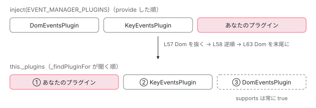

[目次](../README.md) › [DOM レンダラーとイベントの内側](README.md) › 第 13 回 / 全 20 回

# EventManager とプラグイン：イベント名で振り分ける

> EVENT\_MANAGER\_PLUGINS（BrowserModule と bootstrapApplication の providers で入る DomEventsPlugin・KeyEventsPlugin）、EventManager のコンストラクタが DomEventsPlugin 以外を逆順にして DomEventsPlugin を必ず最後に置く行、\_findPluginFor が supports を順に聞いて結果を \_eventNameToPlugin に覚える行と NG05101 が出る条件、EventManagerPlugin の抽象クラス。ページの上で本物の EventManager にイベント名を振り分けさせるデモ。

angular/angular · 読了 約 12 分 · 中核 · [サイトで読む（デモが動きます）](https://angular-deep-dive-cyan.vercel.app/chapter/domr-event-manager)

---

テンプレートに `(click)` と書いても `(keydown.enter)` と書いても、renderer は同じ 1 つの `EventManager` に 「この要素に、この名前のイベントを付けて」と頼むだけです。名前を見て「誰が付けるか」を決めているのは `EventManager` と、その中に並んだ**プラグイン**です。この章では、プラグインがどこから来て、どの順に並べられ、どの行で 1 つに決まるのかを、ソースの行で追います。

読む対象は `packages/platform-browser/src/dom/events/` の `event_manager.ts`（114 行）・`event_manager_plugin.ts`（43 行）・`dom_events.ts`（43 行）と、`browser.ts` の providers です。

1. [1. 全体像](01-domr-overview.md)
2. [2. Renderer2 の約束](02-domr-renderer-api.md)
3. [3. DomRendererFactory2](03-domr-renderer-factory.md)
4. [4. 要素とテキスト](04-domr-default-renderer.md)
5. [5. 属性とプロパティ](05-domr-attributes-properties.md)
6. [6. カプセル化](06-domr-encapsulation.md)
7. [7. SharedStylesHost](07-domr-shared-styles.md)
8. [8. CSS 変数の名前空間](08-domr-css-var-namespacing.md)
9. [9. クラスとスタイル](09-domr-styling-overview.md)
10. [10. 優先順位のリスト](10-domr-style-binding-list.md)
11. [11. 値を決めて書く](11-domr-styling-apply.md)
12. [12. \[class\] と \[style\]](12-domr-styling-maps.md)
13. **13. EventManager**（この章）
14. [14. listen](14-domr-listen.md)
15. [15. キーのイベント](15-domr-key-events.md)
16. [16. 自分のプラグイン](16-domr-custom-plugin.md)
17. [17. サニタイズ](17-domr-sanitization.md)
18. [18. 信頼の印](18-domr-trusted-types.md)
19. [19. Title と Meta](19-domr-title-meta.md)
20. [20. issue と PR を読む](20-domr-issues.md)

## 1. プラグインは providers の配列で入る

**プラグイン**は「ある形のイベント名を引き受けて、DOM にリスナーを付ける係」のオブジェクトです。既定の 2 つは、`bootstrapApplication` と `BrowserModule` の両方が使う `BROWSER_MODULE_PROVIDERS` の中にあります （配列の全体は [BrowserModule の章](../ngmodule/12-ngmodule-browser-module.md)で読んでいます）。

📄 `angular/packages/platform-browser/src/browser.ts` L269–274 （▶ の行: 270–272, 274）

```ts
269 │   {
270 ▶     provide: EVENT_MANAGER_PLUGINS,
271 ▶     useClass: DomEventsPlugin,
272 ▶     multi: true,
273 │   },
274 ▶   {provide: EVENT_MANAGER_PLUGINS, useClass: KeyEventsPlugin, multi: true},
```

270〜272 行目で `DomEventsPlugin`、274 行目で `KeyEventsPlugin`。どちらも `EVENT_MANAGER_PLUGINS` というトークンに `multi: true` で足しています。`multi: true` は「同じトークンの provider を上書きせずに配列へ追加する」という印です（配列ができる仕組みは [multi providers の章](../di/09-di-multi-providers.md)）。だから `inject(EVENT_MANAGER_PLUGINS)` で返ってくるのは `[DomEventsPlugin, KeyEventsPlugin, …あなたが足したもの]` の**配列**で、並びは provider を書いた順です。

## 2. コンストラクタ：manager を配り、並べ直す

📄 `angular/packages/platform-browser/src/dom/events/event_manager.ts` L49–55 （▶ の行: 50–51, 53–54）

```ts
49 │   constructor(
50 ▶     @Inject(EVENT_MANAGER_PLUGINS) plugins: EventManagerPlugin[],
51 ▶     private _zone: NgZone,
52 │   ) {
53 ▶     plugins.forEach((plugin) => {
54 ▶       plugin.manager = this;
55 │     });
```

50 行目で配列を、51 行目で `NgZone` を受け取ります（zoneless の既定では `NoopNgZone`。[zoneless の既定](../zoneless/01-zoneless-default.md)）。53〜54 行目で**全部のプラグインの `manager` に自分を入れます**。プラグインは自分では `EventManager` を inject しません。あとで `this.manager.getZone()` と書けるのは、ここで入れてもらうからです（[第 15 回](15-domr-key-events.md)の `KeyEventsPlugin` が使います）。

📄 `angular/packages/platform-browser/src/dom/events/event_manager.ts` L57–65 （▶ の行: 57–58, 60–63）

```ts
57 ▶     const otherPlugins = plugins.filter((p) => !(p instanceof DomEventsPlugin));
58 ▶     this._plugins = otherPlugins.slice().reverse();
59 │ 
60 ▶     // DomEventsPlugin.supports() always returns true, it should always be the last plugin.
61 ▶     const domEventPlugin = plugins.find((p) => p instanceof DomEventsPlugin);
62 ▶     if (domEventPlugin) {
63 ▶       this._plugins.push(domEventPlugin);
64 │     }
65 │   }
```

1. **57 行目：`DomEventsPlugin` 以外を取り出す**

   `instanceof` で見分けます。既定の配列なら `[KeyEventsPlugin]` が残ります。
2. **58 行目：それを逆順にする**

   `slice()` で写してから `reverse()`。**後から provide したプラグインほど前に来ます**。あなたが `providers` に足したプラグインは `BROWSER_MODULE_PROVIDERS` より後ろに並ぶので、逆にすると `KeyEventsPlugin` より前、つまり先に聞かれます（[第 16 回](16-domr-custom-plugin.md)）。
3. **60〜64 行目：`DomEventsPlugin` を必ず最後に置く**

   60 行目のコメントのとおり、`DomEventsPlugin.supports()` は何にでも `true` を返すので、前にいると後ろのプラグインに順番が回りません。61 行目で探して、63 行目で末尾に push します。結果、既定の `_plugins` は `[KeyEventsPlugin, DomEventsPlugin]` です。

> [!NOTE]
> **さらに深く**
>
> 57・60〜64 行目は昔からあった行ではありません。以前は 58 行目に当たる行が `plugins.slice().reverse()` だけで、「`BrowserModule` より前にプラグインを provide するモジュールを import すると、`DomEventsPlugin` が先頭に来て全部を食べてしまう」という issue #37149・#37850 がありました。直したコミットは 29c397f8839（PR #50394）です。作者の日付は 2023-05-21 ですが、木に入ったのは 2025-10-15 で、最初に入ったタグは 21.0.0-next.9 です（`git tag --contains 29c397f8839`）。#37850 は 2026-02-17 に閉じました。



*EVENT\_MANAGER\_PLUGINS の配列（provide した順）が、コンストラクタの 57〜64 行目で \_plugins の並び（聞く順）になる。DomEventsPlugin だけは場所に関係なく最後。*

## 3. \_findPluginFor：supports を順に聞いて、覚える

renderer から呼ばれる入口の `EventManager.addEventListener` は、`_findPluginFor(eventName)` を呼んで、見つかったプラグインの `addEventListener` に丸投げするだけです （その 2 行は [クリックから描画までの章](../boot/12-boot-click-to-paint.md)で引用しています）。決めているのはこちらです。

📄 `angular/packages/platform-browser/src/dom/events/event_manager.ts` L94–113 （▶ の行: 96–98, 101–105, 107, 111）

```ts
 94 │   /** @internal */
 95 │   _findPluginFor(eventName: string): EventManagerPlugin {
 96 ▶     let plugin = this._eventNameToPlugin.get(eventName);
 97 ▶     if (plugin) {
 98 ▶       return plugin;
 99 │     }
100 │ 
101 ▶     const plugins = this._plugins;
102 ▶     plugin = plugins.find((plugin) => plugin.supports(eventName));
103 ▶     if (!plugin) {
104 ▶       throw new RuntimeError(
105 ▶         RuntimeErrorCode.NO_PLUGIN_FOR_EVENT,
106 │         (typeof ngDevMode === 'undefined' || ngDevMode) &&
107 ▶           `No event manager plugin found for event ${eventName}`,
108 │       );
109 │     }
110 │ 
111 ▶     this._eventNameToPlugin.set(eventName, plugin);
112 │     return plugin;
113 │   }
```

1. **96〜99 行目：まず覚えた答えを見る**

   `_eventNameToPlugin`（フィールドの初期化で作る `Map`）に**イベント名の文字列そのもの**をキーにして答えが入っていれば、それを返します。`'click'` のリスナーを 1000 個付けても、`supports()` が呼ばれるのは最初の 1 回だけです。
2. **101〜102 行目：`_plugins` を前から順に `supports(eventName)` で聞く**

   `Array.prototype.find` なので、**最初に `true` を返したプラグインで止まります**。後ろのプラグインは呼ばれもしません。
3. **103〜108 行目：誰も引き受けなければ NG05101**

   105 行目の `RuntimeErrorCode.NO_PLUGIN_FOR_EVENT` は `-5101` で、画面には `NG05101` と出ます。107 行目の文は開発モードのときだけ付きます（106 行目の `ngDevMode`）。既定の並びでは最後の `DomEventsPlugin` が必ず `true` を返すので、**この行に来るのは `DomEventsPlugin` を入れずに `EventManager` を作ったときだけ**です。
4. **111 行目：答えを覚えて返す**

   覚えるのは名前ごと。`'keydown.enter'` と `'keydown.Enter'` は別のキーです（どちらも `KeyEventsPlugin` に決まりますが、2 回聞きます）。

## 4. プラグインの約束：EventManagerPlugin

📄 `angular/packages/platform-browser/src/dom/events/event_manager_plugin.ts` L22–43 （▶ の行: 24, 27, 32, 37, 42）

```ts
22 │ export abstract class EventManagerPlugin {
23 │   // TODO: remove (has some usage in G3)
24 ▶   constructor(private _doc: any) {}
25 │ 
26 │   // Using non-null assertion because it's set by EventManager's constructor
27 ▶   manager!: EventManager;
28 │ 
29 │   /**
30 │    * Should return `true` for every event name that should be supported by this plugin
31 │    */
32 ▶   abstract supports(eventName: string): boolean;
33 │ 
34 │   /**
35 │    * Implement the behaviour for the supported events
36 │    */
37 ▶   abstract addEventListener(
38 │     element: HTMLElement,
39 │     eventName: string,
40 │     handler: Function,
41 │     options?: ListenerOptions,
42 ▶   ): Function;
43 │ }
```

- 32 行目：`supports(eventName)` は「この名前を引き受けるか」を `boolean` で答えるだけ。
- 37〜42 行目：`addEventListener(element, eventName, handler, options?)` は付けて、**外すための関数**を返します（42 行目の戻り値の型 `Function`）。
- 27 行目：`manager` は 2 節の 54 行目で入れてもらうので `!`（後で必ず入る）です。
- 24 行目：コンストラクタの `_doc` は使われていません。23 行目の TODO（Google 社内のコードが使っているので残している）のとおりです。
- **`removeEventListener` は約束に入っていません**。外し方は `addEventListener` が返す関数に閉じ込めます。

### 既定の 2 つの supports

📄 `angular/packages/platform-browser/src/dom/events/dom_events.ts` L13–24 （▶ の行: 14, 19–22）

```ts
13 │ @Injectable()
14 ▶ export class DomEventsPlugin extends EventManagerPlugin {
15 │   constructor(@Inject(DOCUMENT) doc: any) {
16 │     super(doc);
17 │   }
18 │ 
19 ▶   // This plugin should come last in the list of plugins, because it accepts all
20 ▶   // events.
21 ▶   override supports(eventName: string): boolean {
22 ▶     return true;
23 │   }
24 │ 
```

21〜23 行目、`DomEventsPlugin` は名前を見もしないで `true`。19〜20 行目のコメントが「最後に置くこと」を求めていて、それを 2 節の 60〜64 行目が保証しています。付け方（`element.addEventListener`）は [第 14 回](14-domr-listen.md)で読みます。

📄 `angular/packages/platform-browser/src/dom/events/key_events.ts` L60–67 （▶ の行: 66）

```ts
60 │   /**
61 │    * Reports whether a named key event is supported.
62 │    * @param eventName The event name to query.
63 │    * @return True if the named key event is supported.
64 │    */
65 │   override supports(eventName: string): boolean {
66 ▶     return KeyEventsPlugin.parseEventName(eventName) != null;
67 │   }
```

66 行目、`KeyEventsPlugin` は名前を `parseEventName` で読めたら `true`。読めるのは `keydown.` か `keyup.` で始まり、知らない修飾キーの無い名前です （読み方は [第 15 回](15-domr-key-events.md)）。読めなかった名前は `DomEventsPlugin` に回り、**その名前のまま** DOM の `addEventListener` に渡されます。

> **🧪 DEMO 1 — このページの EventManager の並び**
>
> このサイトの本物の `EventManager`（`@angular/platform-browser` 22.1.6、root の環境インジェクタにある 1 つ）の private な `_plugins` を型を外して読みます。何も登録しません。
>
> ▶ [このデモはサイトで動かせます](https://angular-deep-dive-cyan.vercel.app/chapter/domr-event-manager)

> **🧪 DEMO 2 — イベント名を入れて、どのプラグインに決まるか**
>
> ボタンを押すと、browser.ts の 270〜274 行目と同じ 2 つの provider と `EventManager` だけを持つ小さな環境インジェクタを `createEnvironmentInjector` で作り、その中で本物の `EventManager` を DI に new させます。1 行に 1 つの名前について、両方の `supports()` と、`_findPluginFor`（`@internal`。型を外して呼ぶ）が返したプラグイン、呼ぶ前に `_eventNameToPlugin` に入っていたかを出します。リスナーは付けません。同じ名前を 2 行入れると、2 回目は「覚えていた」になります。
>
> ▶ [このデモはサイトで動かせます](https://angular-deep-dive-cyan.vercel.app/chapter/domr-event-manager)

初期値で押すと、`keydown.foo.a`・`keydown`・`foo` は `DomEventsPlugin` に決まります。`keyup.ente`（enter の打ち間違い）は `KeyEventsPlugin` に決まります。`parseEventName` はキーの名前が正しいかを確かめないからです。この名前のリスナーは**エラーも出さず、どのキーでも呼ばれません**。最後の `click` は 1 つ目と同じ名前なので「覚えていた」になります。

> **🧪 DEMO 3 — DomEventsPlugin の無い EventManager**
>
> `new EventManager([new ɵKeyEventsPlugin(document)], ngZone)` を作り、どこにも付けていない `div` に `'click'` を登録しようとします。捕まえた例外の `message` をそのまま出します。
>
> ▶ [このデモはサイトで動かせます](https://angular-deep-dive-cyan.vercel.app/chapter/domr-event-manager)

開発ビルドで見ると `NG05101: No event manager plugin found for event click. Find more at https://v22.angular.dev/errors/NG05101` でした（22.1.6 の開発ビルド。spec の 63 行目の main の版は next.angular.dev）。`KeyEventsPlugin` の 66 行目が `false` を返し、後ろに誰もいないので 103 行目に入りました。本番ビルドでは 107 行目の文が落ちて、番号とリンクだけになります。

## 5. ここまでを 1 本に

- `BROWSER_MODULE_PROVIDERS` — platform-browser/src/browser.ts L270-274 — *DomEventsPlugin・KeyEventsPlugin を multi で*
  - 👤 `{ provide: EVENT_MANAGER_PLUGINS, useClass: MyPlugin, multi: true }` — あなたの providers — *配列の後ろに並ぶ*
- `new EventManager(plugins, zone)` — dom/events/event\_manager.ts L49
  - `plugin.manager = this` — L54
  - `otherPlugins.slice().reverse()` → `push(domEventPlugin)` — L57-63 — *\[MyPlugin, KeyEventsPlugin, DomEventsPlugin\]*
- `renderer.listen(el, 'keydown.enter', fn)` — 第 14 回
  - `EventManager.addEventListener` → `_findPluginFor('keydown.enter')` — event\_manager.ts → L95
    - `_plugins.find(p => p.supports(name))` — L102 — *MyPlugin が false、KeyEventsPlugin が true で止まる*
    - `_eventNameToPlugin.set(name, plugin)` — L111
  - `plugin.addEventListener(el, name, fn, options)` — event\_manager.ts — *外す関数が返る*

## テストと直し方

### spec と describe

| spec | describe / it | bazel のターゲット |
| --- | --- | --- |
| platform-browser/test/dom/events/event\_manager\_spec.ts | describe `EventManager`（27 行目、it 15 個）。並びとエラーは it `should delegate event bindings to plugins that are passed in from the most generic one to the most specific one`（36）・ `should delegate event bindings to the first plugin supporting the event`（45）・`should throw when no plugin can handle the event`（58）。残りは zone.js との組み合わせ | `//packages/platform-browser/test:test_web_chromium`（ブラウザ） |

📄 `angular/packages/platform-browser/test/dom/events/event_manager_spec.ts` L36–65 （▶ の行: 40, 42, 51, 54–55, 61–63）

```ts
36 │     it('should delegate event bindings to plugins that are passed in from the most generic one to the most specific one', () => {
37 │       const element = el('<div></div>');
38 │       const handler = (e: Event) => e;
39 │       const plugin = new FakeEventManagerPlugin(doc, ['click']);
40 ▶       const manager = new EventManager([domEventPlugin, plugin], new FakeNgZone());
41 │       manager.addEventListener(element, 'click', handler);
42 ▶       expect(plugin.eventHandler['click']).toBe(handler);
43 │     });
44 │ 
45 │     it('should delegate event bindings to the first plugin supporting the event', () => {
46 │       const element = el('<div></div>');
47 │       const clickHandler = (e: Event) => e;
48 │       const dblClickHandler = (e: Event) => e;
49 │       const plugin1 = new FakeEventManagerPlugin(doc, ['dblclick']);
50 │       const plugin2 = new FakeEventManagerPlugin(doc, ['click', 'dblclick']);
51 ▶       const manager = new EventManager([plugin2, plugin1], new FakeNgZone());
52 │       manager.addEventListener(element, 'click', clickHandler);
53 │       manager.addEventListener(element, 'dblclick', dblClickHandler);
54 ▶       expect(plugin2.eventHandler['click']).toBe(clickHandler);
55 ▶       expect(plugin1.eventHandler['dblclick']).toBe(dblClickHandler);
56 │     });
57 │ 
58 │     it('should throw when no plugin can handle the event', () => {
59 │       const element = el('<div></div>');
60 │       const plugin = new FakeEventManagerPlugin(doc, ['dblclick']);
61 ▶       const manager = new EventManager([plugin], new FakeNgZone());
62 ▶       expect(() => manager.addEventListener(element, 'click', null!)).toThrowError(
63 ▶         'NG05101: No event manager plugin found for event click. Find more at https://next.angular.dev/errors/NG05101',
64 │       );
65 │     });
```

40 行目は `[domEventPlugin, plugin]` の順で渡しても、42 行目で `click` が `plugin` に行くことを確かめています（2 節の 60〜64 行目）。51 行目は `[plugin2, plugin1]` と渡し、逆順で `plugin1` が先に聞かれるので、55 行目の `dblclick` は `plugin1`、54 行目の `click` は `plugin1` が断って `plugin2` です。61〜63 行目は DEMO 3 と同じ形で、エラーの文まで比べています。

📄 `angular/packages/platform-browser/test/dom/events/event_manager_spec.ts` L20–34 （▶ の行: 21）

```ts
20 │ (function () {
21 ▶   if (isNode) return;
22 │   let domEventPlugin: DomEventsPlugin;
23 │   let doc: Document;
24 │   let zone: NgZone;
25 │   const {runInInjectionContext} = TestBed;
26 │ 
27 │   describe('EventManager', () => {
28 │     beforeEach(() => {
29 │       doc = getDOM().supportsDOMEvents ? document : getDOM().createHtmlDocument();
30 │       zone = new NgZone({});
31 │       runInInjectionContext(() => {
32 │         domEventPlugin = new DomEventsPlugin(doc);
33 │       });
34 │     });
```

> [!WARNING]
> **ハマりどころ**
>
> 21 行目、**Node で走らせると、この spec は it を 1 つも登録しません**。`//packages/platform-browser/test:test`（Node の jasmine）に `--filter=EventManager` を付けても 「Ran 0 of 159 specs」で PASSED になります（DOMR-COMMON に書かれているとおり、0 件一致でも PASSED）。このファイルはブラウザのターゲット `test_web_chromium` で走ります。

### 手元で走らせた結果

📄 `ターミナル（../angular で）`

```
cd ~/angular-research/angular
# Node の jasmine（isNode のときは event_manager_spec が中身を登録しない）
pnpm bazel test //packages/platform-browser/test:test \
  --nocache_test_results --test_output=all --test_arg=--filter=EventManager
# ブラウザ（Chromium）で platform-browser/test の全部
pnpm bazel test //packages/platform-browser/test:test_web_chromium \
  --nocache_test_results --test_output=all
```

📄 `出力（2026-11-04 に実行。抜粋。ログは scratchpad/domr-logs/d-em-node.log・d-web.log）`

```
# 1 本目
Ran 0 of 159 specs
0 specs, 0 failures
//packages/platform-browser/test:test                                    PASSED in 0.7s
# 2 本目
Chromium: |██████████████████████████████| 1/1 test files | 253 passed, 0 failed, 5 skipped
Finished running tests in 2.8s, all tests passed!
//packages/platform-browser/test:test_web_chromium                       PASSED in 3.3s
```

- ブラウザのターゲットは web test runner で、jasmine の `--filter` では絞っていません。253 件は platform-browser/test の全部で、その中に describe `EventManager` の 15 件と `KeyEventsPlugin` の 6 件が入っています。

### 直すとしたら

- 並び方を変えるなら `EventManager` のコンストラクタ（49〜65 行目）、決め方を変えるなら `_findPluginFor`（95〜113 行目）です。it は 36〜65 行目の形（`FakeEventManagerPlugin` を並べて、どれに `handler` が入ったかを見る）で `event_manager_spec.ts` の describe `EventManager` に足します。走るのはブラウザのターゲットです。
- この場所で 2026 年に入ったのは文書の修正です。NG05101 のエラーの説明のページ（`adev/src/content/reference/errors/NG05101.md`）は 2026-06 に足されたとき、「`(keyup.ente)` のような打ち間違いで出る」と書いていました。3 節の 103 行目と DEMO 2 のとおり打ち間違いでは出ません。main ではこの説明が 6b605eb0b5d（2026-10-20、docs: fix wrong claims in the error reference pages）で直っています（手元の木 8576f161ae4 より新しい）。
- 本家に PR を出すことは勧めません。ここで読んだ行は、issue の「プラグインが呼ばれない」「NG05101 が出る」を読むときに、どの `supports` が先に `true` を返したかを言い当てる手がかりにします（[第 20 回](20-domr-issues.md)）。

## 聞かれそうな質問

**Q. EventManager はアプリに何個ありますか？**

root の環境インジェクタに 1 つです。browser.ts の `BROWSER_MODULE_PROVIDERS` に `EventManager` がそのまま並んでいて（[BrowserModule の章](../ngmodule/12-ngmodule-browser-module.md)）、`DomRendererFactory2` がそれを inject し、全部の renderer が同じ 1 つを使います。DEMO 2 のように別のインジェクタで provide すれば、別のものを作れます。

**Q. 自分のプラグインと KeyEventsPlugin の両方が supports で true を返したら？**

先に聞かれた方だけが使われます。102 行目の `find` は最初の `true` で止まり、あなたの providers は既定の 2 つより後ろに並ぶので、58 行目の逆順で `KeyEventsPlugin` より前に来ます。`DomEventsPlugin` だけは 63 行目で必ず最後です。

**Q. `(keyup.ente)` と打ち間違えたらエラーになりますか？**

なりません。`KeyEventsPlugin` の 66 行目が `true` を返して引き受け、どのキーでも当たらないリスナーが付くだけです（DEMO 2）。NG05101 は 103〜108 行目、つまり誰も `true` を返さないときだけで、既定の並びでは最後の `DomEventsPlugin` が必ず引き受けます。

**Q. supports は毎回呼ばれますか？**

名前ごとに 1 回です。111 行目で `_eventNameToPlugin` に覚え、2 回目からは 96〜99 行目で返ります。覚えた答えは `EventManager` が生きている間ずっと残り、捨てる行はありません。

**Q. プラグインに removeEventListener を書く必要は？**

約束（`EventManagerPlugin` の 32〜42 行目）には `supports` と `addEventListener` しかありません。外すのは `addEventListener` が返す関数で、core はその関数をビューの破棄のときに呼びます（[第 14 回](14-domr-listen.md)）。`DomEventsPlugin` の `removeEventListener` は、その関数の中で使う自分用のメソッドです。

**Q. SSR（プリレンダー）のときも同じ並びですか？**

サーバーでは platform-server が `ServerEventManagerPlugin` を `EVENT_MANAGER_PLUGINS` に足します。これも `supports` が常に `true` で、`DomEventsPlugin` ではないので 58 行目の逆順で先頭に来て、全部の名前を引き受けます （中身は [platform-server の章](../platform/03-ssr-platform-server.md)で引用しています）。

## 読み終えて

- プラグインは `EVENT_MANAGER_PLUGINS` の multi の配列。既定は browser.ts の 270〜274 行目の `DomEventsPlugin` と `KeyEventsPlugin`。
- コンストラクタは 54 行目で `manager` を配り、57〜63 行目で「`DomEventsPlugin` 以外を逆順 + `DomEventsPlugin` を最後」に並べ直す。
- `_findPluginFor` は 102 行目で前から `supports` を聞き、最初の `true` に決めて、111 行目で名前ごとに覚える。
- NG05101 は `DomEventsPlugin` が無いときだけ。打ち間違えた名前は、エラーにならずに誰かが引き受ける。
- event\_manager\_spec は Node では空になる。走らせるのは `test_web_chromium`。

---

← 前: [\[class\] と \[style\] のマップ：文字列・配列・オブジェクト](12-domr-styling-maps.md)  
次: [renderer.listen：window: と document: の的、オプション、外し方](14-domr-listen.md) →
