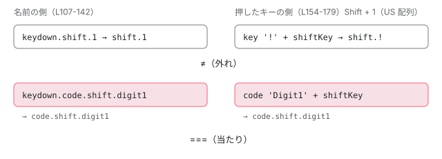

[目次](../README.md) › [DOM レンダラーとイベントの内側](README.md) › 第 15 回 / 全 20 回

# keydown.enter と keydown.shift.a：KeyEventsPlugin

> key\_events.ts の parseEventName が keydown.control.shift.a を「主なキー」と「修飾キー」に分けて決まった順に並べ直す行、matchEventFullKeyCode が event.key（\_keyMap で Del・Esc・Left などの古い値を直す）や event.code（keydown.code.keyA）から同じ形の文字列を作って比べる行、修飾キーの getter、eventCallback。ページの上で本物の ɵKeyEventsPlugin と EventManager にキーを押して当たるかを見るデモ。

angular/angular · 読了 約 12 分 · 中核 · [サイトで読む（デモが動きます）](https://angular-deep-dive-cyan.vercel.app/chapter/domr-key-events)

---

`(keydown.enter)` や `(keyup.control.shift.z)` は、DOM に `keydown.enter` というイベントがあるわけではありません。`KeyEventsPlugin` が名前を「DOM のイベント名」と「比べる文字列」に分け、押されたキーから同じ形の文字列を作って比べています。この章では、その 2 つの文字列がどの行でどう作られるかを追い、`keydown.shift.1` が当たらない理由や `code.` の使いどころを、行で説明できるようにします。

読む対象は `packages/platform-browser/src/dom/events/key_events.ts`（200 行）と、その spec の `key_events_spec.ts` です。

1. [1. 全体像](01-domr-overview.md)
2. [2. Renderer2 の約束](02-domr-renderer-api.md)
3. [3. DomRendererFactory2](03-domr-renderer-factory.md)
4. [4. 要素とテキスト](04-domr-default-renderer.md)
5. [5. 属性とプロパティ](05-domr-attributes-properties.md)
6. [6. カプセル化](06-domr-encapsulation.md)
7. [7. SharedStylesHost](07-domr-shared-styles.md)
8. [8. CSS 変数の名前空間](08-domr-css-var-namespacing.md)
9. [9. クラスとスタイル](09-domr-styling-overview.md)
10. [10. 優先順位のリスト](10-domr-style-binding-list.md)
11. [11. 値を決めて書く](11-domr-styling-apply.md)
12. [12. \[class\] と \[style\]](12-domr-styling-maps.md)
13. [13. EventManager](13-domr-event-manager.md)
14. [14. listen](14-domr-listen.md)
15. **15. キーのイベント**（この章）
16. [16. 自分のプラグイン](16-domr-custom-plugin.md)
17. [17. サニタイズ](17-domr-sanitization.md)
18. [18. 信頼の印](18-domr-trusted-types.md)
19. [19. Title と Meta](19-domr-title-meta.md)
20. [20. issue と PR を読む](20-domr-issues.md)

名前の `keydown.enter` は、コンパイラが切らずにそのまま命令に入れ、`renderer.listen` を通って `EventManager` に届きます（[第 14 回](14-domr-listen.md)）。`EventManager` は `KeyEventsPlugin.supports` に聞き、`parseEventName` が読めれば引き受けさせます（[第 13 回](13-domr-event-manager.md)）。ここからがこの章です。

## 1. 3 つの表

📄 `angular/packages/platform-browser/src/dom/events/key_events.ts` L14–45 （▶ の行: 17, 21, 26–28, 40–44）

```ts
14 │ /**
15 │  * Defines supported modifiers for key events.
16 │  */
17 ▶ const MODIFIER_KEYS = ['alt', 'control', 'meta', 'shift'];
18 │ 
19 │ // The following values are here for cross-browser compatibility and to match the W3C standard
20 │ // cf https://www.w3.org/TR/DOM-Level-3-Events-key/
21 ▶ const _keyMap: {[k: string]: string} = {
22 │   '\b': 'Backspace',
23 │   '\t': 'Tab',
24 │   '\x7F': 'Delete',
25 │   '\x1B': 'Escape',
26 ▶   'Del': 'Delete',
27 ▶   'Esc': 'Escape',
28 ▶   'Left': 'ArrowLeft',
29 │   'Right': 'ArrowRight',
30 │   'Up': 'ArrowUp',
31 │   'Down': 'ArrowDown',
32 │   'Menu': 'ContextMenu',
33 │   'Scroll': 'ScrollLock',
34 │   'Win': 'OS',
35 │ };
36 │ 
37 │ /**
38 │  * Retrieves modifiers from key-event objects.
39 │  */
40 ▶ const MODIFIER_KEY_GETTERS: {[key: string]: (event: KeyboardEvent) => boolean} = {
41 ▶   'alt': (event: KeyboardEvent) => event.altKey,
42 ▶   'control': (event: KeyboardEvent) => event.ctrlKey,
43 ▶   'meta': (event: KeyboardEvent) => event.metaKey,
44 ▶   'shift': (event: KeyboardEvent) => event.shiftKey,
45 │ };
```

- 17 行目 `MODIFIER_KEYS`：修飾キー（ほかのキーと一緒に押して意味を変えるキー）の名前と、**並べる順番**。`alt`・`control`・`meta`・`shift` のアルファベット順です。
- 21〜35 行目 `_keyMap`：**押されたキーの `event.key`** の古い綴り（`Del`・`Esc`・`Left` など、古いブラウザが返した値）を、今の標準の綴りに直す表。名前の側には使いません（3 節）。
- 40〜45 行目 `MODIFIER_KEY_GETTERS`：修飾キーの名前から、`KeyboardEvent` の `altKey`・`ctrlKey`・`metaKey`・`shiftKey` を読む関数。`control` が `ctrlKey` になる対応はここだけです。

## 2. parseEventName：名前を並べ直す

`parseEventName` の頭の数行（小文字にして `.` で割り、先頭を取り出す行）は [バインディングのパーサの章](../compiler/06-compiler-binding-parser.md)で引用しています。ここではその続きから読みます。`parts` は、名前を小文字にして `.` で割った配列です。

📄 `angular/packages/platform-browser/src/dom/events/key_events.ts` L107–142 （▶ の行: 108–110, 113, 116–119, 121–122, 124–125, 128, 130, 132, 138–140）

```ts
107 │ 
108 ▶     const domEventName = parts.shift();
109 ▶     if (parts.length === 0 || !(domEventName === 'keydown' || domEventName === 'keyup')) {
110 ▶       return null;
111 │     }
112 │ 
113 ▶     const key = KeyEventsPlugin._normalizeKey(parts.pop()!);
114 │ 
115 │     let fullKey = '';
116 ▶     let codeIX = parts.indexOf('code');
117 ▶     if (codeIX > -1) {
118 ▶       parts.splice(codeIX, 1);
119 ▶       fullKey = 'code.';
120 │     }
121 ▶     MODIFIER_KEYS.forEach((modifierName) => {
122 ▶       const index: number = parts.indexOf(modifierName);
123 │       if (index > -1) {
124 ▶         parts.splice(index, 1);
125 ▶         fullKey += modifierName + '.';
126 │       }
127 │     });
128 ▶     fullKey += key;
129 │ 
130 ▶     if (parts.length != 0 || key.length === 0) {
131 │       // returning null instead of throwing to let another plugin process the event
132 ▶       return null;
133 │     }
134 │ 
135 │     // NOTE: Please don't rewrite this as so, as it will break JSCompiler property renaming.
136 │     //       The code must remain in the `result['domEventName']` form.
137 │     // return {domEventName, fullKey};
138 ▶     const result: {fullKey: string; domEventName: string} = {} as any;
139 ▶     result['domEventName'] = domEventName;
140 ▶     result['fullKey'] = fullKey;
141 │     return result;
142 │   }
```

1. **108〜111 行目：先頭は `keydown` か `keyup`、しかも後ろが要る**

   108 行目で先頭を取り出して DOM のイベント名にします。`keypress` は読みません。`keydown` だけ（後ろが無い）も 109 行目で `null` です。
2. **113 行目：最後の 1 つが「主なキー」**

   `pop()` で末尾を取り、`_normalizeKey`（4 節の 197〜199 行目）に通します。直すのは `esc` → `escape` の 1 つだけです。
3. **116〜120 行目：`code` がどこかにあれば抜いて、頭に `code.`**

   主なキーの手前ならどこに書いてもよい、ということです。`keyup.control.code.shift.KeyS` も `keyup.control.shift.code.KeyS` も同じ `code.control.shift.keys` になります。
4. **121〜127 行目：修飾キーを 17 行目の順で拾う**

   書いた順ではなく `MODIFIER_KEYS` の順に足すので、`shift.control.z` と `control.shift.z` は同じ `control.shift.z` になります。拾った名前は 124 行目で `parts` から抜きます。
5. **128 行目：主なキーを最後に足す**

   `keydown.control.shift.z` なら `fullKey` は `control.shift.z`、`keydown.code.keyA` なら `code.keya`（大文字は `parts` を作るときに小文字になっている）。
6. **130〜133 行目：何か残っていたら `null`**

   知らない修飾キー（`keydown.foo.a` の `foo`）が残るか、主なキーが空（`keydown.`）なら `null`。131 行目のコメントのとおり、投げずに `null` を返して「ほかのプラグインに回す」ためです。**主なキーの名前が正しいかは確かめません**。`keyup.ente` も通ります。
7. **135〜141 行目：`result['domEventName']` の形で返す**

   135〜136 行目のコメントは、Google の Closure Compiler がプロパティ名を縮めないように、文字列のキーで書いている、という意味です。

## 3. matchEventFullKeyCode：押されたキーから同じ形を作る

📄 `angular/packages/platform-browser/src/dom/events/key_events.ts` L154–179 （▶ の行: 155, 157–159, 162–167, 169–170, 172–173, 177–178）

```ts
154 │   static matchEventFullKeyCode(event: KeyboardEvent, fullKeyCode: string): boolean {
155 ▶     let keycode = _keyMap[event.key] || event.key;
156 │     let key = '';
157 ▶     if (fullKeyCode.indexOf('code.') > -1) {
158 ▶       keycode = event.code;
159 ▶       key = 'code.';
160 │     }
161 │     // the keycode could be unidentified so we have to check here
162 ▶     if (keycode == null || !keycode) return false;
163 ▶     keycode = keycode.toLowerCase();
164 ▶     if (keycode === ' ') {
165 ▶       keycode = 'space'; // for readability
166 ▶     } else if (keycode === '.') {
167 ▶       keycode = 'dot'; // because '.' is used as a separator in event names
168 │     }
169 ▶     MODIFIER_KEYS.forEach((modifierName) => {
170 ▶       if (modifierName !== keycode) {
171 │         const modifierGetter = MODIFIER_KEY_GETTERS[modifierName];
172 ▶         if (modifierGetter(event)) {
173 ▶           key += modifierName + '.';
174 │         }
175 │       }
176 │     });
177 ▶     key += keycode;
178 ▶     return key === fullKeyCode;
179 │   }
```

1. **155 行目：ふつうは `event.key`（`_keyMap` で直す）**

   `event.key` は「押した結果の文字や役割」です。Shift と A なら `'A'`、日本語の配列で Shift と 2 なら `'"'` のように、配列と修飾キーで変わります。
2. **157〜160 行目：名前に `code.` があれば `event.code`**

   `event.code` は「押した物理的なキーの場所」で、配列に関係なく `KeyA`・`Digit1`・`ShiftLeft` のような値です。
3. **162〜168 行目：空なら `false`、小文字にして、空白と点に名前を付ける**

   `' '` は `space`、`'.'` は `dot`。`.` は名前の区切りに使っているので、点のキーは `keydown.dot` と書きます。
4. **169〜176 行目：押されている修飾キーを、同じ順で前に足す**

   170 行目、**主なキーと同じ名前の修飾キーは足しません**。Shift だけを押すと `shiftKey` は `true` ですが、主なキーが `shift` なので `shift.shift` にならず `shift` になります。ところが `code.` のときの主なキーは `shiftleft` なので 170 行目の比べで別物になり、`shift.` が足されます。
5. **177〜178 行目：文字列がぴったり同じなら当たり**

   前方一致ではありません。押した修飾キーが 1 つでも多ければ外れます。`keydown.a` は Ctrl と A では鳴りません。

> [!WARNING]
> **ハマりどころ**
>
> `_keyMap` は 155 行目、つまり**押されたキーの側**にしか使いません。名前の側は 113 行目で `esc` を直すだけです。だから `keydown.esc` は Escape で鳴りますが、`keydown.del` や `keydown.left` は今のブラウザでは鳴りません（`event.key` が `Delete`・`ArrowLeft` なので `delete`・`arrowleft` と比べることになる）。どちらもエラーにはならず、2 節の 130 行目も通るので、黙って鳴らないリスナーになります。DEMO で確かめられます。



*名前の側（parseEventName）と押したキーの側（matchEventFullKeyCode）で、同じ順番の文字列を作って === で比べる。Shift と 1 を押すと key は '!' なので外れ、code. を付けると Digit1 で当たる。*

## 4. addEventListener と eventCallback：DOM には keydown だけを付ける

📄 `angular/packages/platform-browser/src/dom/events/key_events.ts` L77–94 （▶ の行: 83, 85–88, 91–92）

```ts
77 │   override addEventListener(
78 │     element: HTMLElement,
79 │     eventName: string,
80 │     handler: Function,
81 │     options?: ListenerOptions,
82 │   ): Function {
83 ▶     const parsedEvent = KeyEventsPlugin.parseEventName(eventName)!;
84 │ 
85 ▶     const outsideHandler = KeyEventsPlugin.eventCallback(
86 ▶       parsedEvent['fullKey'],
87 ▶       handler,
88 ▶       this.manager.getZone(),
89 │     );
90 │ 
91 ▶     return this.manager.getZone().runOutsideAngular(() => {
92 ▶       return getDOM().onAndCancel(element, parsedEvent['domEventName'], outsideHandler, options);
93 │     });
94 │   }
```

📄 `angular/packages/platform-browser/src/dom/events/key_events.ts` L188–199 （▶ の行: 189–191, 197–198）

```ts
188 │   static eventCallback(fullKey: string, handler: Function, zone: NgZone): Function {
189 ▶     return (event: KeyboardEvent) => {
190 ▶       if (KeyEventsPlugin.matchEventFullKeyCode(event, fullKey)) {
191 ▶         zone.runGuarded(() => handler(event));
192 │       }
193 │     };
194 │   }
195 │ 
196 │   /** @internal */
197 ▶   static _normalizeKey(keyName: string): string {
198 ▶     return keyName === 'esc' ? 'escape' : keyName;
199 │   }
```

1. **83 行目：もう一度 `parseEventName`**

   `supports` でも 1 回読んでいますが、結果は覚えていないので読み直します（`!` は `supports` が `true` だったのだから `null` ではない、という印）。
2. **85〜89 行目：比べてから呼ぶ関数を作る**

   189〜193 行目がその中身です。190 行目で 3 節の比べをして、当たったときだけ 191 行目で `zone.runGuarded` の中でハンドラーを呼びます。
3. **91〜92 行目：zone の外で、DOM のイベント名だけで付ける**

   DOM に付くのは `keydown`（または `keyup`）のリスナー 1 つです。その要素で押された**全部のキー**で 189 行目の関数が走り、外れたキーは何もしません。付けるのは `getDOM().onAndCancel` で、`BrowserDomAdapter` では `addEventListener` して `removeEventListener` する関数を返すだけです（`DomEventsPlugin` と同じ形）。ハンドラーは renderer が包んだもの（[第 14 回](14-domr-listen.md)の `decoratePreventDefault`）なので、`false` を返せば当たったキーだけ `preventDefault()` されます。

> [!NOTE]
> **ポイント**
>
> 91 行目の `runOutsideAngular` と 191 行目の `runGuarded` は、zone.js のアプリで「外れたキーでは変更検知を走らせない」ためのものです（[runOutsideAngular の章](../zone/12-zone-coalescing.md)）。zoneless の既定では `NgZone` が `NoopNgZone` なので、どちらも関数をそのまま呼ぶだけです。変更検知の通知は、ハンドラーを包んだ core の `wrapListener` が出します（[zoneless のリスナーの章](../zoneless/08-zoneless-listener-path.md)）。

> **🧪 DEMO — 名前を入れて、キーを押す**
>
> 名前は本物の `ɵKeyEventsPlugin.parseEventName`（22.1.6 の静的メソッド）でその場で読みます。「この名前で付ける」を押すと、このサイトの本物の `EventManager` に下の入力欄と名前を渡して `addEventListener` します。テンプレートの `(keydown.…)` と同じ道です。同じ入力欄には、その後ろでふつうの `keydown`・`keyup` のリスナーも付け、押したキーごとに 1 行を足します。「match」は本物の `matchEventFullKeyCode` の答え、「呼ばれた」は `EventManager` 経由のハンドラーがその同じイベントで呼ばれたか、「作った文字列」は 155〜177 行目を表示用に移植した関数の結果です。
>
> ▶ [このデモはサイトで動かせます](https://angular-deep-dive-cyan.vercel.app/chapter/domr-key-events)

試すと良い組：`keydown.shift.1` で Shift と 1（作った文字列が `shift.!` になって外れる）と `keydown.code.shift.digit1`（当たる）。`keydown.del` で Delete（`delete` と比べて外れる）。`keydown.code.alt.shiftleft` で Alt を押しながら左の Shift（`code.alt.shift.shiftleft` ができて外れる。170 行目）。`keydown.shift` で Shift だけ（170 行目で `shift` になって当たる）。`keyup.enter` で Enter を押すと、keydown の行も match は `true` になります（表の match は行の種類に関係なく比べた答え）が、DOM に付いているのは keyup なので「呼ばれた」は keyup の行だけです。

## 5. ここまでを 1 本に

- 👤 `<input (keydown.control.shift.z)="undo()">` — あなたのテンプレート
- `renderer.listen(input, 'keydown.control.shift.z', fn)` — 第 14 回
  - `EventManager._findPluginFor` → `KeyEventsPlugin.supports` — 第 13 回
  - `KeyEventsPlugin.addEventListener` — key\_events.ts L77
    - `parseEventName` → `{domEventName: 'keydown', fullKey: 'control.shift.z'}` — L105-142
    - `eventCallback('control.shift.z', fn, zone)` — L85-89 → L188
    - `zone.runOutsideAngular(() => getDOM().onAndCancel(input, 'keydown', cb))` — L91-92 — *外す関数が返る*
- 👤 `Ctrl + Shift + Z を押す` — ブラウザ
  - `cb(event)` → `matchEventFullKeyCode(event, 'control.shift.z')` — L190 → L154 — *key 'Z' → 'z'、ctrlKey・shiftKey → 'control.shift.z'*
  - `zone.runGuarded(() => fn(event))` — L191 — *fn は renderer と core が包んだ関数*

## テストと直し方

### spec と describe

| spec | describe / it | bazel のターゲット |
| --- | --- | --- |
| platform-browser/test/dom/events/key\_events\_spec.ts | describe `KeyEventsPlugin`（11 行目）の it 6 つ：`should ignore unrecognized events`（12）・`should correctly parse event names`（21）・`should alias esc to escape`（94）・ `should match key field`（103）・`should match code field`（234）・`should return false when key is unidentified`（504） | `//packages/platform-browser/test:test`（Node。`isNode` で止める行が無いので Node でも走る） |

📄 `angular/packages/platform-browser/test/dom/events/key_events_spec.ts` L11–19 （▶ の行: 13, 15, 17）

```ts
11 │ describe('KeyEventsPlugin', () => {
12 │   it('should ignore unrecognized events', () => {
13 ▶     expect(KeyEventsPlugin.parseEventName('keydown')).toEqual(null);
14 │     expect(KeyEventsPlugin.parseEventName('keyup')).toEqual(null);
15 ▶     expect(KeyEventsPlugin.parseEventName('keydown.unknownmodifier.enter')).toEqual(null);
16 │     expect(KeyEventsPlugin.parseEventName('keyup.unknownmodifier.enter')).toEqual(null);
17 ▶     expect(KeyEventsPlugin.parseEventName('unknownevent.control.shift.enter')).toEqual(null);
18 │     expect(KeyEventsPlugin.parseEventName('unknownevent.enter')).toEqual(null);
19 │   });
```

13 行目は 2 節の 109 行目（後ろが無い）、15 行目は 130 行目（知らない修飾キーが残る）、17 行目は 109 行目（keydown でも keyup でもない）の確かめです。

📄 `angular/packages/platform-browser/test/dom/events/key_events_spec.ts` L76–101 （▶ の行: 81, 83, 86, 88, 91, 95–96）

```ts
 76 │     expect(KeyEventsPlugin.parseEventName('keyup.control.code.shift')).toEqual({
 77 │       'domEventName': 'keyup',
 78 │       'fullKey': 'code.control.shift',
 79 │     });
 80 │     // capitalization gets lowercased
 81 ▶     expect(KeyEventsPlugin.parseEventName('keyup.control.code.shift.KeyS')).toEqual({
 82 │       'domEventName': 'keyup',
 83 ▶       'fullKey': 'code.control.shift.keys',
 84 │     });
 85 │     // user provided order of `code.` does not matter
 86 ▶     expect(KeyEventsPlugin.parseEventName('keyup.control.shift.code.KeyS')).toEqual({
 87 │       'domEventName': 'keyup',
 88 ▶       'fullKey': 'code.control.shift.keys',
 89 │     });
 90 │     // except for putting `code` at the end
 91 ▶     expect(KeyEventsPlugin.parseEventName('keyup.control.shift.KeyS.code')).toBeNull();
 92 │   });
 93 │ 
 94 │   it('should alias esc to escape', () => {
 95 ▶     expect(KeyEventsPlugin.parseEventName('keyup.control.esc')).toEqual(
 96 ▶       KeyEventsPlugin.parseEventName('keyup.control.escape'),
 97 │     );
 98 │     expect(KeyEventsPlugin.parseEventName('keyup.control.Esc')).toEqual(
 99 │       KeyEventsPlugin.parseEventName('keyup.control.escape'),
100 │     );
101 │   });
```

81〜89 行目が 116〜120 行目（`code` はどこに書いてもよい）と大文字の小文字化、91 行目が「`code` を最後に書くと主なキーとして読まれ、`keys` が残って `null`」、95〜96 行目が 113 行目の `esc` です。

📄 `angular/packages/platform-browser/test/dom/events/key_events_spec.ts` L325–349 （▶ の行: 330–333, 335, 347–348）

```ts
325 │     // combination keys with code match
326 │     expect(
327 │       KeyEventsPlugin.matchEventFullKeyCode(
328 │         new KeyboardEvent('keydown', {
329 │           ...baseKeyboardEvent,
330 ▶           key: 'Alt',
331 ▶           code: 'AltLeft',
332 ▶           shiftKey: true,
333 ▶           altKey: true,
334 │         }),
335 ▶         'code.alt.shift.altleft',
336 │       ),
337 │     ).toBeTruthy();
338 │     expect(
339 │       KeyEventsPlugin.matchEventFullKeyCode(
340 │         new KeyboardEvent('keydown', {
341 │           ...baseKeyboardEvent,
342 │           key: 'Alt',
343 │           code: 'AltLeft',
344 │           shiftKey: true,
345 │           altKey: true,
346 │         }),
347 ▶         'code.shift.altleft',
348 ▶       ),
349 │     ).toBeFalsy();
```

Alt を押しながら Shift を押したとき（330〜333 行目）、`code.alt.shift.altleft` は当たり（335 行目）、`code.shift.altleft` は外れ（347〜348 行目）。`code.` の主なキーに修飾キーの場所を書くと、そのキー自身の修飾も前に要る、という 3 節の 170 行目の結果を確かめています。

### 手元で走らせた結果

📄 `ターミナル（../angular で）`

```
cd ~/angular-research/angular
pnpm bazel test //packages/platform-browser/test:test \
  --nocache_test_results --test_output=all --test_arg=--filter=KeyEventsPlugin
```

📄 `出力（2026-11-04 に実行。抜粋。ログは scratchpad/domr-logs/d-key.log）`

```
Ran 6 of 159 specs
6 specs, 0 failures
Finished in 0.024 seconds
//packages/platform-browser/test:test                                    PASSED in 0.7s
```

- 6 件 = describe `KeyEventsPlugin` の it の全部。`new KeyboardEvent(…)` を作って静的メソッドに渡すだけなので、DOM に付けない分、Node の jasmine でも走ります。

### 直すとしたら

- 名前の読み方は `parseEventName`（107〜142 行目）、比べ方は `matchEventFullKeyCode`（154〜179 行目）です。it は `should match key field`・`should match code field` の形（`KeyboardEvent` を作って `matchEventFullKeyCode` の答えを見る）で足します。
- 3 節の 170 行目の件は、文書の例が間違っていた形で表に出ました。テンプレートのイベントの guide（`adev/src/content/guide/templates/event-listeners.md`）の 「Alt と左の Shift に当たる」例 `(keydown.code.alt.shiftleft)` は鳴りません。main では 2e4e1214cc6（2026-10-26、docs: fix the left shift key event example）で `keydown.code.alt.shift.shiftleft` に直っています（手元の木 8576f161ae4 より新しい）。
- 配列や入力言語で `event.key` が変わり `keyup.control.q` が鳴らない、という issue #25797（2018 年）は、コードを変えずに文書で閉じました。PR #70731（2026-09-17 にマージ。`@HostListener` の文書に「`event.key` と比べる。配列に関係なく比べたいなら `code`」と足した。22.1.x には 7e5e779eb5c）です。
- 「修飾キーが何でも当たる書き方が欲しい」という issue #45475（2022 年）は open です。177〜178 行目のぴったりの比べが理由です。
- 本家に PR を出すことは勧めません。キーの issue を読むときに、名前の側（2 節）と押したキーの側（3 節）のどちらの文字列が想定と違うのかを、DEMO で作った文字列を見て言い当てる手がかりにします（[第 20 回](20-domr-issues.md)）。

## 聞かれそうな質問

**Q. keydown.shift.1 が鳴りません。なぜ？**

押したキーの側は 155 行目で `event.key` を使い、Shift と 1 の `event.key` は（US 配列なら）`'!'` です。作られる文字列は `shift.!` で、名前の側の `shift.1` と 178 行目で一致しません。物理的なキーで書きたいときは `keydown.code.shift.digit1` にします（157〜160 行目で `event.code` の `Digit1` を使う）。

**Q. keydown.shift.control.z と keydown.control.shift.z は別のリスナーですか？**

同じものとして扱われます。121〜127 行目が 17 行目の順（alt・control・meta・shift）で並べ直すので、どちらも `fullKey` は `control.shift.z` です（spec の it `should correctly parse event names` も同じことを確かめています）。

**Q. keydown.a は Ctrl + A でも鳴りますか？**

鳴りません。169〜176 行目が押されている修飾キーを全部足して `control.a` を作り、178 行目はぴったりの比べだからです。修飾キーを問わず鳴らしたい、という issue #45475 は open です。

**Q. keydown.esc と keydown.escape、keydown.del と keydown.delete は同じですか？**

`esc` だけは 197〜199 行目で `escape` に直るので同じです。`del` は直らず、今のブラウザの `event.key` は `Delete` なので、`keydown.del` は鳴りません。`_keyMap` の `Del` は、押したキーの側の古い `event.key` を直すための表です（155 行目）。

**Q. Mac の Command キーは？**

`meta` です。43 行目で `metaKey` を読みます。Mac で Cmd + S を拾うなら `keydown.meta.s`、Windows の Ctrl と両方なら 2 つのリスナーを書きます。

**Q. Angular Aria のキーボードのイベントマネージャと同じものですか？**

別物です。この章の `KeyEventsPlugin` は `EVENT_MANAGER_PLUGINS` のプラグインで、テンプレートの名前を読みます。Angular Aria のものはコンポーネントの中で使う別の仕組みです（[aria-events の章](../aria/04-aria-events.md)）。

## 読み終えて

- 名前の側は `parseEventName`：先頭が keydown か keyup、最後が主なキー、`code` は頭へ、修飾キーは alt・control・meta・shift の順に並べ直す。
- 押したキーの側は `matchEventFullKeyCode`：`event.key`（`code.` なら `event.code`）に、押されている修飾キーを同じ順で足し、`===` で比べる。
- 主なキーの名前の正しさは確かめない。打ち間違いや `del` は、黙って鳴らないリスナーになる。
- DOM に付くのは `keydown` か `keyup` 1 つで、全部のキーで比べが走り、当たったときだけハンドラーを呼ぶ。

---

← 前: [renderer.listen：window: と document: の的、オプション、外し方](14-domr-listen.md)  
次: [自分のプラグインを足す：EVENT\_MANAGER\_PLUGINS](16-domr-custom-plugin.md) →
