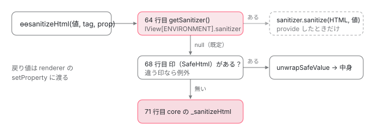

[目次](../README.md) › [DOM レンダラーとイベントの内側](README.md) › 第 17 回 / 全 20 回

# サニタイズの流れ：ɵɵsanitizeHtml から DomSanitizer まで

> コンパイラが dom\_security\_schema.ts の表で \[innerHTML\] や \[href\] に付ける ɵɵsanitizeHtml・ɵɵsanitizeUrl・ɵɵsanitizeResourceUrl と、ɵɵsanitize\* が「LView の sanitizer → SafeValue の印 → core の \_sanitizeHtml・\_sanitizeUrl」の順に見る分かれ（Sanitizer は既定で null なので、ふつうは core のサニタイザが直接動く）、ホストのバインディングを本当の要素で選び直す修正（d06e3748b7b・f57d5d5c8c3）、DomSanitizerImpl.sanitize の SecurityContext ごとの分かれ。ページの上で本物の DomSanitizer と本物のテンプレートに値を渡すデモ。

angular/angular · 読了 約 13 分 · 中核 · [サイトで読む（デモが動きます）](https://angular-deep-dive-cyan.vercel.app/chapter/domr-sanitization)

---

`<div [innerHTML]="html">` の値は、DOM に書かれる前に必ず関数を 1 つ通ります。この章では、**どのバインディングにどの関数が付くか**（コンパイラが表を引いて決める）、**その関数が実行時に何を見て分かれるか**（LView の sanitizer があるか、SafeValue の印があるか）、**`DomSanitizer.sanitize` が SecurityContext ごとにどう分かれるか**を、行で 1 つずつ確かめます。どの要素とタグを消すかという HTML のサニタイザの中身は[サニタイズの章](../template/07-sanitize.md)で読んだので、ここでは入口と分かれ道だけを追います。

読む対象は `packages/core/src/sanitization/` の `dom_security_schema.ts`・`sanitization.ts`・`sanitizer.ts`、コンパイラの `template/pipeline/src/phases/resolve_sanitizers.ts`、`packages/platform-browser/src/security/dom_sanitization_service.ts` です。

1. [1. 全体像](01-domr-overview.md)
2. [2. Renderer2 の約束](02-domr-renderer-api.md)
3. [3. DomRendererFactory2](03-domr-renderer-factory.md)
4. [4. 要素とテキスト](04-domr-default-renderer.md)
5. [5. 属性とプロパティ](05-domr-attributes-properties.md)
6. [6. カプセル化](06-domr-encapsulation.md)
7. [7. SharedStylesHost](07-domr-shared-styles.md)
8. [8. CSS 変数の名前空間](08-domr-css-var-namespacing.md)
9. [9. クラスとスタイル](09-domr-styling-overview.md)
10. [10. 優先順位のリスト](10-domr-style-binding-list.md)
11. [11. 値を決めて書く](11-domr-styling-apply.md)
12. [12. \[class\] と \[style\]](12-domr-styling-maps.md)
13. [13. EventManager](13-domr-event-manager.md)
14. [14. listen](14-domr-listen.md)
15. [15. キーのイベント](15-domr-key-events.md)
16. [16. 自分のプラグイン](16-domr-custom-plugin.md)
17. **17. サニタイズ**（この章）
18. [18. 信頼の印](18-domr-trusted-types.md)
19. [19. Title と Meta](19-domr-title-meta.md)
20. [20. issue と PR を読む](20-domr-issues.md)

> [!TIP]
> **新卒エンジニアへ**
>
> **サニタイズ**は「危ないかもしれない値を、危なくない形に直してから使う」ことです。**SecurityContext** は「その値がどこに書かれるか」の種類で、HTML・スタイル・スクリプト・URL・リソースの URL（スクリプトや iframe を読み込む URL）の 5 つと、「バインディングそのものを許さない」の 1 つがあります。種類ごとに、使う関数が違います。

## 1. どの属性が危ないかの表

表は core の `dom_security_schema.ts` にあります。コンパイラにも同じ名前のファイルがあり、`diff packages/compiler/src/schema/dom_security_schema.ts packages/core/src/sanitization/dom_security_schema.ts` は差が 0 行でした（8576f161ae4）。コンパイラの側の読み方は[バインディングの解析の章](../compiler/06-compiler-binding-parser.md)で引用しているので、ここでは実行時に使う core の写しを読みます。

📄 `angular/packages/core/src/sanitization/dom_security_schema.ts` L76–110 （▶ の行: 78–80, 82–84, 91–92, 95, 98, 101, 105, 107, 110）

```ts
 76 │   // Case is insignificant below, all element and attribute names are lower-cased for lookup.
 77 │ 
 78 ▶   registerContext(SecurityContext.HTML, /** Namespace */ undefined, [
 79 ▶     ['iframe', ['srcdoc']],
 80 ▶     ['*', ['innerHTML', 'outerHTML']],
 81 │   ]);
 82 ▶   registerContext(SecurityContext.STYLE, /** Namespace */ undefined, [['*', ['style']]]);
 83 ▶   // NB: no SCRIPT contexts here, they are never allowed due to the parser stripping them.
 84 ▶   registerContext(SecurityContext.URL, /** Namespace */ undefined, [
 85 │     ['*', ['formAction']],
 86 │     ['area', ['href']],
 87 │     ['a', ['href', 'xlink:href']],
 88 │     ['form', ['action']],
 89 │ 
 90 │     // The below two items are safe and should be removed but they require a G3 clean-up as a small number of tests fail.
 91 ▶     ['img', ['src']],
 92 ▶     ['video', ['src']],
 93 │   ]);
 94 │ 
 95 ▶   registerContext(SecurityContext.URL, MATH_ML_NAMESPACE, [
 96 │     // MathML namespace
 97 │     // https://crsrc.org/c/third_party/blink/renderer/core/sanitizer/sanitizer.cc;l=753-768;drc=b3eb16372dcd3317d65e9e0265015e322494edcd;bpv=1;bpt=1
 98 ▶     ['*', ['href', 'xlink:href']],
 99 │   ]);
100 │ 
101 ▶   registerContext(SecurityContext.RESOURCE_URL, /** Namespace */ undefined, [
102 │     ['base', ['href']],
103 │     ['embed', ['src']],
104 │     ['frame', ['src']],
105 ▶     ['iframe', ['src']],
106 │     ['link', ['href']],
107 ▶     ['object', ['codebase', 'data']],
108 │   ]);
109 │ 
110 ▶   registerContext(SecurityContext.URL, SVG_NAMESPACE, [['a', ['href', 'xlink:href']]]);
```

1. **78〜81 行目：HTML**

   どの要素でも `innerHTML`・`outerHTML`（80 行目の `'*'`）、それと `iframe` の `srcdoc`（79 行目）だけです。
2. **82〜83 行目：STYLE と SCRIPT**

   STYLE はどの要素の `style` も。SCRIPT は 1 つも登録されていません。83 行目のコメントのとおり、テンプレートの `<script>` はパーサが取り除くので、書く場所そのものがありません。
3. **84〜99 行目：URL**

   `a`・`area` の `href`、`form` の `action`、どの要素の `formAction` も。91〜92 行目の `img`・`video` の `src` は「安全なので消すべきだが、Google の中のテストが落ちるので残している」とコメントにあります。95〜99 行目は MathML の名前空間で、どの要素の `href` も URL です。
4. **101〜108 行目：RESOURCE\_URL**

   `base`・`link` の `href`、`embed`・`frame`・`iframe` の `src`、`object` の `codebase`・`data`。読み込んだものが実行される場所です。
5. **110 行目：SVG の a**

   SVG の名前空間の `a` の `href`・`xlink:href` だけが URL です。この表には続きがあり、SVG のアニメーションの属性と iframe の属性（ATTRIBUTE\_NO\_BINDING）は[次の章](18-domr-trusted-types.md)で読みます。

表を引く関数はこうです。

📄 `angular/packages/core/src/sanitization/dom_security_schema.ts` L185–211 （▶ の行: 191–193, 199, 202, 206, 209）

```ts
185 │ export function checkSecurityContext(
186 │   tagName: string,
187 │   propName: string,
188 │   namespace?: string | null,
189 │ ): SecurityContext {
190 │   const securitySchema = SECURITY_SCHEMA();
191 ▶   const attrSchema = securitySchema[propName.toLowerCase()];
192 ▶   if (!attrSchema) {
193 ▶     return SecurityContext.NONE;
194 │   }
195 │ 
196 │   const tagLower = tagName.toLowerCase();
197 │   let context: SecurityContext | undefined;
198 │ 
199 ▶   if (namespace) {
200 │     const nsSchema = attrSchema[namespace];
201 │     if (nsSchema) {
202 ▶       context = nsSchema[tagLower] ?? nsSchema[MATCH_ALL_ELEMENTS];
203 │     }
204 │   }
205 │ 
206 ▶   if (context === undefined) {
207 │     const defaultSchema = attrSchema[NO_NAMESPACE];
208 │     if (defaultSchema) {
209 ▶       context = defaultSchema[tagLower] ?? defaultSchema[MATCH_ALL_ELEMENTS];
210 │     }
211 │   }
```

191 行目で属性の名前を小文字にして 1 段目を引き、無ければ 193 行目で `NONE`（サニタイズしない）。199〜204 行目で名前空間（`svg`・`math`）の表を先に見て、無ければ 206〜211 行目で名前空間なしの表を、タグの名前、無ければ `'*'` の順に見ます。つまり `[innerHTML]` は `'*'` で当たり、`<div [href]>` は `href` の表に `div` も `'*'` も無いので `NONE` です。

## 2. コンパイラが命令にサニタイザを付ける

バインディングごとの SecurityContext は、コンパイラがテンプレートを読むときに 1 節の表で決め、命令の 3 つ目の引数として関数を渡します。その対応表がこれです。

📄 `angular/packages/compiler/src/template/pipeline/src/phases/resolve_sanitizers.ts` L15–25 （▶ の行: 19–24）

```ts
15 │ /**
16 │  * Map of security contexts to their sanitizer function.
17 │  */
18 │ const sanitizerFns = new Map<SecurityContext, o.ExternalReference>([
19 ▶   [SecurityContext.HTML, Identifiers.sanitizeHtml],
20 ▶   [SecurityContext.RESOURCE_URL, Identifiers.sanitizeResourceUrl],
21 ▶   [SecurityContext.SCRIPT, Identifiers.sanitizeScript],
22 ▶   [SecurityContext.STYLE, Identifiers.sanitizeStyle],
23 ▶   [SecurityContext.URL, Identifiers.sanitizeUrl],
24 ▶   [SecurityContext.ATTRIBUTE_NO_BINDING, Identifiers.validateAttribute],
25 │ ]);
```

📄 `angular/packages/compiler/src/template/pipeline/src/phases/resolve_sanitizers.ts` L54–76 （▶ の行: 56–58, 61, 63, 69, 71, 74）

```ts
54 │     for (const op of unit.update) {
55 │       switch (op.kind) {
56 ▶         case ir.OpKind.Property:
57 ▶         case ir.OpKind.Attribute:
58 ▶         case ir.OpKind.DomProperty:
59 │         case ir.OpKind.TwoWayProperty:
60 │           let sanitizerFn: o.ExternalReference | null = null;
61 ▶           if (
62 │             Array.isArray(op.securityContext) &&
63 ▶             hasCompositeUrlSecurityContext(op.securityContext)
64 │           ) {
65 │             // When the host element isn't known, attributes such as `href`, `src`, `data`,
66 │             // `action`, and `codebase` may be part of multiple security contexts. In this case we
67 │             // use a special sanitization function and select the actual behavior at runtime based
68 │             // on the concrete host element.
69 ▶             sanitizerFn = Identifiers.sanitizeUrlOrResourceUrl;
70 │           } else {
71 ▶             sanitizerFn = sanitizerFns.get(getOnlySecurityContext(op.securityContext)) ?? null;
72 │           }
73 │ 
74 ▶           op.sanitizer = sanitizerFn !== null ? o.importExpr(sanitizerFn) : null;
75 │ 
76 │           break;
```

56〜59 行目、プロパティ・属性のバインディングの命令だけが対象です（テキストの補間 `{{ }}` は `textContent` に書くので要りません）。71 行目で SecurityContext を 1 つに絞り、19〜24 行目の表から関数を選んで、74 行目で命令に付けます。例えば `<a [href]="u">` は `ɵɵproperty('href', ctx.u, ɵɵsanitizeUrl)` に、`<div [innerHTML]="h">` は `ɵɵsanitizeHtml` 付きになります。`NONE` なら表に無いので `null`（関数なし）です。

61〜69 行目は、要素が決まっていないときの特別扱いです。SecurityContext が「URL と RESOURCE\_URL の両方」や「URL と NONE の両方」になりうると、69 行目で `ɵɵsanitizeUrlOrResourceUrl` を付けて、実行時に本当の要素を見て選ばせます（4 節）。

### ホストのバインディングは「どの要素に付くか分からない」

`host: {'[attr.src]': 'x'}` のようなホストのバインディングは、セレクタからは要素が 1 つに決まりません。2026-06-30 の d06e3748b7b（#69558、issue #69550 の修正）より前は、宣言したディレクティブのセレクタだけで SecurityContext を決めていたので、`hostDirectives`・継承・`createComponent` の `hostElement` で別の要素に付くと、そちらの要素では必要なサニタイズが付きませんでした。今はこう計算します。

📄 `angular/packages/compiler/src/template/pipeline/src/ingest.ts` L151–185 （▶ の行: 157, 162, 164, 176–177, 180–181, 184）

```ts
151 │ function calcHostBindingSecurityContexts(
152 │   bindingParser: BindingParser,
153 │   selector: string,
154 │   name: string,
155 │   isAttribute: boolean,
156 │ ): SecurityContext[] {
157 ▶   const declaringSelectorContexts = bindingParser.calcPossibleSecurityContexts(
158 │     selector,
159 │     name,
160 │     isAttribute,
161 │   );
162 ▶   const concreteHostContexts = calcPossibleSecurityContexts(
163 │     domSchema,
164 ▶     null,
165 │     domSchema.getMappedPropName(name),
166 │     isAttribute,
167 │   );
168 │   const concreteHostNonNoneContexts = concreteHostContexts.filter(
169 │     (context) => context !== SecurityContext.NONE,
170 │   );
171 │   const concreteHostNonNoneCount = concreteHostNonNoneContexts.length;
172 │   const hasConcreteHostNoneContext = concreteHostNonNoneCount !== concreteHostContexts.length;
173 │ 
174 │   // Host bindings can run against a concrete host whose element name differs from the declaring
175 │   // selector, including dynamic root components whose TNode name is `#host`.
176 ▶   if (hasConcreteHostNoneContext && concreteHostNonNoneCount > 0) {
177 ▶     return concreteHostContexts;
178 │   }
179 │ 
180 ▶   if (concreteHostNonNoneContexts.some((context) => !declaringSelectorContexts.includes(context))) {
181 ▶     return concreteHostContexts;
182 │   }
183 │ 
184 ▶   return declaringSelectorContexts.filter((context) => context !== SecurityContext.NONE);
185 │ }
```

1. **157 行目：宣言したセレクタで計算**

   これが以前の計算です。
2. **162〜167 行目：要素を決めずに計算**

   164 行目の `null` は「どの要素でも」で、その名前の属性が取りうる SecurityContext を全部集めます。`src` なら URL（img など）・RESOURCE\_URL（iframe など）・NONE（div など）です。
3. **176〜182 行目：どの要素でもよい側を選ぶ条件**

   NONE と危ない種類が混ざっているとき（176 行目）、またはセレクタの計算に無い種類が出てきたとき（180 行目）は、全部の候補を返します。これで 2 節の 61〜69 行目に入り、実行時に選ぶ関数が付きます。
4. **184 行目：それ以外はセレクタの計算のまま**

## 3. 実行時：命令からサニタイザが呼ばれる

命令の側は「付いていれば呼ぶ」だけです。プロパティは `setDomProperty`、属性は `setElementAttribute` です （命令から renderer までの道は[第 5 回](05-domr-attributes-properties.md)）。

📄 `angular/packages/core/src/render3/instructions/shared.ts` L305–308 （▶ の行: 307–308）

```ts
305 │     // It is assumed that the sanitizer is only added when the compiler determines that the
306 │     // property is risky, so sanitization can be done without further checks.
307 ▶     value = sanitizer != null ? (sanitizer(value, tNode.value || '', propName) as any) : value;
308 ▶     renderer.setProperty(element as RElement, propName, value);
```

📄 `angular/packages/core/src/render3/instructions/shared.ts` L536–541 （▶ の行: 538, 540）

```ts
536 │   } else {
537 │     const strValue =
538 ▶       sanitizer == null ? renderStringify(value) : sanitizer(value, tagName || '', name);
539 │ 
540 ▶     renderer.setAttribute(element, name, strValue as string, namespace);
541 │   }
```

307・538 行目。サニタイザには**値・タグの名前（`tNode.value`）・プロパティか属性の名前**の 3 つを渡します。305〜306 行目のコメントのとおり、命令の側では「危ないかどうか」を判断しません。コンパイラが付けたかどうかがすべてです。戻り値が 308・540 行目で renderer に渡るので、**renderer が受け取るのはサニタイズ済みの値**です。

## 4. ɵɵsanitize\* の中：3 つの分かれ道

📄 `angular/packages/core/src/sanitization/sanitization.ts` L51–72 （▶ の行: 56, 59, 61, 64–66, 68–69, 71）

```ts
51 │ export function ɵɵsanitizeHtml(
52 │   unsafeHtml: any,
53 │   tagName?: string,
54 │   propName?: string,
55 │ ): TrustedHTML | string {
56 ▶   if (
57 │     tagName !== undefined &&
58 │     propName !== undefined &&
59 ▶     getSecurityContext(tagName, propName) !== SecurityContext.HTML
60 │   ) {
61 ▶     return unsafeHtml;
62 │   }
63 │ 
64 ▶   const sanitizer = getSanitizer();
65 ▶   if (sanitizer) {
66 ▶     return trustedHTMLFromStringBypass(sanitizer.sanitize(SecurityContext.HTML, unsafeHtml) || '');
67 │   }
68 ▶   if (allowSanitizationBypassAndThrow(unsafeHtml, BypassType.Html)) {
69 ▶     return trustedHTMLFromStringBypass(unwrapSafeValue(unsafeHtml));
70 │   }
71 ▶   return _sanitizeHtml(getDocument(), renderStringify(unsafeHtml));
72 │ }
```

1. **56〜62 行目：本当の要素で確かめ直す**

   タグとプロパティの名前を受け取ったら、1 節の表をもう一度引き、HTML でなければ値をそのまま返します。2 節のホストのバインディングで「`srcdoc` は iframe なら HTML」として付いた関数が、実際には `div` の上で動いた場合がこれです。
2. **64〜67 行目：LView に sanitizer があれば、それに頼む**

   `getSanitizer()`（5 節）が返したものの `sanitize(SecurityContext.HTML, 値)` を呼び、結果を Trusted Types の値にして返します（66 行目の `trustedHTMLFromStringBypass` は[次の章](18-domr-trusted-types.md)）。
3. **68〜70 行目：無ければ、SafeValue の印を見る**

   `bypassSecurityTrustHtml` で作った値なら中身を取り出してそのまま使います。違う種類の印ならここで例外です（次の章）。
4. **71 行目：どちらでもなければ core の \_sanitizeHtml**

   文字列にして（`renderStringify`）、core の HTML のサニタイザ（[サニタイズの章](../template/07-sanitize.md)）に渡します。



*ɵɵsanitize\* の中の 3 つの分かれ道。既定のアプリでは LView の sanitizer は null なので、印があれば中身、無ければ core のサニタイザに進む。*

ほかの 4 つも同じ形で、最後の行だけが違います。

📄 `angular/packages/core/src/sanitization/sanitization.ts` L85–94 （▶ の行: 86, 90, 93）

```ts
85 │ export function ɵɵsanitizeStyle(unsafeStyle: any): string {
86 ▶   const sanitizer = getSanitizer();
87 │   if (sanitizer) {
88 │     return sanitizer.sanitize(SecurityContext.STYLE, unsafeStyle) || '';
89 │   }
90 ▶   if (allowSanitizationBypassAndThrow(unsafeStyle, BypassType.Style)) {
91 │     return unwrapSafeValue(unsafeStyle);
92 │   }
93 ▶   return renderStringify(unsafeStyle);
94 │ }
```

📄 `angular/packages/core/src/sanitization/sanitization.ts` L112–121 （▶ の行: 113, 117, 120）

```ts
112 │ export function ɵɵsanitizeUrl(unsafeUrl: any): string {
113 ▶   const sanitizer = getSanitizer();
114 │   if (sanitizer) {
115 │     return sanitizer.sanitize(SecurityContext.URL, unsafeUrl) || '';
116 │   }
117 ▶   if (allowSanitizationBypassAndThrow(unsafeUrl, BypassType.Url)) {
118 │     return unwrapSafeValue(unsafeUrl);
119 │   }
120 ▶   return _sanitizeUrl(renderStringify(unsafeUrl));
121 │ }
```

📄 `angular/packages/core/src/sanitization/sanitization.ts` L134–148 （▶ の行: 135, 141, 144–145）

```ts
134 │ export function ɵɵsanitizeResourceUrl(unsafeResourceUrl: any): TrustedScriptURL | string {
135 ▶   const sanitizer = getSanitizer();
136 │   if (sanitizer) {
137 │     return trustedScriptURLFromStringBypass(
138 │       sanitizer.sanitize(SecurityContext.RESOURCE_URL, unsafeResourceUrl) || '',
139 │     );
140 │   }
141 ▶   if (allowSanitizationBypassAndThrow(unsafeResourceUrl, BypassType.ResourceUrl)) {
142 │     return trustedScriptURLFromStringBypass(unwrapSafeValue(unsafeResourceUrl));
143 │   }
144 ▶   throw new RuntimeError(
145 ▶     RuntimeErrorCode.UNSAFE_VALUE_IN_RESOURCE_URL,
146 │     ngDevMode && `unsafe value used in a resource URL context (see ${XSS_SECURITY_URL})`,
147 │   );
148 │ }
```

📄 `angular/packages/core/src/sanitization/sanitization.ts` L162–176 （▶ の行: 163, 169, 172–173）

```ts
162 │ export function ɵɵsanitizeScript(unsafeScript: any): TrustedScript | string {
163 ▶   const sanitizer = getSanitizer();
164 │   if (sanitizer) {
165 │     return trustedScriptFromStringBypass(
166 │       sanitizer.sanitize(SecurityContext.SCRIPT, unsafeScript) || '',
167 │     );
168 │   }
169 ▶   if (allowSanitizationBypassAndThrow(unsafeScript, BypassType.Script)) {
170 │     return trustedScriptFromStringBypass(unwrapSafeValue(unsafeScript));
171 │   }
172 ▶   throw new RuntimeError(
173 ▶     RuntimeErrorCode.UNSAFE_VALUE_IN_SCRIPT,
174 │     ngDevMode && 'unsafe value used in a script context',
175 │   );
176 │ }
```

| 関数 | sanitizer も印も無いとき | 行 |
| --- | --- | --- |
| `ɵɵsanitizeHtml` | core の `_sanitizeHtml` で危ない要素と属性を消す | 71 |
| `ɵɵsanitizeStyle` | **文字列にするだけ**。何も消さない | 93 |
| `ɵɵsanitizeUrl` | `_sanitizeUrl` で、危ない URL の頭に `unsafe:` を付ける | 120 |
| `ɵɵsanitizeResourceUrl` | **例外** NG0904。直す方法が無いので、印の付いた値しか通さない | 144〜147 |
| `ɵɵsanitizeScript` | **例外** NG0905 | 172〜175 |

`_sanitizeUrl` の中身も、本番と開発での違いを見るために最後の数行だけ読みます（正規表現そのものは[サニタイズの章](../template/07-sanitize.md)）。

📄 `angular/packages/core/src/sanitization/url_sanitizer.ts` L39–48 （▶ の行: 41, 43–44, 47）

```ts
39 │ export function _sanitizeUrl(url: string): string {
40 │   url = String(url);
41 ▶   if (url.match(SAFE_URL_PATTERN)) return url;
42 │ 
43 ▶   if (typeof ngDevMode === 'undefined' || ngDevMode) {
44 ▶     console.warn(`WARNING: sanitizing unsafe URL value ${url} (see ${XSS_SECURITY_URL})`);
45 │   }
46 │ 
47 ▶   return 'unsafe:' + url;
48 │ }
```

📄 `angular/packages/core/src/sanitization/html_sanitizer.ts` L328–336 （▶ の行: 332–333, 336）

```ts
328 │     const sanitizer = new SanitizingHtmlSerializer();
329 │     const safeHtml = sanitizer.sanitizeChildren(
330 │       (getTemplateContent(inertBodyElement!) as Element) || inertBodyElement,
331 │     );
332 ▶     if ((typeof ngDevMode === 'undefined' || ngDevMode) && sanitizer.sanitizedSomething) {
333 ▶       console.warn(`WARNING: sanitizing HTML stripped some content, see ${XSS_SECURITY_URL}`);
334 │     }
335 │ 
336 ▶     return trustedHTMLFromString(safeHtml);
```

URL は 41 行目で安全なら元のまま、そうでなければ 47 行目で `'unsafe:' + url`。HTML は何かを消したとき（`sanitizedSomething`）に 333 行目で警告を出します。どちらの `console.warn` も 43・332 行目の `ngDevMode` の中なので、**本番のビルドでは警告は出ず、値の書き換えだけが起きます**。

### 要素が決まっていないときの ɵɵsanitizeUrlOrResourceUrl

📄 `angular/packages/core/src/sanitization/sanitization.ts` L237–265 （▶ の行: 238, 240, 242, 244, 264）

```ts
237 │ export function getUrlSanitizer(tag: string, prop: string) {
238 ▶   switch (getSecurityContext(tag, prop)) {
239 │     case SecurityContext.RESOURCE_URL:
240 ▶       return ɵɵsanitizeResourceUrl;
241 │     case SecurityContext.URL:
242 ▶       return ɵɵsanitizeUrl;
243 │     default:
244 ▶       return null;
245 │   }
246 │ }
247 │ 
248 │ /**
249 │  * Sanitizes URL, selecting sanitizer function based on tag and property names.
250 │  *
251 │  * This function is used in case we can't define security context at compile time, when only prop
252 │  * name is available. This happens when we generate host bindings for Directives/Components. The
253 │  * host element is unknown at compile time, so we defer calculation of specific sanitizer to
254 │  * runtime.
255 │  *
256 │  * @param unsafeUrl untrusted `url`, typically from the user.
257 │  * @param tag target element tag name.
258 │  * @param prop name of the property that contains the value.
259 │  * @returns `url` string which is safe to bind.
260 │  *
261 │  * @codeGenApi
262 │  */
263 │ export function ɵɵsanitizeUrlOrResourceUrl(unsafeUrl: any, tag: string, prop: string) {
264 ▶   return getUrlSanitizer(tag, prop)?.(unsafeUrl) ?? unsafeUrl;
265 │ }
```

2 節の 69 行目で付く関数です。264 行目で、実行時のタグと名前から 238 行目の `getSecurityContext` を引き、RESOURCE\_URL なら 240 行目、URL なら 242 行目の関数を呼びます。どちらでもなければ 244 行目の `null` で、`?.` と `??` により値をそのまま返します。`<div>` に付いた `[attr.src]` がサニタイズされないのは、この 244 行目のためです。

## 5. LView の sanitizer は、既定では null

📄 `angular/packages/core/src/sanitization/sanitization.ts` L278–312 （▶ の行: 279–280, 284–285, 290–291, 296–297, 299, 302, 307）

```ts
278 │ function getSanitizer(): Sanitizer | null {
279 ▶   const lView = getLView();
280 ▶   return lView && lView[ENVIRONMENT].sanitizer;
281 │ }
282 │ 
283 │ function getSecurityContext(tagName: string, propName: string): SecurityContext {
284 ▶   const [namespace, resolvedTagName] = resolveElement(tagName);
285 ▶   return checkSecurityContext(resolvedTagName, propName, namespace);
286 │ }
287 │ 
288 │ function resolveElement(tagName: string): [namespace: string | null | undefined, tagName: string] {
289 │   tagName = tagName.toLowerCase();
290 ▶   const splitResult = splitNsName(tagName, false);
291 ▶   if (splitResult[0]) {
292 │     return splitResult;
293 │   }
294 │ 
295 │   const index = getSelectedIndex();
296 ▶   const tNode = index === -1 ? null : getSelectedTNode();
297 ▶   let namespace = tNode?.namespace;
298 │ 
299 ▶   if (tagName === TNodeName.DynamicHost && tNode?.type === TNodeType.Element) {
300 │     const element = getNativeByTNode(tNode, getLView()) as RElement;
301 │     if (element.tagName) {
302 ▶       tagName = element.tagName.toLowerCase();
303 │     }
304 │ 
305 │     if (namespace == null) {
306 │       const namespaceURI = (element as RElement & {namespaceURI?: string | null}).namespaceURI;
307 ▶       namespace = namespaceURI && NAMESPACE_URIS[namespaceURI];
308 │     }
309 │   }
310 │ 
311 │   return [namespace, tagName];
312 │ }
```

279〜280 行目、`getSanitizer()` はいま描いている LView の `ENVIRONMENT` の `sanitizer` を読むだけです。284〜285 行目の `getSecurityContext` は、290 行目で `svg:a` のような接頭辞を分け、無ければ 296〜297 行目でいま選ばれている TNode の名前空間を使います。299〜309 行目は `createComponent` で作ったルートの要素のときで、TNode の名前が `'#host'`（`TNodeName.DynamicHost`）なので、本物の要素の `tagName` と `namespaceURI` を読み直します（d06e3748b7b と f57d5d5c8c3 で入った行です）。

では `ENVIRONMENT.sanitizer` には何が入るのでしょう。

📄 `angular/packages/core/src/render3/component_ref.ts` L159–160 （▶ の行: 159）

```ts
159 ▶   const sanitizer = rootLViewInjector.get(Sanitizer, null);
160 │   const changeDetectionScheduler = rootLViewInjector.get(ChangeDetectionScheduler, null);
```

📄 `angular/packages/core/src/sanitization/sanitizer.ts` L12–27 （▶ の行: 19–20, 24–25）

```ts
12 │ /**
13 │  * Sanitizer is used by the views to sanitize potentially dangerous values.
14 │  *
15 │  * @see [Sanitization and security contexts](best-practices/security#sanitization-and-security-contexts)
16 │  *
17 │  * @publicApi
18 │  */
19 ▶ export abstract class Sanitizer {
20 ▶   abstract sanitize(context: SecurityContext, value: {} | string | null): string | null;
21 │   /** @nocollapse */
22 │   static ɵprov = /** @pureOrBreakMyCode */ /* @__PURE__ */ ɵɵdefineInjectable({
23 │     token: Sanitizer,
24 ▶     providedIn: 'root',
25 ▶     factory: () => null,
26 │   });
27 │ }
```

159 行目、ルートの LView の環境を作る `createRootLViewEnvironment`（RendererFactory2 を探すのと同じ関数）が、インジェクタから `Sanitizer` を取ります。そして `Sanitizer` の既定（24〜25 行目）は `providedIn: 'root'` で **`factory: () => null`**。`packages/` の中で `provide: Sanitizer` と書いているのは spec だけでした。

📄 `履歴と grep（../angular で）`

```
$ git -C ../angular show 8c71b9fc42e -- packages/platform-browser/src/browser.ts   （2021-11-09 refactor: delete the View Engine runtime）
-const BROWSER_SANITIZATION_PROVIDERS__PRE_R3__: StaticProvider[] = [
-  {provide: Sanitizer, useExisting: DomSanitizer},
-  {provide: DomSanitizer, useClass: DomSanitizerImpl, deps: [DOCUMENT]},
 ...
-export const BROWSER_SANITIZATION_PROVIDERS__POST_R3__ = [];

$ grep -rn "provide: Sanitizer" ../angular/packages   （8576f161ae4 の木。spec だけが出る）
packages/core/test/acceptance/view_container_ref_spec.ts:1535: {provide: Sanitizer, useValue: TestBed.inject(DomSanitizer)},
packages/core/test/render3/integration_spec.ts:589:   provide: Sanitizer,
packages/core/test/render3/integration_spec.ts:635:   provide: Sanitizer,
```

View Engine の時代は `BrowserModule` が `Sanitizer → DomSanitizer` を provide していましたが、Ivy 用の `__POST_R3__` は空の配列で、2021 年の View Engine の削除で前者も消えました。つまり**今のアプリでは、何も provide しなければ 4 節の 64 行目には入らず、68 行目（印）か 71 行目（core のサニタイザ）に進みます**。`DomSanitizer` は、利用者が inject して `sanitize` や `bypassSecurityTrust*` を呼ぶときだけ使われる、という位置づけです。readme.md（[サニタイズの章](../template/07-sanitize.md)の 4 節）の「サニタイザを差し替えられるが、実際には使われていない」は、この行のことです。

## 6. DomSanitizer.sanitize の分かれ道

📄 `angular/packages/platform-browser/src/security/dom_sanitization_service.ts` L108–119 （▶ の行: 108–109, 119）

```ts
108 ▶ @Injectable({providedIn: 'root', useExisting: forwardRef(() => DomSanitizerImpl)})
109 ▶ export abstract class DomSanitizer implements Sanitizer {
110 │   /**
111 │    * Gets a safe value from either a known safe value or a value with unknown safety.
112 │    *
113 │    * If the given value is already a `SafeValue`, this method returns the unwrapped value.
114 │    * If the security context is HTML and the given value is a plain string, this method
115 │    * sanitizes the string, removing any potentially unsafe content.
116 │    * For any other security context, this method throws an error if provided
117 │    * with a plain string.
118 │    */
119 ▶   abstract sanitize(context: SecurityContext, value: SafeValue | string | null): string | null;
```

108 行目、抽象クラス `DomSanitizer` を inject すると `useExisting` で `DomSanitizerImpl` が返ります。109 行目で core の `Sanitizer` を implements しているので、5 節の `Sanitizer` として provide することもできます（デモ 2）。

📄 `angular/packages/platform-browser/src/security/dom_sanitization_service.ts` L166–192 （▶ の行: 168, 170, 172–173, 175–176, 178, 180, 183, 185, 188）

```ts
166 │ @Service()
167 │ export class DomSanitizerImpl extends DomSanitizer {
168 ▶   private _doc = inject(DOCUMENT);
169 │   override sanitize(ctx: SecurityContext, value: SafeValue | string | null): string | null {
170 ▶     if (value == null) return null;
171 │     switch (ctx) {
172 ▶       case SecurityContext.NONE:
173 ▶         return value as string;
174 │       case SecurityContext.HTML:
175 ▶         if (allowSanitizationBypassOrThrow(value, BypassType.Html)) {
176 ▶           return unwrapSafeValue(value);
177 │         }
178 ▶         return _sanitizeHtml(this._doc, String(value)).toString();
179 │       case SecurityContext.STYLE:
180 ▶         if (allowSanitizationBypassOrThrow(value, BypassType.Style)) {
181 │           return unwrapSafeValue(value);
182 │         }
183 ▶         return value as string;
184 │       case SecurityContext.SCRIPT:
185 ▶         if (allowSanitizationBypassOrThrow(value, BypassType.Script)) {
186 │           return unwrapSafeValue(value);
187 │         }
188 ▶         throw new RuntimeError(
189 │           RuntimeErrorCode.SANITIZATION_UNSAFE_SCRIPT,
190 │           (typeof ngDevMode === 'undefined' || ngDevMode) &&
191 │             'unsafe value used in a script context',
192 │         );
```

📄 `angular/packages/platform-browser/src/security/dom_sanitization_service.ts` L193–214 （▶ の行: 194, 197, 199, 202, 207–208）

```ts
193 │       case SecurityContext.URL:
194 ▶         if (allowSanitizationBypassOrThrow(value, BypassType.Url)) {
195 │           return unwrapSafeValue(value);
196 │         }
197 ▶         return _sanitizeUrl(String(value));
198 │       case SecurityContext.RESOURCE_URL:
199 ▶         if (allowSanitizationBypassOrThrow(value, BypassType.ResourceUrl)) {
200 │           return unwrapSafeValue(value);
201 │         }
202 ▶         throw new RuntimeError(
203 │           RuntimeErrorCode.SANITIZATION_UNSAFE_RESOURCE_URL,
204 │           (typeof ngDevMode === 'undefined' || ngDevMode) &&
205 │             `unsafe value used in a resource URL context (see ${XSS_SECURITY_URL})`,
206 │         );
207 ▶       default:
208 ▶         throw new RuntimeError(
209 │           RuntimeErrorCode.SANITIZATION_UNEXPECTED_CTX,
210 │           (typeof ngDevMode === 'undefined' || ngDevMode) &&
211 │             `Unexpected SecurityContext ${ctx} (see ${XSS_SECURITY_URL})`,
212 │         );
213 │     }
214 │   }
```

1. **170 行目：`null` と `undefined` は `null`**

   文脈に関係なく先に返ります。
2. **172〜173 行目：NONE はそのまま**
3. **174〜178 行目：HTML**

   印があれば中身（176 行目）。無ければ 168 行目で inject した `DOCUMENT` を使って core と同じ `_sanitizeHtml`（178 行目）。`.toString()` で Trusted Types の値を文字列に戻しています。
4. **179〜183 行目：STYLE はそのまま**

   4 節の `ɵɵsanitizeStyle` と同じく、何も消しません。
5. **184〜192 行目：SCRIPT は例外**

   NG5200。
6. **193〜197 行目：URL**

   印があれば中身、無ければ `_sanitizeUrl`。
7. **198〜206 行目：RESOURCE\_URL は例外**

   NG5201。印のある値しか通りません。
8. **207〜212 行目：それ以外**

   ATTRIBUTE\_NO\_BINDING（6）のような想定外の数は NG5202。

> **🧪 DEMO 1 — 本物の DomSanitizer.sanitize に値を渡す**
>
> このページの `inject(DomSanitizer)`（@angular/platform-browser 22.1.6 の `DomSanitizerImpl`）に、下の値と SecurityContext をそのまま渡します。呼んでいる間だけ `console.warn` を横取りして画面に出します（コンソールには出しません）。結果は文字列として表示するだけで、DOM には入れません。
>
> ▶ [このデモはサイトで動かせます](https://angular-deep-dive-cyan.vercel.app/chapter/domr-sanitization)

- HTML は `<script>` が中身ごと消え、`onclick` の属性が消え、`href` の頭に `unsafe:` が付きます。
- STYLE と NONE は何も変えずに返ります（173・183 行目）。SCRIPT と RESOURCE\_URL は文字列なら必ず例外です。
- このサイトは `ng build` の既定（production）でビルドしているので、公開しているページでは警告は「なし」です（4 節の 43・332 行目の `ngDevMode` が `false`）。開発のビルド（`--configuration development`）で私が確かめたときは、HTML の文脈で `WARNING: sanitizing unsafe URL value javascript:alert(3)` と `WARNING: sanitizing HTML stripped some content` の 2 行が出ました（URL のほうが先なのは、HTML のサニタイザが属性の URL を調べる途中で `_sanitizeUrl` を呼ぶため）。例外の文も、本番では `NG05200` のような番号だけになります。

## 7. テンプレートからの道を本物で確かめる

> **🧪 DEMO 2 — \[innerHTML\] と \[href\] が renderer に届くとき**
>
> 章の中で定義した本物のコンポーネント `<div [innerHTML]="html()"></div><a [href]="url()">` を `createComponent` で作り、変更検知を 1 回だけ走らせます。RendererFactory2 は、このサイトの本物の DomRendererFactory2 を記録係（`domr-probe.ts` の `createLoggingRendererFactory`）で包んだもので、下の表は renderer に届いた `setProperty` です。作った要素はページの DOM に付けず、表示したら destroy します。「Sanitizer」の選び方で、`createComponent` に渡す elementInjector に `Sanitizer` を足すかどうかを変えます（5 節の 159 行目が読むトークン）。
>
> ▶ [このデモはサイトで動かせます](https://angular-deep-dive-cyan.vercel.app/chapter/domr-sanitization)

- 「provide しない」では `Sanitizer` のトークンは `null` です（sanitizer.ts 25 行目）。それでも `<script>` は消え、href は `unsafe:javascript:…` になります。4 節の 71・120 行目、core のサニタイザが直接動いた結果です。
- DomSanitizer を provide すると 64〜66・114〜115 行目に入りますが、中で呼ぶのは同じ `_sanitizeHtml`・`_sanitizeUrl` なので結果は同じです。
- 自作にすると、`[自作:HTML]`・`[自作:URL]` の印が付いた値が renderer に届きます。LView の sanitizer が**あれば必ずそちらが使われ、core のサニタイザは呼ばれない**ことが見えます。

## ここまでの呼び出し

- 👤 `<a [href]="url">` — あなたのテンプレート
  - `resolveSanitizers(job)` — compiler/…/phases/resolve\_sanitizers.ts L38 — *dom\_security\_schema の表で URL → ɵɵsanitizeUrl を命令に付ける*
  - `ɵɵproperty('href', ctx.url, ɵɵsanitizeUrl)` — コンパイル結果
    - `setDomProperty(tNode, lView, 'href', value, renderer, sanitizer)` — core/…/instructions/shared.ts L285
      - `ɵɵsanitizeUrl(value, 'a', 'href')` — core/src/sanitization/sanitization.ts L112
        - `getSanitizer()` — sanitization.ts L278 — *lView\[ENVIRONMENT\].sanitizer。既定は null*
        - `allowSanitizationBypassAndThrow(value, BypassType.Url)` — sanitization/bypass.ts L126 — *SafeUrl の印があれば中身*
        - `_sanitizeUrl(String(value))` — sanitization/url\_sanitizer.ts L39 — *危なければ 'unsafe:' + url*
      - `renderer.setProperty(a, 'href', サニタイズ済み)` — shared.ts L308

## テストと直し方

### spec と describe

| spec | describe / it | bazel のターゲット |
| --- | --- | --- |
| core/test/sanitization/sanitization\_spec.ts | describe `sanitization`（38）の it 12 個。`should sanitize html`（47）・`should not sanitize html sinks on concrete hosts with no HTML context`（64）・`should sanitize resourceUrl`（82）・`should select correct sanitizer for URL props`（117）など | `//packages/core/test:test` |
| core/test/sanitization/html\_sanitizer\_spec.ts・url\_sanitizer\_spec.ts | describe `HTML sanitizer`（17）・`URL sanitizer`（11） | `//packages/core/test:test` |
| core/test/acceptance/security\_spec.ts | describe `host binding sanitization`（882）・`innerHTML processing`（864）・`SVG <a> link sanitization`（1361）ほか | `//packages/core/test/acceptance:acceptance` |
| core/test/render3/integration\_spec.ts | describe `sanitization`（566）の it `should sanitize data using the provided sanitization interface`（567） | `//packages/core/test/render3:render3` |
| platform-browser/test/security/dom\_sanitization\_service\_spec.ts | describe `DOM Sanitization Service`（13）の it 1 つだけ | `//packages/platform-browser/test:test` |

📄 `angular/packages/core/test/sanitization/sanitization_spec.ts` L47–69 （▶ の行: 48, 50, 56, 58, 60, 67–68）

```ts
47 │   it('should sanitize html', () => {
48 ▶     expect(ɵɵsanitizeHtml('<div></div>').toString()).toEqual('<div></div>');
49 │     expect(ɵɵsanitizeHtml(new Wrap('<div></div>')).toString()).toEqual('<div></div>');
50 ▶     expect(ɵɵsanitizeHtml('').toString()).toEqual(
51 │       '',
52 │     );
53 │     expect(ɵɵsanitizeHtml(new Wrap('')).toString()).toEqual(
54 │       '',
55 │     );
56 ▶     expect(() =>
57 │       ɵɵsanitizeHtml(bypassSanitizationTrustUrl('')),
58 ▶     ).toThrowError(/Required a safe HTML, got a URL/);
59 │     expect(
60 ▶       ɵɵsanitizeHtml(bypassSanitizationTrustHtml('')).toString(),
61 │     ).toEqual('');
62 │   });
63 │ 
64 │   it('should not sanitize html sinks on concrete hosts with no HTML context', () => {
65 │     const html = '<script>evil</script><p>safe</p>';
66 │ 
67 ▶     expect(ɵɵsanitizeHtml(html, 'div', 'srcdoc')).toBe(html);
68 ▶     expect(ɵɵsanitizeHtml(html, 'iframe', 'srcdoc').toString()).toBe('<p>safe</p>');
69 │   });
```

この spec はファイルの先頭の `fakeLView` で LView を偽物にしていて（`ENVIRONMENT` は空のオブジェクト）、`sanitizer` が無いので 4 節の 71 行目の道を確かめています。56〜58 行目は URL の印を HTML の文脈に渡して例外、60 行目は HTML の印で素通り。67〜68 行目は 4 節の 56〜62 行目（`div` の `srcdoc` は HTML ではない）です。

📄 `angular/packages/core/test/acceptance/security_spec.ts` L1084–1121 （▶ の行: 1086–1087, 1089, 1110–1111, 1119）

```ts
1084 │   it('should not sanitize iframe-only host bindings on non-iframe concrete hosts', async () => {
1085 │     await expectHostBinding({
1086 ▶       tagName: 'div',
1087 ▶       attrName: 'srcdoc',
1088 │       value: UNSAFE_HTML,
1089 ▶       expected: UNSAFE_HTML,
1090 │     });
1091 │   });
1092 │ 
1093 │   it('should not sanitize form-only URL host bindings on non-form concrete hosts', async () => {
1094 │     await expectHostBinding({
1095 │       tagName: 'div',
1096 │       attrName: 'action',
1097 │       value: HOST_BINDING_URL,
1098 │       expected: HOST_BINDING_URL,
1099 │     });
1100 │     await expectHostBinding({
1101 │       tagName: 'div',
1102 │       attrName: 'action',
1103 │       value: HOST_BINDING_UNSAFE_URL,
1104 │       expected: HOST_BINDING_UNSAFE_URL,
1105 │     });
1106 │   });
1107 │ 
1108 │   it('should sanitize form-only URL host bindings on form concrete hosts', async () => {
1109 │     await expectHostBinding({
1110 ▶       tagName: 'form',
1111 ▶       attrName: 'action',
1112 │       value: HOST_BINDING_URL,
1113 │       expected: HOST_BINDING_URL,
1114 │     });
1115 │     await expectHostBinding({
1116 │       tagName: 'form',
1117 │       attrName: 'action',
1118 │       value: HOST_BINDING_UNSAFE_URL,
1119 ▶       expected: `unsafe:${HOST_BINDING_UNSAFE_URL}`,
1120 │     });
1121 │   });
```

`expectHostBinding`（同じ describe の先頭で定義）は、`host: {'[attr.名前]': 'val'}` のディレクティブを、`createComponent` の `hostElement` に渡した本物の要素に付けて、属性の値を読みます。同じ `action` でも `div` では素通り（1100〜1105 行目）、`form` では `unsafe:` が付く（1119 行目）。2 節の d06e3748b7b が足した形です。

📄 `angular/packages/core/test/render3/integration_spec.ts` L567–605 （▶ の行: 581–582, 589–590, 599, 601, 604）

```ts
567 │   it('should sanitize data using the provided sanitization interface', () => {
568 │     @Component({
569 │       selector: 'sanitize-this',
570 │       template: ` <a [href]="href"></a> `,
571 │       changeDetection: ChangeDetectionStrategy.Eager,
572 │     })
573 │     class SanitizationComp {
574 │       href = '';
575 │ 
576 │       updateLink(href: any) {
577 │         this.href = href;
578 │       }
579 │     }
580 │ 
581 ▶     const sanitizer = new LocalSanitizer((value) => {
582 ▶       return 'http://bar';
583 │     });
584 │ 
585 │     TestBed.configureTestingModule({
586 │       providers: [
587 │         provideZoneChangeDetection(),
588 │         {
589 ▶           provide: Sanitizer,
590 ▶           useValue: sanitizer,
591 │         },
592 │       ],
593 │     });
594 │     const fixture = TestBed.createComponent(SanitizationComp);
595 │     fixture.componentInstance.updateLink('http://foo');
596 │     fixture.detectChanges();
597 │ 
598 │     const anchor = fixture.nativeElement.querySelector('a')!;
599 ▶     expect(anchor.getAttribute('href')).toEqual('http://bar');
600 │ 
601 ▶     fixture.componentInstance.updateLink(sanitizer.bypassSecurityTrustUrl('http://foo'));
602 │     fixture.detectChanges();
603 │ 
604 ▶     expect(anchor.getAttribute('href')).toEqual('http://foo');
605 │   });
```

581〜591 行目で `Sanitizer` を provide すると、599 行目のとおり何を渡しても `http://bar` になります。デモ 2 の「自作」と同じことを spec で確かめているのがこの it です。

### 手元で走らせた結果

📄 `ターミナル（../angular で）`

```
cd ~/angular-research/angular
pnpm bazel test //packages/core/test:test --nocache_test_results --test_output=all \
  '--test_arg=--filter=^(sanitization|HTML sanitizer|URL sanitizer) '
pnpm bazel test //packages/core/test/acceptance:acceptance --nocache_test_results --test_output=all \
  '--test_arg=--filter=^(comment node text escaping|iframe processing|SVG animation processing|innerHTML processing|host binding sanitization|Component host element validation|SVG <script> bindings|SVG <a> link sanitization) '
pnpm bazel test //packages/platform-browser/test:test --nocache_test_results --test_output=all \
  '--test_arg=--filter=^(DOM Sanitization Service|Meta service|title service) '
```

📄 `出力（2026-11-04 に実行。抜粋。ログは scratchpad/domr-logs/e-core-sanit.log・e-accept-sec.log・e-pb-sec-meta.log）`

```
//packages/core/test:test（4 シャード）
  shard 1〜4 それぞれ: Ran 21 of 1338 specs / 21 specs, 0 failures   → 合わせて 84 件
  //packages/core/test:test   PASSED in 1.4s    （コマンド全体 real 4.46 秒）
//packages/core/test/acceptance:acceptance
  Ran 325 of 2693 specs / 325 specs, 0 failures
  //packages/core/test/acceptance:acceptance   PASSED in 1.6s   （real 10.63 秒）
//packages/platform-browser/test:test
  Ran 28 of 159 specs / 28 specs, 0 failures
  //packages/platform-browser/test:test   PASSED in 0.7s   （real 1.48 秒）
```

- core の 84 件は sanitization\_spec・html\_sanitizer\_spec・url\_sanitizer\_spec の it の合計です（url\_sanitizer\_spec は配列を回して it を作るので、ファイルの `it(` の数より多くなります）。
- acceptance の 325 件のうち多くは `iframe processing` の it を `ngDevMode` の 2 通り・属性の組み合わせで回したものです。
- platform-browser の 28 件は、この章の `DOM Sanitization Service` 1 件と、[第 19 回](19-domr-title-meta.md)の `Meta service`・`title service` です。

### 直すとしたら

- 「この属性もサニタイズすべき」なら、直すのは `dom_security_schema.ts` の表で、**compiler と core の 2 つを同じに直します**（`SECURITY_SCHEMA` の上のコメント「Keep is a copy of DOM Security Schema」。sanitization\_spec.ts の it `should select correct sanitizer for URL props` が、表と `getUrlSanitizer` がずれていないかを確かめています）。ただし表の上には次の行があります。

  📄 `angular/packages/core/src/sanitization/dom_security_schema.ts` L28–37 （▶ の行: 34）

  ```ts
  28 │ // =================================================================================================
  29 │ // =================================================================================================
  30 │ // =========== S T O P   -  S T O P   -  S T O P   -  S T O P   -  S T O P   -  S T O P  ===========
  31 │ // =================================================================================================
  32 │ // =================================================================================================
  33 │ //
  34 ▶ //        DO NOT EDIT THIS LIST OF SECURITY SENSITIVE PROPERTIES WITHOUT A SECURITY REVIEW!
  35 │ //
  36 │ // =================================================================================================
  37 │ 
  ```

  34 行目、「security review なしにこの一覧を変えるな」。
- 実行時の分かれ（名前空間・`#host`）なら `sanitization.ts` の `resolveElement`（288 行目）。spec は security\_spec.ts の `host binding sanitization` の `expectHostBinding` の形で足します。
- `DomSanitizerImpl` の spec は 1 件しかありません。`sanitize` の 8 つの分かれ（6 節）を 1 つずつ確かめる it は、platform-browser の側には無く、core の sanitization\_spec に同じ形があるだけです。手元で足して確かめる練習にちょうどよい大きさです。
- このあたりの修正は 2026 年に多く入っていて、ほとんどが `area: security` の issue から来ています（d06e3748b7b・f57d5d5c8c3 など。[第 20 回](20-domr-issues.md)）。リポジトリの `SECURITY.md` は、脆弱性をまず Google の Open Source Software Vulnerability Reward Program に報告するように書いています（#70743 のように、VRP から「メンテナーに公開で知らせて」と回されて issue になるものもあります）。このように扱いが特別な場所なので、本家に PR を出すことは勧めません。手元で spec を走らせて「今の振る舞い」を確かめ、issue を読むときの手がかりにします。

## 聞かれそうな質問

**Q. \[innerHTML\] のサニタイズは DomSanitizer がしているのですか？**

既定ではしていません。`Sanitizer` のトークンは誰も provide しておらず、既定の factory は `null` を返します（sanitizer.ts 25 行目）。そのため `ɵɵsanitizeHtml` は 64 行目の分かれに入らず、71 行目で core の `_sanitizeHtml` を直接呼びます。DomSanitizerImpl の 178 行目も同じ関数なので、結果は同じです。

**Q. &lt;div \[attr.src\]="x"&gt; に javascript: の URL を入れても止まらないのはなぜ？**

1 節の表で `src` が危ないのは `img`・`video`（URL）と `embed`・`frame`・`iframe`（RESOURCE\_URL）だけで、`div` には登録が無く、checkSecurityContext が 193 行目か 211 行目のあとで `NONE` を返すからです。コンパイラは関数を付けず（2 節の 71 行目で表に無い）、値はそのまま書かれます。div の src はブラウザが読み込まないので、危なくありません。

**Q. \[style\] や \[attr.style\] に危ない CSS を入れたら消してくれますか？**

消しません。`ɵɵsanitizeStyle` は sanitizer も印も無ければ 93 行目で文字列にするだけで、`DomSanitizerImpl` も 183 行目でそのまま返します。STYLE の文脈は残っていますが、中身の検査はありません。

**Q. &lt;iframe \[src\]="url"&gt; で NG0904 が出ます。どうすれば？**

iframe の src は RESOURCE\_URL（表の 105 行目）で、`ɵɵsanitizeResourceUrl` は印の無い値を 144〜147 行目で必ず拒みます。直し方が無いからです。値の出どころを確かめたうえで `bypassSecurityTrustResourceUrl` の印を付けて渡します（141 行目で通る）。印の仕組みは[次の章](18-domr-trusted-types.md)です。

**Q. 本番で「WARNING: sanitizing HTML stripped some content」が出ないのはなぜ？**

警告は html\_sanitizer.ts 332 行目・url\_sanitizer.ts 43 行目の `ngDevMode` の中にあり、本番のビルドではこの条件が `false` になって消されるからです。値は同じように消され、書き換えられます（デモ 1）。

## 読み終えて

- どのバインディングにサニタイザが付くかは、コンパイラが dom\_security\_schema の表で決めて命令の引数に入れる。命令の側は付いていれば呼ぶだけ。
- ɵɵsanitize\* は「LView の sanitizer → SafeValue の印 → core のサニタイザ」の順に見る。既定では LView の sanitizer は null。
- HTML は消す、URL は unsafe: を付ける、STYLE は何もしない、RESOURCE\_URL と SCRIPT は印が無ければ例外。
- ホストのバインディングは要素が決まらないので、d06e3748b7b 以降は実行時に本当の要素と名前空間で選び直す。

---

← 前: [自分のプラグインを足す：EVENT\_MANAGER\_PLUGINS](16-domr-custom-plugin.md)  
次: [bypassSecurityTrust と Trusted Types：信頼の印](18-domr-trusted-types.md) →
