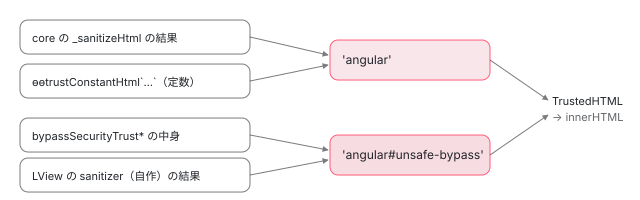

[目次](../README.md) › [DOM レンダラーとイベントの内側](README.md) › 第 18 回 / 全 20 回

# bypassSecurityTrust と Trusted Types：信頼の印

> bypass.ts の SafeValueImpl とその子クラス、allowSanitizationBypassAndThrow が違う種類の印を拒む行、trusted\_types.ts の 'angular' のポリシーと trusted\_types\_bypass.ts の 'angular#unsafe-bypass'、ɵɵtrustConstantHtml、iframe の危ない属性を止める iframe\_attrs\_validation.ts と ɵɵvalidateAttribute（SVG のアニメーション属性の修正 7168bed663b・3499a1321bf）。

angular/angular · 読了 約 13 分 · 発展 · [サイトで読む（デモが動きます）](https://angular-deep-dive-cyan.vercel.app/chapter/domr-trusted-types)

---

[前の章](17-domr-sanitization.md)で、`ɵɵsanitize*` は「LView の sanitizer → SafeValue の印 → core のサニタイザ」の順に見る、と読みました。この章はその 2 番目の**印**の中身と、ブラウザの **Trusted Types**（後で説明）に Angular が渡す値の作り方、そして「サニタイズでは直せないので、バインディングそのものを止める」`ɵɵvalidateAttribute` を読みます。最後の関数は 2026 年に SVG のアニメーションの属性の修正が続いた場所です。

読む対象は `packages/core/src/sanitization/` の `bypass.ts`・`sanitization.ts`（後半）・`iframe_attrs_validation.ts`・`dom_security_schema.ts`（後半）と、`packages/core/src/util/security/` の 3 ファイルです。

1. [1. 全体像](01-domr-overview.md)
2. [2. Renderer2 の約束](02-domr-renderer-api.md)
3. [3. DomRendererFactory2](03-domr-renderer-factory.md)
4. [4. 要素とテキスト](04-domr-default-renderer.md)
5. [5. 属性とプロパティ](05-domr-attributes-properties.md)
6. [6. カプセル化](06-domr-encapsulation.md)
7. [7. SharedStylesHost](07-domr-shared-styles.md)
8. [8. CSS 変数の名前空間](08-domr-css-var-namespacing.md)
9. [9. クラスとスタイル](09-domr-styling-overview.md)
10. [10. 優先順位のリスト](10-domr-style-binding-list.md)
11. [11. 値を決めて書く](11-domr-styling-apply.md)
12. [12. \[class\] と \[style\]](12-domr-styling-maps.md)
13. [13. EventManager](13-domr-event-manager.md)
14. [14. listen](14-domr-listen.md)
15. [15. キーのイベント](15-domr-key-events.md)
16. [16. 自分のプラグイン](16-domr-custom-plugin.md)
17. [17. サニタイズ](17-domr-sanitization.md)
18. **18. 信頼の印**（この章）
19. [19. Title と Meta](19-domr-title-meta.md)
20. [20. issue と PR を読む](20-domr-issues.md)

## 1. bypassSecurityTrust\* が返すもの

`sanitizer.bypassSecurityTrustHtml(s)` が返すのは、文字列を 1 つ持っただけのオブジェクトです。比喩で言えば「検査済み」の札を付けた封筒で、中身は変えません。実物はこれです。

📄 `angular/packages/core/src/sanitization/bypass.ts` L61–98 （▶ の行: 61–62, 64, 66, 68, 74, 76, 79, 84, 89, 94, 96）

```ts
61 ▶ abstract class SafeValueImpl implements SafeValue {
62 ▶   constructor(public changingThisBreaksApplicationSecurity: string) {}
63 │ 
64 ▶   abstract getTypeName(): string;
65 │ 
66 ▶   toString() {
67 │     return (
68 ▶       `SafeValue must use [property]=binding: ${this.changingThisBreaksApplicationSecurity}` +
69 │       ` (see ${XSS_SECURITY_URL})`
70 │     );
71 │   }
72 │ }
73 │ 
74 ▶ class SafeHtmlImpl extends SafeValueImpl implements SafeHtml {
75 │   override getTypeName() {
76 ▶     return BypassType.Html;
77 │   }
78 │ }
79 ▶ class SafeStyleImpl extends SafeValueImpl implements SafeStyle {
80 │   override getTypeName() {
81 │     return BypassType.Style;
82 │   }
83 │ }
84 ▶ class SafeScriptImpl extends SafeValueImpl implements SafeScript {
85 │   override getTypeName() {
86 │     return BypassType.Script;
87 │   }
88 │ }
89 ▶ class SafeUrlImpl extends SafeValueImpl implements SafeUrl {
90 │   override getTypeName() {
91 │     return BypassType.Url;
92 │   }
93 │ }
94 ▶ class SafeResourceUrlImpl extends SafeValueImpl implements SafeResourceUrl {
95 │   override getTypeName() {
96 ▶     return BypassType.ResourceUrl;
97 │   }
98 │ }
```

1. **62 行目：中身は 1 つのプロパティ**

   名前は `changingThisBreaksApplicationSecurity`（これを変えるとアプリの安全が壊れる）。`private` にせず、読んだ人がぎょっとする名前にしてあります。
2. **64 行目と 74〜98 行目：種類は getTypeName() だけで区別する**

   5 つの子クラスは、それぞれ `BypassType` の文字列（`'HTML'`・`'Style'`・`'Script'`・`'URL'`・`'ResourceURL'`）を返すだけです。
3. **66〜71 行目：文字列にすると警告の文になる**

   `{{ safe }}` のように補間に入れたり、`[attr.x]` の文字列にしたりすると、中身ではなく「SafeValue は \[property\]= で使え」という文になります。印は**プロパティのバインディングで、サニタイザに渡してはじめて**中身が取り出されます。

📄 `angular/packages/platform-browser/src/security/dom_sanitization_service.ts` L216–230 （▶ の行: 217, 229）

```ts
216 │   override bypassSecurityTrustHtml(value: string): SafeHtml {
217 ▶     return bypassSanitizationTrustHtml(value);
218 │   }
219 │   override bypassSecurityTrustStyle(value: string): SafeStyle {
220 │     return bypassSanitizationTrustStyle(value);
221 │   }
222 │   override bypassSecurityTrustScript(value: string): SafeScript {
223 │     return bypassSanitizationTrustScript(value);
224 │   }
225 │   override bypassSecurityTrustUrl(value: string): SafeUrl {
226 │     return bypassSanitizationTrustUrl(value);
227 │   }
228 │   override bypassSecurityTrustResourceUrl(value: string): SafeResourceUrl {
229 ▶     return bypassSanitizationTrustResourceUrl(value);
230 │   }
```

`DomSanitizerImpl` の 5 つのメソッドは、core の `bypassSanitizationTrust*`（`new SafeHtmlImpl(value)` などを返すだけ）をそのまま呼んでいます。中身の検査は何もしません。

## 2. 印を取り出す・違う印を拒む

📄 `angular/packages/core/src/sanitization/bypass.ts` L100–138 （▶ の行: 103–105, 127–128, 130–131, 133, 137）

```ts
100 │ export function unwrapSafeValue(value: SafeValue): string;
101 │ export function unwrapSafeValue<T>(value: T): T;
102 │ export function unwrapSafeValue<T>(value: T | SafeValue): T {
103 ▶   return value instanceof SafeValueImpl
104 ▶     ? (value.changingThisBreaksApplicationSecurity as any as T)
105 ▶     : (value as any as T);
106 │ }
107 │ 
108 │ export function allowSanitizationBypassAndThrow(
109 │   value: any,
110 │   type: BypassType.Html,
111 │ ): value is SafeHtml;
112 │ export function allowSanitizationBypassAndThrow(
113 │   value: any,
114 │   type: BypassType.ResourceUrl,
115 │ ): value is SafeResourceUrl;
116 │ export function allowSanitizationBypassAndThrow(
117 │   value: any,
118 │   type: BypassType.Script,
119 │ ): value is SafeScript;
120 │ export function allowSanitizationBypassAndThrow(
121 │   value: any,
122 │   type: BypassType.Style,
123 │ ): value is SafeStyle;
124 │ export function allowSanitizationBypassAndThrow(value: any, type: BypassType.Url): value is SafeUrl;
125 │ export function allowSanitizationBypassAndThrow(value: any, type: BypassType): boolean;
126 │ export function allowSanitizationBypassAndThrow(value: any, type: BypassType): boolean {
127 ▶   const actualType = getSanitizationBypassType(value);
128 ▶   if (actualType != null && actualType !== type) {
129 │     // Allow ResourceURLs in URL contexts, they are strictly more trusted.
130 ▶     if (actualType === BypassType.ResourceUrl && type === BypassType.Url) return true;
131 ▶     throw new Error(`Required a safe ${type}, got a ${actualType} (see ${XSS_SECURITY_URL})`);
132 │   }
133 ▶   return actualType === type;
134 │ }
135 │ 
136 │ export function getSanitizationBypassType(value: any): BypassType | null {
137 ▶   return (value instanceof SafeValueImpl && (value.getTypeName() as BypassType)) || null;
138 │ }
```

1. **137 行目：印の種類を読む**

   `SafeValueImpl` の `instanceof` で、そうなら `getTypeName()`、違えば `null`。
2. **128 行目：印があり、種類が違う**

   131 行目で `Required a safe HTML, got a URL` のような例外です。ただし 130 行目、**ResourceURL の印を URL の文脈に渡すのだけは許します**。「スクリプトを読み込んでよい URL」は「リンクしてよい URL」より強い信頼だからです（129 行目のコメント）。逆は許しません。
3. **133 行目：同じ種類なら true、印が無ければ false**

   false のとき、呼んだ側（`ɵɵsanitizeHtml` など）は自分のサニタイザ（core の `_sanitizeHtml` など）に進みます。
4. **103〜105 行目：取り出す**

   `unwrapSafeValue` は印なら中身を、そうでなければ値をそのまま返します。

> **🧪 DEMO 1 — どの印をどの文脈に渡すと通るか**
>
> このページの本物の `DomSanitizer`（@angular/platform-browser 22.1.6）で、値を 5 種類の印に包み、5 つの SecurityContext の `sanitize` に渡した結果です。結果は表に文字列で出すだけで、DOM には入れません。ページの CSP や Trusted Types の設定は変えません。
>
> ▶ [このデモはサイトで動かせます](https://angular-deep-dive-cyan.vercel.app/chapter/domr-trusted-types)

- 対角線（同じ種類の印と文脈）だけが中身をそのまま返します。`bypassSecurityTrustResourceUrl` は URL の列でも通ります（130 行目）。
- 「文字列のまま」の行は前の章の 6 節のとおりで、URL は `unsafe:` が付き、SCRIPT と RESOURCE\_URL は例外です。STYLE の列は、文字列ならそのまま返りますが、違う種類の印なら 131 行目で例外です。**STYLE は中身を検査しないのに、違う印は拒む**のが分かります。
- headless の Chrome（開発のビルド）で確かめたときは、`typeof globalThis.trustedTypes` が `object`、`ɵɵtrustConstantHtml` の戻り値が `[object TrustedHTML]` でした。このページには CSP の Trusted Types の指示が無いので、3 節の 43 行目の `createPolicy('angular', …)` が成功し、本物の TrustedHTML が返っています。長さ 2 の配列は、開発のビルドでは 198 行目の例外になりました。
- 公開しているページは本番のビルドなので、例外の文は `NG05200` のような番号だけです。131 行目の例外は `RuntimeError` ではなく素の `Error` なので、本番でも文が出ます。

## 3. Trusted Types：ブラウザに「信頼済み」を伝える

> [!TIP]
> **新卒エンジニアへ**
>
> **Trusted Types** はブラウザの仕組みで、CSP に `require-trusted-types-for 'script'` を書くと、`innerHTML` や `script.src` のような危ない場所に**ふつうの文字列を代入すると例外**になります。代わりに、ページが登録した「ポリシー」の関数を通して作った `TrustedHTML` などの値だけを受け付けます。1 節の SafeValue は Angular の中だけの印、Trusted Types はブラウザが見る印です。

Angular は自分の d.ts に `@types/trusted-types` への依存を出さないために、最小限の型を自前で書いています。

📄 `angular/packages/core/src/util/security/trusted_type_defs.ts` L9–36 （▶ の行: 11, 16–17, 28–29, 34）

```ts
 9 │ /**
10 │  * @fileoverview
11 ▶  * While Angular only uses Trusted Types internally for the time being,
12 │  * references to Trusted Types could leak into our core.d.ts, which would force
13 │  * anyone compiling against @angular/core to provide the @types/trusted-types
14 │  * package in their compilation unit.
15 │  *
16 ▶  * Until https://github.com/microsoft/TypeScript/issues/30024 is resolved, we
17 ▶  * will keep Angular's public API surface free of references to Trusted Types.
18 │  * For internal and semi-private APIs that need to reference Trusted Types, the
19 │  * minimal type definitions for the Trusted Types API provided by this module
20 │  * should be used instead. They are marked as "declare" to prevent them from
21 │  * being renamed by compiler optimization.
22 │  *
23 │  * Adapted from
24 │  * https://github.com/DefinitelyTyped/DefinitelyTyped/blob/master/types/trusted-types/index.d.ts
25 │  * but restricted to the API surface used within Angular.
26 │  */
27 │ 
28 ▶ export type TrustedHTML = string & {
29 ▶   __brand__: 'TrustedHTML';
30 │ };
31 │ export type TrustedScript = string & {
32 │   __brand__: 'TrustedScript';
33 │ };
34 ▶ export type TrustedScriptURL = string & {
35 │   __brand__: 'TrustedScriptURL';
36 │ };
```

16〜17 行目の理由で、28〜36 行目の型は「`string` に印の型を足したもの」です。TypeScript の上では文字列として扱えるので、`ɵɵsanitizeHtml` の戻り値は `TrustedHTML | string` と書けます。

### ポリシーは 2 つ：'angular' と 'angular#unsafe-bypass'

📄 `angular/packages/core/src/util/security/trusted_types.ts` L28–57 （▶ の行: 32, 39–41, 43–44, 48, 52）

```ts
28 │ /**
29 │  * The Trusted Types policy, or null if Trusted Types are not
30 │  * enabled/supported, or undefined if the policy has not been created yet.
31 │  */
32 ▶ let policy: TrustedTypePolicy | null | undefined;
33 │ 
34 │ /**
35 │  * Returns the Trusted Types policy, or null if Trusted Types are not
36 │  * enabled/supported. The first call to this function will create the policy.
37 │  */
38 │ function getPolicy(): TrustedTypePolicy | null {
39 ▶   if (policy === undefined) {
40 ▶     policy = null;
41 ▶     if (global.trustedTypes) {
42 │       try {
43 ▶         policy = (global.trustedTypes as TrustedTypePolicyFactory).createPolicy('angular', {
44 ▶           createHTML: (s: string) => s,
45 │           createScript: (s: string) => s,
46 │           createScriptURL: (s: string) => s,
47 │         });
48 ▶       } catch {
49 │         // trustedTypes.createPolicy throws if called with a name that is
50 │         // already registered, even in report-only mode. Until the API changes,
51 │         // catch the error not to break the applications functionally. In such
52 ▶         // cases, the code will fall back to using strings.
53 │       }
54 │     }
55 │   }
56 │   return policy;
57 │ }
```

📄 `angular/packages/core/src/util/security/trusted_types.ts` L59–70 （▶ の行: 63–64, 69）

```ts
59 │ /**
60 │  * Unsafely promote a string to a TrustedHTML, falling back to strings when
61 │  * Trusted Types are not available.
62 │  * @security This is a security-sensitive function; any use of this function
63 ▶  * must go through security review. In particular, it must be assured that the
64 ▶  * provided string will never cause an XSS vulnerability if used in a context
65 │  * that will be interpreted as HTML by a browser, e.g. when assigning to
66 │  * element.innerHTML.
67 │  */
68 │ export function trustedHTMLFromString(html: string): TrustedHTML | string {
69 ▶   return getPolicy()?.createHTML(html) || html;
70 │ }
```

1. **39〜40 行目：最初に呼ばれたときに 1 回だけ作る**

   32 行目の `policy` は `undefined`（まだ）・`null`（作れない）・ポリシー の 3 つの状態を持ちます。40 行目でまず `null` にしてから作り始めるので、失敗しても 2 回目は試しません。
2. **41 行目：ブラウザに trustedTypes が無ければ null のまま**

   69 行目の `getPolicy()?.createHTML(html) || html` で、ただの文字列を返します。
3. **43〜47 行目：名前は 'angular'、関数は何もしない**

   `createHTML: (s) => s`。ポリシーは「この関数を通った」という印を付けるだけで、検査は呼ぶ側の責任です。62〜66 行目のコメントが「この関数を使う所はすべて security review を通す」と書いているのはそのためです。
4. **48〜53 行目：作れなかったら黙って文字列に戻る**

   CSP の `trusted-types` の指示で `angular` という名前が許されていない、同じ名前が既にある、などで `createPolicy` が投げると、ここで握りつぶします。アプリは動き続け、Trusted Types が強制されている場所では代入のときにブラウザが拒みます。

📄 `angular/packages/core/src/util/security/trusted_types_bypass.ts` L39–61 （▶ の行: 45）

```ts
39 │ function getPolicy(): TrustedTypePolicy | null {
40 │   if (policy === undefined) {
41 │     policy = null;
42 │     if (global.trustedTypes) {
43 │       try {
44 │         policy = (global.trustedTypes as TrustedTypePolicyFactory).createPolicy(
45 ▶           'angular#unsafe-bypass',
46 │           {
47 │             createHTML: (s: string) => s,
48 │             createScript: (s: string) => s,
49 │             createScriptURL: (s: string) => s,
50 │           },
51 │         );
52 │       } catch {
53 │         // trustedTypes.createPolicy throws if called with a name that is
54 │         // already registered, even in report-only mode. Until the API changes,
55 │         // catch the error not to break the applications functionally. In such
56 │         // cases, the code will fall back to using strings.
57 │       }
58 │     }
59 │   }
60 │   return policy;
61 │ }
```

📄 `angular/packages/core/src/util/security/trusted_types_bypass.ts` L63–73 （▶ の行: 67–69, 72）

```ts
63 │ /**
64 │  * Unsafely promote a string to a TrustedHTML, falling back to strings when
65 │  * Trusted Types are not available.
66 │  * @security This is a security-sensitive function; any use of this function
67 ▶  * must go through security review. In particular, it must be assured that it
68 ▶  * is only passed strings that come directly from custom sanitizers or the
69 ▶  * bypassSecurityTrust* functions.
70 │  */
71 │ export function trustedHTMLFromStringBypass(html: string): TrustedHTML | string {
72 ▶   return getPolicy()?.createHTML(html) || html;
73 │ }
```

もう 1 つのファイルは、45 行目の名前だけが違う同じ形です。67〜69 行目のとおり、こちらは**自作の sanitizer と bypassSecurityTrust\* から来た文字列だけ**に使います。[前の章](17-domr-sanitization.md)の `ɵɵsanitizeHtml` では、LView の sanitizer の結果と印の中身が `trustedHTMLFromStringBypass` を通り、core のサニタイザの結果（`_sanitizeHtml` の最後の行）が `'angular'` のほうを通っていました。名前を分けてあるので、アプリの CSP で `trusted-types angular` だけを許せば、**bypass を使った所だけが Trusted Types で止まる**ようにできます。



*値の出どころごとに、通る Trusted Types のポリシーが違う。ブラウザに trustedTypes が無いか、ポリシーを作れなければ、どれもただの文字列のまま。*

### テンプレートに直接書いた値：ɵɵtrustConstantHtml

📄 `angular/packages/compiler/src/template/pipeline/src/phases/resolve_sanitizers.ts` L27–52 （▶ の行: 31–32, 44, 46, 48–49）

```ts
27 │ /**
28 │  * Map of security contexts to their trusted value function.
29 │  */
30 │ const trustedValueFns = new Map<SecurityContext, o.ExternalReference>([
31 ▶   [SecurityContext.HTML, Identifiers.trustConstantHtml],
32 ▶   [SecurityContext.RESOURCE_URL, Identifiers.trustConstantResourceUrl],
33 │ ]);
34 │ 
35 │ /**
36 │  * Resolves sanitization functions for ops that need them.
37 │  */
38 │ export function resolveSanitizers(job: CompilationJob): void {
39 │   for (const unit of job.units) {
40 │     // For normal element bindings we create trusted values for security sensitive constant
41 │     // attributes. However, for host bindings we skip this step (this matches what
42 │     // TemplateDefinitionBuilder does).
43 │     // TODO: Is the TDB behavior correct here?
44 ▶     if (job.kind !== CompilationJobKind.Host) {
45 │       for (const op of unit.create) {
46 ▶         if (op.kind === ir.OpKind.ExtractedAttribute) {
47 │           const trustedValueFn =
48 ▶             trustedValueFns.get(getOnlySecurityContext(op.securityContext)) ?? null;
49 ▶           op.trustedValueFn = trustedValueFn !== null ? o.importExpr(trustedValueFn) : null;
50 │         }
51 │       }
52 │     }
```

コンパイラの側です。`<iframe srcdoc="<b>hi</b>">` のように、危ない属性に**定数**を書いた場合は、サニタイズせずにそのまま信頼します（テンプレートは開発者が書いたものなので）。46〜49 行目で、静的な属性（`ExtractedAttribute`）の SecurityContext が HTML なら `ɵɵtrustConstantHtml`、RESOURCE\_URL なら `ɵɵtrustConstantResourceUrl` を付けます。44 行目のとおりホストのバインディング（`host: {srcdoc: '…'}`）では付けません。

📄 `angular/packages/core/src/sanitization/sanitization.ts` L191–228 （▶ の行: 191, 198–199, 201, 224, 227）

```ts
191 ▶ export function ɵɵtrustConstantHtml(html: TemplateStringsArray): TrustedHTML | string {
192 │   // The following runtime check ensures that the function was called as a
193 │   // template tag (e.g. ɵɵtrustConstantHtml`content`), without any interpolation
194 │   // (e.g. not ɵɵtrustConstantHtml`content ${variable}`). A TemplateStringsArray
195 │   // is an array with a `raw` property that is also an array. The associated
196 │   // template literal has no interpolation if and only if the length of the
197 │   // TemplateStringsArray is 1.
198 ▶   if (ngDevMode && (!Array.isArray(html) || !Array.isArray(html.raw) || html.length !== 1)) {
199 ▶     throw new Error(`Unexpected interpolation in trusted HTML constant: ${html.join('?')}`);
200 │   }
201 ▶   return trustedHTMLFromString(html[0]);
202 │ }
203 │ 
204 │ /**
205 │  * A template tag function for promoting the associated constant literal to a
206 │  * TrustedScriptURL. Interpolation is explicitly not allowed.
207 │  *
208 │  * @param url constant template literal containing a trusted script URL.
209 │  * @returns TrustedScriptURL wrapping `url`.
210 │  *
211 │  * @security This is a security-sensitive function and should only be used to
212 │  * convert constant values of attributes and properties found in
213 │  * application-provided Angular templates to TrustedScriptURL.
214 │  *
215 │  * @codeGenApi
216 │  */
217 │ export function ɵɵtrustConstantResourceUrl(url: TemplateStringsArray): TrustedScriptURL | string {
218 │   // The following runtime check ensures that the function was called as a
219 │   // template tag (e.g. ɵɵtrustConstantResourceUrl`content`), without any
220 │   // interpolation (e.g. not ɵɵtrustConstantResourceUrl`content ${variable}`). A
221 │   // TemplateStringsArray is an array with a `raw` property that is also an
222 │   // array. The associated template literal has no interpolation if and only if
223 │   // the length of the TemplateStringsArray is 1.
224 ▶   if (ngDevMode && (!Array.isArray(url) || !Array.isArray(url.raw) || url.length !== 1)) {
225 │     throw new Error(`Unexpected interpolation in trusted URL constant: ${url.join('?')}`);
226 │   }
227 ▶   return trustedScriptURLFromString(url[0]);
228 │ }
```

付いた関数は**タグ付きテンプレート**として呼ばれます（`` ɵɵtrustConstantHtml`<b>hi</b>` ``）。198 行目、補間の無いタグ付きテンプレートなら引数の配列の長さは 1 で、`raw` も配列です。そうでなければ開発モードでは例外。201 行目で `'angular'` のポリシーを通して返します。デモ 1 の下の表で、198 行目が `ngDevMode` の中にあること（本番では長さ 2 の配列でも例外にならない）を確かめられます。

## 4. 直せないものは止める：ATTRIBUTE\_NO\_BINDING

前の章の表には続きがあります。値をどう直しても危ない属性は、**バインディングそのものを禁止**します。

📄 `angular/packages/core/src/sanitization/dom_security_schema.ts` L112–143 （▶ の行: 113–115, 118, 120–124, 127, 129）

```ts
112 │   // Keep this in sync with SECURITY_SENSITIVE_ELEMENTS in packages/core/src/sanitization/sanitization.ts
113 ▶   // The `unknown` elements refer to cases when we need to validate the input/binding in a directive (host bindings)
114 ▶   // and the directive can be applied to multiple different elements (with different tag names). In this case we generate
115 ▶   // a special instruction that an attribute might potentially be security-sensitive and defer the actual security check
116 │   // to runtime, when we apply that directive to a concrete elements, thus we can check the combination of tag+attribute
117 │   // against the set that requires sanitization.
118 ▶   // These are unsafe as `attributeName` can be `href` or `xlink:href`
119 │   // See: http://b/463880509#comment7
120 ▶   registerContext(SecurityContext.ATTRIBUTE_NO_BINDING, SVG_NAMESPACE, [
121 ▶     ['animate', ['attributeName', 'values', 'to', 'from']],
122 ▶     ['set', ['to', 'attributeName']],
123 ▶     ['animateMotion', ['attributeName']],
124 ▶     ['animateTransform', ['attributeName']],
125 │   ]);
126 │ 
127 ▶   registerContext(SecurityContext.ATTRIBUTE_NO_BINDING, /** Namespace */ undefined, [
128 │     [
129 ▶       'unknown',
130 │       [
131 │         'attributeName',
132 │         'values',
133 │         'to',
134 │         'from',
135 │         'sandbox',
136 │         'allow',
137 │         'allowFullscreen',
138 │         'referrerPolicy',
139 │         'csp',
140 │         'fetchPriority',
141 │         'credentialless',
142 │       ],
143 │     ],
```

📄 `angular/packages/core/src/sanitization/dom_security_schema.ts` L144–158 （▶ の行: 145, 147, 153）

```ts
144 │     [
145 ▶       'iframe',
146 │       [
147 ▶         'sandbox',
148 │         'allow',
149 │         'allowFullscreen',
150 │         'referrerPolicy',
151 │         'csp',
152 │         'fetchPriority',
153 ▶         'credentialless',
154 │       ],
155 │     ],
156 │   ]);
157 │ 
158 │   return _SECURITY_SCHEMA;
```

1. **120〜125 行目：SVG のアニメーション**

   `<set attributeName="href" to="javascript:…">` は、アニメーションでリンクの `href` を書き換えられます。118 行目のコメントのとおり `attributeName` が `href` か `xlink:href` になりうるので、`to`・`from`・`values`・`attributeName` は動的に入れさせません。
2. **144〜155 行目：iframe の 7 つ**

   `sandbox`・`allow`・`allowFullscreen`・`referrerPolicy`・`csp`・`fetchPriority`・`credentialless`。どれも **iframe が読み込みを始める前に**決まっていないと意味が無い属性です。あとからバインディングで付けても、最初の読み込みは制限なしで済んでしまいます。153 行目の `credentialless` は 2026-06-12 の 0152e3cbdf5 で足されました。
3. **127〜143 行目：'unknown'**

   113〜117 行目のコメントのとおり、ホストのバインディングのように要素が決まらないときの名前です。コンパイラはこの表で「危ないかもしれない」と見て関数を付け、本当の判断を実行時に回します（6 節）。

📄 `angular/packages/core/src/sanitization/dom_security_schema.ts` L213–222 （▶ の行: 213–216, 218）

```ts
213 ▶   // An SVG animation element declared outside of an `<svg>` has no explicit namespace at compile
214 ▶   // time, but can still animate once it is projected into an SVG subtree.
215 ▶   if (context === undefined && (!namespace || namespace === NO_NAMESPACE)) {
216 ▶     const svgSchema = attrSchema[SVG_NAMESPACE];
217 │     if (svgSchema) {
218 ▶       context = svgSchema[tagLower];
219 │     }
220 │   }
221 │ 
222 │   return context ?? SecurityContext.NONE;
```

前の章の `checkSecurityContext` の最後の 10 行です。2026-08-31 の 7168bed663b（issue #70490 の修正）で足されました。`<svg>` の外に書いた `<set>` は、コンパイルのときは名前空間が無い（HTML の要素として作られる）のに、コンテンツの投影で SVG の中に入り、サーバーで描いた HTML をブラウザが読み直すと SVG のアニメーションとして働きます。そこで 215 行目、名前空間が無いときは**SVG の表も見る**ようにしました。

## 5. ɵɵvalidateAttribute の中

コンパイラは ATTRIBUTE\_NO\_BINDING の属性に、前の章の 2 節の表で `ɵɵvalidateAttribute` を付けます。サニタイザと同じく `(値, タグ, 名前)` で呼ばれます。

📄 `angular/packages/core/src/sanitization/sanitization.ts` L314–333 （▶ の行: 317, 327–330, 332）

```ts
314 │ /**
315 │  * Set of attributes that are sensitive and should be sanitized.
316 │  */
317 ▶ const SECURITY_SENSITIVE_ATTRIBUTE_NAMES: ReadonlySet<string> = new Set(['href', 'xlink:href']);
318 │ 
319 │ /**
320 │  * @remarks Keep this in sync with DOM Security Schema.
321 │  * @see [SECURITY_SCHEMA](../../../compiler/src/schema/dom_security_schema.ts)
322 │  */
323 │ const SVG_ANIMATION_SENSITIVE_STATIC_VALUES: Record<
324 │   string,
325 │   Record<string, ReadonlySet<string>> | undefined
326 │ > = {
327 ▶   'animate': {
328 ▶     'to': SECURITY_SENSITIVE_ATTRIBUTE_NAMES,
329 ▶     'values': SECURITY_SENSITIVE_ATTRIBUTE_NAMES,
330 ▶     'from': SECURITY_SENSITIVE_ATTRIBUTE_NAMES,
331 │   },
332 ▶   'set': {'to': SECURITY_SENSITIVE_ATTRIBUTE_NAMES},
333 │ };
```

📄 `angular/packages/core/src/sanitization/sanitization.ts` L342–367 （▶ の行: 343–346, 349–350, 352–353, 358, 360–361, 363–364, 366）

```ts
342 │ export function ɵɵvalidateAttribute<T = any>(value: T, tagName: string, attributeName: string): T {
343 ▶   const index = getSelectedIndex();
344 ▶   const tNode: TNode | null = index === -1 ? null : getSelectedTNode();
345 ▶   if (tNode && tNode.type !== TNodeType.Element) {
346 ▶     return value;
347 │   }
348 │ 
349 ▶   const [namespace, resolvedTagName] = resolveElement(tagName);
350 ▶   const securityContext = checkSecurityContext(resolvedTagName, attributeName, namespace);
351 │ 
352 ▶   if (securityContext !== SecurityContext.ATTRIBUTE_NO_BINDING) {
353 ▶     return value;
354 │   }
355 │ 
356 │   const lView = getLView();
357 │   if (tNode) {
358 ▶     if (resolvedTagName === 'iframe') {
359 │       const element = getNativeByTNode(tNode, lView) as RElement;
360 ▶       enforceIframeSecurity(element as HTMLIFrameElement);
361 ▶     } else if (namespace === SVG_NAMESPACE || !namespace) {
362 │       const config =
363 ▶         SVG_ANIMATION_SENSITIVE_STATIC_VALUES[resolvedTagName]?.[attributeName.toLowerCase()];
364 ▶       if (config) {
365 │         const element = getNativeByTNode(tNode, lView) as SVGAnimateElement;
366 ▶         const attributeNameValue = getSecuritySensitiveSVGAnimationAttributeName(element, config);
367 │ 
```

📄 `angular/packages/core/src/sanitization/sanitization.ts` L368–396 （▶ の行: 368, 378, 381, 386, 395）

```ts
368 ▶         if (attributeNameValue) {
369 │           const errorMessage =
370 │             ngDevMode &&
371 │             `Angular has detected that the \`${attributeName}\` was applied ` +
372 │               `as a binding to the <${resolvedTagName}> element${getTemplateLocationDetails(lView)}. ` +
373 │               `For security reasons, the \`${attributeName}\` can be set on the <${resolvedTagName}> element ` +
374 │               `as a static attribute only when the "attributeName" is set to \'${attributeNameValue}\'. \n` +
375 │               `To fix this, switch the \`${attributeNameValue}\` binding to a static attribute ` +
376 │               `in a template or in host bindings section.`;
377 │ 
378 ▶           throw new RuntimeError(RuntimeErrorCode.UNSAFE_ATTRIBUTE_BINDING, errorMessage);
379 │         }
380 │ 
381 ▶         return value;
382 │       }
383 │     }
384 │   }
385 │ 
386 ▶   const errorMessage =
387 │     ngDevMode &&
388 │     `Angular has detected that the \`${attributeName}\` was applied ` +
389 │       `as a binding to the <${resolvedTagName}> element${tNode ? getTemplateLocationDetails(lView) : ''}. ` +
390 │       `For security reasons, the \`${attributeName}\` can be set on the <${resolvedTagName}> element ` +
391 │       `as a static attribute only. \n` +
392 │       `To fix this, switch the \`${attributeName}\` binding to a static attribute ` +
393 │       `in a template or in host bindings section.`;
394 │ 
395 ▶   throw new RuntimeError(RuntimeErrorCode.UNSAFE_ATTRIBUTE_BINDING, errorMessage);
396 │ }
```

1. **343〜347 行目：要素でなければ素通り**

   選ばれている TNode が `<ng-container>` などなら値をそのまま返します。
2. **349〜354 行目：表を引き直す**

   前の章の `resolveElement` で本当のタグと名前空間を出し、ATTRIBUTE\_NO\_BINDING でなければ値を返します。コンパイラが 'unknown' で付けた関数が `<div>` の上で動いた、などはここで抜けます。
3. **358〜360 行目：iframe なら、まず iframe を無力にする**

   下の `enforceIframeSecurity` を呼び、**そのまま 386 行目に落ちて例外**です（`return` がありません）。
4. **361〜382 行目：SVG（か名前空間なし）のアニメーション**

   363 行目で 323〜333 行目の表を引きます。表にあるのは `animate` の `to`・`values`・`from` と `set` の `to` だけで、これらは要素の静的な `attributeName` が `href`・`xlink:href`（317 行目）でなければ 381 行目で値を返します。`attributeName` 自体のバインディングは表に無いので、386 行目へ進みます。361 行目の `|| !namespace` は 7168bed663b で足された部分です（4 節の 215 行目と対）。
5. **386〜395 行目：それ以外は全部例外**

   NG0910（`UNSAFE_ATTRIBUTE_BINDING`）。開発モードの文は「静的な属性にしてください」と直し方を書いています。

📄 `angular/packages/core/src/sanitization/sanitization.ts` L398–414 （▶ の行: 402–403, 407–408）

```ts
398 │ function getSecuritySensitiveSVGAnimationAttributeName(
399 │   element: SVGAnimateElement,
400 │   validationConfig: ReadonlySet<string>,
401 │ ): string | null {
402 ▶   for (const attributeName of element.getAttributeNames()) {
403 ▶     if (attributeName.toLowerCase() !== 'attributename') {
404 │       continue;
405 │     }
406 │ 
407 ▶     const attributeNameValue = element.getAttribute(attributeName);
408 ▶     if (attributeNameValue !== null && validationConfig.has(attributeNameValue.toLowerCase())) {
409 │       return attributeNameValue;
410 │     }
411 │   }
412 │ 
413 │   return null;
414 │ }
```

静的な `attributeName` の読み方です。402〜403 行目、要素の属性の名前を**全部**見て、小文字にして比べます。2026-06-05 の e6406924527 は候補を `'attributeName'` と `'attributename'` の 2 つに増やしただけで、2026-07-20 の 3499a1321bf が「`attributenAme` のような大文字小文字の混ぜ方が抜ける」としてこの形にしました。

📄 `angular/packages/core/src/sanitization/iframe_attrs_validation.ts` L14–36 （▶ の行: 31–32, 35）

```ts
14 │ /**
15 │  * Enforces security by neutralizing an `<iframe>` if a security-sensitive attribute is set.
16 │  *
17 │  * This function is invoked at runtime when a security-sensitive attribute is bound to an `<iframe>`.
18 │  * It clears the `src` and `srcdoc` attributes and removes the `<iframe>` from the DOM to prevent
19 │  * potential security risks.
20 │  *
21 │  * @see [SECURITY_SCHEMA](../../../compiler/src/schema/dom_security_schema.ts) for the full list
22 │  * of such attributes.
23 │  *
24 │  * @codeGenApi
25 │  */
26 │ export function enforceIframeSecurity(iframe: HTMLIFrameElement): void {
27 │   const lView = getLView();
28 │ 
29 │   // Unset previously applied `src` and `srcdoc` if we come across a situation when
30 │   // a security-sensitive attribute is set later via an attribute/property binding.
31 ▶   iframe.src = '';
32 ▶   iframe.srcdoc = trustedHTMLFromString('') as unknown as string;
33 │ 
34 │   // Also remove the <iframe> from the document.
35 ▶   nativeRemoveNode(lView[RENDERER], iframe);
36 │ }
```

31〜32 行目で `src` と `srcdoc` を空にし、35 行目で iframe を DOM から外します。例外を投げる前に外すのは、変更検知の途中で例外になってもページに危ない iframe が残らないようにするためです（spec の `ensureNoIframePresent` がそれを確かめます）。

属性に `null` を入れたときも、この関数は呼ばれます。

📄 `angular/packages/core/src/render3/instructions/shared.ts` L529–535 （▶ の行: 530–531, 533, 535）

```ts
529 │ ) {
530 ▶   if (value == null) {
531 ▶     if (sanitizer != null) {
532 │       // Execute sanitizer to enforce security controls (e.g., neutralizing iframe)
533 ▶       sanitizer(value, tagName || '', name);
534 │     }
535 ▶     renderer.removeAttribute(element, name, namespace);
```

530〜534 行目、値が `null` で属性を消すだけのときも、サニタイザ（ここでは `ɵɵvalidateAttribute`）を先に呼びます。533 行目のコメントのとおり、iframe を無力にする副作用のためです。[前の章](17-domr-sanitization.md)の 3 節（値があるときの呼び出し）と合わせて、どちらの道でも検査が走ります。

> **🧪 DEMO 2 — 本物の ɵɵvalidateAttribute をテンプレートの外で呼ぶ**
>
> @angular/core 22.1.6 の `ɵɵvalidateAttribute('x', タグ, 属性)` を、ボタンのクリックの中（テンプレートの外）で呼びます。このときは選ばれている TNode が無いので（343〜344 行目で `null`）、iframe を外す処理も `attributeName` の読み取りも飛ばして、表で ATTRIBUTE\_NO\_BINDING なら 386 行目の例外になります。名前空間は `':svg:set'` の形で渡すと、[前の章](17-domr-sanitization.md)の `resolveElement` が接頭辞として分けます。
>
> ▶ [このデモはサイトで動かせます](https://angular-deep-dive-cyan.vercel.app/chapter/domr-trusted-types)

- `div` の `sandbox`、`iframe` の `src`（RESOURCE\_URL）、`a` の `href`（URL）は ATTRIBUTE\_NO\_BINDING ではないので、352〜354 行目で値が返ります。これらは前の章の `ɵɵsanitize*` の受け持ちで、`ɵɵvalidateAttribute` は付きません。
- `IFRAME`・`SandBox` の大文字も表を引くときに小文字になるので例外です。
- `set` の `to` は、名前空間なしでも `:svg:` 付きでも例外です（名前空間なしは 4 節の 215 行目の表の引き直し）。
- `:math:set` の `to` は**値が返ります**。名前空間が `math` だと、215 行目の条件（名前空間なし）にも 361 行目の条件にも入らないからです。これが開いている issue #70743 の形です（[第 20 回](20-domr-issues.md)）。

## 6. ここまでの呼び出し

- 👤 `<iframe [sandbox]="s">` — あなたのテンプレート
  - `resolveSanitizers(job)` — compiler/…/resolve\_sanitizers.ts — *ATTRIBUTE\_NO\_BINDING → ɵɵvalidateAttribute*
  - `ɵɵproperty('sandbox', ctx.s, ɵɵvalidateAttribute)` — コンパイル結果
    - `setDomProperty(…, sanitizer)` — core/…/instructions/shared.ts L307
      - `ɵɵvalidateAttribute(value, 'iframe', 'sandbox')` — core/src/sanitization/sanitization.ts L342
        - `checkSecurityContext('iframe', 'sandbox', undefined)` — dom\_security\_schema.ts L185 — *ATTRIBUTE\_NO\_BINDING*
        - `enforceIframeSecurity(iframe)` — iframe\_attrs\_validation.ts L26 — *src・srcdoc を空にし、DOM から外す*
        - `throw new RuntimeError(UNSAFE_ATTRIBUTE_BINDING, …)` — sanitization.ts L395 — *NG0910。renderer.setProperty には届かない*

## 7. テストと直し方

### spec と describe

| spec | describe / it | bazel のターゲット |
| --- | --- | --- |
| core/test/acceptance/security\_spec.ts | describe `iframe processing`（78）の中の `with ngDevMode = true/false`（157）、describe `SVG animation processing`（818） | `//packages/core/test/acceptance:acceptance` |
| core/test/render3/integration\_spec.ts | describe `sanitization`（566）の it `should throw when binding to set element with ${attr}="href"`（678）・`… outside of an svg element`（770）・`should throw when binding to a set element projected into an svg element`（784） | `//packages/core/test/render3:render3` |
| core/test/sanitization/sanitization\_spec.ts | it `should only trust constant strings from template literal tags without interpolation`（210）。`ɵɵtrustConstantHtml` の 198 行目 | `//packages/core/test:test` |

📄 `angular/packages/core/test/acceptance/security_spec.ts` L84–104 （▶ の行: 85, 92, 97, 100, 102）

```ts
 84 │   function getErrorMessageRegexp() {
 85 ▶     const errorMessagePart = 'NG0' + Math.abs(RuntimeErrorCode.UNSAFE_ATTRIBUTE_BINDING).toString();
 86 │     return new RegExp(errorMessagePart);
 87 │   }
 88 │ 
 89 │   function ensureNoIframePresent(fixture?: ComponentFixture<unknown>) {
 90 │     // Note: a `fixture` may not exist in case an error was thrown at creation time.
 91 │     const iframe = fixture?.nativeElement.querySelector('iframe');
 92 ▶     expect(!!iframe).toBeFalse();
 93 │   }
 94 │ 
 95 │   function expectIframeCreationToFail<T>(component: Type<T>): ComponentFixture<T> {
 96 │     let fixture: ComponentFixture<T> | undefined;
 97 ▶     expect(() => {
 98 │       fixture = TestBed.createComponent(component);
 99 │       fixture.detectChanges();
100 ▶     }).toThrowError(getErrorMessageRegexp());
101 │ 
102 ▶     ensureNoIframePresent(fixture);
103 │     return fixture!;
104 │   }
```

📄 `angular/packages/core/test/acceptance/security_spec.ts` L197–214 （▶ の行: 205, 212）

```ts
197 │           it(
198 │             `should error when a security-sensitive attribute is applied ` +
199 │               `using a property binding (checking \`${securityAttr}\`, with \`${srcAttr}\`)`,
200 │             () => {
201 │               @Component({
202 │                 selector: 'my-comp',
203 │                 template: `<iframe
204 │                   ${srcAttr}="${TEST_IFRAME_URL}"
205 ▶                   [${securityAttr}]="''"
206 │                 ></iframe>`,
207 │ 
208 │                 changeDetection: ChangeDetectionStrategy.Eager,
209 │               })
210 │               class IframeComp {}
211 │ 
212 ▶               expectIframeCreationToFail(IframeComp);
213 │             },
214 │           );
```

205 行目の `[${securityAttr}]` がプロパティのバインディングで、212 行目の `expectIframeCreationToFail` が 100 行目で NG0910 を、102 行目で iframe が DOM に残っていないこと（5 節の 35 行目）を確かめます。これが 7 つの属性 × `src`/`srcdoc` × `ngDevMode` の 2 通りで回ります。

📄 `angular/packages/core/test/render3/integration_spec.ts` L677–693 （▶ の行: 677, 681, 689–690）

```ts
677 ▶   for (const attr of ['attributeName', 'attributename', 'attributenAme']) {
678 │     it(`should throw when binding to set element with ${attr}="href"`, () => {
679 │       @Component({
680 │         selector: 'test-comp',
681 ▶         template: `<svg><set ${attr}="href" [attr.to]="'foo'"></set></svg>`,
682 │       })
683 │       class TestComp {}
684 │ 
685 │       TestBed.configureTestingModule({
686 │         providers: [provideZoneChangeDetection()],
687 │       });
688 │       const fixture = TestBed.createComponent(TestComp);
689 ▶       expect(() => fixture.detectChanges()).toThrowError(
690 ▶         /Angular has detected that the `to` was applied/,
691 │       );
692 │     });
693 │   }
```

677 行目の 3 通りの書き方が、5 節の 402〜403 行目（3499a1321bf）を確かめています。

📄 `angular/packages/core/test/render3/integration_spec.ts` L784–815 （▶ の行: 791, 804, 812–813）

```ts
784 │   it('should throw when binding to a set element projected into an svg element', () => {
785 │     @Component({
786 │       selector: 'svg-wrapper',
787 │       template: `
788 │         <svg>
789 │           <a>
790 │             <g>
791 ▶               <ng-content></ng-content>
792 │             </g>
793 │           </a>
794 │         </svg>
795 │       `,
796 │     })
797 │     class SvgWrapper {}
798 │ 
799 │     @Component({
800 │       selector: 'test-comp',
801 │       imports: [SvgWrapper],
802 │       template: `
803 │         <svg-wrapper>
804 ▶           <set attributeName="href" [attr.to]="'javascript:alert(1)'"></set>
805 │         </svg-wrapper>
806 │       `,
807 │       changeDetection: ChangeDetectionStrategy.Eager,
808 │     })
809 │     class TestComp {}
810 │ 
811 │     const fixture = TestBed.createComponent(TestComp);
812 ▶     expect(() => fixture.detectChanges()).toThrowError(
813 ▶       /Angular has detected that the `to` was applied/,
814 │     );
815 │   });
```

804 行目の `<set>` は `<svg>` の外に書かれ、791 行目で SVG の中に投影されます。7168bed663b の形です。

### 手元で走らせた結果

📄 `ターミナル（../angular で）`

```
cd ~/angular-research/angular
pnpm bazel test //packages/core/test/render3:render3 --nocache_test_results --test_output=all \
  '--test_arg=--filter=^sanitization '
pnpm bazel test //packages/core/test/acceptance:acceptance --nocache_test_results --test_output=all \
  '--test_arg=--filter=^(iframe processing|SVG animation processing) '
```

📄 `出力（2026-11-04 に実行。抜粋。ログは scratchpad/domr-logs/e-r3-sanit.log・e-accept-iframe-svg.log）`

```
//packages/core/test/render3:render3
  Ran 20 of 574 specs / 20 specs, 0 failures
  //packages/core/test/render3:render3   PASSED in 1.0s   （コマンド全体 real 2.97 秒）
//packages/core/test/acceptance:acceptance
  Ran 294 of 2693 specs / 294 specs, 0 failures
  //packages/core/test/acceptance:acceptance   PASSED in 1.7s   （real 5.83 秒）
```

### 直すとしたら

- **属性を足す**なら `dom_security_schema.ts`（compiler と core の 2 つ）の ATTRIBUTE\_NO\_BINDING。0152e3cbdf5（credentialless）は 2 つの表・`dom_element_schema_registry.ts`・`sanitization.ts`・spec を 1 つの commit で変えていました（`git show --stat 0152e3cbdf5`）。security\_spec.ts の `SECURITY_SENSITIVE_ATTRS` の配列にも足します（spec の側に写しがあります）。
- **名前空間の扱い**なら `checkSecurityContext` の 213〜220 行目と `ɵɵvalidateAttribute` の 361 行目。spec は integration\_spec.ts の `sanitization` の形で、TestBed で本物のコンポーネントを描いて `toThrowError` を見ます。
- 読んでいて見つけた小さなこと：dom\_security\_schema.ts の 112 行目のコメントは `SECURITY_SENSITIVE_ELEMENTS in … sanitization.ts` と書いていますが、その名前は今の sanitization.ts にありません（`grep -rn SECURITY_SENSITIVE_ELEMENTS packages/core packages/compiler` はこのコメントの 2 行だけ）。表に当たるのは 323 行目の `SVG_ANIMATION_SENSITIVE_STATIC_VALUES` です。security\_spec.ts の `SECURITY_SENSITIVE_ATTRS` の上のコメントも、compiler の側に無い名前を指しています。main でも同じでした（`gh api …?ref=main`、2026-11-04）。
- この場所の修正は security の報告から来ていて、リポジトリの `SECURITY.md` は脆弱性をまず Google の VRP に報告するよう書いています。本家に PR を出すことは勧めません。[第 20 回](20-domr-issues.md)の issue（#70743・#71618・#71219）を読むとき、どの行の話かを当てる手がかりにします。

## 聞かれそうな質問

**Q. bypassSecurityTrustHtml を通すと、値は何か検査されますか？**

されません。DomSanitizerImpl の 217 行目から呼ぶ core の `bypassSanitizationTrustHtml` は `new SafeHtmlImpl(trustedHtml)` を返すだけで、62 行目のプロパティに文字列を持つだけです。サニタイザは 2 節の 133 行目で印を見つけると、自分のサニタイズを飛ばして中身を使います。

**Q. SafeUrl を \[innerHTML\] に渡したらどうなりますか？**

例外です。`allowSanitizationBypassAndThrow` の 128 行目で印の種類（URL）と文脈（HTML）が違い、131 行目で `Required a safe HTML, got a URL`。違いを許すのは 130 行目の「ResourceURL の印を URL の文脈へ」だけです。

**Q. {{ safeHtml }} と書くと変な文が出ます。**

テキストの補間は文字列にして `textContent` に書くので、SafeValue の `toString()`（66〜71 行目）が呼ばれ、「SafeValue must use \[property\]=binding」の文になります。印は `[innerHTML]="safeHtml"` のようにプロパティのバインディングで使います。

**Q. Trusted Types を強制した CSP で Angular は動きますか？**

CSP の `trusted-types` に `angular` を許せば、core のサニタイザの結果と `ɵɵtrustConstant*` の値は 43 行目のポリシーを通るので代入できます。bypass を使う所も通したいなら `angular#unsafe-bypass` も許します。どちらも許さないと `createPolicy` が投げ、48〜53 行目で握りつぶされて文字列のまま代入され、ブラウザが拒みます。

**Q. &lt;iframe \[sandbox\]="x"&gt; が NG0910 になるのはなぜ？直し方は？**

sandbox は iframe が読み込みを始める前に決まっていないと効かないので、表の 145〜155 行目で ATTRIBUTE\_NO\_BINDING にしてあり、`ɵɵvalidateAttribute` が 360 行目で iframe を外してから 395 行目で投げます。`<iframe sandbox="allow-scripts">` のように静的な属性で書きます（静的な属性は命令の引数にならないので検査されません）。

## 読み終えて

- SafeValue は文字列を 1 つ持つだけのオブジェクトで、種類は getTypeName() の文字列。違う種類は拒み、例外は ResourceURL → URL だけ。
- Trusted Types のポリシーは 'angular'（core のサニタイザと定数）と 'angular#unsafe-bypass'（bypass と自作の sanitizer）の 2 つで、作れなければ黙って文字列に戻る。
- 直せない属性（SVG のアニメーション・iframe の 7 つ）は ATTRIBUTE\_NO\_BINDING で、ɵɵvalidateAttribute がバインディングごと止める。iframe は外してから投げる。
- 2026 年の修正は「名前空間が違う」「大文字小文字が違う」で抜ける穴を 1 つずつ塞いだもの。MathML の名前空間はまだ残っている（#70743）。

---

← 前: [サニタイズの流れ：ɵɵsanitizeHtml から DomSanitizer まで](17-domr-sanitization.md)  
次: [Title・Meta・DomAdapter：&lt;head&gt; を触る小さなサービス](19-domr-title-meta.md) →
