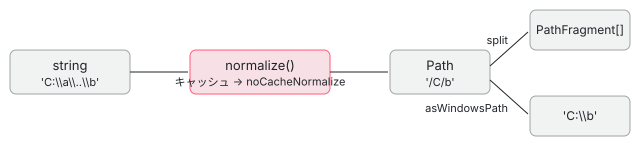

[目次](../README.md) › [@angular-devkit の内側](README.md) › 第 1 回 / 全 12 回

# パスと文字列：virtual-fs/path と utils/strings

> packages/angular\_devkit/core/src/virtual-fs/path.ts・utils/strings.ts・utils/template.ts：Path という印の付いた文字列、normalize・join・relative・dirname の規則、Windows のパスの扱い、dasherize・classify・camelize、テンプレートの小さな言語。

angular/angular-cli · 読了 約 12 分 · 中核 · [サイトで読む（デモが動きます）](https://angular-deep-dive-cyan.vercel.app/chapter/dvk-path)

---

この章で分かること：`@angular-devkit` のほとんどの関数が受け取る `Path` 型が「`normalize` を通った文字列」という約束であること、その `normalize` が `.`・`..`・`\`・Windows のドライブをどの順で片付けるか、`join`・`relative`・`dirname`・`asWindowsPath` の規則と例外。後半は schematic の名前を作る `strings` の関数と、テンプレートの小さな言語（`<%= %>`・`<% %>`・`<%- %>`）の、まだ読んでいない半分です。

読む対象は `packages/angular_devkit/core/src/` の `virtual-fs/path.ts`・`utils/strings.ts`・`utils/template.ts` です（../angular-cli、44129f66a3）。`dasherize`・`camelize`・`classify` の本体と、`template()` が JavaScript のソースを組み立てて `with` で名前を解く流れは[schematic の規則の章](../cli/14-schematics-rules.md)の 4 節が読んでいるので、ここでは繰り返しません。

1. **1. パスと文字列**（この章）
2. [2. 仮想ファイルシステムの host](02-dvk-host.md)
3. [3. JSON schema の検査](03-dvk-schema.md)
4. [4. angular.json の読み書き](04-dvk-workspace.md)
5. [5. logger と小さな道具](05-dvk-logger.md)
6. [6. Tree](06-dvk-tree.md)
7. [7. エンジンと規則](07-dvk-engine.md)
8. [8. ワークフローと engine host](08-dvk-workflow.md)
9. [9. architect の jobs](09-dvk-jobs.md)
10. [10. Architect が builder を呼ぶまで](10-dvk-architect.md)
11. [11. テストの道具](11-dvk-testing.md)
12. [12. spec と issue](12-dvk-tests-issues.md)

> [!TIP]
> **新卒エンジニアへ**
>
> `@angular-devkit/core` は、Angular CLI・schematic・builder の下で動く「土台の道具箱」の npm パッケージです。ブラウザではなく Node の上で動くので、この章の DEMO はページの上で計算せず、手元の Node で本物の関数に入力を通した記録を再生します。記録はローカルの `@angular/cli` 22.2.7 が持つ `@angular-devkit/core` 22.2.7 で取り、44129f66a3 と同じソースの公開版 22.2.0-next.7 でも同じ入力を流して、結果が 1 文字も違わないことを確かめました（`path.ts`・`strings.ts`・`template.ts` は 44129f66a3・22.2.7・main で差分 0）。違ったのは 7 節の `applyContentTemplate`（`@angular-devkit/schematics` の `rules/template.ts`）だけで、その記録は 2 つの版を並べます。

## 1. Path：印の付いた文字列

📄 `angular-cli/packages/angular_devkit/core/src/virtual-fs/path.ts` L12–45 （▶ の行: 12, 14, 17, 19, 22, 24, 31–32, 38–39, 45）

```ts
12 ▶ export class InvalidPathException extends BaseException {
13 │   constructor(path: string) {
14 ▶     super(`Path ${JSON.stringify(path)} is invalid.`);
15 │   }
16 │ }
17 ▶ export class PathMustBeAbsoluteException extends BaseException {
18 │   constructor(path: string) {
19 ▶     super(`Path ${JSON.stringify(path)} must be absolute.`);
20 │   }
21 │ }
22 ▶ export class PathCannotBeFragmentException extends BaseException {
23 │   constructor(path: string) {
24 ▶     super(`Path ${JSON.stringify(path)} cannot be made a fragment.`);
25 │   }
26 │ }
27 │ 
28 │ /**
29 │  * A Path recognized by most methods in the DevKit.
30 │  */
31 ▶ export type Path = string & {
32 ▶   __PRIVATE_DEVKIT_PATH: void;
33 │ };
34 │ 
35 │ /**
36 │  * A Path fragment (file or directory name) recognized by most methods in the DevKit.
37 │  */
38 ▶ export type PathFragment = Path & {
39 ▶   __PRIVATE_DEVKIT_PATH_FRAGMENT: void;
40 │ };
41 │ 
42 │ /**
43 │  * The Separator for normalized path.
44 │  */
45 ▶ export const NormalizedSep: Path = '/' as Path;
```

31〜33 行目の `Path` は、`string` に `__PRIVATE_DEVKIT_PATH` という実在しないプロパティを足した型です。こうした型は「ブランド型」と呼ばれ、実行時には普通の文字列のままですが、TypeScript は `'a/b'` のようなただの `string` を `Path` の引数に渡すとエラーにします。`Path` を作れるのは、`as Path` と書く場所（この章の関数の中）だけです。38〜40 行目の `PathFragment` はさらに印を 1 つ足した「区切りを含まない 1 つの名前」です。45 行目、区切りはいつも `/` です。Windows の `\` は `normalize` が `/` に直してから入ってきます（3 節）。

12〜26 行目は、この章の関数が投げる 3 つの例外です。どれも `BaseException`（第 5 回の `exception.ts`）の子で、文は `JSON.stringify(path)` を挟みます。記録の `normalize('/..')` は「`Path "/.." is invalid.`」、`relative('/a', 'b')` は「`Path "b" must be absolute.`」でした。



*文字列から Path へ。Path を作るのは normalize（とその上の path タグ・join・relative・dirname）だけ*

## 2. normalize：キャッシュと 1 本のループ

📄 `angular-cli/packages/angular_devkit/core/src/virtual-fs/path.ts` L197–219 （▶ の行: 198, 202–204, 208, 212–215）

```ts
197 │ /**
198 ▶  * Normalize a string into a Path. This is the only mean to get a Path type from a string that
199 │  * represents a system path. This method cache the results as real world paths tend to be
200 │  * duplicated often.
201 │  * Normalization includes:
202 ▶  *   - Windows backslashes `\\` are replaced with `/`.
203 ▶  *   - Windows drivers are replaced with `/X/`, where X is the drive letter.
204 ▶  *   - Absolute paths starts with `/`.
205 │  *   - Multiple `/` are replaced by a single one.
206 │  *   - Path segments `.` are removed.
207 │  *   - Path segments `..` are resolved.
208 ▶  *   - If a path is absolute, having a `..` at the start is invalid (and will throw).
209 │  * @param path The path to be normalized.
210 │  */
211 │ export function normalize(path: string): Path {
212 ▶   let maybePath = normalizedCache.get(path);
213 ▶   if (!maybePath) {
214 ▶     maybePath = noCacheNormalize(path);
215 ▶     normalizedCache.set(path, maybePath);
216 │   }
217 │ 
218 │   return maybePath;
219 │ }
```

📄 `angular-cli/packages/angular_devkit/core/src/virtual-fs/path.ts` L163–195 （▶ の行: 168–169, 171, 176–177, 184, 187, 193–194）

```ts
163 │ /**
164 │  * Returns a Path that is the resolution of p2, from p1. If p2 is absolute, it will return p2,
165 │  * otherwise will join both p1 and p2.
166 │  */
167 │ export function resolve(p1: Path, p2: Path): Path {
168 ▶   if (isAbsolute(p2)) {
169 ▶     return p2;
170 │   } else {
171 ▶     return join(p1, p2);
172 │   }
173 │ }
174 │ 
175 │ export function fragment(path: string): PathFragment {
176 ▶   if (path.indexOf(NormalizedSep) != -1) {
177 ▶     throw new PathCannotBeFragmentException(path);
178 │   }
179 │ 
180 │   return path as PathFragment;
181 │ }
182 │ 
183 │ /**
184 ▶  * normalize() cache to reduce computation. For now this grows and we never flush it, but in the
185 │  * future we might want to add a few cache flush to prevent this from growing too large.
186 │  */
187 ▶ let normalizedCache = new Map<string, Path>();
188 │ 
189 │ /**
190 │  * Reset the cache. This is only useful for testing.
191 │  * @private
192 │  */
193 ▶ export function resetNormalizeCache(): void {
194 ▶   normalizedCache = new Map<string, Path>();
195 │ }
```

198 行目の説明文のとおり、文字列から `Path` を得る正式な道は `normalize` だけです。212〜216 行目で、入力の文字列そのものを鍵にした 187 行目の `Map` を引き、無ければ計算して入れます。184〜186 行目のコメントのとおり、この `Map` は消されません（消すのは spec 用の 193 行目だけ）。213 行目の `!maybePath` は、結果が空文字（`''` と `'.'` の答え）のときも偽になるので、その 2 つは毎回計算し直します。例外になる入力は 214 行目で止まるので、キャッシュに入りません。

📄 `angular-cli/packages/angular_devkit/core/src/virtual-fs/path.ts` L221–247 （▶ の行: 225–228, 233–234, 238–240, 243–245）

```ts
221 │ /**
222 │  * The no cache version of the normalize() function. Used for benchmarking and testing.
223 │  */
224 │ export function noCacheNormalize(path: string): Path {
225 ▶   if (path == '' || path == '.') {
226 ▶     return '' as Path;
227 ▶   } else if (path == NormalizedRoot) {
228 ▶     return NormalizedRoot;
229 │   }
230 │ 
231 │   // Match absolute windows path.
232 │   const original = path;
233 ▶   if (path.match(/^[A-Z]:[/\\]/i)) {
234 ▶     path = '\\' + path[0].toUpperCase() + '\\' + path.slice(3);
235 │   }
236 │ 
237 │   // We convert Windows paths as well here.
238 ▶   const p = path.split(/[/\\]/g);
239 ▶   let relative = false;
240 ▶   let i = 1;
241 │ 
242 │   // Special case the first one.
243 ▶   if (p[0] != '') {
244 ▶     p.unshift('.');
245 ▶     relative = true;
246 │   }
247 │ 
```

📄 `angular-cli/packages/angular_devkit/core/src/virtual-fs/path.ts` L248–276 （▶ の行: 248–256, 258, 260–261, 267–268, 270–271, 274）

```ts
248 ▶   while (i < p.length) {
249 ▶     if (p[i] == '.') {
250 ▶       p.splice(i, 1);
251 ▶     } else if (p[i] == '..') {
252 ▶       if (i < 2 && !relative) {
253 ▶         throw new InvalidPathException(original);
254 ▶       } else if (i >= 2 && p[i - 1] != '..') {
255 ▶         p.splice(i - 1, 2);
256 ▶         i--;
257 │       } else {
258 ▶         i++;
259 │       }
260 ▶     } else if (p[i] == '') {
261 ▶       p.splice(i, 1);
262 │     } else {
263 │       i++;
264 │     }
265 │   }
266 │ 
267 ▶   if (p.length == 1) {
268 ▶     return p[0] == '' ? NormalizedSep : ('' as Path);
269 │   } else {
270 ▶     if (p[0] == '.') {
271 ▶       p.shift();
272 │     }
273 │ 
274 ▶     return p.join(NormalizedSep) as Path;
275 │   }
276 │ }
```

1. **225〜229 行目：近道**

   `''` と `'.'` は `''`、`'/'` はそのまま。
2. **233〜235 行目：ドライブを先頭の名前に**

   `C:\` か `c:/` で始まれば、`\C\…` に書き換えます（3 節）。
3. **238 行目：`/` と `\` の両方で割る**

   `'/a/./b//c/'` は `['', 'a', '.', 'b', '', 'c', '']` です。先頭が `''` なら絶対パスです。
4. **243〜246 行目：相対なら `'.'` を前に**

   先頭が空でなければ相対パスで、`'.'` を足して `relative = true` にします。こうすると、どちらの場合も「0 番目は根の印、1 番目からが名前」になります。
5. **248〜265 行目：1 本のループ**

   `'.'`（249 行目）と `''`（260 行目）は消し、`'..'` は 254〜256 行目で 1 つ前の名前と一緒に消して `i` を戻します。1 つ前も `'..'` なら残します（257〜258 行目、`'../..'` がそのまま残る）。
6. **252〜253 行目：根より上**

   絶対パスで `'..'` が 1 番目に来たら（消す名前が無い）、元の文字列で `InvalidPathException` を投げます。相対パスなら投げずに `'..'` を残します。
7. **267〜275 行目：組み立て**

   残りが根の印だけなら `'/'` か `''`、ほかは 270〜272 行目で相対の印の `'.'` を外して `/` で繋ぎます。末尾の `/` は 260 行目で消えているので残りません。

記録（DEMO の「1」）では、`'a/../..'` → `'..'`、`'/a/..'` → `'/'`、`'/a/../..'` → 例外でした。名前の中身は見ないので、`'a/~/b'` の `~` も `'a /b'` の空白もそのまま残ります。

## 3. Windows のパス：ドライブは先頭の名前になる

233 行目の正規表現 `/^[A-Z]:[/\\]/i` は「英字 1 つ・`:`・区切り」で始まる文字列だけを見ます。234 行目で `'\\' + 'C' + '\\' + 残り` にするので、`'C:\\a\\b'` は 238 行目で `['', 'C', 'a', 'b']` に割れ、`'/C/a/b'` になります。`toUpperCase()` は adf9359ad1（2025-01、`fix(@angular-devkit/core): handle Windows drive letter case insensitivity in path functions`、Closes #27029）が足したもので、`c:` と `C:` が別のパスになっていたのを揃えました。

📄 `angular-cli/packages/angular_devkit/core/src/virtual-fs/path.ts` L278–311 （▶ の行: 278–279, 290–293, 295, 298, 305–307, 309）

```ts
278 ▶ export const path: TemplateTag<Path> = (strings, ...values) => {
279 ▶   return normalize(String.raw(strings, ...values));
280 │ };
281 │ 
282 │ // Platform-specific paths.
283 │ export type WindowsPath = string & {
284 │   __PRIVATE_DEVKIT_WINDOWS_PATH: void;
285 │ };
286 │ export type PosixPath = string & {
287 │   __PRIVATE_DEVKIT_POSIX_PATH: void;
288 │ };
289 │ 
290 ▶ export function asWindowsPath(path: Path): WindowsPath {
291 ▶   const drive = path.match(/^\/(\w)(?:\/(.*))?$/);
292 ▶   if (drive) {
293 ▶     const subPath = drive[2] ? drive[2].replace(/\//g, '\\') : '';
294 │ 
295 ▶     return `${drive[1]}:\\${subPath}` as WindowsPath;
296 │   }
297 │ 
298 ▶   return path.replace(/\//g, '\\') as WindowsPath;
299 │ }
300 │ 
301 │ export function asPosixPath(path: Path): PosixPath {
302 │   return path as string as PosixPath;
303 │ }
304 │ 
305 ▶ export function getSystemPath(path: Path): string {
306 ▶   if (process.platform.startsWith('win32')) {
307 ▶     return asWindowsPath(path);
308 │   } else {
309 ▶     return asPosixPath(path);
310 │   }
311 │ }
```

逆向きの 290〜299 行目の `asWindowsPath` は、291 行目の `/^\/(\w)(?:\/(.*))?$/` で「先頭の名前が 1 文字」なら、それをドライブとして `X:\` を付けます。`(?:\/(.*))?` で `'/C'` だけのものも受けるのは a2aba2866c（2018-11、`handle drive only paths in windows`）からです。305〜311 行目の `getSystemPath` は Windows のときだけこれを使い、第 2 回の `NodeJsSyncHost` は読み書きのたびにこれを呼びます。

記録（DEMO の「2」）で、規則の端が見えます。

- `normalize('C:\\..')` は例外ではなく `'/'` でした。233〜235 行目でドライブが 1 番目の名前 `'C'` になり、`'..'` がそれを 255 行目で消すからです。`'C:\\..\\..'` で初めて例外になります（spec の 78 行目はこちらだけを見ている）。208 行目の説明文「絶対パスで先頭に `..` があれば invalid（投げる）」と違い、ドライブより上に出ると、ドライブの無い `'/'` に化けます。`asWindowsPath('/')` は `'\\'` です。
- `asWindowsPath('/a/b')` は `'a:\\b'`、`'/1/x'` は `'1:\\x'`、`'/_/x'` は `'_:\\x'` でした。291 行目の `\w` は英字だけでなく数字と `_` も受けます。`'/ab/x'` は 2 文字なので `'\\ab\\x'` です。Windows の上では絶対パスはいつもドライブから始まるので、1 文字の名前は 233 行目が作ったドライブです。
- `'\\\\server\\share\\x'`（UNC と呼ばれるネットワークの共有の書き方）は `'/server/share/x'` になり、`asWindowsPath` で戻すと先頭の `\` が 1 つの `'\\server\\share\\x'` でした。238 行目で空の名前が消えるので、`\\` の 2 つ目は戻りません。
- `'C:'` と `'C:foo'` は 233 行目に合わない（区切りが無い）ので、相対パスとしてそのまま残ります。`join('/a', 'C:\\x')` は `'/a/C:/x'` で、ドライブを見るのは文字列の先頭だけです。

278〜280 行目の `path` はタグ付きテンプレート（`` path`/a/${x}` `` の形で呼ぶ関数）で、`String.raw` で繋いでから `normalize` します。記録の `` path`/a/${'..\\x'}/b` `` は `'/x/b'` で、埋め込んだ値の `..` も `\` も解かれます。

## 4. split・basename・dirname・join・relative

📄 `angular-cli/packages/angular_devkit/core/src/virtual-fs/path.ts` L52–90 （▶ の行: 53–54, 58–61, 71–74, 84–86, 88）

```ts
52 │ /**
53 ▶  * Split a path into multiple path fragments. Each fragments except the last one will end with
54 ▶  * a path separator.
55 │  * @param {Path} path The path to split.
56 │  * @returns {Path[]} An array of path fragments.
57 │  */
58 ▶ export function split(path: Path): PathFragment[] {
59 ▶   const fragments = path.split(NormalizedSep).map((x) => fragment(x));
60 ▶   if (fragments.at(-1)?.length === 0) {
61 ▶     fragments.pop();
62 │   }
63 │ 
64 │   return fragments;
65 │ }
66 │ 
67 │ /**
68 │  *
69 │  */
70 │ export function extname(path: Path): string {
71 ▶   const base = basename(path);
72 ▶   const i = base.lastIndexOf('.');
73 ▶   if (i < 1) {
74 ▶     return '';
75 │   } else {
76 │     return base.slice(i);
77 │   }
78 │ }
79 │ 
80 │ /**
81 │  * Return the basename of the path, as a Path. See path.basename
82 │  */
83 │ export function basename(path: Path): PathFragment {
84 ▶   const i = path.lastIndexOf(NormalizedSep);
85 ▶   if (i == -1) {
86 ▶     return fragment(path);
87 │   } else {
88 ▶     return fragment(path.slice(path.lastIndexOf(NormalizedSep) + 1));
89 │   }
90 │ }
```

53〜54 行目の説明文は「最後の 1 つを除き、どの断片も区切りで終わる」と言いますが、59 行目は `/` で割るので、断片は区切りを含みません（含めば 176 行目の `fragment` が投げる）。記録の `split('/a/b')` は `["", "a", "b"]`、`split('/')` は 60〜62 行目で末尾の空を 1 つ捨てて `[""]` でした。spec（path\_spec.ts の 89 行目）も `['', 'a', 'b']` を期待していて、説明文だけが違います。72〜73 行目の `extname` は、最後の `.` が 1 文字目より後ろのときだけ拡張子とみなすので、`'.gitignore'` は `''`、`'b.spec.ts'` は `'.ts'` です。

📄 `angular-cli/packages/angular_devkit/core/src/virtual-fs/path.ts` L92–123 （▶ の行: 96–98, 101, 103, 110–112, 114, 122）

```ts
 92 │ /**
 93 │  * Return the dirname of the path, as a Path. See path.dirname
 94 │  */
 95 │ export function dirname(path: Path): Path {
 96 ▶   const index = path.lastIndexOf(NormalizedSep);
 97 ▶   if (index === -1) {
 98 ▶     return '' as Path;
 99 │   }
100 │ 
101 ▶   const endIndex = index === 0 ? 1 : index; // case of file under root: '/file'
102 │ 
103 ▶   return normalize(path.slice(0, endIndex));
104 │ }
105 │ 
106 │ /**
107 │  * Join multiple paths together, and normalize the result. Accepts strings that will be
108 │  * normalized as well (but the original must be a path).
109 │  */
110 ▶ export function join(p1: Path, ...others: string[]): Path {
111 ▶   if (others.length > 0) {
112 ▶     return normalize((p1 ? p1 + NormalizedSep : '') + others.join(NormalizedSep));
113 │   } else {
114 ▶     return p1;
115 │   }
116 │ }
117 │ 
118 │ /**
119 │  * Returns true if a path is absolute.
120 │  */
121 │ export function isAbsolute(p: Path): boolean {
122 ▶   return p.startsWith(NormalizedSep);
123 │ }
```

101 行目、`'/file'` のように根の直下なら `'/'` を残します。`dirname('file')` は `''` です。112 行目の `join` は、繋いでから `normalize` するので、2 つ目の `'/b'` の先頭の `/` は「根」ではなく区切りになり、`join('/a', '/b')` は `'/a/b'` です（Node の `path.join` と同じで、`path.resolve` とは違う）。根より上に出ると `normalize` の例外で、文は繋いだあとの `"/a/../.."` でした。114 行目、引数が 1 つなら **normalize せずに**そのまま返すので、`join('a//b' as Path)` は `'a//b'` のままです（型の上では、渡された 1 つ目はもう `Path` という約束なので）。

📄 `angular-cli/packages/angular_devkit/core/src/virtual-fs/path.ts` L125–161 （▶ の行: 126, 130–131, 133–134, 139–140, 142–143, 145–147, 151, 153–155, 160）

```ts
125 │ /**
126 ▶  * Returns a path such that `join(from, relative(from, to)) == to`.
127 │  * Both paths must be absolute, otherwise it does not make much sense.
128 │  */
129 │ export function relative(from: Path, to: Path): Path {
130 ▶   if (!isAbsolute(from)) {
131 ▶     throw new PathMustBeAbsoluteException(from);
132 │   }
133 ▶   if (!isAbsolute(to)) {
134 ▶     throw new PathMustBeAbsoluteException(to);
135 │   }
136 │ 
137 │   let p: string;
138 │ 
139 ▶   if (from == to) {
140 ▶     p = '';
141 │   } else {
142 ▶     const splitFrom = split(from);
143 ▶     const splitTo = split(to);
144 │ 
145 ▶     while (splitFrom.length > 0 && splitTo.length > 0 && splitFrom[0] == splitTo[0]) {
146 ▶       splitFrom.shift();
147 ▶       splitTo.shift();
148 │     }
149 │ 
150 │     if (splitFrom.length == 0) {
151 ▶       p = splitTo.join(NormalizedSep);
152 │     } else {
153 ▶       p = splitFrom
154 ▶         .map(() => '..')
155 ▶         .concat(splitTo)
156 │         .join(NormalizedSep);
157 │     }
158 │   }
159 │ 
160 ▶   return normalize(p);
161 │ }
```

130〜135 行目で両方が絶対パスでなければ投げます。142〜148 行目で `split` の断片を先頭から比べ、同じ間は捨て、残った `from` の数だけ `'..'` を並べて `to` の残りを繋ぎます。126 行目の約束 `join(from, relative(from, to)) == to` を、spec は 10 組で確かめています（path\_spec.ts の 123〜146 行目）。ドライブは 1 つの名前なので、`relative('/C/x', '/D/y')` は `'../../D/y'` でした（Windows で別のドライブへの相対パスはありませんが、ここでは作れます）。167〜173 行目の `resolve` は、`p2` が絶対ならそれ、相対なら `join` です。

## 5. 名前の変換：underscore・capitalize と、実際の名前

`decamelize`・`dasherize`・`camelize`・`classify` の正規表現は[schematic の規則の章](../cli/14-schematics-rules.md)が読みました。ここでは残りの 2 つと、説明文と実物を比べます。

📄 `angular-cli/packages/angular_devkit/core/src/utils/strings.ts` L9–28 （▶ の行: 10, 12–13）

````ts
 9 │ const STRING_DASHERIZE_REGEXP = /[ _]/g;
10 ▶ const STRING_DECAMELIZE_REGEXP = /([a-z\d])([A-Z])/g;
11 │ const STRING_CAMELIZE_REGEXP = /(-|_|\.|\s)+(.)?/g;
12 ▶ const STRING_UNDERSCORE_REGEXP_1 = /([a-z\d])([A-Z]+)/g;
13 ▶ const STRING_UNDERSCORE_REGEXP_2 = /-|\s+/g;
14 │ 
15 │ /**
16 │  * Converts a camelized string into all lower case separated by underscores.
17 │  *
18 │  ```javascript
19 │  decamelize('innerHTML');         // 'inner_html'
20 │  decamelize('action_name');       // 'action_name'
21 │  decamelize('css-class-name');    // 'css-class-name'
22 │  decamelize('my favorite items'); // 'my favorite items'
23 │  ```
24 │ 
25 │  @method decamelize
26 │  @param {String} str The string to decamelize.
27 │  @return {String} the decamelized string.
28 │  */
````

📄 `angular-cli/packages/angular_devkit/core/src/utils/strings.ts` L95–134 （▶ の行: 101, 103, 111, 113–115, 122, 132–133）

````ts
 95 │ 
 96 │ /**
 97 │  More general than decamelize. Returns the lower_case_and_underscored
 98 │  form of a string.
 99 │ 
100 │  ```javascript
101 ▶  'innerHTML'.underscore();          // 'inner_html'
102 │  'action_name'.underscore();        // 'action_name'
103 ▶  'css-class-name'.underscore();     // 'css_class_name'
104 │  'my favorite items'.underscore();  // 'my_favorite_items'
105 │  ```
106 │ 
107 │  @method underscore
108 │  @param {String} str The string to underscore.
109 │  @return {String} the underscored string.
110 │  */
111 ▶ export function underscore(str: string): string {
112 │   return str
113 ▶     .replace(STRING_UNDERSCORE_REGEXP_1, '$1_$2')
114 ▶     .replace(STRING_UNDERSCORE_REGEXP_2, '_')
115 ▶     .toLowerCase();
116 │ }
117 │ 
118 │ /**
119 │  Returns the Capitalized form of a string
120 │ 
121 │  ```javascript
122 ▶  'innerHTML'.capitalize()         // 'InnerHTML'
123 │  'action_name'.capitalize()       // 'Action_name'
124 │  'css-class-name'.capitalize()    // 'Css-class-name'
125 │  'my favorite items'.capitalize() // 'My favorite items'
126 │  ```
127 │ 
128 │  @method capitalize
129 │  @param {String} str The string to capitalize.
130 │  @return {String} The capitalized string.
131 │  */
132 ▶ export function capitalize(str: string): string {
133 ▶   return str.charAt(0).toUpperCase() + str.slice(1);
134 │ }
````

113 行目の `underscore` は、12 行目の `/([a-z\d])([A-Z]+)/g`（小文字か数字のあとに続く**大文字の並び**）の前に `_` を入れ、114 行目で 13 行目の `/-|\s+/g`（`-` と空白の並び）を `_` にします。`dasherize` が使う 10 行目の `decamelize` は大文字を 1 つずつ見て、空白は 1 つずつ `-` にするので、2 つは端で違います。記録では `'my name'`（空白 2 つ）が `dasherize` で `'my--name'`、`underscore` で `'my_name'` でした。133 行目の `capitalize` は 1 文字目を大文字にするだけです。

📄 `angular-cli/packages/angular_devkit/core/src/utils/strings.ts` L74–94 （▶ の行: 79, 83, 91–93）

````ts
74 │ /**
75 │  Returns the UpperCamelCase form of a string.
76 │ 
77 │  @example
78 │  ```javascript
79 ▶  'innerHTML'.classify();          // 'InnerHTML'
80 │  'action_name'.classify();        // 'ActionName'
81 │  'css-class-name'.classify();     // 'CssClassName'
82 │  'my favorite items'.classify();  // 'MyFavoriteItems'
83 ▶  'app.component'.classify();      // 'AppComponent'
84 │  ```
85 │  @method classify
86 │  @param {String} str the string to classify
87 │  @return {String} the classified string
88 │  */
89 │ export function classify(str: string): string {
90 │   return str
91 ▶     .split('.')
92 ▶     .map((part) => capitalize(camelize(part)))
93 ▶     .join('');
94 │ }
````

説明文の例は、記録の 21 個の入力のうち説明文にある 5 つ（`innerHTML`・`action_name`・`css-class-name`・`my favorite items`・`app.component`）で全部そのとおりの結果でした。ただし 79〜83 行目・101〜104 行目・122〜125 行目の `'innerHTML'.classify()` という書き方は、`String.prototype` にメソッドを足していた Ember.js の説明文の名残で、このパッケージには無い呼び方です（実際は `strings.classify('innerHTML')`）。

実際の schematic の名前で差が出るのは「大文字の並び」です。DEMO の「3」と「4」は同じ名前を関数に通した結果と、記録用のワークスペースで `ng generate component` を走らせた結果です。

| ng g c の名前 | フォルダとファイル（dasherize） | クラス（classify） | selector |
| --- | --- | --- | --- |
| `myHTMLParser` | `my-htmlparser/my-htmlparser.ts` | `MyHTMLParser` | `app-my-htmlparser` |
| `user2FA` | `user2-fa/user2-fa.ts` | `User2FA` | `app-user2-fa` |
| `ABTest` | `abtest/abtest.ts` | `ABTest` | `app-abtest` |
| `admin/HTTPClient` | `admin/httpclient/httpclient.ts` | `HTTPClient` | `app-httpclient` |
| `foo.bar-baz` | `foo.bar-baz/foo.bar-baz.ts` | `FooBarBaz` | `app-foo.bar-baz` |
| `my card`（空白 2 つ） | 「`Selector "app-my--card" is invalid.`」で止まる（何も作らない） |   |   |

10 行目の `decamelize` は「小文字か数字」と「大文字」の境目しか見ないので、`HTTPClient` の `P` と `C` の間（大文字と大文字）には `-` が入らず、`httpclient` になります。`classify` は `camelize` のあとに 1 文字目を大文字にするだけなので、大文字の並びは崩しません。`.` は `dasherize` では残り、`classify` では 91 行目の `split('.')` で区切りになります（e63375ea39、2022-07 までは `Foo.Bar` のように `.` で繋いでいた）。

📄 `angular-cli/packages/angular_devkit/core/src/utils/strings.ts` L136–165 （▶ の行: 147–148, 151, 155, 158, 163）

```ts
136 │ /**
137 │  * Calculate the levenshtein distance of two strings.
138 │  * See https://en.wikipedia.org/wiki/Levenshtein_distance.
139 │  * Based off https://gist.github.com/andrei-m/982927 (for using the faster dynamic programming
140 │  * version).
141 │  *
142 │  * @param a String a.
143 │  * @param b String b.
144 │  * @returns A number that represents the distance between the two strings. The greater the number
145 │  *   the more distant the strings are from each others.
146 │  */
147 ▶ export function levenshtein(a: string, b: string): number {
148 ▶   if (a.length == 0) {
149 │     return b.length;
150 │   }
151 ▶   if (b.length == 0) {
152 │     return a.length;
153 │   }
154 │ 
155 ▶   const matrix: number[][] = [];
156 │ 
157 │   // increment along the first column of each row
158 ▶   for (let i = 0; i <= b.length; i++) {
159 │     matrix[i] = [i];
160 │   }
161 │ 
162 │   // increment each column in the first row
163 ▶   for (let j = 0; j <= a.length; j++) {
164 │     matrix[0][j] = j;
165 │   }
```

`levenshtein` は 2 つの文字列の編集距離（1 文字の置き換え・挿入・削除を何回すれば同じになるか）です。1b5c0082ef（2018-09）で足されましたが、44129f66a3 の `packages/` の中で呼んでいる場所は grep で 0 件で、公開の API として残っているだけです。記録の `levenshtein('build', 'biuld')` は 2（入れ替えは置き換え 2 回と数える）でした。

## 6. テンプレートの小さな言語：templateParser

`template()` が文字列を節に割り、JavaScript のソースを組み立てて `Function` で関数にする流れは[schematic の規則の章](../cli/14-schematics-rules.md)の 4 節にあります。ここでは割る側の `templateParser` と、まだ読んでいない `<%- %>` の中身を読みます。

📄 `angular-cli/packages/angular_devkit/core/src/utils/template.ts` L127–158 （▶ の行: 130, 134–135, 137, 141, 144–150, 154–155）

```ts
127 │ /**
128 │  * Given a source text (and a fileName), returns a TemplateAst.
129 │  */
130 ▶ export function templateParser(sourceText: string, fileName: string): TemplateAst {
131 │   const children: TemplateAstNode[] = [];
132 │ 
133 │   // Compile the regexp to match each delimiter.
134 ▶   const reExpressions = [kEscapeRe, kCommentRe, kInterpolateRe, kEvaluateRe];
135 ▶   const reDelimiters = RegExp(reExpressions.map((x) => x.source).join('|') + '|$', 'g');
136 │ 
137 ▶   const parsed = sourceText.split(reDelimiters);
138 │   let offset = 0;
139 │   // Optimization that uses the fact that the end of a node is always the beginning of the next
140 │   // node, so we keep the positioning of the nodes in memory.
141 ▶   let start = _positionFor(sourceText, offset);
142 │   let end: Position | null;
143 │ 
144 ▶   const increment = reExpressions.length + 1;
145 ▶   for (let i = 0; i < parsed.length; i += increment) {
146 ▶     const [content, escape, comment, interpolate, evaluate] = parsed.slice(i, i + increment);
147 ▶     if (content) {
148 ▶       end = _positionFor(sourceText, offset + content.length);
149 ▶       offset += content.length;
150 ▶       children.push({ kind: 'content', content, start, end } as TemplateAstContent);
151 │       start = end;
152 │     }
153 │     if (escape) {
154 ▶       end = _positionFor(sourceText, offset + escape.length + 5);
155 ▶       offset += escape.length + 5;
156 │       children.push({ kind: 'escape', expression: escape, start, end } as TemplateAstEscape);
157 │       start = end;
158 │     }
```

📄 `angular-cli/packages/angular_devkit/core/src/utils/template.ts` L159–189 （▶ の行: 160–161, 166–167, 176–179）

```ts
159 │     if (comment) {
160 ▶       end = _positionFor(sourceText, offset + comment.length + 5);
161 ▶       offset += comment.length + 5;
162 │       children.push({ kind: 'comment', text: comment, start, end } as TemplateAstComment);
163 │       start = end;
164 │     }
165 │     if (interpolate) {
166 ▶       end = _positionFor(sourceText, offset + interpolate.length + 5);
167 ▶       offset += interpolate.length + 5;
168 │       children.push({
169 │         kind: 'interpolate',
170 │         expression: interpolate,
171 │         start,
172 │         end,
173 │       } as TemplateAstInterpolate);
174 │       start = end;
175 │     }
176 ▶     if (evaluate) {
177 ▶       end = _positionFor(sourceText, offset + evaluate.length + 5);
178 ▶       offset += evaluate.length + 5;
179 ▶       children.push({ kind: 'evaluate', expression: evaluate, start, end } as TemplateAstEvaluate);
180 │       start = end;
181 │     }
182 │   }
183 │ 
184 │   return {
185 │     fileName,
186 │     content: sourceText,
187 │     children,
188 │   };
189 │ }
```

1. **134〜135 行目：1 本の正規表現**

   4 つの区切りの正規表現を `escape・comment・interpolate・evaluate` の順に `|` で繋ぎ、最後に `|$` を足します。`<%-` と `<%#` と `<%=` を先に試すので、`<%` だけの evaluate に食われません。
2. **137 行目：split に捕まえた組を混ぜる**

   正規表現に括弧（捕まえる組）があると、`String.prototype.split` は区切りの間の文字列と一緒に、各組の中身（合わなかった組は `undefined`）を並べて返します。だから 144 行目の 5 つ（文字列 1 + 組 4）ずつ読めます。
3. **146〜181 行目：5 つのうち値のあるものを節に**

   文字列は `content`、組はそれぞれ `escape`・`comment`・`interpolate`・`evaluate` の節です。区切りの文字数として 155・161・167・178 行目で `+ 5` を足します。

📄 `angular-cli/packages/angular_devkit/core/src/utils/template.ts` L16–43 （▶ の行: 17, 19–20, 23–24, 29, 33, 38）

```ts
16 │ // Used to match template delimiters.
17 ▶ // <%- expr %>: HTML escape the value.
18 │ // <% ... %>: Structural template code.
19 ▶ const kEscapeRe = /<%-([\s\S]+?)%>/g;
20 ▶ const kEvaluateRe = /<%([\s\S]+?)%>/g;
21 │ 
22 │ /** Used to map characters to HTML entities. */
23 ▶ const kHtmlEscapes: { [char: string]: string } = {
24 ▶   '&': '&amp;',
25 │   '<': '&lt;',
26 │   '>': '&gt;',
27 │   '"': '&quot;',
28 │   "'": '&#39;',
29 ▶   '`': '&#96;',
30 │ };
31 │ 
32 │ // Used to match HTML entities and HTML characters.
33 ▶ const reUnescapedHtml = new RegExp(`[${Object.keys(kHtmlEscapes).join('')}]`, 'g');
34 │ 
35 │ // Options to pass to template.
36 │ export interface TemplateOptions {
37 │   sourceURL?: string;
38 ▶   sourceMap?: boolean;
39 │   module?: boolean | { exports: {} };
40 │   sourceRoot?: string;
41 │   fileName?: string;
42 │ }
43 │ 
```

📄 `angular-cli/packages/angular_devkit/core/src/utils/template.ts` L44–60 （▶ の行: 44, 47–49, 52）

```ts
44 ▶ function _positionFor(content: string, offset: number): Position {
45 │   let line = 1;
46 │   let column = 0;
47 ▶   for (let i = 0; i < offset - 1; i++) {
48 ▶     if (content[i] == '\n') {
49 ▶       line++;
50 │       column = 0;
51 │     } else {
52 ▶       column++;
53 │     }
54 │   }
55 │ 
56 │   return {
57 │     line,
58 │     column,
59 │   };
60 │ }
```

位置（`start`・`end`）は source map のためだけに使います。2 か所がずれています。1 つ目、47 行目の `_positionFor` は `i < offset - 1` まで数えるので、列が 1 つ少なく出ます。記録の `'ab<%= y %>c'` で、`interpolate` の `start` は `1:1` でしたが、`<` は 2 文字目のあと（列 2）です。2 つ目、`<%` と `%>` は 4 文字なのに、178 行目は `+ 5` を足します。記録の `'a<% x %>b<%= y %>c'` では、evaluate のあとで 2 つのずれが打ち消し合い、`b` から後ろは正しい列になりました。evaluate が 2 つあると、こんどは 1 つ多くなります。source map を作るのは `sourceMap: true` のときだけで、44129f66a3 の `packages/` の中で `template()` にこれを渡す場所は grep で 0 件です（schematic の `applyContentTemplate` は `{}` を渡す）。

区切りの正規表現はどれも `([\s\S]+?)`（19〜20 行目と同じ形）なので、1 文字以上の中身が要り、最初の `%>` で終わります。記録の `<%=%>` は interpolate にならず、`=` を文として貼る evaluate になって `SyntaxError: Unexpected token '='`、`<%= "%>" %>` は文字列の途中で切れて `SyntaxError` でした。

## 7. &lt;%- %&gt;：HTML のエスケープと、文字列でない値

📄 `angular-cli/packages/angular_devkit/core/src/utils/template.ts` L232–256 （▶ の行: 235, 240, 243, 246–247, 249–250, 252）

```ts
232 │ /**
233 │  * Templating algorithm with source map support. The map is outputted as //# sourceMapUrl=...
234 │  */
235 ▶ function templateWithSourceMap(ast: TemplateAst, options?: TemplateOptions): string {
236 │   const sourceUrl = ast.fileName;
237 │   const module = options && options.module ? 'module.exports.default =' : '';
238 │   const reHtmlEscape = reUnescapedHtml.source.replace(/[']/g, "\\\\\\'");
239 │ 
240 ▶   const preamble = new SourceNode(1, 0, sourceUrl, '').add(
241 │     new SourceNode(1, 0, sourceUrl, [
242 │       `return ${module} function(obj) {\n`,
243 ▶       '  obj || (obj = {});\n',
244 │       '  let __t;\n',
245 │       '  let __p = "";\n',
246 ▶       `  const __escapes = ${JSON.stringify(kHtmlEscapes)};\n`,
247 ▶       `  const __escapesre = new RegExp('${reHtmlEscape}', 'g');\n`,
248 │       `\n`,
249 ▶       `  const __e = function(s) { `,
250 ▶       `    return s ? s.replace(__escapesre, function(key) { return __escapes[key]; }) : '';`,
251 │       `  };\n`,
252 ▶       `  with (obj) {\n`,
253 │     ]),
254 │   );
255 │ 
256 │   const end = ast.children.at(-1)?.end ?? { line: 0, column: 0 };
```

source map 付きの版の前置きですが、`__e` は速い版（`templateFast`、規則の章の引用）と同じ形です。250 行目、`s` が真なら 33 行目の ``/[&<>"'`]/g`` に合う文字を 23〜30 行目の表で置き換え、偽なら `''` です。

- 記録の `<%- html %>` に ``<a href="x">&'`</a>`` を渡すと、6 種類すべてが `&lt;`・`&quot;`・`&#39;`・`&#96;` などに置き換わりました。
- `<%- 0 %>` は `''` でした（`<%= 0 %>` は `'0'`）。0 は偽なので、250 行目の `: ''` に入ります。
- `<%- 5 %>` は `TypeError: s.replace is not a function` でした。真の値はそのまま `s.replace` を呼ぶので、文字列でない値（数・真偽値・配列）は投げます。17 行目のコメント「HTML escape the value」と、schematics の README（128 行目）の「Same as above, but the value of the result will be escaped for HTML」は、`<%= %>` と同じく何でも受けるように読めますが、実物は文字列だけです。

この `TypeError` は、schematic の中では版で扱いが違いました。DEMO の「6」は、`@angular-devkit/schematics` の `applyContentTemplate` に同じファイルを通した記録です。44129f66a3（22.2.0-next.7）では、`<%- count %>`（`count: 5`）のファイルも `<%= opts.list.length %>`（`opts: {}`）のファイルも、**例外にならず、テンプレートのまま**（`<%= name %>` も埋まらない）返りました。[規則の章](../cli/14-schematics-rules.md)の 3 節で読んだ「UTF-8 として読めないファイルは元のまま返す」`catch` が `TypeError` を全部拾うからで、テンプレートの式の `TypeError` もそこに入ります（`ReferenceError` の `<%= missing %>` は投げた）。22.2.7 では 3 つとも「`Failed to apply content template to "/a.txt": s.replace is not a function`」のように投げました。99741e8eb5（2026-10-31、`fix(@angular-devkit/schematics): do not ignore TypeErrors thrown by content templates`、main の 0d60ebd198 の cherry-pick）が読む `try` と適用を分け、3ed20d1db0 がファイルのパスを文に入れました。コミットの説明は、18.1.0（41ee8eac1）から続いていた形だと書いています。

📄 `angular-cli/packages/angular_devkit/core/src/utils/template.ts` L340–354 （▶ の行: 341, 345, 348）

```ts
340 │ /**
341 ▶  * An equivalent of EJS templates, which is based on John Resig's `tmpl` implementation
342 │  * (http://ejohn.org/blog/javascript-micro-templating/) and Laura Doktorova's doT.js
343 │  * (https://github.com/olado/doT).
344 │  *
345 ▶  * This version differs from lodash by removing support from ES6 quasi-literals, and making the
346 │  * code slightly simpler to follow. It also does not depend on any third party, which is nice.
347 │  *
348 ▶  * Finally, it supports SourceMap, if you ever need to debug, which is super nice.
349 │  *
350 │  * @param content The template content.
351 │  * @param options Optional Options. See TemplateOptions for more description.
352 │  * @return {(input: T) => string} A function that accept an input object and returns the content
353 │  *         of the template with the input applied.
354 │  */
```

341 行目は EJS と同じ書き方を名乗りますが、EJS の空白を食う区切り（`<%_`・`_%>`・`-%>`）はありません。この 3 つを足す要望の #23169（2022-05、feature: in backlog）と、`<% %>` の行が空行として残る #27896（2024-10、area: @angular-devkit/schematics）は、2026-11-26 に開いたままでした。

> **🧪 DEMO — path・strings・template に入力を通した記録**
>
> ボタンは、手元の Node で `@angular-devkit/core` 22.2.7 の関数を呼んだ戻り値と例外を再生します（22.2.0-next.7 でも同じ結果）。「4」は記録用のワークスペース（`ng new demo-ws --skip-install`）で `ng generate component` を走らせた出力、「6」は 2 つの版の `applyContentTemplate` の結果です。例外の行は左に印を付けます。
>
> ▶ [このデモはサイトで動かせます](https://angular-deep-dive-cyan.vercel.app/chapter/dvk-path)

## ここまでの呼び出し（ng g c admin/HTTPClient のパスと名前）

- 👤 `$ ng g c admin/HTTPClient` — schematics-component の章
  - `parseName('/src/app', 'admin/HTTPClient')` — schematics/angular/utility/parse-name.ts L16
    - `basename(normalize(name))` → `'HTTPClient'` — parse-name.ts L17・path.ts L83
    - `dirname(join(normalize(path), name))` → `'/src/app/admin'` — parse-name.ts L18・path.ts L95・L110
      - `normalize` → `noCacheNormalize` — path.ts L211・L224 — *キャッシュ（L187）、ループ（L248〜265）*
    - `normalize('/' + namePath)` — parse-name.ts L22 — *'//src/app/admin' の // は L260 で 1 つに*
  - `strings.dasherize('HTTPClient')` — strings.ts L47 — *大文字と大文字の間は割らない → httpclient*
  - `strings.classify('HTTPClient')` — strings.ts L89 — *HTTPClient のまま*
  - `applyContentTemplate(options)` — schematics の rules/template.ts
    - `template(content, {})` → `templateParser` — template.ts L355・L130 — *5 つずつ読む（L144）*
    - `__e(s)`（&lt;%- %&gt; のとき） — L249〜250 と templateFast の同じ形 — *文字列でないと TypeError*
  - `getSystemPath(path)`（書き出すとき） — path.ts L305 — *Windows だけ asWindowsPath*

## テストと直し方

| ファイル | describe › it（行） | 固めている約束 |
| --- | --- | --- |
| `core/src/virtual-fs/path_spec.ts` | `path`（22）› `normalize`（23） | 2・3 節。Windows は 71〜83 行目。`'A:\\..\\..'` が投げること（78 行目）は見るが、`'C:\\..'` が `'/'` になることは見ない |
| 同上 | `split`（86）・`join`（105）・`relative`（123） | 4 節。split の 89 行目は `['', 'a', 'b']`（説明文と違う実物を固めている）。relative は 143 行目で `join(f, relative(f, t)) == t` も見る |
| 同上 | `dirname`（148）・`basename`（156）・`asWindowsPath`（164） | asWindowsPath は `c:/` の 3 つだけ。1 文字の名前・UNC は無い |
| `schematics/src/rules/template_spec.ts` | `contentTemplate`（124）› `works with echo token`（134）・`escapes HTML`（161）ほか | 6・7 節。`<%- %>` は文字列だけ（163 行目）。数・0 は無い |
| （無し） | `strings.ts`・`template.ts` | core の `utils/` にこの 2 つの spec は無い（`ls` で `literals`・`object`・`partially-ordered-set`・`priority-queue` の 4 つだけ） |

📄 `走らせたコマンド（2026-11-26）`

```
$ cd ~/angular-research/angular-cli      # 44129f66a3、読むだけ
$ pnpm bazel test //packages/angular_devkit/core:test --nocache_test_results --test_output=all \
    "--test_arg=--filter=^path "
$ pnpm bazel test //packages/angular_devkit/schematics:test --nocache_test_results --test_output=all \
    "--test_arg=--filter=contentTemplate"
（結果は下の段落）
```

手元の bazel で、`^path ` で絞ると 25 specs・0 failures（core の全体は 218 specs）、`contentTemplate` で絞ると 5 specs・0 failures（schematics の全体は 101 specs）でした。

直すとしたら、まず説明文です。`path.ts` の 53〜54 行目は「断片は区切りを含まない、絶対パスは先頭に空の断片」と実物に合わせます。`strings.ts` の 79〜83 行目などの `'x'.classify()` は `classify('x')` の形にします。`normalize('C:\\..')` を 208 行目の約束どおり投げるようにするなら、`noCacheNormalize` の 233〜235 行目でドライブを付けたことを覚えておき、252 行目の `i < 2` を、ドライブがあるときは `i < 3` にします。spec は path\_spec.ts の 78 行目の隣に `normalize('C:\\..')` を足します。`<%- %>` は `__e`（`templateFast` と 249〜250 行目の 2 か所）を `s == null ? '' : String(s).replace(…)` にすると、0 も数も `<%= %>` と同じ扱いになります。spec は template\_spec.ts の `escapes HTML`（161 行目）の隣に数と 0 を足します。位置のずれは 47 行目を `i < offset`、178 行目を `+ 4` にし、source map の spec（今は無い）を core に作る形です。

## 聞かれそうな質問

**Q. ただの文字列を `Path` の引数に渡すと型エラーになります。`as Path` と書けばいいですか？**

`normalize(s)` を通します。`Path` は「normalize を通った」という印で（31〜33 行目）、`as Path` は印だけ付けて中身を直しません。たとえば `join(p)` は引数が 1 つだと normalize しないので（114 行目）、`as Path` にした `'a//b'` はそのまま残ります（記録）。

**Q. Windows の `C:\work\x` は devkit の中でどう見えますか？**

`'/C/work/x'` です。233〜235 行目でドライブを先頭の名前にし、大文字に揃えます。ファイルを読み書きするときに `getSystemPath`（305 行目）が `asWindowsPath` で `'C:\\work\\x'` に戻します。

**Q. `ng g c HTTPClient` のファイル名が `h-t-t-p-client` ではなく `httpclient` になるのはなぜですか？**

`dasherize` の下の `decamelize` が「小文字か数字のあとの大文字」の前にしか区切りを入れないからです（10 行目）。大文字が続く所は割りません。クラス名は `classify` が大文字の並びを崩さないので `HTTPClient` のままでした（記録）。

**Q. テンプレートで数を HTML エスケープして出すには？**

`<%- String(n) %>` と文字列にします。`__e` は真の値に `s.replace` を呼ぶので数は `TypeError`、0 は偽なので `''` になります（250 行目、記録）。数はエスケープが要らないので `<%= n %>` でも足ります。

**Q. テンプレートの式が `TypeError` になったのに、schematic が何も言わずにテンプレートのままのファイルを書きました。**

22.2.6 までの `applyContentTemplate` は、読めないファイルのための `catch` で `TypeError` を全部拾い、元の中身を返していたからです。22.2.7（99741e8eb5）からは読む `try` だけを分け、式の `TypeError` はファイルのパス付きで投げます（記録の「6」）。

## 読み終えて

- `Path` は「normalize を通った」ことを型で表した文字列。区切りは `/`、ドライブは先頭の名前（`/C/…`）、末尾の `/` と `.` と空の名前は消える。
- `normalize` は入力をそのまま鍵にしたキャッシュを持ち、消さない。絶対パスで根より上は投げるが、`'C:\\..'` はドライブを消して `'/'` になる（説明文と違う）。
- `split` の説明文は断片が区切りで終わると言うが、実物と spec は区切りを含まない。`asWindowsPath` は 1 文字の先頭の名前（数字と `_` も）をドライブとみなす。
- `dasherize` は大文字の並びを割らない（`HTTPClient` → `httpclient`）。`underscore` は空白の並びを 1 つにするが、`dasherize` は 1 つずつ `-` にする。
- `<%- %>` は文字列だけを受け、0 は消え、数は `TypeError`。schematic の中でその `TypeError` を黙って捨てていたのは 22.2.7 で直った。

---

← 前: [spec と issue を読む：ng コマンドを固めているもの](../ngx/10-ngx-tests-issues.md)  
次: [仮想ファイルシステムの host：memory・scoped・alias・sync・record](02-dvk-host.md) →
