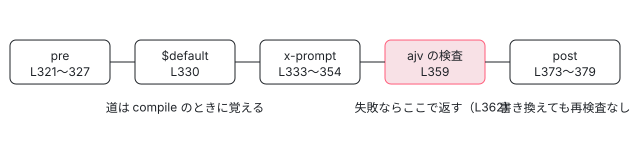

[目次](../README.md) › [@angular-devkit の内側](README.md) › 第 3 回 / 全 12 回

# JSON schema の検査：registry・transforms・visitor

> core/src/json/schema/\*：ajv を包む CoreSchemaRegistry、format の追加、x-prompt と smart default（$default）、既定値を入れる transforms、schema の木を歩く visitor と pointer。

angular/angular-cli · 読了 約 14 分 · 発展 · [サイトで読む（デモが動きます）](https://angular-deep-dive-cyan.vercel.app/chapter/dvk-schema)

---

この章で分かること：schematic のオプションや builder の options、`angular.json` を確かめている `CoreSchemaRegistry` が、1 回の検査で何をどの順に行うか（pre の transforms → `$default` → `x-prompt` → ajv → post の transforms）。`$default` と `x-prompt` が ajv の「自作のキーワード」として compile のときに道を覚える仕組み、既定値を入れる transforms、schema の木を歩く visitor と `ɵflatten` を、小さな schema を 2 つの版の本物に通した記録で確かめます。

読む対象は `packages/angular_devkit/core/src/json/schema/` の `registry.ts`・`transforms.ts`・`visitor.ts`・`utility.ts`・`pointer.ts`・`schema.ts`・`interface.ts` です（../angular-cli、44129f66a3）。この登録簿から CLI のオプションと `--help` を作る `parseJsonSchemaToOptions` は[schema からオプションの章](../ngx/02-ngx-options.md)、`ng generate` が `projectName` の provider を足して値を埋める流れは[ng generate component の章](../cli/15-schematics-component.md)が読んでいます。

1. [1. パスと文字列](01-dvk-path.md)
2. [2. 仮想ファイルシステムの host](02-dvk-host.md)
3. **3. JSON schema の検査**（この章）
4. [4. angular.json の読み書き](04-dvk-workspace.md)
5. [5. logger と小さな道具](05-dvk-logger.md)
6. [6. Tree](06-dvk-tree.md)
7. [7. エンジンと規則](07-dvk-engine.md)
8. [8. ワークフローと engine host](08-dvk-workflow.md)
9. [9. architect の jobs](09-dvk-jobs.md)
10. [10. Architect が builder を呼ぶまで](10-dvk-architect.md)
11. [11. テストの道具](11-dvk-testing.md)
12. [12. spec と issue](12-dvk-tests-issues.md)

> [!TIP]
> **新卒エンジニアへ**
>
> JSON schema は「この JSON はこういう形であるべき」を JSON で書いたものです（`type`・`enum`・`properties` など）。ajv はその schema を JavaScript の検査関数に compile するライブラリで、`CoreSchemaRegistry` は ajv を 1 つ持ち、Angular の独自の約束（`$default`・`x-prompt`・`x-deprecated`）と、検査の前後に値を書き換える段（transforms）を足したものです。
>
> DEMO の記録は 2 つの版で取りました。**old** は npm の公開版 22.2.0-next.7 で、core/src・core/node のソースが引用の 44129f66a3 と同じです。**new** はローカルの @angular/cli 22.2.7 が持つ版です。この章の範囲で 2 つが違うのは `registry.ts` だけで、知らないキーのエラーの文（c0e6b3cf68、3 節）と、`$default` の provider を呼ぶ条件（ad04d689bb、4 節）の 2 か所です。main では同じ 2 つが 8c438891c9・c44762fd44 で、さらに transforms の入れ物が配列になっています（63a1c6ad57、2 節）。

## 1. CoreSchemaRegistry の中身：1 つの ajv と 3 つの登録

📄 `angular-cli/packages/angular_devkit/core/src/json/schema/registry.ts` L91–116 （▶ の行: 92, 95–96, 98, 100–102, 105–108, 111, 113–114）

```ts
 91 │ export class CoreSchemaRegistry implements SchemaRegistry {
 92 ▶   private _ajv: Ajv;
 93 │   private _uriCache = new Map<string, JsonObject>();
 94 │   private _uriHandlers = new Set<UriHandler>();
 95 ▶   private _pre = new PartiallyOrderedSet<JsonVisitor>();
 96 ▶   private _post = new PartiallyOrderedSet<JsonVisitor>();
 97 │ 
 98 ▶   private _currentCompilationSchemaInfo?: SchemaInfo;
 99 │ 
100 ▶   private _smartDefaultKeyword = false;
101 ▶   private _promptProvider?: PromptProvider;
102 ▶   private _sourceMap = new Map<string, SmartDefaultProvider<{}>>();
103 │ 
104 │   constructor(formats: SchemaFormat[] = []) {
105 ▶     this._ajv = new Ajv({
106 ▶       strict: false,
107 ▶       loadSchema: (uri: string) => this._fetch(uri),
108 ▶       passContext: true,
109 │     });
110 │ 
111 ▶     ajvAddFormats(this._ajv);
112 │ 
113 ▶     for (const format of formats) {
114 ▶       this.addFormat(format);
115 │     }
116 │   }
```

92 行目の ajv は登録簿ごとに 1 つです。105〜109 行目の設定が、この章の振る舞いの多くを決めます。

1. **106 行目：`strict: false`**

   ajv が知らないキーワードや format を、エラーにせず無視します。記録の「format を登録しない registry で `format: path`」は検査が通り、標準エラーに ajv の警告「unknown format "path" ignored in schema at path "#"」が出ただけでした。`$default` も provider を 1 つも足していなければ知らないキーワードとして無視されます（4 節）。
2. **107 行目：`loadSchema`**

   手元に無い `$ref` の先を取りに行く関数です。`_fetch`（L118〜169）は、`registerUriHandler` で足した handler を順に試し、どれも答えなければ http / https で取りに行きます。
3. **108 行目：`passContext: true`**

   検査関数を `validator.call(ctx, data)` で呼んだとき、自作のキーワードの関数に `this` として `ctx` を渡す設定です。5 節の `promptFieldsWithValue` がこれを使います。
4. **111〜115 行目：format**

   `ajv-formats` の標準の format（`email`・`uri` など）を足し、コンストラクターに渡された format を `addFormat`（L385〜387、`this._ajv.addFormat` を呼ぶだけ）で足します。CLI と schematics は `formats.standardFormats`（`html-selector` と `path`）を渡します（`schematics-command-module.ts` L119、`workflow/base.ts` L81）。

95〜96 行目の `_pre`・`_post` は transforms の入れ物、98 行目の `_currentCompilationSchemaInfo` は「いま compile 中の schema の覚え書き」、100〜102 行目は `$default` と `x-prompt` の登録の状態です。22.2.7 では 105〜109 行目に `verbose: true` が足されています（3 節）。

📄 `angular-cli/packages/angular_devkit/core/src/json/schema/interface.ts` L13–43 （▶ の行: 16–19, 24–27, 30–31, 41–42）

```ts
13 │ export type JsonPointer = string & {
14 │   __PRIVATE_DEVKIT_JSON_POINTER: void;
15 │ };
16 ▶ export interface SchemaValidatorResult {
17 ▶   data: JsonValue;
18 ▶   success: boolean;
19 ▶   errors?: SchemaValidatorError[];
20 │ }
21 │ 
22 │ export type SchemaValidatorError = Partial<ErrorObject>;
23 │ 
24 ▶ export interface SchemaValidatorOptions {
25 ▶   applyPreTransforms?: boolean;
26 ▶   applyPostTransforms?: boolean;
27 ▶   withPrompts?: boolean;
28 │ }
29 │ 
30 ▶ export interface SchemaValidator {
31 ▶   (data: JsonValue, options?: SchemaValidatorOptions): Promise<SchemaValidatorResult>;
32 │ }
33 │ 
34 │ export type SchemaFormatter = Format;
35 │ 
36 │ export interface SchemaFormat {
37 │   name: string;
38 │   formatter: SchemaFormatter;
39 │ }
40 │ 
41 ▶ export interface SmartDefaultProvider<T> {
42 ▶   (schema: JsonObject): T | Observable<T>;
43 │ }
```

検査関数（30〜32 行目の `SchemaValidator`）は Promise で `SchemaValidatorResult`（16〜20 行目）を返します。失敗しても例外は投げず、`success: false` と `errors` を返すのが約束です。24〜28 行目の 3 つのフラグで、transforms と prompt を検査ごとに止められます。41〜43 行目の `SmartDefaultProvider` は「`$default` の中身を受け取って値（か Observable）を返す関数」です。

## 2. compile が返す関数：5 つの段の順

📄 `angular-cli/packages/angular_devkit/core/src/json/schema/registry.ts` L278–308 （▶ の行: 283–284, 287–289, 292, 296–297, 300, 304, 306）

```ts
278 │   private async _compile(
279 │     schema: JsonSchema,
280 │   ): Promise<
281 │     (data: JsonValue, options?: SchemaValidatorOptions) => Promise<SchemaValidatorResult>
282 │   > {
283 ▶     if (typeof schema === 'boolean') {
284 ▶       return async (data) => ({ success: schema, data });
285 │     }
286 │ 
287 ▶     const schemaInfo: SchemaInfo = {
288 ▶       smartDefaultRecord: new Map<string, JsonObject>(),
289 ▶       promptDefinitions: [],
290 │     };
291 │ 
292 ▶     this._ajv.removeSchema(schema);
293 │     let validator: ValidateFunction;
294 │ 
295 │     try {
296 ▶       this._currentCompilationSchemaInfo = schemaInfo;
297 ▶       validator = this._ajv.compile(schema);
298 │     } catch (e) {
299 │       // This should eventually be refactored so that we we handle race condition where the same schema is validated at the same time.
300 ▶       if (!(e instanceof Ajv.MissingRefError)) {
301 │         throw e;
302 │       }
303 │ 
304 ▶       validator = await this._ajv.compileAsync(schema);
305 │     } finally {
306 ▶       this._currentCompilationSchemaInfo = undefined;
307 │     }
308 │ 
```

283〜285 行目、schema が `true` / `false` なら検査せずにそれを答えにします。287〜290 行目で、この schema 用の覚え書き（`$default` の道と `x-prompt` の定義）を作り、296 行目で「いま compile 中」に置いてから 297 行目で ajv に compile させます。ajv は compile の途中で 4・5 節の自作のキーワードの `compile` を呼び、そこで覚え書きに書き込みます。292 行目の `removeSchema` は ajv の中の同じ schema の結果を捨てる行で、`compile` を呼ぶたびに覚え書きが作り直されます。300〜304 行目、手元に無い `$ref` があると ajv は `MissingRefError` を投げるので、`compileAsync`（1 節の `loadSchema` を使う）でやり直します。306 行目で「compile 中」を外します。

📄 `angular-cli/packages/angular_devkit/core/src/json/schema/registry.ts` L316–354 （▶ の行: 321–324, 330, 333–336, 341, 347–348, 351–352）

```ts
316 │       const validationContext = {
317 │         promptFieldsWithValue: new Set<string>(),
318 │       };
319 │ 
320 │       // Apply pre-validation transforms
321 ▶       if (validationOptions.applyPreTransforms) {
322 ▶         for (const visitor of this._pre.values()) {
323 ▶           data = await lastValueFrom(
324 ▶             visitJson(data, visitor, schema, this._resolver.bind(this), validator),
325 │           );
326 │         }
327 │       }
328 │ 
329 │       // Apply smart defaults
330 ▶       await this._applySmartDefaults(data, schemaInfo.smartDefaultRecord);
331 │ 
332 │       // Apply prompts
333 ▶       if (validationOptions.withPrompts) {
334 ▶         const visitor: JsonVisitor = (value, pointer) => {
335 ▶           if (value !== undefined) {
336 ▶             validationContext.promptFieldsWithValue.add(pointer);
337 │           }
338 │ 
339 │           return value;
340 │         };
341 ▶         if (typeof schema === 'object') {
342 │           await lastValueFrom(
343 │             visitJson(data, visitor, schema, this._resolver.bind(this), validator),
344 │           );
345 │         }
346 │ 
347 ▶         const definitions = schemaInfo.promptDefinitions.filter(
348 ▶           (def) => !validationContext.promptFieldsWithValue.has(def.id),
349 │         );
350 │ 
351 ▶         if (definitions.length > 0) {
352 ▶           await this._applyPrompts(data, definitions);
353 │         }
354 │       }
```

📄 `angular-cli/packages/angular_devkit/core/src/json/schema/registry.ts` L356–382 （▶ の行: 359, 361–362, 365–366, 373–376, 381）

```ts
356 │       // Validate using ajv
357 │       try {
358 │         // eslint-disable-next-line @typescript-eslint/await-thenable
359 ▶         const success = await validator.call(validationContext, data);
360 │ 
361 ▶         if (!success) {
362 ▶           return { data, success, errors: validator.errors ?? [] };
363 │         }
364 │       } catch (error) {
365 ▶         if (error instanceof Ajv.ValidationError) {
366 ▶           return { data, success: false, errors: error.errors };
367 │         }
368 │ 
369 │         throw error;
370 │       }
371 │ 
372 │       // Apply post-validation transforms
373 ▶       if (validationOptions.applyPostTransforms) {
374 ▶         for (const visitor of this._post.values()) {
375 ▶           data = await lastValueFrom(
376 ▶             visitJson(data, visitor, schema, this._resolver.bind(this), validator),
377 │           );
378 │         }
379 │       }
380 │ 
381 ▶       return { data, success: true };
382 │     };
```

1. **321〜327 行目：pre の transforms**

   登録した順に、値の木を `visitJson`（8 節）で歩いて書き換えます。
2. **330 行目：`$default`**

   compile のときに覚えた道に、provider の値を入れます（4 節）。
3. **333〜354 行目：`x-prompt`**

   値の入っている道を集め（334〜337 行目）、値の無い道の定義だけを残して（347〜349 行目）、prompt provider に聞きます（352 行目、5 節）。
4. **359 行目：ajv の検査**

   失敗なら 362 行目で `errors` を付けて返します。`$async` の schema は失敗を例外で知らせるので、365〜366 行目で同じ形に直します。
5. **373〜379 行目：post の transforms**

   検査が通った値だけに走り、381 行目で `success: true` を返します。



*1 回の検査の段。$default と x-prompt は検査の前、post の transforms は検査の後で、post の結果はもう検査しない*

📄 `angular-cli/packages/angular_devkit/core/src/json/schema/registry.ts` L171–189 （▶ の行: 171, 174, 176–177, 181–183, 187–188）

```ts
171 ▶   /**
172 │    * Add a transformation step before the validation of any Json.
173 │    * @param {JsonVisitor} visitor The visitor to transform every value.
174 ▶    * @param {JsonVisitor[]} deps [Deprecated] A list of other visitors to run before. Add transforms in the desired execution order instead.
175 │    */
176 ▶   addPreTransform(visitor: JsonVisitor, deps?: JsonVisitor[]): void {
177 ▶     this._pre.add(visitor, deps);
178 │   }
179 │ 
180 │   /**
181 ▶    * Add a transformation step after the validation of any Json. The JSON will not be validated
182 ▶    * after the POST, so if transformations are not compatible with the Schema it will not result
183 ▶    * in an error.
184 │    * @param {JsonVisitor} visitor The visitor to transform every value.
185 │    * @param {JsonVisitor[]} deps [Deprecated] A list of other visitors to run before. Add transforms in the desired execution order instead.
186 │    */
187 ▶   addPostTransform(visitor: JsonVisitor, deps?: JsonVisitor[]): void {
188 ▶     this._post.add(visitor, deps);
189 │   }
```

181〜183 行目の説明文のとおり、post の後は検査しません。記録の「transform の順」では、post で `n` を `"not a number"`（`type: number` に合わない値）に変えても `success=true` でした。177・188 行目の入れ物は `PartiallyOrderedSet`（「この前にこれ」を守る集合、[logger と小さな道具の章](05-dvk-logger.md)）です。記録では pre に B → A（deps に B）→ B の順で足すと、走る順は B、A で、2 回目の B は増えませんでした。deps に入っていない関数を渡すと `DependencyNotFoundException`（「One of the dependencies is not part of the set.」）です。174・185 行目は deps を「\[Deprecated\] 走らせたい順に足す」と書いており、main の 63a1c6ad57 は入れ物を配列にして、すでにある関数を deps より前に置こうとすると例外にしました。

## 3. 検査のエラーの文：SchemaValidationException

📄 `angular-cli/packages/angular_devkit/core/src/json/schema/registry.ts` L57–83 （▶ の行: 57, 63–64, 66–68, 71–72, 79）

```ts
57 ▶ 
58 │   public static createMessages(errors?: SchemaValidatorError[]): string[] {
59 │     if (!errors || errors.length === 0) {
60 │       return [];
61 │     }
62 │ 
63 ▶     const messages = errors.map((err) => {
64 ▶       let message = `Data path ${JSON.stringify(err.instancePath)} ${err.message}`;
65 │       if (err.params) {
66 ▶         switch (err.keyword) {
67 ▶           case 'additionalProperties':
68 ▶             message += `(${err.params.additionalProperty})`;
69 │             break;
70 │ 
71 ▶           case 'enum':
72 ▶             message += `. Allowed values are: ${(err.params.allowedValues as string[] | undefined)
73 │               ?.map((v) => `"${v}"`)
74 │               .join(', ')}`;
75 │             break;
76 │         }
77 │       }
78 │ 
79 ▶       return message + '.';
80 │     });
81 │ 
82 │     return messages;
83 │   }
```

ajv のエラーは `instancePath`（値の中の場所、JSON pointer）と `message` の組で、64 行目はそれを `Data path "/count" must be number` の形にします。66〜69 行目、知らないキー（`additionalProperties: false`）は名前を括弧で後ろに付け、71〜75 行目、enum は許す値を並べます。CLI は検査が失敗すると、この文を持つ例外を投げます（`config.ts` L258〜259 など）。

| 入力（記録） | old（44129f66a3） | new（22.2.7） |
| --- | --- | --- |
| `count: "3"`（number） | `Data path "/count" must be number.`（`flag: "true"` の方は出ない） |   |
| `style: "less"`（enum） | `Data path "/style" must be equal to one of the allowed values. Allowed values are: "css", "scss".` |   |
| `nmae: "x"`（知らないキー） | `Data path "" must NOT have additional properties(nmae).` | `Unknown option "nmae". Valid options are: name, cli.` |
| `patternProperties` だけの object に `y` | `Data path "" must NOT have additional properties(y).` | `Unknown option "y".` |

67 行目は括弧の前に空白を入れないので、old の文は `properties(nmae)` と続きます。22.2.7 の c0e6b3cf68 は ajv に `verbose: true` を足して、エラーに付く `parentSchema`（キーを弾いた schema）から `properties` の名前を並べ、`properties` を持たない schema では名前の一覧を出しません（記録の 4 行目）。どちらの版でも、エラーは 1 つしか出ませんでした。記録の入力は `count` と `flag`、`nmae` と `cli.analytic` のように 2 つずつ間違えていますが、105〜109 行目の ajv の設定に `allErrors` が無いので、ajv は最初のエラーで止まります。

format の記録（`new CoreSchemaRegistry(formats.standardFormats)`）では、`path` は `/src/app` と `src/app` が通り、`/src/app/`・`/src/../app`・`src\app` が `must match format "path"` でした。`html-selector` は `app-root`・`AppRoot`・`app-ü` が通り、`1app` と `app root` が落ちました。2 つの format の中身は schematics の `src/formats/` にあり、[エンジンと規則の章](07-dvk-engine.md)で読みます。

## 4. $default：compile のときに道を覚え、検査のときに埋める

📄 `angular-cli/packages/angular_devkit/core/src/json/schema/registry.ts` L389–425 （▶ の行: 389–391, 394, 396–397, 399–400, 403, 405–406, 409–411, 413, 415, 421）

```ts
389 ▶   addSmartDefaultProvider<T>(source: string, provider: SmartDefaultProvider<T>): void {
390 ▶     if (this._sourceMap.has(source)) {
391 ▶       throw new Error(source);
392 │     }
393 │ 
394 ▶     this._sourceMap.set(source, provider as unknown as SmartDefaultProvider<{}>);
395 │ 
396 ▶     if (!this._smartDefaultKeyword) {
397 ▶       this._smartDefaultKeyword = true;
398 │ 
399 ▶       this._ajv.addKeyword({
400 ▶         keyword: '$default',
401 │         errors: false,
402 │         valid: true,
403 ▶         compile: (schema, _parentSchema, it) => {
404 │           const compilationSchemInfo = this._currentCompilationSchemaInfo;
405 ▶           if (compilationSchemInfo === undefined) {
406 ▶             return () => true;
407 │           }
408 │ 
409 ▶           // We cheat, heavily.
410 ▶           const pathArray = this.normalizeDataPathArr(it);
411 ▶           compilationSchemInfo.smartDefaultRecord.set(JSON.stringify(pathArray), schema);
412 │ 
413 ▶           return () => true;
414 │         },
415 ▶         metaSchema: {
416 │           type: 'object',
417 │           properties: {
418 │             '$source': { type: 'string' },
419 │           },
420 │           additionalProperties: true,
421 ▶           required: ['$source'],
422 │         },
423 │       });
424 │     }
425 │   }
```

`$default` は、`addSmartDefaultProvider` を初めて呼んだときに、396〜397 行目で 1 回だけ ajv のキーワードとして登録されます。403〜414 行目の `compile` は ajv が schema の中で `$default` を見つけるたびに呼ばれ、検査はせず（413 行目でいつも `true`）、410〜411 行目で「値の中の道 → `$default` の中身」を覚え書きに書くだけです。409 行目のコメントは「We cheat, heavily.」です。

- 390〜392 行目：同じ `$source` を 2 回足すと、名前だけを文にした `Error` を投げます。記録の文は `"argv"` の 1 語でした。
- 405〜407 行目：compile 中でなければ何も覚えません。記録の「provider を compile のあとに足す」は、compile のときにはまだキーワードが無く（106 行目で無視）、そのあとで provider を足しても、その検査関数では `project` は埋まりませんでした。compile し直すと埋まりました。
- 415〜422 行目：`$default` の中身の形（`$source` が必須）を ajv に確かめさせます。

📄 `angular-cli/packages/angular_devkit/core/src/json/schema/registry.ts` L629–647 （▶ の行: 633–637, 640–642, 645）

```ts
629 │   private async _applySmartDefaults<T>(
630 │     data: T,
631 │     smartDefaults: Map<string, JsonObject>,
632 │   ): Promise<void> {
633 ▶     for (const [pointer, schema] of smartDefaults.entries()) {
634 ▶       const fragments = JSON.parse(pointer) as string[];
635 ▶       const source = this._sourceMap.get(schema.$source as string);
636 ▶       if (!source) {
637 ▶         continue;
638 │       }
639 │ 
640 ▶       let value = source(schema);
641 ▶       if (isObservable(value)) {
642 ▶         value = (await lastValueFrom(value)) as {};
643 │       }
644 │ 
645 ▶       CoreSchemaRegistry._set(data, fragments, value);
646 │     }
647 │   }
```

検査のとき（2 節の 330 行目）、覚えた道ごとに 635 行目で provider を探し、無ければ 636〜638 行目で飛ばします（記録の `$source: "nobody"` の `unknown` は入らない）。640 行目で provider を呼び、645 行目の `_set` に渡します。`_set` は値がすでにあれば書かないので、`--project other` のように値を渡したときも、**provider は呼ばれて、答えは捨てられます**。

| 記録（provider の呼ばれた回数） | old（44129f66a3） | new（22.2.7） |
| --- | --- | --- |
| `project` なし、`items: [{}, {id: "given"}]` | 2（`project` の道と `items` の道に 1 回ずつ） | 2（`project` と `items[0]`。`items[1]` は値があるので呼ばない） |
| `name: "explicit", project: "other"` | 2（値は入れない） | 0 |

22.2.7 の ad04d689bb（main は c44762fd44、2026-10-27）は、640 行目で呼ぶのをやめ、`() => source(schema)` を `_set` に渡して、書き込む直前（624 行目の条件が真のとき）に呼ぶ形にしました。コミットの説明は「option が明示的に渡されたときも provider が評価されていた」です。代わりに、配列の要素ごとに 1 回ずつ呼ぶようになりました（表の 1 行目）。

📄 `angular-cli/packages/angular_devkit/core/src/json/schema/registry.ts` L595–627 （▶ の行: 595, 597–599, 602–603, 608, 615–616, 619–621, 624–625）

```ts
595 ▶     for (let index = 0; index < fragments.length; index++) {
596 │       const fragment = fragments[index];
597 ▶       if (/^i\d+$/.test(fragment)) {
598 ▶         if (!Array.isArray(data)) {
599 ▶           return;
600 │         }
601 │ 
602 ▶         for (let dataIndex = 0; dataIndex < data.length; dataIndex++) {
603 ▶           CoreSchemaRegistry._set(
604 │             data[dataIndex],
605 │             fragments.slice(index + 1),
606 │             value,
607 │             data,
608 ▶             `${dataIndex}`,
609 │           );
610 │         }
611 │ 
612 │         return;
613 │       }
614 │ 
615 ▶       if (!data && parent !== null && parentProperty) {
616 ▶         data = parent[parentProperty] = {};
617 │       }
618 │ 
619 ▶       parent = data;
620 ▶       parentProperty = fragment;
621 ▶       data = data[fragment];
622 │     }
623 │ 
624 ▶     if (parent && parentProperty && (force || parent[parentProperty] === undefined)) {
625 ▶       parent[parentProperty] = value;
626 │     }
627 │   }
```

📄 `angular-cli/packages/angular_devkit/core/src/json/schema/registry.ts` L649–671 （▶ の行: 667–670）

```ts
649 │   useXDeprecatedProvider(onUsage: (message: string) => void): void {
650 │     this._ajv.addKeyword({
651 │       keyword: 'x-deprecated',
652 │       validate: (schema, _data, _parentSchema, dataCxt) => {
653 │         if (schema) {
654 │           onUsage(
655 │             `Option "${dataCxt?.parentDataProperty}" is deprecated${
656 │               typeof schema == 'string' ? ': ' + schema : '.'
657 │             }`,
658 │           );
659 │         }
660 │ 
661 │         return true;
662 │       },
663 │       errors: false,
664 │     });
665 │   }
666 │ 
667 ▶   private normalizeDataPathArr(it: SchemaObjCxt): (number | string)[] {
668 ▶     return it.dataPathArr
669 ▶       .slice(1, it.dataLevel + 1)
670 ▶       .map((p) => (typeof p === 'number' ? p : p.str.replace(/"/g, '')));
671 │   }
```

道の作り方は 667〜671 行目の `normalizeDataPathArr` で、ajv が compile 中に持っている「値の中の場所」の配列（`it.dataPathArr`）を文字列にします。配列の要素の場所は、ajv が生成するコードのループの変数の名前になり、記録の x-prompt の道は `/list/i0/name` でした。だから `_set` は 597 行目で `i` と数字だけの断片を「配列の全部の要素」と読み、602〜610 行目で要素ごとに残りの道をたどります。615〜617 行目は途中の object が無ければ作り、624 行目で「上書きを許す（`force`）か、まだ値が無い」ときだけ書きます。

この読み方は、プロパティの名前と区別しません。記録の「配列の中の道」では、`$default` を持つ `i0` という名前のプロパティは埋まらず（597〜599 行目で、配列でないので戻る）、隣の `item1` は埋まりました。old と new で同じで、main も 597 行目は同じです。

## 5. x-prompt：定義を作り、値の無いものだけを聞く

📄 `angular-cli/packages/angular_devkit/core/src/json/schema/registry.ts` L444–479 （▶ の行: 444, 446, 450, 455–456, 458–460, 463–468, 470, 475, 477）

```ts
444 ▶       compile: (schema, parentSchema, it) => {
445 │         const compilationSchemInfo = this._currentCompilationSchemaInfo;
446 ▶         if (!compilationSchemInfo) {
447 │           return () => true;
448 │         }
449 │ 
450 ▶         const path = '/' + this.normalizeDataPathArr(it).join('/');
451 │ 
452 │         let type: string | undefined;
453 │         let items: Array<string | { label: string; value: string | number | boolean }> | undefined;
454 │         let message: string;
455 ▶         if (typeof schema == 'string') {
456 ▶           message = schema;
457 │         } else {
458 ▶           message = schema.message;
459 ▶           type = schema.type;
460 ▶           items = schema.items;
461 │         }
462 │ 
463 ▶         const propertyTypes = getTypesOfSchema(parentSchema as JsonObject);
464 ▶         if (!type) {
465 ▶           if (propertyTypes.size === 1 && propertyTypes.has('boolean')) {
466 ▶             type = 'confirmation';
467 ▶           } else if (Array.isArray((parentSchema as JsonObject).enum)) {
468 ▶             type = 'list';
469 │           } else if (
470 ▶             propertyTypes.size === 1 &&
471 │             propertyTypes.has('array') &&
472 │             (parentSchema as JsonObject).items &&
473 │             Array.isArray(((parentSchema as JsonObject).items as JsonObject).enum)
474 │           ) {
475 ▶             type = 'list';
476 │           } else {
477 ▶             type = 'input';
478 │           }
479 │         }
```

`usePromptProvider` も、初めて呼んだときに `x-prompt` を ajv のキーワードにします（L431〜440）。450 行目の道は 4 節と同じ作り方で、455〜461 行目で文字列の短い形と object の長い形を読み分けます。種類（`type`）を書かなければ 463〜479 行目で決めます：型が boolean だけなら `confirmation`、`enum` があれば `list`、`items` に enum を持つ配列なら `list`、それ以外は `input` です。

📄 `angular-cli/packages/angular_devkit/core/src/json/schema/registry.ts` L481–519 （▶ の行: 482–486, 488, 492, 495–498, 500, 514–515, 518–519）

```ts
481 │         let multiselect;
482 ▶         if (type === 'list') {
483 ▶           multiselect =
484 ▶             schema.multiselect === undefined
485 ▶               ? propertyTypes.size === 1 && propertyTypes.has('array')
486 ▶               : schema.multiselect;
487 │ 
488 ▶           const enumValues = multiselect
489 │             ? (parentSchema as JsonObject).items &&
490 │               ((parentSchema as JsonObject).items as JsonObject).enum
491 │             : (parentSchema as JsonObject).enum;
492 ▶           if (!items && Array.isArray(enumValues)) {
493 │             items = [];
494 │             for (const value of enumValues) {
495 ▶               if (typeof value == 'string') {
496 ▶                 items.push(value);
497 ▶               } else if (typeof value == 'object') {
498 ▶                 // Invalid
499 │               } else {
500 ▶                 items.push({ label: value.toString(), value });
501 │               }
502 │             }
503 │           }
504 │         }
505 │ 
506 │         const definition: PromptDefinition = {
507 │           id: path,
508 │           type,
509 │           message,
510 │           raw: schema,
511 │           items,
512 │           multiselect,
513 │           propertyTypes,
514 ▶           default:
515 ▶             typeof (parentSchema as JsonObject).default == 'object' &&
516 │             (parentSchema as JsonObject).default !== null &&
517 │             !Array.isArray((parentSchema as JsonObject).default)
518 ▶               ? undefined
519 ▶               : ((parentSchema as JsonObject).default as string[]),
```

483〜486 行目、`multiselect` を書かなければ「型が配列だけ」のときに複数選択です。492〜503 行目で enum から選択肢を作り、文字列はそのまま、object は飛ばし、数などは `{ label, value }` にします。記録の `tags`（`items.enum: ["a", "b", 3]`）の選択肢は `["a","b",{"label":"3","value":3}]`、`multiselect=true` でした。514〜519 行目、object の default は質問の初期値にしません。

📄 `angular-cli/packages/angular_devkit/core/src/json/schema/registry.ts` L520–552 （▶ の行: 520, 522, 524, 526, 528, 533–534, 538, 542, 544, 547–548）

```ts
520 ▶           async validator(data: JsonValue): Promise<boolean | string> {
521 │             try {
522 ▶               const result = await it.self.validate(parentSchema, data);
523 │               // If the schema is sync then false will be returned on validation failure
524 ▶               if (result) {
525 │                 return result as boolean | string;
526 ▶               } else if (it.self.errors?.length) {
527 │                 // Validation errors will be present on the Ajv instance when sync
528 ▶                 return it.self.errors[0].message as string;
529 │               }
530 │             } catch (e) {
531 │               const validationError = e as { errors?: Error[] };
532 │               // If the schema is async then an error will be thrown on validation failure
533 ▶               if (Array.isArray(validationError.errors) && validationError.errors.length) {
534 ▶                 return validationError.errors[0].message;
535 │               }
536 │             }
537 │ 
538 ▶             return false;
539 │           },
540 │         };
541 │ 
542 ▶         compilationSchemInfo.promptDefinitions.push(definition);
543 │ 
544 ▶         return function (this: { promptFieldsWithValue: Set<string> }) {
545 │           // If 'this' is undefined in the call, then it defaults to the global
546 │           // 'this'.
547 ▶           if (this && this.promptFieldsWithValue) {
548 ▶             this.promptFieldsWithValue.add(path);
549 │           }
550 │ 
551 │           return true;
552 │         };
```

520〜539 行目の `validator` は、答えを親の schema（`x-prompt` を書いた場所）で確かめ、だめならエラーの文を返します。記録では `port`（number）に `"abc"` を渡すと `"must be number"`、`42` は `true` でした。CLI の prompt provider はこれを入力の検査に使います（[schema からオプションの章](../ngx/02-ngx-options.md)の 5 節）。542 行目で定義を覚え書きに足します。544〜552 行目は検査のときに走る関数で、1 節の `passContext` で受けた `this.promptFieldsWithValue` に道を足します。ただ、この集合を読むのは 2 節の 348 行目だけで、それは 359 行目の ajv の検査より前です。どの定義を聞くかを決めているのは 334〜337 行目の visitor の方です。

📄 `angular-cli/packages/angular_devkit/core/src/json/schema/registry.ts` L571–594 （▶ の行: 572–573, 577–579, 581）

```ts
571 │   private async _applyPrompts(data: JsonValue, prompts: Array<PromptDefinition>): Promise<void> {
572 ▶     const provider = this._promptProvider;
573 ▶     if (!provider) {
574 │       return;
575 │     }
576 │ 
577 ▶     const answers = await lastValueFrom(from(provider(prompts)));
578 ▶     for (const path in answers) {
579 ▶       const pathFragments = path.split('/').slice(1);
580 │ 
581 ▶       CoreSchemaRegistry._set(data, pathFragments, answers[path], null, undefined, true);
582 │     }
583 │   }
584 │ 
585 │   private static _set(
586 │     // eslint-disable-next-line @typescript-eslint/no-explicit-any
587 │     data: any,
588 │     fragments: string[],
589 │     value: unknown,
590 │     // eslint-disable-next-line @typescript-eslint/no-explicit-any
591 │     parent: any = null,
592 │     parentProperty?: string,
593 │     force?: boolean,
594 │   ): void {
```

577 行目で provider に定義の配列を渡し、答え（道 → 値）を 579 行目で断片に分けて、581 行目で `force` を `true` にして書きます。記録では `given` に値があったので 6 つのうち 5 つの定義が渡り、`name`・`style`・`routing`・`tags`・`port` が答えの値になりました。`withPrompts: false` では provider は呼ばれず、data は `{}` のままでした。

配列の要素の中の `x-prompt` は、定義の道が `/list/i0/name`、334〜337 行目の visitor が集める道は `/list/0/name` で、一致しません。記録では `list: [{name: "given"}, {}]` でも `list: []` でも質問が渡りました。答えは 602〜610 行目の再帰が `force` を渡さないので、値の無い 2 つ目の要素にだけ入りました（`[{"name":"given"},{"name":"answered"}]`）。old と new で同じです。

同じ引用の 649〜665 行目は `x-deprecated` で、検査のたびに 655 行目の文を `onUsage` に渡します。名前は `parentDataProperty`（すぐ上のキー）なので、記録の入れ子の `inner.x` は「Option "x" is deprecated.」でした。

## 6. 既定値を入れる transforms

📄 `angular-cli/packages/angular_devkit/core/src/json/schema/transforms.ts` L14–46 （▶ の行: 14, 19, 22, 27, 34, 36–37, 40, 42–44）

```ts
14 ▶ export function addUndefinedObjectDefaults(
15 │   value: JsonValue,
16 │   _pointer: JsonPointer,
17 │   schema?: JsonSchema,
18 │ ): JsonValue {
19 ▶   return transformUndefined(value, _pointer, schema, true);
20 │ }
21 │ 
22 ▶ export function addUndefinedDefaults(
23 │   value: JsonValue,
24 │   _pointer: JsonPointer,
25 │   schema?: JsonSchema,
26 │ ): JsonValue {
27 ▶   return transformUndefined(value, _pointer, schema, false);
28 │ }
29 │ 
30 │ function transformUndefined(
31 │   value: JsonValue,
32 │   _pointer: JsonPointer,
33 │   schema?: JsonSchema,
34 ▶   onlyObjects?: boolean,
35 │ ): JsonValue {
36 ▶   if (typeof schema === 'boolean' || schema === undefined) {
37 ▶     return value;
38 │   }
39 │ 
40 ▶   value ??= schema.default;
41 │ 
42 ▶   const types = getTypesOfSchema(schema);
43 ▶   if (types.size === 0) {
44 ▶     return value;
45 │   }
46 │ 
```

📄 `angular-cli/packages/angular_devkit/core/src/json/schema/transforms.ts` L47–81 （▶ の行: 48, 50–51, 53–54, 57, 62, 65–66, 69, 71–72, 79–80）

```ts
47 │   let type;
48 ▶   if (types.size === 1) {
49 │     // only one potential type
50 ▶     type = Array.from(types)[0];
51 ▶   } else if (types.size === 2 && types.has('array') && types.has('object')) {
52 │     // need to create one of them and array is simpler
53 ▶     type = 'array';
54 ▶   } else if (schema.properties && types.has('object')) {
55 │     // assume object
56 │     type = 'object';
57 ▶   } else if (schema.items && types.has('array')) {
58 │     // assume array
59 │     type = 'array';
60 │   } else {
61 │     // anything else needs to be checked by the consumer anyway
62 ▶     return value;
63 │   }
64 │ 
65 ▶   if (!onlyObjects && type === 'array') {
66 ▶     return value == undefined ? [] : value;
67 │   }
68 │ 
69 ▶   if (type === 'object') {
70 │     let newValue;
71 ▶     if (value == undefined) {
72 ▶       newValue = {} as JsonObject;
73 │     } else if (isJsonObject(value)) {
74 │       newValue = value;
75 │     } else {
76 │       return value;
77 │     }
78 │ 
79 ▶     if (!isJsonObject(schema.properties)) {
80 ▶       return newValue;
81 │     }
```

📄 `angular-cli/packages/angular_devkit/core/src/json/schema/transforms.ts` L83–122 （▶ の行: 83–84, 88–91, 93, 96, 107, 113–114）

```ts
 83 ▶     for (const [propName, schemaObject] of Object.entries(schema.properties)) {
 84 ▶       if (propName === '$schema' || !isJsonObject(schemaObject)) {
 85 │         continue;
 86 │       }
 87 │ 
 88 ▶       const value = newValue[propName];
 89 ▶       if (value === undefined) {
 90 ▶         newValue[propName] = schemaObject.default;
 91 ▶       } else if (isJsonObject(value)) {
 92 │         // Basic support for oneOf and anyOf.
 93 ▶         const propertySchemas = schemaObject.oneOf || schemaObject.anyOf;
 94 │         const allProperties = Object.keys(value);
 95 │         // Locate a schema which declares all the properties that the object contains.
 96 ▶         const adjustedSchema =
 97 │           isJsonArray(propertySchemas) &&
 98 │           propertySchemas.find((s) => {
 99 │             if (!isJsonObject(s)) {
100 │               return false;
101 │             }
102 │ 
103 │             const schemaType = getTypesOfSchema(s);
104 │             if (schemaType.size === 1 && schemaType.has('object') && isJsonObject(s.properties)) {
105 │               const properties = Object.keys(s.properties);
106 │ 
107 ▶               return allProperties.every((key) => properties.includes(key));
108 │             }
109 │ 
110 │             return false;
111 │           });
112 │ 
113 ▶         if (adjustedSchema && isJsonObject(adjustedSchema)) {
114 ▶           newValue[propName] = transformUndefined(value, _pointer, adjustedSchema, onlyObjects);
115 │         }
116 │       }
117 │     }
118 │ 
119 │     return newValue;
120 │   }
121 │ 
122 │   return value;
```

1. **40 行目：値が無ければ schema の default**

   visitor は 8 節の `visitJson` から、値の木の場所ごとに、その場所の schema と一緒に呼ばれます。
2. **48〜63 行目：型を 1 つに決める**

   型が 1 つならそれ、配列と object の 2 つなら配列、`properties` があれば object、`items` があれば配列。決まらなければ値をそのまま返します。
3. **65〜67 行目：配列は空の配列**

   `addUndefinedDefaults` だけです。`addUndefinedObjectDefaults`（`onlyObjects`）は配列を作りません。
4. **83〜90 行目：object の各プロパティに default**

   84 行目で `$schema` を飛ばし、90 行目で、値が無いプロパティに `schemaObject.default` を入れます。default が無くても `undefined` を入れます。
5. **91〜116 行目：oneOf / anyOf**

   値が object なら、そのキーを全部宣言している枝を探し、その枝で入れ子に入ります。

記録（`{}` を検査）は、`addUndefinedDefaults` が `{"count":"3","list":[],"opts":{"deep":"d"}}`、`addUndefinedObjectDefaults` が `list` の無い `{"count":"3","opts":{"deep":"d"}}` でした。どちらもキーの一覧には `plain` があり（値は `undefined`、90 行目）、`$schema` の default は入りませんでした（84 行目）。`count` は `type: number` に default が文字列の `"3"` ですが、post は検査の後なので通りました。同じ transform を pre に入れると、検査の前に `"3"` が入って `Data path "/count" must be number.` で失敗しました。CLI は schematic の登録簿に `addUndefinedDefaults`（`schematics-command-module.ts` L138）、builder に `addUndefinedObjectDefaults` か `addUndefinedDefaults`（`architect-base-command-module.ts` L164〜168）を post で足します。後者の切り替えは a9aa317e7b（2025-03-27、`@angular/build` の builder に配列の既定値を入れない）が入れました。

## 7. 型の集合・JSON pointer・schema の合成

📄 `angular-cli/packages/angular_devkit/core/src/json/schema/utility.ts` L14–53 （▶ の行: 14, 18–19, 23–27, 31, 36, 39–43, 50–51）

```ts
14 ▶ export function getTypesOfSchema(schema: JsonSchema): Set<string> {
15 │   if (!schema) {
16 │     return new Set();
17 │   }
18 ▶   if (schema === true) {
19 ▶     return new Set(allTypes);
20 │   }
21 │ 
22 │   let potentials: Set<string>;
23 ▶   if (typeof schema.type === 'string') {
24 ▶     potentials = new Set([schema.type]);
25 ▶   } else if (Array.isArray(schema.type)) {
26 ▶     potentials = new Set(schema.type as string[]);
27 ▶   } else if (isJsonArray(schema.enum)) {
28 │     potentials = new Set();
29 │ 
30 │     // Gather the type of each enum values, and use that as a starter for potential types.
31 ▶     for (const v of schema.enum) {
32 │       switch (typeof v) {
33 │         case 'string':
34 │         case 'number':
35 │         case 'boolean':
36 ▶           potentials.add(typeof v);
37 │           break;
38 │ 
39 ▶         case 'object':
40 ▶           if (Array.isArray(v)) {
41 ▶             potentials.add('array');
42 ▶           } else if (v === null) {
43 ▶             potentials.add('null');
44 │           } else {
45 │             potentials.add('object');
46 │           }
47 │           break;
48 │       }
49 │     }
50 ▶   } else {
51 ▶     potentials = new Set(allTypes);
52 │   }
53 │ 
```

📄 `angular-cli/packages/angular_devkit/core/src/json/schema/utility.ts` L54–91 （▶ の行: 54–56, 59, 62, 66, 70, 72, 75, 84–87）

```ts
54 ▶   if (isJsonObject(schema.not)) {
55 ▶     const notTypes = getTypesOfSchema(schema.not);
56 ▶     potentials = new Set([...potentials].filter((p) => !notTypes.has(p)));
57 │   }
58 │ 
59 ▶   if (Array.isArray(schema.allOf)) {
60 │     for (const sub of schema.allOf) {
61 │       const types = getTypesOfSchema(sub as JsonObject);
62 ▶       potentials = new Set([...types].filter((t) => potentials.has(t)));
63 │     }
64 │   }
65 │ 
66 ▶   if (Array.isArray(schema.oneOf)) {
67 │     let options = new Set<string>();
68 │     for (const sub of schema.oneOf) {
69 │       const types = getTypesOfSchema(sub as JsonObject);
70 ▶       options = new Set([...options, ...types]);
71 │     }
72 ▶     potentials = new Set([...options].filter((o) => potentials.has(o)));
73 │   }
74 │ 
75 ▶   if (Array.isArray(schema.anyOf)) {
76 │     let options = new Set<string>();
77 │     for (const sub of schema.anyOf) {
78 │       const types = getTypesOfSchema(sub as JsonObject);
79 │       options = new Set([...options, ...types]);
80 │     }
81 │     potentials = new Set([...options].filter((o) => potentials.has(o)));
82 │   }
83 │ 
84 ▶   if (schema.properties) {
85 ▶     potentials.add('object');
86 ▶   } else if (schema.items) {
87 ▶     potentials.add('array');
88 │   }
89 │ 
90 │   return potentials;
91 │ }
```

`getTypesOfSchema` は「この schema の値になりうる型の集合」を返します。5 節の 463 行目、6 節の 42 行目、CLI の `getSupportedTypes` が使います。23〜26 行目で `type`、27〜49 行目で `type` が無ければ enum の値の型、どちらも無ければ 51 行目で全部の型から始め、54〜57 行目の `not` で引き、59〜64 行目の `allOf`・66〜82 行目の `oneOf` / `anyOf` で交わりを取ります。84〜88 行目は最後に、`properties` があれば object、`items` があれば配列を**足し**ます。

記録では `{type: "string", properties: {}}` が `["string","object"]`（84〜85 行目が `type` の後から足す）、`{type: "string", oneOf: [{type: "number"}]}` が `[]`（72 行目の交わり）、`{enum: ["a", 1, null, true]}` が `["string","number","null","boolean"]` でした。enum の数は 36 行目の `typeof` なので `integer` にはなりません。

📄 `angular-cli/packages/angular_devkit/core/src/json/schema/pointer.ts` L11–38 （▶ の行: 11–12, 15, 19–21, 24, 26–28, 30–31, 34, 37）

```ts
11 ▶ export function buildJsonPointer(fragments: string[]): JsonPointer {
12 ▶   return ('/' +
13 │     fragments
14 │       .map((f) => {
15 ▶         return f.replace(/~/g, '~0').replace(/\//g, '~1');
16 │       })
17 │       .join('/')) as JsonPointer;
18 │ }
19 ▶ export function joinJsonPointer(root: JsonPointer, ...others: string[]): JsonPointer {
20 ▶   if (root == '/') {
21 ▶     return buildJsonPointer(others);
22 │   }
23 │ 
24 ▶   return (root + buildJsonPointer(others)) as JsonPointer;
25 │ }
26 ▶ export function parseJsonPointer(pointer: JsonPointer): string[] {
27 ▶   if (pointer === '') {
28 ▶     return [];
29 │   }
30 ▶   if (pointer.charAt(0) !== '/') {
31 ▶     throw new Error('Relative pointer: ' + pointer);
32 │   }
33 │ 
34 ▶   return pointer
35 │     .substring(1)
36 │     .split(/\//)
37 ▶     .map((str) => str.replace(/~1/g, '/').replace(/~0/g, '~'));
38 │ }
```

JSON pointer は値の中の場所を `/a/b/0` の形で表す決まり（RFC 6901）で、15 行目で `~` を `~0`、`/` を `~1` に替えます（記録：`["a/b","c~d"]` → `"/a~1b/c~0d"`）。12 行目は空の配列でも `"/"` を返し、`parseJsonPointer("/")` は `[""]`、`parseJsonPointer("")` は 27〜29 行目で `[]` です。根を `"/"` で作り、読むときは `""` が根、という非対称があります。30〜31 行目、`/` で始まらない文字列は「Relative pointer: a/b」で投げます。8 節の `visitJson` が渡す場所はこの形です。

📄 `angular-cli/packages/angular_devkit/core/src/json/schema/schema.ts` L22–52 （▶ の行: 28–29, 34–37, 40, 42, 44, 47, 49, 51）

```ts
22 │ /**
23 │  * Return a schema that is the merge of all subschemas, ie. it should validate all the schemas
24 │  * that were passed in. It is possible to make an invalid schema this way, e.g. by using
25 │  * `mergeSchemas({ type: 'number' }, { type: 'string' })`, which will never validate.
26 │  * @param schemas All schemas to be merged.
27 │  */
28 ▶ export function mergeSchemas(...schemas: (JsonSchema | undefined)[]): JsonSchema {
29 ▶   return schemas.reduce<JsonSchema>((prev, curr) => {
30 │     if (curr === undefined) {
31 │       return prev;
32 │     }
33 │ 
34 ▶     if (prev === false || curr === false) {
35 ▶       return false;
36 ▶     } else if (prev === true) {
37 ▶       return curr;
38 │     } else if (curr === true) {
39 │       return prev;
40 ▶     } else if (Array.isArray(prev.allOf)) {
41 │       if (Array.isArray(curr.allOf)) {
42 ▶         return { ...prev, allOf: [...prev.allOf, ...curr.allOf] };
43 │       } else {
44 ▶         return { ...prev, allOf: [...prev.allOf, curr] };
45 │       }
46 │     } else if (Array.isArray(curr.allOf)) {
47 ▶       return { ...prev, allOf: [prev, ...curr.allOf] };
48 │     } else {
49 ▶       return { ...prev, allOf: [prev, curr] };
50 │     }
51 ▶   }, true);
52 │ }
```

`mergeSchemas` は schema を `allOf` で重ねます。`false` が 1 つでもあれば `false`（34〜35 行目）、`true` は相手を返し（36〜39 行目）、それ以外は 49 行目で `allOf: [prev, curr]` です。`{...prev}` で元の中身を残したまま `allOf` にも入れるので、記録の `mergeSchemas({type: "string"}, {minLength: 1})` は `{"type":"string","allOf":[{"type":"string"},{"minLength":1}]}` でした。22〜27 行目の説明文のとおり、矛盾する schema（number と string）を重ねると、どの値も通らない schema になります。

## 8. 木を歩く visitor と ɵflatten

このファイルには歩き方が 2 つあります。`visitJson` は**値**の木を歩き、各場所の schema を添えて visitor を呼びます（transforms と prompt が使う）。`visitJsonSchema` は **schema** の木を歩きます（`ɵflatten` と CLI の `parseJsonSchemaToOptions` が使う）。

📄 `angular-cli/packages/angular_devkit/core/src/json/schema/visitor.ts` L29–55 （▶ の行: 29, 35, 37–38, 40, 42–43, 50–51）

```ts
29 ▶ function _getObjectSubSchema(schema: JsonSchema | undefined, key: string): JsonObject | undefined {
30 │   if (typeof schema !== 'object' || schema === null) {
31 │     return undefined;
32 │   }
33 │ 
34 │   // Is it an object schema?
35 ▶   if (typeof schema.properties == 'object' || schema.type == 'object') {
36 │     if (
37 ▶       typeof schema.properties == 'object' &&
38 ▶       typeof (schema.properties as JsonObject)[key] == 'object'
39 │     ) {
40 ▶       return (schema.properties as JsonObject)[key] as JsonObject;
41 │     }
42 ▶     if (typeof schema.additionalProperties == 'object') {
43 ▶       return schema.additionalProperties as JsonObject;
44 │     }
45 │ 
46 │     return undefined;
47 │   }
48 │ 
49 │   // Is it an array schema?
50 ▶   if (typeof schema.items == 'object' || schema.type == 'array') {
51 ▶     return typeof schema.items == 'object' ? (schema.items as JsonObject) : undefined;
52 │   }
53 │ 
54 │   return undefined;
55 │ }
```

📄 `angular-cli/packages/angular_devkit/core/src/json/schema/visitor.ts` L101–131 （▶ の行: 101, 103–105, 108–109, 114–117, 124）

```ts
101 ▶       } else if (typeof value == 'object' && value !== null) {
102 │         return concat(
103 ▶           from(Object.getOwnPropertyNames(value)).pipe(
104 ▶             mergeMap((key) => {
105 ▶               return _visitJsonRecursive(
106 │                 value[key],
107 │                 visitor,
108 ▶                 joinJsonPointer(ptr, key),
109 ▶                 _getObjectSubSchema(schema, key),
110 │                 refResolver,
111 │                 context,
112 │                 root || value,
113 │               ).pipe(
114 ▶                 tap<JsonValue>((x) => {
115 ▶                   const descriptor = Object.getOwnPropertyDescriptor(value, key);
116 ▶                   if (descriptor && descriptor.writable && value[key] !== x) {
117 ▶                     value[key] = x;
118 │                   }
119 │                 }),
120 │               );
121 │             }),
122 │             ignoreElements(),
123 │           ),
124 ▶           observableOf(value),
125 │         );
126 │       } else {
127 │         return observableOf(value);
128 │       }
129 │     }),
130 │   );
131 │ }
```

`visitJson` は値が object なら 103 行目で全部のキーを並べ、`_getObjectSubSchema`（29〜55 行目：`properties[key]`、無ければ object の `additionalProperties`、配列なら `items`）で子の schema を選んで、子に降ります。visitor が返した値は 115〜117 行目で、書き込めるプロパティで、値が変わったときだけ書き戻します。`$ref` はその手前の L71〜77 で、2 節の `this._resolver` を使って先の schema に替えます。

📄 `angular-cli/packages/angular_devkit/core/src/json/schema/registry.ts` L191–217 （▶ の行: 199–200, 202–204, 206–207, 211）

```ts
191 │   protected _resolver(
192 │     ref: string,
193 │     validate?: ValidateFunction,
194 │   ): { context?: ValidateFunction; schema?: JsonObject } {
195 │     if (!validate || !ref) {
196 │       return {};
197 │     }
198 │ 
199 ▶     const schema = validate.schemaEnv.root.schema;
200 ▶     const id = typeof schema === 'object' ? schema.$id : null;
201 │ 
202 ▶     let fullReference = ref;
203 ▶     if (typeof id === 'string') {
204 ▶       fullReference = Url.resolve(id, ref);
205 │ 
206 ▶       if (ref.startsWith('#')) {
207 ▶         fullReference = id + fullReference;
208 │       }
209 │     }
210 │ 
211 ▶     const resolvedSchema = this._ajv.getSchema(fullReference);
212 │ 
213 │     return {
214 │       context: resolvedSchema?.schemaEnv.validate,
215 │       schema: resolvedSchema?.schema as JsonObject,
216 │     };
217 │   }
```

`_resolver` は、根の schema に `$id` があると、204 行目で `Url.resolve(id, ref)` を取り、`#` で始まる参照なら 207 行目でさらに `id` を前に付けます。`Url.resolve("demo", "#/definitions/str")` はすでに `"demo#/definitions/str"` なので、211 行目で探す名前は `"demodemo#/definitions/str"` になり、見つかりません。記録の「$ref と $id と transforms」では、`$ref` の先に `default: "D"` を書いた schema で、`$id` が無ければ `{"a":"D"}`、`$id: "demo"` を足すと `{}` でした。ajv の検査そのもの（359 行目）は ajv が自分で `$ref` を解くので影響を受けず、影響するのは transforms です。この 2 行は ajv 8 に上げた 08753138d3（2021-04-11）で入りました。この repo の JSON で `$id` と `$ref` を両方持つのは、transforms を使わない `workspace-schema.json`（`config.ts` L255）、architect の `targets-schema.json`・`builders-schema.json`、`@angular-devkit/build-angular` の server の `schema.json` の 4 つでした（schematic の schema は `$ref` が無く、`@angular/build` の builder の schema は `$id` が無い）。server の `$ref` は `items` の下の `oneOf` の定義を指し、6 節の 48〜63 行目で型が 1 つに決まらないので、引けても default は入りません。手元でこの schema に `assets: [{glob, input, output}]` を通すと、`$id` があってもなくても `followSymlinks`（default は false）は入りませんでした。

📄 `angular-cli/packages/angular_devkit/core/src/json/schema/visitor.ts` L158–197 （▶ の行: 158, 164, 166, 168, 173–174, 180, 182, 186, 196–197）

```ts
158 ▶ export function visitJsonSchema(schema: JsonSchema, visitor: JsonSchemaVisitor): void {
159 │   if (schema === false || schema === true) {
160 │     // Nothing to visit.
161 │     return;
162 │   }
163 │ 
164 ▶   const keywords = {
165 │     additionalItems: true,
166 ▶     items: true,
167 │     contains: true,
168 ▶     additionalProperties: true,
169 │     propertyNames: true,
170 │     not: true,
171 │   };
172 │ 
173 ▶   const arrayKeywords = {
174 ▶     items: true,
175 │     allOf: true,
176 │     anyOf: true,
177 │     oneOf: true,
178 │   };
179 │ 
180 ▶   const propsKeywords = {
181 │     definitions: true,
182 ▶     properties: true,
183 │     patternProperties: true,
184 │     additionalProperties: true,
185 │     dependencies: true,
186 ▶     items: true,
187 │   };
188 │ 
189 │   function _traverse(
190 │     schema: JsonObject | JsonArray,
191 │     jsonPtr: JsonPointer,
192 │     rootSchema: JsonObject,
193 │     parentSchema?: JsonObject | JsonArray,
194 │     keyIndex?: string,
195 │   ) {
196 ▶     if (schema && typeof schema == 'object' && !Array.isArray(schema)) {
197 ▶       visitor(schema, jsonPtr, parentSchema, keyIndex);
```

📄 `angular-cli/packages/angular_devkit/core/src/json/schema/visitor.ts` L199–238 （▶ の行: 199, 201–205, 208–209, 213–215, 227–229）

```ts
199 ▶       for (const key of Object.keys(schema)) {
200 │         const sch = schema[key];
201 ▶         if (key in propsKeywords) {
202 ▶           if (sch && typeof sch == 'object') {
203 ▶             for (const prop of Object.keys(sch)) {
204 ▶               _traverse(
205 ▶                 (sch as JsonObject)[prop] as JsonObject,
206 │                 joinJsonPointer(jsonPtr, key, prop),
207 │                 rootSchema,
208 ▶                 schema,
209 ▶                 prop,
210 │               );
211 │             }
212 │           }
213 ▶         } else if (key in keywords) {
214 ▶           _traverse(sch as JsonObject, joinJsonPointer(jsonPtr, key), rootSchema, schema, key);
215 ▶         } else if (key in arrayKeywords) {
216 │           if (Array.isArray(sch)) {
217 │             for (let i = 0; i < sch.length; i++) {
218 │               _traverse(
219 │                 sch[i] as JsonArray,
220 │                 joinJsonPointer(jsonPtr, key, '' + i),
221 │                 rootSchema,
222 │                 sch,
223 │                 '' + i,
224 │               );
225 │             }
226 │           }
227 ▶         } else if (Array.isArray(sch)) {
228 ▶           for (let i = 0; i < sch.length; i++) {
229 ▶             _traverse(
230 │               sch[i] as JsonArray,
231 │               joinJsonPointer(jsonPtr, key, '' + i),
232 │               rootSchema,
233 │               sch,
234 │               '' + i,
235 │             );
236 │           }
237 │         }
238 │       }
```

164〜187 行目は 3 つの表で、`keywords` は「中身が 1 つの schema」、`arrayKeywords` は「schema の配列」、`propsKeywords` は「名前 → schema の map」です。`items` は 3 つ全部にあり、201 行目は `propsKeywords` を先に見るので、`items: {$ref: …}` は map として扱われ、キーの `$ref`（中身は文字列）を schema として見に行き、`items` の schema そのものは訪ねません。204〜210 行目の 4 つ目の引数は `schema`（`properties` を持つ側）で、`sch`（`properties` の map）ではありません。visitor の受け取る `parentSchema` は親ではなく祖父です。227〜236 行目は表に無いキーでも中身が配列なら要素を schema として訪ねるので、記録の訪問の順には `/enum/0` がありました。

📄 `angular-cli/packages/angular_devkit/core/src/json/schema/registry.ts` L219–237 （▶ の行: 220, 223–224, 228, 230–231, 233）

```ts
219 │   /**
220 ▶    * Flatten the Schema, resolving and replacing all the refs. Makes it into a synchronous schema
221 │    * that is also easier to traverse. Does not cache the result.
222 │    *
223 ▶    * Producing a flatten schema document does not in all cases produce a schema with identical behavior to the original.
224 ▶    * See: https://json-schema.org/draft/2019-09/json-schema-core.html#rfc.appendix.B.2
225 │    *
226 │    * @param schema The schema or URI to flatten.
227 │    * @return A Promise that resolves to the flattened schema object.
228 ▶    * @private since 11.2 without replacement.
229 │    */
230 ▶   async ɵflatten(schema: JsonObject): Promise<JsonObject> {
231 ▶     this._ajv.removeSchema(schema);
232 │     this._currentCompilationSchemaInfo = undefined;
233 ▶     const validate = await this._ajv.compileAsync(schema);
234 │ 
235 │     // eslint-disable-next-line @typescript-eslint/no-this-alias
236 │     const self = this;
237 │ 
```

📄 `angular-cli/packages/angular_devkit/core/src/json/schema/registry.ts` L238–264 （▶ の行: 244, 246–247, 249, 252, 255, 260–261）

```ts
238 │     function visitor(
239 │       current: JsonObject | JsonArray,
240 │       pointer: JsonPointer,
241 │       parentSchema?: JsonObject | JsonArray,
242 │       index?: string,
243 │     ) {
244 ▶       if (
245 │         current &&
246 ▶         parentSchema &&
247 ▶         index &&
248 │         isJsonObject(current) &&
249 ▶         Object.prototype.hasOwnProperty.call(current, '$ref') &&
250 │         typeof current['$ref'] == 'string'
251 │       ) {
252 ▶         const resolved = self._resolver(current['$ref'], validate);
253 │ 
254 │         if (resolved.schema) {
255 ▶           (parentSchema as JsonObject)[index] = resolved.schema;
256 │         }
257 │       }
258 │     }
259 │ 
260 ▶     const schemaCopy = structuredClone(validate.schema as JsonObject);
261 ▶     visitJsonSchema(schemaCopy, visitor);
262 │ 
263 │     return schemaCopy;
264 │   }
```

`ɵflatten` は `$ref` をその先の schema に置き換えた写しを返す関数で、233 行目で compile し、260 行目で写しを作って、visitor で `$ref` を探し、255 行目で `parentSchema[index]` に先の schema を入れます。上の 2 つの振る舞いがここに重なります。

- `properties.a: {$ref}` は、`parentSchema` が祖父（根）なので、`properties.a` は `$ref` のまま、根に `a` というキーが増えました（記録）。
- `items: {$ref}` は訪ねられないので、そのまま残りました。本物の `@angular/build` の application の `schema.json`（`$ref` は 3 つ、どれも `items` の下）を通すと、3 つとも残りました。
- 置き換わったのは `oneOf` の要素（`arrayKeywords`、`parentSchema` が配列そのもの）だけでした。

220 行目の説明文は「resolving and replacing all the refs」と書き、223〜224 行目と 228 行目で「同じ振る舞いになるとは限らない」「11.2 から private」と断っています。同じ振る舞いの報告（items と祖父の 2 点）は 2021 年の angular/angular-cli#19751 にあり、「flatten は代わりなしで非推奨」として閉じられました。ただ CLI は今も `parseJsonSchemaToOptions`（`json-schema.ts` L388）でこの関数の写しを歩いています。main も visitor.ts と 230〜264 行目は同じです。

> **🧪 DEMO — CoreSchemaRegistry に小さな schema を通した記録（2 つの版）**
>
> ボタンは、手元の記録スクリプトで `@angular-devkit/core` の 22.2.0-next.7（old、44129f66a3 と同じソース）と 22.2.7（new）に同じ schema と値を通した出力を再生します。`success` と返った `data`、ajv のエラー（`keyword`・`instancePath`・`message`・`params`）、`SchemaValidationException` の文、provider に渡った定義を出しています。2 つの版で違う記録は左に印を付け、両方を並べます。
>
> ▶ [このデモはサイトで動かせます](https://angular-deep-dive-cyan.vercel.app/chapter/dvk-schema)

### ここまでの呼び出し（schematic のオプションを 1 回検査する）

- 👤 `new CoreSchemaRegistry(formats.standardFormats)` — registry.ts L104 — *strict: false・passContext: true*
  - `addPostTransform(addUndefinedDefaults)`・`addSmartDefaultProvider('projectName', …)`・`usePromptProvider(…)` — L187・L389・L431 — *$default と x-prompt を ajv のキーワードに*
- 👤 `await registry.compile(schema)` — L272
  - `this._ajv.compile(schema)` — L297 — *キーワードの compile が道と定義を覚える（L411・L542）*
- 👤 `await validator(data)` — L309
  - `visitJson(data, pre)` — L321〜327・visitor.ts L148
  - `this._applySmartDefaults(data, record)` — L330・L629 — *provider → \_set（L645）*
  - `visitJson(data, 値のある道を集める)` → `this._applyPrompts` — L334〜352・L571 — *\_set(…, force)*
  - `validator.call(validationContext, data)` — L359 — *失敗なら errors を返す*
  - `visitJson(data, addUndefinedDefaults)` — L373〜379・transforms.ts L22 — *結果はもう検査しない*

## テストと直し方

| ファイル | describe › it（行） | 固めている約束 |
| --- | --- | --- |
| `core/src/json/schema/registry_spec.ts` | `CoreSchemaRegistry`（14）› `supports pre transforms`（42）・`fails on invalid additionalProperties`（96）・`fails on invalid enum value`（114）・`supports smart defaults`（222）・`works with true as a schema and post-transforms`（306）・`adds deprecated options usage`（318） | 2〜4 節。96 行目の it は ajv の `message` を見るので 3 節の文の変更に関係しない（22.2.7 で `describe('error messages')` の 5 つの it を足した）。222 行目は `$ref` 越しと配列の中の `$default` を確かめるが、値を渡したときに provider を呼ぶかは見ない（22.2.7 で `does not call smart default provider when value is already defined` を足した） |
| `core/src/json/schema/prompt_spec.ts` | `Prompt Provider`（12）› `sets properties with answer`（13）・`with shorthand`（90）・`with longhand`（162）› `analyzes enums` ほか | 5 節の種類と選択肢。配列の要素の中の `x-prompt` の it は無い |
| `core/src/json/schema/transforms_spec.ts` | `addUndefinedDefaults`（12）› `(1)`（13）・`(2)`（61）・`when using oneOf`（93）・`anyOf`（159）・`when using $refs`（215） | 6 節。215 行目の schema は `$id` を持たないので、8 節の `_resolver` の 207 行目は通らない |
| `core/src/json/schema/visitor_spec.ts` | `visitJson`（34）› `works to replace the root`（35）ほか 5 つ | 8 節の `visitJson` だけ。`visitJsonSchema` と `ɵflatten` の spec は無い |

📄 `走らせたコマンド（2026-11-26）`

```
$ cd ~/angular-research/angular-cli      # 44129f66a3、読むだけ
$ pnpm bazel test //packages/angular_devkit/core:test --nocache_test_results --test_output=all \
    "--test_arg=--filter=CoreSchemaRegistry|Prompt Provider|addUndefinedDefaults|visitJson"
Ran 36 of 218 specs
36 specs, 0 failures
//packages/angular_devkit/core:test                                      PASSED in 0.5s
```

名前で絞った 4 つの describe は 36 specs・0 failures でした（core:test 全体は 218 specs）。

直すとしたら、`registry.ts` の `_resolver`（206〜208 行目）は `Url.resolve` の結果をそのまま使えば `$id` を持つ schema の `#` の参照が引けます。spec は transforms\_spec.ts の 215 行目の it を `$id` 付きで足します。`visitor.ts` の `visitJsonSchema` は、201 行目の前で `items` が object のときは `keywords` として扱い、204〜210 行目の 4 つ目の引数を `sch` にすれば、`ɵflatten` の 255 行目が正しい場所に書きます。ただし CLI の `parseJsonSchemaToOptions` の visitor（`json-schema.ts` L306〜）は今の `parentSchema` の意味と `items` の扱いで書かれているので、そちらの `json-schema_spec.ts` も合わせて走らせる必要があります。spec は visitor\_spec.ts に `describe('visitJsonSchema')` と、registry\_spec.ts に `ɵflatten` の it を足します。`_set` の 597 行目は、道を作る 667〜671 行目で配列の位置に印を付けて区別すれば、`i0` という名前と取り違えなくなり、配列の中の `x-prompt` も 334〜337 行目の道と照らせます。

## 聞かれそうな質問

**Q. `--project` を渡したのに、projectName の provider が呼ばれています。**

44129f66a3 では `_applySmartDefaults` の 640 行目が値の有無を見ずに provider を呼び、645 行目の `_set` が書かずに捨てます（記録：値を渡しても 2 回）。22.2.7（ad04d689bb）と main（c44762fd44）は、`_set` が書く直前に呼ぶ形に直し、記録は 0 回でした。

**Q. schema の default を間違った型で書いたのに、検査が通ります。**

default を入れる `addUndefinedDefaults` を post（検査の後）に足しているからです。181〜183 行目の説明文どおり post の後は検査しません。記録の `count: "3"` は post で通り、pre に入れると `must be number` で落ちました。

**Q. 値を渡した option の `x-prompt` が聞かれないのはどこで決まりますか？**

2 節の 334〜337 行目の visitor が値のある道を集め、347〜349 行目でその道の定義を外します。544〜549 行目のキーワードの関数も道を足しますが、それは 359 行目の検査のときで、348 行目より後です。配列の要素の中は、定義の道が `/list/i0/name` で一致しないので、値があっても聞かれます（記録）。

**Q. 知らないキーのエラーの文が、版で違います。**

44129f66a3 は 66〜69 行目で `must NOT have additional properties(nmae).`、22.2.7 と main は ajv の `verbose: true` で `parentSchema` を受け、`Unknown option "nmae". Valid options are: name, cli.` です（c0e6b3cf68・8c438891c9）。ajv は最初のエラーで止まるので、どちらも 1 件だけです。

**Q. `ɵflatten` の結果に `$ref` が残っています。**

`visitJsonSchema` が `items` を map として扱い（201 行目）、`properties` の下では祖父を `parentSchema` として渡す（208 行目）ので、255 行目の置き換えが `items` の下では起きず、`properties` の下では根に書かれます。application の schema.json の 3 つの `$ref` は全部残りました。

## 読み終えて

- 1 回の検査は pre → `$default` → `x-prompt` → ajv → post の順。失敗は例外ではなく `success: false` と `errors`、post の結果は検査しない。
- `$default` と `x-prompt` は ajv の自作のキーワードで、compile のときに道を覚え、検査のときに `_set` で埋める。道の `i0` は配列の印で、同じ名前のプロパティと区別しない。
- 44129f66a3 は値を渡しても smart default の provider を呼び、知らないキーの文は `additional properties(名前)`。22.2.7 と main で両方とも変わった。
- transforms の default は型を確かめずに入り、`addUndefinedDefaults` は配列を、`addUndefinedObjectDefaults` は object だけを作る。`$id` を持つ schema では `$ref` の先の default が入らない。
- `visitJsonSchema` は `items` を map として扱い、祖父を親として渡すので、`ɵflatten` は `items` と `properties` の下の `$ref` を置き換えない。

---

← 前: [仮想ファイルシステムの host：memory・scoped・alias・sync・record](02-dvk-host.md)  
次: [angular.json を読み書きする：workspace](04-dvk-workspace.md) →
