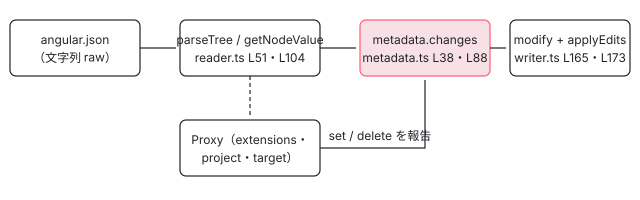

[目次](../README.md) › [@angular-devkit の内側](README.md) › 第 4 回 / 全 12 回

# angular.json を読み書きする：workspace

> core/src/workspace/\*：WorkspaceDefinition・ProjectDefinition・TargetDefinition の形、json/reader が作る Proxy と変更の帳簿（metadata）、コメントと並び順と改行を保って modify で書き戻す writer（字下げは空白 2 つ）、host の約束、architect と targets の取り違え。

angular/angular-cli · 読了 約 12 分 · 中核 · [サイトで読む（デモが動きます）](https://angular-deep-dive-cyan.vercel.app/chapter/dvk-workspace)

---

この章で分かること：`angular.json` を読む `readWorkspace` が返す `WorkspaceDefinition` は、ふつうのオブジェクトではなく、書き換えを拾う Proxy と「変更の帳簿」の組です。`writeWorkspace` はファイルを作り直さず、帳簿の 1 行ずつを jsonc-parser の `modify` で元の文字列に当てるので、コメントと並び順が残ります。どこまで残り、どこで崩れるかを、`ng new` で作った `angular.json` の写しで確かめます。

読む対象は `packages/angular_devkit/core/src/workspace/` の `core.ts`・`host.ts`・`definitions.ts`・`json/reader.ts`・`json/utilities.ts`・`json/metadata.ts`・`json/writer.ts` です（../angular-cli、44129f66a3）。CLI が `angular.json` と `~/.angular-config.json` をどう探して `readWorkspace` に渡すかは[angular.json と設定の章](../ngx/03-ngx-config.md)、schematic の中で `getWorkspace(tree)` からパスを決める流れは[ng generate component の章](../cli/15-schematics-component.md)が読んでいます。

1. [1. パスと文字列](01-dvk-path.md)
2. [2. 仮想ファイルシステムの host](02-dvk-host.md)
3. [3. JSON schema の検査](03-dvk-schema.md)
4. **4. angular.json の読み書き**（この章）
5. [5. logger と小さな道具](05-dvk-logger.md)
6. [6. Tree](06-dvk-tree.md)
7. [7. エンジンと規則](07-dvk-engine.md)
8. [8. ワークフローと engine host](08-dvk-workflow.md)
9. [9. architect の jobs](09-dvk-jobs.md)
10. [10. Architect が builder を呼ぶまで](10-dvk-architect.md)
11. [11. テストの道具](11-dvk-testing.md)
12. [12. spec と issue](12-dvk-tests-issues.md)

> [!TIP]
> **新卒エンジニアへ**
>
> Proxy は JavaScript の組み込みで、オブジェクトへの読み書き（`get`・`set`・`delete`・`in` など）を横取りする関数（トラップ）を差し込めます。この章の `project.root = 'x'` は、ただの代入に見えて、裏で「`/projects/app/root` が変わった」と帳簿に書く関数が動いています。DEMO の記録は、グローバルの `@angular/cli` 22.2.7 が持つ `@angular-devkit/core` 22.2.7 で取りました。`core/src/workspace` は 44129f66a3・v22.2.7・main（origin/main）の 3 つで差分がありません。44129f66a3 と同じソースの公開版 22.2.0-next.7 でも同じスクリプトを走らせ、記録は 1 文字も違いませんでした。



*読む → Proxy で拾う → 帳簿 → 元の文字列に当てる*

## 1. 入口：readWorkspace・writeWorkspace と WorkspaceHost

📄 `angular-cli/packages/angular_devkit/core/src/workspace/core.ts` L15–42 （▶ の行: 15, 20–21, 39–41）

```ts
15 ▶ const formatLookup = new WeakMap<WorkspaceDefinition, WorkspaceFormat>();
16 │ 
17 │ /**
18 │  * Supported workspace formats
19 │  */
20 ▶ export enum WorkspaceFormat {
21 ▶   JSON,
22 │ }
23 │ 
24 │ /**
25 │  * @private
26 │  */
27 │ export function _test_addWorkspaceFile(name: string, format: WorkspaceFormat): void {
28 │   workspaceFiles[name] = format;
29 │ }
30 │ 
31 │ /**
32 │  * @private
33 │  */
34 │ export function _test_removeWorkspaceFile(name: string): void {
35 │   delete workspaceFiles[name];
36 │ }
37 │ 
38 │ // NOTE: future additions could also perform content analysis to determine format/version
39 ▶ const workspaceFiles: Record<string, WorkspaceFormat> = {
40 ▶   'angular.json': WorkspaceFormat.JSON,
41 ▶   '.angular.json': WorkspaceFormat.JSON,
42 │ };
```

📄 `angular-cli/packages/angular_devkit/core/src/workspace/core.ts` L60–98 （▶ の行: 66, 70, 75–76, 83, 89–92, 96–97）

```ts
60 │ export async function readWorkspace(
61 │   path: string,
62 │   host: WorkspaceHost,
63 │   format?: WorkspaceFormat,
64 │   // return type will eventually have a `diagnostics` property as well
65 │ ): Promise<{ workspace: WorkspaceDefinition }> {
66 ▶   if (await host.isDirectory(path)) {
67 │     // TODO: Warn if multiple found (requires diagnostics support)
68 │     const directory = normalize(path);
69 │     let found = false;
70 ▶     for (const [name, nameFormat] of Object.entries(workspaceFiles)) {
71 │       if (format !== undefined && format !== nameFormat) {
72 │         continue;
73 │       }
74 │ 
75 ▶       const potential = getSystemPath(join(directory, name));
76 ▶       if (await host.isFile(potential)) {
77 │         path = potential;
78 │         format = nameFormat;
79 │         found = true;
80 │         break;
81 │       }
82 │     }
83 ▶     if (!found) {
84 │       throw new Error(
85 │         'Unable to locate a workspace file for workspace path. Are you missing an `angular.json`' +
86 │           ' or `.angular.json` file?',
87 │       );
88 │     }
89 ▶   } else if (format === undefined) {
90 ▶     const filename = basename(normalize(path));
91 ▶     if (filename in workspaceFiles) {
92 ▶       format = workspaceFiles[filename];
93 │     }
94 │   }
95 │ 
96 ▶   if (format === undefined) {
97 ▶     throw new Error('Unable to determine format for workspace path.');
98 │   }
```

1. **66〜82 行目：フォルダなら探す**

   `workspaceFiles`（39〜42 行目）を `angular.json`・`.angular.json` の順に試し、最初に見つかったファイルを使います。75 行目で `getSystemPath(join(…))` と、[第 1 回](01-dvk-path.md)の `Path` を OS のパスに戻してから host に渡します。どちらも無ければ 83〜87 行目の例外です（記録「angular.json の無いフォルダ」）。
2. **89〜94 行目：ファイルなら名前で決める**

   ファイルの名前（`basename`）が表にあれば JSON です。記録では `.angular.json` は読めて、同じ中身の `workspace.json` は 97 行目の「Unable to determine format for workspace path.」でした。3 つ目の引数 `format` を渡せばどんな名前でも読めます（CLI の `AngularWorkspace.load` は `WorkspaceFormat.JSON` を渡す）。

📄 `angular-cli/packages/angular_devkit/core/src/workspace/core.ts` L100–112 （▶ の行: 103, 109）

```ts
100 │   let workspace;
101 │   switch (format) {
102 │     case WorkspaceFormat.JSON:
103 ▶       workspace = await readJsonWorkspace(path, host);
104 │       break;
105 │     default:
106 │       throw new Error('Unsupported workspace format.');
107 │   }
108 │ 
109 ▶   formatLookup.set(workspace, WorkspaceFormat.JSON);
110 │ 
111 │   return { workspace };
112 │ }
```

📄 `angular-cli/packages/angular_devkit/core/src/workspace/core.ts` L132–151 （▶ の行: 138–141, 147）

```ts
132 │ export async function writeWorkspace(
133 │   workspace: WorkspaceDefinition,
134 │   host: WorkspaceHost,
135 │   path?: string,
136 │   format?: WorkspaceFormat,
137 │ ): Promise<void> {
138 ▶   if (format === undefined) {
139 ▶     format = formatLookup.get(workspace);
140 ▶     if (format === undefined) {
141 ▶       throw new Error('A format is required for custom workspace objects.');
142 │     }
143 │   }
144 │ 
145 │   switch (format) {
146 │     case WorkspaceFormat.JSON:
147 ▶       return writeJsonWorkspace(workspace, host, path);
148 │     default:
149 │       throw new Error('Unsupported workspace format.');
150 │   }
151 │ }
```

109 行目で、読んだワークスペースを 15 行目の `WeakMap` に「JSON で読んだ」と覚えます。`writeWorkspace` は 139 行目でそれを引き、無ければ 141 行目の例外です。記録の「readWorkspace を通さずに作ったワークスペースを書く」は、format を渡さないと「A format is required for custom workspace objects.」、`WorkspaceFormat.JSON` とパスを渡すと 6 節の `convertJsonWorkspace` の形で書けました。

📄 `angular-cli/packages/angular_devkit/core/src/workspace/host.ts` L12–22 （▶ の行: 13–14, 16–17）

```ts
12 │ export interface WorkspaceHost {
13 ▶   readFile(path: string): Promise<string>;
14 ▶   writeFile(path: string, data: string): Promise<void>;
15 │ 
16 ▶   isDirectory(path: string): Promise<boolean>;
17 ▶   isFile(path: string): Promise<boolean>;
18 │ 
19 │   // Potential future additions
20 │   // readDirectory?(path: string): Promise<string[]>;
21 │ }
22 │ 
```

📄 `angular-cli/packages/angular_devkit/core/src/workspace/host.ts` L23–55 （▶ の行: 29, 31, 34, 36, 39, 41）

```ts
23 │ export function createWorkspaceHost(host: virtualFs.Host): WorkspaceHost {
24 │   const decoder = new TextDecoder();
25 │   const encoder = new TextEncoder();
26 │ 
27 │   const workspaceHost: WorkspaceHost = {
28 │     async readFile(path: string): Promise<string> {
29 ▶       const data = await lastValueFrom(host.read(normalize(path)));
30 │ 
31 ▶       return decoder.decode(data);
32 │     },
33 │     async writeFile(path: string, data: string): Promise<void> {
34 ▶       return lastValueFrom(host.write(normalize(path), encoder.encode(data).buffer));
35 │     },
36 ▶     async isDirectory(path: string): Promise<boolean> {
37 │       try {
38 │         return await lastValueFrom(host.isDirectory(normalize(path)));
39 ▶       } catch {
40 │         // some hosts throw if path does not exist
41 ▶         return false;
42 │       }
43 │     },
44 │     async isFile(path: string): Promise<boolean> {
45 │       try {
46 │         return await lastValueFrom(host.isFile(normalize(path)));
47 │       } catch {
48 │         // some hosts throw if path does not exist
49 │         return false;
50 │       }
51 │     },
52 │   };
53 │ 
54 │   return workspaceHost;
55 │ }
```

`WorkspaceHost` は文字列で読み書きする 4 つのメソッドだけの約束です。`createWorkspaceHost` は[第 2 回](02-dvk-host.md)の `virtualFs.Host`（Observable でバイト列を返す）をこの形に包み、29〜31 行目で UTF-8 に読み、34 行目で書きます。36〜43 行目、host が例外を投げても `false` にします（コメントのとおり、無いパスで投げる host があるため）。CLI はこれを使わず `node:fs` の `promises` で同じ 4 つを書き（config.ts L21〜）、schematic は `Tree` を包む `TreeWorkspaceHost`（`@schematics/angular` の utility/workspace.ts）を使います。後者の `isDirectory` は「ファイルが無く、下にファイルがある」で近似しています。

## 2. 形：WorkspaceDefinition と DefinitionCollection

📄 `angular-cli/packages/angular_devkit/core/src/workspace/definitions.ts` L11–30 （▶ の行: 12–13, 17–18, 20–22, 28–29）

```ts
11 │ export interface WorkspaceDefinition {
12 ▶   readonly extensions: Record<string, JsonValue | undefined>;
13 ▶   readonly projects: ProjectDefinitionCollection;
14 │ }
15 │ 
16 │ export interface ProjectDefinition {
17 ▶   readonly extensions: Record<string, JsonValue | undefined>;
18 ▶   readonly targets: TargetDefinitionCollection;
19 │ 
20 ▶   root: string;
21 ▶   prefix?: string;
22 ▶   sourceRoot?: string;
23 │ }
24 │ 
25 │ export interface TargetDefinition {
26 │   options?: Record<string, JsonValue | undefined>;
27 │   configurations?: Record<string, Record<string, JsonValue | undefined> | undefined>;
28 ▶   defaultConfiguration?: string;
29 ▶   builder: string;
30 │ }
```

ワークスペースもプロジェクトも、決まった名前の値と `extensions`（それ以外のキー全部）に分かれます。プロジェクトで名前を持つのは 20〜22 行目の `root`・`prefix`・`sourceRoot` だけで、`projectType` や `schematics` は `extensions` に入ります（記録「readWorkspace で読んだ形」の `Object.keys(p.extensions)` は `["projectType","schematics"]`）。

📄 `angular-cli/packages/angular_devkit/core/src/workspace/definitions.ts` L38–67 （▶ の行: 38, 45, 49, 51–52, 59, 61, 63）

```ts
38 ▶ class DefinitionCollection<V extends object> implements ReadonlyMap<string, V> {
39 │   private _map: Map<string, V>;
40 │ 
41 │   constructor(
42 │     initial?: Record<string, V>,
43 │     private _listener?: DefinitionCollectionListener<V>,
44 │   ) {
45 ▶     this._map = new Map(initial && Object.entries(initial));
46 │   }
47 │ 
48 │   delete(key: string): boolean {
49 ▶     const result = this._map.delete(key);
50 │ 
51 ▶     if (result) {
52 ▶       this._listener?.(key, undefined, this);
53 │     }
54 │ 
55 │     return result;
56 │   }
57 │ 
58 │   set(key: string, value: V): this {
59 ▶     const updatedValue = value !== this.get(key);
60 │ 
61 ▶     if (updatedValue) {
62 │       this._map.set(key, value);
63 ▶       this._listener?.(key, value, this);
64 │     }
65 │ 
66 │     return this;
67 │   }
```

`projects` と `targets` は 38 行目の `DefinitionCollection` で、`ReadonlyMap` の形を `implements` した自前のクラスです。中身は 39 行目の本物の `Map` で、`delete`（52 行目）と `set`（63 行目）のときだけ、作ったときに渡された `_listener` を呼びます。これが 3 節で帳簿につながります。59 行目、同じオブジェクトを入れ直しても listener は呼ばれません。記録の `workspace.projects instanceof Map` は `false` でした。core の README.md の L72〜74 は「specialized Javascript Map objects」と書いていますが、`Map` を継いではおらず `clear()` もありません。

📄 `angular-cli/packages/angular_devkit/core/src/workspace/definitions.ts` L141–169 （▶ の行: 149–150, 152, 154, 158–159, 162, 165）

```ts
141 │   add(definition: {
142 │     name: string;
143 │     root: string;
144 │     sourceRoot?: string;
145 │     prefix?: string;
146 │     targets?: Record<string, TargetDefinition | undefined>;
147 │     [key: string]: unknown;
148 │   }): ProjectDefinition {
149 ▶     if (this.has(definition.name)) {
150 ▶       throw new Error('Project name already exists.');
151 │     }
152 ▶     this._validateName(definition.name);
153 │ 
154 ▶     const project: ProjectDefinition = {
155 │       root: definition.root,
156 │       prefix: definition.prefix,
157 │       sourceRoot: definition.sourceRoot,
158 ▶       targets: new TargetDefinitionCollection(),
159 ▶       extensions: {},
160 │     };
161 │ 
162 ▶     if (definition.targets) {
163 │       for (const [name, target] of Object.entries(definition.targets)) {
164 │         if (target) {
165 ▶           project.targets.set(name, target);
166 │         }
167 │       }
168 │     }
169 │ 
```

📄 `angular-cli/packages/angular_devkit/core/src/workspace/definitions.ts` L170–205 （▶ の行: 170, 178–180, 182, 188, 194, 202–203）

```ts
170 ▶     for (const [name, value] of Object.entries(definition)) {
171 │       switch (name) {
172 │         case 'name':
173 │         case 'root':
174 │         case 'sourceRoot':
175 │         case 'prefix':
176 │         case 'targets':
177 │           break;
178 ▶         default:
179 ▶           if (isJsonValue(value)) {
180 ▶             project.extensions[name] = value;
181 │           } else {
182 ▶             throw new TypeError(`"${name}" must be a JSON value.`);
183 │           }
184 │           break;
185 │       }
186 │     }
187 │ 
188 ▶     super.set(definition.name, project);
189 │ 
190 │     return project;
191 │   }
192 │ 
193 │   override set(name: string, value: ProjectDefinition): this {
194 ▶     this._validateName(name);
195 │ 
196 │     super.set(name, value);
197 │ 
198 │     return this;
199 │   }
200 │ 
201 │   private _validateName(name: string): void {
202 ▶     if (typeof name !== 'string' || !/^(?:@\w[\w.-]*\/)?\w[\w.-]*$/.test(name)) {
203 ▶       throw new Error('Project name must be a valid npm package name.');
204 │     }
205 │   }
```

1. **149〜152 行目：名前の検査**

   同じ名前は「Project name already exists.」、202 行目の正規表現（npm のパッケージ名の形、`@scope/` は 1 つまで）に合わなければ「Project name must be a valid npm package name.」。記録の `'Bad Name'` はこれでした。
2. **154〜168 行目：新しいプロジェクト**

   158 行目の `targets` は listener の無い新しい集まりです。足したプロジェクトの target をあとで変えても帳簿には何も書かれませんが、帳簿の側がプロジェクトのオブジェクトそのものを持っているので（3 節の 129 行目の `'project'`）、書くときに今の中身が出ます。
3. **170〜186 行目：残りのキーは extensions へ**

   JSON の値でなければ 182 行目の `TypeError` です。記録の `meta: { a: undefined }` は「"meta" must be a JSON value.」でした。
4. **188 行目：`super.set`**

   ここで listener が呼ばれ、帳簿に「`/projects/lib-a` にプロジェクト」と 1 行入ります。

📄 `angular-cli/packages/angular_devkit/core/src/workspace/definitions.ts` L105–131 （▶ の行: 106, 117–119, 122）

```ts
105 │ function isJsonValue(value: unknown): value is JsonValue {
106 ▶   const visited = new Set();
107 │ 
108 │   switch (typeof value) {
109 │     case 'boolean':
110 │     case 'number':
111 │     case 'string':
112 │       return true;
113 │     case 'object':
114 │       if (value === null) {
115 │         return true;
116 │       }
117 ▶       visited.add(value);
118 ▶       for (const property of Object.values(value)) {
119 ▶         if (typeof value === 'object' && visited.has(property)) {
120 │           continue;
121 │         }
122 ▶         if (!isJsonValue(property)) {
123 │           return false;
124 │         }
125 │       }
126 │ 
127 │       return true;
128 │     default:
129 │       return false;
130 │   }
131 │ }
```

179 行目が呼ぶ `isJsonValue` には 2 つの穴があります。106 行目の `visited` は呼び出しのたびに新しく作られ、119 行目は `property` ではなく `value` の型を見ています。だから自分を直接持つ `a.self = a` は 1 段だけ飛ばせても、`a.child = { parent: a }` のように 1 段はさむ循環は無限に潜ります。記録は `RangeError: Maximum call stack size exceeded` で、182 行目の分かりやすい `TypeError` になりませんでした。`new Date(0)` は `Object.values` が空なので JSON の値として通りました。

📄 `angular-cli/packages/angular_devkit/core/src/workspace/definitions.ts` L216–250 （▶ の行: 221, 226–230, 233, 247）

```ts
216 │   add(
217 │     definition: {
218 │       name: string;
219 │     } & TargetDefinition,
220 │   ): TargetDefinition {
221 ▶     if (this.has(definition.name)) {
222 │       throw new Error('Target name already exists.');
223 │     }
224 │     this._validateName(definition.name);
225 │ 
226 ▶     const target = {
227 ▶       builder: definition.builder,
228 ▶       options: definition.options,
229 ▶       configurations: definition.configurations,
230 ▶       defaultConfiguration: definition.defaultConfiguration,
231 │     };
232 │ 
233 ▶     super.set(definition.name, target);
234 │ 
235 │     return target;
236 │   }
237 │ 
238 │   override set(name: string, value: TargetDefinition): this {
239 │     this._validateName(name);
240 │ 
241 │     super.set(name, value);
242 │ 
243 │     return this;
244 │   }
245 │ 
246 │   private _validateName(name: string): void {
247 ▶     if (typeof name !== 'string') {
248 │       throw new TypeError('Target name must be a string.');
249 │     }
250 │   }
```

target の `add` は 226〜231 行目で 4 つのキーだけを写します。名前の検査は 247 行目の「文字列か」だけで、プロジェクトのような形の決まりはありません。

## 3. 読む：readJsonWorkspace

### ワークスペースの段と、知らないキーの警告

📄 `angular-cli/packages/angular_devkit/core/src/workspace/json/reader.ts` L23–39 （▶ の行: 23–24, 29, 37–38）

```ts
23 ▶ const ANGULAR_WORKSPACE_EXTENSIONS = Object.freeze(['cli', 'newProjectRoot', 'schematics']);
24 ▶ const ANGULAR_PROJECT_EXTENSIONS = Object.freeze(['cli', 'schematics', 'projectType', 'i18n']);
25 │ 
26 │ interface ParserContext {
27 │   readonly host: WorkspaceHost;
28 │   readonly metadata: JsonWorkspaceMetadata;
29 ▶   readonly trackChanges: boolean;
30 │   readonly unprefixedWorkspaceExtensions: ReadonlySet<string>;
31 │   readonly unprefixedProjectExtensions: ReadonlySet<string>;
32 │   error(message: string, node: JsonValue): void;
33 │   warn(message: string, node: JsonValue): void;
34 │ }
35 │ 
36 │ export interface JsonWorkspaceOptions {
37 ▶   allowedProjectExtensions?: string[];
38 ▶   allowedWorkspaceExtensions?: string[];
39 │ }
```

📄 `angular-cli/packages/angular_devkit/core/src/workspace/json/reader.ts` L41–64 （▶ の行: 46, 51–52, 57, 61–63）

```ts
41 │ export async function readJsonWorkspace(
42 │   path: string,
43 │   host: WorkspaceHost,
44 │   options: JsonWorkspaceOptions = {},
45 │ ): Promise<WorkspaceDefinition> {
46 ▶   const raw = await host.readFile(path);
47 │   if (raw === undefined) {
48 │     throw new Error('Unable to read workspace file.');
49 │   }
50 │ 
51 ▶   const ast = parseTree(raw, undefined, { allowTrailingComma: true, disallowComments: false });
52 ▶   if (ast?.type !== 'object' || !ast.children) {
53 │     throw new Error('Invalid workspace file - expected JSON object.');
54 │   }
55 │ 
56 │   // Version check
57 ▶   const versionNode = findNodeAtLocation(ast, ['version']);
58 │   if (!versionNode) {
59 │     throw new Error('Unknown format - version specifier not found.');
60 │   }
61 ▶   const version = versionNode.value;
62 ▶   if (version !== 1) {
63 ▶     throw new Error(`Invalid format version detected - Expected:[ 1 ] Found: [ ${version} ]`);
64 │   }
```

51 行目、jsonc-parser の `parseTree` でコメントと末尾のカンマを許して木にします。62 行目の `version !== 1` は型も比べるので、`"version": "1"` は通りません。記録の文は「Invalid format version detected - Expected:\[ 1 \] Found: \[ 1 \]」で、63 行目がテンプレート文字列に入れるため、数と文字列の違いが文から読めません。

📄 `angular-cli/packages/angular_devkit/core/src/workspace/json/reader.ts` L66–92 （▶ の行: 68–70, 74, 80, 85）

```ts
66 │   const context: ParserContext = {
67 │     host,
68 ▶     metadata: new JsonWorkspaceMetadata(path, ast, raw),
69 ▶     trackChanges: true,
70 ▶     unprefixedWorkspaceExtensions: new Set([
71 │       ...ANGULAR_WORKSPACE_EXTENSIONS,
72 │       ...(options.allowedWorkspaceExtensions ?? []),
73 │     ]),
74 ▶     unprefixedProjectExtensions: new Set([
75 │       ...ANGULAR_PROJECT_EXTENSIONS,
76 │       ...(options.allowedProjectExtensions ?? []),
77 │     ]),
78 │     error(message, _node) {
79 │       // TODO: Diagnostic reporting support
80 ▶       throw new Error(message);
81 │     },
82 │     warn(message, _node) {
83 │       // TODO: Diagnostic reporting support
84 │       // eslint-disable-next-line no-console
85 ▶       console.warn(message);
86 │     },
87 │   };
88 │ 
89 │   const workspace = parseWorkspace(ast, context);
90 │ 
91 │   return workspace;
92 │ }
```

69 行目の `trackChanges` は `true` 固定です。だから 98〜100 行目・180〜184 行目・294〜296 行目の「変更を追わない」枝は、この関数を通るかぎり使われません。80 行目、`error` は例外、85 行目、`warn` は `console.warn` です（コメントのとおり、診断を返す仕組みはまだ無い）。

📄 `angular-cli/packages/angular_devkit/core/src/workspace/json/reader.ts` L94–124 （▶ の行: 104, 106, 108, 115, 117–118）

```ts
 94 │ function parseWorkspace(workspaceNode: Node, context: ParserContext): WorkspaceDefinition {
 95 │   const jsonMetadata = context.metadata;
 96 │   let projects;
 97 │   let extensions: Record<string, JsonValue> | undefined;
 98 │   if (!context.trackChanges) {
 99 │     extensions = Object.create(null);
100 │   }
101 │ 
102 │   // TODO: `getNodeValue` - looks potentially expensive since it walks the whole tree and instantiates the full object structure each time.
103 │   // Might be something to look at moving forward to optimize.
104 ▶   const workspaceNodeValue = getNodeValue(workspaceNode);
105 │   for (const [name, value] of Object.entries<JsonValue>(workspaceNodeValue)) {
106 ▶     if (name === '$schema' || name === 'version') {
107 │       // skip
108 ▶     } else if (name === 'projects') {
109 │       const nodes = findNodeAtLocation(workspaceNode, ['projects']);
110 │       if (!isJsonObject(value) || !nodes) {
111 │         context.error('Invalid "projects" field found; expected an object.', value);
112 │         continue;
113 │       }
114 │ 
115 ▶       projects = parseProjectsObject(nodes, context);
116 │     } else {
117 ▶       if (!context.unprefixedWorkspaceExtensions.has(name) && !/^[a-z]{1,3}-.*/.test(name)) {
118 ▶         context.warn(`Workspace extension with invalid name (${name}) found.`, name);
119 │       }
120 │       if (extensions) {
121 │         extensions[name] = value;
122 │       }
123 │     }
124 │   }
```

104 行目で木を素の値に戻し、106 行目で `$schema` と `version` を飛ばし、108 行目で `projects` を下の関数に渡します。残りは extensions で、117 行目、23 行目の 3 つ（`cli`・`newProjectRoot`・`schematics`）でも「英小文字 1〜3 字 + `-`」で始まる名前でもなければ警告します。記録の「知らないキー」では `foo`・`myTool`・`bar` に警告が出て、`nx-cloud`・`ab-ok`・`i18n` には出ませんでした。値は警告しても捨てません。37〜38 行目の `allowed…Extensions` を渡すと警告が消えます（記録）。ただし `readWorkspace` は `core.ts` の 103 行目で options を渡さないので、CLI と schematic の読み方ではこの逃げ道を使えません。

📄 `angular-cli/packages/angular_devkit/core/src/workspace/json/reader.ts` L126–149 （▶ の行: 128–129, 133, 136, 142–143, 145）

```ts
126 │   let collectionListener: DefinitionCollectionListener<ProjectDefinition> | undefined;
127 │   if (context.trackChanges) {
128 ▶     collectionListener = (name, newValue) => {
129 ▶       jsonMetadata.addChange(['projects', name], newValue, 'project');
130 │     };
131 │   }
132 │ 
133 ▶   const projectCollection = new ProjectDefinitionCollection(projects, collectionListener);
134 │ 
135 │   return {
136 ▶     [JsonWorkspaceSymbol]: jsonMetadata,
137 │     projects: projectCollection,
138 │     // If not tracking changes the `extensions` variable will contain the parsed
139 │     // values.  Otherwise the extensions are tracked via a virtual AST object.
140 │     extensions:
141 │       extensions ??
142 ▶       createVirtualAstObject(workspaceNodeValue, {
143 ▶         exclude: ['$schema', 'version', 'projects'],
144 │         listener(path, value) {
145 ▶           jsonMetadata.addChange(path, value);
146 │         },
147 │       }),
148 │   } as WorkspaceDefinition;
149 │ }
```

128〜130 行目が `projects` の集まりの listener で、足す・消すを `['projects', name]` の変更として帳簿に書きます。142〜147 行目、`extensions` は元の値の Proxy で、143 行目で `$schema`・`version`・`projects` を見えなくします。記録では `'$schema' in workspace.extensions` が `false` でした。

### プロジェクトと target の段

📄 `angular-cli/packages/angular_devkit/core/src/workspace/json/reader.ts` L170–204 （▶ の行: 187–188, 193–194, 200–202）

```ts
170 │ function parseProject(
171 │   projectName: string,
172 │   projectNode: Node,
173 │   context: ParserContext,
174 │ ): ProjectDefinition {
175 │   const jsonMetadata = context.metadata;
176 │   let targets;
177 │   let hasTargets = false;
178 │   let extensions: Record<string, JsonValue> | undefined;
179 │   let properties: Record<'root' | 'sourceRoot' | 'prefix', string> | undefined;
180 │   if (!context.trackChanges) {
181 │     // If not tracking changes, the parser will store the values directly in standard objects
182 │     extensions = Object.create(null);
183 │     properties = Object.create(null);
184 │   }
185 │ 
186 │   const projectNodeValue = getNodeValue(projectNode);
187 ▶   if (!('root' in projectNodeValue)) {
188 ▶     throw new Error(`Project "${projectName}" is missing a required property "root".`);
189 │   }
190 │ 
191 │   for (const [name, value] of Object.entries<JsonValue>(projectNodeValue)) {
192 │     switch (name) {
193 ▶       case 'targets':
194 ▶       case 'architect': {
195 │         const nodes = findNodeAtLocation(projectNode, [name]);
196 │         if (!isJsonObject(value) || !nodes) {
197 │           context.error(`Invalid "${name}" field found; expected an object.`, value);
198 │           break;
199 │         }
200 ▶         hasTargets = true;
201 ▶         targets = parseTargetsObject(projectName, nodes, context);
202 ▶         jsonMetadata.hasLegacyTargetsName = name === 'architect';
203 │         break;
204 │       }
```

187〜189 行目、`root` が無いプロジェクトは例外です（記録）。reader\_spec.ts の L140 の it は「warns on missing root property in a project」という名前ですが、中身は L150 の `toBeRejectedWithError` で、名前と期待が食い違っています。193〜194 行目、target の置き場は `targets` と古い名前の `architect` のどちらでも読み、202 行目で「古い名前か」を 1 つの `hasLegacyTargetsName` に書きます。この 1 行は 6 節の不具合の元です。

📄 `angular-cli/packages/angular_devkit/core/src/workspace/json/reader.ts` L205–227 （▶ の行: 208–209, 216–217）

```ts
205 │       case 'prefix':
206 │       case 'root':
207 │       case 'sourceRoot':
208 ▶         if (typeof value !== 'string') {
209 ▶           context.warn(`Project property "${name}" should be a string.`, value);
210 │         }
211 │         if (properties) {
212 │           properties[name] = value as string;
213 │         }
214 │         break;
215 │       default:
216 ▶         if (!context.unprefixedProjectExtensions.has(name) && !/^[a-z]{1,3}-.*/.test(name)) {
217 ▶           context.warn(
218 │             `Project '${projectName}' contains extension with invalid name (${name}).`,
219 │             name,
220 │           );
221 │         }
222 │         if (extensions) {
223 │           extensions[name] = value;
224 │         }
225 │         break;
226 │     }
227 │   }
```

📄 `angular-cli/packages/angular_devkit/core/src/workspace/json/reader.ts` L229–256 （▶ の行: 231–233, 235–238, 245, 251, 253）

```ts
229 │   let collectionListener: DefinitionCollectionListener<TargetDefinition> | undefined;
230 │   if (context.trackChanges) {
231 ▶     collectionListener = (name, newValue, collection) => {
232 ▶       if (hasTargets) {
233 ▶         jsonMetadata.addChange(['projects', projectName, 'targets', name], newValue, 'target');
234 │       } else {
235 ▶         jsonMetadata.addChange(
236 ▶           ['projects', projectName, 'targets'],
237 ▶           collection,
238 ▶           'targetcollection',
239 │         );
240 │       }
241 │     };
242 │   }
243 │ 
244 │   const base = {
245 ▶     targets: new TargetDefinitionCollection(targets, collectionListener),
246 │     // If not tracking changes the `extensions` variable will contain the parsed
247 │     // values.  Otherwise the extensions are tracked via a virtual AST object.
248 │     extensions:
249 │       extensions ??
250 │       createVirtualAstObject(projectNodeValue, {
251 ▶         exclude: ['architect', 'prefix', 'root', 'sourceRoot', 'targets'],
252 │         listener(path, value) {
253 ▶           jsonMetadata.addChange(['projects', projectName, ...path], value);
254 │         },
255 │       }),
256 │   };
```

target の集まりの listener は 2 通りです。232〜233 行目、ファイルに target の置き場があれば、1 つの target を `['projects', p, 'targets', name]` として書きます。無ければ 235〜239 行目、集まり全体（`'targetcollection'`）を 1 つの変更にします。記録「targets の無いプロジェクトに target を 2 つ足す」の帳簿は `projects/lib-c/targets (targetcollection)` の 1 行で、2 つの target が 1 つの `"architect"` にまとまって書かれました。

📄 `angular-cli/packages/angular_devkit/core/src/workspace/json/reader.ts` L258–271 （▶ の行: 258, 261–262, 264–265, 270）

```ts
258 ▶   const baseKeys = new Set(Object.keys(base));
259 │   const project =
260 │     properties ??
261 ▶     createVirtualAstObject<ProjectDefinition>(projectNodeValue, {
262 ▶       include: ['prefix', 'root', 'sourceRoot', ...baseKeys],
263 │       listener(path, value) {
264 ▶         if (!baseKeys.has(path[0])) {
265 ▶           jsonMetadata.addChange(['projects', projectName, ...path], value);
266 │         }
267 │       },
268 │     });
269 │ 
270 ▶   return Object.assign(project, base) as ProjectDefinition;
271 │ }
```

プロジェクト自身も Proxy で、262 行目の `include` の名前だけを見せます。270 行目の `Object.assign` は Proxy に `targets` と `extensions` を代入するので set のトラップが動きますが、264 行目でその 2 つを帳簿に書かないようにしています。

📄 `angular-cli/packages/angular_devkit/core/src/workspace/json/reader.ts` L273–300 （▶ の行: 282–283, 288–289, 291）

```ts
273 │ function parseTargetsObject(
274 │   projectName: string,
275 │   targetsNode: Node,
276 │   context: ParserContext,
277 │ ): Record<string, TargetDefinition> {
278 │   const jsonMetadata = context.metadata;
279 │   const targets: Record<string, TargetDefinition> = Object.create(null);
280 │ 
281 │   for (const [name, value] of Object.entries<JsonValue>(getNodeValue(targetsNode))) {
282 ▶     if (!isJsonObject(value)) {
283 ▶       context.warn('Skipping invalid target value; expected an object.', value);
284 │       continue;
285 │     }
286 │ 
287 │     if (context.trackChanges) {
288 ▶       targets[name] = createVirtualAstObject<TargetDefinition>(value, {
289 ▶         include: ['builder', 'options', 'configurations', 'defaultConfiguration'],
290 │         listener(path, value) {
291 ▶           jsonMetadata.addChange(['projects', projectName, 'targets', name, ...path], value);
292 │         },
293 │       });
294 │     } else {
295 │       targets[name] = value as unknown as TargetDefinition;
296 │     }
297 │   }
298 │ 
299 │   return targets;
300 │ }
```

target は 289 行目の 4 つだけを見せます。記録「targets.set で target を丸ごと差し替える」では、ファイルの `"x-note": "keep me"` は `Object.keys(test)` に出ず、`targets.set` で差し替えると消えました。値を変えるだけ（`target.options.x = …`）なら、5 節のとおり元の文字列に当てるので残ります。

## 4. 書き換えを拾う Proxy と変更の帳簿

### createVirtualAstObject

📄 `angular-cli/packages/angular_devkit/core/src/workspace/json/utilities.ts` L24–58 （▶ の行: 32, 37, 42, 45, 47, 52, 55–56）

```ts
24 │ export function createVirtualAstObject<T extends object = JsonObject>(
25 │   root: JsonObject | JsonArray,
26 │   options: {
27 │     exclude?: string[];
28 │     include?: string[];
29 │     listener?: ChangeListener;
30 │   } = {},
31 │ ): T {
32 ▶   const reporter: ChangeReporter = (path, target, oldValue, newValue) => {
33 │     if (!options.listener) {
34 │       return;
35 │     }
36 │ 
37 ▶     if (oldValue === newValue || JSON.stringify(oldValue) === JSON.stringify(newValue)) {
38 │       // same value
39 │       return;
40 │     }
41 │ 
42 ▶     if (Array.isArray(target)) {
43 │       // For arrays we remove the index and update the entire value as keeping
44 │       // track of changes by indices can be rather complex.
45 ▶       options.listener(path.slice(0, -1), target);
46 │     } else {
47 ▶       options.listener(path, newValue);
48 │     }
49 │   };
50 │ 
51 │   return create(
52 ▶     Array.isArray(root) ? [...root] : { ...root },
53 │     [],
54 │     reporter,
55 ▶     new Set(options.exclude),
56 ▶     options.include?.length ? new Set(options.include) : undefined,
57 │   ) as T;
58 │ }
```

37 行目、古い値と新しい値が `JSON.stringify` で同じなら報告しません。記録「同じ値を入れ直す」では、同じ文字列と、同じ中身の別の配列を入れても `hasChanges` は `false` で、ファイルは書かれませんでした。42〜45 行目、配列の中の 1 つが変わったときは、添字を外して配列全体を新しい値として報告します。記録の `styles.push(…)` の帳簿は `/…/options/styles` でした。

📄 `angular-cli/packages/angular_devkit/core/src/workspace/json/utilities.ts` L60–97 （▶ の行: 69, 75–76, 80, 83, 92–93）

```ts
60 │ function create(
61 │   obj: JsonObject | JsonArray,
62 │   path: string[],
63 │   reporter: ChangeReporter,
64 │   excluded = new Set<ProxyPropertyKey>(),
65 │   included?: Set<ProxyPropertyKey>,
66 │ ) {
67 │   return new Proxy(obj, {
68 │     getOwnPropertyDescriptor(target: {}, p: ProxyPropertyKey): PropertyDescriptor | undefined {
69 ▶       if (excluded.has(p) || (included && !included.has(p))) {
70 │         return undefined;
71 │       }
72 │ 
73 │       return Reflect.getOwnPropertyDescriptor(target, p);
74 │     },
75 ▶     has(target: {}, p: ProxyPropertyKey): boolean {
76 ▶       if (typeof p === 'symbol' || excluded.has(p)) {
77 │         return false;
78 │       }
79 │ 
80 ▶       return Reflect.has(target, p);
81 │     },
82 │     get(target: {}, p: ProxyPropertyKey): unknown {
83 ▶       if (excluded.has(p) || (included && !included.has(p))) {
84 │         return undefined;
85 │       }
86 │ 
87 │       const value = Reflect.get(target, p);
88 │       if (typeof p === 'symbol') {
89 │         return value;
90 │       }
91 │ 
92 ▶       if ((isJsonObject(value) && !(value instanceof Map)) || Array.isArray(value)) {
93 ▶         return create(value, [...path, p], reporter);
94 │       } else {
95 │         return value;
96 │       }
97 │     },
```

`get`（83 行目）は `exclude` と `include` の両方を見るのに、`has`（76 行目）は `exclude` しか見ません。記録では `'projectType' in p` が `true` なのに `p.projectType` は `undefined` でした（`projectType` は 262 行目の `include` に無い）。target の `'x-note' in test` も同じく `true` と `undefined` です。92〜93 行目、入れ子のオブジェクトと配列は、読むたびに道（`path`）を 1 段のばした新しい Proxy で包みます。`exclude`・`include` は根の段だけです。

📄 `angular-cli/packages/angular_devkit/core/src/workspace/json/utilities.ts` L98–120 （▶ の行: 99–100, 103, 105, 112–114）

```ts
 98 │     set(target: {}, p: ProxyPropertyKey, value: unknown): boolean {
 99 ▶       if (excluded.has(p) || (included && !included.has(p))) {
100 ▶         return false;
101 │       }
102 │ 
103 ▶       if (value === undefined) {
104 │         // setting to undefined is equivalent to a delete.
105 ▶         return this.deleteProperty?.(target, p) ?? false;
106 │       }
107 │ 
108 │       if (typeof p === 'symbol') {
109 │         return Reflect.set(target, p, value);
110 │       }
111 │ 
112 ▶       const existingValue = getCurrentValue(target, p);
113 ▶       if (Reflect.set(target, p, value)) {
114 ▶         reporter([...path, p], target, existingValue, value as JsonValue);
115 │ 
116 │         return true;
117 │       }
118 │ 
119 │       return false;
120 │     },
```

📄 `angular-cli/packages/angular_devkit/core/src/workspace/json/utilities.ts` L121–152 （▶ の行: 122–123, 131–132, 137, 144, 147–148）

```ts
121 │     deleteProperty(target: {}, p: ProxyPropertyKey): boolean {
122 ▶       if (excluded.has(p)) {
123 ▶         return false;
124 │       }
125 │ 
126 │       if (typeof p === 'symbol') {
127 │         return Reflect.deleteProperty(target, p);
128 │       }
129 │ 
130 │       const existingValue = getCurrentValue(target, p);
131 ▶       if (Reflect.deleteProperty(target, p)) {
132 ▶         reporter([...path, p], target, existingValue, undefined);
133 │ 
134 │         return true;
135 │       }
136 │ 
137 ▶       return true;
138 │     },
139 │     defineProperty(target: {}, p: ProxyPropertyKey, attributes: PropertyDescriptor): boolean {
140 │       if (typeof p === 'symbol') {
141 │         return Reflect.defineProperty(target, p, attributes);
142 │       }
143 │ 
144 ▶       return false;
145 │     },
146 │     ownKeys(target: {}): ProxyPropertyKey[] {
147 ▶       return Reflect.ownKeys(target).filter(
148 ▶         (p) => !excluded.has(p) && (!included || included.has(p)),
149 │       );
150 │     },
151 │   });
152 │ }
```

1. **99〜101 行目：見せていない名前には書けない**

   トラップが `false` を返すと、strict mode（ES のモジュールと TypeScript の出力はこれ）では `TypeError` です。記録は `extensions.$schema`・`extensions.projects`・`project.extensions.root`・`project.foo` のどれも「'set' on proxy: trap returned falsish」でした。`$schema` を変える道は、このオブジェクトの上にはありません。
2. **103〜106 行目：`undefined` は削除**

   記録の `serve.defaultConfiguration = undefined` と `newProjectRoot = undefined` は、行ごと消えました。
3. **112〜114 行目：代入してから報告**

   報告は 47 行目の `listener(path, newValue)` で、3 節の listener が道の頭に `['projects', name, …]` を付けて帳簿に書きます。
4. **121〜138 行目：削除**

   122 行目、`exclude` の名前は `false`（記録 `delete extensions.version` は TypeError）。137 行目、`Reflect.deleteProperty` が失敗しても `true` を返します。

### 変更の帳簿：JsonWorkspaceMetadata

📄 `angular-cli/packages/angular_devkit/core/src/workspace/json/metadata.ts` L27–54 （▶ の行: 33–34, 38, 40, 45）

```ts
27 │ export interface JsonChange {
28 │   value?: unknown;
29 │   type?: keyof ChangeValues;
30 │   jsonPath: string[];
31 │ }
32 │ 
33 ▶ function escapeKey(key: string): string | number {
34 ▶   return key.replace('~', '~0').replace('/', '~1');
35 │ }
36 │ 
37 │ export class JsonWorkspaceMetadata {
38 ▶   readonly changes: Map<string, JsonChange> = new Map();
39 │ 
40 ▶   hasLegacyTargetsName = true;
41 │ 
42 │   constructor(
43 │     readonly filePath: string,
44 │     private readonly ast: Node,
45 ▶     readonly raw: string,
46 │   ) {}
47 │ 
48 │   get hasChanges(): boolean {
49 │     return this.changes.size > 0;
50 │   }
51 │ 
52 │   get changeCount(): number {
53 │     return this.changes.size;
54 │   }
```

📄 `angular-cli/packages/angular_devkit/core/src/workspace/json/metadata.ts` L56–89 （▶ の行: 72–74, 76, 80–82, 84, 88）

```ts
56 │   getNodeValueFromAst(path: JSONPath): unknown {
57 │     const node = findNodeAtLocation(this.ast, path);
58 │ 
59 │     return node && getNodeValue(node);
60 │   }
61 │ 
62 │   findChangesForPath(path: string): JsonChange | undefined {
63 │     return this.changes.get(path);
64 │   }
65 │ 
66 │   addChange<T extends keyof ChangeValues = keyof ChangeValues>(
67 │     jsonPath: string[],
68 │     value: ChangeValues[T] | undefined,
69 │     type?: T,
70 │   ): void {
71 │     let currentPath = '';
72 ▶     for (let index = 0; index < jsonPath.length - 1; index++) {
73 ▶       currentPath = currentPath + '/' + escapeKey(jsonPath[index]);
74 ▶       if (this.changes.has(currentPath)) {
75 │         // Ignore changes on children as parent is updated.
76 ▶         return;
77 │       }
78 │     }
79 │ 
80 ▶     const pathKey = '/' + jsonPath.map((k) => escapeKey(k)).join('/');
81 ▶     for (const key of this.changes.keys()) {
82 ▶       if (key.startsWith(pathKey + '/')) {
83 │         // changes on the same or child paths are redundant.
84 ▶         this.changes.delete(key);
85 │       }
86 │     }
87 │ 
88 ▶     this.changes.set(pathKey, { jsonPath, type, value });
89 │   }
```

1. **72〜78 行目：親が変わっていれば子は捨てる**

   親の変更が値を丸ごと持っているので、子の変更は要りません。値はオブジェクトの参照なので、あとで子を書き換えても親の値に入っています。
2. **80〜86 行目：子の変更は消す**

   道を `/` でつないだ文字列を鍵にし、その鍵 + `/` で始まる鍵を消します。
3. **88 行目：記録**

   鍵ごとに 1 つ。`Map` なので、書くときは入れた順に当たります。

鍵を作る 33〜35 行目の `escapeKey` は JSON Pointer の書き方（`~` → `~0`、`/` → `~1`）ですが、`replace` に文字列を渡しているので**最初の 1 つ**しか置き換えません。`/` を 2 つ含むキー `x-a/b/c` の鍵は `/x-a~1b/c` になり、キー `x-a/b` の鍵 `/x-a~1b` の「子」に見えます。記録「"/" を 2 つ含む拡張のキー」では、`x-a/b/c` を足したあと `x-a/b` を足すと、82〜84 行目が 1 つ目の変更を消し、ファイルには `x-a/b` だけが書かれました。メモリの上の `extensions['x-a/b/c']` は 1 のままで、読み直すと消えています。キーに `/` を 2 つ入れることはまれですが、黙って消える形です。main も同じです。

## 5. 書き戻す：updateJsonWorkspace と modify

📄 `angular-cli/packages/angular_devkit/core/src/workspace/json/writer.ts` L21–50 （▶ の行: 29, 31–33, 36, 38, 41, 45–46）

```ts
21 │ export async function writeJsonWorkspace(
22 │   workspace: WorkspaceDefinition,
23 │   host: WorkspaceHost,
24 │   path?: string,
25 │   options: {
26 │     schema?: string;
27 │   } = {},
28 │ ): Promise<void> {
29 ▶   const metadata = (workspace as JsonWorkspaceDefinition)[JsonWorkspaceSymbol];
30 │ 
31 ▶   if (metadata) {
32 ▶     if (!metadata.hasChanges) {
33 ▶       return;
34 │     }
35 │     // update existing JSON workspace
36 ▶     const data = updateJsonWorkspace(metadata);
37 │ 
38 ▶     return host.writeFile(path ?? metadata.filePath, data);
39 │   } else {
40 │     // serialize directly
41 ▶     if (!path) {
42 │       throw new Error('path option is required');
43 │     }
44 │ 
45 ▶     const obj = convertJsonWorkspace(workspace, options.schema);
46 ▶     const data = JSON.stringify(obj, null, 2);
47 │ 
48 │     return host.writeFile(path, data);
49 │   }
50 │ }
```

📄 `angular-cli/packages/angular_devkit/core/src/workspace/json/writer.ts` L152–177 （▶ の行: 153, 156, 158–159, 165, 167–169, 173）

```ts
152 │ function updateJsonWorkspace(metadata: JsonWorkspaceMetadata): string {
153 ▶   let { raw: content } = metadata;
154 │   const { changes, hasLegacyTargetsName } = metadata;
155 │ 
156 ▶   for (const { jsonPath, value, type } of changes.values()) {
157 │     // Determine which key to use if (architect or targets)
158 ▶     if (hasLegacyTargetsName && jsonPath[2] === 'targets') {
159 ▶       jsonPath[2] = 'architect';
160 │     }
161 │ 
162 │     // TODO: `modify` re-parses the content every time.
163 │     // See: https://github.com/microsoft/node-jsonc-parser/blob/35d94cd71bd48f9784453b2439262c938e21d49b/src/impl/edit.ts#L18
164 │     // Ideally this should accept a string or an AST to avoid the potentially expensive repeat parsing operation.
165 ▶     const edits = modify(content, jsonPath, normalizeValue(value, type), {
166 │       formattingOptions: {
167 ▶         insertSpaces: true,
168 ▶         tabSize: 2,
169 ▶         eol: getEOL(content),
170 │       },
171 │     });
172 │ 
173 ▶     content = applyEdits(content, edits);
174 │   }
175 │ 
176 │   return content;
177 │ }
```

1. **32〜33 行目：変更が無ければ書かない**

   ファイルの時刻も変わりません（記録）。
2. **153 行目：読んだときの文字列から始める**

   今の `WorkspaceDefinition` を JSON にするのではなく、`raw` に帳簿の変更を 1 つずつ当てます。
3. **165 行目：`modify` が編集の差分を返す**

   jsonc-parser の `modify` は「この位置からこの長さをこの文字列に」という差分の配列を返し、173 行目の `applyEdits` がそれを当てます。触らない場所の文字はそのままなので、コメントも並び順も残ります。記録「options と configurations を変える」では、先頭の `// ワークスペースの設定`・`/* 新しいプロジェクトの置き場 */`・`// 既定は production` のどれも残り、diff は変えた 3 か所だけでした。新しいキーは、その親の最後に足されます（`optimization` は `styles` のあと）。
4. **167〜169 行目：字下げは空白 2 つで固定、改行はファイルから**

   下の `getEOL` が改行を決めます。字下げはファイルを見ません。

📄 `angular-cli/packages/angular_devkit/core/src/workspace/json/writer.ts` L179–192 （▶ の行: 182, 185, 188, 191）

```ts
179 │ function getEOL(content: string): string {
180 │   const CRLF = '\r\n';
181 │   const LF = '\n';
182 ▶   const newlines = content.match(/(?:\r?\n)/g);
183 │ 
184 │   if (newlines?.length) {
185 ▶     const crlf = newlines.filter((l) => l === CRLF).length;
186 │     const lf = newlines.length - crlf;
187 │ 
188 ▶     return crlf > lf ? CRLF : LF;
189 │   }
190 │ 
191 ▶   return EOL;
192 │ }
```

182〜188 行目、ファイルの改行を数えて多い方を使い、改行が 1 つも無ければ 191 行目で OS の改行です。記録「タブ字下げ・CRLF のファイルに target を足す」では、書いたあとも改行は CRLF が 79 個・LF だけが 0 個でした。一方、足した `e2e` の行は空白 2 つずつで字下げされ、直前の `test` の閉じ括弧の行もタブから空白に変わって、タブと空白が混ざりました。CLI の `JSONFile`（[angular.json と設定の章](../ngx/03-ngx-config.md)の 6 節）は同じ `modify` を使いながら、字下げをファイルから読みます。`getEOL` は d77c005313（2024-01-05、`fix(@angular-devkit/core): retain existing EOL when updating workspace config`）が足したもので、そのコミットは writer.ts だけを変え、spec はありません。`modify` を使う形そのものは c0eb926121（2022-04-11、`refactor(@angular-devkit/core): remove custom json parser`）が、自前の JSON パーサーを消して入れました。

📄 `angular-cli/packages/angular_devkit/core/src/workspace/json/writer.ts` L124–150 （▶ の行: 128, 133–134, 138, 140–141, 145）

```ts
124 │ function normalizeValue(
125 │   value: JsonChange['value'] | undefined,
126 │   type: JsonChange['type'],
127 │ ): JsonValue | undefined {
128 ▶   if (value === undefined) {
129 │     return undefined;
130 │   }
131 │ 
132 │   switch (type) {
133 ▶     case 'project':
134 ▶       return convertJsonProject(value as ProjectDefinition);
135 │     case 'projectcollection': {
136 │       const projects = convertJsonProjectCollection(value as Iterable<[string, ProjectDefinition]>);
137 │ 
138 ▶       return isEmpty(projects) ? undefined : projects;
139 │     }
140 ▶     case 'target':
141 ▶       return convertJsonTarget(value as TargetDefinition);
142 │     case 'targetcollection': {
143 │       const targets = convertJsonTargetCollection(value as Iterable<[string, TargetDefinition]>);
144 │ 
145 ▶       return isEmpty(targets) ? undefined : targets;
146 │     }
147 │     default:
148 │       return value as JsonValue;
149 │   }
150 │ }
```

帳簿の値は、`type` が付いていれば 133〜146 行目で JSON に直します。`value` が `undefined` なら 128 行目で `undefined` のまま `modify` に渡り、`modify` はそのキーを消します（記録「target・option を消す」で `test` と `assets` が前のカンマごと消えた）。

## 6. 新しく書くときの形と、"architect" か "targets" か

📄 `angular-cli/packages/angular_devkit/core/src/workspace/json/writer.ts` L52–63 （▶ の行: 54–57）

```ts
52 │ function convertJsonWorkspace(workspace: WorkspaceDefinition, schema?: string): JsonObject {
53 │   const obj = {
54 ▶     $schema: schema || './node_modules/@angular/cli/lib/config/schema.json',
55 ▶     version: 1,
56 ▶     ...workspace.extensions,
57 ▶     ...(isEmpty(workspace.projects)
58 │       ? {}
59 │       : { projects: convertJsonProjectCollection(workspace.projects) }),
60 │   };
61 │ 
62 │   return obj;
63 │ }
```

📄 `angular-cli/packages/angular_devkit/core/src/workspace/json/writer.ts` L77–112 （▶ の行: 87–91, 104–105, 108）

```ts
 77 │ function convertJsonProject(project: ProjectDefinition): JsonObject {
 78 │   let targets: JsonObject | undefined;
 79 │   if (project.targets.size > 0) {
 80 │     targets = Object.create(null) as JsonObject;
 81 │     for (const [targetName, target] of project.targets) {
 82 │       targets[targetName] = convertJsonTarget(target);
 83 │     }
 84 │   }
 85 │ 
 86 │   const obj = {
 87 ▶     ...project.extensions,
 88 ▶     root: project.root,
 89 ▶     ...(project.sourceRoot === undefined ? {} : { sourceRoot: project.sourceRoot }),
 90 ▶     ...(project.prefix === undefined ? {} : { prefix: project.prefix }),
 91 ▶     ...(targets === undefined ? {} : { architect: targets }),
 92 │   };
 93 │ 
 94 │   return obj;
 95 │ }
 96 │ 
 97 │ function isEmpty(obj: object | undefined): boolean {
 98 │   return obj === undefined || Object.keys(obj).length === 0;
 99 │ }
100 │ 
101 │ function convertJsonTarget(target: TargetDefinition): JsonObject {
102 │   return {
103 │     builder: target.builder,
104 ▶     ...(isEmpty(target.options) ? {} : { options: target.options as JsonObject }),
105 ▶     ...(isEmpty(target.configurations)
106 │       ? {}
107 │       : { configurations: target.configurations as JsonObject }),
108 ▶     ...(target.defaultConfiguration === undefined
109 │       ? {}
110 │       : { defaultConfiguration: target.defaultConfiguration }),
111 │   };
112 │ }
```

帳簿を持たないワークスペースは 45〜46 行目で丸ごと `JSON.stringify` し、54 行目で `$schema` の既定を入れます。プロジェクトは 87 行目で extensions を**先に**並べ、そのあと `root`・`sourceRoot`・`prefix`、91 行目で target を **いつも `architect`** のキーで書きます。104 行目、空の `options` は書きません。記録「project と target を足す」で足した `lib-a` は `projectType`・`root`・`prefix`・`architect` の順、「readWorkspace を通さずに作った…」の `options: {}` は消えました。

既にあるプロジェクトの target の道は、3 節の 233 行目で `'targets'` と書かれ、5 節の 158〜160 行目で `hasLegacyTargetsName` が真なら `'architect'` に読み替えます。ところが、この旗はワークスペースに 1 つ（metadata.ts の 40 行目、既定は `true`）で、3 節の 202 行目はプロジェクトを読むたびに上書きします。決めるのは**最後に読んだ、target の置き場を持つプロジェクト**です。

> [!WARNING]
> **ハマりどころ**
>
> 記録「"architect" と "targets" が混ざったワークスペース」：`demo-ws` は `"architect"`、あとに書いた `lib-b` は `"targets"` です。読んだあとの `hasLegacyTargetsName` は `false` で、`demo-ws` に `lint` を足すと、`"architect"` の隣に新しい `"targets": { "lint": … }` ができました。これを読み直すと、193〜203 行目が 2 つのキーを順に読み、あとの `targets` で上書きするので、`demo-ws` の target は `["lint"]` だけになり、`build`・`serve`・`test` が見えなくなりました。c0eb926121 より前の reader は、プロジェクトごとに見つけた target の節（`targetsNode`）を覚えて、そこに書いていました。main も 44129f66a3 と同じです。

> **🧪 DEMO — 本物の readWorkspace / writeWorkspace を angular.json の写しに当てた記録**
>
> ボタンは、`ng new demo-ws --skip-install --skip-git --defaults`（22.2.7）が作った `angular.json` を記録ごとに写し（コメント・タブ・知らないキーなどを足したものもある）、`workspaces.createWorkspaceHost(new NodeJsSyncHost())` で読み書きした記録を再生します。「操作」は走らせたコード、「出力」は値と `console.warn`、「差分」は書く前と後の `diff -u` です。例外は左に印を付けます。
>
> ▶ [このデモはサイトで動かせます](https://angular-deep-dive-cyan.vercel.app/chapter/dvk-workspace)

### ここまでの呼び出し（updateWorkspace で options を 1 つ変える）

- 👤 `updateWorkspace((ws) => { …options.optimization = true; })` — @schematics/angular utility/workspace.ts
  - `workspaces.readWorkspace('/angular.json', new TreeWorkspaceHost(tree))` — core.ts L60 — *ファイル名で JSON*
    - `readJsonWorkspace(path, host)` — reader.ts L41 — *parseTree・version の検査*
      - `parseWorkspace` → `parseProjectsObject` → `parseProject` → `parseTargetsObject` — L94・L151・L170・L273 — *hasLegacyTargetsName を上書き（L202）*
        - `createVirtualAstObject(value, { include, listener })` — utilities.ts L24
  - 👤 `target.options.optimization = true` — Proxy の set（L98）
    - `reporter` → `listener(path, value)` — utilities.ts L32・L47
      - `jsonMetadata.addChange(['projects', p, 'targets', t, 'options', 'optimization'], true)` — metadata.ts L66
  - `workspaces.writeWorkspace(ws, host)` — core.ts L132 — *WeakMap から JSON*
    - `writeJsonWorkspace` → `updateJsonWorkspace(metadata)` — writer.ts L21・L152 — *targets → architect（L158）*
      - `modify(content, jsonPath, value, { formattingOptions })` → `applyEdits` — L165・L173 — *空白 2 つ、改行は getEOL*
    - `host.writeFile(metadata.filePath, data)` — L38 — *Tree なら overwrite*

## テストと直し方

| ファイル | describe › it（行） | 固めている約束 |
| --- | --- | --- |
| `src/workspace/core_spec.ts` | `readWorkspace`（21）› `attempts to find/read from directory path`（151）・`errors when no file found from specified directory path`（233）ほか 8 個、`writeWorkspace`（263）› `errors when writing custom workspace without specified format`（323）ほか 3 個 | 1 節。名前の表と format の WeakMap |
| `src/workspace/definitions_spec.ts` | `ProjectDefinitionCollection`（16）› `listens to an addition via add`（116）・`listens to a replacement`（145）ほか、`TargetDefinitionCollection`（165）› 同じ 8 個 | 2 節の listener。名前の検査（L150・L203）と `isJsonValue` の例外を確かめる it は無い |
| `src/workspace/json/reader_spec.ts` | `readJsonWorkpace Parsing`（60）› `errors on invalid version`（113）・`warns on missing root property in a project`（140）、`JSON WorkspaceDefinition Tracks Workspace Changes`（156）、`JSON ProjectDefinition Tracks Project Changes`（640）› `tracks target additions with no original target collection`（720） | 3〜4 節。L140 は名前が「warns」で中身は例外。spec の JSON はどれも `"architect"` で、`"targets"` のファイルは無い |
| `src/workspace/json/writer_spec.ts` | `writeJsonWorkpaceFile`（62）› `retains comments and formatting when modifying the workspace`（187）・`adds a target to an existing project`（318）・配列の it（353〜569）・`removes a property when using delete operator`（587） | 5 節。出力は `json/test/cases/*.json` と文字列で比べる（L40〜50）。CRLF・タブの it は無い |
| `src/workspace/host_spec.ts` | `createWorkspaceHost`（12）› 4 個 | 1 節の 4 つのメソッド |

📄 `走らせたコマンド（2026-11-26）`

```
$ cd ~/angular-research/angular-cli      # 44129f66a3、読むだけ
$ pnpm bazel test //packages/angular_devkit/core:test --nocache_test_results --test_output=all \
    "--test_arg=--filter=readWorkspace|writeWorkspace|readJsonWorkpace|writeJsonWorkpaceFile|Tracks|DefinitionCollection|createWorkspaceHost"
Ran 97 of 218 specs
97 specs, 0 failures
//packages/angular_devkit/core:test                                      PASSED
```

名前で絞って 97 specs・0 failures でした（core:test 全体は 218 specs）。`readJsonWorkpace`・`writeJsonWorkpaceFile` は spec の describe の綴りのまま（Workpace）です。

直すとしたら、6 節の不具合は `json/reader.ts` の `parseProject` で「このプロジェクトの target の置き場のキー」をプロジェクトごとに覚え（たとえば `JsonWorkspaceMetadata` に `Map<projectName, 'architect' | 'targets'>`）、`json/writer.ts` の `updateJsonWorkspace` の 158 行目でそれを引きます。spec は reader\_spec.ts の `JSON ProjectDefinition Tracks Project Changes` か writer\_spec.ts に、「`architect` と `targets` のプロジェクトが混ざったファイルに target を足して読み直す」を足します。4 節の鍵は `json/metadata.ts` の `escapeKey` を `replaceAll` にし、writer\_spec.ts に `/` を 2 つ含むキーの it を足します。2 節の循環は `definitions.ts` の `isJsonValue` に `visited` を引数で渡して 119 行目を `property` の型で見るようにし、definitions\_spec.ts に「循環する値の `add` は TypeError」を足します。5 節の字下げは、`updateJsonWorkspace` の 167〜168 行目を、`raw` から読んだ字下げ（angular/cli の `JSONFile` と同じ考え方）にすることになり、writer\_spec.ts にタブのファイルの case を足します。

## 聞かれそうな質問

**Q. `updateWorkspace` で `angular.json` を書き換えても、コメントが消えないのはなぜですか？**

ファイルを JSON から作り直さず、読んだときの文字列（metadata.ts L45 の `raw`）に、変わった道ごとの差分だけを jsonc-parser の `modify`・`applyEdits` で当てるからです（writer.ts L153・L165・L173）。記録でも 3 つのコメントが残りました。

**Q. `workspace.extensions.$schema = '…'` が TypeError になります。**

`extensions` の Proxy が `$schema`・`version`・`projects` を見せず（reader.ts L143）、set のトラップが `false` を返すからです（utilities.ts L99〜101）。strict mode では「'set' on proxy: trap returned falsish」です。このオブジェクトから `$schema` は変えられません。

**Q. `project.projectType` が `undefined` です。**

`projectType` は名前のある値ではなく extensions です（reader.ts L262 の `include` に無い）。`project.extensions.projectType` で読みます。ただし `'projectType' in project` は `true` になります（utilities.ts L75〜81 の `has` が `include` を見ない）。

**Q. 新しく足したプロジェクトの target は、なぜ `"targets"` ではなく `"architect"` で書かれるのですか？**

プロジェクトを丸ごと JSON にする `convertJsonProject` が、いつも `architect` のキーを使うからです（writer.ts L91）。既にあるプロジェクトへの追加は、ワークスペースに 1 つの `hasLegacyTargetsName` で決まり（L158）、`"targets"` のプロジェクトが混ざると取り違えます（6 節の記録）。

**Q. 知らないキーを足すと「Workspace extension with invalid name」と出ます。止められますか？**

キーを `x-` のような「英小文字 1〜3 字 + `-`」で始めれば出ません（reader.ts L117・L216）。`allowed…Extensions`（L37〜38）は `readJsonWorkspace` を直に呼ぶときだけ渡せ、`readWorkspace`（core.ts L103）は渡しません。警告は出ても値は extensions に入り、書き戻しで消えることはありません。

## 読み終えて

- `readWorkspace` の答えは、Proxy（`createVirtualAstObject`）と変更の帳簿（`JsonWorkspaceMetadata.changes`）の組。代入や `targets.add` が帳簿に道と値を 1 行ずつ書く。
- `writeWorkspace` は帳簿を元の文字列に `modify` で当てる。コメント・並び順・改行（CRLF）は残り、字下げは空白 2 つで固定。変更が無ければ書かない。
- プロジェクトが名前で持つのは `root`・`prefix`・`sourceRoot`・`targets` だけ。`projectType` などは extensions、target は 4 つのキーだけを見せる。
- `"architect"` か `"targets"` かはワークスペースに 1 つの旗で、混ざったファイルでは target の置き場を取り違え、読み直すと元の target が見えなくなる（main も同じ）。
- `escapeKey` の最初の 1 つだけの置き換えと、`isJsonValue` の循環は、どちらも spec の無い角。

---

← 前: [JSON schema の検査：registry・transforms・visitor](03-dvk-schema.md)  
次: [logger と小さな道具：logger・utils・exception](05-dvk-logger.md) →
