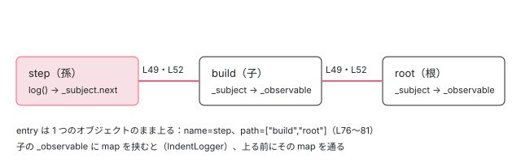

[目次](../README.md) › [@angular-devkit の内側](README.md) › 第 5 回 / 全 12 回

# logger と小さな道具：logger・utils・exception

> core/src/logger/\*・utils/\*・exception.ts・core/node/cli-logger.ts：Logger の木と level、indent と transform、PartiallyOrderedSet と PriorityQueue、deepCopy ほかの道具、例外の型。

angular/angular-cli · 読了 約 10 分 · 基礎 · [サイトで読む（デモが動きます）](https://angular-deep-dive-cyan.vercel.app/chapter/dvk-logger)

---

この章で分かること：`@angular-devkit/core` の `Logger` が「entry（1 行のログ）を流す Observable」であること、`createChild` で作る親子の木を entry がどう上っていくか、`IndentLogger`・`LevelCapLogger`・`TransformLogger`・`NullLogger` がその流れのどこに手を入れるか、ng の出力がどの条件で stderr と色に分かれるか。最後に同じフォルダの小さな道具（`PartiallyOrderedSet`・`PriorityQueue`・`deepCopy`・`tags`・例外の型）を、本物を Node で動かした記録で確かめます。

読む対象は `packages/angular_devkit/core/src/logger/` の `logger.ts`・`indent.ts`・`level.ts`・`transform-logger.ts`・`null-logger.ts`、`core/node/cli-logger.ts`、`core/src/utils/` の `partially-ordered-set.ts`・`priority-queue.ts`・`object.ts`・`literals.ts`、`core/src/exception.ts` と、ng の色を決める `packages/angular/cli/src/utilities/color.ts` です（../angular-cli、44129f66a3）。ng が最初に logger を作って `console` を差し替える `lib/cli/index.ts` は[ng コマンドの起動の章](../boot/01-boot-ng-command.md)が、段ごとの色の表は[ng と打ってからの章](../ngx/01-ngx-entry.md)が読んでいます。同じ `utils/` の `strings.ts`・`template.ts` は[第 1 回](01-dvk-path.md)です。

1. [1. パスと文字列](01-dvk-path.md)
2. [2. 仮想ファイルシステムの host](02-dvk-host.md)
3. [3. JSON schema の検査](03-dvk-schema.md)
4. [4. angular.json の読み書き](04-dvk-workspace.md)
5. **5. logger と小さな道具**（この章）
6. [6. Tree](06-dvk-tree.md)
7. [7. エンジンと規則](07-dvk-engine.md)
8. [8. ワークフローと engine host](08-dvk-workflow.md)
9. [9. architect の jobs](09-dvk-jobs.md)
10. [10. Architect が builder を呼ぶまで](10-dvk-architect.md)
11. [11. テストの道具](11-dvk-testing.md)
12. [12. spec と issue](12-dvk-tests-issues.md)

> [!TIP]
> **新卒エンジニアへ**
>
> Observable は RxJS の「値をあとから何回も流す口」です。`subscribe` した人だけが、そのあとに流れた値を受け取ります。`Subject` は、外から `next(値)` で値を押し込める Observable です。DEMO の記録は、グローバルの `@angular/cli` 22.2.7 が持つ `@angular-devkit/core` 22.2.7 を Node で直に動かして取りました。この章の範囲（logger・utils・exception・cli-logger）は 44129f66a3 と 22.2.7 でソースの差がなく、44129f66a3 と同じソースの公開版 22.2.0-next.7 で同じ記録を取り直しても出力は 1 文字も変わりませんでした。

## 1. Logger の形：entry と log

📄 `angular-cli/packages/angular_devkit/core/src/logger/logger.ts` L12–31 （▶ の行: 12–14, 16–19, 21–22, 31）

```ts
12 ▶ export interface LoggerMetadata extends JsonObject {
13 ▶   name: string;
14 ▶   path: string[];
15 │ }
16 ▶ export interface LogEntry extends LoggerMetadata {
17 ▶   level: LogLevel;
18 ▶   message: string;
19 ▶   timestamp: number;
20 │ }
21 ▶ export interface LoggerApi {
22 ▶   createChild(name: string): Logger;
23 │   log(level: LogLevel, message: string, metadata?: JsonObject): void;
24 │   debug(message: string, metadata?: JsonObject): void;
25 │   info(message: string, metadata?: JsonObject): void;
26 │   warn(message: string, metadata?: JsonObject): void;
27 │   error(message: string, metadata?: JsonObject): void;
28 │   fatal(message: string, metadata?: JsonObject): void;
29 │ }
30 │ 
31 ▶ export type LogLevel = 'debug' | 'info' | 'warn' | 'error' | 'fatal';
```

1 行のログは `LogEntry`（16〜20 行目）という JSON のオブジェクトです。`name` はその行を出した logger の名前、`path`（14 行目）は親の名前の列、`level` は 31 行目の 5 つのどれか、`timestamp` は数です。21〜29 行目の `LoggerApi` は、builder や schematic に渡す「書くだけ」の面です。

📄 `angular-cli/packages/angular_devkit/core/src/logger/logger.ts` L108–138 （▶ の行: 108–109, 112–116, 118, 120–121, 124–125）

```ts
108 ▶   complete(): void {
109 ▶     this._subject.complete();
110 │   }
111 │ 
112 ▶   log(level: LogLevel, message: string, metadata: JsonObject = {}): void {
113 ▶     const entry: LogEntry = Object.assign({}, metadata, this._metadata, {
114 ▶       level,
115 ▶       message,
116 ▶       timestamp: +Date.now(),
117 │     });
118 ▶     this._subject.next(entry);
119 │   }
120 ▶   next(entry: LogEntry): void {
121 ▶     this._subject.next(entry);
122 │   }
123 │ 
124 ▶   debug(message: string, metadata: JsonObject = {}): void {
125 ▶     this.log('debug', message, metadata);
126 │   }
127 │   info(message: string, metadata: JsonObject = {}): void {
128 │     this.log('info', message, metadata);
129 │   }
130 │   warn(message: string, metadata: JsonObject = {}): void {
131 │     this.log('warn', message, metadata);
132 │   }
133 │   error(message: string, metadata: JsonObject = {}): void {
134 │     this.log('error', message, metadata);
135 │   }
136 │   fatal(message: string, metadata: JsonObject = {}): void {
137 │     this.log('fatal', message, metadata);
138 │   }
```

1. **113 行目：entry は 3 つを重ねて作る**

   `Object.assign({}, metadata, this._metadata, {level, message, timestamp})` の順なので、呼んだ人が渡した `metadata` は、logger の `name`・`path` と、`level`・`message`・`timestamp` に上書きされます。記録で `info('本文', {name: 'fake', path: ['x'], level: 'fatal', message: 'ちがう', extra: 1})` と渡すと、残ったのは `extra: 1` だけでした。
2. **118 行目：自分の Subject に流す**

   保存はしません。記録の「subscribe より前の log」は、あとから subscribe しても届きませんでした（spec の `misses messages if not subscribed` と同じ）。
3. **120〜122 行目：`next(entry)`**

   作り終えた entry をそのまま流す口です。2 節の親への転送はこちらを通らず、`_subject.next` を直に呼びます。
4. **124〜138 行目：`debug`〜`fatal`**

   どれも `log(level, …)` を呼ぶだけです。4 節の `LevelTransformLogger` は `log` を上書きするので、この 5 つも全部そこを通ります。

## 2. 親子の木：createChild と、親への転送

📄 `angular-cli/packages/angular_devkit/core/src/logger/logger.ts` L70–106 （▶ の行: 76–80, 82–84, 86, 104–105）

```ts
 70 │   constructor(
 71 │     public readonly name: string,
 72 │     public readonly parent: Logger | null = null,
 73 │   ) {
 74 │     super();
 75 │ 
 76 ▶     const path: string[] = [];
 77 ▶     let p = parent;
 78 ▶     while (p) {
 79 ▶       path.push(p.name);
 80 ▶       p = p.parent;
 81 │     }
 82 ▶     this._metadata = { name, path };
 83 ▶     this._observable = this._subject.asObservable();
 84 ▶     if (this.parent && this.parent._subject) {
 85 │       // When the parent completes, complete us as well.
 86 ▶       this.parent._subject.subscribe(undefined, undefined, () => this.complete());
 87 │     }
 88 │   }
 89 │ 
 90 │   asApi(): LoggerApi {
 91 │     return {
 92 │       createChild: (name: string) => this.createChild(name),
 93 │       log: (level: LogLevel, message: string, metadata?: JsonObject) => {
 94 │         return this.log(level, message, metadata);
 95 │       },
 96 │       debug: (message: string, metadata?: JsonObject) => this.debug(message, metadata),
 97 │       info: (message: string, metadata?: JsonObject) => this.info(message, metadata),
 98 │       warn: (message: string, metadata?: JsonObject) => this.warn(message, metadata),
 99 │       error: (message: string, metadata?: JsonObject) => this.error(message, metadata),
100 │       fatal: (message: string, metadata?: JsonObject) => this.fatal(message, metadata),
101 │     };
102 │   }
103 │ 
104 ▶   createChild(name: string): Logger {
105 ▶     return new (this.constructor as typeof Logger)(name, this);
106 │   }
```

76〜81 行目で、親から根に向かって名前を集めます。だから `path` は**近い親が先**で、記録の `root → build → step` の `step` の entry は `path=["build","root"]` でした。83 行目で `_observable` に代入すると、すぐ下の setter が動きます。86 行目、親の Subject が complete したら自分も complete します。105 行目の `createChild` は `this.constructor`（自分と同じクラス）を `(name, this)` の 2 つの引数で作ります。クラスごとに引数の形が違うのに、ここは 2 つの形に決め打ちです（3 節と 4 節で効いてくる）。

📄 `angular-cli/packages/angular_devkit/core/src/logger/logger.ts` L33–68 （▶ の行: 34, 37, 43–45, 47–49, 51–52, 57, 60, 64）

```ts
33 │ export class Logger extends Observable<LogEntry> implements LoggerApi {
34 ▶   protected readonly _subject: Subject<LogEntry> = new Subject<LogEntry>();
35 │   protected _metadata: LoggerMetadata;
36 │ 
37 ▶   private _obs: Observable<LogEntry> = EMPTY;
38 │   private _subscription: Subscription | null = null;
39 │ 
40 │   protected get _observable() {
41 │     return this._obs;
42 │   }
43 ▶   protected set _observable(v: Observable<LogEntry>) {
44 ▶     if (this._subscription) {
45 ▶       this._subscription.unsubscribe();
46 │     }
47 ▶     this._obs = v;
48 ▶     if (this.parent) {
49 ▶       this._subscription = this.subscribe(
50 │         (value: LogEntry) => {
51 ▶           if (this.parent) {
52 ▶             this.parent._subject.next(value);
53 │           }
54 │         },
55 │         (error: Error) => {
56 │           if (this.parent) {
57 ▶             this.parent._subject.error(error);
58 │           }
59 │         },
60 ▶         () => {
61 │           if (this._subscription) {
62 │             this._subscription.unsubscribe();
63 │           }
64 ▶           this._subscription = null;
65 │         },
66 │       );
67 │     }
68 │   }
```

1. **43〜46 行目：前の購読を外す**

   `_observable` を入れ替えるたびに、親への転送の購読を作り直します。
2. **48〜49 行目：自分を subscribe して親に流す**

   49 行目の `this.subscribe` は、下の `subscribe`（161 行目）を通って**新しい `_observable`** を購読します。子が `_observable` に `map` などを挟むと、親に届くのは挟んだあとの entry です。
3. **52 行目：親の Subject に直に押し込む**

   親の `log` は通りません。親の `_metadata` も付け直さないので、親に届いた entry の `name` は子の名前のままです（記録の `root が受けた: … name=step`）。
4. **60〜65 行目：自分が complete したら購読を外す**

   記録では `root.complete()` のあと、`child complete` が `root complete` より先に出ました。86 行目の購読は子を作った時点で親の Subject に付き、`root.subscribe` はそのあとだからです。complete のあとの `child.info`・`root.info` はどこにも届きませんでした。

📄 `angular-cli/packages/angular_devkit/core/src/logger/logger.ts` L140–166 （▶ の行: 141, 144–145, 155, 161–162）

```ts
140 │   override toString() {
141 ▶     return `<Logger(${this.name})>`;
142 │   }
143 │ 
144 ▶   override lift<R>(operator: Operator<LogEntry, R>): Observable<R> {
145 ▶     return this._observable.lift(operator);
146 │   }
147 │ 
148 │   override subscribe(): Subscription;
149 │   override subscribe(observer: PartialObserver<LogEntry>): Subscription;
150 │   override subscribe(
151 │     next?: (value: LogEntry) => void,
152 │     error?: (error: Error) => void,
153 │     complete?: () => void,
154 │   ): Subscription;
155 ▶   override subscribe(
156 │     _observerOrNext?: PartialObserver<LogEntry> | ((value: LogEntry) => void),
157 │     _error?: (error: Error) => void,
158 │     _complete?: () => void,
159 │   ): Subscription {
160 │     // eslint-disable-next-line prefer-spread
161 ▶     return this._observable.subscribe.apply(
162 ▶       this._observable,
163 │       // eslint-disable-next-line prefer-rest-params
164 │       arguments as unknown as Parameters<Observable<LogEntry>['subscribe']>,
165 │     );
166 │   }
```

`Logger` は `Observable` を継ぎますが、自分の購読の仕組みは使わず、144〜146 行目の `lift`（`pipe` の中で呼ばれる）も 161 行目の `subscribe` も `_observable` に回します。だから `logger.pipe(filter(…))` は `_observable` の先に付きます（5 節の `createConsoleLogger` の 29 行目）。141 行目の `toString` は記録で `<Logger(root)>` でした。



*step.info('…') の entry が親へ上る道。親への転送は親の log を通らず、親の \_subject に直に入る*

## 3. IndentLogger：path の長さで字下げ、子で重なる字下げ

📄 `angular-cli/packages/angular_devkit/core/src/logger/indent.ts` L12–45 （▶ の行: 19, 22, 25–26, 28–31, 35, 39, 41）

```ts
12 │ /**
13 │  * Keep an map of indentation => array of indentations based on the level.
14 │  * This is to optimize calculating the prefix based on the indentation itself. Since most logs
15 │  * come from similar levels, and with similar indentation strings, this will be shared by all
16 │  * loggers. Also, string concatenation is expensive so performing concats for every log entries
17 │  * is expensive; this alleviates it.
18 │  */
19 ▶ const indentationMap: { [indentationType: string]: string[] } = {};
20 │ 
21 │ export class IndentLogger extends Logger {
22 ▶   constructor(name: string, parent: Logger | null = null, indentation = '  ') {
23 │     super(name, parent);
24 │ 
25 ▶     indentationMap[indentation] = indentationMap[indentation] || [''];
26 ▶     const indentMap = indentationMap[indentation];
27 │ 
28 ▶     this._observable = this._observable.pipe(
29 ▶       map((entry) => {
30 ▶         const l = entry.path.filter((x) => !!x).length;
31 ▶         if (l >= indentMap.length) {
32 │           let current = indentMap[indentMap.length - 1];
33 │           while (l >= indentMap.length) {
34 │             current += indentation;
35 ▶             indentMap.push(current);
36 │           }
37 │         }
38 │ 
39 ▶         entry.message = indentMap[l] + entry.message.split(/\n/).join('\n' + indentMap[l]);
40 │ 
41 ▶         return entry;
42 │       }),
43 │     );
44 │   }
45 │ }
```

ng の根の logger（`cli-main-logger`）も `createConsoleLogger` もこのクラスです。28 行目で `_observable` に `map` を挟み（2 節の setter が転送の購読を作り直す）、30 行目で `path` の空でない名前の数を深さにし、39 行目で各行の頭に深さの分の字下げを付けます。19 行目の表はモジュールに 1 つで、字下げの文字ごとに `['', ' ', ' ', …]` を覚えておきます。

spec（`indent_spec.ts` L31〜33）は、子を `new Logger(…)`（普通の Logger）で作ります。記録の同じ形では `test`・`" test2"`・`" test3\n 2 行目"` と、1 段 2 文字で字下げされました。ところが `createChild` で子を作ると、105 行目のとおり子も `IndentLogger` になり、結果が変わります。

1. **孫の 28 行目の map**

   孫 `b` の entry は `path=["a","root"]`、深さ 2 で 4 文字付きます。2 節の 49 行目のとおり、親へはこの map のあとの entry が上ります。
2. **子の map がもう一度**

   子 `a` の `_observable` にも同じ map があり、entry の `path` は孫のまま（深さ 2）なので、さらに 4 文字付きます。
3. **根の map がもう一度**

   根でまた 4 文字。記録の `b.info('b から')` は根で `" b から"`（12 文字）、`a.info` は 4 文字でした。spec の形なら 4 文字と 2 文字です。

本物の ng でも同じでした。記録用の schematic の `context.logger` は `IndentLogger`（`name=say`、`path=["cli-main-logger"]`）で、`info('line1\nline2')` は 2 行とも 4 文字の字下げで出ました。schematic のエンジンは呼び出し側の logger の `createChild(schematic の名前)` を `context.logger` にするので（`schematics/src/engine/engine.ts` L262、[第 7 回](07-dvk-engine.md)）、ng の根の `IndentLogger` の子は `IndentLogger` です。さらに `context.logger.createChild('nested')` の 1 行は 12 文字でした。

39 行目は entry を**書き換えて**返します。entry は 1 つのオブジェクトなので、同じ `IndentLogger` を 2 回 subscribe すると、2 つ目の購読の map は 1 つ目が書き換えた文字列にもう一度字下げを足します。記録は `1 つ目: " x"`・`2 つ目: " x"` でした。もう 1 つ、105 行目は 3 つ目の引数を渡さないので、`new IndentLogger('root', null, '--')` の `createChild` の子は既定の `' '` に戻ります。記録は `"-- createChild の子"`（根の `--` と子の 2 文字が重なった）でした。main（0a61cbc4bf）の `indent.ts` も 44129f66a3 と同じです。

## 4. level を変える・流れを変える・捨てる

📄 `angular-cli/packages/angular_devkit/core/src/logger/level.ts` L12–48 （▶ の行: 12, 16, 21–22, 25–26, 31, 34, 36, 42, 44–45）

```ts
12 ▶ export class LevelTransformLogger extends Logger {
13 │   constructor(
14 │     public override readonly name: string,
15 │     public override readonly parent: Logger | null,
16 ▶     public readonly levelTransform: (level: LogLevel) => LogLevel,
17 │   ) {
18 │     super(name, parent);
19 │   }
20 │ 
21 ▶   override log(level: LogLevel, message: string, metadata: JsonObject = {}): void {
22 ▶     return super.log(this.levelTransform(level), message, metadata);
23 │   }
24 │ 
25 ▶   override createChild(name: string): Logger {
26 ▶     return new LevelTransformLogger(name, this, this.levelTransform);
27 │   }
28 │ }
29 │ 
30 │ export class LevelCapLogger extends LevelTransformLogger {
31 ▶   static levelMap: { [cap: string]: { [level: string]: string } } = {
32 │     debug: { debug: 'debug', info: 'debug', warn: 'debug', error: 'debug', fatal: 'debug' },
33 │     info: { debug: 'debug', info: 'info', warn: 'info', error: 'info', fatal: 'info' },
34 ▶     warn: { debug: 'debug', info: 'info', warn: 'warn', error: 'warn', fatal: 'warn' },
35 │     error: { debug: 'debug', info: 'info', warn: 'warn', error: 'error', fatal: 'error' },
36 ▶     fatal: { debug: 'debug', info: 'info', warn: 'warn', error: 'error', fatal: 'fatal' },
37 │   };
38 │ 
39 │   constructor(
40 │     public override readonly name: string,
41 │     public override readonly parent: Logger | null,
42 ▶     public readonly levelCap: LogLevel,
43 │   ) {
44 ▶     super(name, parent, (level: LogLevel) => {
45 ▶       return (LevelCapLogger.levelMap[levelCap][level] || level) as LogLevel;
46 │     });
47 │   }
48 │ }
```

`LevelTransformLogger` は 21〜23 行目で `log` を上書きし、level を関数に通してから 1 節の 113 行目に渡します。`LevelCapLogger` はその関数を 31〜37 行目の表にしたもので、「この level より上は、この level に下げる」です。ng の中では `ng update` の peer の検査が `new LevelCapLogger('validation', logger.createChild(''), 'warn')` で、検査の `error` を `warn` に下げています（`update-resolver.ts` L1030）。

1. **34 行目：上限が warn**

   記録の `error`・`fatal` は `warn` になり、`debug`・`info`・`warn` はそのままでした。
2. **25〜27 行目：`createChild` も同じ関数**

   2 節の 105 行目を上書きしているので、子も下げます（記録の `child.fatal → warn`）。ただし `new Logger('plain', cap)` と直に作った子の `fatal` は `fatal` のままでした。子の entry は 2 節の 52 行目で親の Subject に直に入り、親の `log`（21 行目）を通らないからです。下げるのは「その logger の `log` を呼んだ行」だけです。
3. **45 行目：表に無い level はそのまま**

   `|| level` なので、型の外の `'verbose'` を JavaScript から渡すと `verbose` のまま流れました。

📄 `angular-cli/packages/angular_devkit/core/src/logger/transform-logger.ts` L12–21 （▶ の行: 13–16, 19）

```ts
12 │ export class TransformLogger extends Logger {
13 ▶   constructor(
14 ▶     name: string,
15 ▶     transform: (stream: Observable<LogEntry>) => Observable<LogEntry>,
16 ▶     parent: Logger | null = null,
17 │   ) {
18 │     super(name, parent);
19 ▶     this._observable = transform(this._observable);
20 │   }
21 │ }
```

`TransformLogger` は 19 行目で、受け取った関数に `_observable` を通します。記録では `filter` で `debug` を捨て、`map` で大文字にできました。引数の順は `(name, transform, parent)`（13〜17 行目）で、ほかの logger の `(name, parent)` と違います。2 節の 105 行目は `new TransformLogger(name, this)` と呼ぶので、親の logger が `transform` に入り、19 行目で関数として呼ばれます。記録の `t.createChild('c')` は `TypeError: transform is not a function` でした。

📄 `angular-cli/packages/angular_devkit/core/src/logger/null-logger.ts` L12–29 （▶ の行: 13–15, 18, 20）

```ts
12 │ export class NullLogger extends Logger {
13 ▶   constructor(parent: Logger | null = null) {
14 ▶     super('', parent);
15 ▶     this._observable = EMPTY;
16 │   }
17 │ 
18 ▶   override asApi(): LoggerApi {
19 │     return {
20 ▶       createChild: () => new NullLogger(this),
21 │       log() {},
22 │       debug() {},
23 │       info() {},
24 │       warn() {},
25 │       error() {},
26 │       fatal() {},
27 │     } as LoggerApi;
28 │   }
29 │ }
```

`NullLogger` は 15 行目で `_observable` を `EMPTY`（すぐ complete する Observable）にします。親への転送の購読もすぐ終わるので、親にも何も届きません（記録の `n の subscribe はすぐ complete`）。Architect や schematic のエンジンが「logger を渡されなかったとき」の代わりに使います。20 行目の `asApi().createChild` は `new NullLogger(this)` と正しく作りますが、`NullLogger` の `createChild` は上書きしていないので、2 節の 105 行目が `new NullLogger('x', this)` と呼び、13 行目の `parent` に名前の文字列が入ります。記録は `parent は "x"`・`path は [null]`（文字列の `.name` は undefined）でした。何も流さないので、表に出る違いはありません。

## 5. ng の出力：stdout と stderr、色

📄 `angular-cli/packages/angular_devkit/core/node/cli-logger.ts` L16–40 （▶ の行: 19, 21–22, 25, 27, 29–31, 33, 37）

```ts
16 │ /**
17 │  * A Logger that sends information to STDOUT and STDERR.
18 │  *
19 ▶  * @deprecated Use a custom logger implementation instead.
20 │  */
21 ▶ export function createConsoleLogger(
22 ▶   verbose = false,
23 │   stdout: ProcessOutput = process.stdout,
24 │   stderr: ProcessOutput = process.stderr,
25 ▶   colors?: Partial<Record<logging.LogLevel, (s: string) => string>>,
26 │ ): logging.Logger {
27 ▶   const logger = new logging.IndentLogger('cling');
28 │ 
29 ▶   logger.pipe(filter((entry) => entry.level !== 'debug' || verbose)).subscribe((entry) => {
30 ▶     const color = colors && colors[entry.level];
31 ▶     let output = stdout;
32 │ 
33 ▶     switch (entry.level) {
34 │       case 'warn':
35 │       case 'fatal':
36 │       case 'error':
37 ▶         output = stderr;
38 │         break;
39 │     }
40 │ 
```

`createConsoleLogger` は 19 行目で `@deprecated` です（015bbcb4e4、2026-05-12）。ng 自身はもう使わず、`lib/cli/index.ts` に同じ形を自分で書いています（[ng コマンドの起動の章](../boot/01-boot-ng-command.md)）。`architect` と `schematics` の bin も同じ時期の 33152 で自前の `IndentLogger` に替えました。27 行目で根を `IndentLogger('cling')` にし、29 行目で `verbose` でなければ `debug` を捨て、33〜39 行目で `warn`・`error`・`fatal` を stderr にします。色は 25 行目で呼んだ人が渡す関数だけで、`createConsoleLogger` 自身は端末かどうかを見ません。記録で ANSI を直に書く関数を渡すと、パイプの先でも `[ESC]31merror の行[ESC]39m` が出ました。

📄 `angular-cli/packages/angular_devkit/core/node/cli-logger.ts` L41–71 （▶ の行: 60, 62–65, 67）

```ts
41 │     // If we do console.log(message) or process.stdout.write(message + '\n'), the process might
42 │     // stop before the whole message is written and the stream is flushed. This happens when
43 │     // streams are asynchronous.
44 │     //
45 │     // NodeJS IO streams are different depending on platform and usage. In POSIX environment,
46 │     // for example, they're asynchronous when writing to a pipe, but synchronous when writing
47 │     // to a TTY. In windows, it's the other way around. You can verify which is which with
48 │     // stream.isTTY and platform, but this is not good enough.
49 │     // In the async case, one should wait for the callback before sending more data or
50 │     // continuing the process. In our case it would be rather hard to do (but not impossible).
51 │     //
52 │     // Instead we take the easy way out and simply chunk the message and call the write
53 │     // function while the buffer drain itself asynchronously. With a smaller chunk size than
54 │     // the buffer, we are mostly certain that it works. In this case, the chunk has been picked
55 │     // as half a page size (4096/2 = 2048), minus some bytes for the color formatting.
56 │     // On POSIX it seems the buffer is 2 pages (8192), but just to be sure (could be different
57 │     // by platform).
58 │     //
59 │     // For more details, see https://nodejs.org/api/process.html#process_a_note_on_process_i_o
60 ▶     const chunkSize = 2000; // Small chunk.
61 │     let message = entry.message;
62 ▶     while (message) {
63 ▶       const chunk = message.slice(0, chunkSize);
64 ▶       message = message.slice(chunkSize);
65 ▶       output.write(color ? color(chunk) : chunk);
66 │     }
67 ▶     output.write('\n');
68 │   });
69 │ 
70 │   return logger;
71 │ }
```

60〜66 行目で、1 行を 2000 文字ずつに切って `write` します。色の関数は 65 行目で**切れ端ごと**に呼びます。記録の 4500 文字の `info`（色の関数は `<…>` で包むもの）は、`write` が 4 回、長さが `2002, 2002, 502, 1`（3 つの切れ端と 67 行目の改行）でした。記録の `createChild('child').info` は stdout に 4 文字の字下げで出ました。27 行目の根が `IndentLogger` なので、3 節の重なりがここでも起きます（字下げの段は 1 つなので、重ならなければ 2 文字）。

📄 `angular-cli/packages/angular/cli/src/utilities/color.ts` L9–39 （▶ の行: 10, 12, 15, 22, 25, 28–30, 35, 37）

```ts
 9 │ import { WriteStream } from 'node:tty';
10 ▶ import { styleText } from 'node:util';
11 │ 
12 ▶ export const colors = Object.freeze({
13 │   black: (text: string) => styleText('black', text),
14 │   blue: (text: string) => styleText('blue', text),
15 ▶   bold: (text: string) => styleText('bold', text),
16 │   cyan: (text: string) => styleText('cyan', text),
17 │   dim: (text: string) => styleText('dim', text),
18 │   gray: (text: string) => styleText('gray', text),
19 │   green: (text: string) => styleText('green', text),
20 │   italic: (text: string) => styleText('italic', text),
21 │   magenta: (text: string) => styleText('magenta', text),
22 ▶   red: (text: string) => styleText('red', text),
23 │   underline: (text: string) => styleText('underline', text),
24 │   white: (text: string) => styleText('white', text),
25 ▶   yellow: (text: string) => styleText('yellow', text),
26 │ });
27 │ 
28 ▶ export function supportColor(stream: NodeJS.WritableStream = process.stdout): boolean {
29 ▶   if (stream instanceof WriteStream) {
30 ▶     return stream.hasColors();
31 │   }
32 │ 
33 │   try {
34 │     // The hasColors function does not rely on any instance state and should ideally be static
35 ▶     return WriteStream.prototype.hasColors();
36 │   } catch {
37 ▶     return process.env['FORCE_COLOR'] !== undefined && process.env['FORCE_COLOR'] !== '0';
38 │   }
39 │ }
```

ng の色の関数は 12〜26 行目で、Node の `util.styleText` を呼ぶだけです。`styleText` は既定で `process.stdout` が色を出せるかを確かめ、出せなければ色を付けずに文字列を返します（Node の `validateStream` の既定）。もう 1 つの判断が 28 行目の `supportColor` で、`lib/cli/index.ts` はこれが偽なら色の制御文字を外します。パイプの `process.stdout` は `tty.WriteStream` ではないので 29 行目は通らず、35 行目で**環境変数だけ**から答えます（`hasColors` は例外を投げないので、37 行目の `FORCE_COLOR` の行は、この記録では一度も通りませんでした）。

| 子プロセスの env（stdout・stderr はパイプ） | `supportColor()` | stderr の warn の行 |
| --- | --- | --- |
| PATH だけ | false | 色なし |
| `TERM=xterm-256color` | true | 色なし（`styleText` が端末でないと見て外す） |
| `FORCE_COLOR=1` | true | `[ESC]1m[ESC]33mwarn の行[ESC]39m[ESC]22m` |
| `FORCE_COLOR=0`・`NO_COLOR=1` | false | 色なし |

もう 1 つ、`styleText` が見るのはいつも stdout です。`script` で疑似端末を作り、`ng g …:say 2> tty-err.txt` と stderr だけをファイルにすると、端末の stdout は色なしの `info` だけ、**ファイルの方に**`[ESC]1m[ESC]33m warn line[ESC]39m[ESC]22m` が入りました。architect の bin（`architect/bin/architect.ts` L224〜226）は `styleText(…, { stream: process.stderr })` と stderr を渡していて、こちらは出す先を見ます。main の `color.ts` も同じです。

## 6. 小さな道具：PartiallyOrderedSet・PriorityQueue・deepCopy・tags・例外

### PartiallyOrderedSet：deps より後に並ぶ集合

📄 `angular-cli/packages/angular_devkit/core/src/utils/partially-ordered-set.ts` L9–34 （▶ の行: 11, 13, 16, 18, 23, 26, 28–30, 33）

```ts
 9 │ import { BaseException } from '../exception';
10 │ 
11 ▶ export class DependencyNotFoundException extends BaseException {
12 │   constructor() {
13 ▶     super('One of the dependencies is not part of the set.');
14 │   }
15 │ }
16 ▶ export class CircularDependencyFoundException extends BaseException {
17 │   constructor() {
18 ▶     super('Circular dependencies found.');
19 │   }
20 │ }
21 │ 
22 │ /**
23 ▶  * @deprecated Use standard arrays and ensure correct insertion order instead.
24 │  */
25 │ export class PartiallyOrderedSet<T> {
26 ▶   private _items = new Map<T, Set<T>>();
27 │ 
28 ▶   protected _checkCircularDependencies(item: T, deps: Set<T>): void {
29 ▶     if (deps.has(item)) {
30 ▶       throw new CircularDependencyFoundException();
31 │     }
32 │ 
33 ▶     deps.forEach((dep) => this._checkCircularDependencies(item, this._items.get(dep) || new Set()));
34 │   }
```

23 行目のとおり `@deprecated` です（1b900f0671、2026-04-24）。44129f66a3 で使っているのは schema の登録簿の `_pre`・`_post`（`addPreTransform(visitor, deps)` の並び、[第 3 回](03-dvk-schema.md)）だけでした。26 行目の `Map` が「item → その deps の Set」を持ち、28〜34 行目で、足す item が deps をたどった先に無いかを再帰で確かめます。

📄 `angular-cli/packages/angular_devkit/core/src/utils/partially-ordered-set.ts` L77–108 （▶ の行: 77–78, 83–84, 86, 94, 103–104, 106）

```ts
 77 ▶   add(item: T, deps: Set<T> | T[] = new Set()): this {
 78 ▶     if (Array.isArray(deps)) {
 79 │       deps = new Set(deps);
 80 │     }
 81 │ 
 82 │     // Verify item is not already in the set.
 83 ▶     if (this._items.has(item)) {
 84 ▶       const itemDeps = this._items.get(item) || new Set<T>();
 85 │ 
 86 ▶       // If the dependency list is equal, just return, otherwise remove and keep going.
 87 │       let equal = true;
 88 │       for (const dep of deps) {
 89 │         if (!itemDeps.has(dep)) {
 90 │           equal = false;
 91 │           break;
 92 │         }
 93 │       }
 94 ▶       if (equal) {
 95 │         for (const dep of itemDeps) {
 96 │           if (!deps.has(dep)) {
 97 │             equal = false;
 98 │             break;
 99 │           }
100 │         }
101 │       }
102 │ 
103 ▶       if (equal) {
104 ▶         return this;
105 │       } else {
106 ▶         this._items.delete(item);
107 │       }
108 │     }
```

📄 `angular-cli/packages/angular_devkit/core/src/utils/partially-ordered-set.ts` L109–134 （▶ の行: 111–113, 118, 120, 125, 131, 133）

```ts
109 │ 
110 │     // Verify all dependencies are part of the Set.
111 ▶     for (const dep of deps) {
112 ▶       if (!this._items.has(dep)) {
113 ▶         throw new DependencyNotFoundException();
114 │       }
115 │     }
116 │ 
117 │     // Verify there's no dependency cycle.
118 ▶     this._checkCircularDependencies(item, deps);
119 │ 
120 ▶     this._items.set(item, new Set(deps));
121 │ 
122 │     return this;
123 │   }
124 │ 
125 ▶   delete(item: T): boolean {
126 │     if (!this._items.has(item)) {
127 │       return false;
128 │     }
129 │ 
130 │     // Remove it from all dependencies if force == true.
131 ▶     this._items.forEach((value) => value.delete(item));
132 │ 
133 ▶     return this._items.delete(item);
134 │   }
```

1. **83〜104 行目：同じ item で deps も同じなら何もしない**

   記録の `add('a', [])` は並びを変えませんでした。
2. **106 行目：deps が違えば、いったん消す**

   消してから 120 行目で `Map` の末尾に入れ直すので、並びが変わります。記録の `add('a', ['c'])` は `["b","c","a"]` でした。
3. **111〜115 行目と 118 行目：検査は消したあと**

   検査で投げると、106 行目で消した item は戻りません。記録の `add('y', ['x'])` のあとの `add('x', ['y'])` は `CircularDependencyFoundException` で、そのあと `has(x) = false` でした。`y` の deps には `x` が残るので、`[...s]` は 160 行目で同じ例外を投げ、集合はもう歩けません。
4. **131 行目：delete は deps からも消す**

   記録で `top` の deps の `base` を delete してから `base` を戻すと、並びは `["top","other","base"]` で、`top` はもう `base` を待ちませんでした。

📄 `angular-cli/packages/angular_devkit/core/src/utils/partially-ordered-set.ts` L136–165 （▶ の行: 137, 140, 143, 146–148, 152–153, 155, 158, 160）

```ts
136 │   *[Symbol.iterator](): IterableIterator<T, undefined, unknown> {
137 ▶     const copy: Map<T, Set<T>> = new Map(this._items);
138 │ 
139 │     for (const [key, value] of copy.entries()) {
140 ▶       copy.set(key, new Set(value));
141 │     }
142 │ 
143 ▶     while (copy.size > 0) {
144 │       const run: T[] = [];
145 │       // Take the first item without dependencies.
146 ▶       for (const [item, deps] of copy.entries()) {
147 ▶         if (deps.size == 0) {
148 ▶           run.push(item);
149 │         }
150 │       }
151 │ 
152 ▶       for (const item of run) {
153 ▶         copy.forEach((s) => s.delete(item));
154 │         copy.delete(item);
155 ▶         yield item;
156 │       }
157 │ 
158 ▶       if (run.length == 0) {
159 │         // uh oh...
160 ▶         throw new CircularDependencyFoundException();
161 │       }
162 │     }
163 │ 
164 │     return undefined;
165 │   }
```

並べるのは 136〜165 行目の iterator で、毎回 137〜141 行目で写しを作ります。143 行目からの 1 周で「deps が空の item」を**全部**集め（146〜150 行目）、`Map` の順に出して（152〜156 行目）、その item を残りの deps から消します。だから並びは「波」ごとで、spec の例は `red, blue`（deps なし）→ `yellow, green, purple` でした。あとから deps なしの `red2` を足すと、`purple` より前の 1 波目に入りました。

main では 3832ab3429（2026-10-23）が 86〜101 行目と 111〜115 行目を ES2025 の `Set` のメソッド（`deps.isSubsetOf(itemDeps)`、`deps.isSubsetOf(this._items)`）に書き換え、63a1c6ad57（2026-11-16）が 11〜20 行目の 2 つの例外を `exception.ts` に移し、registry の `_pre`・`_post` を普通の配列と `addTransform` にして、PartiallyOrderedSet を中で使うのをやめました。106 行目で消してから検査する順は main でも同じです。

### PriorityQueue：同じ優先度は後から来た方が先

📄 `angular-cli/packages/angular_devkit/core/src/utils/priority-queue.ts` L9–35 （▶ の行: 9, 13, 20, 22–23, 25, 29, 34）

```ts
 9 ▶ /** Naive priority queue; not intended for large datasets */
10 │ export class PriorityQueue<T> {
11 │   private _items = new Array<T>();
12 │ 
13 ▶   constructor(private _comparator: (x: T, y: T) => number) {}
14 │ 
15 │   clear(): void {
16 │     this._items = new Array<T>();
17 │   }
18 │ 
19 │   push(item: T): void {
20 ▶     const index = this._items.findIndex((existing) => this._comparator(item, existing) <= 0);
21 │ 
22 ▶     if (index === -1) {
23 ▶       this._items.push(item);
24 │     } else {
25 ▶       this._items.splice(index, 0, item);
26 │     }
27 │   }
28 │ 
29 ▶   pop(): T | undefined {
30 │     if (this._items.length === 0) {
31 │       return undefined;
32 │     }
33 │ 
34 ▶     return this._items.splice(0, 1)[0];
35 │   }
```

9 行目のコメントのとおり、配列に順に差し込むだけの素朴な作りです。20 行目は「比べて `<= 0` になる最初の要素」の前に入れるので、同じ優先度の要素の**前**に入ります。記録で `a2 b1 c2 d1 e3` の順に push すると `toArray` は `d1 b1 c2 a2 e3`、pop（34 行目、先頭を取る）も `d b c a e` で、同じ優先度の中は後から来た順でした。`< 0` なら来た順になります。使っているのは schematics の `TaskScheduler`（`schematics/src/engine/engine.ts` L110、比べるのは `priority`）だけで、deps の無い task の `priority` は 0 です。記録で A・B・C（A に依存）・D の順に予約すると、`finalize()` の並びは `D → B → A → C` と、deps の無い 3 つが予約の逆順でした。`ng new` は git の初期化の task に install の task を deps として渡し（`ng-new/index.ts` L102〜105）、順を deps で決めています。task を走らせる側は[第 8 回](08-dvk-workflow.md)です。

### deepCopy・tags・例外の型

📄 `angular-cli/packages/angular_devkit/core/src/utils/object.ts` L9–45 （▶ の行: 12, 15–16, 25, 27, 30–31, 34–37, 39）

```ts
 9 │ const copySymbol = Symbol();
10 │ 
11 │ /**
12 ▶  * @deprecated Use `structuredClone` instead.
13 │  */
14 │ export function deepCopy<T>(value: T): T {
15 ▶   if (Array.isArray(value)) {
16 ▶     return value.map((o) => deepCopy(o)) as unknown as T;
17 │   } else if (value && typeof value === 'object') {
18 │     const valueCasted = value as unknown as {
19 │       [copySymbol]?: T;
20 │       toJSON?: () => string;
21 │       // eslint-disable-next-line @typescript-eslint/no-explicit-any
22 │       [key: string]: any;
23 │     };
24 │ 
25 ▶     if (valueCasted[copySymbol]) {
26 │       // This is a circular dependency. Just return the cloned value.
27 ▶       return valueCasted[copySymbol] as T;
28 │     }
29 │ 
30 ▶     if (valueCasted['toJSON']) {
31 ▶       return JSON.parse(valueCasted['toJSON']()) as T;
32 │     }
33 │ 
34 ▶     const copy = Object.create(Object.getPrototypeOf(valueCasted));
35 ▶     valueCasted[copySymbol] = copy;
36 ▶     for (const key of Object.getOwnPropertyNames(valueCasted)) {
37 ▶       copy[key] = deepCopy(valueCasted[key]);
38 │     }
39 ▶     delete valueCasted[copySymbol];
40 │ 
41 │     return copy;
42 │   } else {
43 │     return value;
44 │   }
45 │ }
```

12 行目で `@deprecated`（fe6a5d2dbe、registry の写しを `structuredClone` に替えた）です。25〜28 行目と 35・39 行目で、写している途中の物に印の symbol を付けて循環を見分け、34 行目でプロトタイプを保ちます。記録でも循環は `c.self === c`、クラスの getter も使えました。30〜31 行目は `toJSON()` の戻り値を `JSON.parse` しますが、`toJSON` は普通 JSON の文字列ではなく値を返します。記録の `deepCopy({ d: new Date(0) })` は `SyntaxError: Unexpected non-whitespace character after JSON at position 4`（`"1970-01-01T…"` を JSON として読んだ）でした。`Map` は自分のプロパティを持たないので 36〜38 行目で中身が写らず、写しの `get` は `TypeError` でした。

📄 `angular-cli/packages/angular_devkit/core/src/utils/literals.ts` L15–49 （▶ の行: 16, 19, 22, 29, 34, 38, 45, 48）

```ts
15 │ // eslint-disable-next-line @typescript-eslint/no-explicit-any
16 ▶ export function oneLine(strings: TemplateStringsArray, ...values: any[]) {
17 │   const endResult = String.raw(strings, ...values);
18 │ 
19 ▶   return endResult.replace(/(?:\r?\n(?:\s*))+/gm, ' ').trim();
20 │ }
21 │ 
22 ▶ export function indentBy(indentations: number): TemplateTag {
23 │   let i = '';
24 │   while (indentations--) {
25 │     i += ' ';
26 │   }
27 │ 
28 │   return (strings, ...values) => {
29 ▶     return i + stripIndent(strings, ...values).replace(/\n/g, '\n' + i);
30 │   };
31 │ }
32 │ 
33 │ // eslint-disable-next-line @typescript-eslint/no-explicit-any
34 ▶ export function stripIndent(strings: TemplateStringsArray, ...values: any[]) {
35 │   const endResult = String.raw(strings, ...values);
36 │ 
37 │   // remove the shortest leading indentation from each line
38 ▶   const match = endResult.match(/^[ \t]*(?=\S)/gm);
39 │ 
40 │   // return early if there's nothing to strip
41 │   if (match === null) {
42 │     return endResult;
43 │   }
44 │ 
45 ▶   const indent = Math.min(...match.map((el) => el.length));
46 │   const regexp = new RegExp('^[ \\t]{' + indent + '}', 'gm');
47 │ 
48 ▶   return (indent > 0 ? endResult.replace(regexp, '') : endResult).trim();
49 │ }
```

`tags` として出るテンプレートのタグです。19 行目の `oneLine` は改行とそのあとの空白を 1 つの空白にし、38〜48 行目の `stripIndent` は空白でない行の頭の空白の最短を全部の行から外します。記録は `oneLine` が `"a b c"`、`stripIndent` が `"a\n b"`（相対の字下げは残る）、`indentBy(2)` が `" a\n b"` でした。

📄 `angular-cli/packages/angular_devkit/core/src/exception.ts` L9–41 （▶ の行: 9–11, 22, 24, 27, 29, 32, 37）

```ts
 9 ▶ export class BaseException extends Error {
10 ▶   constructor(message = '') {
11 ▶     super(message);
12 │   }
13 │ }
14 │ 
15 │ export class UnknownException extends BaseException {
16 │   constructor(message: string) {
17 │     super(message);
18 │   }
19 │ }
20 │ 
21 │ // Exceptions
22 ▶ export class FileDoesNotExistException extends BaseException {
23 │   constructor(path: string) {
24 ▶     super(`Path "${path}" does not exist.`);
25 │   }
26 │ }
27 ▶ export class FileAlreadyExistException extends BaseException {
28 │   constructor(path: string) {
29 ▶     super(`Path "${path}" already exist.`);
30 │   }
31 │ }
32 ▶ export class PathIsDirectoryException extends BaseException {
33 │   constructor(path: string) {
34 │     super(`Path "${path}" is a directory.`);
35 │   }
36 │ }
37 ▶ export class PathIsFileException extends BaseException {
38 │   constructor(path: string) {
39 │     super(`Path "${path}" is a file.`);
40 │   }
41 │ }
```

9〜13 行目の `BaseException` は `Error` を継ぐだけで、`name` を付けません。記録では 5 つとも `name=Error`、`instanceof BaseException` は true でした。スタックの 1 行目は `Error: Path "/a" does not exist.` の形になり、クラス名は出ません。29 行目の文は `already exist.`（`exists` ではない）で、main も同じです。

> **🧪 DEMO — logger と小さな道具を本物で動かした記録**
>
> ボタンは記録を再生します。1〜4 と 6 は @angular-devkit/core 22.2.7 に、表示したコードを Node で通した出力（`out(…)` の行）です。4 と 5 は子プロセスの標準出力と標準エラーを別々に取ったもので、標準エラーは左に印を付けます。ANSI の色の始まりは `[ESC]` と書き換えました。5 の schematic「say」は `context.logger` に 5 つの level と子の logger で 1 行ずつ書くだけです。
>
> ▶ [このデモはサイトで動かせます](https://angular-deep-dive-cyan.vercel.app/chapter/dvk-logger)

### ここまでの呼び出し（schematic の context.logger.info が端末に出るまで）

- 👤 `context.logger.info('line1\nline2')` — 記録用の schematic — *context.logger は cli-main-logger.createChild('say')*
  - `Logger.log('info', …)` — logger.ts L112 — *entry を作る（L113）*
    - `this._subject.next(entry)` — L118
      - `map(…)`（子の IndentLogger） — indent.ts L28〜39 — *深さ 1 で 2 文字*
        - `this.parent._subject.next(value)` — logger.ts L52 — *転送の購読（L49）*
          - `map(…)`（根の IndentLogger） — indent.ts L39 — *もう 2 文字で計 4 文字*
            - `logger.forEach((entry) => …)` — lib/cli/index.ts — *supportColor と styleText で色、warn 以上は console.error*

## テストと直し方

| ファイル | describe › it（行） | 固めている約束 |
| --- | --- | --- |
| `src/logger/logger_spec.ts` | `Logger`（14）› `works`（15）・`works with children`（34）・`misses messages if not subscribed`（57） | 1・2 節。子は `new Logger(name, parent)` で作り、`createChild` は通らない |
| `src/logger/indent_spec.ts` | `IndentSpec`（14）› `works`（15） | 3 節の 1 段 2 文字。子は L31〜33 の `new Logger` だけで、`IndentLogger` の子（`createChild`）と 2 回の subscribe は無い |
| `src/logger/transform-logger_spec.ts`・`null-logger_spec.ts` | `TransformLogger`（14）› `works`（15）、`NullLogger`（13）› `works`（14）・`nullifies children`（30） | 4 節。`TransformLogger` の `createChild` は無い。`LevelCapLogger` の spec は無い |
| `src/utils/partially-ordered-set_spec.ts` | `PartiallyOrderedSet`（11）› `can add an item`（12）・`can remove an item`（20）・`list items in determistic order of dependency`（31） | 6 節の波の並び。例外と、失敗した `add` のあとは無い |
| `src/utils/priority-queue_spec.ts` | `PriorityQueue`（11）› `adds an item`（12） | 1 つ push して `peek` だけ。同じ優先度の並び（`TaskScheduler` の task の順になる）は無い |
| `src/utils/object_spec.ts`・`literals_spec.ts` | `deepCopy`（13）› 7 個（`works with circular objects` 47 ほか）、`literals`（11）› 4 個 | `toJSON` を持つ物（Date）は無い |
| `core/node/cli-logger.ts` | spec なし | 5 節の振り分けと切れ端は、どの spec も通らない |

📄 `走らせたコマンド（2026-11-26）`

```
$ cd ~/angular-research/angular-cli      # 44129f66a3、読むだけ
$ pnpm bazel test //packages/angular_devkit/core:test --nocache_test_results --test_output=all
$ pnpm bazel test //packages/angular_devkit/core:test --nocache_test_results --test_output=all \
    "--test_arg=--filter=^(Logger|IndentSpec|TransformLogger|NullLogger|PartiallyOrderedSet|PriorityQueue|object|literals) "
（結果は下の段落）
```

手元の bazel で `//packages/angular_devkit/core:test` は 218 specs・0 failures、上の名前で絞ると 22 specs（Logger 3・IndentSpec 1・TransformLogger 1・NullLogger 2・PartiallyOrderedSet 3・PriorityQueue 1・deepCopy 7・literals 4）・0 failures でした。

直すとしたら、3 節の重なりは `indent.ts` の 28〜43 行目で、子から上ってきた entry（`entry.name !== this.name`、または自分より深い `path`）には字下げを足さない形にするか、`IndentLogger` に `createChild` を足して子を普通の `Logger` にします。39 行目は entry を書き換えず `{ ...entry, message }` を返すと、2 回の subscribe の重なりも消えます。ただし schematic や builder の出力の字下げが今と変わるので、e2e の出力の比べ方も見直しが要ります。spec は `indent_spec.ts` に「`createChild` の孫が 4 文字」「2 回 subscribe しても同じ文字列」を足します。4 節の `TransformLogger` と `NullLogger` は、それぞれ `createChild` を上書きします（`new TransformLogger(name, this.transform, this)` の形にするには transform を覚えておく必要がある）。spec は `transform-logger_spec.ts`・`null-logger_spec.ts` に足します。6 節の `PartiallyOrderedSet.add` は、106 行目の削除を 111〜118 行目の検査のあとに動かします（検査は「item を除いた集合」で行う必要がある）。`PriorityQueue` の 20 行目を `< 0` にするかは、来た順を約束にするかどうかの判断で、spec が無いので今はどちらの約束もありません。5 節の stderr の色は `color.ts` の側で、`colors` に出す先の stream を渡せる形にし、`lib/cli/index.ts` の `warn`・`error`・`fatal` は stderr で判断します。

## 聞かれそうな質問

**Q. 子の logger の entry を受けたら `name` が子の名前でした。親の名前はどこですか？**

`path` です（logger.ts L76〜81、近い親が先）。親への転送は L52 で親の Subject に直に押し込むので、親の `_metadata` は付け直されません。

**Q. schematic の `context.logger.info` が 4 文字字下げされるのはなぜですか？**

`context.logger` は ng の根の `IndentLogger` の `createChild` で、L105 のとおり子も `IndentLogger` だからです。子の map と根の map が同じ深さ 1 を見て 2 文字ずつ足します（indent.ts L28・L39、記録）。孫なら 12 文字です。

**Q. `LevelCapLogger` で `warn` に抑えたのに、子が `fatal` を出しました。**

子を `new Logger(name, cap)` で作ると、子の entry は level.ts L21 の `log` を通らず L52 で親に入るからです。`cap.createChild(…)`（L25〜27）で作った子なら下がります（記録）。

**Q. CI のログで ng の警告に色を付けたい（または外したい）。**

パイプでは `styleText` が色を外すので、`FORCE_COLOR=1` で付き、`FORCE_COLOR=0` か `NO_COLOR=1` なら `supportColor()` が偽になって制御文字も外れます（color.ts L28〜38、記録の表）。stdout が端末で stderr だけをファイルにしたときは、ファイルに色が入ります（記録）。

**Q. `PartiallyOrderedSet.add` が例外を投げたあと、集合はそのまま使えますか？**

同じ item を deps を変えて足し直したときは使えません。L106 で消してから L111〜118 で検査するので、item は消えたまま、ほかの item の deps に残り、L160 で歩くたびに `CircularDependencyFoundException` です（記録）。新しい item なら消す物が無いので、元のままです。

## 読み終えて

- `Logger` は Subject を包んだ Observable で、entry は保存されない。`metadata` は `name`・`path`・`level`・`message` を上書きできず、`path` は近い親が先。
- 子の entry は子の `_observable` を通ってから、親の `log` を通らず親の Subject に入る。だから `LevelCapLogger` は直に作った子を抑えず、`IndentLogger` の子の字下げは段ごとに重なる（本物の ng の schematic で 4 文字・12 文字）。
- `createChild` は `new this.constructor(name, this)` に決め打ちで、`TransformLogger` は `TypeError`、`NullLogger` は parent に文字列が入る。
- ng の出力は `warn` 以上が stderr。色は `supportColor`（環境変数だけを見る）と `styleText`（stdout を見る）の 2 つで決まり、`FORCE_COLOR` でパイプにも付く。
- `PartiallyOrderedSet`（波ごとの並び、失敗した `add` で壊れる）・`deepCopy`（Date で投げる）は `@deprecated`。`PriorityQueue` は同じ優先度を後から来た順に出し、schematic の deps の無い task は予約の逆順に並ぶ。

---

← 前: [angular.json を読み書きする：workspace](04-dvk-workspace.md)  
次: [Tree：schematic が触るファイルの木](06-dvk-tree.md) →
