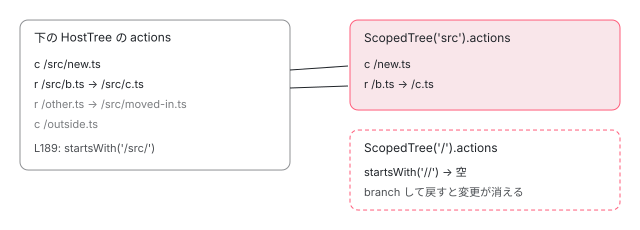

[目次](../README.md) › [@angular-devkit の内側](README.md) › 第 6 回 / 全 12 回

# Tree：schematic が触るファイルの木

> schematics/src/tree/\*：HostTree の読み書きと actions（create・overwrite・rename・delete）、UpdateRecorder の挿入と削除の位置、ScopedTree と DelegateTree、merge の衝突の決め方。

angular/angular-cli · 読了 約 14 分 · 発展 · [サイトで読む（デモが動きます）](https://angular-deep-dive-cyan.vercel.app/chapter/dvk-tree)

---

この章で分かること：schematic が受け取る `Tree` の 5 つの実装（`HostTree`・`FilterHostTree`・`ScopedTree`・`DelegateTree`・`NullTree`）が、読む・書く・`actions` を出す・`branch` と `merge` をするときに何をしているかです。`UpdateRecorder` で同じ位置に挿入と削除を重ねたときの結果、`MergeStrategy` ごとの衝突の表、`ScopedTree` の見え方を、本物の `@angular-devkit/schematics` を Node で動かして確かめます。

読む対象は `packages/angular_devkit/schematics/src/tree/` の `host-tree.ts`・`scoped.ts`・`delegate.ts`・`null.ts`・`static.ts`・`entry.ts`・`action.ts`・`recorder.ts`・`interface.ts` です（../angular-cli、44129f66a3）。`HostTree` が `CordHost` に記録し、それが `actions` になり、sink がディスクに書くまでの大きな流れは[Schematics の Tree と sink の章](../cli/13-schematics.md)が、`mergeWith`・`branchAndMerge` と `MergeStrategy` の値は[規則（Rule）の章](../cli/14-schematics-rules.md)の 2 節が読んでいます。この章はその残りの行を読みます。

1. [1. パスと文字列](01-dvk-path.md)
2. [2. 仮想ファイルシステムの host](02-dvk-host.md)
3. [3. JSON schema の検査](03-dvk-schema.md)
4. [4. angular.json の読み書き](04-dvk-workspace.md)
5. [5. logger と小さな道具](05-dvk-logger.md)
6. **6. Tree**（この章）
7. [7. エンジンと規則](07-dvk-engine.md)
8. [8. ワークフローと engine host](08-dvk-workflow.md)
9. [9. architect の jobs](09-dvk-jobs.md)
10. [10. Architect が builder を呼ぶまで](10-dvk-architect.md)
11. [11. テストの道具](11-dvk-testing.md)
12. [12. spec と issue](12-dvk-tests-issues.md)

> [!TIP]
> **新卒エンジニアへ**
>
> 記録は、グローバルの `@angular/cli` 22.2.7 が持つ `@angular-devkit/schematics` 22.2.7 と、npm の 22.2.0-next.7 の 2 つで同じスクリプトを走らせて取りました。22.2.0-next.7 は、`schematics/src/tree/` と `core/src` のソースが 44129f66a3 と差分 0 の公開版です。44129f66a3 と 22.2.7 は、この章の範囲では 3 か所が違います：`recorder.ts` の 14 行目と `null.ts` の 23 行目の `export` が外れた（ddd1760c1a、main は 16435ed697）、`static.ts` の `partition` が `DelegateTree` を受けるようになった（e7fd1bd9cb、main は 9d6baa30ae）。記録で値が違ったのはこの 2 つだけで、DEMO では両方を並べます。

## 1. Tree の約束と、木を作る 4 つの関数

`Tree` は `interface.ts` の 78〜128 行目の interface で、読む（`read`・`exists`・`get`・`getDir`・`visit`）、中身を変える（`overwrite`・`beginUpdate`・`commitUpdate`）、形を変える（`create`・`delete`・`rename`）、木どうし（`branch`・`merge`・`actions`）の 4 組のメソッドを約束します。

📄 `angular-cli/packages/angular_devkit/schematics/src/tree/interface.ts` L130–145 （▶ の行: 134–136, 140, 142–144）

```ts
130 │ export interface TreeConstructor {
131 │   isTree(maybeTree: object): maybeTree is Tree;
132 │ }
133 │ 
134 ▶ export const Tree: TreeConstructor = Object.freeze({
135 ▶   isTree(maybeTree: object): maybeTree is Tree {
136 ▶     return TreeSymbol in maybeTree;
137 │   },
138 │ });
139 │ 
140 ▶ export interface UpdateRecorder {
141 │   // These just record changes.
142 ▶   insertLeft(index: number, content: Buffer | string): UpdateRecorder;
143 ▶   insertRight(index: number, content: Buffer | string): UpdateRecorder;
144 ▶   remove(index: number, length: number): UpdateRecorder;
145 │ }
```

「これは Tree か」は `instanceof` ではなく、136 行目の `TreeSymbol in maybeTree` で決めます。`TreeSymbol` は L61〜76 で `global.Symbol.schematicTree` に 1 つだけ作る symbol なので、`node_modules` に `@angular-devkit/schematics` が 2 つあっても同じ symbol です。どの実装もコンストラクターで `this[TreeSymbol] = () => this` を置きます（host-tree.ts L131、scoped.ts L108、delegate.ts L32、null.ts L60）。142〜144 行目の `UpdateRecorder` の約束は 3 つのメソッドだけで、実装は 4 節の `UpdateRecorderBase` です。

📄 `angular-cli/packages/angular_devkit/schematics/src/tree/static.ts` L13–40 （▶ の行: 13–14, 17–18, 21, 26, 31–32, 34–35, 38）

```ts
13 ▶ export function empty(): HostTree {
14 ▶   return new HostTree();
15 │ }
16 │ 
17 ▶ export function branch(tree: Tree): Tree {
18 ▶   return tree.branch();
19 │ }
20 │ 
21 ▶ export function merge(
22 │   tree: Tree,
23 │   other: Tree,
24 │   strategy: MergeStrategy = MergeStrategy.Default,
25 │ ): Tree {
26 ▶   tree.merge(other, strategy);
27 │ 
28 │   return tree;
29 │ }
30 │ 
31 ▶ export function partition(tree: Tree, predicate: FilePredicate<boolean>): [Tree, Tree] {
32 ▶   if (tree instanceof HostTree) {
33 │     return [
34 ▶       new FilterHostTree(tree, predicate),
35 ▶       new FilterHostTree(tree, (path, entry) => !predicate(path, entry)),
36 │     ];
37 │   } else {
38 ▶     throw new SchematicsException('Tree type is not supported.');
39 │   }
40 │ }
```

`index.ts` が `Tree.empty`・`Tree.branch`・`Tree.merge`・`Tree.partition` として外に出す関数です。14 行目の `empty()` は backend の無い `HostTree`、18 行目と 26 行目はメソッドを呼ぶだけです。31〜39 行目の `partition` は、`HostTree` を 2 つの `FilterHostTree`（8 節）に分け、それ以外は 38 行目で「Tree type is not supported.」です。44129f66a3 では、`DelegateTree`（8 節）を包んだ木を渡すとここで止まります。記録では 22.2.0-next.7 が「SchematicsException: Tree type is not supported.」、22.2.7 は先に `tree.branch()` で `HostTree` にしてから分けて、`yes: /a1`・`no: /b2` でした（e7fd1bd9cb、`UnitTestTree` を `partitionApplyMerge` に渡すと止まる問題の修正）。

## 2. HostTree の読む側：get・getDir・visit・readJson

📄 `angular-cli/packages/angular_devkit/schematics/src/tree/host-tree.ts` L338–372 （▶ の行: 339, 343–345, 347, 351, 355–357, 360, 362–363, 367–368）

```ts
338 │   exists(path: string): boolean {
339 ▶     return this._recordSync.isFile(this._normalizePath(path));
340 │   }
341 │ 
342 │   get(path: string): FileEntry | null {
343 ▶     const p = this._normalizePath(path);
344 ▶     if (this._recordSync.isDirectory(p)) {
345 ▶       throw new PathIsDirectoryException(p);
346 │     }
347 ▶     if (!this._recordSync.exists(p)) {
348 │       return null;
349 │     }
350 │ 
351 ▶     return new LazyFileEntry(p, () => Buffer.from(this._recordSync.read(p)));
352 │   }
353 │ 
354 │   getDir(path: string): DirEntry {
355 ▶     const p = this._normalizePath(path);
356 ▶     if (this._recordSync.isFile(p)) {
357 ▶       throw new PathIsFileException(p);
358 │     }
359 │ 
360 ▶     let maybeCache = this._dirCache.get(p);
361 │     if (!maybeCache) {
362 ▶       let parent: Path | null = dirname(p);
363 ▶       if (p === parent) {
364 │         parent = null;
365 │       }
366 │ 
367 ▶       maybeCache = new HostDirEntry(parent && this.getDir(parent), p, this._recordSync, this);
368 ▶       this._dirCache.set(p, maybeCache);
369 │     }
370 │ 
371 │     return maybeCache;
372 │   }
```

1. **339 行目：exists はファイルだけ**

   `isFile` を見るので、ディレクトリのパスには `false` です。パスはどこでも L136〜138 の `normalize('/' + path)` を通るので、`'new.txt'` と `'/new.txt'` は同じです（パスの規則は[パスと文字列の章](01-dvk-path.md)）。
2. **344〜346 行目：get にディレクトリを渡すと例外**

   記録の `tree.get('/')` は「PathIsDirectoryException: Path "/" is a directory.」、逆に 356〜358 行目の `getDir('/a.txt')` は「PathIsFileException: Path "/a.txt" is a file.」でした。無いファイルの `get` は 347〜349 行目で `null` です。
3. **351 行目：中身は読むまで読まない**

   `LazyFileEntry` に「読む関数」を渡すだけです。
4. **360〜368 行目：DirEntry はパスごとに 1 つ**

   `_dirCache` に入れ、親は 362 行目の `dirname` から再帰で作ります。363 行目、`/` の親は自分なので `null` にします。

📄 `angular-cli/packages/angular_devkit/schematics/src/tree/entry.ts` L26–40 （▶ の行: 27, 31, 38）

```ts
26 │ export class LazyFileEntry implements FileEntry {
27 ▶   private _content: Buffer | null = null;
28 │ 
29 │   constructor(
30 │     private _path: Path,
31 ▶     private _load: (path?: Path) => Buffer,
32 │   ) {}
33 │ 
34 │   get path(): Path {
35 │     return this._path;
36 │   }
37 │   get content(): Buffer {
38 ▶     return this._content || (this._content = this._load(this._path));
39 │   }
40 │ }
```

38 行目で、最初に `content` を読んだときに 1 回だけ `_load` を呼び、あとは覚えた Buffer を返します。`get` は呼ぶたびに新しい `LazyFileEntry` を作るので、覚えるのは 1 つの entry の中だけです。

📄 `angular-cli/packages/angular_devkit/schematics/src/tree/host-tree.ts` L61–98 （▶ の行: 62, 64, 69, 79, 81, 83–84, 89, 91–93）

```ts
61 │   get subdirs(): PathFragment[] {
62 ▶     return this._host
63 │       .list(this.path)
64 ▶       .filter((fragment) => this._host.isDirectory(join(this.path, fragment)));
65 │   }
66 │   get subfiles(): PathFragment[] {
67 │     return this._host
68 │       .list(this.path)
69 ▶       .filter((fragment) => this._host.isFile(join(this.path, fragment)));
70 │   }
71 │ 
72 │   dir(name: PathFragment): DirEntry {
73 │     return this._tree.getDir(join(this.path, name));
74 │   }
75 │   file(name: PathFragment): FileEntry | null {
76 │     return this._tree.get(join(this.path, name));
77 │   }
78 │ 
79 ▶   visit(visitor: FileVisitor): void {
80 │     try {
81 ▶       this.getSubfilesRecursively().forEach((file) => visitor(file.path, file));
82 │     } catch (e) {
83 ▶       if (e !== FileVisitorCancelToken) {
84 ▶         throw e;
85 │       }
86 │     }
87 │   }
88 │ 
89 ▶   private getSubfilesRecursively() {
90 │     function _recurse(entry: DirEntry): FileEntry[] {
91 ▶       return entry.subdirs.reduce(
92 ▶         (files, subdir) => [...files, ..._recurse(entry.dir(subdir))],
93 ▶         entry.subfiles.map((subfile) => entry.file(subfile) as FileEntry),
94 │       );
95 │     }
96 │ 
97 │     return _recurse(this);
98 │   }
```

`visit` は 89〜98 行目で、ディレクトリの下のファイルを全部配列にしてから 81 行目で 1 つずつ渡します。91〜94 行目の `reduce` の初めの値が 93 行目の「このディレクトリのファイル」なので、並びは「自分のファイル → 子のディレクトリの中」です。記録の `ScopedTree` の `visit` も `/b.ts` が `/app/a.ts` より先でした。83 行目、visitor が `FileVisitorCancelToken` を投げると途中で止められます。

📄 `angular-cli/packages/angular_devkit/schematics/src/tree/host-tree.ts` L298–336 （▶ の行: 300–301, 304, 308, 316, 325, 328, 330–331）

```ts
298 │   readText(path: string): string {
299 │     const data = this.read(path);
300 ▶     if (data === null) {
301 ▶       throw new FileDoesNotExistException(path);
302 │     }
303 │ 
304 ▶     const decoder = new TextDecoder('utf-8', { fatal: true });
305 │ 
306 │     try {
307 │       // With the `fatal` option enabled, invalid data will throw a TypeError
308 ▶       return decoder.decode(data);
309 │     } catch (e) {
310 │       // The second part should not be needed. But Jest does not support instanceof correctly.
311 │       // See: https://github.com/jestjs/jest/issues/2549
312 │       if (
313 │         e instanceof TypeError ||
314 │         (e as NodeJS.ErrnoException).code === 'ERR_ENCODING_INVALID_ENCODED_DATA'
315 │       ) {
316 ▶         throw new Error(`Failed to decode "${path}" as UTF-8 text.`, { cause: e });
317 │       }
318 │       throw e;
319 │     }
320 │   }
321 │ 
322 │   readJson(path: string): JsonValue {
323 │     const content = this.readText(path);
324 │     const errors: ParseError[] = [];
325 ▶     const result = jsoncParse(content, errors, { allowTrailingComma: true });
326 │ 
327 │     // If there is a parse error throw with the error information
328 ▶     if (errors[0]) {
329 │       const { error, offset } = errors[0];
330 ▶       throw new Error(
331 ▶         `Failed to parse "${path}" as JSON. ${printParseErrorCode(error)} at offset: ${offset}.`,
332 │       );
333 │     }
334 │ 
335 │     return result;
336 │   }
```

304 行目の `fatal: true` で、UTF-8 として読めない byte があると 316 行目の文になります（記録：`0xc3 0x28` で「Failed to decode "/bin" as UTF-8 text.」）。`readJson` は 325 行目で jsonc-parser をコメントと末尾のカンマを許して呼び、記録の `{ // comment\n "a": 1, }` は `{"a":1}` でした。壊れた JSON は 330〜331 行目の文で、`{"a": }` は「Failed to parse "/bad.json" as JSON. ValueExpected at offset: 6.」でした。

## 3. 書く側と actions の並び

`create`・`overwrite`・`delete`・`rename` が `CordHost` に記録され、`actions` が delete → rename → create → overwrite の順に並ぶことは[Schematics の Tree と sink の章](../cli/13-schematics.md)の 2〜4 節が読んでいます（`CordHost` の中は[host の章](02-dvk-host.md)）。記録で確かめた並びはこうです。

| した操作（backend に /a.txt・/b.txt・/c.txt） | tree.actions |
| --- | --- |
| create new.txt → overwrite a → rename b→b2 → delete c | `d /c.txt`・`r /b.txt → /b2.txt`・`c /new.txt`・`o /a.txt` |
| 同じ 4 つを逆の順で | 上と同じ（操作の順は残らない） |
| create n → overwrite n → rename n→m | `c /m.txt "v2"` の 1 つ |
| create tmp → delete tmp | 空 |
| overwrite a → delete a、rename b→x → rename x→y | `d /a.txt`・`r /b.txt → /y.txt` |
| delete a → create a | `o /a.txt "again"` |

もう 1 つ、記録の `create('/a.txt')`（backend にあるファイル）は例外にならず、`c /a.txt` が積まれました。`CordHost.create` がメモリの中しか見ないからで、止めるのは sink の検査です（同じ章の 1 節と 8 節）。`action.ts` の L162 のコメント「If the file already exists then this is an error.」は、sink が確かめる条件です。

`action.ts` にはもう 1 つ、操作を並べ直す `ActionList` があります。

📄 `angular-cli/packages/angular_devkit/schematics/src/tree/action.ts` L51–74 （▶ の行: 51–52, 55, 59–60, 64–65, 71–72）

```ts
51 ▶   optimize(): void {
52 ▶     const toCreate = new Map<Path, Buffer>();
53 │     const toRename = new Map<Path, Path>();
54 │     const toOverwrite = new Map<Path, Buffer>();
55 ▶     const toDelete = new Set<Path>();
56 │ 
57 │     for (const action of this._actions) {
58 │       switch (action.kind) {
59 ▶         case 'c':
60 ▶           toCreate.set(action.path, action.content);
61 │           break;
62 │ 
63 │         case 'o':
64 ▶           if (toCreate.has(action.path)) {
65 ▶             toCreate.set(action.path, action.content);
66 │           } else {
67 │             toOverwrite.set(action.path, action.content);
68 │           }
69 │           break;
70 │ 
71 ▶         case 'd':
72 ▶           toDelete.add(action.path);
73 │           break;
74 │ 
```

📄 `angular-cli/packages/angular_devkit/schematics/src/tree/action.ts` L104–123 （▶ の行: 107–109, 112, 116–117, 120）

```ts
104 │       }
105 │     }
106 │ 
107 ▶     this._actions = [];
108 ▶     toDelete.forEach((x) => {
109 ▶       this.delete(x);
110 │     });
111 │ 
112 ▶     toRename.forEach((to, from) => {
113 │       this.rename(from, to);
114 │     });
115 │ 
116 ▶     toCreate.forEach((content, path) => {
117 ▶       this.create(path, content);
118 │     });
119 │ 
120 ▶     toOverwrite.forEach((content, path) => {
121 │       this.overwrite(path, content);
122 │     });
123 │   }
```

`optimize` は 4 つの Map と Set に畳んでから、107〜122 行目で delete → rename → create → overwrite の順に出し直します。ただし 71〜72 行目の delete は `toCreate` から消しません。記録の「create /a → delete /a」は、`optimize` のあと `d /a`・`c /a "1"` になり、消したファイルが戻りました。`ActionList` は `index.ts` の 18 行目で外に出ていますが、../angular-cli の中で使うのは action\_spec.ts だけです（`HostTree` の `actions` は `CordHost.records()` から作る）。`Tree.optimize`（index.ts L65〜67）も木をそのまま返すだけです。

## 4. UpdateRecorder：同じ位置に重ねたとき

`beginUpdate` と `commitUpdate` の流れ、`insertLeft`・`insertRight`・`remove` が MagicString の `appendLeft`・`appendRight`・`remove` を呼ぶこと、`ContentHasMutatedException` は[Schematics の Tree と sink の章](../cli/13-schematics.md)の 3 節です。ここではその前の行を読みます。

📄 `angular-cli/packages/angular_devkit/schematics/src/tree/recorder.ts` L14–43 （▶ の行: 14, 16, 25, 27–28, 32, 35, 42）

```ts
14 ▶ export class IndexOutOfBoundException extends BaseException {
15 │   constructor(index: number, min: number, max: number = Infinity) {
16 ▶     super(`Index ${index} outside of range [${min}, ${max}].`);
17 │   }
18 │ }
19 │ 
20 │ export class UpdateRecorderBase implements UpdateRecorder {
21 │   protected _path: string;
22 │   protected content: MagicString;
23 │ 
24 │   constructor(
25 ▶     private readonly data: Uint8Array,
26 │     path: string,
27 ▶     encoding = 'utf-8',
28 ▶     private readonly bom = false,
29 │   ) {
30 │     let text;
31 │     try {
32 ▶       text = new TextDecoder(encoding, { fatal: true, ignoreBOM: false }).decode(data);
33 │     } catch (e) {
34 │       if (e instanceof TypeError) {
35 ▶         throw new Error(`Failed to decode "${path}" as ${encoding} text.`, { cause: e });
36 │       }
37 │ 
38 │       throw e;
39 │     }
40 │ 
41 │     this._path = path;
42 ▶     this.content = new MagicString(text);
43 │   }
```

📄 `angular-cli/packages/angular_devkit/schematics/src/tree/recorder.ts` L45–71 （▶ の行: 46, 51–54, 59, 66–68）

```ts
45 │   static createFromFileEntry(entry: FileEntry): UpdateRecorderBase {
46 ▶     const c0 = entry.content.byteLength > 0 && entry.content.readUInt8(0);
47 │     const c1 = entry.content.byteLength > 1 && entry.content.readUInt8(1);
48 │     const c2 = entry.content.byteLength > 2 && entry.content.readUInt8(2);
49 │ 
50 │     // Check if we're BOM.
51 ▶     if (c0 == 0xef && c1 == 0xbb && c2 == 0xbf) {
52 ▶       return new UpdateRecorderBase(entry.content, entry.path, 'utf-8', true);
53 ▶     } else if (c0 === 0xff && c1 == 0xfe) {
54 ▶       return new UpdateRecorderBase(entry.content, entry.path, 'utf-16le', true);
55 │     } else if (c0 === 0xfe && c1 == 0xff) {
56 │       return new UpdateRecorderBase(entry.content, entry.path, 'utf-16be', true);
57 │     }
58 │ 
59 ▶     return new UpdateRecorderBase(entry.content, entry.path);
60 │   }
61 │ 
62 │   get path(): string {
63 │     return this._path;
64 │   }
65 │ 
66 ▶   protected _assertIndex(index: number): void {
67 ▶     if (index < 0 || index > this.content.original.length) {
68 ▶       throw new IndexOutOfBoundException(index, 0, this.content.original.length);
69 │     }
70 │   }
71 │ 
```

1. **46〜58 行目：先頭の byte で文字コードを決める**

   `EF BB BF` なら UTF-8、`FF FE` なら UTF-16LE、`FE FF` なら UTF-16BE で、どれも `bom = true`。
2. **32 行目：BOM を除いた文字列にする**

   `ignoreBOM: false` は「BOM を読み飛ばす」です。だから位置は BOM を除いた文字で数えます。
3. **66〜70 行目：位置の検査は元の長さで**

   `content.original.length` は挿入の前の長さです。記録の `"abcdef"` で、先に `insertLeft(0, 'XXXXXXXX')` をしても `insertLeft(6, '!')` は末尾に入り、`insertLeft(7, …)` は「Index 7 outside of range \[0, 6\].」でした。

記録で、`"abcdef"` の同じ位置に重ねた結果はこうでした。

| 呼んだ順 | 結果 |
| --- | --- |
| `insertRight(3,'[R1]')`・`insertLeft(3,'[L1]')`・`insertRight(3,'[R2]')`・`insertLeft(3,'[L2]')` | `abc[L1][L2][R1][R2]def`（Left が全部先、それぞれ呼んだ順） |
| `remove(2,2)` のあと、2 と 4 に Left と Right | `ab<L2><R2><L4><R4>ef`（消した範囲の両端の挿入は残る） |
| `remove(1,4)` のあと `insertLeft(3,'<in>')` | `a<in>f`（消した範囲の中への挿入も残る） |
| `remove(1,3)`・`remove(2,3)`（重なる） | `af` |
| `remove(4, 100)` | 「MagicStringError: \[MagicString\] range 4–104 is out of bounds」 |

最後の行は、`remove` が L89 で `_assertIndex(index)` しか呼ばず、`index + length` を確かめないからです。範囲の外は `IndexOutOfBoundException` ではなく MagicString の例外になります。BOM の記録は、UTF-16LE のファイル（`ff fe 68 00 69 00`）に `insertRight(2, '!')` をすると `ef bb bf 68 69 21`、つまり **UTF-8 の BOM 付きに書き換わりました**。recorder.ts L100 のコメントのとおり、書くのは UTF-8 だけです。中身の変わらない `commitUpdate`（空の挿入）は、`actions` が空のままでした（host-tree.ts L404）。

## 5. branch と merge の入口：祖先の印

📄 `angular-cli/packages/angular_devkit/schematics/src/tree/host-tree.ts` L156–177 （▶ の行: 157–160, 166–167, 169–170, 172–173）

```ts
156 │   branch(): Tree {
157 ▶     const branchedTree = new HostTree(this._backend);
158 ▶     branchedTree._record = this._record.clone();
159 ▶     branchedTree._recordSync = new virtualFs.SyncDelegateHost(branchedTree._record);
160 ▶     branchedTree._ancestry = new Set(this._ancestry).add(this._id);
161 │ 
162 │     return branchedTree;
163 │   }
164 │ 
165 │   private isAncestorOf(tree: Tree): boolean {
166 ▶     if (tree instanceof HostTree) {
167 ▶       return tree._ancestry.has(this._id);
168 │     }
169 ▶     if (tree instanceof DelegateTree) {
170 ▶       return this.isAncestorOf((tree as unknown as { _other: Tree })._other);
171 │     }
172 ▶     if (tree instanceof ScopedTree) {
173 ▶       return this.isAncestorOf((tree as unknown as { _base: Tree })._base);
174 │     }
175 │ 
176 │     return false;
177 │   }
```

`branch` は 157 行目で同じ backend の新しい `HostTree` を作り、158 行目で記録（`CordHost`）を `clone` します。160 行目で、自分の祖先の集合に自分の `_id`（L111、作るたびに 1 つずつ減る負の数）を足したものを枝に持たせます。`isAncestorOf` は相手の `_ancestry` に自分の id があるかを見ます。169〜174 行目で、`DelegateTree` と `ScopedTree` は中の木をたどります。

📄 `angular-cli/packages/angular_devkit/schematics/src/tree/host-tree.ts` L179–197 （▶ の行: 180, 182, 185, 188, 191–193, 195–196）

```ts
179 │   merge(other: Tree, strategy: MergeStrategy = MergeStrategy.Default): void {
180 ▶     if (other === this) {
181 │       // Merging with yourself? Tsk tsk. Nothing to do at least.
182 ▶       return;
183 │     }
184 │ 
185 ▶     if (this.isAncestorOf(other)) {
186 │       // Workaround for merging a branch back into one of its ancestors
187 │       // More complete branch point tracking is required to avoid
188 ▶       strategy |= MergeStrategy.Overwrite;
189 │     }
190 │ 
191 ▶     const creationConflictAllowed =
192 ▶       (strategy & MergeStrategy.AllowCreationConflict) == MergeStrategy.AllowCreationConflict;
193 ▶     const overwriteConflictAllowed =
194 │       (strategy & MergeStrategy.AllowOverwriteConflict) == MergeStrategy.AllowOverwriteConflict;
195 ▶     const deleteConflictAllowed =
196 ▶       (strategy & MergeStrategy.AllowDeleteConflict) == MergeStrategy.AllowDeleteConflict;
197 │ 
```

185〜189 行目、相手が自分から枝分かれした木なら、渡された strategy に関係なく `Overwrite` の bit を足します。記録では、親と枝で同じファイルを別の中身に `overwrite` して `host.merge(br, MergeStrategy.Error)` としても例外にならず、枝の中身（`"branch"`）が勝ちました。逆に `br.merge(host)` は祖先ではないので「A merge conflicted on path "/a.txt".」でした。`branchAndMerge` の rule が親と枝で衝突しないのはこの 185 行目のおかげです。191〜196 行目で 3 つの許可の bit を取り出し、L198 から相手の `actions` を 1 つずつ写します（`'c'` の場合は[Schematics の Tree と sink の章](../cli/13-schematics.md)の 5 節）。`MergeStrategy.Error`（1）の bit は、この関数のどこも見ません。

## 6. merge の残り：overwrite・rename・delete と衝突の表

📄 `angular-cli/packages/angular_devkit/schematics/src/tree/host-tree.ts` L221–246 （▶ の行: 224–225, 229, 231, 233, 236–237, 242）

```ts
221 │ 
222 │         case 'o': {
223 │           const { path, content } = action;
224 ▶           if (this._willDelete(path) && !overwriteConflictAllowed) {
225 ▶             throw new MergeConflictException(path);
226 │           }
227 │ 
228 │           // Ignore if content is the same (considered the same change).
229 ▶           if (this._willOverwrite(path)) {
230 │             const existingContent = this.read(path);
231 ▶             if (existingContent && content.equals(existingContent)) {
232 │               // Identical outcome; no action required
233 ▶               return;
234 │             }
235 │ 
236 ▶             if (!overwriteConflictAllowed) {
237 ▶               throw new MergeConflictException(path);
238 │             }
239 │           }
240 │           // We use write here as merge validation has already been done, and we want to let
241 │           // the CordHost do its job.
242 ▶           this._record.write(path, content as {} as virtualFs.FileBuffer).subscribe();
243 │ 
244 │           return;
245 │         }
246 │ 
```

📄 `angular-cli/packages/angular_devkit/schematics/src/tree/host-tree.ts` L247–285 （▶ の行: 249–250, 253–254, 256, 259–260, 262, 269, 272, 275–276, 279）

```ts
247 │         case 'r': {
248 │           const { path, to } = action;
249 ▶           if (this._willDelete(path)) {
250 ▶             throw new MergeConflictException(path);
251 │           }
252 │ 
253 ▶           if (this._willRename(path)) {
254 ▶             if (this._record.willRenameTo(path, to)) {
255 │               // Identical outcome; no action required
256 ▶               return;
257 │             }
258 │ 
259 ▶             // No override possible for renaming.
260 ▶             throw new MergeConflictException(path);
261 │           }
262 ▶           this.rename(path, to);
263 │ 
264 │           return;
265 │         }
266 │ 
267 │         case 'd': {
268 │           const { path } = action;
269 ▶           if (this._willDelete(path)) {
270 │             // TODO: This should technically check the content (e.g., hash on delete)
271 │             // Identical outcome; no action required
272 ▶             return;
273 │           }
274 │ 
275 ▶           if (!this.exists(path) && !deleteConflictAllowed) {
276 ▶             throw new MergeConflictException(path);
277 │           }
278 │ 
279 ▶           this._recordSync.delete(path);
280 │ 
281 │           return;
282 │         }
283 │       }
284 │     });
285 │   }
```

1. **224〜226 行目：自分が消したファイルへの overwrite**

   `AllowOverwriteConflict` が無ければ衝突です。あれば 242 行目の `write` がファイルを作り直します。
2. **229〜239 行目：両方が overwrite**

   中身が同じなら何もしない。違えば `AllowOverwriteConflict` が無いと衝突、あれば相手の中身で上書き。
3. **249〜261 行目：rename に許可は無い**

   自分が消したファイルの rename は 250 行目、自分も違う行き先に rename したものは 260 行目で、どの strategy でも衝突です（259 行目「No override possible for renaming.」）。
4. **269〜279 行目：delete**

   自分も消していれば何もしない。275 行目、自分の側に無いファイルの delete は `AllowDeleteConflict` が無いと衝突、あれば 279 行目で消します。

記録は、同じ backend（`/a.txt`・`/b.txt`）から別々に作った 2 つの `HostTree`（祖先の関係なし）で、`host.merge(other, s)` を strategy ごとに呼んだものです。○は例外なし、✕は `MergeConflictException` です。

| host 側 / other 側 | Default | Error | ContentOnly | AllowCreation | AllowDelete | Overwrite |
| --- | --- | --- | --- | --- | --- | --- |
| create /x "mine" / create /x "theirs" | ✕ | ✕ | ✕ | ○ theirs | ✕ | ○ theirs |
| create /x "same" / create /x "same" | ○ | ○ | ○ | ○ | ○ | ○ |
| （backend の /a.txt）/ create /a.txt | ✕ | ✕ | ✕ | ○ theirs | ✕ | ○ theirs |
| overwrite /a.txt / overwrite /a.txt | ✕ | ✕ | ○ theirs | ✕ | ✕ | ○ theirs |
| delete /a.txt / overwrite /a.txt | ✕ | ✕ | ○ 戻る | ✕ | ✕ | ○ 戻る |
| delete /a.txt / rename /a.txt → /z.txt | ✕ | ✕ | ✕ | ✕ | ✕ | ✕ |
| rename → /p / rename → /q | ✕ | ✕ | ✕ | ✕ | ✕ | ✕ |
| delete /a.txt / delete /a.txt | ○ | ○ | ○ | ○ | ○ | ○ |
| （/gone が無い）/ delete /gone | ✕ | ✕ | ✕ | ✕ | FileDoesNotExist | FileDoesNotExist |

最後の行が、表の中で 1 つだけ形の違うものです。`AllowDeleteConflict` を付けると 275 行目は通りますが、279 行目の `_recordSync.delete` が無いファイルを消そうとして「FileDoesNotExistException: Path "/gone" does not exist.」を投げました。「衝突を許す」の bit が、例外の種類を変えるだけになっています。main も同じ行です。もう 1 つ、merge は action を 1 つずつ写すので、途中で衝突すると前の action は写ったまま残ります。記録では other の `c /ok`・`c /x` のうち `/x` で例外になり、host には `/ok` が残っていました。

## 7. ScopedTree：あるフォルダを根に見せる

`applyToSubtree(path, rules)` と、schematic を `scope` 付きで呼んだとき（engine/schematic.ts L69〜71）に使う木です。比喩を 1 つだけ使うと「窓」で、下の木は同じものを、窓の枠（`scope`）の中だけ、枠を `/` と呼んで見せます。

📄 `angular-cli/packages/angular_devkit/schematics/src/tree/scoped.ts` L101–130 （▶ の行: 105–106, 109–110, 117–118, 120, 123–125, 129）

```ts
101 │ export class ScopedTree implements Tree {
102 │   readonly _root: ScopedDirEntry;
103 │ 
104 │   constructor(
105 ▶     private _base: Tree,
106 ▶     scope: string,
107 │   ) {
108 │     this[TreeSymbol] = () => this;
109 ▶     const normalizedScope = normalize('/' + scope);
110 ▶     this._root = new ScopedDirEntry(this._base.getDir(normalizedScope), normalizedScope);
111 │   }
112 │ 
113 │   get root(): DirEntry {
114 │     return this._root;
115 │   }
116 │ 
117 ▶   branch(): Tree {
118 ▶     return new ScopedTree(this._base.branch(), this._root.scope);
119 │   }
120 ▶   merge(other: Tree, strategy?: MergeStrategy): void {
121 │     // eslint-disable-next-line @typescript-eslint/no-this-alias
122 │     const self = this;
123 ▶     const delegate = new (class extends DelegateTree {
124 ▶       override get actions(): Action[] {
125 ▶         return other.actions.map((action) => self._fullPathAction(action));
126 │       }
127 │     })(other);
128 │ 
129 ▶     this._base.merge(delegate, strategy);
130 │   }
```

📄 `angular-cli/packages/angular_devkit/schematics/src/tree/scoped.ts` L30–62 （▶ の行: 37, 41, 52–53, 56, 60）

```ts
30 │ class ScopedFileEntry implements FileEntry {
31 │   constructor(
32 │     private _base: FileEntry,
33 │     private scope: Path,
34 │   ) {}
35 │ 
36 │   get path(): Path {
37 ▶     return join(NormalizedRoot, relative(this.scope, this._base.path));
38 │   }
39 │ 
40 │   get content(): Buffer {
41 ▶     return this._base.content;
42 │   }
43 │ }
44 │ 
45 │ class ScopedDirEntry implements DirEntry {
46 │   constructor(
47 │     private _base: DirEntry,
48 │     readonly scope: Path,
49 │   ) {}
50 │ 
51 │   get parent(): DirEntry | null {
52 ▶     if (!this._base.parent || this._base.path == this.scope) {
53 ▶       return null;
54 │     }
55 │ 
56 ▶     return new ScopedDirEntry(this._base.parent, this.scope);
57 │   }
58 │ 
59 │   get path(): Path {
60 ▶     return join(NormalizedRoot, relative(this.scope, this._base.path));
61 │   }
62 │ 
```

1. **109〜110 行目：根は下の木の getDir(scope)**

   `'src'` は `/src` になります。読み書きは全部 210〜212 行目の `_fullPath`（scope と `normalize('/' + path)` を `join`）を通して下の木に渡します。
2. **37・60 行目：見せるパスは scope からの相対**

   記録の `get('app/a.ts').path` は `/app/a.ts`、`root.path` は `/` でした。52〜53 行目、scope のディレクトリの親は `null` です。
3. **窓の外には出られない**

   `exists('/other.ts')` は `/src/other.ts` を見るので `false`、`exists('../other.ts')` は `normalize('/../other.ts')` が「InvalidPathException: Path "/../other.ts" is invalid.」でした。
4. **117〜118 行目：branch は下の木の branch を包み直す**

   129 行目の `merge` は、相手の `actions` を 125 行目でフルパスに直す `DelegateTree` を作って下の木に渡します。5 節の 172〜173 行目が `ScopedTree` の `_base` をたどるので、枝を戻すときは `Overwrite` の扱いになります（記録の「ScopedTree を branch して戻す」は `MergeStrategy.Error` でも枝の `B2` が勝った）。

📄 `angular-cli/packages/angular_devkit/schematics/src/tree/scoped.ts` L185–212 （▶ の行: 188–190, 193, 196, 198, 202, 211）

```ts
185 │   get actions(): Action[] {
186 │     const scopedActions: Action[] = [];
187 │ 
188 ▶     for (const action of this._base.actions) {
189 ▶       if (!action.path.startsWith(this._root.scope + '/')) {
190 ▶         continue;
191 │       }
192 │ 
193 ▶       if (action.kind !== 'r') {
194 │         scopedActions.push({
195 │           ...action,
196 ▶           path: join(NormalizedRoot, relative(this._root.scope, action.path)),
197 │         });
198 ▶       } else if (action.to.startsWith(this._root.scope + '/')) {
199 │         scopedActions.push({
200 │           ...action,
201 │           path: join(NormalizedRoot, relative(this._root.scope, action.path)),
202 ▶           to: join(NormalizedRoot, relative(this._root.scope, action.to)),
203 │         });
204 │       }
205 │     }
206 │ 
207 │     return scopedActions;
208 │   }
209 │ 
210 │   private _fullPath(path: string): Path {
211 ▶     return join(this._root.scope, normalize('/' + path));
212 │   }
```

`actions` は下の木の `actions` から、189 行目で `scope + '/'` で始まるものだけを残します。rename は 198 行目で行き先も窓の中のものだけです。記録では、窓の中から外への rename（`/src/app/a.ts → /a-out.ts`）も、外から中への rename（`/other.ts → /src/moved-in.ts`）も `scoped.actions` に出ませんでした。後者は `scoped.exists('moved-in.ts')` が `true` なのに、です。



*ScopedTree（scope = /src）は下の HostTree のパスを /src からの相対で見せる。actions は 189 行目の startsWith('/src/') で残すので、scope が / のときは '//' で始まる action を探すことになり、1 つも残らない。*

scope が `/` または空文字のとき、109 行目の `normalizedScope` は `/` なので、189 行目は `'//'` で始まる path を探し、`actions` は必ず空です。記録の `new ScopedTree(base, '/')` に `create('new.ts')` をすると、`scoped.actions.length` は 0、`base.actions.length` は 1 でした。これは `merge` の道で表に出ます。`applyToSubtree(scope, [branchAndMerge((t) => t.create('made.ts', 'm'))])` を走らせると、scope が `'src'` なら結果の木に `c /src/made.ts` がありましたが、`'/'` と `''` では **made.ts が消えて**いて、例外もありませんでした。枝（`ScopedTree`）の `actions` が空なので、118 行目の枝を 129 行目で戻しても写すものが無いからです。189 行目の形は a0ac4b0e3d（2018-12）から変わっておらず、main も同じです。

## 8. DelegateTree・NullTree・FilterHostTree

📄 `angular-cli/packages/angular_devkit/schematics/src/tree/delegate.ts` L29–45 （▶ の行: 31–32, 35–36, 38–39）

```ts
29 │ // eslint-disable-next-line @typescript-eslint/no-unsafe-declaration-merging
30 │ export class DelegateTree implements Tree {
31 ▶   constructor(protected _other: Tree) {
32 ▶     this[TreeSymbol] = () => this;
33 │   }
34 │ 
35 ▶   branch(): Tree {
36 ▶     return this._other.branch();
37 │   }
38 ▶   merge(other: Tree, strategy?: MergeStrategy): void {
39 ▶     this._other.merge(other, strategy);
40 │   }
41 │ 
42 │   get root(): DirEntry {
43 │     return this._other.root;
44 │   }
45 │ 
```

`DelegateTree` は全部のメソッドを 31 行目の `_other` に渡すだけの木で、必要なメソッドだけ上書きして使います（7 節の 123〜127 行目、`@angular-devkit/schematics/testing` の `UnitTestTree`）。36 行目の `branch` は中の木の `branch` を返すので、`DelegateTree` ではなく `HostTree` が返ります。1 節の `partition` の修正（e7fd1bd9cb）はこれを使って `HostTree` に戻しています。記録では `Tree.isTree(new Wrap(t))` は `true`、`HostTree.isHostTree(new Wrap(t))` は `false` でした（host-tree.ts L123 は `_ancestry` の有無を見るだけで、`{ _ancestry: {} }` も `true`）。

📄 `angular-cli/packages/angular_devkit/schematics/src/tree/null.ts` L58–89 （▶ の行: 63–64, 66, 68, 71–72, 74–75, 86–87）

```ts
58 │ export class NullTree implements Tree {
59 │   constructor() {
60 │     this[TreeSymbol] = () => this;
61 │   }
62 │ 
63 ▶   branch(): Tree {
64 ▶     return new NullTree();
65 │   }
66 ▶   merge(_other: Tree, _strategy?: MergeStrategy): void {}
67 │ 
68 ▶   readonly root: DirEntry = new NullTreeDirEntry(normalize('/'));
69 │ 
70 │   // Simple readonly file system operations.
71 ▶   exists(_path: string) {
72 ▶     return false;
73 │   }
74 ▶   read(_path: string) {
75 ▶     return null;
76 │   }
77 │   readText(path: string): string {
78 │     throw new FileDoesNotExistException(path);
79 │   }
80 │   readJson(path: string): JsonValue {
81 │     throw new FileDoesNotExistException(path);
82 │   }
83 │   get(_path: string) {
84 │     return null;
85 │   }
86 ▶   getDir(path: string): NullTreeDirEntry {
87 ▶     return new NullTreeDirEntry(normalize('/' + path));
88 │   }
89 │   visit(): void {}
```

📄 `angular-cli/packages/angular_devkit/schematics/src/tree/null.ts` L101–121 （▶ の行: 102, 105–106, 108–109, 114, 118–120）

```ts
101 │   // Change structure of the host.
102 ▶   copy(path: string, _to: string): never {
103 │     throw new FileDoesNotExistException(path);
104 │   }
105 ▶   delete(path: string): never {
106 ▶     throw new FileDoesNotExistException(path);
107 │   }
108 ▶   create(path: string, _content: Buffer | string): never {
109 ▶     throw new CannotCreateFileException(path);
110 │   }
111 │   rename(path: string, _to: string): never {
112 │     throw new FileDoesNotExistException(path);
113 │   }
114 ▶   overwrite(path: string, _content: Buffer | string): never {
115 │     throw new FileDoesNotExistException(path);
116 │   }
117 │ 
118 ▶   apply(_action: Action, _strategy?: MergeStrategy): void {}
119 ▶   get actions(): Action[] {
120 ▶     return [];
121 │   }
```

`NullTree` は「何も無く、何も書けない」木です。読むと無い、書くと 105〜116 行目で例外、66 行目の `merge` と 118 行目の `apply` は何もしません。記録では `create` が「CannotCreateFileException: Cannot create file "/a".」、ファイルを持つ `HostTree` を `merge` したあとも `exists('/q')` は `false` でした。102 行目の `copy` は `Tree` の interface に無いメソッドです。`index.ts` は `null.ts` も `scoped.ts` も外に出していません（`CannotCreateFileException` は 22.2.7 で `export` も外れ、記録の `require('…/src/tree/null').CannotCreateFileException` は 22.2.0-next.7 で function、22.2.7 で undefined）。

📄 `angular-cli/packages/angular_devkit/schematics/src/tree/host-tree.ts` L492–528 （▶ の行: 493–494, 496, 499–500, 507–508, 511, 516–517, 522, 524, 528）

```ts
492 │ export class FilterHostTree extends HostTree {
493 ▶   constructor(tree: HostTree, filter: FilePredicate<boolean> = () => true) {
494 ▶     const newBackend = new virtualFs.SimpleMemoryHost();
495 │     // cast to allow access
496 ▶     const originalBackend = (tree as FilterHostTree)._backend;
497 │ 
498 │     // Walk the original backend and add files that match the filter to the new backend
499 ▶     const pendingPaths: Path[] = ['/' as Path];
500 ▶     while (pendingPaths.length > 0) {
501 │       const currentPath = pendingPaths.pop();
502 │       if (currentPath === undefined) {
503 │         break;
504 │       }
505 │ 
506 │       let isDirectory = false;
507 ▶       originalBackend.isDirectory(currentPath).subscribe((val) => (isDirectory = val));
508 ▶       if (isDirectory) {
509 │         originalBackend
510 │           .list(currentPath)
511 ▶           .subscribe((val) => pendingPaths.push(...val.map((p) => join(currentPath, p))));
512 │         continue;
513 │       }
514 │ 
515 │       let isFile = false;
516 ▶       originalBackend.isFile(currentPath).subscribe((val) => (isFile = val));
517 ▶       if (!isFile || !filter(currentPath)) {
518 │         continue;
519 │       }
520 │ 
521 │       let content = null;
522 ▶       originalBackend.read(currentPath).subscribe((val) => (content = val));
523 │       if (content !== null) {
524 ▶         newBackend.write(currentPath, content).subscribe();
525 │       }
526 │     }
527 │ 
528 ▶     super(newBackend);
```

📄 `angular-cli/packages/angular_devkit/schematics/src/tree/host-tree.ts` L530–552 （▶ の行: 531–532, 538, 541, 544, 547）

```ts
530 │     // Add actions that match the filter to new tree
531 ▶     for (const action of tree.actions) {
532 ▶       if (!filter(action.path)) {
533 │         continue;
534 │       }
535 │ 
536 │       switch (action.kind) {
537 │         case 'c':
538 ▶           this.create(action.path, action.content);
539 │           break;
540 │         case 'd':
541 ▶           this.delete(action.path);
542 │           break;
543 │         case 'o':
544 ▶           this.overwrite(action.path, action.content);
545 │           break;
546 │         case 'r':
547 ▶           this.rename(action.path, action.to);
548 │           break;
549 │       }
550 │     }
551 │   }
552 │ }
```

`FilterHostTree` は `filter` の rule と `partition` が作る木です。493〜526 行目で、元の木の `_backend`（ディスクの側）を歩き、`filter` を通るファイルだけを新しい `SimpleMemoryHost` に写し、528 行目でそれを backend にします。531〜550 行目で、元の木の `actions` のうち `filter` を通るものを、もう一度 `create`・`delete`・`overwrite`・`rename` し直します。記録の `partition` の yes 側は、backend にあった `/base1` と作った `/a1` の両方が見え、`actions` は `c /a1` だけでした（backend の分は「元からあるもの」のまま）。532 行目は `action.path` だけを見るので、rename の行き先が filter を通るかは見ません。

> **🧪 DEMO — Tree を Node で直に動かした記録**
>
> ボタンは、手元の記録のスクリプトが `@angular-devkit/schematics` の `HostTree`・`ScopedTree`・`NullTree` などを直に呼んだ記録を再生します。上の枠が呼んだコード（要点だけ）、下の枠が結果の行、左に印のある枠が例外です。backend は `SimpleMemoryHost` で、ディスクには書いていません。各記録の 2 行目は、どの版の結果かです。
>
> ▶ [このデモはサイトで動かせます](https://angular-deep-dive-cyan.vercel.app/chapter/dvk-tree)

### ここまでの呼び出し（applyToSubtree の中で branchAndMerge）

- 👤 `applyToSubtree('src', [branchAndMerge(rule)])` — rules/base.ts L168
  - `new ScopedTree(tree, 'src')` — scoped.ts L104〜111 — *根は getDir('/src')*
    - `scoped.branch()` — scoped.ts L117 — *new ScopedTree(base.branch(), scope)*
      - `HostTree.branch()` — host-tree.ts L156 — *CordHost を clone、\_ancestry に親の id*
    - `rule(branch)` → `branch.create('made.ts')` — scoped.ts L171 — *\_fullPath で /src/made.ts*
    - `scoped.merge(branch)` — scoped.ts L120 — *actions をフルパスに直す DelegateTree*
      - `branch.actions` — scoped.ts L185 — *L189 の startsWith(scope + '/')。scope が / なら空*
      - `HostTree.merge(delegate)` — host-tree.ts L179 — *isAncestorOf → Overwrite の bit（L185〜189）*
        - `this._record.create / write / rename / delete` — L198〜284 — *action を 1 つずつ写す*

## テストと直し方

| ファイル | describe › it（行） | 固めている約束 |
| --- | --- | --- |
| `src/tree/host-tree_spec.ts` | `HostTree`（13）› `readText`（14）・`readJson`（37）・`merge`（92）› `should throw if the file exists in one tree with the correct MergeStrategy`（112）ほか | 2 節の読む側と、merge の `'c'`。`'o'`・`'r'`・`'d'` の衝突と、6 節の表の strategy ごとの違いを確かめる it は無い |
| 同上 | `FilterHostTree`（132）› `works`（133）〜 `subdirs only contains directories`（211） | 8 節。rename の行き先が filter の外になる場合は無い |
| `src/tree/scoped_spec.ts` | `ScopedTree`（13）› `supports exists`（32）〜 `supports merge from a scoped tree`（142）・`supports root`（157） | 7 節。scope は 29 行目の `'level-1'` だけで、`'/'` や空文字、窓をまたぐ rename の it は無い |
| `src/tree/recorder_spec.ts` | `UpdateRecorderBase`（13）› `works with multiple adjacent inserts`（34）・`can create the proper recorder (bom)`（51）、`UpdateRecorderBom`（67） | 4 節。同じ位置に Left と Right を重ねる順、`remove` の長さの外、UTF-16 の書き戻しの it は無い |
| `src/tree/action_spec.ts` | `Action`（12）› `optimize`（13）› `works with create`（14）〜 `handles edge cases (3)`（94） | 3 節の `ActionList.optimize`。create のあとの delete は無い |

📄 `走らせたコマンド（2026-11-26）`

```
$ cd ~/angular-research/angular-cli      # 44129f66a3、読むだけ
$ pnpm bazel test //packages/angular_devkit/schematics:test --nocache_test_results --test_output=all
$ pnpm bazel test //packages/angular_devkit/schematics:test --nocache_test_results --test_output=all \
    "--test_arg=--filter=^(HostTree|FilterHostTree|ScopedTree|UpdateRecorder|Action |partitionApplyMerge|applyToSubtree)"
（結果は下の段落）
```

手元の bazel で、`//packages/angular_devkit/schematics:test` は 101 specs・0 failures、名前で tree の describe と `partitionApplyMerge`・`applyToSubtree` に絞ると「Ran 47 of 101 specs」・47 specs・0 failures でした。

直すとしたら、7 節は `scoped.ts` の `get actions()`（185〜208 行目）で、scope が `/` のときは全部を残す（`startsWith` に渡す接頭辞を `join(scope, '/')` の形で作るか、`relative` の結果が `..` で始まらないかで決める）形にし、scoped\_spec.ts に「scope が `'/'` の `ScopedTree` を branch して merge すると変更が残る」と「外から中への rename が actions に出る」を足します。6 節の `AllowDeleteConflict` は `host-tree.ts` の `merge` の `'d'`（275〜279 行目）で、無いファイルなら `delete` を呼ばずに戻す形にし、host-tree\_spec.ts の `merge` の describe に strategy ごとの it を足します。4 節の `remove` は `recorder.ts` の `remove` で `_assertIndex(index + length)` も呼び、recorder\_spec.ts に範囲の外の it を足します。3 節の `ActionList.optimize` は 71〜73 行目で `toCreate` と `toOverwrite` から消し、action\_spec.ts に create → delete を足します。

## 聞かれそうな質問

**Q. schematic でファイルを作る順を変えると、`actions` の順も変わりますか？**

変わりません。`HostTree` の `actions` は `CordHost.records()` から作るので、いつも delete → rename → create → overwrite です。記録で 4 つの操作を逆の順にしても同じ並びでした。同じファイルへの create → overwrite → rename は `c` 1 つに畳まれます。

**Q. `insertLeft` と `insertRight` は何が違いますか？**

同じ位置に両方を入れたとき、Left が全部先、Right が全部後になり、それぞれの中は呼んだ順です（記録：`abc[L1][L2][R1][R2]def`）。位置はいつも元の内容で数えます（66〜70 行目の `content.original.length`）。

**Q. `branchAndMerge` の中で、親と同じファイルを書き換えても衝突しないのはなぜですか？**

`HostTree.merge` の 185〜189 行目が、相手が自分から枝分かれした木（`_ancestry` に自分の id がある）なら strategy に `Overwrite` を足すからです。記録では `MergeStrategy.Error` を渡しても枝の中身が勝ちました。

**Q. `MergeStrategy.Overwrite` にすれば、どんな衝突も起きませんか？**

起きます。rename は 249〜261 行目で strategy を見ずに衝突にします（自分が消したファイル、違う行き先への rename）。無いファイルの delete は 279 行目で `FileDoesNotExistException` になりました。

**Q. `ScopedTree` の scope を `'/'` にしてもいいですか？**

読み書きはできますが、`actions` が 189 行目で必ず空になります。記録では `applyToSubtree('/', [branchAndMerge(…)])` の中で作ったファイルが、例外なしに消えました。

**Q. `UnitTestTree` を `partition` に渡すと止まるのはなぜですか？**

44129f66a3 の `static.ts` の 32 行目が `instanceof HostTree` だけを受け、`DelegateTree` は 38 行目の「Tree type is not supported.」になるからです。22.2.7 と main は先に `branch()` で `HostTree` にします（e7fd1bd9cb・9d6baa30ae）。

## 読み終えて

- `Tree` かどうかは `TreeSymbol in tree` で決め、`HostTree` かどうかは `_ancestry` の有無で決める。`DelegateTree` の `branch` は中の `HostTree` を返す。
- `actions` の並びは操作の順ではない。backend にあるファイルの `create` は Tree では止まらず、sink が止める。`ActionList.optimize` は使われておらず、create → delete を戻してしまう。
- `UpdateRecorder` の位置は元の内容で数え、同じ位置は Left → Right。BOM で読み分けるが、書くのは UTF-8 だけ。`remove` の長さは確かめない。
- `merge` は action を 1 つずつ写し、祖先からの枝は `Overwrite` 扱い。rename は許しの bit が無く、`AllowDeleteConflict` は無いファイルで別の例外になる。途中の衝突の前に写したものは残る。
- `ScopedTree` は窓の中を `/` と見せ、`actions` は窓の中に閉じたものだけ。scope が `/` だと `actions` が空になり、枝の変更が消える。

---

← 前: [logger と小さな道具：logger・utils・exception](05-dvk-logger.md)  
次: [エンジンと規則：engine・rules・formats](07-dvk-engine.md) →
