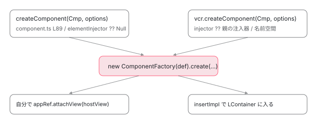

[目次](../README.md) › [動的コンポーネント：createComponent と ViewContainerRef](README.md) › 第 1 回 / 全 6 回

# 2 つの入口：createComponent 関数と ViewContainerRef.createComponent

> テンプレートの外でコンポーネントを作る 2 つの入口の引数（environmentInjector・elementInjector・hostElement と、index・injector・ngModuleRef。directives・bindings・projectableNodes・onError は共通）を golden で並べ、どちらも new ComponentFactory(def).create に集まるまで。attachView の有無で変更検知が届くかが変わることをページの上で 2 つの入口から作って確かめ、reflectComponentType の JSDoc の例が propName と templateName を逆に書いていることを記録で示す。ComponentFactoryResolver と ComponentFactory を公開 API から外し、revert して、同じ差分で入れ直した 2026 年 4 月の経緯（9d76ac82290・ecae525970a・b1f5181ffd8・df9eed4ff1d・f9b74e90e3c）と、残ったもの。

angular/angular · 読了 約 12 分 · 中核 · [サイトで読む（デモが動きます）](https://angular-deep-dive-cyan.vercel.app/chapter/dyn-entry-points)

---

テンプレートに `<app-child />` と書かずにコンポーネントを作る公開 API は 2 つあります。関数の `createComponent(Cmp, { environmentInjector, hostElement, ... })` と、`ViewContainerRef.createComponent(Cmp, { index, injector, ... })` です。この章では、2 つの引数を並べて違いを確かめ、どちらも内部の `ComponentFactory` の `create` に集まることを読みます。あわせて、2026 年 4 月に `ComponentFactoryResolver` と `ComponentFactory` を公開 API から外したコミットを、revert を含めて順に読み、何が残ったかを確かめます。

読む対象は `packages/core/src/render3/component.ts`（`createComponent` と `reflectComponentType`）、`goldens/public-api/core/index.api.md`（公開 API の一覧）、`packages/core/src/linker/component_factory.ts`、`packages/core/test/acceptance/create_component_spec.ts` です。`ViewContainerRef.createComponent` の中の行は[第 5 回](05-dyn-vcr-host.md)で、`ComponentFactory.create` の中は[第 2 回](02-dyn-factory-create.md)で読みます。

1. **1. 2 つの入口**（この章）
2. [2. ComponentFactory.create の中](02-dyn-factory-create.md)
3. [3. directives の選択肢](03-dyn-directives.md)
4. [4. bindings と ComponentRef](04-dyn-bindings-ref.md)
5. [5. ViewContainerRef とホストの守り](05-dyn-vcr-host.md)
6. [6. spec と issue](06-dyn-tests-issues.md)

## 1. 公開 API の形を golden で並べる

公開 API の形は、`goldens/public-api/core/index.api.md` にまとめて書き出されています（golden ＝「正解として保存した出力」。公開 API が変わると、この差分がレビューに出ます。[公開 API の章](../contrib/08-contrib-public-api.md)）。まず 2 つの入口の型をここで読みます。

📄 `angular/goldens/public-api/core/index.api.md` L430–440 （▶ の行: 431–434, 436–438）

```md
430 │ // @public
431 ▶ export function createComponent<C>(component: Type<C>, options: {
432 ▶     environmentInjector: EnvironmentInjector;
433 ▶     hostElement?: Element;
434 ▶     elementInjector?: Injector;
435 │     projectableNodes?: Node[][];
436 ▶     directives?: (Type<unknown> | DirectiveWithBindings<unknown>)[];
437 ▶     bindings?: Binding[];
438 ▶     onError?: (error: Error, details: ErrorDetails) => void;
439 │ }): ComponentRef<C>;
440 │ 
```
*関数の createComponent。options は必須で、その中の environmentInjector も必須。*

📄 `angular/goldens/public-api/core/index.api.md` L2104–2116 （▶ の行: 2106–2113）

```md
2104 │ export abstract class ViewContainerRef {
2105 │     abstract clear(): void;
2106 ▶     abstract createComponent<C>(componentType: Type<C>, options?: {
2107 ▶         index?: number;
2108 ▶         injector?: Injector;
2109 ▶         ngModuleRef?: NgModuleRef<unknown>;
2110 ▶         environmentInjector?: EnvironmentInjector | NgModuleRef<unknown>;
2111 ▶         projectableNodes?: Node[][];
2112 ▶         directives?: (Type<unknown> | DirectiveWithBindings<unknown>)[];
2113 ▶         bindings?: Binding[];
2114 │         onError?: (error: Error, context: ErrorDetails) => void;
2115 │     }): ComponentRef<C>;
2116 │     abstract createEmbeddedView<C>(templateRef: TemplateRef<C>, context?: C, options?: {
```
*ViewContainerRef.createComponent。options は省略できて、中身もすべて任意。*

| 何を決めるか | createComponent 関数（431〜439 行目） | ViewContainerRef.createComponent（2106〜2115 行目） |
| --- | --- | --- |
| 環境の注入器 | `environmentInjector`（432 行目、**必須**） | `environmentInjector` か `ngModuleRef`（2109〜2110 行目、任意。渡さなければ親の注入器から `EnvironmentInjector` を引く。[第 5 回](05-dyn-vcr-host.md)） |
| 要素の側の注入器 | `elementInjector`（434 行目、任意） | `injector`（2108 行目、任意。既定は ViewContainerRef の親の注入器） |
| ホストの要素をどこに置くか | `hostElement`（433 行目）。渡さなければ作るだけで、**どこにも差し込まない** | `index`（2107 行目）。コンテナの何番目に差し込むか |
| 投影する DOM ノード | `projectableNodes`（435・2111 行目。[proj-dynamic](../proj/05-proj-dynamic.md)） |   |
| 一緒に当てるディレクティブ | `directives`（436・2112 行目。[第 3 回](03-dyn-directives.md)） |   |
| 入力・出力のつなぎ | `bindings`（437・2113 行目。[第 4 回](04-dyn-bindings-ref.md)） |   |
| エラーの受け口 | `onError`（438・2114 行目。[err-boundary-runtime](../err/04-err-boundary-runtime.md)） |   |

違いは上の 3 行だけです。**関数の方は「どこに置くか」をあなたが決め、ViewContainerRef の方は「コンテナの中の何番目か」だけを決める**、と言い換えられます。この違いが、変更検知が回るかどうかの違いにつながります（3 節）。

## 2. createComponent 関数は ComponentFactory に渡すだけ

関数の使い方は、JSDoc の例がそのまま手順になっています。

📄 `angular/packages/core/src/render3/component.ts` L47–63 （▶ の行: 51, 54, 57, 61–62）

````ts
47 │  * // Bootstrap an application.
48 │  * const applicationRef = await bootstrapApplication(RootComponent);
49 │  *
50 │  * // Locate a DOM node that would be used as a host.
51 ▶  * const hostElement = document.getElementById('hello-component-host');
52 │  *
53 │  * // Get an `EnvironmentInjector` instance from the `ApplicationRef`.
54 ▶  * const environmentInjector = applicationRef.injector;
55 │  *
56 │  * // We can now create a `ComponentRef` instance.
57 ▶  * const componentRef = createComponent(HelloComponent, {hostElement, environmentInjector});
58 │  *
59 │  * // Last step is to register the newly created ref using the `ApplicationRef` instance
60 │  * // to include the component view into change detection cycles.
61 ▶  * applicationRef.attachView(componentRef.hostView);
62 ▶  * componentRef.changeDetectorRef.detectChanges();
63 │  * ```
````

1. **51 行目：ホストにする DOM ノードを自分で探す**

   ここで渡した要素が、そのままコンポーネントのホストの要素になります（中身は空にされます。[boot-application-ref](../boot/10-boot-application-ref.md) の `locateHostElement`）。
2. **54 行目：環境の注入器は ApplicationRef から取る**

   `applicationRef.injector` はアプリの根の `EnvironmentInjector` です（[boot-injectors](../boot/08-boot-injectors.md)）。
3. **57 行目で作り、61 行目で ApplicationRef に登録する**

   60 行目のコメントのとおり、`attachView` しないと変更検知の回に入りません。62 行目の `detectChanges()` は、次の回を待たずにすぐ描くための呼び出しです。

📄 `angular/packages/core/src/render3/component.ts` L96–103 （▶ の行: 101–103）

```ts
 96 │     directives?: (Type<unknown> | DirectiveWithBindings<unknown>)[];
 97 │     bindings?: Binding[];
 98 │     onError?: (error: Error, details: ErrorDetails) => void;
 99 │   },
100 │ ): ComponentRef<C> {
101 ▶   ngDevMode && assertComponentDef(component);
102 ▶   const componentDef = getComponentDef(component)!;
103 ▶   const elementInjector = options.elementInjector || getNullInjector();
```

本体の頭です。101 行目の `assertComponentDef` は `ngDevMode &&` 付きなので、**本番ビルドでは「コンポーネントか」を確かめません**。102 行目で `ɵcmp`（コンパイラが作ったコンポーネントの定義）を取り、103 行目で `elementInjector` が無ければ `getNullInjector()`（何も持たない注入器）を入れます。このあとは `new ComponentFactory(componentDef)` を作り、`factory.create` に `elementInjector`・`projectableNodes`・`hostElement`・`environmentInjector`・`directives`・`bindings` の 6 つを順に渡すだけです （その行は [ngmodule-standalone-imports](../ngmodule/13-ngmodule-standalone-imports.md) の 4 節で引用しています）。`onError` だけは渡さず、できた `ComponentRef` のルートの `LView` に書きます（[err-boundary-runtime](../err/04-err-boundary-runtime.md) の 3 節）。

ViewContainerRef の方も、最後は同じ `new ComponentFactory(...)` の `create` を呼びます。違うのは渡すものです。1 つ目の引数に `injector || 親の注入器`、3 つ目にハイドレーションで見つけた既存の DOM ノード（無ければ `null`）、そして 7 つ目に「差し込む場所の名前空間」を渡します。作ったあとで `hostView` を自分のコンテナに `insert` します。行は[第 5 回](05-dyn-vcr-host.md)、insert の中身は [view-container](../template/04-view-container.md) です。



*2 つの入口は、どちらも new ComponentFactory(def).create(...) に集まる。違いは create に渡すものと、作ったあとで hostView をどこに付けるか。*

## 3. DEMO：同じコンポーネントを 2 つの入口から作る

「どこに付くか」の違いを、ページの上の本物（`@angular/core` 22.1.6）で見ます。作るのは `DepBadge` という小さなコンポーネントで、自分の `n`（signal）を表示し、中の「+1」ボタンで増やします。A と B は関数の `createComponent` で、この章の中の枠に置いた要素を `hostElement` に渡します。A だけ `appRef.attachView` します。C はこの章のテンプレートにある `<ng-container #anchorC>` の `ViewContainerRef` から作ります。

> **🧪 DEMO — createComponent と ViewContainerRef.createComponent**
>
> 作ったあと、各枠の「中の +1」を押したり、下の「instance.n を +1」を押したりして、表の「画面の n」と「instance.n()」を比べてください。表は `await appRef.whenStable()` のあとに読み直します。
>
> appRef.viewCount =
>
> ▶ [このデモはサイトで動かせます](https://angular-deep-dive-cyan.vercel.app/chapter/dyn-entry-points)

1. **A：attachView したものは、どのボタンでも表示が追いつく**

   中の「+1」はイベントのリスナーが `markViewDirty` でビューに印を付け、スケジューラに知らせます（[通知の種類の章](../zoneless/02-zoneless-notification-source.md)）。`appRef.attachView` したビューは `ApplicationRef.tick` が回すビューの一覧に入っているので、次の回で描き直されます。`viewCount` は A の分だけ 1 増えます。
2. **B：作っただけでは「画面の n」が空のまま**

   `ComponentFactory.create` は作成の回（DOM を作る回）だけを走らせ、値を書く更新の回は走らせません（[第 2 回](02-dyn-factory-create.md)）。どこにも付いていないので `tick` も届かず、中の「+1」を押しても、`instance.n` を増やしても、画面は変わりません。「B だけ detectChanges()」を押したときだけ、その時点の `n` が描かれます。
3. **C：コンテナに入ったものは、この章のビューと一緒に回る**

   `attachView` は要りません。`hostView` はこの章のテンプレートの中のコンテナ（`LContainer`）に入っていて（[view-container](../template/04-view-container.md)）、この章のビューを変更検知するときに一緒に調べられます。`viewCount` は増えません。`environmentInjector` を渡していないのに作れたのは、ViewContainerRef が親の注入器から引いたからです。
4. **destroy のあと**

   A は先に `detachView` してから `destroy` します。A と B のホストの要素は自分で `appendChild` したものなので、`destroy` のあとで自分で外します。C は `destroy` だけで、コンテナからも DOM からも消えます（破棄の順は[第 4 回](04-dyn-bindings-ref.md)）。

> [!TIP]
> **新卒エンジニアへ**
>
> C の `<ng-container #anchorC>` は、`afterNextRender` のあとの `@if` の中に置いています。このサイトは事前に描いた HTML をハイドレーション（サーバーで描いた DOM を捨てずに引き継ぐこと）するので、ハイドレーションした要素に `viewChild(..., { read: ViewContainerRef })` を付けると、開発モードでは `Unexpected state: no hydration info available for a given TNode, which represents a view container.` という警告が出ました（その行は[第 5 回](05-dyn-vcr-host.md)の 77f1ca08e4a）。ブラウザで描いた要素ならハイドレーションの対象にならないので、警告は出ません。

## 4. reflectComponentType：同じ ComponentFactory でメタデータを読む

もう 1 つの公開関数 `reflectComponentType` も、中で `new ComponentFactory(componentDef)` を作り、その getter を返すだけです（本体は [elements-attributes-inputs](../elements/03-elements-attributes-inputs.md) で引用）。返すオブジェクトの形はこのインターフェイスです。

📄 `angular/packages/core/src/render3/component.ts` L125–161 （▶ の行: 129, 137–141, 146, 150, 155, 160）

```ts
125 │ export interface ComponentMirror<C> {
126 │   /**
127 │    * The component's HTML selector.
128 │    */
129 ▶   get selector(): string;
130 │   /**
131 │    * The type of component the factory will create.
132 │    */
133 │   get type(): Type<C>;
134 │   /**
135 │    * The inputs of the component.
136 │    */
137 ▶   get inputs(): ReadonlyArray<{
138 ▶     readonly propName: string;
139 ▶     readonly templateName: string;
140 ▶     readonly transform?: (value: any) => any;
141 ▶     readonly isSignal: boolean;
142 │   }>;
143 │   /**
144 │    * The outputs of the component.
145 │    */
146 ▶   get outputs(): ReadonlyArray<{readonly propName: string; readonly templateName: string}>;
147 │   /**
148 │    * Selector for all <ng-content> elements in the component.
149 │    */
150 ▶   get ngContentSelectors(): ReadonlyArray<string>;
151 │   /**
152 │    * Whether this component is marked as standalone.
153 │    * Note: an extra flag, not present in `ComponentFactory`.
154 │    */
155 ▶   get isStandalone(): boolean;
156 │   /**
157 │    * // TODO(signals): Remove internal and add public documentation
158 │    * @internal
159 │    */
160 ▶   get isSignal(): boolean;
161 │ }
```

137〜142 行目の `inputs` は `propName`（クラスのプロパティ名）・`templateName`（テンプレートで書く名前）・`transform`・`isSignal` の 4 つを持ちます。155 行目の `isStandalone` は `ComponentFactory` に無い項目で、153 行目のコメントのとおり、この関数が足したものです。160 行目の `isSignal` は `@internal` なので、golden には出ません。

同じファイルの JSDoc の例は、こう書いています。

📄 `angular/packages/core/src/render3/component.ts` L183–189 （▶ の行: 188–189）

```ts
183 │  *
184 │  * const mirror = reflectComponentType(FooComponent);
185 │  * expect(mirror.type).toBe(FooComponent);
186 │  * expect(mirror.selector).toBe('foo-component');
187 │  * expect(mirror.isStandalone).toBe(true);
188 ▶  * expect(mirror.inputs).toEqual([{propName: 'inputName', templateName: 'inputPropName'}]);
189 ▶  * expect(mirror.outputs).toEqual([{propName: 'outputName', templateName: 'outputPropName'}]);
```

この例のクラスは `@Input('inputName') inputPropName` と `@Output('outputName') outputPropName` です。同じクラスを JIT でコンパイルして Node で `reflectComponentType` を呼ぶと、こうなりました。

📄 `記録（Node、22.1.6 と 22.2.6）`

```
// ~/angular-research/... の記録スクリプトを @angular/core 22.1.6 と 22.2.6 で走らせた結果（2 つとも同じ）
// クラスはドキュメントの例と同じ: @Input('inputName') inputPropName / @Output('outputName') outputPropName
reflectComponentType(FooComponent) =>
  selector:           'foo-component'
  isStandalone:       true
  inputs:             [{ propName: 'inputPropName', templateName: 'inputName', isSignal: false }]
  outputs:            [{ propName: 'outputPropName', templateName: 'outputName' }]
  ngContentSelectors: ['*', 'content-selector-a']
reflectComponentType(class Plain {}) => null
```

実物は `propName: 'inputPropName', templateName: 'inputName'` で、188〜189 行目の例とは **`propName` と `templateName` が逆**です。188 行目の例には `isSignal` も無いので、`toEqual` としても通りません。spec の方は実物と同じ向きで書いています。

📄 `angular/packages/core/test/acceptance/component_spec.ts` L834–844 （▶ の行: 836）

```ts
834 │       expect(mirror.outputs).toEqual([
835 │         {propName: 'output-a', templateName: 'output-a'},
836 ▶         {propName: 'output-b', templateName: 'output-alias-b'},
837 │       ]);
838 │       expect(mirror.ngContentSelectors).toEqual([
839 │         '*',
840 │         'content-selector-a',
841 │         'content-selector-b',
842 │         '*',
843 │       ]);
844 │     });
```
*component\_spec.ts の it('should create an ComponentMirror for a standalone component')（:799）の後半。*

836 行目、`'output-b:output-alias-b'` と書いた出力は `propName: 'output-b', templateName: 'output-alias-b'` です。ドキュメントの例だけが逆になっています（`../angular-main` の 74961c66242 でも同じ行のままでした）。

## 5. ComponentFactoryResolver を公開 API から外した経緯

v13 から、`ViewContainerRef.createComponent` は `ComponentFactoryResolver` でファクトリを作らずに、クラスを直接受け取れるようになっていました。古い入口は deprecated のまま残っていましたが、2026 年 4 月の 5 つのコミットで公開 API から消えました。

📄 `git log（../angular、関係するものだけ）`

```
9d76ac82290 2026-04-02 refactor(core): remove ComponentFactoryResolver & ComponentFactory from the api surface
ecae525970a 2026-04-06 Revert "refactor(core): remove ComponentFactoryResolver & ComponentFactory from the api surface"
                       （本文: This reverts commit 9d76ac82290... / g3 cleanup not complete）
b1f5181ffd8 2026-04-06 refactor(core): remove ComponentFactoryResolver & ComponentFactory from the api surface""
df9eed4ff1d 2026-04-12 refactor(core): remove `ComponentFactoryResolver` usages
f9b74e90e3c 2026-04-13 refactor(core): simplifying the ComponentFactory usage
```

1. **9d76ac82290 → ecae525970a：入れて、4 日後に戻した**

   revert の本文は「g3 cleanup not complete」の 1 行です。g3 は Google の社内のリポジトリのことで、merge の前に社内のテスト（`google-internal-tests`）でも確かめられます（[contrib-pr-flow](../contrib/10-contrib-pr-flow.md)）。社内の利用箇所の片付けが終わっていなかったので戻した、という意味です。
2. **b1f5181ffd8：同じ変更をもう一度入れた**

   題の末尾の `""` は、revert の題 `Revert "..."` から `Revert` だけを消したときの名残です。差分そのものは 9d76ac82290 と**同じ**で、`git patch-id` が一致します。違いはコミットの本文だけで、BREAKING CHANGE の文の `createComponentFunction` が `createComponent function` に直っています。

   📄 `ターミナル`

   ```
   $ git show 9d76ac82290 | git patch-id
   0af0a735254bed9d1c2f3338cf35b234fad075ff 9d76ac82290e047f1481fb38bd95233e951a77de
   $ git show b1f5181ffd8 | git patch-id
   0af0a735254bed9d1c2f3338cf35b234fad075ff b1f5181ffd8e9906affd486d9e2f655eb144f175
   $ git tag --contains b1f5181ffd8 | head -1
   v22.0.0
   ```

📄 `git show b1f5181ffd8（抜粋）`

```
--- a/goldens/public-api/core/index.api.md   （b1f5181ffd8 の差分から抜粋）
+++ b/goldens/public-api/core/index.api.md
@@ export class ApplicationRef {
     bootstrap<C>(component: Type<C>, rootSelectorOrNode?: string | any): ComponentRef<C>;
-    // @deprecated
-    bootstrap<C>(componentFactory: ComponentFactory<C>, rootSelectorOrNode?: string | any): ComponentRef<C>;
@@
-// @public @deprecated
-export abstract class ComponentFactory<C> {
-    abstract get componentType(): Type<any>;
-    abstract create(injector: Injector, projectableNodes?: any[][], rootSelectorOrNode?: string | any, environmentInjector?: EnvironmentInjector | NgModuleRef<any>, directives?: (Type<unknown> | DirectiveWithBindings<unknown>)[], bindings?: Binding[]): ComponentRef<C>;
     ...
-// @public @deprecated
-export abstract class ComponentFactoryResolver {
-    static NULL: ComponentFactoryResolver;
-    abstract resolveComponentFactory<T>(component: Type<T>): ComponentFactory<T>;
-}
@@ export abstract class ViewContainerRef {
-    // @deprecated
-    abstract createComponent<C>(componentFactory: ComponentFactory<C>, index?: number, injector?: Injector, projectableNodes?: any[][], environmentInjector?: EnvironmentInjector | NgModuleRef<any>, directives?: (Type<unknown> | DirectiveWithBindings<unknown>)[], bindings?: Binding[]): ComponentRef<C>;

--- a/packages/core/src/linker/component_factory_resolver.ts   （同じコミット。前後の行も残す）
  * Note: since v13, dynamic component creation via
  * [`ViewContainerRef.createComponent`](api/core/ViewContainerRef#createComponent)
  * does **not** require resolving component factory: component class can be used directly.
- *
- * @publicApi
- *
- * @deprecated Angular no longer requires Component factories. Please use other APIs where
- *     Component class can be used directly.
  */
 export abstract class ComponentFactoryResolver {

--- a/packages/core/src/linker.ts   （同じコミット）
-export {ComponentFactory, ComponentRef} from './linker/component_factory';
-export {ComponentFactoryResolver} from './linker/component_factory_resolver';
+export {ComponentRef, ComponentFactory as ɵComponentFactory} from './linker/component_factory';
+export {ComponentFactoryResolver as ɵComponentFactoryResolver} from './linker/component_factory_resolver';
```

golden で消えたのは 3 つです。`ApplicationRef.bootstrap` と `ViewContainerRef.createComponent` の「ファクトリを受け取る」overload（同じ名前で引数の形が違う宣言）、そして抽象クラスの `ComponentFactory` と `ComponentFactoryResolver` です。`linker.ts` では、2 つを消さずに `ɵ` 付きの名前（非公開の印）で出し直しています。実装はこの時点ではまだ残っています。

📄 `git show df9eed4ff1d / f9b74e90e3c（抜粋）`

```
--- df9eed4ff1d（usages を消す）から抜粋
 goldens/public-api/core/index.api.md
 export abstract class NgModuleRef<T> {
-    // @deprecated
-    abstract get componentFactoryResolver(): ComponentFactoryResolver;
 goldens/public-api/core/errors.api.md
-    NO_COMPONENT_FACTORY_FOUND = 917,
 packages/core/src/errors.ts
-  NO_COMPONENT_FACTORY_FOUND = 917,
+  /* 917 - Removed */
 packages/core/src/linker/component_factory_resolver.ts   （ファイルごと削除、43 行）
 packages/core/src/render3/component_ref.ts
-export class ComponentFactoryResolver extends AbstractComponentFactoryResolver {
-  override resolveComponentFactory<T>(component: Type<T>): AbstractComponentFactory<T> {
-    ngDevMode && assertComponentType(component);
-    const componentDef = getComponentDef(component)!;
-    return new ComponentFactory(componentDef, this.ngModule);
-  }
-}

--- f9b74e90e3c（ComponentFactory の使い方を簡単に）から抜粋
 goldens/public-api/core/index.api.md
-    compileModuleAndAllComponentsAsync<T>(moduleType: Type<T>): Promise<ModuleWithComponentFactories<T>>;
-    compileModuleAndAllComponentsSync<T>(moduleType: Type<T>): ModuleWithComponentFactories<T>;
-export class ModuleWithComponentFactories<T> { ... }
 packages/core/src/linker.ts
-export {ComponentRef, ComponentFactory as ɵComponentFactory} from './linker/component_factory';
+export {ComponentRef} from './linker/component_factory';
 packages/core/src/render3/component_ref.ts
-export class ComponentFactory<T> extends AbstractComponentFactory<T> {
-  override selector: string;
+export class ComponentFactory<T> {
+  selector: string;
```

6 日後の df9eed4ff1d で、`ɵComponentFactoryResolver` も含めて実装ごと消しました。`NgModuleRef.componentFactoryResolver` も消え、エラーコード 917（`NO_COMPONENT_FACTORY_FOUND`）は「Removed」の印だけが残りました。翌日の f9b74e90e3c で、抽象クラスの `ComponentFactory` と `ModuleWithComponentFactories`・`Compiler.compileModuleAndAllComponents*` も消し、render3 の `ComponentFactory` は何も継承しないただのクラスになりました。5 つとも v22.0.0 に入っています。

### 何が残ったか

📄 `ターミナル（../angular、8576f161ae4）`

```
$ grep -rn "new ComponentFactory" packages --include='*.ts' | grep -v /test/
packages/core/testing/src/test_bed_compiler.ts:497:  componentDef && factories.push(new ComponentFactory(componentDef, this.testModuleRef!));
packages/core/testing/src/test_bed.ts:877:    const factory = new ComponentFactory(getComponentDef(type)!);
packages/core/src/linker/view_container_ref.ts:489:    const componentFactory = new ComponentFactory(getComponentDef(componentType)!);
packages/core/src/render3/component.ts:104:  const factory = new ComponentFactory<C>(componentDef);
packages/core/src/render3/component.ts:205:  const factory = new ComponentFactory<C>(componentDef);
packages/core/src/application/application_ref.ts:487:      const componentFactory = new ComponentFactory<C>(componentDef, ngModule);

$ grep -rn "_getComponentFactories" packages
packages/core/testing/src/test_bed_compiler.ts:494:  _getComponentFactories(moduleType: NgModuleType): ComponentFactory<any>[] {

$ grep -rn "isBoundToModule" packages --include='*.ts'
packages/core/src/render3/component_ref.ts:226:  isBoundToModule: boolean;
packages/core/src/render3/component_ref.ts:263:    this.isBoundToModule = !!ngModule;
```

- **render3 の `ComponentFactory` クラス**は残っていて、入口はすべてこれを `new` します（関数の `createComponent`、`reflectComponentType`、ViewContainerRef、`ApplicationRef.bootstrap`、TestBed）。`@angular/core` の外へは `ɵRender3ComponentFactory` という非公開の名前で出ています。
- `TestBedCompiler._getComponentFactories` は、呼んでいた `compileModuleAndAllComponents*` が f9b74e90e3c で消えたので、呼ぶ人がいません。`ComponentFactory.isBoundToModule` も、読んでいた `ɵisBoundToModule` が df9eed4ff1d で消えたので、書くだけのフィールドです。
- 公開の抽象クラス `ComponentRef` の JSDoc は、まだ `ComponentFactory` を前提に書かれています。

📄 `angular/packages/core/src/linker/component_factory.ts` L16–34 （▶ の行: 17, 25）

```ts
16 │ /**
17 ▶  * Represents a component created by a `ComponentFactory`.
18 │  * Provides access to the component instance and related objects,
19 │  * and provides the means of destroying the instance.
20 │  *
21 │  * @see [Programmatically rendering components](guide/components/programmatic-rendering)
22 │  *
23 │  * @publicApi
24 │  */
25 ▶ export abstract class ComponentRef<C> {
26 │   /**
27 │    * Updates a specified input name to a new value. Using this method will properly mark for check
28 │    * component using the `OnPush` change detection strategy. It will also assure that the
29 │    * `OnChanges` lifecycle hook runs when a dynamically created component is change-detected.
30 │    *
31 │    * @param name The name of an input.
32 │    * @param value The new value of an input.
33 │    */
34 │   abstract setInput(name: string, value: unknown): void;
```

17 行目の「`ComponentFactory` が作ったコンポーネント」は、もう公開されていない名前を指しています。同じ種類の古い説明だった `Compiler` の JSDoc（存在しない `{@link AbstractComponentFactory}`）は、`../angular-main` の 95e8dec4e22 で直っています。

## ここまでの呼び出し

- 👤 `createComponent(Cmp, { environmentInjector, hostElement })` — あなたのコード
  - `getComponentDef(Cmp)` / `getNullInjector()` — component.ts L102〜103
  - `new ComponentFactory(def).create(elementInjector, projectableNodes, hostElement, environmentInjector, directives, bindings)` — 第 2 回
- 👤 `appRef.attachView(ref.hostView)` — あなたのコード（component.ts L61 の例）
- 👤 `vcr.createComponent(Cmp, { index, injector })` — あなたのコード
  - `new ComponentFactory(def).create(injector ?? 親, projectableNodes, 既存の DOM, env, directives, bindings, 名前空間)` — 第 5 回
  - `insertImpl(hostView, index)` — view-container

## テストと直し方

📄 `angular/packages/core/test/acceptance/create_component_spec.ts` L42–64 （▶ の行: 52–54, 56–57, 61, 63）

```ts
42 │   it('should create an instance of a standalone component', () => {
43 │     @Component({
44 │       template: 'Hello {{ name }}!',
45 │ 
46 │       changeDetection: ChangeDetectionStrategy.Eager,
47 │     })
48 │     class StandaloneComponent {
49 │       name = 'Angular';
50 │     }
51 │ 
52 ▶     const hostElement = document.createElement('div');
53 ▶     const environmentInjector = TestBed.inject(EnvironmentInjector);
54 ▶     const componentRef = createComponent(StandaloneComponent, {hostElement, environmentInjector});
55 │ 
56 ▶     componentRef.changeDetectorRef.detectChanges();
57 ▶     expect(hostElement.textContent).toBe('Hello Angular!');
58 │ 
59 │     // Verify basic change detection works.
60 │     componentRef.instance.name = 'ZoneJS';
61 ▶     componentRef.changeDetectorRef.detectChanges();
62 │     expect(hostElement.textContent).toBe('Hello ZoneJS!');
63 ▶     componentRef.destroy();
64 │   });
```

`packages/core/test/acceptance/create_component_spec.ts` の `describe('createComponent')`（:41）の最初の `it('should create an instance of a standalone component')`（:42）です。52〜54 行目が 2 節の JSDoc の例と同じ組み立てで、56 行目の `detectChanges()` を呼んでから 57 行目で表示を確かめています。この spec は `attachView` せず、`changeDetectorRef.detectChanges()` を自分で呼んで描いています（DEMO の B と同じ形です）。同じ describe に `should create an instance of an NgModule-based component`（:66）、`should render projected content`（:98）、注入器の 2 本（:129・:151）、ホストの要素を作る 2 本（:202・:228）が続きます（後ろの 4 本は[第 2 回](02-dyn-factory-create.md)）。`reflectComponentType` は別のファイル `packages/core/test/acceptance/component_spec.ts` の `describe('reflectComponentType')`（:798）に 3 本あります。3 本目の `describe('error checking')` の `it('should throw when provided class is not a component')`（:893）は、名前は「投げる」ですが、中身は `toBe(null)` を 3 回確かめています（4 節の記録の最後の行のとおり、定義が無ければ `null` を返し、投げません）。

📄 `ターミナル`

```
cd ~/angular-research/angular
pnpm bazel test //packages/core/test/acceptance:acceptance --nocache_test_results \
  --test_output=all --test_arg=--filter="^createComponent "
pnpm bazel test //packages/core/test/acceptance:acceptance --nocache_test_results \
  --test_output=all --test_arg=--filter="reflectComponentType"
```

📄 `出力（抜粋。2026-11-15 に実行）`

```
Ran 52 of 2693 specs
52 specs, 0 failures
//packages/core/test/acceptance:acceptance                               PASSED in 1.4s
Ran 3 of 2693 specs
3 specs, 0 failures
//packages/core/test/acceptance:acceptance                               PASSED in 1.3s
```

1. **本数の確かめ方**

   `--filter="^createComponent "` は先頭が `createComponent ` の spec の名前だけに合います。`create_component_spec.ts` の `it(` は 52 本で、`Ran 52` と一致しました。`^` を付けないと `view_container_ref_spec.ts` の `describe('createComponent')`（:1446）の中の spec も拾います。
2. **直すとしたら**

   4 節の JSDoc の例は `packages/core/src/render3/component.ts` の `reflectComponentType` の上のコメント（188〜189 行目）です。コメントの直しなので spec は変わりませんが、例と同じクラスを `component_spec.ts` の `describe('reflectComponentType')` に足すと、例が実物と同じであることを固められます。5 節の残りは、`test_bed_compiler.ts` の `_getComponentFactories` と `component_ref.ts` の `isBoundToModule`（消すなら、呼ぶ人がいないことを `grep` と bazel のビルドで確かめる）、`linker/component_factory.ts` の JSDoc です。

## 聞かれそうな質問

**Q. createComponent 関数と ViewContainerRef.createComponent は、どう使い分けますか？**

置き場所がテンプレートの中にあるなら ViewContainerRef です。コンテナに入るので、親のビューと一緒に変更検知され、親と一緒に壊れます（DEMO の C）。置き場所が Angular の外（`document.body` の直下のダイアログなど）なら関数で、`hostElement` に渡し、`appRef.attachView` と `detachView` を自分で呼びます（component.ts 61 行目の例、DEMO の A）。

**Q. attachView を忘れるとどうなりますか？**

DOM は作られますが、更新の回が一度も走らないので、テンプレートの補間で書いた場所は空のままです（DEMO の B）。中のボタンのリスナーは動いて signal も変わりますが、`tick` がそのビューに届きません。自分で `changeDetectorRef.detectChanges()` を呼べば、その時点の値が描かれます（spec の 56・61 行目もこの形です）。

**Q. ComponentFactoryResolver を使っていたコードはどう直しますか？**

`resolver.resolveComponentFactory(Cmp)` で作ったファクトリを渡していたところに、クラスをそのまま渡します。`vcr.createComponent(factory, index, injector)` は `vcr.createComponent(Cmp, { index, injector })` に、`factory.create(injector, nodes, host)` は関数の `createComponent(Cmp, { environmentInjector, elementInjector: injector, projectableNodes: nodes, hostElement: host })` になります（golden の 431〜439 行目と 2106〜2115 行目）。ファクトリから読んでいた `inputs` などは `reflectComponentType` で読めます（137〜146 行目）。

**Q. なぜ 1 回 revert されたのですか？**

revert のコミット ecae525970a の本文は「g3 cleanup not complete」で、社内のリポジトリの利用箇所の片付けが終わっていなかったからです。作者の日付で同じ日のうちに、同じ差分（`patch-id` が一致）を b1f5181ffd8 として入れ直しています。そのときも `linker.ts` で `ɵ` 付きの名前で出し続け、実装を消したのは 6 日後の df9eed4ff1d です。

**Q. reflectComponentType の inputs の propName と templateName は、どちらがどちらですか？**

`propName` がクラスのプロパティ名、`templateName` がテンプレートで書く公開名（別名があれば別名）です。Node の記録でも、spec の 836 行目でもこの向きです。component.ts 188〜189 行目の JSDoc の例は逆に書かれているので、例を写すときは注意します。

## 読み終えて

- 2 つの入口の違いは、環境の注入器が必須か、要素の注入器の名前、そして「hostElement で置き場所を決める」か「index でコンテナの何番目かを決める」かの 3 つ
- 関数の createComponent は ComponentFactory.create に 6 つを渡すだけ。`attachView` しないと更新の回が走らない
- ViewContainerRef の方はコンテナに入るので、親のビューと一緒に変更検知される
- ComponentFactoryResolver と抽象の ComponentFactory は v22.0.0 で公開 API から消えた（一度 revert、同じ差分で入れ直し）。render3 の ComponentFactory は内部のクラスとして残っている
- reflectComponentType の JSDoc の例は propName と templateName が逆。spec と実物は「propName ＝ クラスのプロパティ名」

---

← 前: [spec と issue を読む：エラーの行き先を固めているテスト](../err/06-err-tests-issues.md)  
次: [ComponentFactory.create の中：注入器・tracing・ホストの要素](02-dyn-factory-create.md) →
