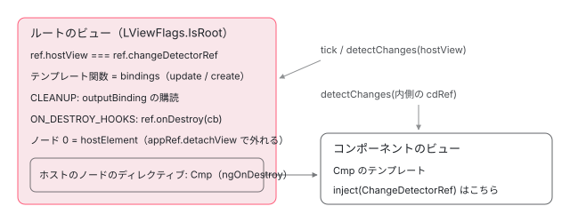

[目次](../README.md) › [動的コンポーネント：createComponent と ViewContainerRef](README.md) › 第 4 回 / 全 6 回

# bindings と ComponentRef：作ったあとの入力・出力・破棄

> inputBinding・outputBinding・twoWayBinding の値と購読がいつ入るか（入力は作るときではなく最初の変更検知、出力の購読は作るとき）、setInput と bindings を両方使うときの NG0317（本番では投げずに値が残る）、出力の購読がルートのビューの破棄で外れること、ComponentRef.destroy のフックの順と、ホストの要素を DOM から外すのが appRef.detachView であること（#62150）、hostView と changeDetectorRef。testing シリーズの章の続きとして、テストではなくアプリの中の動きを、ページの上の本物と Node の記録で確かめる。

angular/angular · 読了 約 13 分 · 発展 · [サイトで読む（デモが動きます）](https://angular-deep-dive-cyan.vercel.app/chapter/dyn-bindings-ref)

---

`createComponent(Cmp, { bindings: [...] })` で作ったコンポーネントに、作ったあとで何が起きるかを追います。`inputBinding` の値が**いつ**入力に書かれるか、`setInput` と一緒に使うと何が起きるか、`outputBinding` の購読がいつ外れるか、`ComponentRef.destroy()` でフックがどの順で呼ばれ、ホストの要素がいつ DOM から外れるか、です。`bindings` の基本（ルートのビューのテンプレート関数になること）は [testing シリーズの「入力の渡し方」](../testing/06-testing-component-bindings.md)で読んだので、ここでは繰り返しません。

読む対象は `packages/core/src/render3/dynamic_bindings.ts`、`render3/view/directive_outputs.ts`、`render3/view_ref.ts`、`core/src/errors.ts`、それに 2025〜2026 年のコミット（be44cc8f40f・b154fb39114・a3cb7b94978・ae28db0f2e2・5537950079d・780774f9480）の差分と、`packages/core/test/acceptance/create_component_spec.ts` です。

1. [1. 2 つの入口](01-dyn-entry-points.md)
2. [2. ComponentFactory.create の中](02-dyn-factory-create.md)
3. [3. directives の選択肢](03-dyn-directives.md)
4. **4. bindings と ComponentRef**（この章）
5. [5. ViewContainerRef とホストの守り](05-dyn-vcr-host.md)
6. [6. spec と issue](06-dyn-tests-issues.md)

> [!NOTE]
> **ポイント**
>
> この章の「記録」は、`@angular/core` 22.2.6 を Node（JIT のコンパイラと domino の DOM）で動かした結果です。開発モードと、`globalThis.ngDevMode = false` にした本番の分岐の 2 回を取りました。ページの下のデモは、このサイトの依存（22.2.6）の本番ビルドで動く本物です。

## 1. Binding の形：公開の型と内部の型

📄 `angular/packages/core/src/render3/dynamic_bindings.ts` L24–51 （▶ の行: 25, 33–34, 37, 39–40, 44, 47, 50）

```ts
24 │ /** Symbol used to store and retrieve metadata about a binding. */
25 ▶ export const BINDING: unique symbol = /* @__PURE__ */ Symbol('BINDING');
26 │ 
27 │ /**
28 │  * A dynamically-defined binding targeting.
29 │  * For example, `inputBinding('value', () => 123)` creates an input binding.
30 │  *
31 │  * @see [Binding inputs, outputs and setting host directives at creation](guide/components/programmatic-rendering#binding-inputs-outputs-and-setting-host-directives-at-creation)
32 │  */
33 ▶ export interface Binding {
34 ▶   readonly [BINDING]: unknown;
35 │ }
36 │ 
37 ▶ export interface BindingInternal extends Binding {
38 │   readonly [BINDING]: {
39 ▶     readonly kind: string;
40 ▶     readonly requiredVars: number;
41 │   };
42 │ 
43 │   /** Target index (in a view's registry) to which to apply the binding. */
44 ▶   targetIdx?: number;
45 │ 
46 │   /** Callback that will be invoked during creation. */
47 ▶   create?(slot?: number): void;
48 │ 
49 │   /** Callback that will be invoked during updates. */
50 ▶   update?(slot?: number): void;
51 │ }
```

公開の型 `Binding`（33〜35 行目）は、25 行目の symbol `BINDING` を鍵にした `unknown` を 1 つ持つだけです。中身は 37 行目からの `BindingInternal` にあり、39〜40 行目の種類（`kind`）と必要な枠の数（`requiredVars`）、44 行目の「ホストのノードに並ぶディレクティブのうち何番目に当てるか」（`targetIdx`）、47・50 行目の `create` と `update` です。

📄 `git show 5537950079d -- packages/core/src/render3/dynamic_bindings.ts（最初のハンク）`

```
# 5537950079d 2025-05-14 refactor(core): expose `Binding` for easier use of `inputBinding` (#61351)
--- a/packages/core/src/render3/dynamic_bindings.ts
+++ b/packages/core/src/render3/dynamic_bindings.ts
@@ -25,13 +25,17 @@ export const BINDING: unique symbol = /* @__PURE__ */ Symbol('BINDING');
  * For example, `inputBinding('value', () => 123)` creates an input binding.
  */
 export interface Binding {
+  readonly [BINDING]: unknown;
+}
+
+export interface BindingInternal extends Binding {
   readonly [BINDING]: {
     readonly kind: string;
     readonly requiredVars: number;
   };
 
   /** Target index (in a view's registry) to which to apply the binding. */
-  readonly targetIdx?: number;
+  targetIdx?: number;
 
   /** Callback that will be invoked during creation. */
   create?(): void;
```

この 2 つに分かれたのは 5537950079d（2025-05、#61351）です。それまでは `Binding` が中身ごと公開されていて、利用者が `bindings` を変数に入れたいときに `ReturnType<typeof inputBinding>` と書くしかありませんでした（コミットの本文）。公開の型を中身の無い形にしておくことで、`kind` や `targetIdx` を API に約束せずに、型の名前だけを出せます。差分の `- readonly targetIdx?: number;` が `+ targetIdx?: number;` に変わったのは、作る側（`createRootTView`）が後から書き込むためです。

📄 `angular/packages/core/src/render3/dynamic_bindings.ts` L66–75 （▶ の行: 66–67, 69, 71, 73）

```ts
66 ▶ // These are constant between all the bindings so we can reuse the objects.
67 ▶ const INPUT_BINDING_METADATA: BindingInternal[typeof BINDING] = {
68 │   kind: 'input',
69 ▶   requiredVars: 1,
70 │ };
71 ▶ const OUTPUT_BINDING_METADATA: BindingInternal[typeof BINDING] = {
72 │   kind: 'output',
73 ▶   requiredVars: 0,
74 │ };
75 │ 
```

66 行目のコメントのとおり、種類の情報は全部の binding で 1 つのオブジェクトを使い回します。入力は枠を 1 つ（69 行目。前の値を覚えて `bindingUpdated` で比べるため）、出力は 0（73 行目。作るときに 1 回購読するだけ）です。`twoWayBinding` は、この 2 つを足した 1 になります。

📄 `git show a3cb7b94978 -- packages/core/src/render3/dynamic_bindings.ts（2 つ目のハンク、抜粋）`

```
# a3cb7b94978 2025-03-03 refactor(core): allow InputBinding and OutputBinding to be tree shaken (#60137)
--- a/packages/core/src/render3/dynamic_bindings.ts
+++ b/packages/core/src/render3/dynamic_bindings.ts
@@ -53,85 +54,6 @@ export interface DirectiveWithBindings<T> {
 const INPUT_BINDING_METADATA: Binding[typeof BINDING] = {kind: 'input', requiredVars: 1};
 const OUTPUT_BINDING_METADATA: Binding[typeof BINDING] = {kind: 'output', requiredVars: 0};
 
-class InputBinding<T> implements Binding {
-  readonly target!: DirectiveDef<T>;
-  readonly [BINDING] = INPUT_BINDING_METADATA;
-
-  constructor(
-    private readonly publicName: string,
-    private readonly value: () => unknown,
-  ) {}
-
-  update(): void {
-    const lView = getLView();
-    const bindingIndex = nextBindingIndex();
-    const value = this.value();
-    if (bindingUpdated(lView, bindingIndex, value)) {
-      const tView = getTView();
-      const tNode = getSelectedTNode();
-
-      if (!this.target && ngDevMode) {
-        throw new RuntimeError(
-          RuntimeErrorCode.NO_BINDING_TARGET,
-          `Input binding to property "${this.publicName}" does not have a target.`,
-        );
-      }
-
-      const hasSet = setDirectiveInput(tNode, tView, lView, this.target, this.publicName, value);
-
-      if (ngDevMode) {
-        if (!hasSet) {
-          throw new RuntimeError(
-            RuntimeErrorCode.NO_BINDING_TARGET,
-            `${this.target.type.name} does not have an input with a public name of "${this.publicName}".`,
-          );
-        }
-        storePropertyBindingMetadata(tView.data, tNode, this.publicName, bindingIndex);
-      }
-    }
-  }
-}
-
-class OutputBinding<T> implements Binding {
-  readonly target!: DirectiveDef<unknown>;
-  readonly [BINDING] = OUTPUT_BINDING_METADATA;
-
-  constructor(
-    private readonly eventName: string,
-    private readonly listener: (event: T) => unknown,
-  ) {}
-
-  create(): void {
-    if (!this.target && ngDevMode) {
-      throw new RuntimeError(
-        RuntimeErrorCode.NO_BINDING_TARGET,
-        `Output binding to "${this.eventName}" does not have a target.`,
-      );
-    }
-
-    const lView = getLView<{} | null>();
-    const tView = getTView();
-    const tNode = getCurrentTNode()!;
-    const context = lView[CONTEXT];
-    const wrappedListener = wrapListener(tNode, lView, context, this.listener);
-    const hasBound = listenToDirectiveOutput(
-      tNode,
-      tView,
-      lView,
-      this.target,
-      this.eventName,
-      wrappedListener,
-    );
-
-    if (!hasBound && ngDevMode) {
-      throw new RuntimeError(
-        RuntimeErrorCode.INVALID_BINDING_TARGET,
-        `${this.target.type.name} does not have an output with a public name of "${this.eventName}".`,
-      );
-    }
-  }
-}
-
 /**
  * Creates an input binding.
  * @param publicName Public name of the input to bind to.
```

もとは `InputBinding` と `OutputBinding` の 2 つのクラスでした。a3cb7b94978（2025-03、#60137 の中）で、関数の中でオブジェクトを作る形に書き換わっています。本文は「Terser が、関数を使っていないときもクラスを木から落とせなかった」です。`inputBinding` を import しないアプリには、この仕組みの本体が入りません。サイズの確認は `packages/core/test/bundling/*/bundle.golden_symbols.json` の差分で見ます（このコミットでも 3 つのファイルが変わっています）。

## 2. 値はいつ書かれるか：作るときではなく、最初の変更検知

`update` を呼ぶのはルートのビューのテンプレート関数の更新モードです（[testing の章の 4 節](../testing/06-testing-component-bindings.md)）。作るときの `renderView` は作成モードしか走らせないので（[最初の描画の章](../boot/11-boot-first-render.md)）、**`createComponent` が返った時点では、入力はまだ書かれていません**。逆に `outputBinding` の `create` は作成モードで走るので、購読はもう始まっています。記録で確かめます。

| 場面 | 開発モード（22.2.6） |
| --- | --- |
| 1 | `createComponent の直後: instance.label="?" / 表示=""` |
| 2 | `outputBinding が受けた: 変更検知の前` |
| 3 | `attachView + tick のあと: instance.label="A" / 表示="A:0"` |
| 4 | `label.set('B') の直後: instance.label="A"` |
| 5 | `もう一度 tick: instance.label="B" / 表示="B:0"` |
| 6 | `hostView === changeDetectorRef: true` |
| 7 | `子の ngOnDestroy（ここで picked.emit("bye")）` |
| 8 | `outputBinding が受けた: bye` |
| 9 | `子の inject(DestroyRef).onDestroy` |

1. **1 行目：作った直後の `instance.label` は初期値の `"?"`**

   コンポーネントのクラスのフィールドの初期値のままです。コンストラクタや、`ngOnInit` より前の処理で入力を読むと、まだ渡した値ではありません。
2. **2 行目：変更検知の前でも、出力は届く**

   `createComponent` の直後に子の `picked.emit()` を呼ぶと、もう `outputBinding` の関数が呼ばれました。購読は作るときです。
3. **3〜5 行目：`tick` で書かれ、signal を変えても次の `tick` まで変わらない**

   `label.set('B')` の直後はまだ `"A"` です。値は「次にルートのビューが変更検知されたとき」に `value()` を読んで書かれるので、`setInput`（その場で書く）とは書かれる時点が違います。

📄 `git show 780774f9480 -- packages/core/src/render3/dynamic_bindings.ts（#62613、2025-07）`

```
# 780774f9480 2025-07-13 fix(core): InputBinding marks component a dirty. (#62613)
--- a/packages/core/src/render3/dynamic_bindings.ts
+++ b/packages/core/src/render3/dynamic_bindings.ts
@@ -16,6 +16,9 @@ import {TVIEW} from './interfaces/view';
 import {getCurrentTNode, getLView, getSelectedTNode, nextBindingIndex} from './state';
 import {stringifyForError} from './util/stringify_utils';
 import {createOutputListener} from './view/directive_outputs';
+import {markViewDirty} from './instructions/mark_view_dirty';
+import {getComponentLViewByIndex} from './util/view_utils';
+import {NotificationSource} from '../change_detection/scheduling/zoneless_scheduling';
 
 /** Symbol used to store and retrieve metadata about a binding. */
 export const BINDING: unique symbol = /* @__PURE__ */ Symbol('BINDING');
@@ -70,6 +73,9 @@ function inputBindingUpdate(targetDirectiveIdx: number, publicName: string, valu
     const tView = lView[TVIEW];
     const tNode = getSelectedTNode();
 
+    const componentLView = getComponentLViewByIndex(tNode.index, lView);
+    markViewDirty(componentLView, NotificationSource.SetInput);
+
     // TODO(pk): don't check on each and every binding, just assert in dev mode
     const targetDef = tView.directiveRegistry![targetDirectiveIdx];
     if (ngDevMode && !targetDef) {
```

値を書くときに子のビューへ印を付ける 2 行は、あとから足されたものです。issue #62343（2025-06）は「`@Input()` の OnPush のコンポーネントに `inputBinding` で渡すと、値と `ngOnChanges` は入るのにテンプレートが更新されない」という報告で、v20.1.1 の 780774f9480 で直りました。`input()`（signal）の入力では起きなかったのは、signal の入力は値を書くこと自体が読んでいるビューに印を付けるからです。`@Input()` の普通のプロパティでは誰も印を付けないので、`setInput` と同じ `markViewDirty(…, NotificationSource.SetInput)` が必要でした（[通知の種類の章](../zoneless/02-zoneless-notification-source.md)）。このコミットが足した spec は 8 節で読みます。

## 3. setInput と bindings を両方使うと：NG0317

📄 `angular/packages/core/src/errors.ts` L60–69 （▶ の行: 66–68）

```ts
60 │   DUPLICATE_DIRECTIVE = 309,
61 │   HOST_DIRECTIVE_COMPONENT = 310,
62 │   HOST_DIRECTIVE_UNDEFINED_BINDING = 311,
63 │   HOST_DIRECTIVE_CONFLICTING_ALIAS = 312,
64 │   MULTIPLE_MATCHING_PIPES = 313,
65 │   UNINITIALIZED_LET_ACCESS = 314,
66 ▶   NO_BINDING_TARGET = 315,
67 ▶   INVALID_BINDING_TARGET = 316,
68 ▶   INVALID_SET_INPUT_CALL = 317,
69 │   INVALID_STYLE_PROP_VALUE = -318,
```

bindings まわりのエラーの番号は 3 つ並んでいます。66 行目の 315 は「当てる入力が無い」（`inputBinding` の名前の間違い）、67 行目の 316 は「当てる出力が無い」（`outputBinding` の名前の間違い、5 節の 36 行目）、68 行目の 317 が `setInput` との組み合わせです。317 を投げる行（`ComponentRef.setInput` の先頭の `this._hasInputBindings && ngDevMode`）と、`_hasInputBindings` を決める行は、[testing の章の 2 節と 4 節](../testing/06-testing-component-bindings.md)で引用しています。

📄 `git show b154fb39114 -- packages/core/src/render3/component_ref.ts（#60342、2025-03）`

```
# b154fb39114 2025-03-12 feat(core): add support for two-way bindings on dynamically-created components (#60342)
--- a/packages/core/src/render3/component_ref.ts
+++ b/packages/core/src/render3/component_ref.ts
@@ -458,7 +458,8 @@ function getRootTViewTemplate(
 }
 
 function isInputBinding(binding: Binding): boolean {
-  return binding[BINDING].kind === 'input';
+  const kind = binding[BINDING].kind;
+  return kind === 'input' || kind === 'twoWay';
 }
 
 /**
@@ -498,7 +499,7 @@ export class ComponentRef<T> extends AbstractComponentRef<T> {
     if (this._hasInputBindings && ngDevMode) {
       throw new RuntimeError(
         RuntimeErrorCode.INVALID_SET_INPUT_CALL,
-        'Cannot call `setInput` on a component that is using the `inputBinding` function.',
+        'Cannot call `setInput` on a component that is using the `inputBinding` or `twoWayBinding` functions.',
       );
     }
 
```

`twoWayBinding` を足した b154fb39114 は、「入力の binding か」の判定に `'twoWay'` を加え、エラーの文も「`inputBinding` or `twoWayBinding`」に直しました。`outputBinding` だけなら判定は `false` のままで、`setInput` も使えます。記録の 2 つ目の場面です。

| やったこと | 開発モード | 本番の分岐（ngDevMode = false） |
| --- | --- | --- |
| inputBinding('label', sig) で作り、tick のあと setInput('label', 'S') | ``setInput が投げた: code=317 NG0317: Cannot call `setInput` on a component that is using the `inputBinding` or `twoWayBinding` functions.`` | `setInput は投げなかった` |
| もう一度 tick | `tick のあと: 表示="A:0"` | `tick のあと: 表示="S:0"` |
| sig.set('B') して tick | `label.set('B') + tick: 表示="B:0"` | `label.set('B') + tick: 表示="B:0"` |
| outputBinding だけで作った別の子に setInput('label', 'S') して tick | `outputBinding だけのとき setInput: 表示="S:0"` | `outputBinding だけのとき setInput: 表示="S:0"` |

開発モードでは `code=317` で投げ、表示は `bindings` の値（`A`）のままです。本番の分岐では確認そのものが無いので投げず、`setInput` の値 `S` が**書かれて残ります**。次の `tick` でも戻りません。`inputBindingUpdate` は `bindingUpdated` で「自分が前に渡した値」と比べるだけなので、signal が変わらない限り書き直さないからです。`label.set('B')` で初めて `B` になります。開発と本番で表示が変わる組み合わせなので、作るときに渡したら最後まで `bindings` の signal で動かします。

## 4. 型は名前を確かめない（#70878・#63489）

`inputBinding` の引数は `publicName: string` と `value: () => unknown` で、どちらもコンポーネントの型に結び付いていません（[testing の章の 3 節](../testing/06-testing-component-bindings.md)の引用）。名前の間違いは 3 節の 315・316 で**実行時に**、しかも開発モードでだけ見つかります。値の型の間違いは見つかりません。

これを型で確かめたいという issue は 2025-08 の #63489 と 2026-09 の #70878 があり、どちらも数日で閉じています。#63489 にはメンテナーから「入力を型安全にするには入力の考え方そのものかコンパイラの作りを変える必要があり、簡単ではない」という返事があり、どちらも 2023 年からの #51878（Type safe apis for setting inputs、開いている）にまとめられました。#70878 の返事は「別名（`alias`）があるので素直にはいかない」です。`input({ alias: 'x' })` の公開名は型に出てこないので、`keyof` では書けません。

## 5. outputBinding の購読と、それが外れるとき

📄 `angular/packages/core/src/render3/view/directive_outputs.ts` L25–42 （▶ の行: 25, 33–34, 36, 38）

```ts
25 ▶ export function createOutputListener(
26 │   tNode: TNode,
27 │   lView: LView<{} | null>,
28 │   listenerFn: EventCallback,
29 │   targetDef: DirectiveDef<unknown>,
30 │   eventName: string,
31 │ ) {
32 │   // TODO(pk): decouple checks from the actual binding
33 ▶   const wrappedListener = wrapListener(tNode, lView, listenerFn);
34 ▶   const hasBound = listenToDirectiveOutput(tNode, lView, targetDef, eventName, wrappedListener);
35 │ 
36 ▶   if (!hasBound && ngDevMode) {
37 │     throw new RuntimeError(
38 ▶       RuntimeErrorCode.INVALID_BINDING_TARGET,
39 │       `${stringifyForError(targetDef.type)} does not have an output with a public name of "${eventName}".`,
40 │     );
41 │   }
42 │ }
```

1. **33 行目：テンプレートの `(event)` と同じ包み方**

   `wrapListener` は、呼ばれたときにビューへ印を付け、利用者の関数の例外を `handleUncaughtError` で `ErrorHandler` に送る包みです （[リスナーの道の章](../zoneless/08-zoneless-listener-path.md)）。be44cc8f40f（2025-02、`outputBinding` を足したコミット）の本文は、「インスタンスを取って `subscribe` するのとの違い」として、この 2 つと「壊すときに自動で外れる」こと、「host directive の出力にも届く」ことを挙げています。
2. **34 行目：ディレクティブの出力を購読する**

   `listenToDirectiveOutput` は、当てる先のディレクティブとその host directive の出力を探して `listenToOutput` を呼びます （host directive の側は [hdi の章](../hdi/05-hdi-host-providers-bindings.md)、`listenToOutput` の中は [model と output の章](../signals/13-signals-model-output.md)）。`listenToOutput` は `output.subscribe(listener)` の戻り値を `storeListenerCleanup(…, true)` でビューの片付けの表に積みます。この 2 つの関数は ae28db0f2e2（2025-03）で、テンプレートの `listener` 命令と共有するために `directive_outputs.ts` に移されたものです。
3. **36〜41 行目：出力が無ければ、開発モードでだけ NG0316**

   3 節の 67 行目の番号です。本番では何も起きず、購読もされません。

積まれた購読を外すのは、ビューを壊すときの `processCleanups` です。表の 4 つ目の値が負の数なら「購読」とみなして `unsubscribe()` を呼びます （[ビューの破棄の章](../ivy/17-ivy-destroy.md)）。`outputBinding` の購読はルートのビュー（`createComponent` が作る、ホストの要素 1 つだけのビュー）の表に入るので、**外れるのは `ComponentRef.destroy()` でルートのビューが壊されるとき**です。`ApplicationRef.detachView` や `ViewContainerRef.detach` では外れません。

## 6. destroy と onDestroy：呼ばれる順と、ホストの要素（#62150）

`ComponentRef.destroy()` は `this.hostView.destroy()`、`onDestroy(cb)` は `this.hostView.onDestroy(cb)` を呼ぶだけです（[ivy-refs](../ivy/16-ivy-refs.md)）。`hostView` は `ViewRef` で、その `destroy` は「`ApplicationRef` に付いていれば `appRef.detachView(this)`、ViewContainer に入っていれば外す、そのあと `destroyLView`」です（同じ章）。記録の 3 つ目の場面は、ホストの要素を `<section>` の子にしてから作り、`attachView` する場合としない場合で比べたものです。

|   | attachView する | attachView しない |
| --- | --- | --- |
| 1 | `ref.destroy() を呼ぶ` | `ref.destroy() を呼ぶ` |
| 2 | `子の ngOnDestroy（ここで picked.emit("bye")）` | `子の ngOnDestroy（ここで picked.emit("bye")）` |
| 3 | `outputBinding が受けた: bye` | `outputBinding が受けた: bye` |
| 4 | `子の inject(DestroyRef).onDestroy` | `子の inject(DestroyRef).onDestroy` |
| 5 | `ComponentRef.onDestroy` | `ComponentRef.onDestroy` |
| 6 | `destroy のあと: host.parentNode=null / hostView.destroyed=true / app.viewCount=0` | `destroy のあと: host.parentNode=SECTION / hostView.destroyed=true / app.viewCount=0` |

1. **2〜5 行目の順：ngOnDestroy → 出力 → DestroyRef → ComponentRef.onDestroy**

   `cleanUpView` は、先にディレクティブの `ngOnDestroy` を呼び、そのあとで `processCleanups` が購読を外し、最後に `ON_DESTROY_HOOKS`（`DestroyRef.onDestroy` と `ViewRef.onDestroy` で積んだもの）を積んだ順に呼びます（[ivy-destroy](../ivy/17-ivy-destroy.md)）。だから `ngOnDestroy` の中で出した `picked.emit('bye')` は、まだ `outputBinding` に届きます（3 行目）。子のコンストラクタで積んだ `inject(DestroyRef).onDestroy` が、作ったあとで積んだ `ref.onDestroy` より先なのは、積んだ順だからです。この順は本番の分岐でも同じでした。
2. **6 行目：ホストの要素が DOM から外れるのは、attachView したときだけ**

   attachView した方は `host.parentNode` が `null`、しなかった方は `SECTION` のままです。外しているのは destroy ではなく、その前の `appRef.detachView` です。

📄 `angular/packages/core/src/render3/view_ref.ts` L342–360 （▶ の行: 343–344, 352–354, 359）

```ts
342 │   attachToViewContainerRef() {
343 ▶     if (this._appRef) {
344 ▶       throw new RuntimeError(
345 │         RuntimeErrorCode.VIEW_ALREADY_ATTACHED,
346 │         ngDevMode && 'This view is already attached directly to the ApplicationRef!',
347 │       );
348 │     }
349 │     this._attachedToViewContainer = true;
350 │   }
351 │ 
352 ▶   detachFromAppRef() {
353 ▶     this._appRef = null;
354 ▶     const isRoot = isRootView(this._lView);
355 │     const declarationContainer = this._lView[DECLARATION_LCONTAINER];
356 │     if (declarationContainer !== null && !isRoot) {
357 │       detachMovedView(declarationContainer, this._lView);
358 │     }
359 ▶     detachViewFromDOM(this._lView[TVIEW], this._lView);
360 │   }
```

`ApplicationRef.detachView` が呼ぶ `detachFromAppRef` です。359 行目の `detachViewFromDOM` は、ビューの一番上のノードを `WalkTNodeTreeAction.Detach` で DOM から外します。ルートのビューの一番上のノードは**ホストの要素そのもの**なので、`hostElement` に渡した要素が親から外れます。一方 `destroyLView` の DOM の処理は `renderer.destroyNode` があるときだけで、ブラウザの `DomRenderer` は `destroyNode = null` なので何もしません（[ivy-destroy](../ivy/17-ivy-destroy.md)）。

issue #62150（2025-06）は「`destroy()` するとホストの要素まで消え、次に同じ要素で作っても描かれない」という報告でした。返事は「`hostElement` はコンポーネントの `ElementRef` そのものになる。残したい要素の中に新しい要素を作って渡す」で、期待どおりの振る舞いとして閉じています。報告のコードは `appRef.attachView` していたので、上の 359 行目の道を通っていました。343〜347 行目は逆向きの確認で、`ApplicationRef` に付けたビューを ViewContainer に入れようとすると `NG0902` になります（[次の章](05-dyn-vcr-host.md)）。

## 7. hostView と changeDetectorRef は同じもの

`ComponentRef` のコンストラクタは `this.hostView = this.changeDetectorRef = new ViewRef(_rootLView)` と、1 つの `ViewRef` を 2 つの名前で持ちます（[ivy-refs](../ivy/16-ivy-refs.md)）。記録の 1 つ目の場面の 6 行目も `true` でした。`ref.changeDetectorRef.detectChanges()` はルートのビューから走るので、2 節の `update`（`bindings` の値の書き込み）も通ります。

これと違うのが、コンポーネントの中で `inject(ChangeDetectorRef)` したもの（`ref.injector.get(ChangeDetectorRef)` も同じ）です。こちらはコンポーネント自身のビューの `ViewRef` で、ルートのビューを通らないので、`bindings` の値は書かれません。この違いを固めている spec は 8 節にあります。



*createComponent が作る 2 つのビュー。bindings の更新・出力の購読・ComponentRef.onDestroy はルートのビューに、ngOnDestroy は子のビューのコンポーネントにある。*

## DEMO：本物の createComponent で確かめる

> **🧪 DEMO — inputBinding・twoWayBinding・outputBinding でつないだ子を作って壊す**
>
> ページの上に `DbrCard`（`input` の `label`、`model` の `count`、`output` の `picked`）を作ります。このページは本番ビルドなので、`setInput` は投げずに値が残ります（3 節の右の列）。開発モードの `NG0317` は 3 節の記録を見てください。
>
> ▶ [このデモはサイトで動かせます](https://angular-deep-dive-cyan.vercel.app/chapter/dyn-bindings-ref)

attachView しないで作ると、親の label を変えても子は変わりません。signal はルートのビューに印を付けて通知しますが、`ApplicationRef.tick` は付いているビューしか走らないからです。`changeDetectorRef.detectChanges()` を押すと変わります。destroy のあとのログで、ホストの要素がステージに残っているか（6 節）も出します。

## ここまでの呼び出し

- 👤 `createComponent(Cmp, { bindings: [inputBinding('label', sig), outputBinding('picked', fn)] })` — あなたのコード
  - `renderView(rootTView, rootLView)` → テンプレート関数（作成モード） — 第 2 回・testing の章 — *ここで outputBinding の create*
    - `createOutputListener()` → `listenToDirectiveOutput()` — directive\_outputs.ts L25 — *購読をルートのビューの CLEANUP に積む*
  - `new ComponentRef(type, rootLView, hasInputBindings)` — component\_ref.ts — *入力はまだ初期値*
- 👤 `appRef.attachView(ref.hostView)` → `tick()`
  - テンプレート関数（更新モード）→ `inputBindingUpdate()` — dynamic\_bindings.ts — *bindingUpdated → markViewDirty（780774f9480）→ 書く*
- 👤 `ref.setInput('label', x)` — 開発モード: NG0317（errors.ts L68）/ 本番: 書かれて残る
- 👤 `ref.destroy()`
  - `ViewRef.destroy()` → `appRef.detachView()` → `detachFromAppRef()` — view\_ref.ts L352 — *hostElement が DOM から外れる*
  - `destroyLView()` → `cleanUpView()` — ivy-destroy — *ngOnDestroy → 購読を外す → DestroyRef / ref.onDestroy*

## テストと直し方

📄 `angular/packages/core/test/acceptance/create_component_spec.ts` L1142–1166 （▶ の行: 1142–1143, 1147, 1157, 1160, 1163–1165）

```ts
1142 ▶     it('should update view of component set with the onPush strategy after input change', () => {
1143 ▶       @Component({
1144 │         template: 'Value: {{ value }}',
1145 │       })
1146 │       class DisplayOnPushComponent {
1147 ▶         @Input() value: number = -1;
1148 │       }
1149 │ 
1150 │       const hostElement = document.createElement('div');
1151 │       const environmentInjector = TestBed.inject(EnvironmentInjector);
1152 │       const valueSignal = signal(10);
1153 │ 
1154 │       const componentRef = createComponent(DisplayOnPushComponent, {
1155 │         hostElement,
1156 │         environmentInjector,
1157 ▶         bindings: [inputBinding('value', valueSignal)],
1158 │       });
1159 │ 
1160 ▶       componentRef.changeDetectorRef.detectChanges();
1161 │       expect(hostElement.textContent).toBe('Value: 10');
1162 │ 
1163 ▶       valueSignal.set(20);
1164 ▶       componentRef.changeDetectorRef.detectChanges();
1165 ▶       expect(hostElement.textContent).toBe('Value: 20');
1166 │     });
```

780774f9480 が足した it です（`describe('createComponent')` :41 › `describe('root component inputs')` :660）。1147 行目が `@Input()` の普通のプロパティで、1163 行目で signal を変えたあと、1164 行目で**ルートの**`changeDetectorRef` から走らせて 1165 行目で表示を見ます。修正前は 1165 行目が `'Value: 10'` のままで落ちます。1143 行目の `@Component` に `changeDetection` がありません。もとは `ChangeDetectionStrategy.OnPush` と書いてありましたが、v22 で既定が OnPush になった（eae8f7e30b9）ので、49a797f510c（2026-09）で消されました。780774f9480 の差分では、この `ChangeDetectionStrategy` を `@angular/compiler` から import していました（compiler の enum も `OnPush = 0` で値は同じなので動いていた）。その import は eae8f7e30b9 が core からの import に直しています。

📄 `angular/packages/core/test/acceptance/create_component_spec.ts` L1225–1248 （▶ の行: 1225, 1237, 1242–1243, 1245–1247）

```ts
1225 ▶     it('should clean up root component output listeners', () => {
1226 │       @Component({template: '', changeDetection: ChangeDetectionStrategy.Eager})
1227 │       class RootComp {
1228 │         @Output() event = new EventEmitter<void>();
1229 │       }
1230 │ 
1231 │       let count = 0;
1232 │       const hostElement = document.createElement('div');
1233 │       const environmentInjector = TestBed.inject(EnvironmentInjector);
1234 │       const ref = createComponent(RootComp, {
1235 │         hostElement,
1236 │         environmentInjector,
1237 ▶         bindings: [outputBinding('event', () => count++)],
1238 │       });
1239 │       ref.changeDetectorRef.detectChanges();
1240 │       expect(count).toBe(0);
1241 │ 
1242 ▶       ref.instance.event.emit();
1243 ▶       expect(count).toBe(1);
1244 │ 
1245 ▶       ref.destroy();
1246 ▶       ref.instance.event.emit();
1247 ▶       expect(count).toBe(1);
1248 │     });
```

5 節の「壊すと外れる」を固めている it です（`describe('root component outputs')` :1197）。1245 行目の `destroy()` のあとで 1246 行目に emit しても、1247 行目で数が増えません。6 節の「`ngOnDestroy` の中の emit はまだ届く」を確かめる it はこのファイルにはありません。足すなら、この it の隣に、`ngOnDestroy` で emit するコンポーネントを置いて `count` が 2 になることを見ます。

📄 `angular/packages/core/test/acceptance/view_container_ref_spec.ts` L1765–1785 （▶ の行: 1767, 1770, 1773–1774, 1777–1778, 1782–1784）

```ts
1765 │       const fixture = TestBed.createComponent(TestCmp);
1766 │       const testCmpInstance = fixture.componentInstance;
1767 ▶       const dynamicCmpRef = testCmpInstance.viewContainerRef.createComponent(DynamicCmp);
1768 │ 
1769 │       // change detection didn't run at all
1770 ▶       expect(dynamicCmpRef.instance.doCheckCount).toBe(0);
1771 │ 
1772 │       // running change detection on the dynamicCmpRef level
1773 ▶       dynamicCmpRef.changeDetectorRef.detectChanges();
1774 ▶       expect(dynamicCmpRef.instance.doCheckCount).toBe(1);
1775 │ 
1776 │       // running change detection on the TestBed fixture level
1777 ▶       fixture.changeDetectorRef.detectChanges();
1778 ▶       expect(dynamicCmpRef.instance.doCheckCount).toBe(2);
1779 │ 
1780 │       // The injector should retrieve the change detector ref for DynamicComp. As such,
1781 │       // the doCheck hook for DynamicComp should NOT run upon ref.detectChanges().
1782 ▶       const changeDetector = dynamicCmpRef.injector.get(ChangeDetectorRef);
1783 ▶       changeDetector.detectChanges();
1784 ▶       expect(dynamicCmpRef.instance.doCheckCount).toBe(2);
1785 │     });
```

7 節の「2 つの `ChangeDetectorRef`」です（`view_container_ref_spec.ts` の `describe('ViewContainerRef')` :54 › `describe('createComponent')` :1446 › `it('should return ComponentRef with ChangeDetectorRef attached to root view')` :1739）。1773 行目のルートの `changeDetectorRef` では子の `ngDoCheck` が呼ばれ（1774 行目）、1782 行目の注入器から取ったものでは呼ばれません（1784 行目）。`ngDoCheck` はホストのノードのディレクティブのフックなので、それを持つルートのビューから走らせたときだけ呼ばれます。

📄 `ターミナル`

```
cd ~/angular-research/angular
pnpm bazel test //packages/core/test/acceptance:acceptance --nocache_test_results \
  --test_output=all "--test_arg=--filter=^createComponent "
pnpm bazel test //packages/core/test/acceptance:acceptance --nocache_test_results \
  --test_output=all "--test_arg=--filter=^ViewContainerRef createComponent"
```

📄 `出力（抜粋。2026-11-15 に実行）`

```
Ran 52 of 2693 specs
52 specs, 0 failures
//packages/core/test/acceptance:acceptance                               PASSED in 1.4s

Ran 15 of 2693 specs
15 specs, 0 failures
//packages/core/test/acceptance:acceptance                               PASSED in 1.3s
```

1. **数を確かめる**

   1 本目の `^createComponent ` は、`create_component_spec.ts` の一番外の describe の名前の後ろに空白を付けて、`createComponent` で始まるほかの describe（`createComponentRef` など）を外しています。52 本は、このファイルの `it(` を `grep` で数えた数と同じです。2 本目の 15 本も、1446〜2069 行目の `it(` の数と同じです。
2. **直すとしたら**

   値を書く本体は `dynamic_bindings.ts` の `inputBindingUpdate`、出力の購読は `directive_outputs.ts` の `createOutputListener`、`setInput` との組み合わせは `component_ref.ts` の `ComponentRef.setInput` と `isInputBinding` です。spec は `create_component_spec.ts` の `root component inputs`（:660）・`root component outputs`（:1197）・`root component two-way bindings`（:1457）に足します。破棄の順やホストの要素の扱いは `view_ref.ts` と `node_manipulation.ts` で、ここはすべてのビューに効くので、`view_container_ref_spec.ts` の `destroy should clean the DOM in all cases:`（:652）も走らせます。
3. **名前が formField の twoWayBinding**

   記録の 5 つ目の場面です。`formField` という名前の `model` を持つコンポーネントに `twoWayBinding('formField', sig)` を作ろうとすると、開発モードでは `createComponent` より前、`twoWayBinding` を呼んだ時点で投げ、本番の分岐では作れました。

   📄 `記録（22.2.6、5 つ目の場面）`

   ```
   開発モード: twoWayBinding の時点で投げた: ASSERTION ERROR: Unexpected `create` callback in inputBinding [Expected=> null == () => {
   本番の分岐: 作れた: 表示="x"
   開発モード: inputBinding('formField') なら作れた: instance.formField="x"
   本番の分岐: inputBinding('formField') なら作れた: instance.formField="x"
   ```

   `inputBinding` は名前が `formField` のときだけ Signal Forms のために `create` も持つ形を返し（[testing の章の 3 節](../testing/06-testing-component-bindings.md)の `inputBinding` の引用）、`twoWayBinding` は開発モードで「入力の binding に `create` は無い」ことを `assertNotDefined` で確かめてから（同じ章の twoWay の引用）、`create` を出力の側のものだけにします。この 2 つが同じ名前でぶつかっています。`create_component_spec.ts` の `it("should support input bindings named 'formField'")`（:1168）は `inputBinding` だけで、`twoWayBinding` の形はありません。

## 聞かれそうな質問

**Q. createComponent の直後に instance の入力を読むと、渡した値になっていますか？**

なっていません。`inputBinding` の値はルートのビューのテンプレート関数の更新モードで書かれ、作るときの `renderView` は作成モードしか走らせません。記録では作った直後の `instance.label` が初期値の `"?"` で、`tick` のあとで `"A"` になりました（2 節）。出力の購読は作成モードの `create`（directive\_outputs.ts 25 行目の `createOutputListener`）なので、こちらは作った直後から届きます。

**Q. bindings で作ったコンポーネントに setInput を呼ぶとどうなりますか？**

入力の binding（`inputBinding` か `twoWayBinding`）があれば、開発モードでは `NG0317`（errors.ts 68 行目）で投げます。本番ビルドでは確認が無く、`setInput` の値が書かれて、signal が次に変わるまで残ります（3 節の表）。`outputBinding` だけなら、どちらのモードでも普通に使えます。

**Q. outputBinding の購読はいつ外れますか？自分で unsubscribe しないといけませんか？**

`ComponentRef.destroy()` でルートのビューが壊されるときに外れます。購読は `storeListenerCleanup(…, true)` でルートのビューの片付けの表に入り、`processCleanups` が `unsubscribe()` を呼びます（5 節、ivy-destroy の章）。自分で外す必要はありません。spec では create\_component\_spec.ts 1245〜1247 行目が確かめています。`ngOnDestroy` の中で出した値は、外れる前なのでまだ届きます（6 節）。

**Q. destroy() したらホストの要素が消えました。なぜですか？**

`ApplicationRef.attachView` していたからです。`ViewRef.destroy` は先に `appRef.detachView` を呼び、view\_ref.ts 359 行目の `detachViewFromDOM` がルートのビューの一番上のノード、つまりホストの要素を親から外します。attachView していなければ要素は残りました（6 節の表）。要素を残したいときは、#62150 の返事のとおり、残したい要素の中に新しい要素を作って `hostElement` に渡します。

**Q. ref.changeDetectorRef と、コンポーネントの中で inject(ChangeDetectorRef) したものは同じですか？**

違います。`ref.changeDetectorRef` は `ref.hostView` と同じルートのビューの `ViewRef` で、`detectChanges()` は bindings の書き込みとホストのノードのフック（`ngDoCheck` など）を通ります。中で inject したものはコンポーネント自身のビューで、そこは通りません。view\_container\_ref\_spec.ts 1773〜1784 行目が、`ngDoCheck` の回数でこの違いを確かめています。

## 読み終えて

- `Binding` は中身の無い公開の型で、中身（`kind`・`requiredVars`・`targetIdx`・`create` / `update`）は `BindingInternal`。クラスでなくオブジェクトなのは木から落とすため
- 入力の値は作るときではなく、ルートのビューの変更検知のたびに書かれる。出力の購読は作るとき
- 入力の binding があると `setInput` は開発モードで `NG0317`。本番では書かれて残り、表示がモードで変わる
- destroy の順は `ngOnDestroy` → 出力の購読を外す → `DestroyRef` / `ref.onDestroy`（積んだ順）。ホストの要素を外すのは `appRef.detachView`
- `hostView` と `changeDetectorRef` は同じルートのビューの `ViewRef`。中で inject した `ChangeDetectorRef` とは別もの

---

← 前: [directives の選択肢：作るときにディレクティブを当てる](03-dyn-directives.md)  
次: [ViewContainerRef.createComponent とホストの要素の守り](05-dyn-vcr-host.md) →
