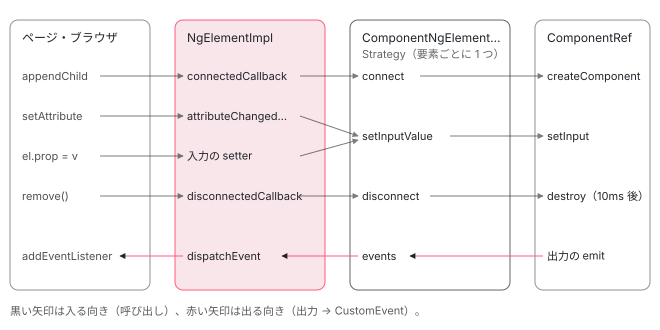

[目次](../README.md) › [Angular Elements の内側](README.md) › 第 1 回 / 全 8 回

# Angular Elements の全体像：カスタム要素とコンポーネントの間

> packages/elements/src の分担（create-custom-element・component-factory-strategy・element-strategy・extract-projectable-nodes・utils）と、カスタム要素のライフサイクルの呼び出しが strategy を通ってコンポーネントに届く全体図。NgElement・NgElementStrategy・NgElementStrategyFactory の約束、公開の API（public\_api.ts）、各章へのリンク。

angular/angular · 読了 約 11 分 · 基礎 · [サイトで読む（デモが動きます）](https://angular-deep-dive-cyan.vercel.app/chapter/elements-overview)

---

`@angular/elements` は、1 つの Angular コンポーネントを、`customElements.define` で登録できる 1 つのクラスに包むパッケージです。この章では、パッケージの入口（`public_api.ts`）に何があるか、ソースの 5 つのファイルがどう分担しているか、そしてブラウザがカスタム要素に送る呼び出し（`connectedCallback` など）が、どの部品を通ってコンポーネントに届くかを、全体図と本物のデモで確かめます。

読む対象は `packages/elements/public_api.ts`・`src/element-strategy.ts`・`src/create-custom-element.ts` の型の部分・`src/component-factory-strategy.ts` の先頭です。中身の手順は第 2 回から 1 つずつ読みます。

1. **1. 全体像**（この章）
2. [2. createCustomElement](02-elements-create.md)
3. [3. 属性と入力](03-elements-attributes-inputs.md)
4. [4. つながるとき](04-elements-connect.md)
5. [5. 入力と変更検知](05-elements-inputs-cd.md)
6. [6. 出力とイベント](06-elements-outputs.md)
7. [7. 切り離しと破棄](07-elements-disconnect.md)
8. [8. spec と issue](08-elements-tests-issues.md)

> [!TIP]
> **新卒エンジニアへ**
>
> **カスタム要素**とは、`customElements.define('my-tag', MyClass)` で登録した、HTML のタグとして使える要素のことです。`MyClass` は `HTMLElement` を継承したクラスで、ブラウザは要素が文書につながったとき `connectedCallback()`、外れたとき `disconnectedCallback()`、`observedAttributes` に挙げた属性が変わったとき `attributeChangedCallback()` を呼びます。これを**ライフサイクルの呼び出し**と呼びます。`@angular/elements` は、この 3 つの呼び出しをコンポーネントの作成・入力・破棄につなぐ役です。

## 1. 入口：public\_api.ts に出ているもの

📄 `angular/packages/elements/public_api.ts` L9–28 （▶ の行: 15–19, 22–24, 26, 28）

```ts
 9 │ /**
10 │  * @module
11 │  * @description
12 │  * Entry point for all public APIs of the `elements` package.
13 │  */
14 │ export {
15 ▶   createCustomElement,
16 ▶   NgElement,
17 ▶   NgElementConfig,
18 ▶   NgElementConstructor,
19 ▶   WithProperties,
20 │ } from './src/create-custom-element';
21 │ export {
22 ▶   NgElementStrategy,
23 ▶   NgElementStrategyEvent,
24 ▶   NgElementStrategyFactory,
25 │ } from './src/element-strategy';
26 ▶ export {VERSION} from './src/version';
27 │ 
28 ▶ // This file only reexports content of the `src` folder. Keep it that way.
```

公開されているのは 9 つです。15〜19 行目が `create-custom-element.ts` から、22〜24 行目が `element-strategy.ts` から、26 行目が `version.ts` から。関数は `createCustomElement` の 1 つだけで、残りは型と抽象クラスと `VERSION` です。28 行目のとおり、このファイルは `src` を再 export するだけにしておく決まりです。

逆に言うと、**既定の strategy（`ComponentNgElementStrategy`）とその factory は公開されていません**。「既定の動きを少しだけ変えたい」ときに継承して使うことはできず、`NgElementStrategy` を自分で全部書くことになります（4 節）。

📄 `angular/packages/elements/index.ts` L9–14 （▶ の行: 14）

```ts
 9 │ // This file is not used to build this module. It is only used during editing
10 │ // by the TypeScript language service and during build for verification. `ngc`
11 │ // replaces this file with production index.ts when it rewrites private symbol
12 │ // names.
13 │ 
14 ▶ export * from './public_api';
```

📄 `angular/packages/elements/src/version.ts` L9–14 （▶ の行: 14）

```ts
 9 │ import {Version} from '@angular/core';
10 │ 
11 │ /**
12 │  * @publicApi
13 │  */
14 ▶ export const VERSION = /* @__PURE__ */ new Version('0.0.0-PLACEHOLDER');
```

`index.ts` は 14 行目で `public_api` をそのまま出すだけで、9〜12 行目のとおりエディタと検証のためのファイルです。`version.ts` の 14 行目の `'0.0.0-PLACEHOLDER'` は配布物を作るときに置き換わり、このサイトに入っている配布物 （`node_modules/@angular/elements/fesm2022/elements.mjs`、296 行）では `new Version('22.1.6')` になっています。

### ファイルの分担

| ファイル（src/） | 行数 | 中身 | 読む回 |
| --- | --- | --- | --- |
| `create-custom-element.ts` | 255 | `NgElement`（抽象クラス）・`NgElementConfig` などの型、`createCustomElement`（`HTMLElement` を継承した `NgElementImpl` を作り、入力ごとの getter と setter を足す） | 第 2 回・第 6 回（イベント） |
| `component-factory-strategy.ts` | 248 | 既定の strategy。`connect` でコンポーネントを作り、`setInputValue` で入力を入れ、`disconnect` で少し待ってから壊す | 第 4〜7 回 |
| `utils.ts` | 109 | `camelToDashCase` などの小さな関数、入力の一覧を取る `getComponentInputs`、遅らせて呼ぶ `scheduler` | 第 3 回 |
| `extract-projectable-nodes.ts` | 54 | 要素の子を、`ng-content` の select ごとに分ける | 第 4 回 |
| `element-strategy.ts` | 44 | strategy と factory の約束（interface）だけ | この回 |
| `version.ts` | 14 | `VERSION` | この回 |

## 2. strategy の約束：NgElementStrategy

📄 `angular/packages/elements/src/element-strategy.ts` L11–44 （▶ の行: 16–18, 27–28, 30–33, 41, 43）

```ts
11 │ /**
12 │  * Interface for the events emitted through the NgElementStrategy.
13 │  *
14 │  * @publicApi
15 │  */
16 ▶ export interface NgElementStrategyEvent {
17 ▶   name: string;
18 ▶   value: any;
19 │ }
20 │ 
21 │ /**
22 │  * Underlying strategy used by the NgElement to create/destroy the component and react to input
23 │  * changes.
24 │  *
25 │  * @publicApi
26 │  */
27 ▶ export interface NgElementStrategy {
28 ▶   events: Observable<NgElementStrategyEvent>;
29 │ 
30 ▶   connect(element: HTMLElement): void;
31 ▶   disconnect(): void;
32 ▶   getInputValue(propName: string): any;
33 ▶   setInputValue(propName: string, value: string, transform?: (value: any) => any): void;
34 │ }
35 │ 
36 │ /**
37 │  * Factory used to create new strategies for each NgElement instance.
38 │  *
39 │  * @publicApi
40 │  */
41 ▶ export interface NgElementStrategyFactory {
42 │   /** Creates a new instance to be used for an NgElement. */
43 ▶   create(injector: Injector): NgElementStrategy;
44 │ }
```

**strategy**（戦略）は、「要素」と「コンポーネント」の間に立つ部品の名前です。要素の側（`NgElementImpl`）は、ブラウザから来た呼び出しを、ほぼそのまま strategy のメソッドに渡します。約束は 27〜34 行目の 5 つです。

1. **30 行目 `connect(element)`**

   要素が文書につながったとき。既定の strategy はここで初めてコンポーネントを作ります（[第 4 回](04-elements-connect.md)）。
2. **31 行目 `disconnect()`**

   要素が外れたとき。既定の strategy はすぐには壊さず、少し待ちます（[第 7 回](07-elements-disconnect.md)）。
3. **32・33 行目 `getInputValue` / `setInputValue`**

   要素のプロパティを読んだり書いたりしたとき、属性が変わったとき（[第 5 回](05-elements-inputs-cd.md)）。33 行目の `value` の型が `string` になっていますが、プロパティからは何の型でも来ます。この型を直す PR（#36883）は 2025-09-25 に「NOT\_PLANNED」で閉じられました。
4. **28 行目 `events`**

   コンポーネントの出力をまとめた `Observable`。流れてくる値は 16〜19 行目の `{ name, value }` で、要素の側がこれを `CustomEvent` にします（[第 6 回](06-elements-outputs.md)）。

41〜44 行目の `NgElementStrategyFactory` は、要素 1 つにつき 1 つの strategy を作る factory です。43 行目の `create(injector)` は注入器だけを受け取ります。

## 3. 要素の側の型：NgElement・NgElementConstructor・NgElementConfig

📄 `angular/packages/elements/src/create-custom-element.ts` L39–78 （▶ の行: 44, 48, 52, 62, 72, 77）

```ts
39 │ /**
40 │  * Implements the functionality needed for a custom element.
41 │  *
42 │  * @publicApi
43 │  */
44 ▶ export abstract class NgElement extends HTMLElement {
45 │   /**
46 │    * The strategy that controls how a component is transformed in a custom element.
47 │    */
48 ▶   protected abstract ngElementStrategy: NgElementStrategy;
49 │   /**
50 │    * A subscription to change, connect, and disconnect events in the custom element.
51 │    */
52 ▶   protected ngElementEventsSubscription: Subscription | null = null;
53 │ 
54 │   /**
55 │    * Prototype for a handler that responds to a change in an observed attribute.
56 │    * @param attrName The name of the attribute that has changed.
57 │    * @param oldValue The previous value of the attribute.
58 │    * @param newValue The new value of the attribute.
59 │    * @param namespace The namespace in which the attribute is defined.
60 │    * @returns Nothing.
61 │    */
62 ▶   abstract attributeChangedCallback(
63 │     attrName: string,
64 │     oldValue: string | null,
65 │     newValue: string,
66 │     namespace?: string,
67 │   ): void;
68 │   /**
69 │    * Prototype for a handler that responds to the insertion of the custom element in the DOM.
70 │    * @returns Nothing.
71 │    */
72 ▶   abstract connectedCallback(): void;
73 │   /**
74 │    * Prototype for a handler that responds to the deletion of the custom element from the DOM.
75 │    * @returns Nothing.
76 │    */
77 ▶   abstract disconnectedCallback(): void;
78 │ }
```

44 行目、`NgElement` は `HTMLElement` を継承した**抽象クラス**で、公開されています。48 行目に strategy を持つ欄、52 行目に出力の購読を持つ欄があり、62・72・77 行目でブラウザが呼ぶ 3 つのメソッドを宣言しています。中身を書くのは `createCustomElement` の中の `NgElementImpl` です（[第 2 回](02-elements-create.md)）。

📄 `angular/packages/elements/src/create-custom-element.ts` L16–37 （▶ の行: 30, 36）

```ts
16 │ /**
17 │  * Prototype for a class constructor based on an Angular component
18 │  * that can be used for custom element registration. Implemented and returned
19 │  * by the {@link createCustomElement createCustomElement() function}.
20 │  *
21 │  * @see [Angular Elements Overview](guide/elements "Turning Angular components into custom elements")
22 │  *
23 │  * @publicApi
24 │  */
25 │ export interface NgElementConstructor<P> {
26 │   /**
27 │    * An array of observed attribute names for the custom element,
28 │    * derived by transforming input property names from the source component.
29 │    */
30 ▶   readonly observedAttributes: string[];
31 │ 
32 │   /**
33 │    * Initializes a constructor instance.
34 │    * @param injector If provided, overrides the configured injector.
35 │    */
36 ▶   new (injector?: Injector): NgElement & WithProperties<P>;
37 │ }
```

`createCustomElement` が返す値の型です。30 行目の `observedAttributes` は、ブラウザが「どの属性の変化を知らせるか」を読む静的な欄です。36 行目、`new` に注入器を渡すと、その要素だけ別の注入器を使えます。ただし `document.createElement` や HTML の中のタグから作られるときは引数なしで呼ばれます。

📄 `angular/packages/elements/src/create-custom-element.ts` L80–108 （▶ の行: 87–88, 102, 107）

```ts
 80 │ /**
 81 │  * Additional type information that can be added to the NgElement class,
 82 │  * for properties that are added based
 83 │  * on the inputs and methods of the underlying component.
 84 │  *
 85 │  * @publicApi
 86 │  */
 87 ▶ export type WithProperties<P> = {
 88 ▶   [property in keyof P]: P[property];
 89 │ };
 90 │ 
 91 │ /**
 92 │  * A configuration that initializes an NgElementConstructor with the
 93 │  * dependencies and strategy it needs to transform a component into
 94 │  * a custom element class.
 95 │  *
 96 │  * @publicApi
 97 │  */
 98 │ export interface NgElementConfig {
 99 │   /**
100 │    * The injector to use for retrieving the component's factory.
101 │    */
102 ▶   injector: Injector;
103 │   /**
104 │    * An optional custom strategy factory to use instead of the default.
105 │    * The strategy controls how the transformation is performed.
106 │    */
107 ▶   strategyFactory?: NgElementStrategyFactory;
108 │ }
```

87〜89 行目の `WithProperties<P>` は、要素の型にコンポーネントのプロパティを足すための型です。設定は 102 行目の `injector`（必須）と、107 行目の `strategyFactory`（任意）の 2 つだけです。`strategyFactory` を渡さなければ、次の節の既定の factory が使われます。

## 4. 既定の factory：ComponentNgElementStrategyFactory

📄 `angular/packages/elements/src/component-factory-strategy.ts` L9–39 （▶ の行: 10, 14, 17, 21–22, 24, 26, 28, 38–39）

```ts
 9 │ // Needed for the global `Zone` ambient types to be available.
10 ▶ import type {} from 'zone.js';
11 │ 
12 │ import {
13 │   ApplicationRef,
14 ▶   ɵChangeDetectionScheduler as ChangeDetectionScheduler,
15 │   ComponentMirror,
16 │   ComponentRef,
17 ▶   createComponent,
18 │   EnvironmentInjector,
19 │   EventEmitter,
20 │   Injector,
21 ▶   ɵisViewDirty as isViewDirty,
22 ▶   ɵmarkForRefresh as markForRefresh,
23 │   NgZone,
24 ▶   ɵNotificationSource as NotificationSource,
25 │   OutputRef,
26 ▶   reflectComponentType,
27 │   Type,
28 ▶   ɵViewRef as ViewRef,
29 │ } from '@angular/core';
30 │ import {merge, Observable, ReplaySubject} from 'rxjs';
31 │ import {switchMap} from 'rxjs/operators';
32 │ 
33 │ import {
34 │   NgElementStrategy,
35 │   NgElementStrategyEvent,
36 │   NgElementStrategyFactory,
37 │ } from './element-strategy';
38 ▶ import {extractProjectableNodes} from './extract-projectable-nodes';
39 ▶ import {scheduler} from './utils';
```

既定の strategy が `@angular/core` から借りているものです。17 行目の `createComponent`・26 行目の `reflectComponentType` は公開の API ですが、14・21・22・24・28 行目の `ɵ` の付いた 5 つは非公開の API です（`ChangeDetectionScheduler` に通知する道は [zoneless の通知の章](../zoneless/02-zoneless-notification-source.md)）。10 行目の zone.js は `import type` なので、型だけを読みます。配布物の `elements.mjs` の import は `@angular/core`・`rxjs`・`rxjs/operators` の 3 つで、zone.js は入っていません。

📄 `angular/packages/elements/src/component-factory-strategy.ts` L44–63 （▶ の行: 54–56, 60–61）

```ts
44 │ /**
45 │  * Factory that creates new ComponentNgElementStrategy instance. Gets the component factory with the
46 │  * constructor's injector's factory resolver and passes that factory to each strategy.
47 │  */
48 │ export class ComponentNgElementStrategyFactory implements NgElementStrategyFactory {
49 │   componentMirror: ComponentMirror<any>;
50 │ 
51 │   inputMap = new Map<string, string>();
52 │ 
53 │   constructor(private component: Type<any>) {
54 ▶     this.componentMirror = reflectComponentType(component)!;
55 ▶     for (const input of this.componentMirror.inputs) {
56 ▶       this.inputMap.set(input.propName, input.templateName);
57 │     }
58 │   }
59 │ 
60 ▶   create(injector: Injector) {
61 ▶     return new ComponentNgElementStrategy(this.component, injector, this.inputMap);
62 │   }
63 │ }
```

54 行目でコンポーネントの情報を `reflectComponentType` で 1 回だけ読み、55〜57 行目で「クラスのプロパティの名前 → テンプレートで使う名前」の `Map` を作ります。60〜62 行目、要素 1 つにつき 1 回 `create(injector)` が呼ばれ、新しい `ComponentNgElementStrategy` が 1 つできます。つまり**要素とコンポーネントは 1 対 1** で、コンポーネントのクラスの情報（`inputMap`）だけが同じ種類の要素で共有されます。

## 5. 全体図：呼び出しはどこを通るか



*ブラウザ（とページのコード）が要素に送る呼び出しは、NgElementImpl → ComponentNgElementStrategy → ComponentRef の順に届く。出力は逆向きに、events → CustomEvent になって戻る。*

- 👤 `customElements.define(tag, createCustomElement(Cmp, { injector }))` — あなたのコード — *第 2 回*
- 👤 `document.createElement(tag)` — ブラウザ — *NgElementImpl の constructor。まだ何も作らない*
- 👤 `parent.appendChild(el)` — ブラウザ
  - `NgElementImpl.connectedCallback()` — create-custom-element.ts 191 — *初めて strategy を作る（getter）*
    - `ComponentNgElementStrategy.connect(el)` — component-factory-strategy.ts 116 — *第 4 回*
      - `initializeComponent(el)` — component-factory-strategy.ts 200 — *extractProjectableNodes → createComponent → attachView → detectChanges*
- 👤 `el.setAttribute('user-name', v)` / `el.userName = v` — ブラウザ・あなたのコード
  - `attributeChangedCallback` / 入力の setter — create-custom-element.ts 181・246 — *第 2・3 回*
    - `setInputValue(propName, value)` — component-factory-strategy.ts 172 — *ComponentRef.setInput → 変更検知の通知（第 5 回）*
- 👤 `el.remove()` — ブラウザ
  - `disconnectedCallback()` → `disconnect()` — create-custom-element.ts 218・component-factory-strategy.ts 136 — *10ms 後に destroy（第 7 回）*

## 6. DEMO：本物のカスタム要素に、1 つずつ呼び出しを送る

> **🧪 DEMO — &lt;el-overview-greet&gt; に届いた順番**
>
> 入力 `userName = input('だれか')` と出力 `liked = output<number>()` を持つ小さなコンポーネントを、このページに入っている本物の `@angular/elements` 22.1.6 の `createCustomElement` でカスタム要素にします。最初のボタンを押したときに `@angular/elements` を読み込み、`customElements.define` します（取り消せないので、このページで 1 回だけ）。記録のために、`createCustomElement` が返したクラスを継承して、`connectedCallback` など 3 つのメソッドと strategy の getter で「呼ばれた」と書いてから `super` を呼んでいます。中身には手を入れていません。
>
> ▶ [このデモはサイトで動かせます](https://angular-deep-dive-cyan.vercel.app/chapter/elements-overview)

押すと分かることです（本番ビルドをヘッドレスの Chrome で動かした結果は、章末の「テストと直し方」にあります）。

1. **1. 作る：表に出るのは define と createElement だけ**

   `document.createElement` で `NgElementImpl` の constructor は走りますが、strategy もコンポーネントもまだ作られません。strategy は「初めて必要になったとき」に作る getter です（[第 2 回](02-elements-create.md)）。
2. **2. つなぐ：connectedCallback → strategy を作る → コンポーネントの constructor → ngOnChanges は出ない**

   まだ入力に何も入れていないので、`ngOnChanges` は呼ばれません。`appendChild から戻った` の行より前に constructor が出ます。コンポーネントは `appendChild` の中で同期に作られて描かれます（[第 4 回](04-elements-connect.md)）。
3. **3・4. 属性・プロパティ：ngOnChanges は少しあとに出る**

   属性は `attributeChangedCallback`、プロパティは setter を通って、どちらも `setInputValue` に入ります。`ngOnChanges` はその場ではなく、予約された変更検知のときに出ます（[第 5 回](05-elements-inputs-cd.md)）。プロパティを書いた直後に読むと、もう新しい値が返ります。
4. **5. 出力：liked.emit のすぐあとに addEventListener が受ける**

   `output()` の emit が、同期に `CustomEvent('liked')` になって要素から出ます。`bubbles` は `false` です（[第 6 回](06-elements-outputs.md)）。
5. **6. 外す：disconnectedCallback のあと、約 10ms 後に ngOnDestroy**

   外してすぐには壊しません。すぐ戻したときに作り直さないための待ち時間です（[第 7 回](07-elements-disconnect.md)）。このデモでは、外したあとに同じ要素をつなぎ直すボタンは押せないようにしています。壊れたあとに同じ要素をつなぎ直すと、コンポーネントが作られないからです（[第 4 回](04-elements-connect.md)の 2 節、#38778）。もう一度試すときは「1. 作る」から押してください。

## 7. このシリーズの読み方

| 回 | 読む行 | 答えられるようになる質問 |
| --- | --- | --- |
| [2. createCustomElement](02-elements-create.md) | create-custom-element.ts の `createCustomElement` の本体 | なぜ strategy を constructor で作らないのか。定義の前に入れたプロパティはどうなるか |
| [3. 属性と入力](03-elements-attributes-inputs.md) | utils.ts と reflectComponentType | 別名の付いた入力は、どの属性の名前とどのプロパティの名前になるか |
| [4. つながるとき](04-elements-connect.md) | component-factory-strategy.ts の connect・initializeComponent、extract-projectable-nodes.ts | 要素の子はどの ng-content に入るか。注入器は何を渡せばよいか |
| [5. 入力と変更検知](05-elements-inputs-cd.md) | setInputValue と ChangeDetectionScheduler | 同じ値を入れたら変更検知は走るか |
| [6. 出力とイベント](06-elements-outputs.md) | initializeOutputs・subscribeToEvents | CustomEvent の名前と detail は何になるか |
| [7. 切り離しと破棄](07-elements-disconnect.md) | disconnect と scheduler | 要素を DOM の中で動かすと、コンポーネントは作り直されるか |
| [8. spec と issue](08-elements-tests-issues.md) | packages/elements/test と issue | どの issue が、どの行に関係するか |

## テストと直し方

### spec の地図

| spec（packages/elements/test/） | 行数・it | 何を確かめるか | 回 |
| --- | --- | --- | --- |
| create-custom-element\_spec.ts | 451 行・it 14 | 偽の strategy（`TestStrategy`）をつないだ要素で、属性・プロパティ・イベントの渡し方 | 第 2・3・6 回 |
| component-factory-strategy\_spec.ts | 423 行・it 19・xit 5 | 本物の `ComponentNgElementStrategy` を `TestBed` の注入器で動かす | 第 4〜7 回 |
| utils\_spec.ts | 176 行・it 13 | utils.ts の関数 1 つずつ | 第 3 回 |
| extract-projectable-nodes\_spec.ts | 106 行・it 8 | 子を select ごとに分ける | 第 4 回 |
| slots\_spec.ts | 161 行・it 4 | Shadow DOM の `<slot>` への投影 | 第 4 回 |
| create-custom-element-env\_spec.ts | 47 行・it 1 | `createApplication` の注入器で本物の要素を描く | 第 4 回 |

it は合わせて 59、xit（飛ばす it）は 5 で、5 つとも component-factory-strategy\_spec.ts にあります（163・254・272・284・347 行目。`ngOnChanges` の回数・変更検知を 1 回にまとめること・zone.js なしのとき）。手元の結果の「5 skipped」はこの 5 つです。

📄 `angular/packages/elements/test/create-custom-element_spec.ts` L40–70 （▶ の行: 52–53, 55–56, 59, 64）

```ts
40 │ describe('createCustomElement', () => {
41 │   let selectorUid = 0;
42 │   let testContainer: HTMLDivElement;
43 │   let NgElementCtor: NgElementConstructor<WithFooBar>;
44 │   let strategy: TestStrategy;
45 │   let strategyFactory: TestStrategyFactory;
46 │   let injector: Injector;
47 │ 
48 │   beforeAll((done) => {
49 │     testContainer = document.createElement('div');
50 │     document.body.appendChild(testContainer);
51 │     destroyPlatform();
52 ▶     platformBrowser()
53 ▶       .bootstrapModule(TestModule)
54 │       .then((ref) => {
55 ▶         injector = ref.injector;
56 ▶         strategyFactory = new TestStrategyFactory();
57 │         strategy = strategyFactory.testStrategy;
58 │ 
59 ▶         NgElementCtor = createAndRegisterTestCustomElement(strategyFactory);
60 │       })
61 │       .then(done, done.fail);
62 │   });
63 │ 
64 ▶   afterEach(() => strategy.reset());
65 │ 
66 │   afterAll(() => {
67 │     destroyPlatform();
68 │     testContainer.remove();
69 │     (testContainer as any) = null;
70 │   });
```

create-custom-element\_spec.ts の準備です。52〜53 行目で `platformBrowser().bootstrapModule` し、55 行目でその `NgModuleRef` の注入器を取り、56 行目で偽の strategy の factory を作って、59 行目で 1 回だけ `customElements.define` します。define は取り消せないので、このあとの it はみな同じ 1 つの strategy（64 行目で毎回 `reset`）を使います。

📄 `angular/packages/elements/test/create-custom-element_spec.ts` L405–434 （▶ の行: 412–413, 425–426）

```ts
405 │   class TestStrategy implements NgElementStrategy {
406 │     connectedElement: HTMLElement | null = null;
407 │     disconnectCalled = false;
408 │     inputs = new Map<string, any>();
409 │ 
410 │     events = new Subject<NgElementStrategyEvent>();
411 │ 
412 ▶     connect(element: HTMLElement): void {
413 ▶       this.events.next({name: 'strategy-event', value: 'connect'});
414 │       this.connectedElement = element;
415 │     }
416 │ 
417 │     disconnect(): void {
418 │       this.disconnectCalled = true;
419 │     }
420 │ 
421 │     getInputValue(propName: string): any {
422 │       return this.inputs.get(propName);
423 │     }
424 │ 
425 ▶     setInputValue(propName: string, value: string, transform?: (value: any) => any): void {
426 ▶       this.inputs.set(propName, transform ? transform(value) : value);
427 │     }
428 │ 
429 │     reset(): void {
430 │       this.connectedElement = null;
431 │       this.disconnectCalled = false;
432 │       this.inputs.clear();
433 │     }
434 │   }
```

偽の strategy です。**426 行目で、渡された `transform` を自分で呼んでいます**。本物の `ComponentNgElementStrategy` は、この 3 番目の引数を受け取らず、`ComponentRef.setInput` の中で core が transform を呼びます（[第 3 回](03-elements-attributes-inputs.md)）。つまり create-custom-element\_spec.ts の transform の確かめは、要素の側が transform を渡しているかまでで、本物の道は通っていません。

### 手元で走らせた結果

📄 `ターミナル（../angular で）`

```
cd ~/angular-research/angular
pnpm bazel test //packages/elements/test:test_chromium //packages/elements/test:test_firefox \
  --nocache_test_results --test_output=all

# 名前の絞り込みを試した（効かない）
pnpm bazel test //packages/elements/test:test_chromium \
  '--test_arg=--filter=extractProjectableNodes' --nocache_test_results --test_output=all
```

📄 `出力（2026-11-06 に実行。抜粋。ログは scratchpad/el-logs/a-test.log・a-filter.log）`

```
Chromium: |██████████| 1/1 test files | 59 passed, 0 failed, 5 skipped
Firefox:  |██████████| 1/1 test files | 59 passed, 0 failed, 5 skipped
//packages/elements/test:test_chromium      PASSED in 1.5s
//packages/elements/test:test_firefox       PASSED in 3.0s
INFO: Elapsed time: 4.814s

# --test_arg=--filter=extractProjectableNodes を付けても
Chromium: |██████████| 1/1 test files | 59 passed, 0 failed, 5 skipped
//packages/elements/test:test_chromium      PASSED in 1.1s
```

- 6 つの spec は 1 つのバンドル（`test_bundle.spec.js`）になり、Web Test Runner の上の Jasmine で、Chromium と Firefox の両方で走ります（BUILD.bazel の `ng_web_test_suite`）。
- `--test_arg=--filter=extractProjectableNodes` を付けても 59 件すべてが走ったので、**名前の絞り込みは効きません**。全部でも数秒なので、ターゲットごと走らせます。1 つの it だけを見たいときは、手元で `fit` に変えて走らせ、終わったら戻します。
- `//packages/elements:elements_api` は公開 API のゴールデン（`goldens/public-api/elements`）と比べるテストです。1 節の 9 つを増やしたり型を変えたりすると、ここが落ちます。

### 直すとしたら

- 2 節の `setInputValue(propName, value: string, …)` の型：element-strategy.ts の 33 行目です。#36883 は、`unknown` にすると破壊的な変更になるため閉じられました。触るなら公開 API のゴールデンも変わります。
- 偽の strategy だけで transform を確かめている点：本物の道（属性の文字列 → `setInput` → transform）の it は、component-factory-strategy\_spec.ts の `TestComponent` に transform 付きの入力を足し、describe `after connected`（82 行目）に足す形になります（第 3 回）。
- 2026-09-24 に開かれた #70905（つながる・外れるをコンポーネントに知らせる API）は、2026-10-06 に「NOT\_PLANNED」で閉じられています。issue の全体は[第 8 回](08-elements-tests-issues.md)で読みます。本家に PR を出すことは勧めません。

**本番ビルドでデモを動かした結果（2026-11-06）。**ヘッドレスの Chrome（HeadlessChrome/155.0.8043.0）で本番ビルドのこのページを開き、playwright で 1 から順に押しました。ページを開いた時点では @angular/elements の chunk は読み込まれず、「1. 作る」を押したときに 1 つだけ増えました（main には @angular/elements が入っていません）。表は、define と createElement → connectedCallback → strategy を作った → constructor → appendChild から戻った、の順で、つないだときに ngOnChanges は出ませんでした。setAttribute のあとは約 13ms 後に ngOnChanges(userName: undefined → '属性1'（firstChange）)、プロパティのあとも約 13ms 後に ngOnChanges が出て、書いた直後に読んだ userName は新しい値でした。中のボタンでは liked.emit(1) のすぐあとに addEventListener が detail = 1・bubbles = false で受け、外すと disconnectedCallback の約 18ms 後に ngOnDestroy が出ました。外したあとは「2. つなぐ」が押せず、「1. 作る」からやり直すと新しい constructor が出ました。別の章へ移ったあと、この章の要素は文書に残っておらず、コンソールの警告とエラーは 0 件でした（scratchpad/el-a-exp/verify.mjs、2026-11-06）。

## 聞かれそうな質問

**Q. createCustomElement は、アプリ全体をカスタム要素にするのですか？**

いいえ。1 つのコンポーネントを 1 つのクラスにします。factory は要素ごとに `create(injector)` で strategy を 1 つ作り（component-factory-strategy.ts 60〜62 行目）、その strategy がコンポーネントを 1 つ作ります。注入器は `NgElementConfig` の 102 行目で受け取ったものを、同じ種類の全部の要素で使います。アプリ（注入器と `ApplicationRef`）は、先に `createApplication` などで作っておく必要があります。

**Q. 既定の動きを少し変えたいとき、strategy を継承できますか？**

できません。`public_api.ts`（14〜26 行目）に出ているのは `NgElementStrategy` などの interface だけで、`ComponentNgElementStrategy` と `ComponentNgElementStrategyFactory` は出ていません。`NgElementConfig` の 107 行目の `strategyFactory` に、element-strategy.ts の 27〜34 行目の 5 つを全部書いた自分の strategy を渡します。

**Q. document.createElement した時点で、コンポーネントは作られますか？**

作られません。デモの「1. 作る」で表に出るのは createElement の行だけです。コンポーネントは要素がつながったときの `connect`（element-strategy.ts 30 行目の約束）で作られます。つながる前に入れた入力は、strategy の中に貯めておかれ、作ったときにまとめて入ります（[第 4 回](04-elements-connect.md)）。

**Q. zone.js は必要ですか？**

必要ありません。component-factory-strategy.ts の 10 行目は `import type` で型だけを読み、配布物の import にも zone.js はありません。このサイトも zone.js なし（zoneless）で、デモが動いています。zone.js があるときだけ、strategy は Angular の zone の中で動くようにします（[第 5 回](05-elements-inputs-cd.md)）。

**Q. 出力は、どんな名前のイベントになりますか？**

`events` に流れる値の `name`（element-strategy.ts 17 行目）がイベントの名前です。既定の strategy では出力のテンプレートでの名前（別名があれば別名）になり、デモでは `liked` でした。`value`（18 行目）が `detail` になります（[第 6 回](06-elements-outputs.md)）。

## 読み終えて

- 公開されているのは `createCustomElement` と、`NgElement`・`NgElementStrategy` などの型と `VERSION` の 9 つ。既定の strategy は公開されていない
- 要素（`NgElementImpl`）は、ブラウザの 3 つの呼び出しとプロパティの読み書きを、要素ごとに 1 つの strategy に渡す
- 既定の strategy は、つながったときに初めてコンポーネントを作り、外れたら少し待ってから壊す。コンポーネントと要素は 1 対 1
- spec は 6 ファイル・it 59・xit 5。ブラウザで走り、名前の絞り込みは効かない

---

← 前: [spec と issue を読む：event-dispatch の今](../jsaction/12-jsaction-tests-issues.md)  
次: [createCustomElement：HTMLElement を継承したクラスを作る](02-elements-create.md) →
