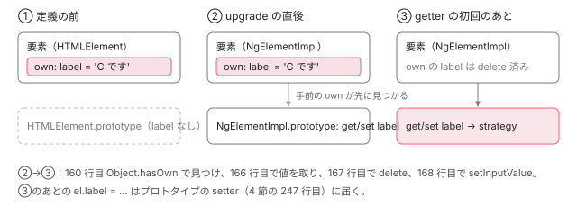

[目次](../README.md) › [Angular Elements の内側](README.md) › 第 2 回 / 全 8 回

# createCustomElement：HTMLElement を継承したクラスを作る

> createCustomElement が NgElementImpl を作り、observedAttributes を入力から決め、connectedCallback・attributeChangedCallback・disconnectedCallback を strategy に回し、入力ごとにプロパティの getter と setter を定義する行。strategy を遅れて作る理由と、つながる前に設定されたプロパティの扱い、signal の入力の getter の修正（be0455adda7）。

angular/angular · 読了 約 13 分 · 中核 · [サイトで読む（デモが動きます）](https://angular-deep-dive-cyan.vercel.app/chapter/elements-create)

---

`createCustomElement(Cmp, { injector })` は、`HTMLElement` を継承したクラスを 1 つ作って返す関数です。この章では、そのクラス（`NgElementImpl`）が何を持っているか、ブラウザの 3 つの呼び出しをどう strategy に回すか、入力ごとのプロパティをどう足すか、そして strategy をわざと遅れて作る理由と「つながる前・定義の前に入れたプロパティ」の扱いを、行を指して追います。

読む対象は `packages/elements/src/create-custom-element.ts` の 132〜255 行目（`createCustomElement` の本体）です。

1. [1. 全体像](01-elements-overview.md)
2. **2. createCustomElement**（この章）
3. [3. 属性と入力](03-elements-attributes-inputs.md)
4. [4. つながるとき](04-elements-connect.md)
5. [5. 入力と変更検知](05-elements-inputs-cd.md)
6. [6. 出力とイベント](06-elements-outputs.md)
7. [7. 切り離しと破棄](07-elements-disconnect.md)
8. [8. spec と issue](08-elements-tests-issues.md)

## 1. 最初の 3 行と observedAttributes

📄 `angular/packages/elements/src/create-custom-element.ts` L132–147 （▶ の行: 136, 138–139, 141, 143, 146）

```ts
132 │ export function createCustomElement<P>(
133 │   component: Type<any>,
134 │   config: NgElementConfig,
135 │ ): NgElementConstructor<P> {
136 ▶   const inputs = getComponentInputs(component, config.injector);
137 │ 
138 ▶   const strategyFactory =
139 ▶     config.strategyFactory || new ComponentNgElementStrategyFactory(component);
140 │ 
141 ▶   const attributeToPropertyInputs = getDefaultAttributeToPropertyInputs(inputs);
142 │ 
143 ▶   class NgElementImpl extends NgElement {
144 │     // Work around a bug in closure typed optimizations(b/79557487) where it is not honoring static
145 │     // field externs. So using quoted access to explicitly prevent renaming.
146 ▶     static readonly ['observedAttributes'] = Object.keys(attributeToPropertyInputs);
147 │ 
```

`createCustomElement` を呼んだときに 1 回だけ走る行です。要素を作るたびではありません。

1. **136 行目：入力の一覧を読む**

   `getComponentInputs` は `reflectComponentType(component).inputs` を返すだけです（中身は[第 3 回](03-elements-attributes-inputs.md)）。1 つの入力は `propName`（クラスのプロパティの名前）・`templateName`（テンプレートで使う名前。別名があれば別名）・`transform`・`isSignal` を持ちます。
2. **138〜139 行目：strategy の factory を決める**

   設定に `strategyFactory` が無ければ、既定の `ComponentNgElementStrategyFactory` を作ります（[第 1 回](01-elements-overview.md)の 4 節）。
3. **141 行目：属性の名前 → 入力の表を作る**

   `{ 'user-name': ['userName', transform] }` の形の表です（[第 3 回](03-elements-attributes-inputs.md)）。
4. **143 行目：クラスを作る**

   `NgElementImpl` は関数の中で宣言されるので、`createCustomElement` を呼ぶたびに別のクラスができます。同じコンポーネントで 2 回呼べば、2 つのタグに別々に登録できます。
5. **146 行目：observedAttributes**

   141 行目の表のキーの配列です。ブラウザはこの静的な欄を `customElements.define` のときに読みます。144〜145 行目のコメントのとおり、Closure Compiler に名前を変えられないよう、`['observedAttributes']` と引用符付きで書いています。

## 2. strategy を遅れて作る getter

📄 `angular/packages/elements/src/create-custom-element.ts` L148–179 （▶ の行: 148, 151–153, 159–160, 166–168, 172, 177–178）

```ts
148 ▶     protected override get ngElementStrategy(): NgElementStrategy {
149 │       // TODO(andrewseguin): Add e2e tests that cover cases where the constructor isn't called. For
150 │       // now this is tested using a Google internal test suite.
151 ▶       if (!this._ngElementStrategy) {
152 ▶         const strategy = (this._ngElementStrategy = strategyFactory.create(
153 ▶           this.injector || config.injector,
154 │         ));
155 │ 
156 │         // Re-apply pre-existing input values (set as properties on the element) through the
157 │         // strategy.
158 │         // TODO(alxhub): why are we doing this? this makes no sense.
159 ▶         inputs.forEach(({propName, transform}) => {
160 ▶           if (!Object.hasOwn(this, propName)) {
161 │             // No pre-existing value for `propName`.
162 │             return;
163 │           }
164 │ 
165 │           // Delete the property from the DOM node and re-apply it through the strategy.
166 ▶           const value = (this as any)[propName];
167 ▶           delete (this as any)[propName];
168 ▶           strategy.setInputValue(propName, value, transform);
169 │         });
170 │       }
171 │ 
172 ▶       return this._ngElementStrategy!;
173 │     }
174 │ 
175 │     private _ngElementStrategy?: NgElementStrategy;
176 │ 
177 ▶     constructor(private readonly injector?: Injector) {
178 ▶       super();
179 │     }
```

177〜179 行目の constructor は `super()` を呼んで、渡された注入器を覚えるだけです。strategy は作りません。strategy は 148 行目の getter が**初めて呼ばれたとき**に、151〜154 行目で作られます。注入器は、constructor に渡されたもの（`this.injector`）が無ければ `config.injector` です。

constructor で作らない理由は、この getter を入れたコミット e3d447229d0（2020-05、v10.0.0）に書かれています。カスタム要素の polyfill（ブラウザが対応していなかったころの代わりの実装）の中に constructor を呼ばないものがあり、「constructor で作った」と決めつけると、そのときに strategy が無くて壊れていました。getter にすれば、どの入口から来ても 1 か所で作れます。

> [!TIP]
> **新卒エンジニアへ**
>
> **upgrade** は、すでにある要素が、あとから届いた定義のクラスに「なる」ことです。ブラウザは要素を作り直さず、同じ要素のまま、その要素でクラスの constructor を走らせ、プロトタイプを付け替えます。定義の前に HTML に書いてあった `<my-tag>` は、`customElements.define` の時点で upgrade されます。

### 定義の前に入れたプロパティを拾い直す（159〜169 行目）

同じ v10.0.0 のコミット 2fc5ae561b2（#30848 を直したもの）が足した行です。どういうときに要るのかを、1 ステップずつ見ます。

1. **定義の前：要素はまだただの `HTMLElement`**

   `customElements.define` の前に作られた要素（HTML に先に書いてあった、別の文書で作った、など）に `el.label = 'x'` と書くと、`label` はその要素の上の**ふつうのデータのプロパティ**（own のプロパティ）になります。
2. **upgrade：プロトタイプに setter が来るが、own のプロパティが手前にある**

   定義が届くと、要素は `NgElementImpl` になります（upgrade）。4 節の setter は `NgElementImpl.prototype` にありますが、JavaScript はプロパティを要素そのものから探すので、own の `label` が見つかって setter は呼ばれません。
3. **getter の初回：own のプロパティを消して、strategy に入れ直す**

   160 行目の `Object.hasOwn(this, propName)` で own のプロパティを見つけ、166 行目で値を取り、167 行目で `delete` し（これでプロトタイプの setter と getter が見えるようになる）、168 行目で `setInputValue` に渡します。



*定義の前に書いたプロパティは要素の上の own のプロパティになる。upgrade のあともプロトタイプの setter より手前にあり、strategy の getter の初回に消されて strategy に入れ直される。*

158 行目に `TODO(alxhub): why are we doing this? this makes no sense.` とありますが、上の 3 ステップの場合には、この行が無いと値が失われます（下のデモの C）。160 行目は、2026-08 のコミット 732e5050180 で `this.hasOwnProperty(propName)` から `Object.hasOwn(this, propName)` に変わりました（全体の置き換えで、動きは同じ）。また 2025-01 のコミット 0c1ecb453c8（v19.2.0、#59757）より前は、ここで **signal の入力を飛ばしていた**ため、定義の前に入れた signal の入力の値が失われていました。

## 3. ブラウザの 3 つの呼び出し

📄 `angular/packages/elements/src/create-custom-element.ts` L181–216 （▶ の行: 187–188, 200, 202, 204, 208, 210, 214）

```ts
181 │     override attributeChangedCallback(
182 │       attrName: string,
183 │       oldValue: string | null,
184 │       newValue: string,
185 │       namespace?: string,
186 │     ): void {
187 ▶       const [propName, transform] = attributeToPropertyInputs[attrName]!;
188 ▶       this.ngElementStrategy.setInputValue(propName, newValue, transform);
189 │     }
190 │ 
191 │     override connectedCallback(): void {
192 │       // For historical reasons, some strategies may not have initialized the `events` property
193 │       // until after `connect()` is run. Subscribe to `events` if it is available before running
194 │       // `connect()` (in order to capture events emitted during initialization), otherwise subscribe
195 │       // afterwards.
196 │       //
197 │       // TODO: Consider deprecating/removing the post-connect subscription in a future major version
198 │       //       (e.g. v11).
199 │ 
200 ▶       let subscribedToEvents = false;
201 │ 
202 ▶       if (this.ngElementStrategy.events) {
203 │         // `events` are already available: Subscribe to it asap.
204 ▶         this.subscribeToEvents();
205 │         subscribedToEvents = true;
206 │       }
207 │ 
208 ▶       this.ngElementStrategy.connect(this);
209 │ 
210 ▶       if (!subscribedToEvents) {
211 │         // `events` were not initialized before running `connect()`: Subscribe to them now.
212 │         // The events emitted during the component initialization have been missed, but at least
213 │         // future events will be captured.
214 ▶         this.subscribeToEvents();
215 │       }
216 │     }
```

1. **187〜188 行目：attributeChangedCallback**

   属性の名前で 141 行目の表を引き、入力の `propName` と `transform` を取り出して `setInputValue` に渡します。属性を消したとき、`newValue` は（184 行目の型は `string` ですが）`null` で来ます（[第 3 回](03-elements-attributes-inputs.md)のデモ）。`this.ngElementStrategy` を使うので、まだ strategy が無ければここで作られます。
2. **202〜206 行目：connectedCallback はまず出力を購読する**

   strategy の `events` がもうあれば、`connect` より先に購読します。`connect` の中で出たイベントを取りこぼさないためです（購読の中身は[第 6 回](06-elements-outputs.md)）。
3. **208 行目：connect**

   ここで初めてコンポーネントが作られます（[第 4 回](04-elements-connect.md)）。
4. **210〜215 行目：events が後から来る strategy のための道**

   196〜198 行目のコメントのとおり、昔の strategy のための互換の道です。この場合 `connect` の中で出たイベントは取りこぼします。

📄 `angular/packages/elements/src/create-custom-element.ts` L218–228 （▶ の行: 219–221, 224–226）

```ts
218 │     override disconnectedCallback(): void {
219 ▶       // Not using `this.ngElementStrategy` to avoid unnecessarily creating the `NgElementStrategy`.
220 ▶       if (this._ngElementStrategy) {
221 ▶         this._ngElementStrategy.disconnect();
222 │       }
223 │ 
224 ▶       if (this.ngElementEventsSubscription) {
225 ▶         this.ngElementEventsSubscription.unsubscribe();
226 ▶         this.ngElementEventsSubscription = null;
227 │       }
228 │     }
```

220 行目だけは getter ではなく `this._ngElementStrategy` を直接見ます。219 行目のコメントのとおり、一度もつながっていない要素を外したときに、わざわざ strategy を作らないためです。224〜227 行目で出力の購読をやめます。外れたあとの strategy の動きは[第 7 回](07-elements-disconnect.md)です。

## 4. 入力ごとの getter と setter

📄 `angular/packages/elements/src/create-custom-element.ts` L239–255 （▶ の行: 240–241, 243–244, 247, 249–250, 254）

```ts
239 │   // Add getters and setters to the prototype for each property input.
240 ▶   inputs.forEach(({propName, transform, isSignal: _isSignal}) => {
241 ▶     Object.defineProperty(NgElementImpl.prototype, propName, {
242 │       get(): any {
243 ▶         const inputValue = this.ngElementStrategy.getInputValue(propName);
244 ▶         return _isSignal && isSignal(inputValue) ? inputValue() : inputValue;
245 │       },
246 │       set(newValue: any): void {
247 ▶         this.ngElementStrategy.setInputValue(propName, newValue, transform);
248 │       },
249 ▶       configurable: true,
250 ▶       enumerable: true,
251 │     });
252 │   });
253 │ 
254 ▶   return NgElementImpl as any as NgElementConstructor<P>;
255 │ }
```

240 行目で入力を 1 つずつ回り、241 行目で `NgElementImpl.prototype` に **`propName`**（クラスのプロパティの名前）でアクセサを足します。属性は `templateName`（別名）から、プロパティは `propName` から名前を作るので、別名を付けた入力では 2 つの名前がずれます（[第 3 回](03-elements-attributes-inputs.md)、#58302）。

1. **247 行目：setter**

   属性のときと同じ `setInputValue(propName, value, transform)` です。プロパティからは文字列に限らず何でも来ます。
2. **243 行目：getter**

   strategy の `getInputValue` に聞きます。コンポーネントがまだ無ければ貯めてある値、あればコンポーネントのプロパティの値が返ります（[第 5 回](05-elements-inputs-cd.md)）。
3. **244 行目：signal の入力なら中身を返す**

   `input()` で作った入力では、コンポーネントのプロパティは `InputSignal`（関数）です。`isSignal` が `true` の入力で、値が signal なら、呼んで中身を返します。
4. **249〜250 行目**

   `configurable` なので 2 節の 167 行目のような `delete` や上書きができ、`enumerable` なので `for...in` に出ます。

### signal の入力の getter の修正（be0455adda7）

📄 `git show be0455adda7 -- packages/elements/src（抜粋）`

```
-import {Injector, Type} from '@angular/core';
+import {Injector, Type, isSignal} from '@angular/core';
 ...
   // Add getters and setters to the prototype for each property input.
-  inputs.forEach(({propName, transform}) => {
+  inputs.forEach(({propName, transform, isSignal: _isSignal}) => {
     Object.defineProperty(NgElementImpl.prototype, propName, {
       get(): any {
-        return this.ngElementStrategy.getInputValue(propName);
+        const inputValue = this.ngElementStrategy.getInputValue(propName);
+        return _isSignal && isSignal(inputValue) ? inputValue() : inputValue;
       },
```

2025-06 のコミットで、v21.0.0 から入っています（#62097 を閉じたもの。コミットの本文には `BREAKING CHANGE` とあります）。それまでは getter が `InputSignal` をそのまま返していたので、デコレーターの入力は `el.oldInput`、signal の入力は `el.newInput()` と読み方が違っていました。244 行目の条件は 2 つあります。`_isSignal`（入力として signal か）だけでなく `isSignal(inputValue)` も見るので、つながる前（貯めてある値はただの値）にも正しく動き、デコレーターの入力に signal を入れているコンポーネント（章末の spec の 334〜343 行目の形）では signal のまま返ります。

## 5. DEMO：つなぐ前に入れるか、あとに入れるか、定義の前に入れるか

> **🧪 DEMO — つなぐ前に入れたか、あとに入れたか**
>
> デコレーターの入力 `@Input() label` と signal の入力 `count = input(0)` を持つコンポーネントを、本物の `createCustomElement` で `<el-create-counter>` にします。A・B・C の 3 通りで、同じ値を入れます。コンポーネントは `constructor`・`ngOnChanges`・`ngAfterViewChecked`（「描いた」）を記録します。記録のために `createCustomElement` が返したクラスを継承し、constructor・`connectedCallback`・strategy の getter で書いてから `super` を呼んでいます。
>
> ▶ [このデモはサイトで動かせます](https://angular-deep-dive-cyan.vercel.app/chapter/elements-create)

押すと分かることです（本番ビルドをヘッドレスの Chrome で動かした結果は、章末の「テストと直し方」にあります）。

1. **A：最初のプロパティを書いたときに strategy ができ、ngOnChanges は appendChild の中で 1 回**

   `A.label = …` の setter（4 節の 247 行目）が `this.ngElementStrategy` を読むので、そこで strategy ができます（own のプロパティはなし）。コンポーネントがまだ無いので値は strategy に貯まり、`A.count` を読むと貯めた 3 が返ります。`appendChild` の中で constructor・`ngOnChanges`（2 つとも `firstChange`）・「描いた」が 1 回ずつ出て、そのあとで `appendChild から戻った` が出ます。
2. **B：先に既定の値で描かれ、少しあとに ngOnChanges と 2 回目の描画**

   つないだ時点では入力が空なので、`ngOnChanges` は出ず、「（なし）：0」で 1 回描かれます。そのあとのプロパティは、コンポーネントへすぐ入る（直後に読むと 3）一方、`ngOnChanges` と 2 回目の描画は約 10ms あとの変更検知で 1 回にまとまって出ます。`firstChange` はやはり `true` です（初めて入った値なので）。予約の仕組みは[第 5 回](05-elements-inputs-cd.md)です。
3. **C：own のプロパティが 2 つ見つかり、upgrade のあとに入れ直される**

   別の文書で作った要素は定義が届かないので、`C.label = …` は own のプロパティになり、`NgElementImpl` でもありません。このページに入れると、`appendChild` の中で upgrade（constructor）→ `connectedCallback` → getter の初回で「own のプロパティ: label, count」が出て、2 節の 159〜169 行目で入れ直されます。結果は A と同じく、`ngOnChanges` 1 回・描画 1 回で、戻ったあとは own のプロパティが消えています。

## ここまでの呼び出し

- 👤 `createCustomElement(Cmp, config)` — create-custom-element.ts 132 — *入力の一覧・factory・属性の表を 1 回だけ作る*
  - `class NgElementImpl extends NgElement` — create-custom-element.ts 143 — *observedAttributes（146）*
  - `Object.defineProperty(NgElementImpl.prototype, propName, …)` — create-custom-element.ts 241 — *入力ごとに getter と setter*
- 👤 `el.label = v` / `setAttribute` / `appendChild` — あなたのコード・ブラウザ
  - `get ngElementStrategy()` — create-custom-element.ts 148 — *初回だけ strategyFactory.create(injector)、own のプロパティを入れ直す*
    - `strategy.setInputValue(propName, value, transform)` — create-custom-element.ts 168・188・247 — *第 5 回*
    - `strategy.connect(this)` — create-custom-element.ts 208 — *第 4 回*

## テストと直し方

### spec と it

| it（create-custom-element\_spec.ts） | 行 | この章のどこ |
| --- | --- | --- |
| `should work even if the constructor is not called (due to polyfill)` | 96 | 2 節（it の中で要素の `injector` を消して、constructor を呼ばなかった形にする） |
| `should properly set getters/setters on the element` | 185 | 4 節 |
| `should properly handle getting/setting properties on the element even if the constructor is not called` | 198 | 2 節 |
| `should capture properties set before upgrading the element` | 217 | 2 節の 159〜169 行目 |
| `should capture properties set after upgrading the element but before inserting it into the DOM` | 245 | 2 節（upgrade のあとも own のプロパティが手前にある） |
| `should return value from input getter for input signal`・`should not unpack signal value with input decorator having signal as value` | 322・334 | 4 節の 244 行目（be0455adda7 が足した 2 つ） |

📄 `angular/packages/elements/test/create-custom-element_spec.ts` L217–243 （▶ の行: 220, 228, 232–233, 236, 241）

```ts
217 │   it('should capture properties set before upgrading the element', () => {
218 │     // Create a regular element and set properties on it.
219 │     const {selector, ElementCtor} = createTestCustomElement(strategyFactory);
220 ▶     const element = Object.assign(document.createElement(selector), {
221 │       fooFoo: 'foo-prop-value',
222 │       barBar: 'bar-prop-value',
223 │       fooTransformed: 'truthy' as unknown,
224 │       fooSignal: 'value-signal',
225 │     });
226 │     expect(element.fooFoo).toBe('foo-prop-value');
227 │     expect(element.barBar).toBe('bar-prop-value');
228 ▶     expect(element.fooTransformed).toBe('truthy');
229 │     expect(element.fooSignal).toBe('value-signal');
230 │ 
231 │     // Upgrade the element to a Custom Element and insert it into the DOM.
232 ▶     customElements.define(selector, ElementCtor);
233 ▶     testContainer.appendChild(element);
234 │     expect(element.fooFoo).toBe('foo-prop-value');
235 │     expect(element.barBar).toBe('bar-prop-value');
236 ▶     expect(element.fooTransformed).toBe(true);
237 │     expect(element.fooSignal).toBe('value-signal');
238 │ 
239 │     expect(strategy.inputs.get('fooFoo')).toBe('foo-prop-value');
240 │     expect(strategy.inputs.get('barBar')).toBe('bar-prop-value');
241 ▶     expect(strategy.inputs.get('fooTransformed')).toBe(true);
242 │     expect(strategy.inputs.get('fooSignal')).toBe('value-signal');
243 │   });
```

デモの C と同じ形を、`Object.assign(document.createElement(selector), …)`（220 行目）で作ります。この時点ではタグがまだ定義されていないので、own のプロパティになります。228 行目で `fooTransformed` はまだ文字列 `'truthy'`、232〜233 行目で define して入れたあとの 236 行目では `true` です。この spec は偽の strategy（[第 1 回](01-elements-overview.md)のテストの節）を使うので、`true` にしたのは偽の strategy が自分で呼んだ transform です。

📄 `angular/packages/elements/test/create-custom-element_spec.ts` L245–282 （▶ の行: 261–264, 268, 272, 275）

```ts
245 │   it('should capture properties set after upgrading the element but before inserting it into the DOM', () => {
246 │     // Create a regular element and set properties on it.
247 │     const {selector, ElementCtor} = createTestCustomElement(strategyFactory);
248 │     const element = Object.assign(document.createElement(selector), {
249 │       fooFoo: 'foo-prop-value',
250 │       barBar: 'bar-prop-value',
251 │       fooTransformed: 'truthy' as unknown,
252 │       fooSignal: 'value-signal',
253 │     });
254 │     expect(element.fooFoo).toBe('foo-prop-value');
255 │     expect(element.barBar).toBe('bar-prop-value');
256 │     expect(element.fooTransformed).toBe('truthy');
257 │     expect(element.fooSignal).toBe('value-signal');
258 │ 
259 │     // Upgrade the element to a Custom Element (without inserting it into the DOM) and update a
260 │     // property.
261 ▶     customElements.define(selector, ElementCtor);
262 ▶     customElements.upgrade(element);
263 ▶     element.barBar = 'bar-prop-value-2';
264 ▶     element.fooTransformed = '';
265 │     element.fooSignal = 'value-signal-changed';
266 │     expect(element.fooFoo).toBe('foo-prop-value');
267 │     expect(element.barBar).toBe('bar-prop-value-2');
268 ▶     expect(element.fooTransformed).toBe('');
269 │     expect(element.fooSignal).toBe('value-signal-changed');
270 │ 
271 │     // Insert the element into the DOM.
272 ▶     testContainer.appendChild(element);
273 │     expect(element.fooFoo).toBe('foo-prop-value');
274 │     expect(element.barBar).toBe('bar-prop-value-2');
275 ▶     expect(element.fooTransformed).toBe(false);
276 │     expect(element.fooSignal).toBe('value-signal-changed');
277 │ 
278 │     expect(strategy.inputs.get('fooFoo')).toBe('foo-prop-value');
279 │     expect(strategy.inputs.get('barBar')).toBe('bar-prop-value-2');
280 │     expect(strategy.inputs.get('fooTransformed')).toBe(false);
281 │     expect(strategy.inputs.get('fooSignal')).toBe('value-signal-changed');
282 │   });
```

2 節の「upgrade のあとも own のプロパティが手前にある」を確かめている it です。262 行目で `customElements.upgrade` したあと、263〜265 行目でプロパティを書いても、まだ strategy の getter が一度も呼ばれていないので own のプロパティが書き換わるだけで、268 行目では `''`（transform 前）のままです。272 行目で入れて `connectedCallback` → getter の初回が走ると、275 行目で `false` になります。

📄 `angular/packages/elements/test/create-custom-element_spec.ts` L322–343 （▶ の行: 327, 331, 342）

```ts
322 │   it('should return value from input getter for input signal', () => {
323 │     const {selector, ElementCtor} = createTestCustomElementForSignal();
324 │     const element = document.createElement(selector) as HTMLElement & {
325 │       fooSignal: string | null;
326 │     };
327 ▶     element.setAttribute('foo-signal', 'value-signal');
328 │ 
329 │     customElements.define(selector, ElementCtor);
330 │     testContainer.appendChild(element);
331 ▶     expect(element.fooSignal).toBe('value-signal');
332 │   });
333 │ 
334 │   it('should not unpack signal value with input decorator having signal as value', () => {
335 │     const {selector, ElementCtor} = createTestCustomElementForSignal();
336 │     const element = document.createElement(selector) as HTMLElement & {
337 │       fooFoo: WritableSignal<string | null>;
338 │     };
339 │ 
340 │     customElements.define(selector, ElementCtor);
341 │     testContainer.appendChild(element);
342 ▶     expect(isSignal(element.fooFoo)).toBe(true);
343 │   });
```

こちらは偽の strategy ではなく本物の strategy（`createCustomElement(TestSignalComponent, {injector})`）で動く 2 つです。331 行目で signal の入力が値で返ること、342 行目で、デコレーターの入力に入っている signal は signal のまま返ることを確かめます。

### 手元で走らせた結果

`pnpm bazel test //packages/elements/test:test_chromium //packages/elements/test:test_firefox --nocache_test_results --test_output=all` で、どちらも「1/1 test files | 59 passed, 0 failed, 5 skipped」、4.8 秒でした（2026-11-06。ログは scratchpad/el-logs/a-test.log）。名前の絞り込みが効かないことは[第 1 回](01-elements-overview.md)のテストの節で確かめました。

### 直すとしたら

- 158 行目の `TODO(alxhub)`：2 節の 159〜169 行目を消すと、217・245 行目の it が落ちます。消すのではなく、なぜ要るのかを書いたコメントに置き換えるのが本家に合う直し方です。
- #34594（2019 年から開いている「要素のプロパティの getter と setter の振る舞いの違い」）や #22114（コンポーネントのメソッドを要素に出してほしい）は、4 節の 240〜252 行目に関係します。メソッドを出すのは入力の一覧（`reflectComponentType`）に無い情報が要るので、この関数だけでは直せません。#63090（2025-08 に閉じた同じ要望）も同じです。
- 直すなら create-custom-element.ts の `createCustomElement` の中で、spec は create-custom-element\_spec.ts の 322 行目のあたり（本物の strategy を使う it）に足します。本家に PR を出すことは勧めません。issue の全体は[第 8 回](08-elements-tests-issues.md)にあります。

**本番ビルドでデモを動かした結果（2026-11-06）。**ヘッドレスの Chrome（HeadlessChrome/155.0.8043.0）で本番ビルドのこのページを開き、A・B・C の順に押しました。A は最初のプロパティで strategy ができ（own のプロパティなし）、つなぐ前に読んだ A.count は 3、appendChild の中で constructor・ngOnChanges(label: undefined → 'A です'（firstChange）, count: undefined → 3（firstChange）)・描いた「A です：3」が出ました（ngOnChanges 1 回・描いた 1 回）。B は appendChild の中で「（なし）：0」を描き、プロパティを入れた直後に読んだ B.count は 3、約 11ms 後に ngOnChanges（2 つとも firstChange）と「B です：3」が出ました（ngOnChanges 1 回・描いた 2 回）。C は入れる前に own のプロパティ true・NgElementImpl ではない（false）で、appendChild の中で NgElementImpl の constructor → connectedCallback → 「own のプロパティ: label, count」→ constructor → ngOnChanges → 描いた「C です：5」が出て、戻ったあとは own のプロパティ false、C.count は 5 でした。コンソールの警告とエラーは 0 件でした（scratchpad/el-a-exp/verify.mjs、2026-11-06）。

## 聞かれそうな質問

**Q. なぜ strategy を constructor で作らないのですか？**

constructor を呼ばない polyfill があったからです（e3d447229d0）。177〜179 行目の constructor は注入器を覚えるだけで、strategy は 148 行目の getter の初回（151〜154 行目）に作ります。属性・プロパティ・`connectedCallback` のどれが先に来ても、同じ 1 か所で作られます。

**Q. `customElements.define` の前に入れたプロパティは失われませんか？**

失われません。own のプロパティとして残っているものを、getter の初回に 160 行目で見つけ、167 行目で消し、168 行目で strategy に入れ直します。デモの C と spec の 217 行目の it がその形です。ただし入れ直しが起きるのは getter の初回なので、upgrade のあと、つなぐ前に書いた値は own のプロパティに入ったままです（spec の 268 行目）。

**Q. つながる前に要素のプロパティを読むと、何が返りますか？**

243 行目で strategy の `getInputValue` を呼ぶので、既定の strategy なら、それまでに入れた値（transform の前）が返ります。デモの A では、つなぐ前に `A.count` を読んで 3 でした。コンポーネントができたあとは、コンポーネントのプロパティ（transform のあと）が返ります（[第 5 回](05-elements-inputs-cd.md)）。

**Q. signal の入力を要素のプロパティで読むと、関数が返りますか？**

v21.0.0 からは値が返ります。244 行目の `_isSignal && isSignal(inputValue) ? inputValue() : inputValue` です（be0455adda7）。v20 までは `InputSignal` が返っていました。

**Q. observedAttributes をあとから増やせますか？**

増やせません。146 行目の静的な欄は `createCustomElement` のときに 141 行目の表から 1 回だけ作られ、ブラウザは `customElements.define` のときに読みます。入力を増やしたら、別のタグで定義し直します（同じタグの define は 2 回できません）。

## 読み終えて

- `createCustomElement` は呼ぶたびに新しい `NgElementImpl` を作る。observedAttributes と、入力ごとの getter・setter（`propName` の名前）はそのとき決まる
- strategy は constructor ではなく getter の初回に作る。polyfill のためで、属性・プロパティ・つながる、のどれが先でも同じ
- 定義の前に入れたプロパティは own のプロパティになっていて、getter の初回に消して入れ直す
- つなぐ前に入れた値は 1 回の `ngOnChanges` にまとまって同期に入り、つないだあとに入れた値は少しあとの変更検知で入る

---

← 前: [Angular Elements の全体像：カスタム要素とコンポーネントの間](01-elements-overview.md)  
次: [属性と入力：名前の変換と getComponentInputs](03-elements-attributes-inputs.md) →
