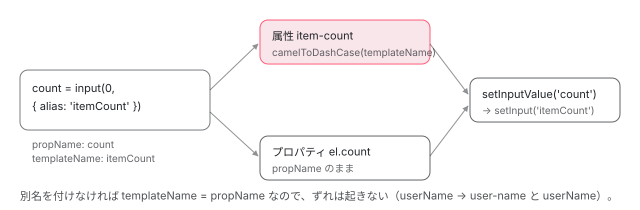

[目次](../README.md) › [Angular Elements の内側](README.md) › 第 3 回 / 全 8 回

# 属性と入力：名前の変換と getComponentInputs

> utils.ts の getComponentInputs（reflectComponentType の inputs を返すだけ）・camelToDashCase・getDefaultAttributeToPropertyInputs と scheduler。HTML の属性（文字列か null）が入力の名前と値に直る道、別名（alias）を付けると属性とプロパティの名前がずれること（#58302）、transform は要素の側ではなく core の setInput の先で呼ばれ signal の入力でも効くこと。src から呼ばれなくなった isFunction・kebabToCamelCase・strictEquals。

angular/angular · 読了 約 12 分 · 中核 · [サイトで読む（デモが動きます）](https://angular-deep-dive-cyan.vercel.app/chapter/elements-attributes-inputs)

---

カスタム要素では、コンポーネントの 1 つの入力が、**属性**（HTML に書く、いつも文字列の値）と**プロパティ**（JavaScript から入れる、何の型でもよい値）の 2 つの入口を持ちます。この章では、入力の一覧がどこから来るか（`reflectComponentType`）、属性の名前がどう作られるか（`camelToDashCase`）、別名・transform・signal の入力でそれぞれ何が起きるかを、utils.ts の行と、本物の要素に属性を入れるデモで確かめます。

読む対象は `packages/elements/src/utils.ts`（109 行）と、`packages/core/src/render3/component.ts` の `reflectComponentType` です。

1. [1. 全体像](01-elements-overview.md)
2. [2. createCustomElement](02-elements-create.md)
3. **3. 属性と入力**（この章）
4. [4. つながるとき](04-elements-connect.md)
5. [5. 入力と変更検知](05-elements-inputs-cd.md)
6. [6. 出力とイベント](06-elements-outputs.md)
7. [7. 切り離しと破棄](07-elements-disconnect.md)
8. [8. spec と issue](08-elements-tests-issues.md)

## 1. 入力の一覧：getComponentInputs は reflectComponentType を呼ぶだけ

📄 `angular/packages/elements/src/utils.ts` L74–109 （▶ の行: 77–78, 82, 88–89, 92, 99, 101, 108）

```ts
 74 │ /**
 75 │  * Test two values for strict equality, accounting for the fact that `NaN !== NaN`.
 76 │  */
 77 ▶ export function strictEquals(value1: any, value2: any): boolean {
 78 ▶   return value1 === value2 || (value1 !== value1 && value2 !== value2);
 79 │ }
 80 │ 
 81 │ /** Gets a map of default set of attributes to observe and the properties they affect. */
 82 ▶ export function getDefaultAttributeToPropertyInputs(
 83 │   inputs: readonly {propName: string; templateName: string; transform?: (value: any) => any}[],
 84 │ ) {
 85 │   const attributeToPropertyInputs: {
 86 │     [key: string]: [propName: string, transform: ((value: any) => any) | undefined];
 87 │   } = {};
 88 ▶   inputs.forEach(({propName, templateName, transform}) => {
 89 ▶     attributeToPropertyInputs[camelToDashCase(templateName)] = [propName, transform];
 90 │   });
 91 │ 
 92 ▶   return attributeToPropertyInputs;
 93 │ }
 94 │ 
 95 │ /**
 96 │  * Gets a component's set of inputs. Uses the injector to get the component factory where the inputs
 97 │  * are defined.
 98 │  */
 99 ▶ export function getComponentInputs(
100 │   component: Type<any>,
101 ▶   injector: Injector,
102 │ ): readonly {
103 │   propName: string;
104 │   templateName: string;
105 │   transform?: (value: any) => any;
106 │   isSignal: boolean;
107 │ }[] {
108 ▶   return reflectComponentType(component)!.inputs;
109 │ }
```

99〜109 行目の `getComponentInputs` は、101 行目で `injector` を受け取りますが使わず、108 行目で `reflectComponentType(component)!.inputs` を返すだけです。注入器を受け取るのは、以前は注入器から `ComponentFactoryResolver` を取って factory の inputs を読んでいた名残です（コミット df9eed4ff1d で `ComponentFactoryResolver` を使わない形になりました）。配布物の `elements.mjs` では、引数そのものが消えて `getComponentInputs(component)` と呼ばれています。

📄 `angular/packages/core/src/render3/component.ts` L201–234 （▶ の行: 202–203, 205, 213, 219, 224–225）

```ts
201 │ export function reflectComponentType<C>(component: Type<C>): ComponentMirror<C> | null {
202 ▶   const componentDef = getComponentDef(component);
203 ▶   if (!componentDef) return null;
204 │ 
205 ▶   const factory = new ComponentFactory<C>(componentDef);
206 │   return {
207 │     get selector(): string {
208 │       return factory.selector;
209 │     },
210 │     get type(): Type<C> {
211 │       return factory.componentType;
212 │     },
213 ▶     get inputs(): ReadonlyArray<{
214 │       propName: string;
215 │       templateName: string;
216 │       transform?: (value: any) => any;
217 │       isSignal: boolean;
218 │     }> {
219 ▶       return factory.inputs;
220 │     },
221 │     get outputs(): ReadonlyArray<{propName: string; templateName: string}> {
222 │       return factory.outputs;
223 │     },
224 ▶     get ngContentSelectors(): ReadonlyArray<string> {
225 ▶       return factory.ngContentSelectors;
226 │     },
227 │     get isStandalone(): boolean {
228 │       return componentDef.standalone;
229 │     },
230 │     get isSignal(): boolean {
231 │       return componentDef.signals;
232 │     },
233 │   };
234 │ }
```

`reflectComponentType` は `@angular/core` の公開 API です。202 行目でコンポーネントの定義（`ɵcmp`）を取り、無ければ 203 行目で `null`。205 行目で `ComponentFactory` を作り、213〜220 行目の `inputs` はその factory の `inputs` を返します。

📄 `angular/packages/core/src/render3/component_ref.ts` L222–250 （▶ の行: 237–241, 243–244）

```ts
222 │ export class ComponentFactory<T> {
223 │   selector: string;
224 │   componentType: Type<any>;
225 │   ngContentSelectors: string[];
226 │   isBoundToModule: boolean;
227 │   private cachedInputs:
228 │     | {
229 │         propName: string;
230 │         templateName: string;
231 │         isSignal: boolean;
232 │         transform?: (value: any) => any;
233 │       }[]
234 │     | null = null;
235 │   private cachedOutputs: {propName: string; templateName: string}[] | null = null;
236 │ 
237 ▶   get inputs(): {
238 ▶     propName: string;
239 ▶     templateName: string;
240 ▶     isSignal: boolean;
241 ▶     transform?: (value: any) => any;
242 │   }[] {
243 ▶     this.cachedInputs ??= toInputRefArray(this.componentDef.inputs);
244 ▶     return this.cachedInputs;
245 │   }
246 │ 
247 │   get outputs(): {propName: string; templateName: string}[] {
248 │     this.cachedOutputs ??= toOutputRefArray(this.componentDef.outputs);
249 │     return this.cachedOutputs;
250 │   }
```

243 行目、定義の `inputs` から `toInputRefArray` で 1 回だけ配列を作って覚えます。1 つの入力は `propName`（クラスのプロパティの名前）・`templateName`（テンプレートで書く名前。別名があれば別名）・`isSignal`・`transform` です。定義の `inputs` の形と、`toInputRefArray` の中身は [input() のコンパイルの章](../signals/12-signals-input-compile.md)で読んでいます。そこで見たとおり、**signal の入力の transform は定義の `inputs` に出ない**（signal の中に持つ）ので、ここの `transform` はデコレーターの入力のぶんだけです。

> [!WARNING]
> **ハマりどころ**
>
> `reflectComponentType` の JSDoc の例は、`propName` と `templateName` が逆になっています。
>
> 📄 `angular/packages/core/src/render3/component.ts` L171–194 （▶ の行: 180, 188）
>
> ````ts
> 171 │  * ```angular-ts
> 172 │  * @Component({
> 173 │  *   selector: 'foo-component',
> 174 │  *   template: `
> 175 │  *     <ng-content></ng-content>
> 176 │  *     <ng-content select="content-selector-a"></ng-content>
> 177 │  *   `,
> 178 │  * })
> 179 │  * class FooComponent {
> 180 ▶  *   @Input('inputName') inputPropName: string;
> 181 │  *   @Output('outputName') outputPropName = new EventEmitter<void>();
> 182 │  * }
> 183 │  *
> 184 │  * const mirror = reflectComponentType(FooComponent);
> 185 │  * expect(mirror.type).toBe(FooComponent);
> 186 │  * expect(mirror.selector).toBe('foo-component');
> 187 │  * expect(mirror.isStandalone).toBe(true);
> 188 ▶  * expect(mirror.inputs).toEqual([{propName: 'inputName', templateName: 'inputPropName'}]);
> 189 │  * expect(mirror.outputs).toEqual([{propName: 'outputName', templateName: 'outputPropName'}]);
> 190 │  * expect(mirror.ngContentSelectors).toEqual([
> 191 │  *   '*',                 // first `<ng-content>` in a template, the selector defaults to `*`
> 192 │  *   'content-selector-a' // second `<ng-content>` in a template
> 193 │  * ]);
> 194 │  * ```
> ````
>
> 180 行目の `@Input('inputName') inputPropName` なら、243 行目の配列では `propName: 'inputPropName'`・`templateName: 'inputName'` です。core の spec も、下のデモの 1 つ目の表（`count` / `itemCount`）もそうなっていて、188 行目の例だけが逆です。
>
> 📄 `angular/packages/core/test/acceptance/component_spec.ts` L810–833 （▶ の行: 814, 827–829, 832）
>
> ```ts
> 810 │         inputs: ['input-a', 'input-b:input-alias-b'],
> 811 │         outputs: ['output-a', 'output-b:output-alias-b'],
> 812 │       })
> 813 │       class StandaloneComponent {
> 814 ▶         @Input({alias: 'input-alias-c', transform: transformFn}) inputC: unknown;
> 815 │         @Input({isSignal: true} as Input) inputD = input(false);
> 816 │       }
> 817 │ 
> 818 │       const mirror = reflectComponentType(StandaloneComponent)!;
> 819 │ 
> 820 │       expect(mirror.selector).toBe('standalone-component');
> 821 │       expect(mirror.type).toBe(StandaloneComponent);
> 822 │       expect(mirror.isStandalone).toEqual(true);
> 823 │       expect(mirror.inputs).toEqual([
> 824 │         {propName: 'input-a', templateName: 'input-a', isSignal: false},
> 825 │         {propName: 'input-b', templateName: 'input-alias-b', isSignal: false},
> 826 │         {
> 827 ▶           propName: 'inputC',
> 828 ▶           templateName: 'input-alias-c',
> 829 ▶           transform: transformFn,
> 830 │           isSignal: false,
> 831 │         },
> 832 ▶         {propName: 'inputD', templateName: 'inputD', isSignal: true},
> 833 │       ]);
> ```
>
> 814 行目の `@Input({alias: 'input-alias-c', …}) inputC` が、827〜828 行目で `propName: 'inputC'`・`templateName: 'input-alias-c'` です。832 行目の signal の入力 `inputD` には `transform` がありません（これは transform を付けていないからですが、付けても出ないことはデモの `size` で確かめます）。

## 2. 属性の名前：camelToDashCase と getDefaultAttributeToPropertyInputs

📄 `angular/packages/elements/src/utils.ts` L25–51 （▶ の行: 28–29, 35–36, 42–43, 49–50）

```ts
25 │ /**
26 │  * Convert a camelCased string to kebab-cased.
27 │  */
28 ▶ export function camelToDashCase(input: string): string {
29 ▶   return input.replace(/[A-Z]/g, (char) => `-${char.toLowerCase()}`);
30 │ }
31 │ 
32 │ /**
33 │  * Check whether the input is an `Element`.
34 │  */
35 ▶ export function isElement(node: Node | null): node is Element {
36 ▶   return !!node && node.nodeType === Node.ELEMENT_NODE;
37 │ }
38 │ 
39 │ /**
40 │  * Check whether the input is a function.
41 │  */
42 ▶ export function isFunction(value: any): value is Function {
43 ▶   return typeof value === 'function';
44 │ }
45 │ 
46 │ /**
47 │  * Convert a kebab-cased string to camelCased.
48 │  */
49 ▶ export function kebabToCamelCase(input: string): string {
50 ▶   return input.replace(/-([a-z\d])/g, (_, char) => char.toUpperCase());
51 │ }
```

29 行目、`camelToDashCase` は**大文字 1 文字ごとに**「`-` + 小文字」に置き換えるだけです。`userName` は `user-name`、`itemCount` は `item-count` ですが、大文字が続く `iconURL` は `icon-u-r-l` になります（デモで確かめます）。すでにある `-` はそのまま残ります。

1 節の 82〜93 行目に戻ると、`getDefaultAttributeToPropertyInputs` は 89 行目で**`templateName`（別名）**を `camelToDashCase` にかけたものをキーにし、値に `[propName, transform]` を入れます。この表のキーが `observedAttributes` になり（[第 2 回](02-elements-create.md)の 1 節）、属性が変わると、値の `propName` で strategy の `setInputValue` が呼ばれます。

一方、要素のプロパティの名前は `propName` そのものです（[第 2 回](02-elements-create.md)の 4 節）。つまり**別名を付けた入力では、属性は別名から、プロパティはクラスのプロパティの名前から作られる**ので、2 つの名前がずれます。これが #58302（2024-10 から開いている）で、issue の中で Angular のチームが「コンポーネントの中の名前が公開の API に出てしまっている。直すと破壊的な変更になる」と書いています。



*1 つの入力から 2 つの入口ができる。属性は templateName（別名）を camelToDashCase したもの、プロパティは propName。どちらも strategy には propName で届く。*

### 使われていない 3 つ

42〜44 行目の `isFunction`・49〜51 行目の `kebabToCamelCase`・1 節の 77〜79 行目の `strictEquals` は、`packages/elements/src` のどこからも呼ばれていません（`grep` で確かめると、呼んでいるのは test/utils\_spec.ts だけ）。`strictEquals` と `isFunction` は、入力を自前で比べて `ngOnChanges` を呼んでいたころの道具で、コミット 0cebfd7462c（v19.0.0、`ComponentRef.setInput` に切り替えたもの）で呼ぶ側が消えました。`kebabToCamelCase` は、2018-02 の最初のコミット（22b96b96902）の時点で、すでに src から呼ばれていません。配布物の `elements.mjs` にはこの 3 つは入っていません（使われないので束ねるときに落ちる）。35〜37 行目の `isElement` は、[第 4 回](04-elements-connect.md)の投影で使われます。

## 3. 値：属性はいつも文字列、transform は core が呼ぶ

属性の値は文字列（消したときは `null`）です。`attributeChangedCallback` は 2 節の表から `transform` も取り出して strategy に渡しますが、既定の strategy の `setInputValue` は引数を 2 つしか受け取らず、3 つ目の `transform` を捨てます（[第 5 回](05-elements-inputs-cd.md)）。実際に transform を呼ぶのは、`ComponentRef.setInput` から入る core の `writeToDirectiveInput` で、デコレーターの transform と signal の transform のどちらか一方を呼びます （[input() のコンパイルの章](../signals/12-signals-input-compile.md)）。だから、1 節の `reflectComponentType` に transform が出ない signal の入力でも、transform は効きます。

transform の無い入力には、文字列がそのまま入ります。**型を `number` にしていても、属性からは文字列が入ります**。Angular のテンプレートなら型検査で止まりますが、属性には型検査がありません。数や真偽値を属性で受けるなら、`numberAttribute`・`booleanAttribute` のような transform を付けます。

## 4. scheduler：setTimeout の包み

📄 `angular/packages/elements/src/utils.ts` L10–23 （▶ の行: 13, 19–21）

```ts
10 │ /**
11 │  * Provide methods for scheduling the execution of a callback.
12 │  */
13 ▶ export const scheduler = {
14 │   /**
15 │    * Schedule a callback to be called after some delay.
16 │    *
17 │    * Returns a function that when executed will cancel the scheduled function.
18 │    */
19 ▶   schedule(taskFn: () => void, delay: number): () => void {
20 ▶     const id = setTimeout(taskFn, delay);
21 ▶     return () => clearTimeout(id);
22 │   },
23 │ };
```

utils.ts の残りの 1 つです。20 行目で `setTimeout` し、21 行目で「取り消す関数」を返します。使うのは strategy の `disconnect` で、外れてから壊すまでの待ち時間に使います（[第 7 回](07-elements-disconnect.md)）。utils\_spec.ts の describe `scheduler` は、`window.setTimeout` と `clearTimeout` を spy にして、この 2 つが呼ばれることを確かめています。以前はここに `requestAnimationFrame` で変更検知を予約する `scheduleBeforeRender` もありましたが、0cebfd7462c で消えました。

## 5. DEMO：入力の名前ごとに、どの属性で何の値が入るか

> **🧪 DEMO — 入力の名前ごとに、どの属性で何の値が入るか**
>
> 5 つの入力を持つコンポーネントを、本物の `createCustomElement` で `<el-attrs-probe>` にします。下の 1 つ目の表は、`@angular/core` の公開 API `reflectComponentType` で読んだ入力の一覧です（このページを開いた時点で読めます）。要素を作ると、ブラウザが読む `observedAttributes` が出ます。記録のために `attributeChangedCallback` だけを継承して書いています。
>
> observedAttributes：  （要素を作ると出ます）
>
> ▶ [このデモはサイトで動かせます](https://angular-deep-dive-cyan.vercel.app/chapter/elements-attributes-inputs)

試すと分かることです（本番ビルドをヘッドレスの Chrome で動かした結果は章末にあります）。

| 入力の書き方 | 属性（observedAttributes） | 要素のプロパティ | 属性で入れたとき |
| --- | --- | --- | --- |
| `@Input() userName` | `user-name` | `userName` | 文字列のまま |
| `count = input(0, { alias: 'itemCount' })` | `item-count` | `count`（`itemCount` は無い） | `'12'`（`number` の型なのに文字列） |
| `@Input({ transform: booleanAttribute }) disabled` | `disabled` | `disabled` | `''` → `true`、`'false'` → `false`、消すと `null` → `false` |
| `size = input(0, { transform: numberAttribute })` | `size` | `size` | `'12px'` → `NaN`、`'12'` → `12`、消すと `null` → `NaN` |
| `@Input() iconURL` | `icon-u-r-l` | `iconURL` | `iconurl` では入らない |

1. **1 つ目の表：size の transform は「—」**

   `reflectComponentType` の `transform` は、デコレーターの入力の `disabled` にだけ出ます。`size` にも `numberAttribute` を付けていますが、signal の入力なので出ません（1 節）。それでも属性の `'12'` は数の 12 になります。transform を呼ぶのは core だからです（3 節）。
2. **observedAttributes に無い名前は、何も起きない**

   `itemcount`・`count`・`iconurl` で `setAttribute` しても、`attributeChangedCallback` は呼ばれず、記録にも出ません。ブラウザは `observedAttributes` にある名前の変化だけを知らせます。
3. **属性を消すと、null が入力に入る**

   `removeAttribute('size')` で `attributeChangedCallback('size', '12', null)` が来て、`numberAttribute(null)` の `NaN` が入ります。「消したら既定の値（0）に戻る」わけではありません。
4. **プロパティでも transform は効き、別名のプロパティは無い**

   `要素.size = '30'` は 30（数）、`要素.disabled = 'false'` は `false` になります。`要素.itemCount = '6'` は、要素の上にただの own のプロパティが 1 つ増えるだけで、コンポーネントには届きません。つながったあとに要素のプロパティを読むと、transform のあとの値が返ります。

## ここまでの呼び出し

- 👤 `createCustomElement(Cmp, config)` — create-custom-element.ts 132
  - `getComponentInputs(component, injector)` — utils.ts 99 — *injector は使わない*
    - `reflectComponentType(component).inputs` — core/src/render3/component.ts 201
      - `ComponentFactory.inputs` → `toInputRefArray(def.inputs)` — component\_ref.ts 237・243 — *propName・templateName・isSignal・transform*
  - `getDefaultAttributeToPropertyInputs(inputs)` — utils.ts 82 — *camelToDashCase(templateName) → \[propName, transform\]*
- 👤 `el.setAttribute('item-count', '12')` — ブラウザ
  - `attributeChangedCallback('item-count', null, '12')` — create-custom-element.ts 181
    - `strategy.setInputValue('count', '12', undefined)` — component-factory-strategy.ts 172 — *transform は捨てる*
      - `componentRef.setInput('itemCount', '12')` — component-factory-strategy.ts 179 — *inputMap で propName → templateName*
        - `writeToDirectiveInput` — core/src/render3/instructions/write\_to\_directive\_input.ts — *ここで transform を呼ぶ*

## テストと直し方

### spec と it

| spec | describe / it（行） | この章のどこ |
| --- | --- | --- |
| utils\_spec.ts（it 13） | describe `scheduler`（20）の it 2 つ（30・39）、`camelToKebabCase()`（49）の 2 つ（50・55）、`isElement()`（60）、`isFunction()`（85）、`kebabToCamelCase()`（100）、`matchesSelector()`（113）、`strictEquals()`（146） | 2・4 節。使われていない 3 つの関数の it も 6 つある |
| create-custom-element\_spec.ts | `should use a default strategy for converting component inputs`（72）・`should send input values from attributes when connected`（81）・`should allow overwriting properties with attributes …`（284） | 2・3 節 |

📄 `angular/packages/elements/test/create-custom-element_spec.ts` L368–384 （▶ の行: 374–376, 380）

```ts
368 │   @Component({
369 │     selector: 'test-component',
370 │     template: 'TestComponent|foo({{ fooFoo }})|bar({{ barBar }})',
371 │     standalone: false,
372 │   })
373 │   class TestComponent {
374 ▶     @Input() fooFoo: string = 'foo';
375 ▶     @Input('barbar') barBar!: string;
376 ▶     @Input({transform: (value: unknown) => !!value}) fooTransformed!: boolean;
377 │ 
378 │     // This needs to apply the decorator and pass `isSignal`, because
379 │     // the compiler transform doesn't run against JIT tests.
380 ▶     @Input({isSignal: true} as Input) fooSignal = input<string | null>(null);
381 │ 
382 │     @Output() bazBaz = new EventEmitter<boolean>();
383 │     @Output('quxqux') quxQux = new EventEmitter<Object>();
384 │   }
```

📄 `angular/packages/elements/test/create-custom-element_spec.ts` L72–94 （▶ の行: 73–77, 84–85, 91–92）

```ts
72 │   it('should use a default strategy for converting component inputs', () => {
73 ▶     expect(NgElementCtor.observedAttributes).toEqual([
74 ▶       'foo-foo',
75 ▶       'barbar',
76 ▶       'foo-transformed',
77 ▶       'foo-signal',
78 │     ]);
79 │   });
80 │ 
81 │   it('should send input values from attributes when connected', () => {
82 │     const element = new NgElementCtor(injector);
83 │     element.setAttribute('foo-foo', 'value-foo-foo');
84 ▶     element.setAttribute('barbar', 'value-barbar');
85 ▶     element.setAttribute('foo-transformed', 'truthy');
86 │     element.setAttribute('foo-signal', 'value-signal');
87 │     element.connectedCallback();
88 │     expect(strategy.connectedElement).toBe(element);
89 │ 
90 │     expect(strategy.getInputValue('fooFoo')).toBe('value-foo-foo');
91 ▶     expect(strategy.getInputValue('barBar')).toBe('value-barbar');
92 ▶     expect(strategy.getInputValue('fooTransformed')).toBe(true);
93 │     expect(strategy.getInputValue('fooSignal')).toBe('value-signal');
94 │   });
```

375 行目の `@Input('barbar') barBar` は、別名が小文字だけなので属性は 75 行目の `barbar`、プロパティは `barBar`（91 行目で `getInputValue('barBar')`）です。#58302 の「名前がずれる」形を、この it はそのまま確かめています。85 行目の `'truthy'` が 92 行目で `true` になるのは、偽の strategy が transform を呼ぶからです（[第 1 回](01-elements-overview.md)のテストの節）。

📄 `angular/packages/elements/test/create-custom-element_spec.ts` L284–320 （▶ の行: 301–303, 305–306, 312）

```ts
284 │   it('should allow overwriting properties with attributes after upgrading the element but before inserting it into the DOM', () => {
285 │     // Create a regular element and set properties on it.
286 │     const {selector, ElementCtor} = createTestCustomElement(strategyFactory);
287 │     const element = Object.assign(document.createElement(selector), {
288 │       fooFoo: 'foo-prop-value',
289 │       barBar: 'bar-prop-value',
290 │       fooTransformed: 'truthy' as unknown,
291 │       fooSignal: 'value-signal',
292 │     });
293 │     expect(element.fooFoo).toBe('foo-prop-value');
294 │     expect(element.barBar).toBe('bar-prop-value');
295 │     expect(element.fooTransformed).toBe('truthy');
296 │     expect(element.fooSignal).toBe('value-signal');
297 │ 
298 │     // Upgrade the element to a Custom Element (without inserting it into the DOM) and set an
299 │     // attribute.
300 │     customElements.define(selector, ElementCtor);
301 ▶     customElements.upgrade(element);
302 ▶     element.setAttribute('barbar', 'bar-attr-value');
303 ▶     element.setAttribute('foo-transformed', '');
304 │     expect(element.fooFoo).toBe('foo-prop-value');
305 ▶     expect(element.barBar).toBe('bar-attr-value');
306 ▶     expect(element.fooTransformed).toBe(false);
307 │     expect(element.fooSignal).toBe('value-signal');
308 │ 
309 │     // Insert the element into the DOM.
310 │     testContainer.appendChild(element);
311 │     expect(element.fooFoo).toBe('foo-prop-value');
312 ▶     expect(element.barBar).toBe('bar-attr-value');
313 │     expect(element.fooTransformed).toBe(false);
314 │     expect(element.fooSignal).toBe('value-signal');
315 │ 
316 │     expect(strategy.inputs.get('fooFoo')).toBe('foo-prop-value');
317 │     expect(strategy.inputs.get('barBar')).toBe('bar-attr-value');
318 │     expect(strategy.inputs.get('fooTransformed')).toBe(false);
319 │     expect(strategy.inputs.get('fooSignal')).toBe('value-signal');
320 │   });
```

upgrade のあとに属性を入れると、プロパティで入れた値より後勝ちになることを確かめる it です。301 行目の `upgrade` のあと 302 行目で `setAttribute` すると、`attributeChangedCallback` が strategy の getter を初めて読むので、そこで own のプロパティが入れ直され（[第 2 回](02-elements-create.md)の 2 節）、そのあとに属性の値が入ります。305 行目で `barBar` は属性の値です。

📄 `angular/packages/elements/test/utils_spec.ts` L49–58 （▶ の行: 51–52, 56）

```ts
49 │   describe('camelToKebabCase()', () => {
50 │     it('should convert camel-case to kebab-case', () => {
51 ▶       expect(camelToDashCase('fooBarBazQux')).toBe('foo-bar-baz-qux');
52 ▶       expect(camelToDashCase('foo1Bar2Baz3Qux4')).toBe('foo1-bar2-baz3-qux4');
53 │     });
54 │ 
55 │     it('should keep existing dashes', () => {
56 ▶       expect(camelToDashCase('fooBar-baz-Qux')).toBe('foo-bar-baz--qux');
57 │     });
58 │   });
```

`camelToDashCase` の it は 2 つで、大文字が続く名前（デモの `iconURL`）の it はありません。describe の名前は `camelToKebabCase()` ですが、関数の名前は `camelToDashCase` です。

### 手元で走らせた結果

utils\_spec.ts も同じターゲットに入っているので、`pnpm bazel test //packages/elements/test:test_chromium //packages/elements/test:test_firefox --nocache_test_results --test_output=all` で走らせ、どちらも 59 passed, 0 failed, 5 skipped でした（2026-11-06。名前の絞り込みは効かない。[第 1 回](01-elements-overview.md)）。

### 直すとしたら

- **reflectComponentType の JSDoc の例**（1 節の注意の箱）：packages/core/src/render3/component.ts の 188・189 行目の `propName` と `templateName` が逆です。2026-11-06 に `gh search issues` と `gh search prs` で「reflectComponentType propName templateName」などを探しましたが、この点の issue・PR はありませんでした。
- **別名と名前のずれ**（#58302）：入口は utils.ts の 89 行目（属性）と、create-custom-element.ts の入力ごとの `Object.defineProperty`（プロパティ。[第 2 回](02-elements-create.md)の 4 節）。issue の中で Angular のチームが破壊的な変更だと書いています。
- **使われていない関数**：utils.ts の `isFunction`・`kebabToCamelCase`・`strictEquals` と、utils\_spec.ts の 85・100・146 行目の describe。消しても配布物は変わりません（もう落ちている）。
- **本物の strategy で transform を確かめる it**：component-factory-strategy\_spec.ts の `TestComponent` に `booleanAttribute` などの入力を足し、`setInputValue` に文字列を入れて `componentRef.instance` を見る形です。
- #53193（host directive の入力が要素の属性にならない。#65245 はその重複として閉じられた）：1 節の 108 行目は `reflectComponentType` のコンポーネントの入力だけを返し、host directive が出す入力はこの一覧に入りません（デモでは確かめていません）。本家に PR を出すことは勧めません。issue の表は[第 8 回](08-elements-tests-issues.md)にあります。

**本番ビルドでデモを動かした結果（2026-11-06）。**ヘッドレスの Chrome（HeadlessChrome/155.0.8043.0）で本番ビルドのこのページを開いて操作しました。1 つ目の表は userName/userName・count/itemCount（isSignal true）・disabled/disabled（transform あり）・size/size（isSignal true、transform —）・iconURL/iconURL、observedAttributes は user-name, item-count, disabled, size, icon-u-r-l でした。setAttribute で user-name 'さくら' は 'さくら'、item-count '12' は '12'（string）、disabled '' は true・'false' は false、size '12px' は NaN・'12' は 12、icon-u-r-l 'a.svg' は 'a.svg' でした。iconurl・itemcount・count では attributeChangedCallback が呼ばれず、値も変わりませんでした。removeAttribute で size は NaN、disabled は false。プロパティでは size = '30' が 30、disabled = 'false' が false、count = '5' が '5'（string）、itemCount = '6' は要素の上に own の '6' ができただけでコンポーネントの値は変わりませんでした。コンソールの警告とエラーは 0 件でした（scratchpad/el-a-exp/verify.mjs、2026-11-06）。

## 聞かれそうな質問

**Q. `@Input('itemCount') count` の入力は、HTML でどう書きますか？**

属性は `item-count="3"`、JavaScript のプロパティは `el.count = 3` です。utils.ts の 89 行目で属性の名前は別名（`templateName`）の `camelToDashCase`、プロパティの名前は `propName` から作られます。`el.itemCount` は定義されません（#58302）。

**Q. 入力の型を `number` にしておけば、属性の値は数になりますか？**

なりません。属性の値は文字列で、transform が無ければそのまま入ります。デモの `item-count` は `'12'`（`string`）でした。`numberAttribute` などの transform を付けると、core の `writeToDirectiveInput` が変換します。

**Q. 属性を消すと、入力は既定の値に戻りますか？**

戻りません。`attributeChangedCallback` に `null` が来て、そのまま（transform があれば transform を通して）入ります。デモでは `size` が `NaN`、`disabled` が `false` でした。

**Q. 大文字が続く入力の名前（`iconURL`）は、どんな属性になりますか？**

utils.ts の 29 行目は大文字 1 文字ごとに `-` を足すので、`icon-u-r-l` です。`iconurl` は `observedAttributes` に無いので、入れても何も起きません。

**Q. signal の入力の transform は、Elements でも効きますか？**

効きます。`reflectComponentType` の `transform`（component\_ref.ts 243 行目の配列）には出ませんが、transform を呼ぶのは要素の側ではなく core の `setInput` の先なので、デモの `size` は `'12'` で 12 になりました。

## 読み終えて

- 入力の一覧は `reflectComponentType(component).inputs`。`getComponentInputs` の `injector` は使われていない
- 属性の名前は別名（`templateName`）の `camelToDashCase`、プロパティの名前は `propName`。別名を付けると 2 つがずれる
- 属性の値は文字列か `null`。transform は要素の側ではなく core が呼び、signal の入力の transform も効く
- utils.ts の `isFunction`・`kebabToCamelCase`・`strictEquals` は、もう src から呼ばれていない

---

← 前: [createCustomElement：HTMLElement を継承したクラスを作る](02-elements-create.md)  
次: [要素がつながるとき：ComponentNgElementStrategy.connect と投影](04-elements-connect.md) →
