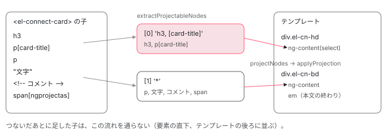

[目次](../README.md) › [Angular Elements の内側](README.md) › 第 4 回 / 全 8 回

# 要素がつながるとき：ComponentNgElementStrategy.connect と投影

> connect が、前の切り離しの予定を取り消すか、initializeComponent でコンポーネントを作る行（壊れたあとのつなぎ直しで作られない #38778 の形も）。要素の子を CSS のセレクターと '\*' で ng-content ごとに分ける extractProjectableNodes（ngProjectAs は効かない）と core の projectNodes・applyProjection、注入器（EnvironmentInjector として渡される）、作る前に貯めておいた入力の値を入れる initializeInputs と、ApplicationRef への attachView。

angular/angular · 読了 約 13 分 · 中核 · [サイトで読む（デモが動きます）](https://angular-deep-dive-cyan.vercel.app/chapter/elements-connect)

---

要素が文書につながると、`NgElementImpl.connectedCallback` から既定の strategy の `connect` が呼ばれ、ここで初めてコンポーネントが作られます。この章では、strategy が持つ欄と constructor、`connect` の分かれ道、`initializeComponent` の 5 つの手順（子を分ける・作る・入力を入れる・`ApplicationRef` につなぐ・描く）を読み、要素の子がどの `ng-content` に入るかを本物の要素で確かめます。

読む対象は `packages/elements/src/component-factory-strategy.ts` の 65〜130 行目と 200〜227 行目、`src/extract-projectable-nodes.ts`、そして core の側で投影を受け取る `component_ref.ts` の `projectNodes` と `node_manipulation.ts` の `applyProjection` です。

1. [1. 全体像](01-elements-overview.md)
2. [2. createCustomElement](02-elements-create.md)
3. [3. 属性と入力](03-elements-attributes-inputs.md)
4. **4. つながるとき**（この章）
5. [5. 入力と変更検知](05-elements-inputs-cd.md)
6. [6. 出力とイベント](06-elements-outputs.md)
7. [7. 切り離しと破棄](07-elements-disconnect.md)
8. [8. spec と issue](08-elements-tests-issues.md)

## 1. strategy が持つもの

📄 `angular/packages/elements/src/component-factory-strategy.ts` L65–99 （▶ の行: 71, 74, 77, 80, 83, 89, 94, 99）

```ts
65 │ /**
66 │  * Creates and destroys a component ref using a component factory and handles change detection
67 │  * in response to input changes.
68 │  */
69 │ export class ComponentNgElementStrategy implements NgElementStrategy {
70 │   // Subject of `NgElementStrategyEvent` observables corresponding to the component's outputs.
71 ▶   private eventEmitters = new ReplaySubject<Observable<NgElementStrategyEvent>[]>(1);
72 │ 
73 │   /** Merged stream of the component's output events. */
74 ▶   readonly events = this.eventEmitters.pipe(switchMap((emitters) => merge(...emitters)));
75 │ 
76 │   /** Reference to the component that was created on connect. */
77 ▶   private componentRef: ComponentRef<any> | null = null;
78 │ 
79 │   /** Callback function that when called will cancel a scheduled destruction on the component. */
80 ▶   private scheduledDestroyFn: (() => void) | null = null;
81 │ 
82 │   /** Initial input values that were set before the component was created. */
83 ▶   private readonly initialInputValues = new Map<string, any>();
84 │ 
85 │   /** Service for setting zone context. */
86 │   private readonly ngZone: NgZone;
87 │ 
88 │   /** The zone the element was created in or `null` if Zone.js is not loaded. */
89 ▶   private readonly elementZone: Zone | null;
90 │ 
91 │   /**
92 │    * The `ApplicationRef` shared by all instances of this custom element (and potentially others).
93 │    */
94 ▶   private readonly appRef: ApplicationRef;
95 │ 
96 │   /**
97 │    * Angular's change detection scheduler, which works independently of zone.js.
98 │    */
99 ▶   private cdScheduler: ChangeDetectionScheduler;
```

要素 1 つにつき 1 つの strategy が、次の欄を持ちます。

| 行 | 欄 | はじめの値 | 何に使うか |
| --- | --- | --- | --- |
| 77 | `componentRef` | `null` | 作ったコンポーネント。`null` かどうかで「もう作ったか」を見分ける |
| 80 | `scheduledDestroyFn` | `null` | 外れたときに立てた「壊す予定」の取り消し（[第 7 回](07-elements-disconnect.md)） |
| 83 | `initialInputValues` | 空の `Map` | コンポーネントを作る前に来た入力の値を貯めておく |
| 71・74 | `eventEmitters`・`events` | `ReplaySubject(1)` | 出力の束。作る前から購読できる（[第 6 回](06-elements-outputs.md)） |
| 94 | `appRef` | 注入器から | 91〜93 行目のコメントのとおり、同じ注入器の全部の要素で 1 つの `ApplicationRef` を共有する |
| 89・99 | `elementZone`・`cdScheduler` | 注入器から | zone.js のあるなしと、変更検知の通知先（[第 5 回](05-elements-inputs-cd.md)） |

## 2. constructor と connect

📄 `angular/packages/elements/src/component-factory-strategy.ts` L101–130 （▶ の行: 106–109, 117, 120–123, 126–127）

```ts
101 │   constructor(
102 │     private component: Type<any>,
103 │     private injector: Injector,
104 │     private inputMap: Map<string, string>,
105 │   ) {
106 ▶     this.ngZone = this.injector.get(NgZone);
107 ▶     this.appRef = this.injector.get(ApplicationRef);
108 ▶     this.cdScheduler = injector.get(ChangeDetectionScheduler);
109 ▶     this.elementZone = typeof Zone === 'undefined' ? null : this.ngZone.run(() => Zone.current);
110 │   }
111 │ 
112 │   /**
113 │    * Initializes a new component if one has not yet been created and cancels any scheduled
114 │    * destruction.
115 │    */
116 │   connect(element: HTMLElement) {
117 ▶     this.runInZone(() => {
118 │       // If the element is marked to be destroyed, cancel the task since the component was
119 │       // reconnected
120 ▶       if (this.scheduledDestroyFn !== null) {
121 ▶         this.scheduledDestroyFn();
122 ▶         this.scheduledDestroyFn = null;
123 ▶         return;
124 │       }
125 │ 
126 ▶       if (this.componentRef === null) {
127 ▶         this.initializeComponent(element);
128 │       }
129 │     });
130 │   }
```

106〜108 行目、constructor は注入器から `NgZone`・`ApplicationRef`・`ChangeDetectionScheduler` を取ります。strategy は要素の getter の初回に作られるので（[第 2 回](02-elements-create.md)）、ここが**注入器を初めて使う場所**です。109 行目は zone.js が無ければ `null` です（このサイトは zone.js なしなので `null`）。

1. **117 行目：runInZone の中で動く**

   zone.js があるとき、Angular の zone の中で動かすための包みです（中身は[第 5 回](05-elements-inputs-cd.md)）。zone.js なしなら `fn()` をそのまま呼びます。
2. **120〜124 行目：壊す予定があれば、取り消して終わり**

   外れたあと、壊す前にまたつながったときの道です。`scheduledDestroyFn()`（中身は `clearTimeout`）を呼び、`null` に戻して、**123 行目で return** します。コンポーネントは前のまま使われます。
3. **126〜128 行目：まだ作っていなければ作る**

   `componentRef` が `null` のときだけ `initializeComponent` を呼びます。すでにあれば何もしません。

> [!WARNING]
> **ハマりどころ**
>
> 120 行目の判定は「壊す予定がまだ残っているか」ではなく、「`scheduledDestroyFn` が `null` でないか」です。壊す予定の関数（[第 7 回](07-elements-disconnect.md)の `disconnect` の中）は、壊したあとに `scheduledDestroyFn` を `null` に戻しません。そのため、**外れて壊れたあとに同じ要素をつなぎ直すと、123 行目で return してしまい、コンポーネントは作られません**。下のデモの「外して 50ms 後に同じ要素をつなぎ直す」で確かめられます。2020 年から開いている #38778 がこの形で、issue の本文にも「`scheduledDestroyFn` が `null` にされない」と書かれています。

## 3. initializeComponent：5 つの手順

📄 `angular/packages/elements/src/component-factory-strategy.ts` L200–227 （▶ の行: 201–204, 206–210, 213, 216–217, 222–223, 226）

```ts
200 │   protected initializeComponent(element: HTMLElement) {
201 ▶     const childInjector = Injector.create({providers: [], parent: this.injector});
202 ▶     const projectableNodes = extractProjectableNodes(
203 ▶       element,
204 ▶       reflectComponentType(this.component)!.ngContentSelectors as string[],
205 │     );
206 ▶     this.componentRef = createComponent(this.component, {
207 ▶       environmentInjector: this.injector as EnvironmentInjector,
208 ▶       elementInjector: childInjector,
209 ▶       hostElement: element,
210 ▶       projectableNodes,
211 │     });
212 │ 
213 ▶     this.initializeInputs();
214 │     this.initializeOutputs(this.componentRef);
215 │ 
216 ▶     this.appRef.attachView(this.componentRef.hostView);
217 ▶     this.componentRef.hostView.detectChanges();
218 │   }
219 │ 
220 │   /** Set any stored initial inputs on the component's properties. */
221 │   protected initializeInputs(): void {
222 ▶     for (const [propName, value] of this.initialInputValues) {
223 ▶       this.setInputValue(propName, value);
224 │     }
225 │ 
226 ▶     this.initialInputValues.clear();
227 │   }
```

1. **201 行目：空の注入器を 1 つ挟む**

   `Injector.create({ providers: [], parent: this.injector })` で、provider を持たない注入器を作り、208 行目で `elementInjector` に渡します。中身が空なので、探すものはそのまま親（`config.injector`）へ行きます。
2. **202〜205 行目：要素の子を ng-content ごとに分ける**

   `reflectComponentType(...).ngContentSelectors`（テンプレートの `ng-content` の select を並べたもの）を渡して、`extractProjectableNodes` で子を分けます（4 節）。**この時点の子だけ**が対象です。
3. **206〜211 行目：createComponent**

   公開の `createComponent` に、207 行目の環境注入器・208 行目の要素の注入器・209 行目のホストの要素（カスタム要素そのもの）・210 行目の分けた子を渡します。`hostElement` を渡すので、新しい要素は作らず、カスタム要素の中にテンプレートを描きます。
4. **213 行目：貯めておいた入力を入れる**

   221〜224 行目で、`initialInputValues` を 1 つずつ `setInputValue` に通し、226 行目で空にします。今度は `componentRef` があるので、値は `ComponentRef.setInput` でコンポーネントに入ります（[第 5 回](05-elements-inputs-cd.md)）。214 行目は出力の購読の準備です（[第 6 回](06-elements-outputs.md)）。
5. **216〜217 行目：ApplicationRef につないで、すぐ 1 回描く**

   216 行目の `attachView` で、ホストのビューを `ApplicationRef` の見るビューに足します。これで以後の `ApplicationRef.tick()` がこのコンポーネントも見ます（`attachView` の中身は [ApplicationRef の章](../boot/10-boot-application-ref.md)）。217 行目の `detectChanges()` で、`connectedCallback` の中のうちに 1 回目の変更検知が同期に走ります。第 2 回のデモの A で、`ngOnChanges` と描画が `appendChild` の中で出たのはこの行です。

### 207 行目：注入器は EnvironmentInjector として渡される

207 行目は `this.injector as EnvironmentInjector` と、型を言い張っているだけで、確かめてはいません。2026-04 のコミット df9eed4ff1d（v22.0.0。`ComponentFactoryResolver` を使わない形にしたもの）で入った行です。core の `createComponent` の先で、渡された環境注入器が本当に `EnvironmentInjector` のときだけ、standalone のコンポーネントの `imports` の NgModule の provider を持つ注入器（standalone injector）が作られます （`createRootViewInjector`。[standalone の imports の章](../ngmodule/13-ngmodule-standalone-imports.md)の 4 節）。では `config.injector` に、コンポーネントの中で `inject(Injector)` した `NodeInjector` を渡すとどうなるか。章末の「テストと直し方」に、ハイドレーションなしのアプリで確かめた記録があります。

📄 `angular/packages/core/src/render3/component.ts` L86–99 （▶ の行: 89, 92–95）

```ts
86 │  *
87 │  * @publicApi
88 │  */
89 ▶ export function createComponent<C>(
90 │   component: Type<C>,
91 │   options: {
92 ▶     environmentInjector: EnvironmentInjector;
93 ▶     hostElement?: Element;
94 ▶     elementInjector?: Injector;
95 ▶     projectableNodes?: Node[][];
96 │     directives?: (Type<unknown> | DirectiveWithBindings<unknown>)[];
97 │     bindings?: Binding[];
98 │     onError?: (error: Error, details: ErrorDetails) => void;
99 │   },
```

受け取る側の `createComponent` の引数です。92 行目の `environmentInjector` だけが必須で、93〜95 行目の `hostElement`・`elementInjector`・`projectableNodes` は任意です。この関数の JSDoc のとおり、`projectableNodes` は「`ng-content` 1 つにつき 1 つの配列」の配列です。

## 4. extractProjectableNodes：子を select ごとに分ける

📄 `angular/packages/elements/src/extract-projectable-nodes.ts` L9–38 （▶ の行: 9, 16–18, 20–22, 28, 30, 32–33）

```ts
 9 ▶ // NOTE: This is a (slightly improved) version of what is used in ngUpgrade's
10 │ //       `DowngradeComponentAdapter`.
11 │ // TODO(gkalpak): Investigate if it makes sense to share the code.
12 │ 
13 │ import {isElement, matchesSelector} from './utils';
14 │ 
15 │ export function extractProjectableNodes(host: HTMLElement, ngContentSelectors: string[]): Node[][] {
16 ▶   const nodes = host.childNodes;
17 ▶   const projectableNodes: Node[][] = ngContentSelectors.map(() => []);
18 ▶   let wildcardIndex = -1;
19 │ 
20 ▶   ngContentSelectors.some((selector, i) => {
21 ▶     if (selector === '*') {
22 ▶       wildcardIndex = i;
23 │       return true;
24 │     }
25 │     return false;
26 │   });
27 │ 
28 ▶   for (let i = 0, ii = nodes.length; i < ii; ++i) {
29 │     const node = nodes[i];
30 ▶     const ngContentIndex = findMatchingIndex(node, ngContentSelectors, wildcardIndex);
31 │ 
32 ▶     if (ngContentIndex !== -1) {
33 ▶       projectableNodes[ngContentIndex].push(node);
34 │     }
35 │   }
36 │ 
37 │   return projectableNodes;
38 │ }
```

1. **16〜17 行目：子と、select の数だけの空の配列**

   `host.childNodes` なので、要素だけでなく文字（Text）やコメントも数えます。孫は見ません。
2. **18〜26 行目：`'*'`（select なしの ng-content）の位置を探す**

   select の無い `<ng-content />` は `'*'` として並びます。最初の `'*'` の位置が `wildcardIndex` で、無ければ `-1` です。
3. **28〜35 行目：子を 1 つずつ、行き先の番号に入れる**

   30 行目の `findMatchingIndex` が番号を決め、`-1` でなければ 33 行目でその配列に入れます。

📄 `angular/packages/elements/src/extract-projectable-nodes.ts` L40–54 （▶ の行: 41, 43–46, 53）

```ts
40 │ function findMatchingIndex(node: Node, selectors: string[], defaultIndex: number): number {
41 ▶   let matchingIndex = defaultIndex;
42 │ 
43 ▶   if (isElement(node)) {
44 ▶     selectors.some((selector, i) => {
45 ▶       if (selector !== '*' && matchesSelector(node, selector)) {
46 ▶         matchingIndex = i;
47 │         return true;
48 │       }
49 │       return false;
50 │     });
51 │   }
52 │ 
53 ▶   return matchingIndex;
54 │ }
```

41 行目、行き先のはじめの値は `'*'` の番号です。43 行目で**要素のときだけ**、44〜50 行目で `'*'` 以外の select を前から順に試し、最初に合ったものに決めます。つまり、文字とコメントはいつも `'*'` へ行き（`'*'` が無ければどこにも行かない）、要素は「合う select があればそこ、無ければ `'*'`」です。`'*'` が select の並びの前にあっても後ろにあっても、合う select が先に決まります。

📄 `angular/packages/elements/src/utils.ts` L53–72 （▶ の行: 61, 63–64, 71）

```ts
53 │ let _matches: (this: any, selector: string) => boolean;
54 │ 
55 │ /**
56 │  * Check whether an `Element` matches a CSS selector.
57 │  * NOTE: this is duplicated from @angular/upgrade, and can
58 │  * be consolidated in the future
59 │  */
60 │ export function matchesSelector(el: any, selector: string): boolean {
61 ▶   if (!_matches) {
62 │     const elProto = <any>Element.prototype;
63 ▶     _matches =
64 ▶       elProto.matches ||
65 │       elProto.matchesSelector ||
66 │       elProto.mozMatchesSelector ||
67 │       elProto.msMatchesSelector ||
68 │       elProto.oMatchesSelector ||
69 │       elProto.webkitMatchesSelector;
70 │   }
71 ▶   return el.nodeType === Node.ELEMENT_NODE ? _matches.call(el, selector) : false;
72 │ }
```

合うかどうかは、ブラウザの `Element.prototype.matches`（64 行目。古いブラウザ向けの別名を 65〜69 行目で探す）です。57〜58 行目のコメントのとおり `@angular/upgrade` から写したもので、9〜11 行目のコメントのとおり extract-projectable-nodes.ts も ngUpgrade の `DowngradeComponentAdapter` の書き方を元にしています。

> [!NOTE]
> **ポイント**
>
> ここで比べるのは**本物の DOM の要素と、CSS のセレクター**です。Angular のテンプレートの `ngProjectAs` はコンパイラがテンプレートの中で読む印なので、要素の子に `ngprojectas="h3"` という属性を書いても、`matches('h3')` は `false` です。デモの `<span ngprojectas="h3">` は `'*'` へ行きます。

## 5. core の側：分けた子を ng-content の位置へ

📄 `angular/packages/core/src/render3/component_ref.ts` L653–669 （▶ の行: 653, 659–661, 667）

```ts
653 ▶ /** Projects the `projectableNodes` that were specified when creating a root component. */
654 │ function projectNodes(
655 │   tNode: TElementNode,
656 │   ngContentSelectors: string[],
657 │   projectableNodes: any[][],
658 │ ) {
659 ▶   const projection: (TNode | RNode[] | null)[] = (tNode.projection = []);
660 ▶   for (let i = 0; i < ngContentSelectors.length; i++) {
661 ▶     const nodesforSlot = projectableNodes[i];
662 │     // Projectable nodes can be passed as array of arrays or an array of iterables (ngUpgrade
663 │     // case). Here we do normalize passed data structure to be an array of arrays to avoid
664 │     // complex checks down the line.
665 │     // We also normalize the length of the passed in projectable nodes (to match the number of
666 │     // <ng-container> slots defined by a component).
667 ▶     projection.push(nodesforSlot != null && nodesforSlot.length ? Array.from(nodesforSlot) : null);
668 │   }
669 │ }
```

`createComponent` に `projectableNodes` を渡すと、ルートのコンポーネントを作るときに `projectNodes` が呼ばれます。659 行目でホストの TNode の `projection` に配列を作り、667 行目で select ごとに、子があれば配列のコピー、無ければ `null` を入れます。ふつうのコンポーネントでは `projection` には親のテンプレートの TNode が入りますが（[projection の章](../template/02-projection.md)）、ここでは**本物の DOM ノードの配列**が入ります。

📄 `angular/packages/core/src/render3/node_manipulation.ts` L988–1001 （▶ の行: 990, 992–993, 995）

```ts
 988 │ export function applyProjection(tView: TView, lView: LView, tProjectionNode: TProjectionNode) {
 989 │   const renderer = lView[RENDERER];
 990 ▶   const parentRNode = getParentRElement(tView, tProjectionNode, lView);
 991 │   const parentTNode = tProjectionNode.parent || lView[T_HOST]!;
 992 ▶   let beforeNode = getInsertInFrontOfRNode(parentTNode, tProjectionNode, lView);
 993 ▶   applyProjectionRecursive(
 994 │     renderer,
 995 ▶     WalkTNodeTreeAction.Create,
 996 │     lView,
 997 │     tProjectionNode,
 998 │     parentRNode,
 999 │     beforeNode,
1000 │   );
1001 │ }
```

📄 `angular/packages/core/src/render3/node_manipulation.ts` L1025–1048 （▶ の行: 1029–1031, 1036, 1038, 1042, 1045）

```ts
1025 │   const componentLView = lView[DECLARATION_COMPONENT_VIEW];
1026 │   const componentNode = componentLView[T_HOST] as TElementNode;
1027 │   ngDevMode &&
1028 │     assertEqual(typeof tProjectionNode.projection, 'number', 'expecting projection index');
1029 ▶   const nodeToProjectOrRNodes = componentNode.projection![tProjectionNode.projection]!;
1030 ▶   if (Array.isArray(nodeToProjectOrRNodes)) {
1031 ▶     // This should not exist, it is a bit of a hack. When we bootstrap a top level node and we
1032 │     // need to support passing projectable nodes, so we cheat and put them in the TNode
1033 │     // of the Host TView. (Yes we put instance info at the T Level). We can get away with it
1034 │     // because we know that TView is not shared and therefore it will not be a problem.
1035 │     // This should be refactored and cleaned up.
1036 ▶     for (let i = 0; i < nodeToProjectOrRNodes.length; i++) {
1037 │       const rNode = nodeToProjectOrRNodes[i];
1038 ▶       applyToElementOrContainer(
1039 │         action,
1040 │         renderer,
1041 │         lView[INJECTOR],
1042 ▶         parentRElement,
1043 │         rNode,
1044 │         tProjectionNode,
1045 ▶         beforeNode,
1046 │         lView,
1047 │       );
1048 │     }
```

コンポーネントのテンプレートの `<ng-content>`（`ɵɵprojection` の命令）が作成のときに `applyProjection` を呼び、990 行目で親の要素、992 行目で「この前に入れる」ノードを決めます。1030 行目、`projection` が配列なら、1031〜1035 行目のコメントが自分で「hack」と呼んでいる、ルートのコンポーネントのための道です。1036〜1047 行目で DOM ノードを 1 つずつ、1042 行目の親の中へ移します（`appendChild` か `insertBefore`）。DOM ノードは 1 つの場所にしか置けないので、**カスタム要素の子は、テンプレートの ng-content の位置へ移動します**。



*つながったときの子だけが、select ごとの配列に分けられ、ホストの TNode の projection に入り、テンプレートの ng-content の位置へ移される。*

### どこにも合わなかった子は、消えるか残るか

`hostElement` を渡して作るとき、core は `locateHostElement` → `selectRootElement` で、ホストの要素の中身を `textContent = ''` で空にします。ただし `PRESERVE_HOST_CONTENT` が `true` のとき（Shadow DOM のときも）は空にしません（[ApplicationRef の章](../boot/10-boot-application-ref.md)で読んだ行）。`PRESERVE_HOST_CONTENT` を `true` にするのは `provideClientHydration()` で、ブラウザで、サーバーの描画したハイドレーションの情報があるときです（[ハイドレーションの章](../platform/07-hydration-provide.md)）。4 節で分けた子は、空にする前に配列に取ってあるので、`projectableNodes` に入った子は無事に ng-content へ移ります。違いが出るのは**どの配列にも入らなかった子**です。

| アプリ | どこにも合わなかった子（`'*'` の無いコンポーネントで、select に合わない要素・文字・コメント） |
| --- | --- |
| ハイドレーションなし（ふつうの `bootstrapApplication`・`createApplication`） | ホストを空にするときに消える（章末の記録） |
| このサイト（`provideClientHydration`、プリレンダーしたページ） | ホストの先頭に残り、そのあとにテンプレートが描かれる（下のデモ） |

## 6. DEMO：子を入れてからつなぐ

> **🧪 DEMO — 要素の子は、どの ng-content に入るか**
>
> ng-content を 2 つ持つコンポーネント（`<el-connect-card>`：select は `h3, [card-title] | *`）と、select ありの 1 つだけを持つコンポーネント（`<el-connect-title-only>`：`h3`）を、本物の `createCustomElement` でカスタム要素にします。select は `reflectComponentType(…).ngContentSelectors` で読んだ実物です。子は `document.createElement` などで作り、要素に入れてからつなぎます。
>
> ▶ [このデモはサイトで動かせます](https://angular-deep-dive-cyan.vercel.app/chapter/elements-connect)

試すと分かることです（本番ビルドをヘッドレスの Chrome で動かした結果は章末にあります）。

1. **card：h3 と p\[card-title\] は見出しへ、残りはみな本文へ（em の前）**

   `ngContentSelectors` は `['h3, [card-title]', '*']` です。要素の 2 つは 1 番目の select に合い、ふつうの `<p>`・文字・**コメント**・`ngprojectas` を書いた `<span>` は `'*'` へ行きます。テンプレートで ng-content の後ろにある `<em>（本文の終わり）</em>` より前に入ります。
2. **ngAfterContentInit のときには、もう移っている**

   記録の `ngAfterContentInit` の行で、`.el-cn-hd` の子は 3 個（「見出し：」の文字と、移ってきた 2 つ）です。投影はテンプレートを作るとき（`createComponent` の中）に済んでいて、`ngAfterContentInit` は 217 行目の `detectChanges` の中で呼ばれるからです。
3. **つないだあとに足した p は、投影されない**

   4 節の分け方は 202 行目の 1 回だけなので、あとから足した子は要素の直下、テンプレートの後ろに並ぶだけです。
4. **title-only：合わない子が要素の先頭に残る（このサイトだから）**

   `'*'` が無いので、h3 以外の 5 つはどの配列にも入りません。このサイトはハイドレーションありなので、ホストは空にされず、5 つが先頭に残って、そのあとに「見出しだけ：」のテンプレートが描かれます。ハイドレーションなしのアプリでは、この 5 つは消えます（章末の記録）。
5. **ホストに ng-version が付く**

   「要素の中の形」の先頭の `ng-version="22.1.6"` は、ルートのコンポーネントのホストに core が付ける属性です。カスタム要素 1 つずつに付きます（#23329 は 2025-12 に「NOT\_PLANNED」で閉じられました）。
6. **外して 50ms 後につなぎ直す：constructor は出ず、壊れた前のテンプレートの DOM が残ったまま**

   2 節の注意の箱の形です。外したあと約 10ms で ngOnDestroy が出ます。50ms 後に同じ要素をつなぐと connectedCallback は出ますが、constructor は出ません（123 行目の return）。要素の中には、壊れた前のコンポーネントが描いた div が 2 つ残っていて、見た目は前と同じですが、それを持つコンポーネントはもうありません。

## ここまでの呼び出し

- 👤 `frame.appendChild(el)` — ブラウザ
  - `NgElementImpl.connectedCallback()` — create-custom-element.ts 191 — *第 2 回*
    - `ComponentNgElementStrategy.connect(el)` — component-factory-strategy.ts 116 — *壊す予定があれば取り消して return（120〜124）*
      - `initializeComponent(el)` — component-factory-strategy.ts 200
        - `extractProjectableNodes(el, ngContentSelectors)` — extract-projectable-nodes.ts 15 — *findMatchingIndex → matchesSelector*
        - `createComponent(cmp, { environmentInjector, elementInjector, hostElement, projectableNodes })` — core/src/render3/component.ts 89
          - `ComponentFactory.create` → `projectNodes` — component\_ref.ts 266・654 — *tNode.projection に DOM ノードの配列*
          - `ɵɵprojection` → `applyProjection` — node\_manipulation.ts 988 — *子を ng-content の位置へ移す*
        - `initializeInputs()` — component-factory-strategy.ts 221 — *貯めた値を setInputValue（第 5 回）*
        - `initializeOutputs(componentRef)` — component-factory-strategy.ts 230 — *第 6 回*
        - `appRef.attachView(hostView)` → `hostView.detectChanges()` — component-factory-strategy.ts 216・217 — *ngOnChanges・ngAfterContentInit などが同期に走る*

## テストと直し方

### spec と it

| spec | describe / it（行） | この章のどこ |
| --- | --- | --- |
| extract-projectable-nodes\_spec.ts（it 8） | it 5 つ（40・49・56・64・72）と describe `(with wildcard selector)`（81）の it 3 つ（82・90・98） | 4 節 |
| component-factory-strategy\_spec.ts | describe `after connected`（82）の `should attach the component to the view`（98）・`should detect changes`（102）・`should initialize the component with initial values`（132）・`… falsy initial values`（137）・`should call ngOnChanges with the change`（150）・xit `… proper firstChange value`（163） | 3 節 |
| slots\_spec.ts（it 4） | `should use slots to project content`（49）など | 5 節（Shadow DOM のときはホストを空にしない） |
| create-custom-element-env\_spec.ts（it 1） | `should use provided EnvironmentInjector to create a custom element`（27） | 3 節の 207 行目 |

📄 `angular/packages/elements/test/extract-projectable-nodes_spec.ts` L26–47 （▶ の行: 28–29, 32–35, 43–45）

```ts
26 │   beforeEach(() => {
27 │     elem = document.createElement('div');
28 ▶     elem.innerHTML =
29 ▶       '<div class="foo" first="">' +
30 │       '<span class="bar"></span>' +
31 │       '</div>' +
32 ▶       '<span id="bar"></span>' +
33 ▶       '<!-- Comment -->' +
34 ▶       'Text' +
35 ▶       '<blink class="foo" id="quux"></blink>' +
36 │       'More text';
37 │     childNodes = Array.prototype.slice.call(elem.childNodes);
38 │   });
39 │ 
40 │   it(
41 │     'should match each node to the corresponding selector',
42 │     test({
43 ▶       '[first]': [0],
44 ▶       '#bar': [1],
45 ▶       '#quux': [4],
46 │     }),
47 │   );
```

📄 `angular/packages/elements/test/extract-projectable-nodes_spec.ts` L81–104 （▶ の行: 83, 86, 99, 101–102）

```ts
 81 │   describe('(with wildcard selector)', () => {
 82 │     it(
 83 ▶       'should match non-element nodes to `*` (but still ignore comments)',
 84 │       test({
 85 │         'div,span,blink': [0, 1, 4],
 86 ▶         '*': [2, 3, 5],
 87 │       }),
 88 │     );
 89 │ 
 90 │     it(
 91 │       'should match otherwise unmatched nodes to `*`',
 92 │       test({
 93 │         'div,blink': [0, 4],
 94 │         '*': [1, 2, 3, 5],
 95 │       }),
 96 │     );
 97 │ 
 98 │     it(
 99 ▶       'should give higher priority to `*` (eve if it appears first)',
100 │       test({
101 ▶         '*': [2, 3, 5],
102 ▶         'div,span,blink': [0, 1, 4],
103 │       }),
104 │     );
```

28〜36 行目の子は、0: `div`・1: `span#bar`・2: コメント・3: 文字・4: `blink`・5: 文字の 6 つです。83 行目の it の名前は「コメントは無視する（but still ignore comments）」ですが、86 行目の期待は `'*': [2, 3, 5]` で、**2 番のコメントは `'*'` に入っています**。4 節の 41 行目のとおり、要素でないノードはみな `'*'` へ行くので、期待のほうが動きに合っていて、名前だけが違います（2018-02 の最初のコミットからこのまま）。デモの card でも、コメントは本文の ng-content へ移りました。99 行目の it の名前も「`'*'` を優先する」ですが、101〜102 行目の期待は、`'*'` が先にあっても要素は合う select へ行く形です。

📄 `angular/packages/elements/test/component-factory-strategy_spec.ts` L82–104 （▶ の行: 87–88, 92–93, 99, 103）

```ts
 82 │   describe('after connected', () => {
 83 │     let componentRef: ComponentRef<TestComponent>;
 84 │ 
 85 │     beforeEach(() => {
 86 │       // Set up an initial value to make sure it is passed to the component
 87 ▶       strategy.setInputValue('fooFoo', 'fooFoo-1');
 88 ▶       strategy.setInputValue('falsyUndefined', undefined);
 89 │       strategy.setInputValue('falsyNull', null);
 90 │       strategy.setInputValue('falsyEmpty', '');
 91 │       strategy.setInputValue('falsyFalse', false);
 92 ▶       strategy.setInputValue('falsyZero', 0);
 93 ▶       strategy.connect(document.createElement('div'));
 94 │       componentRef = getComponentRef(strategy)!;
 95 │       expect(componentRef).not.toBeNull();
 96 │     });
 97 │ 
 98 │     it('should attach the component to the view', () => {
 99 ▶       expect((TestBed.inject(ApplicationRef) as any).allViews).toContain(componentRef.hostView);
100 │     });
101 │ 
102 │     it('should detect changes', () => {
103 ▶       expect(componentRef.instance.cdCalls).toBe(2);
104 │     });
```

87〜92 行目で、つなぐ前に入力を 6 つ入れてから 93 行目でつなぎます。99 行目は 3 節の 216 行目の `attachView` を `ApplicationRef` の `allViews` で確かめ、103 行目は変更検知の回数（`ngDoCheck` を数えるディレクティブで数えたもの）が 2 であることを確かめます。この describe は `TestBed` に `provideZoneChangeDetection()` を入れた注入器で動くので（spec の先頭の `beforeEach`）、このサイト（zoneless）のデモとは変更検知の予約の道が違います。回数の中身は[第 5 回](05-elements-inputs-cd.md)で読みます。

📄 `angular/packages/elements/test/component-factory-strategy_spec.ts` L150–173 （▶ の行: 151–152, 161–163, 170）

```ts
150 │     it('should call ngOnChanges with the change', () => {
151 ▶       expectSimpleChanges(componentRef.instance.simpleChanges[0], {
152 ▶         fooFoo: new SimpleChange(undefined, 'fooFoo-1', true),
153 │         falsyUndefined: new SimpleChange(undefined, undefined, true),
154 │         falsyNull: new SimpleChange(undefined, null, true),
155 │         falsyEmpty: new SimpleChange(undefined, '', true),
156 │         falsyFalse: new SimpleChange(undefined, false, true),
157 │         falsyZero: new SimpleChange(undefined, 0, true),
158 │       });
159 │     });
160 │ 
161 ▶     // Disabled: this is not actually how `NgOnChanges` works. The test appears to encode correct
162 ▶     // behavior, but the `ngOnChanges` implementation has a bug.
163 ▶     xit('should call ngOnChanges with proper firstChange value', async () => {
164 │       strategy.setInputValue('fooFoo', 'fooFoo-2');
165 │       strategy.setInputValue('barBar', 'barBar-1');
166 │       strategy.setInputValue('falsyUndefined', 'notanymore');
167 │       await whenStable();
168 │       expectSimpleChanges(componentRef.instance.simpleChanges[1], {
169 │         fooFoo: new SimpleChange('fooFoo-1', 'fooFoo-2', false),
170 ▶         barBar: new SimpleChange(undefined, 'barBar-1', true),
171 │         falsyUndefined: new SimpleChange(undefined, 'notanymore', false),
172 │       });
173 │     });
```

150〜159 行目は、つなぐ前の 6 つが**1 回の `ngOnChanges`**（`simpleChanges[0]`）にまとまって、どれも `firstChange: true` で届くことを確かめます。第 2 回のデモの A と同じ形です。163 行目の xit は飛ばされている 5 つのうちの 1 つで、161〜162 行目のコメントは「この期待は正しいが、`ngOnChanges` の実装に不具合がある」と書いています。170 行目の「あとから初めて入った `barBar` も `firstChange: true`」の形です。

📄 `angular/packages/elements/test/slots_spec.ts` L49–67 （▶ の行: 51, 54, 56）

```ts
49 │   it('should use slots to project content', () => {
50 │     const tpl = `<default-slot-el><span class="projected"></span></default-slot-el>`;
51 ▶     testContainer.innerHTML = tpl;
52 │     const testEl = testContainer.querySelector('default-slot-el')!;
53 │     const content = testContainer.querySelector('span.projected')!;
54 ▶     const slot = testEl.shadowRoot!.querySelector('slot')!;
55 │     const assignedNodes = slot.assignedNodes();
56 ▶     expect(assignedNodes[0]).toBe(content);
57 │   });
58 │ 
59 │   it('should use a named slot to project content', () => {
60 │     const tpl = `<named-slot-el><span class="projected" slot="header"></span></named-slot-el>`;
61 │     testContainer.innerHTML = tpl;
62 │     const testEl = testContainer.querySelector('named-slot-el')!;
63 │     const content = testContainer.querySelector('span.projected')!;
64 │     const slot = testEl.shadowRoot!.querySelector('slot[name=header]') as HTMLSlotElement;
65 │     const assignedNodes = slot.assignedNodes();
66 │     expect(assignedNodes[0]).toBe(content);
67 │   });
```

📄 `angular/packages/elements/test/create-custom-element-env_spec.ts` L27–46 （▶ の行: 33, 36, 40, 42）

```ts
27 │   it('should use provided EnvironmentInjector to create a custom element', async () => {
28 │     @Component({
29 │       template: `Hello, standalone element!`,
30 │     })
31 │     class TestStandaloneCmp {}
32 │ 
33 ▶     const appRef = await createApplication();
34 │ 
35 │     try {
36 ▶       const NgElementCtor = createCustomElement(TestStandaloneCmp, {injector: appRef.injector});
37 │ 
38 │       customElements.define('test-standalone-cmp', NgElementCtor);
39 │       const customEl = document.createElement('test-standalone-cmp');
40 ▶       testContainer.appendChild(customEl);
41 │ 
42 ▶       expect(testContainer.innerText).toBe('Hello, standalone element!');
43 │     } finally {
44 │       appRef.destroy();
45 │     }
46 │   });
```

slots\_spec.ts は `ViewEncapsulation.ShadowDom` のコンポーネントで、ホストを空にせず、子が Shadow DOM の `<slot>` に割り当てられる（56 行目）ことを見ます。この道では 4 節の分け方は使われても、子は動きません。env\_spec.ts は 33 行目の `createApplication()` の `appRef.injector`（`EnvironmentInjector`）を渡す 1 つだけで、`NodeInjector` を渡す it はありません。

### ハイドレーションなしのアプリで確かめた記録

これは記録です。このページの上ではなく、サイトの `node_modules`（`@angular/*` 22.1.6）を esbuild で束ねた小さなページを、ヘッドレスの Chrome で開いて動かしました（JIT。ハイドレーションなし）。

📄 `scratchpad/el-a-exp/exp.ts（全文）`

```
// 実験: 配布物 @angular/elements 22.1.6 を JIT で動かす（ハイドレーションなしのアプリ）。
// 1) config.injector に NodeInjector を渡したとき、standalone の imports の NgModule の providers が見えるか
// 2) ハイドレーションなしのとき、どの ng-content にも合わない子が host に残るか
// 3) ng-content の後ろの兄弟より前に投影されるか（#42247 の形）
import '@angular/compiler';
import {
  Component,
  ElementRef,
  InjectionToken,
  NgModule,
  createComponent,
  inject,
  Injector,
  reflectComponentType,
} from '@angular/core';
import { createApplication } from '@angular/platform-browser';
import { createCustomElement } from '@angular/elements';

const out: string[] = [];
(window as any).__out = out;
const TOK = new InjectionToken<string>('TOK');

@NgModule({ providers: [{ provide: TOK, useValue: 'NgModule の providers から' }] })
class ModP {}

@Component({ selector: 'exp-uses-mod', imports: [ModP], template: `<b>{{ v }}</b>` })
class UsesMod {
  v = inject(TOK, { optional: true }) ?? 'null（見つからない）';
}

@Component({
  selector: 'exp-card',
  template: `<div class="hd"><ng-content select="h3" /></div><div class="bd"><ng-content /><em>end</em></div>`,
})
class Card {}

@Component({ selector: 'exp-title-only', template: `<div class="hd"><ng-content select="h3" /></div>` })
class TitleOnly {}

@Component({ selector: 'exp-host', template: `` })
class Host {}

function describe(host: Element): string {
  const walk = (n: Node, d: number): string[] => {
    const me =
      n.nodeType === 1
        ? `<${(n as Element).localName}${(n as Element).className ? '.' + (n as Element).className : ''}>`
        : n.nodeType === 3
          ? JSON.stringify(n.textContent)
          : n.nodeType === 8
            ? `<!--${n.textContent}-->`
            : String(n.nodeType);
    return ['  '.repeat(d) + me, ...[...n.childNodes].flatMap((c) => walk(c, d + 1))];
  };
  return walk(host, 0).join('\n');
}

function kids(el: HTMLElement) {
  const h3 = document.createElement('h3');
  h3.textContent = 'H';
  const p = document.createElement('p');
  p.textContent = 'P';
  el.append(h3, p, document.createTextNode('T'), document.createComment('C'));
}

(async () => {
  try {
    const appRef = await createApplication();
    const env = appRef.injector;
    out.push('ngContentSelectors(Card) = ' + JSON.stringify(reflectComponentType(Card)!.ngContentSelectors));

    // 1) EnvironmentInjector を渡す
    customElements.define('exp-uses-mod-env', createCustomElement(UsesMod, { injector: env }));
    const a = document.createElement('exp-uses-mod-env');
    try {
      document.body.appendChild(a);
      out.push('EnvironmentInjector: ' + a.textContent);
    } catch (e) {
      out.push('EnvironmentInjector: 例外 ' + (e as Error).message.split('\n')[0]);
    }

    // 1') NodeInjector を渡す（コンポーネントの中で inject(Injector) したときと同じ種類）
    const hostRef = createComponent(Host, { environmentInjector: env });
    const nodeInjector = hostRef.injector;
    out.push('nodeInjector の型 = ' + nodeInjector.constructor.name);
    customElements.define('exp-uses-mod-node', createCustomElement(UsesMod, { injector: nodeInjector }));
    const b = document.createElement('exp-uses-mod-node');
    try {
      document.body.appendChild(b);
      out.push('NodeInjector: ' + b.textContent);
    } catch (e) {
      out.push('NodeInjector: 例外 ' + (e as Error).message.split('\n')[0]);
    }
    // 1'') Injector.create を渡す
    customElements.define(
      'exp-uses-mod-create',
      createCustomElement(UsesMod, { injector: Injector.create({ providers: [], parent: nodeInjector }) }),
    );
    const c = document.createElement('exp-uses-mod-create');
    try {
      document.body.appendChild(c);
      out.push('Injector.create(parent: NodeInjector): ' + c.textContent);
    } catch (e) {
      out.push('Injector.create(parent: NodeInjector): 例外 ' + (e as Error).message.split('\n')[0]);
    }

    // 2) 3)
    customElements.define('exp-card', createCustomElement(Card, { injector: env }));
    customElements.define('exp-title-only', createCustomElement(TitleOnly, { injector: env }));
    const card = document.createElement('exp-card');
    kids(card);
    document.body.appendChild(card);
    out.push('--- exp-card（ハイドレーションなし）\n' + describe(card));
    const t = document.createElement('exp-title-only');
    kids(t);
    document.body.appendChild(t);
    out.push('--- exp-title-only（ハイドレーションなし）\n' + describe(t));
    const late = document.createElement('p');
    late.textContent = 'LATE';
    card.appendChild(late);
    out.push('--- exp-card に後から p を足した\n' + describe(card));
  } catch (e) {
    out.push('全体で例外: ' + (e as Error).stack);
  }
  out.push('done');
})();

```

📄 `出力（2026-11-06、HeadlessChrome 155）`

```
ngContentSelectors(Card) = ["h3","*"]
EnvironmentInjector: NgModule の providers から
nodeInjector の型 = NodeInjector
NodeInjector: null（見つからない）
Injector.create(parent: NodeInjector): NgModule の providers から
--- exp-card（ハイドレーションなし）
<exp-card>
  <div.hd>
    <h3>
      "H"
  <div.bd>
    <p>
      "P"
    "T"
    <!--C-->
    <em>
      "end"
--- exp-title-only（ハイドレーションなし）
<exp-title-only>
  <div.hd>
    <h3>
      "H"
--- exp-card に後から p を足した
<exp-card>
  <div.hd>
    <h3>
      "H"
  <div.bd>
    <p>
      "P"
    "T"
    <!--C-->
    <em>
      "end"
  <p>
    "LATE"
done
--- コンソール（警告・エラー）: なし
UA: 155.0.8043.0
```

- **NodeInjector を渡すと、standalone の imports の NgModule の provider が見えない**：`EnvironmentInjector` と `Injector.create({ parent: NodeInjector })` では「NgModule の providers から」、`NodeInjector` では `null` でした。`Injector.create` が作る `R3Injector` は `EnvironmentInjector` を継承しているので、207 行目の言い張りが本当になります。`NodeInjector` はそうでないので、core は standalone injector を作りません。
- **ハイドレーションなしでは、合わない子は消える**：`exp-title-only` には h3 だけが残りました。投影の位置（`<em>` の前）と、あとから足した子が末尾に並ぶのはデモと同じです。

### 手元で走らせた結果

この章の spec もすべて同じ 2 つのターゲットに入っていて、Chromium・Firefox ともに 59 passed, 0 failed, 5 skipped でした（2026-11-06。ログは scratchpad/el-logs/a-test.log。絞り込みは効かない）。

### 直すとしたら

- **壊れたあとのつなぎ直し**（2 節の注意の箱、#38778）：入口は component-factory-strategy.ts の `disconnect` の中の、壊す予定の関数です（[第 7 回](07-elements-disconnect.md)）。spec は component-factory-strategy\_spec.ts の describe `disconnect` に「壊れるまで待ってから `connect` し直すと、新しい `componentRef` ができる」it を足す形です。
- **NodeInjector と standalone の imports**（207 行目）：入口は `initializeComponent` の 207 行目です。df9eed4ff1d より前は、strategy の factory が注入器から取った `ComponentFactoryResolver`（NgModule に結びついたもの）で `ComponentFactory` を作っていました（差分の削除行）。21 系の配布物では動かしていないので、前の版でこの provider が見えていたかは、この記録では確かめていません。spec は create-custom-element-env\_spec.ts に、`imports` に provider 付きの NgModule を持つ standalone のコンポーネントを、`NodeInjector` で作る it を足す形です。2026-11-06 に `gh search issues`（「createCustomElement NodeInjector」「elements EnvironmentInjector」「custom element NullInjectorError」など）で探しましたが、同じ形の issue は見つかりませんでした。
- **spec の名前**：extract-projectable-nodes\_spec.ts の 83 行目と 99 行目（と 99 行目の「eve」）。動きではなく名前の直しです。
- #42247（投影した子がテンプレートの末尾に入る）と #42246（`ngAfterContentInit` のときに投影した子がまだ無い）は、このデモと記録の形（つなぐ前に子を入れる）では起きませんでした。どちらも 2021-05 の issue で、元の再現（StackBlitz）は動かしていません。本家に PR を出すことは勧めません。issue の表は[第 8 回](08-elements-tests-issues.md)です。

**本番ビルドでデモを動かした結果（2026-11-06）。**ヘッドレスの Chrome（HeadlessChrome/155.0.8043.0）で本番ビルドのこのページを開いて操作しました。card では connectedCallback のときの子は 6 個で、h3 と p\[card-title\] が見出しの ng-content、p・文字・コメント・span\[ngprojectas\] が本文の ng-content（em の前）に移り、ngAfterContentInit のときに .el-cn-hd の子は 3 個・.el-cn-bd の子は 6 個でした。つないだあとに足した p は要素の直下（テンプレートの後ろ）でした。title-only では h3 だけが見出しへ移り、ほかの 5 つは要素の先頭に残りました。ホストには ng-version="22.1.6" が付いていました。「外して 50ms 後に同じ要素をつなぎ直す」では、外したあとに ngOnDestroy が出て、つなぎ直すと connectedCallback は出ましたが constructor は出ず、子は前のテンプレートの div 2 つのままでした。コンソールの警告とエラーは 0 件でした（scratchpad/el-a-exp/verify.mjs、2026-11-06）。

## 聞かれそうな質問

**Q. 要素の子は、いつ、どの ng-content に入りますか？**

つながったときの 1 回だけ（202〜205 行目）です。要素の子は合う select の ng-content へ、合わない要素と、文字・コメントは select なしの ng-content へ行きます（extract-projectable-nodes.ts 41〜50 行目）。あとから足した子は投影されません。

**Q. 子に `ngProjectAs` を書けば、別の select に入れられますか？**

入れられません。合うかどうかは utils.ts 64 行目の `Element.prototype.matches` で、本物の DOM の要素と CSS のセレクターを比べるだけです。デモの `<span ngprojectas="h3">` は select なしのほうへ行きました。

**Q. どの ng-content にも合わない子はどうなりますか？**

アプリによって違います。ふつうはホストを空にするときに消えますが、`provideClientHydration()` を使っていて、プリレンダーなどでハイドレーションの情報があるページでは、ホストの先頭に残ります（5 節の表）。

**Q. `createCustomElement` の `injector` には何を渡せばよいですか？**

`EnvironmentInjector` を渡します（`createApplication()` の `appRef.injector`、またはコンポーネントの中なら `inject(EnvironmentInjector)`）。207 行目は型を言い張るだけなので、`NodeInjector` を渡すと、standalone のコンポーネントの `imports` の NgModule の provider が見えなくなります（章末の記録）。

**Q. 外した要素をもう一度つなぐと、コンポーネントはどうなりますか？**

壊れる前（外して 10ms 以内）なら、120〜124 行目で壊す予定を取り消して、同じコンポーネントを使い続けます。壊れたあとなら、`scheduledDestroyFn` が `null` に戻っていないので 123 行目で return し、コンポーネントは作られません（#38778）。新しい要素を作ってつなぎます。

## 読み終えて

- `connect` は「壊す予定の取り消し」か「まだなら作る」のどちらか。作るのは `initializeComponent`
- `initializeComponent` は、子を分ける → `createComponent` → 貯めた入力 → `attachView` → `detectChanges` の順。最初の変更検知は `connectedCallback` の中で同期に走る
- 子の分け方は CSS のセレクターと `'*'` だけで、文字とコメントは `'*'` へ。`ngProjectAs` は効かず、あとから足した子は投影されない
- 注入器は `EnvironmentInjector` を渡す。`NodeInjector` では standalone の imports の provider が見えない

---

← 前: [属性と入力：名前の変換と getComponentInputs](03-elements-attributes-inputs.md)  
次: [入力と変更検知：setInputValue と ChangeDetectionScheduler](05-elements-inputs-cd.md) →
