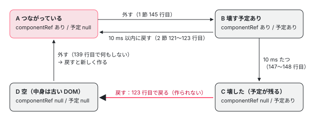

[目次](../README.md) › [Angular Elements の内側](README.md) › 第 7 回 / 全 8 回

# 切り離しと破棄：少し待ってから壊す

> disconnect が 10 ms 後に destroy する予定を立て、同じ要素がすぐつながり直したら取り消す行、壊すときに ComponentRef.destroy から ApplicationRef.detachView と destroyLView に進む行と、要素の側で出力の購読をすぐやめる行。要素を DOM の中で移動したときに作り直されない理由と、待ってから戻すと 1 回おきにしか作り直されない #38778 が v22 でも起きること、残った DOM と PRESERVE\_HOST\_CONTENT。

angular/angular · 読了 約 11 分 · 発展 · [サイトで読む（デモが動きます）](https://angular-deep-dive-cyan.vercel.app/chapter/elements-disconnect)

---

カスタム要素を DOM から外すと、ブラウザは `disconnectedCallback` を呼びます。Angular Elements はそこでコンポーネントをすぐには壊さず、10 ms 待ってから壊します。この章では、その「待つ」予定を立てる行、すぐつながり直したら予定を取り消す行、壊すときに core の側で起きること、要素の購読の後片付けを 1 行ずつ追います。そして、**待ってから戻すと、コンポーネントが作り直されない**という 2020 年から開いている issue（#38778）が v22 の行でも起きることを、ページの上の本物の要素で確かめます。

読む対象は `packages/elements/src/component-factory-strategy.ts`（`disconnect`）・`src/utils.ts`（`scheduler`）・`src/create-custom-element.ts`（`disconnectedCallback`）と、core の `render3/component_ref.ts`・`render3/view_ref.ts`・`application/application_ref.ts`・`render3/instructions/shared.ts`・`hydration/api.ts` です。

1. [1. 全体像](01-elements-overview.md)
2. [2. createCustomElement](02-elements-create.md)
3. [3. 属性と入力](03-elements-attributes-inputs.md)
4. [4. つながるとき](04-elements-connect.md)
5. [5. 入力と変更検知](05-elements-inputs-cd.md)
6. [6. 出力とイベント](06-elements-outputs.md)
7. **7. 切り離しと破棄**（この章）
8. [8. spec と issue](08-elements-tests-issues.md)

## 1. disconnect：壊す予定を立てる

📄 `angular/packages/elements/src/component-factory-strategy.ts` L41–42 （▶ の行: 42）

```ts
41 │ /** Time in milliseconds to wait before destroying the component ref when disconnected. */
42 ▶ const DESTROY_DELAY = 10;
```

📄 `angular/packages/elements/src/component-factory-strategy.ts` L132–152 （▶ の行: 137, 139, 145–148, 150）

```ts
132 │   /**
133 │    * Schedules the component to be destroyed after some small delay in case the element is just
134 │    * being moved across the DOM.
135 │    */
136 │   disconnect() {
137 ▶     this.runInZone(() => {
138 │       // Return if there is no componentRef or the component is already scheduled for destruction
139 ▶       if (this.componentRef === null || this.scheduledDestroyFn !== null) {
140 │         return;
141 │       }
142 │ 
143 │       // Schedule the component to be destroyed after a small timeout in case it is being
144 │       // moved elsewhere in the DOM
145 ▶       this.scheduledDestroyFn = scheduler.schedule(() => {
146 ▶         if (this.componentRef !== null) {
147 ▶           this.componentRef.destroy();
148 ▶           this.componentRef = null;
149 │         }
150 ▶       }, DESTROY_DELAY);
151 │     });
152 │   }
```

1. **137 行目：`runInZone` に包む**

   zone.js が無ければそのまま呼ぶだけです（[第 5 回](05-elements-inputs-cd.md)の 5 節）。
2. **139 行目：壊すものが無いか、もう予定があれば何もしない**

   `componentRef` が `null`（まだ作っていない・もう壊した）か、`scheduledDestroyFn` がすでにあれば戻ります。
3. **145〜150 行目：`DESTROY_DELAY`（42 行目、10 ms）後に壊す予定を立てる**

   予定の中身は 146〜149 行目だけです。`componentRef` があれば 147 行目で `destroy()` し、148 行目で `null` に戻します。`scheduler.schedule` が返す「取り消す関数」を `scheduledDestroyFn` に置きます。

コメント（133〜134 行目、143〜144 行目）のとおり、待つのは「要素を DOM の中で動かしている場合（in case it is being moved）」に備えるためです。要素を別の親に `append` すると、ブラウザは同じ要素に `disconnectedCallback` と `connectedCallback` を続けて呼びます。すぐ壊すと、移動のたびにコンポーネントが作り直されてしまいます。

📄 `angular/packages/elements/src/utils.ts` L19–22 （▶ の行: 20–21）

```ts
19 │   schedule(taskFn: () => void, delay: number): () => void {
20 ▶     const id = setTimeout(taskFn, delay);
21 ▶     return () => clearTimeout(id);
22 │   },
```

`scheduler.schedule` の中身は 20 行目の `setTimeout` で、21 行目で `clearTimeout` する関数を返します（`utils.ts` のほかの関数は [第 3 回](03-elements-attributes-inputs.md)）。Angular の変更検知のスケジューラとは関係のない、素のタイマーです。

## 2. connect：予定があれば取り消して終わる

📄 `angular/packages/elements/src/component-factory-strategy.ts` L118–124 （▶ の行: 120–123）

```ts
118 │       // If the element is marked to be destroyed, cancel the task since the component was
119 │       // reconnected
120 ▶       if (this.scheduledDestroyFn !== null) {
121 ▶         this.scheduledDestroyFn();
122 ▶         this.scheduledDestroyFn = null;
123 ▶         return;
124 │       }
```

`connect` の先頭です（全体は [第 4 回](04-elements-connect.md)）。120 行目で `scheduledDestroyFn` があれば、121 行目で呼んで（`clearTimeout`）、122 行目で `null` にし、**123 行目で戻ります**。コンポーネントを作る行には進みません。「予定がある＝まだ壊していないコンポーネントがある」という前提の書き方です。

## 3. 予定の関数は、終わっても残る

1 節の 146〜149 行目をもう一度見ます。**予定が実行されて壊したあとも、`scheduledDestroyFn` を `null` に戻す行がありません**。すると、2 節の前提が崩れます。

1. **外す**

   1 節で予定が立ち、`scheduledDestroyFn` が入ります。
2. **10 ms 以上たつ**

   147〜148 行目で壊して `componentRef = null`。`scheduledDestroyFn` は残ったまま（もう終わったタイマーを取り消す関数）です。
3. **戻す（1 回目）**

   2 節の 120 行目で `scheduledDestroyFn` があるので、121 行目で終わったタイマーを取り消し（何も起きない）、122 行目で `null`、123 行目で戻ります。**コンポーネントは作られません**。
4. **もう一度外す**

   1 節の 139 行目で `componentRef` が `null` なので、何もしません。
5. **戻す（2 回目）**

   今度は `scheduledDestroyFn` も `componentRef` も `null` なので、新しいコンポーネントが作られます。

つまり、**待ってから戻すと、作られる・作られないが 1 回おきに入れ替わります**。これは issue [#38778](https://github.com/angular/angular/issues/38778)（2020-09 に開かれ、いまも開いている。state: confirmed、P3）が指摘した行そのもので、そこでも「`scheduledDestroyFn` を `null` にしていない」と書かれています。直す PR（#38816、#58586）はどちらも merge されずに閉じています。5 節のデモで、このページの上で起きることを確かめます。



*strategy の 2 つの欄（componentRef と scheduledDestroyFn）の組み合わせで見た、外す・戻すの動き。右下の「C」から戻すと作られない*

## 4. 壊すとき：ComponentRef.destroy から先

📄 `angular/packages/core/src/render3/component_ref.ts` L644–646 （▶ の行: 645）

```ts
644 │   override destroy(): void {
645 ▶     this.hostView.destroy();
646 │   }
```

📄 `angular/packages/core/src/render3/view_ref.ts` L104–107 （▶ の行: 105–106）

```ts
104 │   destroy(): void {
105 ▶     if (this._appRef) {
106 ▶       this._appRef.detachView(this);
107 │     } else if (this._attachedToViewContainer) {
```

📄 `angular/packages/core/src/render3/view_ref.ts` L124–126 （▶ の行: 125）

```ts
124 │     }
125 ▶     destroyLView(this._lView[TVIEW], this._lView);
126 │   }
```

📄 `angular/packages/core/src/application/application_ref.ts` L731–736 （▶ の行: 734–735）

```ts
731 │   detachView(viewRef: ViewRef): void {
732 │     (typeof ngDevMode === 'undefined' || ngDevMode) && warnIfDestroyed(this._destroyed);
733 │     const view = viewRef as InternalViewRef<unknown>;
734 ▶     remove(this._views, view);
735 ▶     view.detachFromAppRef();
736 │   }
```

1. **645 行目：`hostView.destroy()`**

   `ComponentRef.destroy` はホストのビューを壊すだけです。
2. **105〜106 行目：`ApplicationRef` から外す**

   つながったときに `appRef.attachView(hostView)` されている（[第 4 回](04-elements-connect.md)）ので、`_appRef` があります。734 行目で `_views` から消し、735 行目でビューの側の印も外します。これで tick のたびに見に来られることは無くなります。
3. **125 行目：`destroyLView`**

   ビューの木を壊し、`ngOnDestroy` と `DestroyRef.onDestroy` の登録を呼びます（順番と中身は [ivy-destroy](../ivy/17-ivy-destroy.md)）。`output()` の `OutputEmitterRef` もここで `destroyed` になります（[第 6 回](06-elements-outputs.md)の最後）。

## 5. 要素の側の後片付け

📄 `angular/packages/elements/src/create-custom-element.ts` L220–226 （▶ の行: 220–221, 224–226）

```ts
220 ▶       if (this._ngElementStrategy) {
221 ▶         this._ngElementStrategy.disconnect();
222 │       }
223 │ 
224 ▶       if (this.ngElementEventsSubscription) {
225 ▶         this.ngElementEventsSubscription.unsubscribe();
226 ▶         this.ngElementEventsSubscription = null;
```

`disconnectedCallback` です。220 行目、strategy をまだ作っていなければ（一度もつながっていない要素）作らずに済ませ、あれば 221 行目で 1 節の `disconnect` を呼びます。224〜226 行目で、[第 6 回](06-elements-outputs.md)の 3 節の購読（`ngElementEventsSubscription`）を**すぐに**やめます。コンポーネントを壊すのは 10 ms 後ですが、出力のイベントは外した瞬間から要素に出なくなります。すぐ戻したときは、`connectedCallback` がもう一度購読します。

## 6. 壊したあと、要素の中の DOM はどうなるか

5 節のデモでは、壊したあとも要素の中の DOM（「インスタンス #1」の文字）がそのまま残っているのが見えます。コンポーネントが作り直されるときに、その残った DOM をどうするかは、ホストの要素を探す core の行が決めます。

📄 `angular/packages/core/src/render3/instructions/shared.ts` L174–180 （▶ の行: 174, 178–180）

```ts
174 ▶   const preserveHostContent = injector.get(PRESERVE_HOST_CONTENT, PRESERVE_HOST_CONTENT_DEFAULT);
175 │ 
176 │   // When using native Shadow DOM, do not clear host element to allow native slot
177 │   // projection.
178 ▶   const preserveContent =
179 ▶     preserveHostContent ||
180 ▶     encapsulation === ViewEncapsulation.ShadowDom ||
```

📄 `angular/packages/platform-browser/src/dom/dom_renderer.ts` L388–390 （▶ の行: 388–389）

```ts
388 ▶     if (!preserveContent) {
389 ▶       el.textContent = '';
390 │     }
```

📄 `angular/packages/core/src/hydration/api.ts` L254–260 （▶ の行: 254, 260）

```ts
254 ▶         provide: PRESERVE_HOST_CONTENT,
255 │         useFactory: () => {
256 │           // Preserve host element content only in a browser
257 │           // environment and when hydration is configured properly.
258 │           // On a server, an application is rendered from scratch,
259 │           // so the host content needs to be empty.
260 ▶           return inject(IS_HYDRATION_DOM_REUSE_ENABLED);
```

`createComponent` に `hostElement` を渡すと、`locateHostElement` がそれを使います（全体は [boot-application-ref](../boot/10-boot-application-ref.md)）。174 行目で `PRESERVE_HOST_CONTENT` を読み、178〜180 行目で、それが true か、Shadow DOM のカプセル化なら、中身を残します。残さないときは `DomRenderer.selectRootElement` の 388〜389 行目で `textContent = ''` にして空にします。

- **ハイドレーションを使うアプリ（このサイト）**：`provideClientHydration()` が 254〜260 行目で `PRESERVE_HOST_CONTENT` を `IS_HYDRATION_DOM_REUSE_ENABLED` にします。このサイトでは true なので、作り直したコンポーネントの DOM は、残っていた古い DOM の**後ろに足されます**（デモの「インスタンス #1インスタンス #2」）。
- **ハイドレーションを使わないアプリ**：`PRESERVE_HOST_CONTENT` は既定の false なので、作り直すときに古い DOM は消えます。ただし、要素の子として書いた投影用の中身も、つながる前に取り出されていなければ一緒に消えます（投影は [第 4 回](04-elements-connect.md)）。
- **`ViewEncapsulation.ShadowDom` のコンポーネント**：180 行目の条件で、いつも残します。[#58707](https://github.com/angular/angular/issues/58707)（「Shadow root cannot be created on a host which already hosts a shadow tree」、開いている）は「同じ要素を外して戻すと、3 回目に表示したときにこのエラー」という報告です。3 節の 1 回おきでは、最初につないだあと次にコンポーネントが作り直されるのが 3 回目の表示なので、回数は合います。ただし `attachShadow` を呼ぶ行はこの章では読んでおらず、ShadowDom のコンポーネントでは試していません。

## 7. DEMO：外す・戻す・移す

> **🧪 DEMO — 外す・戻す・移すで、コンポーネントが作られるか壊れるか（ライブ。@angular/elements 22.1.6 の createCustomElement）**
>
> 「作ってつなぐ」を押すと、`createCustomElement(ElDisLife, { injector })` のクラスを、`connectedCallback` と `disconnectedCallback` を記録してから `super` を呼ぶだけの子クラスにして `<el-disconnect-life>` の名前で登録し、作った要素を枠 A に入れます。`ElDisLife` は constructor と `ngOnDestroy` を記録し、テンプレートに自分のインスタンスの番号を出します。「観察」の行は、操作のあと 40 ms（待って戻すときは戻してから 40 ms）で要素の中身を見た結果です。時刻はボタンを押してからのミリ秒です。
>
> ▶ [このデモはサイトで動かせます](https://angular-deep-dive-cyan.vercel.app/chapter/elements-disconnect)

試すと分かることです（本番ビルドで確かめた結果は「テストと直し方」の最後にあります）。

1. **作ってつなぐ：`connectedCallback` の中で constructor（インスタンス #1）**

   `connectedCallback` が戻ったときには、もう中身が描かれています（つながるときの `detectChanges`。[第 4 回](04-elements-connect.md)）。
2. **外す → すぐ戻す、隣の枠へ移す：`ngOnDestroy` も constructor も出ない**

   `disconnectedCallback` と `connectedCallback` が同じ時刻に続けて出ます。1 節で立った予定を 2 節の 121 行目が取り消すので、40 ms 後もインスタンス #1 のままです。
3. **外す → 50 ms 待って戻す（1 回目）：十数ミリ秒で `ngOnDestroy`、戻しても constructor は出ない**

   10 ms の予定がタイマーで実行され、4 節の流れで `ngOnDestroy` が呼ばれます。50 ms 後に戻すと、`connectedCallback` は呼ばれますが、3 節のとおり 123 行目で戻るので constructor は出ません。中身には壊れたインスタンス #1 の DOM が残っていて、見た目は変わりません。
4. **外す → 50 ms 待って戻す（2 回目）：`ngOnDestroy` は出ず、戻すと constructor（インスタンス #2）**

   外したとき 1 節の 139 行目で何もしないので `ngOnDestroy` は出ません。戻すと新しいインスタンスが作られ、6 節のとおり中身は「インスタンス #1インスタンス #2」になります。
5. **もう一度（3 回目）：`ngOnDestroy`（#2）、戻しても作られない**

   1 回おきに入れ替わります。「外す」と「枠 A に戻す」を、間を空けて手で押しても同じです。

## ここまでの呼び出し

- 👤 `el.remove()` — あなたのコード
  - `NgElementImpl.disconnectedCallback` — create-custom-element.ts 220
    - `ComponentNgElementStrategy.disconnect` — component-factory-strategy.ts 136
      - `scheduler.schedule(fn, DESTROY_DELAY)` → `setTimeout(fn, 10)` — utils.ts 20 — *scheduledDestroyFn に取り消す関数*
    - `ngElementEventsSubscription.unsubscribe()` — create-custom-element.ts 225 — *出力はすぐ止まる*
- `（10 ms 後）fn` — component-factory-strategy.ts 146
  - `ComponentRef.destroy` → `ViewRef.destroy` — component\_ref.ts 645・view\_ref.ts 104
    - `ApplicationRef.detachView` — application\_ref.ts 731
    - `destroyLView` — view\_ref.ts 125 — *ngOnDestroy*
  - `componentRef = null` — component-factory-strategy.ts 148 — *scheduledDestroyFn は残る*
- 👤 `parent.append(el)` — あなたのコード
  - `connect` → `scheduledDestroyFn !== null` → `return` — component-factory-strategy.ts 120〜123 — *#38778：作られない*

## テストと直し方

### spec と describe

| spec | describe / it | この章のどこ |
| --- | --- | --- |
| test/component-factory-strategy\_spec.ts | describe `disconnect`（303 行目）の it `should be able to call if not connected`（304）・`should destroy the component after the destroy delay`（311） | 1 節 |
| test/create-custom-element\_spec.ts | it `should not listen to output events after disconnected`（130） | 5 節 |

📄 `angular/packages/elements/test/component-factory-strategy_spec.ts` L303–322 （▶ の行: 305, 312, 315, 317–320）

```ts
303 │   describe('disconnect', () => {
304 │     it('should be able to call if not connected', () => {
305 ▶       expect(() => strategy.disconnect()).not.toThrow();
306 │ 
307 │       // Sanity check: componentRef doesn't exist.
308 │       expect(getComponentRef(strategy)).toBeNull();
309 │     });
310 │ 
311 │     it('should destroy the component after the destroy delay', async () => {
312 ▶       strategy.connect(document.createElement('div'));
313 │       const componentRef = getComponentRef(strategy)!;
314 │       let destroyed = false;
315 ▶       componentRef.onDestroy(() => (destroyed = true));
316 │ 
317 ▶       strategy.disconnect();
318 ▶       expect(destroyed).toBeFalse();
319 ▶       await new Promise((resolve) => setTimeout(resolve, 10));
320 ▶       expect(destroyed).toBeTrue();
321 │     });
322 │   });
```

311〜321 行目が、この章の中心の行を確かめる唯一の it です。317 行目で外し、318 行目でまだ壊れていないこと、319 行目で 10 ms 待ってから 320 行目で壊れたことを見ます。**「壊れたあとにもう一度 `connect` する」it も、「すぐ `connect` し直すと壊れない」it もありません**。だから 3 節の 1 回おきは、どの spec にも引っかかりません。

📄 `angular/packages/elements/test/create-custom-element_spec.ts` L130–141 （▶ の行: 133–134, 138, 140）

```ts
130 │   it('should not listen to output events after disconnected', () => {
131 │     const element = new NgElementCtor(injector);
132 │     element.connectedCallback();
133 ▶     element.disconnectedCallback();
134 ▶     expect(strategy.disconnectCalled).toBe(true);
135 │ 
136 │     let eventValue: any = null;
137 │     element.addEventListener('some-event', (e: Event) => (eventValue = (e as CustomEvent).detail));
138 ▶     strategy.events.next({name: 'some-event', value: 'event-value'});
139 │ 
140 ▶     expect(eventValue).toEqual(null);
141 │   });
```

5 節の 224〜226 行目の it です。`TestStrategy`（本物の strategy ではない）を使い、133 行目で外したあと 138 行目で流したイベントが届かない（140 行目）ことを見ます。

### 手元で走らせた結果

`pnpm bazel test //packages/elements/... --nocache_test_results --test_output=all` で、Chromium と Firefox のどちらも「59 passed, 0 failed, 5 skipped」でした（2026-11-06。抜粋は [第 5 回](05-elements-inputs-cd.md)）。この章の 3 件は skip されていません。名前の絞り込みは効かないので、1 件だけ走らせることはできません。

### 直すとしたら

- **#38778 の 1 行**：`component-factory-strategy.ts` の `disconnect` の予定の中（146〜149 行目）に `this.scheduledDestroyFn = null;` を足す形です。spec は、311 行目の it の後ろに、`await` で 10 ms 待ったあと `strategy.connect(…)` し直して `getComponentRef(strategy)` が新しいものになることを見る it を足します。#38778 のコメントでは、この 1 行だけでは足りない（投影の中身が戻らない、入力が入らない、animations が要素を外す）という話が続いています。入力が入らないのは、`initialInputValues` がつながったときに空にされ（[第 4 回](04-elements-connect.md)）、壊したあとは値を覚えている場所が無いからです（[第 5 回](05-elements-inputs-cd.md)の 5 節）。
- **出力の購読が落ちる**（[第 6 回](06-elements-outputs.md)の最後）：同じ予定の中で `eventEmitters` を空の配列にする形です。この直しだけでも、作り直されたコンポーネントの出力は届きます（手元で確かめた流れは [見つけた不具合を手元で直す・第 8 回](../fix/08-fix-elements-outputs.md)）。
- どちらも、本家に出す前に、まず手元の spec で今の挙動を確かめる it を書くところまでです。関係する issue（#38778・#58707・#49531・#64229・#67890）は [第 8 回](08-elements-tests-issues.md)の表にあります。[#64229](https://github.com/angular/angular/issues/64229)（Angular Elements Lifecycle is Broken、開いている）は「切り離しと破棄を分けるべき」という大きな話で、[#67890](https://github.com/angular/angular/issues/67890)（閉じた）はそこへの重複として案内されています。

### 本番ビルドで確かめた結果

ヘッドレスの Chrome（HeadlessChrome/155.0.8043.0）で本番ビルドのこのページを開き、playwright-core で 7 節のデモを操作しました。「作ってつなぐ」で connectedCallback の中に constructor（インスタンス #1）が出ました。「外す → すぐ戻す」と「隣の枠へ移す」（2 回）では disconnectedCallback と connectedCallback が同じ時刻に続き、40 ms 後もインスタンス #1 のままで、ngOnDestroy は出ませんでした。「外す → 50 ms 待って戻す」は、1 回目が 18.3 ms に ngOnDestroy（#1）・戻しても constructor なし（中身「インスタンス #1」のまま）、2 回目が ngOnDestroy なし・戻すと constructor（#2）で中身「インスタンス #1インスタンス #2」、3 回目が 18.2 ms に ngOnDestroy（#2）・戻しても constructor なし、でした。そのあと「外す」と「枠 A に戻す」を手で押すと constructor（#3）が出ました。シリーズを 1 ページで読むページ（/series/elements）でも、第 5 回と第 7 回のデモの要素は同じように作られ、どちらのページでもコンソールの警告とエラーは 0 件でした（scratchpad/el-b/verify/verify.mjs、2026-11-06）。

## 聞かれそうな質問

**Q. 要素を DOM から外すと、ngOnDestroy はいつ呼ばれますか？**

すぐではなく、10 ms 後です。`disconnect` の 145〜150 行目が `scheduler.schedule(…, DESTROY_DELAY)`（`utils.ts` の 20 行目の `setTimeout`）で予定を立て、その中の 147 行目の `componentRef.destroy()` から `ViewRef.destroy` の 125 行目の `destroyLView` で呼ばれます。出力の購読だけは `disconnectedCallback` の 224〜226 行目ですぐにやめます。

**Q. 要素を別の親へ移すと、コンポーネントは作り直されますか？**

作り直されません。移動ではブラウザが `disconnectedCallback` と `connectedCallback` を続けて呼ぶので、1 節で立った 10 ms の予定を、`connect` の 120〜123 行目がすぐ取り消して戻ります。同じインスタンスのままで、状態も残ります。

**Q. 外して 1 秒後に戻したら、コンポーネントは作り直されますか？**

v22 では作り直されません（#38778）。壊したあとに 146〜149 行目が `scheduledDestroyFn` を `null` に戻さないので、戻したときの `connect` は 120 行目で「予定がある」と見て、123 行目で戻ります。もう一度外して戻すと作られます。デモで 1 回おきに入れ替わるのが見えます。

**Q. 壊れたあとの要素の中には何が残っていますか？**

このページでは、壊れたコンポーネントの DOM がそのまま残ります（デモの観察の行）。ビューを壊すときにテンプレートのリスナーの後片付けも走る（[ivy-destroy](../ivy/17-ivy-destroy.md)）ので、残った DOM はもう動きません。作り直すと、ハイドレーションを使うアプリでは `PRESERVE_HOST_CONTENT` が true（hydration/api.ts の 254〜260 行目）なので古い DOM の後ろに足され、使わないアプリでは 388〜389 行目で一度空にされます。

**Q. なぜ 10 ms なのですか？変えられますか？**

42 行目の定数 `DESTROY_DELAY` で、`export` されていないので外からは変えられません。待つ理由は 133〜134 行目と 143〜144 行目のコメントのとおり DOM の中での移動のためで、移動は同期に disconnect と connect が続くので、0 より大きければ足ります。変えたいなら、`NgElementStrategyFactory` を自作して `strategyFactory` に渡します（[第 1 回](01-elements-overview.md)）。

## 読み終えて

- 外すと、出力の購読はすぐやめ、コンポーネントは 10 ms の `setTimeout` のあとで壊します。
- すぐ戻す・移すと、`connect` が予定を取り消し、同じインスタンスが続きます。
- 壊したあとも `scheduledDestroyFn` が残るので、待ってから戻すと 1 回おきにしか作り直されません（#38778、v22 でも起きる）。
- 壊すと `ApplicationRef` から外れて `destroyLView` が走りますが、要素の中の DOM は残り、作り直したときの扱いは `PRESERVE_HOST_CONTENT`（ハイドレーション）と Shadow DOM で変わります。

---

← 前: [出力とイベント：CustomEvent になるまで](06-elements-outputs.md)  
次: [spec と issue を読む：Angular Elements の今](08-elements-tests-issues.md) →
