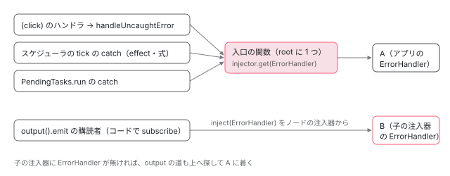

[目次](../README.md) › [ErrorHandler とエラーの行き先](README.md) › 第 1 回 / 全 6 回

# ErrorHandler と内部の入口：INTERNAL\_APPLICATION\_ERROR\_HANDLER

> フレームワークの中から呼ばれる入口 INTERNAL\_APPLICATION\_ERROR\_HANDLER が、ApplicationRef の生成で循環しないよう ErrorHandler を最初のエラーまで取らない理由（1c1ad12ad3e、#58970）、壊れた注入器から取らない修正（c4dd258658f・538de86a725）、zone の扱いを factory に入れた d399d7d02b6。入口を通る場所と ErrorHandler を直接取る場所（output・afterRender）の grep と、子の注入器の ErrorHandler に届くのはどちらか。ページの上で別のアプリを作り、自分の ErrorHandler に届くエラーを数える。

angular/angular · 読了 約 12 分 · 中核 · [サイトで読む（デモが動きます）](https://angular-deep-dive-cyan.vercel.app/chapter/err-handler-core)

---

Angular の中で捕まえたエラーは、たいてい `ErrorHandler` を直接ではなく、`INTERNAL_APPLICATION_ERROR_HANDLER` という内部のトークンが返す関数に渡されます。この章では、そのトークンの factory が **ErrorHandler を最初のエラーのときまで取らない**理由（1c1ad12ad3e、#58970）、**壊れた注入器からは取らない**修正（c4dd258658f・538de86a725）、そして「入口を通る場所」と「ErrorHandler を直接取る場所」の違いを、コミット → 今の行 → spec の順に読みます。最後に、ページの上で別のアプリを作り、自分の ErrorHandler に届くエラーを数えます。

読む対象は `packages/core/src/error_handler.ts`・`application/application_ref.ts`・`render3/instructions/shared.ts`、確かめる spec は `packages/core/test/error_handler_spec.ts` です。テストの中で TestBed がこの入口を差し替えて投げ直す話は [testing-errors](../testing/12-testing-errors.md)、エラーを捕まえる場所の一覧は[第 2 回](02-err-where-caught.md)で扱います。

1. **1. ErrorHandler と内部の入口**（この章）
2. [2. エラーを捕まえる場所の地図](02-err-where-caught.md)
3. [3. ブラウザの全体のエラー](03-err-global-listeners.md)
4. [4. @boundary の実行時](04-err-boundary-runtime.md)
5. [5. @boundary のコンパイル](05-err-boundary-compile.md)
6. [6. spec と issue](06-err-tests-issues.md)

## 1. ErrorHandler は「差し替えられるための」クラス

📄 `angular/packages/core/src/error_handler.ts` L56–89 （▶ の行: 59–61, 67–68, 74–76, 79–81, 85）

````ts
56 │ /**
57 │  * Provides a hook for centralized exception handling.
58 │  *
59 ▶  * The default implementation of `ErrorHandler` prints error messages to the `console`. To
60 ▶  * intercept error handling, write a custom exception handler that replaces this default as
61 ▶  * appropriate for your app.
62 │  *
63 │  * @usageNotes
64 │  * ### Example
65 │  *
66 │  * ```ts
67 ▶  * class MyErrorHandler implements ErrorHandler {
68 ▶  *   handleError(error) {
69 │  *     // do something with the exception
70 │  *   }
71 │  * }
72 │  *
73 │  * // Provide in standalone apps
74 ▶  * bootstrapApplication(AppComponent, {
75 ▶  *   providers: [{provide: ErrorHandler, useClass: MyErrorHandler}]
76 ▶  * })
77 │  *
78 │  * // Provide in module-based apps
79 ▶  * @NgModule({
80 ▶  *   providers: [{provide: ErrorHandler, useClass: MyErrorHandler}]
81 ▶  * })
82 │  * class MyModule {}
83 │  * ```
84 │  *
85 ▶  * @publicApi
86 │  *
87 │  * @see [Unhandled errors in Angular](best-practices/error-handling)
88 │  *
89 │  */
````

1. **59〜61 行目 既定の動き**

   既定の実装はコンソールに出すだけで、差し替えて使うものだと書いてあります。本体は `this._console.error('ERROR', error)` の 1 行で、その行と、`BrowserModule` の providers が `{provide: ErrorHandler, useFactory: errorHandler}` で既定のものを入れる行は [ngmodule-browser-module](../ngmodule/12-ngmodule-browser-module.md) で読みました。クラスの宣言には `@Injectable` も `providedIn` も無いので、**誰かが provide しない限り注入器には居ません**。
2. **67〜68・74〜76・79〜81 行目 差し替え方**

   `handleError(error)` を持つクラスを書き、`bootstrapApplication` の providers（74〜76 行目）か NgModule の providers（79〜81 行目）で `{provide: ErrorHandler, useClass: ...}` にします。85 行目の `@publicApi` のとおり公開の API で、引数の型は `any` です。Error でない値もそのまま来ます（6 節の spec）。
3. **同じクラスの残り**

   v22.2 で足された `onViewError` と `ErrorDetails` はエラーの境界のためのもので、[第 4 回](04-err-boundary-runtime.md)で読みます。この章では `handleError` だけを扱います。

## 2. 内部の入口：INTERNAL\_APPLICATION\_ERROR\_HANDLER

📄 `angular/packages/core/src/error_handler.ts` L143–152 （▶ の行: 144, 146, 149–152）

```ts
143 │ /**
144 ▶  * `InjectionToken` used to configure how to call the `ErrorHandler`.
145 │  */
146 ▶ export const INTERNAL_APPLICATION_ERROR_HANDLER = new InjectionToken<(e: any) => void>(
147 │   typeof ngDevMode === 'undefined' || ngDevMode ? 'internal error handler' : '',
148 │   {
149 ▶     factory: () => {
150 ▶       // The user's error handler may depend on things that create a circular dependency
151 ▶       // so we inject it lazily.
152 ▶       const zone = inject(NgZone);
```

146 行目のトークンは値が「関数」です。149 行目の `factory` を持つので、誰も provide しなければこの factory が使われます。`providedIn` を書いていないトークンでも、factory があれば `'root'` の注入器に置かれます（[di-injection-token](../di/06-di-injection-token.md)）。この「root に 1 つ」が 8 節の子の注入器の話につながります。factory の続きは [testing-errors](../testing/12-testing-errors.md) で行番号つきで引用したので、ここでは**その形になったコミット**から読みます。

📄 `git show d399d7d02b6（error_handler.ts の部分）`

```
$ git show d399d7d02b6 --format='%h %ad %s' --date=short -- packages/core/src/error_handler.ts
d399d7d02b6 2025-08-26 fix(core): Explicit Zone CD in TestBed providers should not override TestBed error handler (#63404)
@@ -67,17 +68,20 @@ export const INTERNAL_APPLICATION_ERROR_HANDLER = new InjectionToken<(e: any) =>
     factory: () => {
       // The user's error handler may depend on things that create a circular dependency
       // so we inject it lazily.
+      const zone = inject(NgZone);
       const injector = inject(EnvironmentInjector);
       let userErrorHandler: ErrorHandler;
       return (e: unknown) => {
-        if (injector.destroyed && !userErrorHandler) {
-          setTimeout(() => {
-            throw e;
-          });
-        } else {
-          userErrorHandler ??= injector.get(ErrorHandler);
-          userErrorHandler.handleError(e);
-        }
+        zone.runOutsideAngular(() => {
+          if (injector.destroyed && !userErrorHandler) {
+            setTimeout(() => {
+              throw e;
+            });
+          } else {
+            userErrorHandler ??= injector.get(ErrorHandler);
+            userErrorHandler.handleError(e);
+          }
+        });
       };
     },
   },
```

1. **factory の中で取るのは 2 つだけ**

   `inject(NgZone)` と `inject(EnvironmentInjector)` です。`ErrorHandler` はまだ取りません。`let userErrorHandler` は空のままです。
2. **返す関数は zone の外で走る**

   `zone.runOutsideAngular(() => ...)` の中で処理します。zone.js を使うアプリで、エラーの報告そのものが変更検知を起こさないためです（zoneless では `NoopNgZone` なのでそのまま呼ぶだけ。[zoneless-default](../zoneless/01-zoneless-default.md)）。
3. **最初のエラーで ErrorHandler を取る**

   `userErrorHandler ??= injector.get(ErrorHandler)` で 1 回目だけ取り、`handleError(e)` に渡します。投げ直しはしません。
4. **このコミットでしたこと**

   それまで zone のときだけ `internalProvideZoneChangeDetection` が同じ形の関数を別に provide していました（同じコミットの ng\_zone\_scheduling.ts の差分で消えています）。TestBed の providers に `provideZoneChangeDetection()` を書くと、その provider が TestBed の差し替えを上書きして、テストでエラーが投げ直されなくなっていました（#63404）。zone の扱いをトークンの factory の中に入れて、provider を 1 つにしました。

## 3. なぜ遅れて取るのか（1c1ad12ad3e、#58970）

📄 `angular/packages/core/src/application/application_ref.ts` L253–265 （▶ の行: 253–254, 261）

```ts
253 ▶ @Service()
254 ▶ export class ApplicationRef {
255 │   /** @internal */
256 │   _runningTick: boolean = false;
257 │   private _destroyed = false;
258 │   private _destroyListeners: Array<() => void> = [];
259 │   /** @internal */
260 │   _views: InternalViewRef<unknown>[] = [];
261 ▶   private readonly internalErrorHandler = inject(INTERNAL_APPLICATION_ERROR_HANDLER);
262 │   private readonly afterRenderManager = inject(AfterRenderManager);
263 │   private readonly zonelessEnabled = inject(ZONELESS_ENABLED);
264 │   private readonly rootEffectScheduler = inject(EffectScheduler);
265 │ 
```

`ApplicationRef` は作られた瞬間に、261 行目でこの入口を inject します。もし入口の factory がその場で `ErrorHandler` を inject していたら、**ApplicationRef を作ること**が **利用者の ErrorHandler を作ること**を含んでしまいます。利用者の ErrorHandler が（間接的にでも）`ApplicationRef` や effect を使うと、注入器はまだ作り終えていない ApplicationRef をもう一度作ろうとして NG0200（循環）になります。

#58970 はこの形でした。v19 で、利用者の `ErrorHandler` が作る途中で CDK の Directionality を上書きしたサービスを作り、そのサービスの `effect` が `ChangeDetectionScheduler` → `ApplicationRef` → 入口 → `ErrorHandler` とたどって、`NG0200: Circular dependency in DI detected for ChangeDetectionScheduler` が出ました。直したのが次の差分です。

📄 `git show 1c1ad12ad3e（error_handler.ts の部分。抜粋）`

```
$ git show 1c1ad12ad3e --format='%h %ad %s' --date=short -- packages/core/src/error_handler.ts
1c1ad12ad3e 2024-11-30 refactor(core): Instantiate the ErrorHandler lazily. (#58984)
@@ -58,8 +58,20 @@ export const INTERNAL_APPLICATION_ERROR_HANDLER = new InjectionToken<(e: any) =>
   {
     providedIn: 'root',
     factory: () => {
-      const userErrorHandler = inject(ErrorHandler);
-      return (e: unknown) => userErrorHandler.handleError(e);
+      // The user's error handler may depend on things that create a circular dependency
+      // so we inject it lazily.
+      const injector = inject(EnvironmentInjector);
+      let userErrorHandler: ErrorHandler;
+      return (e: unknown) => {
+        userErrorHandler ??= injector.get(ErrorHandler);
+        userErrorHandler.handleError(e);
+      };
     },
   },
 );
+
+export const errorHandlerEnvironmentInitializer = {
+  provide: ENVIRONMENT_INITIALIZER,
+  useValue: () => void inject(ErrorHandler),
+  multi: true,
+};
```

1. **- の 2 行 → + の 7 行**

   factory の中の `inject(ErrorHandler)` を消し、`EnvironmentInjector` を覚えておいて、返す関数の中で `??=` で取るようにしました。factory を作るときに ErrorHandler は作られません。
2. **+ の errorHandlerEnvironmentInitializer**

   遅らせた代わりに、環境の注入器の初期化（`ENVIRONMENT_INITIALIZER`）で `inject(ErrorHandler)` を 1 回呼ぶ値を足しました。これで ErrorHandler は、ApplicationRef の生成とは別の「環境の注入器の初期化」の時点で作られます。今の形（`{optional: true}` で取り、無ければ開発モードで NG0402 を投げる。45fed3d2011）は [ngmodule-browser-module](../ngmodule/12-ngmodule-browser-module.md) で引用しています。`bootstrapApplication` と `createApplication` では `internalCreateApplication` が（[boot-bootstrap-application](../boot/07-boot-bootstrap-application.md)）、NgModule では `PlatformRef.bootstrapModuleFactory` が（[ngmodule-bootstrap-module](../ngmodule/11-ngmodule-bootstrap-module.md)）この値を providers に入れます。
3. **デモで見る順番**

   9 節のデモの ErrorHandler（A）は、factory の中で `inject(ApplicationRef)` します。それでも NG0200 にならず、「A が作られた」は「`createApplication` の Promise が解決した」より先に出ます。初期化の値が起動の途中で作るからです。

> [!WARNING]
> **ハマりどころ**
>
> 遅らせたのは**入口の factory**だけです。`ErrorHandler` 自身の constructor で `effect()` を作るのは今も避けます。`packages/core/test/render3/reactivity_spec.ts` の `xit('should be usable inside an ErrorHandler')` は止めてあり、そのコメントは「effect は ApplicationRef に、ApplicationRef は ErrorHandler に循環して依存する」と書いています（[第 2 回](02-err-where-caught.md)でその直前の it を引用します）。

## 4. 壊れた注入器からは取らない（c4dd258658f・538de86a725）

遅らせたことで、新しい問題が出ました。**アプリを destroy したあと**に最初のエラーが来ると、`injector.get(ErrorHandler)` が壊れた注入器を触って、もう 1 つ別のエラー（NG0205 destroyed injector）になります。

📄 `git show c4dd258658f と 538de86a725（抜粋）`

```
$ git show c4dd258658f --format='%h %ad %s' --date=short -- packages/core/src/error_handler.ts
c4dd258658f 2025-06-05 fix(core): avoid injecting `ErrorHandler` from a destroyed injector (#61886)
@@ -70,8 +70,14 @@ export const INTERNAL_APPLICATION_ERROR_HANDLER = new InjectionToken<(e: any) =>
       const injector = inject(EnvironmentInjector);
       let userErrorHandler: ErrorHandler;
       return (e: unknown) => {
-        userErrorHandler ??= injector.get(ErrorHandler);
-        userErrorHandler.handleError(e);
+        if (injector.destroyed && !userErrorHandler) {
+          setTimeout(() => {
+            throw e;
+          });
+        } else {
+          userErrorHandler ??= injector.get(ErrorHandler);
+          userErrorHandler.handleError(e);
+        }
       };
     },
   },

$ git show 538de86a725 --format='%h %ad %s' --date=short -- packages/core/src/render3/instructions/shared.ts
538de86a725 2025-06-26 fix(core): avoid injecting internal error handler from a destroyed injector (#62275)
@@ -705,7 +705,12 @@ export function handleUncaughtError(lView: LView, error: any): void {
   if (!injector) {
     return;
   }
-  const errorHandler = injector.get(INTERNAL_APPLICATION_ERROR_HANDLER, null);
+  let errorHandler: ((e: any) => void) | null;
+  try {
+    errorHandler = injector.get(INTERNAL_APPLICATION_ERROR_HANDLER, null);
+  } catch {
+    errorHandler = null;
+  }
   errorHandler?.(error);
 }
```

1. **c4dd258658f：入口の関数の中**

   `injector.destroyed && !userErrorHandler` のとき、つまり**まだ一度も ErrorHandler を取っていない**うちに注入器が壊れたときは、取らずに `setTimeout(() => { throw e; })` で投げます。エラーを黙って捨てないために、次のタスクでブラウザに報告させる形です。すでに取ってあれば、壊れていても覚えている `userErrorHandler` に渡します。
2. **538de86a725：入口そのものを取る側**

   テンプレートのリスナーなどが使う `handleUncaughtError` は、ビューの注入器から入口の関数を取ります。その `injector.get` 自体が壊れた注入器で投げるので、`try` で包んで、取れなければ何もしません。コミットのメッセージの例は、マイクロフロントエンドで `this.appRef.destroy()` のすぐあとにハンドラが投げる形です。この関数の今の行は [testing-errors](../testing/12-testing-errors.md) で引用しています。
3. **window に届いたあと**

   `setTimeout` で投げたエラーは window の `error` イベントになります。[第 3 回](03-err-global-listeners.md)の全体のリスナーは destroy のときに外れるので、このエラーはアプリの ErrorHandler には戻りません。

## 5. 誰が入口を通り、誰が ErrorHandler を直接取るか

📄 `ターミナル（grep。2026-11-15、8576f161ae4）`

```
$ cd ~/angular-research/angular
$ grep -rnE "(inject|get)\(ɵ?INTERNAL_APPLICATION_ERROR_HANDLER" packages/*/src --include='*.ts'
packages/common/src/pipes/async_pipe.ts:152:  private readonly applicationErrorHandler = inject(INTERNAL_APPLICATION_ERROR_HANDLER);
packages/core/src/change_detection/scheduling/ng_zone_scheduling.ts:41:  private readonly applicationErrorHandler = inject(INTERNAL_APPLICATION_ERROR_HANDLER);
packages/core/src/change_detection/scheduling/zoneless_scheduling_impl.ts:61:  private readonly applicationErrorHandler = inject(INTERNAL_APPLICATION_ERROR_HANDLER);
packages/core/src/error_handler.ts:198:      const errorHandler = inject(INTERNAL_APPLICATION_ERROR_HANDLER);
packages/core/src/platform/bootstrap.ts:94:    const exceptionHandler = envInjector.get(INTERNAL_APPLICATION_ERROR_HANDLER);
packages/core/src/render3/instructions/shared.ts:714:    errorHandler = injector.get(INTERNAL_APPLICATION_ERROR_HANDLER, null);
packages/core/src/application/application_ref.ts:261:  private readonly internalErrorHandler = inject(INTERNAL_APPLICATION_ERROR_HANDLER);
packages/core/src/pending_tasks.ts:45:  private readonly errorHandler = inject(INTERNAL_APPLICATION_ERROR_HANDLER);
packages/platform-server/src/utils.ts:207:  const errorHandler = environmentInjector.get(INTERNAL_APPLICATION_ERROR_HANDLER);
packages/router/src/directives/router_link.ts:372:  private readonly applicationErrorHandler = inject(ɵINTERNAL_APPLICATION_ERROR_HANDLER);
packages/router/src/router.ts:354:        this.injector.get(ɵINTERNAL_APPLICATION_ERROR_HANDLER)(e);

$ grep -rnE "inject\(ErrorHandler|get\(ErrorHandler" packages/*/src --include='*.ts'
packages/core/src/change_detection/scheduling/exhaustive_check_no_changes.ts:21:    const errorHandler = inject(ErrorHandler);
packages/core/src/error_handler.ts:162:            userErrorHandler ??= injector.get(ErrorHandler);
packages/core/src/error_handler.ts:174:    const handler = inject(ErrorHandler, {optional: true});
packages/core/src/authoring/output/output_emitter_ref.ts:36:  private errorHandler = inject(ErrorHandler, {optional: true});
packages/core/src/render3/instructions/boundary.ts:133:              const errorHandler = hostLView[INJECTOR]?.get(ErrorHandler, null);
packages/core/src/render3/instructions/boundary.ts:161:            const errorHandler = hostLView[INJECTOR]?.get(ErrorHandler, null);
packages/core/src/render3/after_render/manager.ts:51:  private readonly errorHandler = inject(ErrorHandler, {optional: true});
```

| 道 | 場所（grep の行） | TestBed の投げ直し |
| --- | --- | --- |
| 入口の関数を呼ぶ | テンプレートのリスナー（shared.ts:714 の `handleUncaughtError`）、スケジューラの tick（zoneless\_scheduling\_impl.ts:61・ng\_zone\_scheduling.ts:41）、`ApplicationRef` の起動時の tick（application\_ref.ts:261）、`PendingTasks.run`（pending\_tasks.ts:45）、async パイプ（async\_pipe.ts:152）、zone の `onError` と起動の失敗（bootstrap.ts:94）、全体のリスナー（error\_handler.ts:198）、Router のナビゲーションと `RouterLink`（router.ts:354・router\_link.ts:372）、サーバーの直列化前のコールバック（utils.ts:207） | 効く（TestBed がこのトークンを差し替える） |
| ErrorHandler を直接 | `output()` の emit（output\_emitter\_ref.ts:36）、`afterRender` 系（after\_render/manager.ts:51）、開発モードの全体の変更検査（exhaustive\_check\_no\_changes.ts:21）、エラーの境界（boundary.ts:133・161。第 4 回） | 効かない（ErrorHandler が呼ばれるだけ） |

違いは 2 つあります。1 つは TestBed です。[testing-errors](../testing/12-testing-errors.md) のとおり TestBed は入口のトークンを差し替えて投げ直すので、入口を通るエラーはテストを失敗させ、直接の道のエラーは ErrorHandler に記録されるだけです。もう 1 つは、**どの注入器の ErrorHandler に届くか**です。入口は root に 1 つで、その factory が覚えている `EnvironmentInjector` から ErrorHandler を取ります。直接の道は、`inject(ErrorHandler)` を書いた場所の注入器から探します。`output()` はコンポーネントやディレクティブの中で作るので、そのノードの注入器から上へ探します。



*入口を通る道は root の ErrorHandler（A）へ。output() の emit は、そのコンポーネントの注入器から探した ErrorHandler（子の注入器に B があれば B）へ。*

## 6. Error でない値はそのまま届く

入口も ErrorHandler も、受け取った値を包みません。`throw 'not an Error'` なら、`handleError` の引数は文字列です（9 節のデモの表の 2 段目）。既定の `handleError` は `console.error('ERROR', error)` に 2 つの引数で渡すだけなので、どんな値でも落ちません。それを固めているのが次の spec です。

📄 `angular/packages/core/test/error_handler_spec.ts` L15–44 （▶ の行: 15, 17–18, 22, 25–27, 36–37, 39, 42–43）

```ts
15 ▶ class MockConsole {
16 │   res: any[][] = [];
17 ▶   error(...s: any[]): void {
18 ▶     this.res.push(s);
19 │   }
20 │ }
21 │ 
22 ▶ function errorToString(error: any) {
23 │   const logger = new MockConsole();
24 │   const errorHandler = new ErrorHandler();
25 ▶   (errorHandler as any)._console = logger as any;
26 ▶   errorHandler.handleError(error);
27 ▶   return logger.res.map((line) => line.map((x) => `${x}`).join('#')).join('\n');
28 │ }
29 │ 
30 │ describe('ErrorHandler', () => {
31 │   it('should output exception', () => {
32 │     const e = errorToString(new Error('message!'));
33 │     expect(e).toContain('message!');
34 │   });
35 │ 
36 ▶   it('should correctly handle primitive values', () => {
37 ▶     expect(errorToString('message')).toBe('ERROR#message');
38 │     expect(errorToString(404)).toBe('ERROR#404');
39 ▶     expect(errorToString(0)).toBe('ERROR#0');
40 │     expect(errorToString(true)).toBe('ERROR#true');
41 │     expect(errorToString(false)).toBe('ERROR#false');
42 ▶     expect(errorToString(null)).toBe('ERROR#null');
43 ▶     expect(errorToString(undefined)).toBe('ERROR#undefined');
44 │   });
```

15〜20 行目の `MockConsole` を 25 行目で `_console` に差し込み（`_console` は `@internal` のフィールド）、26 行目で `handleError` を呼んで、27 行目で引数を `#` でつないだ文字列にします。37〜43 行目は、文字列・数・`0`・真偽値・`null`・`undefined` がどれも `'ERROR#値'` になることを見ています。エラーの境界は Error でない値を `ErrorBoundaryWrappedError` に包みますが、それは境界の道だけです（[第 4 回](04-err-boundary-runtime.md)）。

## 7. 呼び出しの連なり

- 👤 `button.click()` — デモ（別のアプリのコンポーネント）
  - `wrapListenerIn_markDirtyAndPreventDefault(event)` — render3/view/listeners.ts
    - `executeListenerWithErrorHandling(...)` — listeners.ts — *try / catch（[testing-errors](../testing/12-testing-errors.md)）*
      - 👤 `boom()` が throw — あなたのコンポーネント
      - `handleUncaughtError(lView, error)` — render3/instructions/shared.ts — *538de86a725 の try*
        - `injector.get(INTERNAL_APPLICATION_ERROR_HANDLER, null)` — shared.ts:714 — *root に 1 つ（L146-149）*
        - `(e) => zone.runOutsideAngular(...)` — error\_handler.ts（d399d7d02b6 の形）
          - `userErrorHandler ??= injector.get(ErrorHandler)` — error\_handler.ts — *1 回目だけ（1c1ad12ad3e）。壊れていれば setTimeout で投げる（c4dd258658f）*
          - 👤 `ErrorHandler.handleError(e)` — あなたの ErrorHandler（既定は console.error）

## 8. 子の注入器で ErrorHandler を差し替えると

遅延ルートの `providers` や `createEnvironmentInjector` で、子の注入器に別の `ErrorHandler`（B）を置いたとします。その下のコンポーネントのエラーがどこへ行くかは、5 節の 2 つの道で分かれます。

1. **入口を通る道は B に来ない**

   `handleUncaughtError` はビューの注入器から入口のトークンを探します。子の注入器はそのトークンを持たず、スコープも `'environment'` なので `'root'` の factory を自分では使いません（[ngmodule-provided-in](../ngmodule/10-ngmodule-provided-in.md)）。親をたどって root で作られた関数が返り、その関数は root の `EnvironmentInjector` から ErrorHandler を取ります。だから A に届きます。
2. **output の道は B に来る**

   `output()` を作るときの `inject(ErrorHandler, {optional: true})` はコンポーネントのノードの注入器から探すので、子の注入器の B を見つけます。

コンポーネントごとに ErrorHandler を分けたいという #43504 は、2026-10-30 に「v22.2 でエラーの境界を出した」というコメントとともに閉じられました（[第 4 回](04-err-boundary-runtime.md)）。

## 9. デモ：別のアプリの ErrorHandler に届くもの

> **🧪 DEMO — 別のアプリの ErrorHandler に届くものを数える**
>
> 押すたびに `createApplication` で別のアプリを作り、providers に「受けたものを記録するだけの ErrorHandler（A）」と `provideZonelessChangeDetection()` を入れて、選んだ場所でエラーを投げます。終わったら `destroy()` します。このサイト自身の ErrorHandler には届かないので、ブラウザのコンソールには何も出ません。
>
> ▶ [このデモはサイトで動かせます](https://angular-deep-dive-cyan.vercel.app/chapter/err-handler-core)

2026-11-15 に本番ビルドを headless Chrome で開き、全部のボタンを押した結果（@angular/core 22.1.6）です。

| 投げた場所 | 直下に作ったとき | 子の注入器（B）の下に作ったとき | 読み方 |
| --- | --- | --- | --- |
| (click) が Error | A に 1 回、`Error('boom in (click)')` | A に 1 回、B に 0 回 | 入口の道。8 節の 1 |
| (click) が文字列 | A に 1 回、`string "not an Error"` | A に 1 回 | 包まれない（6 節） |
| PendingTasks.run が reject | A に 1 回 | A に 1 回 | 入口の道（第 2 回） |
| effect が投げる | A に 1 回 | A に 1 回 | スケジューラの catch から入口へ |
| 式が投げる中で `appRef.tick()` | A に 0 回、**呼んだ側に**`Error('boom in template')` | 同じ | tick を直接呼ぶ道には catch が無い（338818ce899。第 2 回） |
| output の購読者が投げる | A に 1 回 | **A に 0 回、B に 1 回** | 直接の道。8 節の 2 |

下の番号つきの記録は、毎回「A（アプリの ErrorHandler）が作られた。中で inject(ApplicationRef) した」→「createApplication の Promise が解決した」→「appRef.destroy() した」の順でした（3 節の 3）。コンソールには、開発ビルドで Angular 自身が出す `Angular is running in development mode.` などのほかは何も出ず、本番ビルドでは 0 件でした。

> [!NOTE]
> **ポイント**
>
> なぜ `createEnvironmentInjector` の下ではなく別のアプリを作るのか、もこの章の答えです。このサイトの注入器の子に B を置いても、入口の道は 8 節の 1 のとおり**このサイトの** root の ErrorHandler に届き、コンソールに出てしまいます。root ごと分けるには、`'root'` のスコープを持つ注入器をもう 1 つ作る `createApplication` が要ります。

## テストと直し方

📄 `angular/packages/core/test/error_handler_spec.ts` L101–127 （▶ の行: 102–104, 109, 117, 123）

```ts
101 │   it(
102 ▶     'should not try to inject the `ErrorHandler` lazily once app is destroyed',
103 ▶     withBody('<app></app>', async () => {
104 ▶       destroyPlatform();
105 │ 
106 │       let dispatched = false;
107 │       // Prevents Jasmine from reporting an error.
108 │       const originalWindowOnError = window.onerror;
109 ▶       window.onerror = () => {};
110 │ 
111 │       @Component({
112 │         selector: 'app',
113 │         template: '',
114 │       })
115 │       class App {
116 │         constructor() {
117 ▶           inject(ApplicationRef).onDestroy(() => {
118 │             // Note: The unit test environment differs from the real browser environment.
119 │             // This is a simple test that ensures that if an error event is dispatched
120 │             // during destruction, it does not attempt to inject the `ErrorHandler`.
121 │             // Before the `if (injector.destroyed)` checks were added, this would
122 │             // throw a "destroyed injector" error.
123 ▶             dispatched = window.dispatchEvent(new Event('error'));
124 │           });
125 │         }
126 │       }
127 │ 
```

📄 `angular/packages/core/test/error_handler_spec.ts` L128–146 （▶ の行: 128–130, 132, 137, 140）

```ts
128 ▶       await jasmine.spyOnGlobalErrorsAsync(async () => {
129 ▶         const appRef = await bootstrapApplication(App, {
130 ▶           providers: [provideBrowserGlobalErrorListeners()],
131 │         });
132 ▶         appRef.destroy();
133 │ 
134 │         // We assert that `dispatched` is truthy because Angular's error handler
135 │         // calls `preventDefault()` on the event object, which would cause `dispatchEvent`
136 │         // to return false. This assertion ensures that Angular's error handler was not invoked.
137 ▶         expect(dispatched).toEqual(true);
138 │ 
139 │         // Wait until the error is re-thrown, so we can reset the original error handler.
140 ▶         await timeout(1);
141 │       });
142 │ 
143 │       window.onerror = originalWindowOnError;
144 │       destroyPlatform();
145 │     }),
146 │   );
```

1. **c4dd258658f が足した it（101 行目）**

   103 行目の `withBody` で `<app>` を置き、129〜131 行目で全体のリスナー付きのアプリを起動して、132 行目で destroy します。117 行目の `onDestroy` の中で 123 行目に window へ `error` イベントを投げ、128 行目の `jasmine.spyOnGlobalErrorsAsync` の中で、140 行目で 1 ミリ秒待ちます。「destroyed injector」のエラーが出ないことが確かめたいことで、出ればテストは失敗します（121〜122 行目のコメント）。
2. **137 行目は何を見ているか**

   134〜136 行目のコメントは「Angular のハンドラは `preventDefault()` するので、呼ばれれば `dispatchEvent` は false になる」と書いています。ただし 123 行目は `new Event('error')` で、`cancelable` を付けていません。DOM の決まりでは、取り消せないイベントの `preventDefault()` は何もしないので、`dispatchEvent` はハンドラが呼ばれても `true` を返します。[第 3 回](03-err-global-listeners.md)のデモの「取り消せない Event('error')」の行で、ハンドラに 1 回届いたうえで戻り値が `true` になることを確かめています。137 行目だけでは「呼ばれなかった」ことは分かりません。

📄 `ターミナル`

```
cd ~/angular-research/angular
pnpm bazel test //packages/core/test:test --test_arg=--filter="^ErrorHandler " --nocache_test_results --test_output=all
```

📄 `出力（抜粋。2026-11-15 に実行）`

```
Ran 1 of 1397 specs
1 spec, 0 failures
Ran 1 of 1397 specs
1 spec, 0 failures
Ran 1 of 1397 specs
1 spec, 0 failures
Ran 2 of 1398 specs
2 specs, 0 failures
//packages/core/test:test                                                PASSED in 1.4s
```

1. **件数の読み方**

   `--filter` は spec の名前の全体に正規表現で当たるので、`^ErrorHandler ` は `describe('ErrorHandler')` の中の 5 本です（この章の 31・36・101 行目の 3 本と、[第 3 回](03-err-global-listeners.md)で引用する全体のリスナーの 2 本）。4 つの shard の合計が 1 + 1 + 1 + 2 = 5 です。全体のリスナーの 2 本は、Node ではもちろん、ブラウザでも中身が走りません。理由は第 3 回で見ます。
2. **直すとしたら**

   ErrorHandler を取る時点と壊れた注入器の扱いは error\_handler.ts の `INTERNAL_APPLICATION_ERROR_HANDLER` の factory（149 行目から）、入口そのものを取る側は shared.ts の `handleUncaughtError`、起動時の 1 回は同じファイルの `errorHandlerEnvironmentInitializer` です。spec は `describe('ErrorHandler')`（error\_handler\_spec.ts:30）に足すのが入口で、137 行目のように「呼ばれなかった」ことを見たいときは、`cancelable: true` のイベントにするか、`ErrorHandler` を差し替えて呼ばれた回数を数える形にします。

## 聞かれそうな質問

**Q. ErrorHandler の中で HttpClient や ApplicationRef を inject すると NG0200 になりますか？**

今はなりません。`ApplicationRef` は 261 行目で入口を inject しますが、入口の factory は ErrorHandler を取らず、最初のエラーのときに `??=` で取ります（1c1ad12ad3e）。9 節のデモの A は factory の中で `inject(ApplicationRef)` していて、起動できています。ただし ErrorHandler の constructor で `effect()` を作ることは、reactivity\_spec.ts の止めてある `xit('should be usable inside an ErrorHandler')` のとおり今も支えられていません。

**Q. 遅延ルートの providers に ErrorHandler を置けば、そのルートのエラーはそこに届きますか？**

テンプレートのリスナー・effect・変更検知・`PendingTasks.run` のエラーは届きません。これらは入口の関数を通り、その関数は 146〜149 行目の root のトークンとして作られ、root の注入器から ErrorHandler を取るからです（8 節、デモの子の注入器の行）。届くのは `output()` の購読者のように `inject(ErrorHandler)` をその場で書いている直接の道だけです（5 節の grep）。

**Q. `throw 'message'` のように文字列を投げると、handleError には何が来ますか？**

文字列がそのまま来ます。入口も既定の ErrorHandler も包みません。error\_handler\_spec.ts の 36〜44 行目が、文字列や `null` でも `'ERROR#値'` と出ることを確かめています。

**Q. アプリを destroy したあとでエラーが起きたらどうなりますか？**

それまでに一度でも ErrorHandler を取っていれば、その ErrorHandler に渡ります。一度も取っていなければ、取らずに `setTimeout` の中で投げ直し、ブラウザの未処理のエラーになります（c4dd258658f）。リスナーの道では、入口を取る `injector.get` 自体が投げても `try` で捨てます（538de86a725）。

**Q. 自分で `appRef.tick()` を呼んだときのエラーは ErrorHandler に行きますか？**

行きません。呼んだ側に投げられます（デモの tick の行）。`ApplicationRef.tick` の中の catch は 338818ce899 で外され、catch して入口に渡すのはスケジューラと起動時の `_loadComponent` だけになりました（[第 2 回](02-err-where-caught.md)）。

## 読み終えて

- `ErrorHandler` は provide されて初めて注入器に居る公開のクラスで、既定は `console.error('ERROR', error)` だけ。
- フレームワークの中のほとんどは `INTERNAL_APPLICATION_ERROR_HANDLER`（error\_handler.ts L146）の関数に渡し、その関数が最初のエラーのときに root の注入器から ErrorHandler を取る（1c1ad12ad3e、#58970）。
- まだ取っていないうちに注入器が壊れていたら `setTimeout` で投げ直し（c4dd258658f）、入口を取る側も `try` で守る（538de86a725）。
- `output()`・`afterRender` などは ErrorHandler を直接取るので、TestBed の投げ直しが効かず、子の注入器の ErrorHandler に届く。

---

← 前: [spec と issue を読む：hostDirectives と継承を固めているテスト](../hdi/06-hdi-tests-issues.md)  
次: [エラーを捕まえる場所の地図：リスナー・effect・変更検知・PendingTasks](02-err-where-caught.md) →
