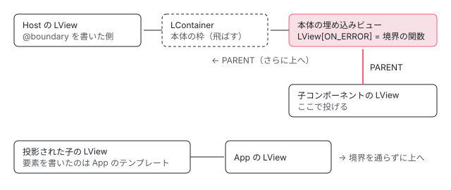

[目次](../README.md) › [ErrorHandler とエラーの行き先](README.md) › 第 4 回 / 全 6 回

# @boundary の実行時：ɵɵboundaryUpdate と ON\_ERROR

> v22.2 で入ったエラーの境界の実行時（f6afb807c1e・54ed62d2405、main に入ったのは 2026-09-09）。boundary.ts の ɵɵboundaryUpdate が本体のビューの LView\[ON\_ERROR\] に置く関数で、更新のときのエラーを受けて本体を消し @error に切り替える行と、作るときのエラーを受ける自分の catch の違い、どの @error にも合わないときの BoundaryError、ErrorBoundaryWrappedError、境界に届かないエラー（リスナー・描画後・投影・公開 API の作るとき）。22.2.6 を Node で動かした記録で、場面ごとの HTML と ErrorHandler に届いたものを見る。

angular/angular · 読了 約 14 分 · 発展 · [サイトで読む（デモが動きます）](https://angular-deep-dive-cyan.vercel.app/chapter/err-boundary-runtime)

---

v22.2 で、テンプレートの一部を `@boundary { … } @error { … }` で囲むと、その中で投げられたエラーでアプリ全体を止めずに、`@error` の中身に切り替えられるようになりました（エラーの境界）。この章では、境界の実行時の命令 `ɵɵboundaryUpdate` が、内側のビューの `LView[ON_ERROR]` にハンドラを置き、そこへ届いたエラーで本体のビューを消して `@error` のビューを作るまでを、1 行ずつ追います。作るときのエラーと更新のときのエラーで通る道が違うこと、どのエラーが境界に届かないかも、22.2.6 を Node で動かした記録で確かめます。

読む対象は `packages/core/src/render3/instructions/boundary.ts`（全部）、`packages/core/src/error_handler.ts` のうち `ErrorDetails`・`onViewError`・`ErrorBoundaryWrappedError`、`linker/view_container_ref.ts` と `render3/component.ts` の `onError`、確かめる spec は `packages/core/test/render3/error_boundary_spec.ts` です。テンプレートの `@boundary` がどんな命令の呼び出しにコンパイルされるかは[第 5 回](05-err-boundary-compile.md)、ErrorHandler そのものは[第 1 回](01-err-handler-core.md)で扱います。

1. [1. ErrorHandler と内部の入口](01-err-handler-core.md)
2. [2. エラーを捕まえる場所の地図](02-err-where-caught.md)
3. [3. ブラウザの全体のエラー](03-err-global-listeners.md)
4. **4. @boundary の実行時**（この章）
5. [5. @boundary のコンパイル](05-err-boundary-compile.md)
6. [6. spec と issue](06-err-tests-issues.md)

## 1. コミットを読む：f6afb807c1e と 54ed62d2405

境界は PR #70463（Alex Rickabaugh さん）の 4 つのコミットで入りました。`git show --stat` で、実行時に関係する部分を並べます。

| コミット（日付） | 題 | 実行時に関係する差分 |
| --- | --- | --- |
| f6afb807c1e（2026-03-17） | feat(core): add ErrorBoundary programmatic APIs | `interfaces/view.ts` に `ON_ERROR = 27` を足し `HEADER_OFFSET` を 28 に。`refreshView` の catch に「`ON_ERROR` を持つ先祖を探す」処理。`ViewContainerRef.createEmbeddedView`・`createComponent` と `createComponent()` の `onError`。`error_handler.ts` に 78 行（`ErrorDetails`・`onViewError`・`encapsulateBoundaryError`・`ErrorBoundaryWrappedError`）。`boundary.ts` を新規に 206 行。spec を新規に 1069 行。 |
| 54ed62d2405（2026-03-17） | refactor(core): implement `@boundary` runtime primitives and AST nodes | `ɵɵboundaryCreate`・`ɵɵboundaryUpdate`・`ɵɵgetBoundary` を JIT の環境と公開の私的な出口に足す。`@error` の文脈の `$retry` を `$reset` に改名。どの `@error` にも合わないときに、`boundary.error !== null` を確かめずに必ず `BoundaryError` を投げる形に変更。`isErrorLike` を resource.ts から error\_handler.ts に移す。コンパイラの側（[第 5 回](05-err-boundary-compile.md)）も同じコミット。 |
| 25228d0cc3c（2026-09-09） | test: fix failing boundary test | spec の 1066 行目の `capturedDetails.boundary!.retry` を `reset` に（改名に spec が追いついていなかった）。compiler-cli の boundary\_spec.ts から重複していた it を 95 行消す。 |

表の日付は書いた日（author date）です。#70463 の 4 つのコミットが main に入ったのは、どれも 2026-09-09（committer date）で、最初のタグは同じ日の v22.2.0-next.6、安定版は 2026-09-23 の v22.2.0 です。読んでいる 22.2.0-next.7（8576f161ae4）にはこの 3 つ（と第 5 回の f7597cb7d93・f4a5650ed9c）が入っています。その後に入った直しは 9 節で並べます。

## 2. 公開 API：ErrorDetails と onViewError

同じ f6afb807c1e で、error\_handler.ts に 2 つの公開 API が入りました。中身は[第 1 回](01-err-handler-core.md)で引用して読みます。この章で使うのは次の点だけです。

- `ErrorDetails`（`@developerPreview 22.2`）は、境界やビューの `onError` がエラーと一緒に渡す付帯の情報で、`declarationType`・`declarationInstance`（エラーが起きたコンポーネントかディレクティブ）、`boundary`（テンプレートの `@boundary` が受けたときだけ。`type` は境界を書いたコンポーネント、`reset` はやり直しの関数）、`caughtBy`（受けた関数）を持ちます。
- `ErrorHandler` に、省略できる `onViewError?(error, details)` が足されました。既定の `ErrorHandler` は持っていないので、境界は 6 節で、無ければ `handleError` に回します。

どの値が実際に入るかは、通った道で変わります（6・7 節と 11 節の記録）。

## 3. ビューに onError を付ける公開 API

テンプレートの `@boundary` の前に、同じ仕組みを手で使う入口が 2 つあります。

📄 `angular/packages/core/src/linker/view_container_ref.ts` L182–199 （▶ の行: 186–187, 197）

```ts
182 │    * @param options Extra configuration for the created view. Includes:
183 │    *  * index: The 0-based index at which to insert the new view into this container.
184 │    *           If not specified, appends the new view as the last entry.
185 │    *  * injector: Injector to be used within the embedded view.
186 ▶    *  * onError: A callback that will be invoked when an error occurs during the view's change detection or lifecycle hooks.
187 ▶    *             Note that this will not catch errors thrown during the view's creation.
188 │    *
189 │    * @returns The `ViewRef` instance for the newly created view.
190 │    */
191 │   abstract createEmbeddedView<C>(
192 │     templateRef: TemplateRef<C>,
193 │     context?: C,
194 │     options?: {
195 │       index?: number;
196 │       injector?: Injector;
197 ▶       onError?: (error: Error, details: ErrorDetails) => void;
198 │     },
199 │   ): EmbeddedViewRef<C>;
```

📄 `angular/packages/core/src/linker/view_container_ref.ts` L392–410 （▶ の行: 394, 401, 405, 410）

```ts
392 │     let index: number | undefined;
393 │     let injector: Injector | undefined;
394 ▶     let onError: ((error: Error, context: ErrorDetails) => void) | undefined;
395 │ 
396 │     if (typeof indexOrOptions === 'number') {
397 │       index = indexOrOptions;
398 │     } else if (indexOrOptions != null) {
399 │       index = indexOrOptions.index;
400 │       injector = indexOrOptions.injector;
401 ▶       onError = indexOrOptions.onError;
402 │     }
403 │ 
404 │     const dehydratedView = findMatchingDehydratedView(this._lContainer, templateRef.ssrId);
405 ▶     const viewRef = templateRef.createEmbeddedViewImpl(
406 │       context || <any>{},
407 │       injector,
408 │       dehydratedView,
409 │     );
410 ▶     if (onError) {
```

📄 `angular/packages/core/src/render3/component.ts` L106–117 （▶ の行: 112–114）

```ts
106 │     elementInjector,
107 │     options.projectableNodes,
108 │     options.hostElement,
109 │     options.environmentInjector,
110 │     options.directives,
111 │     options.bindings,
112 ▶   );
113 ▶   if (options.onError) {
114 ▶     (componentRef.hostView as R3ViewRef<any>)._lView![ON_ERROR] = options.onError;
115 │   }
116 │   return componentRef;
117 │ }
```

1. **view\_container\_ref.ts 401 行目 → 405 行目 → 410 行目**

   `createEmbeddedView` は options から `onError` を取り出し（401 行目）、405 行目でビューを作り終えた**あと**、410 行目の `if` の中で、その `LView` の `ON_ERROR` の枠に関数を置きます。`ViewContainerRef.createComponent` も同じ形です（ホストのビューの `ON_ERROR` に置く）。
2. **component.ts 112 行目 → 113〜114 行目**

   公開関数の `createComponent()` も、`factory.create(…)` の呼び出し（112 行目で閉じる。この中でコンポーネントの constructor が走る）が終わってから 114 行目で置きます。
3. **だから作るときのエラーは受けない**

   186〜187 行目の説明（「ビューを作るときに投げられたエラーは捕まえない」）は、この順番のことです。ビューの `ON_ERROR` を読むのは 4 節の `refreshView` の catch だけで、そこに来るのは変更検知（更新）とライフサイクルのフックのエラーです。テンプレートの `@boundary` は、作るときのエラーを自分の try / catch で受けます（7 節）。

## 4. エラーが ON\_ERROR を探して上る道

変更検知の中で投げられたエラーは、`refreshView` の catch で受けられます。この catch の中身は[cd-refresh-view の 10 節](../cd/03-cd-refresh-view.md)で 1 行ずつ読んでいます。要点は、投げたビューから `PARENT` を上へたどり（`LContainer` は飛ばす）、`ON_ERROR` を持つ最初の `LView` でその関数を `encapsulateBoundaryError(エラー)` と `{ declarationInstance, declarationType, caughtBy }` で呼び、呼べたら投げ直さない、関数自体が投げたらそのエラーでさらに上へ、誰もいなければ投げ直す、の 3 つです。



*ON\_ERROR を探して PARENT をたどる。投影された子は、境界の中に表示されていても、たどる道に境界が無い*

コンポーネントの `LView` の `PARENT` は、そのホスト要素を**書いた**テンプレートの `LView` です。`<ng-content>` で境界の中に表示される子は、要素を書いたのが外側のテンプレートなので、たどる道に境界がありません。spec がこれを「支えない」こととして固めています。

📄 `angular/packages/core/test/render3/error_boundary_spec.ts` L340–376 （▶ の行: 340, 354–355, 366–367, 375）

```ts
340 ▶   it('does not support catching errors from projected content', () => {
341 │     @Component({
342 │       selector: 'throws-error',
343 │       template: '<div>Throws</div>',
344 │     })
345 │     class ThrowsError {
346 │       ngOnInit() {
347 │         throw new Error('Projected Error');
348 │       }
349 │     }
350 │ 
351 │     @Component({
352 │       selector: 'wrapper',
353 │       template: `
354 ▶         @boundary {
355 ▶           <ng-content></ng-content>
356 │         } @error {
357 │           <div id="fallback">Fallback</div>
358 │         }
359 │       `,
360 │     })
361 │     class Wrapper {}
362 │ 
363 │     @Component({
364 │       selector: 'app',
365 │       template: `
366 ▶         <wrapper>
367 ▶           <throws-error></throws-error>
368 │         </wrapper>
369 │       `,
370 │       imports: [Wrapper, ThrowsError],
371 │     })
372 │     class App {}
373 │ 
374 │     const fixture = TestBed.createComponent(App);
375 ▶     expect(() => fixture.detectChanges()).toThrow();
376 │   });
```

354〜355 行目、`Wrapper` は `@boundary` の中に `<ng-content>` を置き、366〜367 行目で `App` が `<throws-error>` を投影します。375 行目、`detectChanges()` は投げます。`ThrowsError` の `ngOnInit` は `App` のビューの更新で呼ばれ、そこから上は `App` → ルートで、`Wrapper` の本体のビューを通りません。

## 5. 境界の状態：LBoundary と ɵɵboundaryCreate

📄 `angular/packages/core/src/render3/instructions/boundary.ts` L33–74 （▶ の行: 38, 41, 48–49, 51, 53–55, 62, 65, 71, 73）

```ts
33 │ /**
34 │  * Error thrown when an error falls through an @boundary without matching any @error block.
35 │  *
36 │  * @publicApi 22.2
37 │  */
38 ▶ export class BoundaryError extends Error {
39 │   constructor(message: string, options?: {cause?: unknown}) {
40 │     super(message, options);
41 ▶     this.name = 'BoundaryError';
42 │   }
43 │ }
44 │ 
45 │ /**
46 │  * State object representing an @boundary block, allocated in the LView data array.
47 │  */
48 ▶ export class LBoundary {
49 ▶   error: any = null;
50 │ 
51 ▶   constructor(private hostLView: LView) {}
52 │ 
53 ▶   reset() {
54 ▶     this.error = null;
55 ▶     markViewForRefresh(this.hostLView);
56 │   }
57 │ }
58 │ 
59 │ /**
60 │  * Creates an LBoundary state object in the current LView.
61 │  */
62 ▶ export function ɵɵboundaryCreate(index: number) {
63 │   performanceMarkFeature('NgBoundary');
64 │   const lView = getLView();
65 ▶   lView[HEADER_OFFSET + index] = new LBoundary(lView);
66 │ }
67 │ 
68 │ /**
69 │  * Retrieves the LBoundary state object from the current LView.
70 │  */
71 ▶ export function ɵɵgetBoundary(index: number): LBoundary {
72 │   const lView = getLView();
73 ▶   return lView[HEADER_OFFSET + index] as LBoundary;
74 │ }
```

1. **48〜57 行目 LBoundary**

   境界 1 つにつき 1 個の状態です。49 行目の `error` は受けたエラー（無ければ `null`）、51 行目の `hostLView` は境界を書いたテンプレートの `LView`。53〜56 行目の `reset()` は `error` を `null` に戻し、ホストに `markViewForRefresh` を付けるだけです。ビューを作り直すのは、次の更新で走る `ɵɵboundaryUpdate` です。
2. **62〜66 行目 ɵɵboundaryCreate（作るときの命令）**

   65 行目で、テンプレートの枠 `HEADER_OFFSET + index` に `LBoundary` を入れます。要素や `LContainer` ではなく、ただのオブジェクトが LView の枠に入ります。
3. **71〜74 行目 ɵɵgetBoundary**

   更新の命令の中で、同じ枠から `LBoundary` を読みます。73 行目は**いまの `getLView()`**の枠を読むので、呼ぶのは境界を書いたテンプレートの関数の中でなければなりません（第 5 回の 4 節で、別のビューから呼ばれてしまう形を見ます）。
4. **38〜43 行目 BoundaryError**

   どの `@error` にも合わなかったときに投げるクラスです（8 節）。41 行目で `name` を `'BoundaryError'` にします。

## 6. ɵɵboundaryUpdate：どの塊を出すかを切り替える

更新のときの命令です。引数は、状態の枠、出す塊の枠、本体の塊の枠の 3 つです。2 つ目はコンパイラが `bnd.error === null ? 本体 : （when の連なり）` の式で作ります（[第 5 回](05-err-boundary-compile.md)）。

📄 `angular/packages/core/src/render3/instructions/boundary.ts` L84–127 （▶ の行: 85–87, 90–92, 99–100, 102–103, 106, 111, 119, 121–124）

```ts
 84 │ export function ɵɵboundaryUpdate(
 85 ▶   slotIndex: number,
 86 ▶   matchingTemplateIndex: number,
 87 ▶   primaryTemplateIndex: number,
 88 │ ) {
 89 │   const hostLView = getLView();
 90 ▶   const bindingIndex = nextBindingIndex();
 91 ▶   const prevMatchingTemplateIndex: number =
 92 ▶     hostLView[bindingIndex] !== NO_CHANGE ? hostLView[bindingIndex] : -1;
 93 │   const prevContainer =
 94 │     prevMatchingTemplateIndex !== -1
 95 │       ? getLContainer(hostLView, HEADER_OFFSET + prevMatchingTemplateIndex)
 96 │       : undefined;
 97 │   const viewInContainerIdx = 0;
 98 │ 
 99 ▶   if (bindingUpdated(hostLView, bindingIndex, matchingTemplateIndex)) {
100 ▶     const prevConsumer = setActiveConsumer(null);
101 │     try {
102 ▶       if (prevContainer !== undefined) {
103 ▶         removeLViewFromLContainer(prevContainer, viewInContainerIdx);
104 │       }
105 │ 
106 ▶       if (matchingTemplateIndex !== -1) {
107 │         const nextLContainerIndex = HEADER_OFFSET + matchingTemplateIndex;
108 │         const nextContainer = getLContainer(hostLView, nextLContainerIndex);
109 │         const templateTNode = getExistingTNode(hostLView[TVIEW], nextLContainerIndex);
110 │ 
111 ▶         const dehydratedView = findAndReconcileMatchingDehydratedViews(
112 │           nextContainer,
113 │           templateTNode,
114 │           hostLView,
115 │         );
116 │ 
117 │         let embeddedLView: LView<any> | undefined;
118 │         try {
119 ▶           const boundary = hostLView[HEADER_OFFSET + slotIndex] as LBoundary;
120 │           const context =
121 ▶             matchingTemplateIndex === primaryTemplateIndex
122 ▶               ? undefined
123 ▶               : {$error: boundary.error, $reset: () => boundary.reset()};
124 ▶           embeddedLView = createAndRenderEmbeddedLView(hostLView, templateTNode, context, {
125 │             dehydratedView,
126 │           });
127 │ 
```

1. **90〜92 行目 前回の塊を覚えている枠**

   バインディングの枠を 1 つ使い、前回出した塊の番号を入れておきます。最初は `NO_CHANGE` なので `-1`。
2. **99 行目 番号が変わったときだけ**

   `bindingUpdated` が false なら何もしません。エラーが起きていない更新では、ここで終わります。
3. **100 行目 signal の依存を取らない**

   ビューを作る間に読んだ signal が、ホストのテンプレートの依存にならないよう、アクティブな consumer を外します（205 行目で戻す）。
4. **102〜104 行目 前の塊を消す**

   前回の塊の `LContainer` から、0 番目のビューを外して壊します。
5. **119〜126 行目 次の塊を作る**

   121〜123 行目、本体なら文脈は `undefined`、`@error` なら `{$error: boundary.error, $reset: () => boundary.reset()}` です。テンプレートの `$error` と `$reset` は、この文脈のプロパティを読みます。124 行目の `createAndRenderEmbeddedLView` がビューを作り、作るときのテンプレート関数を走らせます。

### 本体のビューの ON\_ERROR

📄 `angular/packages/core/src/render3/instructions/boundary.ts` L128–155 （▶ の行: 128–129, 131, 133, 137–139, 142–143, 145, 150, 153）

```ts
128 ▶           if (matchingTemplateIndex === primaryTemplateIndex) {
129 ▶             embeddedLView[ON_ERROR] = (error: Error, details: ErrorDetails) => {
130 │               const boundary = hostLView[HEADER_OFFSET + slotIndex] as LBoundary;
131 ▶               boundary.error = error;
132 │ 
133 ▶               const errorHandler = hostLView[INJECTOR]?.get(ErrorHandler, null);
134 │               if (errorHandler) {
135 │                 const boundaryComponentView = hostLView[DECLARATION_COMPONENT_VIEW][CONTEXT] as any;
136 │                 const boundaryType: Type<unknown> = boundaryComponentView.constructor;
137 ▶                 (details as Writable<ErrorDetails>).boundary = {
138 ▶                   type: boundaryType,
139 ▶                   reset: () => boundary.reset(),
140 │                 };
141 │ 
142 ▶                 if (errorHandler.onViewError) {
143 ▶                   errorHandler.onViewError(error, details);
144 │                 } else {
145 ▶                   errorHandler.handleError(error);
146 │                 }
147 │               }
148 │ 
149 │               // Immediately destroy the primary view
150 ▶               removeLViewFromLContainer(nextContainer, viewInContainerIdx);
151 │ 
152 │               // Trigger a targeted change detection pass on the host to run the @error block
153 ▶               markViewForRefresh(hostLView);
154 │             };
155 │           }
```

1. **128〜129 行目 本体のときだけ**

   作り終えた本体のビューの `ON_ERROR` に、この関数を置きます。`@error` のビューには置きません。
2. **131 行目 エラーを覚える**

   ここに来るのは 4 節の catch からなので、`error` はすでに `encapsulateBoundaryError` を通っています（Error でないものは `ErrorBoundaryWrappedError` に包まれている）。
3. **133 行目 ErrorHandler を直接取る**

   ホストのビューのインジェクタから `ErrorHandler` を取ります。[第 1 回](01-err-handler-core.md)の `INTERNAL_APPLICATION_ERROR_HANDLER` は通りません。だから TestBed の投げ直し（[testing-errors](../testing/12-testing-errors.md)）も、zone の外で走らせる処理も、ここには掛かりません。境界が受けたエラーで、テストは失敗しません。
4. **137〜140 行目 boundary を足す**

   4 節の catch が作った `details`（`declarationInstance`・`declarationType`・`caughtBy`）に、境界を書いたコンポーネントの型と `reset` を書き足します。
5. **142〜146 行目 onViewError か handleError**

   `onViewError` があればそちらに `details` つきで、無ければ `handleError(error)` に渡します。
6. **150 行目 → 153 行目 本体を消して、ホストをもう一度**

   本体のビューをすぐに外して壊し、ホストに `markViewForRefresh` を付けます。この関数は**投げずに戻る**ので、4 節の catch は「処理済み」として先へ進みます。付けた印で、同じ tick の中でホストの更新がもう一度走り（[cd-detect-changes-in-view](../cd/02-cd-detect-changes-in-view.md) の「dirty の間は繰り返す」）、今度は `bnd.error` が `null` でないので別の番号になり、99 行目を通って `@error` のビューが作られます。

## 7. 作るときのエラー：自分の catch

📄 `angular/packages/core/src/render3/instructions/boundary.ts` L156–190 （▶ の行: 156–157, 159, 161, 163–169, 174, 181, 186, 189）

```ts
156 ▶         } catch (e) {
157 ▶           if (matchingTemplateIndex === primaryTemplateIndex) {
158 │             const boundary = hostLView[HEADER_OFFSET + slotIndex] as LBoundary;
159 ▶             boundary.error = e;
160 │ 
161 ▶             const errorHandler = hostLView[INJECTOR]?.get(ErrorHandler, null);
162 │             if (errorHandler) {
163 ▶               const boundaryError = encapsulateBoundaryError(e);
164 ▶               const declarationInstance = hostLView[DECLARATION_COMPONENT_VIEW][CONTEXT];
165 ▶               const declarationType = (declarationInstance as any).constructor;
166 ▶               const details: ErrorDetails = {
167 ▶                 declarationInstance,
168 ▶                 declarationType,
169 ▶                 boundary: {
170 │                   type: declarationType,
171 │                   reset: () => boundary.reset(),
172 │                 },
173 │               };
174 ▶               if (errorHandler.onViewError) {
175 │                 errorHandler.onViewError(boundaryError, details);
176 │               } else {
177 │                 errorHandler.handleError(boundaryError);
178 │               }
179 │             }
180 │ 
181 ▶             markViewForRefresh(hostLView);
182 │ 
183 │             // If the view threw during creation, we do not add it to the DOM.
184 │             // We swallow the error so that the host can finish its current change detection cycle
185 │             // and later re-evaluate the boundary switch statement to render the @error block.
186 ▶             return;
187 │           }
188 │           // If we caught an error inside an @error block, rethrow it to let it bubble naturally.
189 ▶           throw e;
190 │         }
```

1. **156〜157 行目 本体を作る途中で投げた**

   124 行目の `createAndRenderEmbeddedLView` の中（本体のテンプレートの作るときの関数、その中の子コンポーネントの constructor、子のテンプレートの作るとき）で投げたものです。`ON_ERROR` はまだ置かれていない（129 行目は 124 行目のあと）ので、4 節の道は通りません。
2. **159 行目 エラーをそのまま覚える**

   ここでは `encapsulateBoundaryError` を通さずに、投げられた値をそのまま `boundary.error` に入れます。これが `@error` の中の `$error` になります（6 節の 123 行目）。
3. **163〜173 行目 ErrorHandler に渡すもの**

   ErrorHandler には 163 行目で包んだ `boundaryError` を渡します。`details` は 164〜173 行目でここで作り、`declarationInstance` と `declarationType` は**ホスト**（境界を書いたコンポーネント）です。`caughtBy` はありません。
4. **181 行目 → 186 行目 ビューを足さずに戻る**

   ホストに印を付け、作りかけのビューは `LContainer` に足さずに戻ります（183〜185 行目のコメント）。ホストはこの更新を最後まで進め、次の回で `@error` を出します。
5. **188〜189 行目 @error を作る途中で投げたら**

   投げ直します。そのエラーはホストのビューの更新から出ていくので、ホストより上に別の境界があればそこが受けます（spec の「nested boundaries and fallback cascading」:378）。

> [!WARNING]
> **ハマりどころ**
>
> 159 行目と 131 行目の違いは、記録（10 節の DEMO の「作るときに文字列を投げる」「更新のときに文字列を投げる」）で見えます。子の constructor が文字列を投げると、`@error` の `$error` は `typeof` が `string` の文字列そのもの、ErrorHandler に届くのは `ErrorBoundaryWrappedError` です。同じ文字列を更新のときに投げると、`$error` も `ErrorBoundaryWrappedError` になります。型チェックは `$error` を `Error` として扱います（[typecheck-control-flow](../typecheck/13-typecheck-control-flow.md) の 7 節）。
>
> もう 1 つ、記録の「作る途中で失敗（先に作られた兄弟がある）」では、先に作られた兄弟のコンポーネントの `DestroyRef.onDestroy` が、アプリを destroy したあとも呼ばれませんでした。作りかけのビューは 186 行目で捨てられるだけで、壊す処理を通らないからです。`@boundary` を使わない `@if` で同じことをしても同じでした（比べたスクリプトは DEMO の下に載せます）。

## 8. どの @error にも合わないとき：BoundaryError

📄 `angular/packages/core/src/render3/instructions/boundary.ts` L191–208 （▶ の行: 192–194, 196, 198–201, 205）

```ts
191 │ 
192 ▶         addLViewToLContainer(
193 ▶           nextContainer,
194 ▶           embeddedLView,
195 │           viewInContainerIdx,
196 ▶           shouldAddViewToDom(templateTNode, dehydratedView),
197 │         );
198 ▶       } else {
199 ▶         const boundary = hostLView[HEADER_OFFSET + slotIndex] as LBoundary;
200 ▶         throw new BoundaryError('Unhandled error in @boundary fell through.', {
201 ▶           cause: boundary.error,
202 │         });
203 │       }
204 │     } finally {
205 ▶       setActiveConsumer(prevConsumer);
206 │     }
207 │   }
208 │ }
```

1. **192〜197 行目 できたビューを足す**

   作るときに投げなかったら、ビューを `LContainer` の 0 番目に足します（DOM に入れるかはハイドレーションの都合で 196 行目が決める）。
2. **198〜202 行目 番号が -1**

   `@error` がどれも `when` つきで、どれにも合わないと、コンパイラの式は `-1` になります（`@error` が 1 つも無いときも同じ）。すると 200 行目で、受けたエラーを `cause` にした `BoundaryError` を投げます。54ed62d2405 より前は `boundary.error !== null` のときだけ投げる形でした。
3. **投げたものはどこへ行くか**

   この命令はホストのテンプレートの更新の中で走っているので、ホストの `refreshView` の catch に入り、4 節の道でホストより上を探します。外側に境界があればそこの `@error` に、無ければ変更検知を回したスケジューラの catch から ErrorHandler の `handleError` に届きます（[第 2 回](02-err-where-caught.md)）。記録では、どちらの場合も「内側の境界の `onViewError`（元のエラー）」と「`BoundaryError`」の 2 回、ErrorHandler に届きました。

## 9. ErrorBoundaryWrappedError と、そのあとの直し

📄 `angular/packages/core/src/error_handler.ts` L125–141 （▶ の行: 131, 133–137, 139）

```ts
125 │ 
126 │ /**
127 │  * Error thrown when an error boundary catches an error that is not an `Error` instance.
128 │  *
129 │  * @publicApi 22.2
130 │  */
131 ▶ export class ErrorBoundaryWrappedError extends Error {
132 │   constructor(error: unknown) {
133 ▶     super(
134 ▶       typeof ngDevMode !== 'undefined' && ngDevMode
135 ▶         ? `Error boundary caught an error that's not an Error instance: ${String(error)}. Check this error's .cause for the actual error.`
136 ▶         : String(error),
137 ▶       {cause: error},
138 │     );
139 ▶     this.name = 'ErrorBoundaryWrappedError';
140 │   }
141 │ }
```

Error でないもの（文字列など）を包むクラスで、137 行目で元の値を `cause` に入れます。134〜136 行目、開発モードのときだけ長いメッセージにします。これを返す `encapsulateBoundaryError` と、判定の `isErrorLike`（error\_handler.ts の、この引用のすぐ上）は、resource の `encapsulateResourceError` と同じ形で、[resx-errors](../resx/03-resx-errors.md) で読んでいます。

読んでいる版のあと、angular-main（74961c66242）と npm の 22.2.6 に入った直しです。DEMO の記録は 22.2.6 で取っています。

| コミット | 何を直したか | 22.2.6 に |
| --- | --- | --- |
| 04ce74197a6（#70673） | HMR で作り直したビューに最初の `RefreshView` の印が残っていて、7 節の 181 行目の `markViewForRefresh` が「もう印がある」として何もせず、`@error` が出なかった。render3/hmr.ts で更新の前に印を消す | angular-main のみ（HMR は開発サーバーの機能） |
| 3be586f930d（#71199） | 4 節の catch が、失敗したビューの reactive な文脈のまま `onError` を呼んでいて、`onViewError` の中で signal に書くと NG0600 になった。catch の中身を `handleViewError` に出し、`setActiveConsumer(null)` で呼ぶ | 入っている |
| ea43e6c3934 | targeted な変更検知（`RefreshView` の印が無く、子だけを回す道）で、ビューの effect のエラーが境界に届かなかった。その道の `runEffectsInView` を try で包んで `handleViewError` へ | 入っている |
| 5f511541978（#71885、22.3.x） | `$reset` と `details.boundary.reset` の矢印関数が、`nextContainer` や `embeddedLView` と同じクロージャを持って、それらを離さなかった。`createBoundaryResetFn` に出す | 入っている |

## 10. 境界に届かないエラー

DEMO の記録から、境界が**切り替わらなかった**ものを抜き出します。

| 投げた場所 | ErrorHandler に届いたもの | 理由 |
| --- | --- | --- |
| 境界の中のボタンの `(click)` のハンドラ | `handleError`（`onViewError` ではない）。本体はそのまま | リスナーのエラーは `handleUncaughtError` から `INTERNAL_APPLICATION_ERROR_HANDLER` へ（[第 2 回](02-err-where-caught.md)）。`ON_ERROR` を見ない |
| 子の `afterNextRender` | `handleError`。本体はそのまま | 描画後のフックは `refreshView` の外の `AfterRenderManager` が回す |
| 投影された子の `ngOnInit` | なし。最初の `appRef.tick()` から投げられた | 4 節の図。たどる道に境界が無い |
| 公開 API の `createComponent(…, {onError})` で作るコンポーネントの constructor | なし。`createComponent` が投げた | 3 節。`ON_ERROR` を置くのは作ったあと |
| `@error` の中のバインディング | （記録には無い。spec の :647 が、ErrorHandler の `handleError` に届くことを見ている） | `@error` のビューには `ON_ERROR` が無く、ホストより上へ |

> [!NOTE]
> **さらに深く**
>
> **Router のエラーの境界**：issue #72027（2026-11-13、開いている）の題の「Router error boundaries」は、2026-11-10 の 262417f1555「feat(router): introduce route error boundaries and redirect handling」（v22.3.0-rc.0）のことです。読んでいる版にも angular-main にも入っていないので、`git show 262417f1555:packages/router/src/directives/router_outlet.ts` で読みました。`RouterOutlet` の `activateComponent` は、3 節の `ViewContainerRef.createComponent` に `onError` を渡し、constructor のエラーは `activateWith` の try / catch で自分で受けて同じ関数に渡します。3 節の「作るときは受けない」を、外側の try / catch で埋める形です。#72027 は、その関数（router\_error\_boundary.ts の `triggerRedirectIfCommand`）が `RedirectCommand` の実体に印を付けて消さないので、同じ実体を 2 回目に投げるとリダイレクトしない、という報告です。

## 11. DEMO：22.2.6 の境界を Node で動かした記録

> **🧪 DEMO — @boundary の切り替わり（記録の再生）**
>
> これは記録です。@angular/core 22.2.6 / Node v24.22.1 で、domino の DOM の上に `createApplication` で場面ごとに別のアプリを作り、`@boundary` を使うコンポーネントを JIT でコンパイルして描きました。HTML はホストの `innerHTML` からコメントを除いたもの、「届いたもの」は自作の ErrorHandler（`handleError` と `onViewError` を持つ）の記録です。このサイトの 22.1.6 には `@boundary` が無いので、ブラウザでは何も動かしません。
>
> ▶ [このデモはサイトで動かせます](https://angular-deep-dive-cyan.vercel.app/chapter/err-boundary-runtime)

記録から読み取れることを表にします（本番ビルドで再生し、場面を全部選んで最後まで進め、コンソールのエラーは 0 件でした）。

| 場面 | HTML の変わり方 | ErrorHandler | 本文 |
| --- | --- | --- | --- |
| 更新のときにバインディングが投げる | 本体 → `Error: バインディングで失敗` | `onViewError` 1 回。caughtBy あり | 6 節 |
| 子の constructor が投げる | 最初から `@error` | `onViewError` 1 回。declarationType はホスト、caughtBy なし | 7 節 |
| 作るとき / 更新のときに文字列を投げる | `$error` の typeof が `string` / `object` | どちらも `ErrorBoundaryWrappedError` | 7 節の注意 |
| `$reset` | 原因を直さずに押すと、もう一度 `@error`（もう一度届く）。直してから押すと本体 | 直さずに押した回にもう 1 回 | 5 節の 53〜56 行目 |
| `when` で選ぶ / どれにも合わない | 合う塊 / 空になる | 合わないときは `onViewError` と `handleError(BoundaryError)` | 8 節 |
| 入れ子で内側が合わない | 外側の `@error` に `BoundaryError / cause = 内側で失敗` | `onViewError` 2 回 | 8 節 |
| 子の effect が投げる | 最初の tick で `@error` | `onViewError` 1 回 | 9 節の表 |

## 12. 呼び出しの連なり（更新のときのエラー）

- `ApplicationRef.tick()` — スケジューラから
  - `refreshView(Host)` — change\_detection.ts — *テンプレートの更新で `ɵɵboundaryUpdate`（番号は変わらず 99 行目で終わり）*
    - `refreshView(本体の埋め込みビュー)` — detectChangesInEmbeddedViews から
      - 👤 `value()` が throw — あなたのバインディング
    - `catch`：PARENT をたどり `ON_ERROR` を見つける — change\_detection.ts（cd-refresh-view の 10 節） — *encapsulateBoundaryError で包む*
      - `ON_ERROR(error, details)` — boundary.ts L129
        - 👤 `ErrorHandler.onViewError(error, details)` — あなたの ErrorHandler — *L133-L146（INTERNAL\_APPLICATION\_ERROR\_HANDLER を通らない）*
        - `removeLViewFromLContainer` → `markViewForRefresh(Host)` — boundary.ts L150・L153
  - `refreshView(Host)`（もう一度） — 同じ tick の中
    - `ɵɵboundaryUpdate(slot, @error の番号, 本体の番号)` — boundary.ts L84 — *L99 で番号が変わり、L124 で @error のビューを作る（文脈は L123）*

## テストと直し方

spec は `packages/core/test/render3/error_boundary_spec.ts` の 2 つの describe です。`describe('Error Boundary Runtime Interception')`（:23、it 12 本）が 3 節の公開 API と、テンプレートを使う入れ子・`@defer`・`@for`・投影、`describe('@boundary runtime instructions (JIT)')`（:515、it 14 本）が TestBed の JIT でテンプレートの `@boundary` を通します。

📄 `angular/packages/core/test/render3/error_boundary_spec.ts` L539–558 （▶ の行: 539, 543, 545–546, 556–557）

```ts
539 ▶   it('should intercept errors thrown during component constructor', () => {
540 │     @Component({
541 │       template: `
542 │         @boundary {
543 ▶           <throwing-ctor></throwing-ctor>
544 │           Main Content
545 ▶         } @error (let err) {
546 ▶           Error: {{err.message}}
547 │         }
548 │       `,
549 │       imports: [ThrowingCtor],
550 │     })
551 │     class Host {}
552 │ 
553 │     const fixture = TestBed.createComponent(Host);
554 │     fixture.detectChanges();
555 │ 
556 ▶     expect(fixture.nativeElement.textContent).toContain('Error: Ctor Error');
557 ▶     expect(fixture.nativeElement.textContent).not.toContain('Main Content');
558 │   });
```

`it('should intercept errors thrown during component constructor')`（:539）は 7 節の catch の道です。543 行目の子の constructor が投げ、556 行目で `@error` の `err.message` が出ることを見ています。ここで投げているのは `Error` なので、159 行目でそのまま入れても 131 行目と見分けがつきません。

📄 `angular/packages/core/test/render3/error_boundary_spec.ts` L137–171 （▶ の行: 137, 144–145, 161–162, 164, 168, 170）

```ts
137 ▶   it('should NOT intercept errors thrown during component constructor via createComponent', () => {
138 │     let interceptedError: Error | null = null;
139 │ 
140 │     @Component({
141 │       template: '...',
142 │     })
143 │     class ThrowingConstructorComponent {
144 ▶       constructor() {
145 ▶         throw new Error('Constructor Error');
146 │       }
147 │     }
148 │ 
149 │     @Component({
150 │       template: '<ng-container #vc></ng-container>',
151 │     })
152 │     class Host {
153 │       @ViewChild('vc', {read: ViewContainerRef, static: true}) vc!: ViewContainerRef;
154 │     }
155 │ 
156 │     const fixture = TestBed.createComponent(Host);
157 │     fixture.detectChanges();
158 │ 
159 │     const envInjector = TestBed.inject(EnvironmentInjector);
160 │ 
161 ▶     expect(() => {
162 ▶       fixture.componentInstance.vc.createComponent(ThrowingConstructorComponent, {
163 │         environmentInjector: envInjector,
164 ▶         onError: (e: Error) => {
165 │           interceptedError = e;
166 │         },
167 │       });
168 ▶     }).toThrowError('Constructor Error');
169 │ 
170 ▶     expect(interceptedError).toBeNull();
171 │   });
```

3 節の「作るときは受けない」を固めているのが `it('should NOT intercept errors thrown during component constructor via createComponent')`（:137）です。168 行目で `createComponent` が投げ、170 行目で `onError` が呼ばれていないことを見ています。

📄 `angular/packages/core/test/render3/error_boundary_spec.ts` L952–986 （▶ の行: 952, 966, 973, 985）

```ts
952 ▶   it('should fall through and rethrow if no @error block matches', async () => {
953 │     class ChartError extends Error {
954 │       constructor(message: string) {
955 │         super(message);
956 │         this.name = 'ChartError';
957 │       }
958 │     }
959 │ 
960 │     @Component({
961 │       template: `
962 │         @boundary {
963 │           @if (doThrow()) {
964 │             {{ throwError() }}
965 │           }
966 ▶         } @error (let err; when isChartError(err)) {
967 │           Chart Error: {{err.message}}
968 │         }
969 │       `,
970 │     })
971 │     class Host {
972 │       doThrow = signal(true);
973 ▶       errorToThrow: Error = new Error('Generic Failed');
974 │ 
975 │       throwError() {
976 │         throw this.errorToThrow;
977 │       }
978 │ 
979 │       isChartError(e: Error) {
980 │         return e instanceof ChartError;
981 │       }
982 │     }
983 │ 
984 │     const fixture = TestBed.createComponent(Host);
985 ▶     expect(() => fixture.detectChanges()).toThrowError(/Unhandled error in @boundary fell through/);
986 │   });
```

8 節の `BoundaryError` は `it('should fall through and rethrow if no @error block matches')`（:952）。985 行目は、最初の `detectChanges()` が投げることを見ています（TestBed の `detectChanges` は tick を直接呼ぶので、間に catch がありません）。

📄 `ターミナル`

```
cd ~/angular-research/angular
pnpm bazel test //packages/core/test/render3:render3 --nocache_test_results --test_output=all \
  "--test_arg=--filter=Error Boundary Runtime Interception|@boundary runtime instructions"
```

📄 `出力（抜粋。2026-11-15 に実行）`

```
INFO: Found 1 test target...
Ran 26 of 574 specs
26 specs, 0 failures
Finished in 0.146 seconds
Randomized with seed 75234 (jasmine --random=true --seed=75234)
//packages/core/test/render3:render3                                     PASSED in 1.0s

Executed 1 out of 1 test: 1 test passes.
```

1. **件数の読み方**

   12 + 14 = 26 本で、`Ran 26 of 574 specs` と合います。出力には既定の ErrorHandler の `ERROR Error: …` が混じります。境界が受けたエラーも 6 節の 145 行目で `handleError` に渡り、既定の実装が console に出すからです。
2. **直すとしたら**

   7 節の注意の 1 つ目は、boundary.ts の `ɵɵboundaryUpdate` の 159 行目で覚える値を 163 行目と同じ `encapsulateBoundaryError(e)` にすれば、131 行目と揃います。spec は `describe('@boundary runtime instructions (JIT)')` に、子の constructor が文字列を投げて `@error` の中で `$error` の型を見る it を足すのが入口です（いまある `it('should wrap non-Error exceptions …')`（:222）は公開 API の側だけ）。2 つ目（作りかけのビュー）は 186 行目で捨てる前に壊す処理が要る話で、`@if` の `ɵɵconditional` にも同じ形があります。
3. **issue を読むときの手がかり**

   「境界の中なのに `@error` にならない」は、10 節の表（リスナー・描画後・投影・作るときの公開 API）のどれかを先に疑います。「ErrorHandler に 2 回届く」は 8 節の、内側の `onViewError` と `BoundaryError` の 2 回です。

## 聞かれそうな質問

**Q. @boundary で受けたエラーは ErrorHandler に届きますか？**

届きます。更新のときは 133〜146 行目、作るときは 161〜178 行目で、ホストのインジェクタの `ErrorHandler` の `onViewError`（無ければ `handleError`）を呼びます。ただし `INTERNAL_APPLICATION_ERROR_HANDLER` を通らないので、TestBed の投げ直しは起きず、テストは失敗しません。

**Q. イベントのハンドラで投げたエラーも @error に切り替わりますか？**

切り替わりません。境界の印 `ON_ERROR` を読むのは `refreshView` の catch だけで（4 節）、リスナーのエラーは `handleUncaughtError` から ErrorHandler に行きます。記録の「イベントのリスナーが投げる」で、本体のまま `handleError` が 1 回呼ばれました。

**Q. $reset を押しても戻らないのはなぜですか？**

`reset()`（53〜56 行目）は `error` を消してホストを更新し直すだけなので、原因が残っていれば本体を作り直した直後にまた投げ、もう一度 `@error` になります。記録の `$reset` の場面の 3 手順目がそれで、ErrorHandler にももう一度届きます。原因の状態を直してから呼びます。

**Q. ErrorDetails の declarationType は、いつも投げたコンポーネントですか？**

更新のときは 4 節の catch が「投げたビューを書いたコンポーネント」を入れます。作るときは 164〜168 行目で境界のホストを入れるので、子の constructor が投げてもホストになります（記録の「子の constructor が投げる」で `HostB`）。`caughtBy` も作るときは付きません。

**Q. ng-content で境界の中に入れた子のエラーを受けられないのはなぜですか？**

子の `LView` の `PARENT` は、子の要素を書いた外側のテンプレートのビューで、境界の本体のビューではないからです（4 節の図）。spec の 340〜376 行目が、`detectChanges()` が投げることを期待値にしています。

## 読み終えて

- 境界の印は `LView[ON_ERROR]`。`ɵɵboundaryUpdate` が本体のビューを作ったあとに関数を置き（L129）、`refreshView` の catch が `PARENT` をたどってそれを呼ぶ。
- その関数は ErrorHandler に直接渡し（L133-L146）、本体を消して（L150）ホストに印を付ける（L153）。同じ tick の更新で `@error` のビューが文脈 `{$error, $reset}` で作られる（L123）。
- 作るときのエラーは自分の catch（L156-L190）。`$error` は包まない値、ErrorHandler には包んだ値、details はホスト。
- 合う `@error` が無ければ `BoundaryError`（L200）がホストの更新から外へ出て、外側の境界か ErrorHandler へ。
- リスナー・描画後のフック・投影された子・公開 API の作るときのエラーは、境界に届かない。

---

← 前: [ブラウザの全体のエラー：provideBrowserGlobalErrorListeners](03-err-global-listeners.md)  
次: [@boundary のコンパイル：字句解析から型チェックまで](05-err-boundary-compile.md) →
