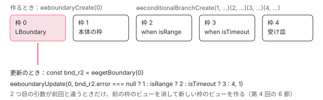

[目次](../README.md) › [ErrorHandler とエラーの行き先](README.md) › 第 5 回 / 全 6 回

# @boundary のコンパイル：字句解析から型チェックまで

> @boundary の塊が lexer と r3\_boundaries.ts の createBoundaryBlock で AST になり、テンプレートのパイプラインの ingest・boundary\_conditions・generate\_variables・resolve\_boundaries で ɵɵboundaryUpdate の式になるまで、型チェックの TCB（f7597cb7d93）と言語サービス（f4a5650ed9c）、書き方の誤りの診断。22.2.6 の compiler-cli で書き方を変えて出力と診断を比べ、22.1.6 のパーサの結果と並べる。

angular/angular · 読了 約 13 分 · 発展 · [サイトで読む（デモが動きます）](https://angular-deep-dive-cyan.vercel.app/chapter/err-boundary-compile)

---

[第 4 回](04-err-boundary-runtime.md)で読んだ `ɵɵboundaryUpdate(状態の枠, 出す塊の枠, 本体の枠)` の 2 つ目の引数は、コンパイラが作る式です。この章では、テンプレートの `@boundary { … } @error (let err; when 条件) { … }` が、パーサで `t.BoundaryBlock` になり、テンプレートのパイプラインで op になって、`bnd.error === null ? 本体 : 条件 ? … : …` の式を持つ命令の呼び出しになるまでを、phase ごとに追います。型チェック（TCB）と言語サービスの対応、書き方の誤りの診断も並べ、22.2.6 の compiler-cli でコンパイルした記録で確かめます。

読む対象は `packages/compiler/src/render3/` の `r3_boundaries.ts`・`r3_ast.ts`・`r3_template_transform.ts`、`template/pipeline/src/` の `ingest.ts`・`phases/boundary_conditions.ts`・`phases/generate_variables.ts`・`phases/resolve_boundaries.ts`・`phases/reify.ts`・`instruction.ts`、`typecheck/ops/boundary.ts`、言語サービスの `document_symbols.ts`・`template_target.ts` です。パイプライン全体の流れは[compiler-control-flow-phases](../compiler/15-compiler-control-flow-phases.md)（`@if` などの phase）にあり、ここでは `@boundary` の分だけを読みます。

1. [1. ErrorHandler と内部の入口](01-err-handler-core.md)
2. [2. エラーを捕まえる場所の地図](02-err-where-caught.md)
3. [3. ブラウザの全体のエラー](03-err-global-listeners.md)
4. [4. @boundary の実行時](04-err-boundary-runtime.md)
5. **5. @boundary のコンパイル**（この章）
6. [6. spec と issue](06-err-tests-issues.md)

## 1. コミットを読む

| コミット（日付） | コンパイラの側の差分 |
| --- | --- |
| 54ed62d2405（2026-03-17、#70463） | `packages/compiler/src` の 26 ファイルで +959 / −101。lexer.ts は 1 行（`'@boundary'`）、r3\_ast.ts に 2 つのノード、r3\_boundaries.ts を新規に 168 行、r3\_control\_flow.ts の `parseLetParameter` を util.ts の `parseLetParameters` に出して `@for` と `@error` で共有、パイプラインに op 3 種と phase 2 つ（boundary\_conditions・resolve\_boundaries）。compliance のテスト 7 件と compiler-cli の boundary\_spec.ts（271 行）も同じコミット。 |
| f7597cb7d93（2026-04-20） | 型チェック：`typecheck/ops/boundary.ts`（`TcbBoundaryOp`、102 行）と scope.ts。boundary\_spec.ts に型の it を足す |
| f4a5650ed9c（2026-04-10） | 言語サービス：completions・document\_symbols・outlining\_spans・semantic\_tokens・template\_target と、vscode の文法の JSON |
| d9bd68258dc（2026-10-04、angular-main のみ、#71288） | 制御フローの中で投影されない要素の診断（NG8011）が、`@boundary` の中を見ていなかった（[proj-compile](../proj/02-proj-compile.md)） |

表の日付は書いた日（author date）で、上の 3 つが main に入ったのはどれも 2026-09-09 です（[第 4 回](04-err-boundary-runtime.md)の 1 節）。

## 2. 字句解析：@boundary をブロックの始まりと認める

lexer.ts の差分は、ブロックとして認める名前の並び `SUPPORTED_BLOCKS` に `'@boundary'` を 1 行足しただけです（並び自体は[compiler-html-lexer](../compiler/03-compiler-html-lexer.md)で引用済み）。`@error` は `@defer` のために前から並んでいます。この並びに無い名前の `@` はただの文字で、続く `{` は ICU（複数形などの式）の始まりとして読まれます。だから 22.1.6 のパーサに `@boundary { … }` を通すと、記録のとおり「Unexpected character "EOF" (Do you have an unescaped "{" …」と「Invalid ICU message. Missing '}'.」の 2 つになります（12 節の DEMO の右の列）。

## 3. ブロックから t.BoundaryBlock へ：r3\_boundaries.ts

📄 `angular/packages/compiler/src/render3/r3_template_transform.ts` L528–537 （▶ の行: 529–530, 532）

```ts
528 │ 
529 ▶       case 'boundary':
530 ▶         result = createBoundaryBlock(
531 │           block,
532 ▶           this.findConnectedBlocks(index, context, isConnectedBoundaryErrorBlock),
533 │           this,
534 │           this.bindingParser,
535 │         );
536 │         break;
537 │ 
```

HTML の AST のブロックを Ivy の AST にする `HtmlAstToIvyAst.visitBlock` の分岐です（全体は[compiler-control-flow-blocks](../compiler/08-compiler-control-flow-blocks.md)）。532 行目の `findConnectedBlocks` が、すぐ後ろに続く兄弟のブロックのうち `isConnectedBoundaryErrorBlock` が真のもの（`@error`）を集めます。すぐ下の default の分岐では、どこにもつながらない `@error` の文言が「`@defer` or `@boundary` の後ろでしか使えない」に変わりました（記録の「`@boundary` の無い `@error`」で、22.2.6 と 22.1.6 の文言の違いが見えます）。

📄 `angular/packages/compiler/src/render3/r3_boundaries.ts` L17–50 （▶ の行: 18, 20–21, 33–34, 37, 39, 41, 46–48）

```ts
17 │ /** Pattern used to identify a boundary `when` expression. */
18 ▶ const WHEN_PATTERN = /^(when\s+)(.*)/;
19 │ 
20 ▶ export function isConnectedBoundaryErrorBlock(name: string): boolean {
21 ▶   return name === 'error';
22 │ }
23 │ 
24 │ export function createBoundaryBlock(
25 │   ast: html.Block,
26 │   connectedBlocks: html.Block[],
27 │   visitor: html.Visitor,
28 │   bindingParser: BindingParser,
29 │ ): {node: t.BoundaryBlock | null; errors: ParseError[]} {
30 │   const errors: ParseError[] = [];
31 │   const errorBlocks: t.BoundaryErrorBlock[] = [];
32 │ 
33 ▶   if (ast.parameters.length > 0) {
34 ▶     errors.push(new ParseError(ast.sourceSpan, '@boundary block cannot have parameters'));
35 │   }
36 │ 
37 ▶   for (let blockIndex = 0; blockIndex < connectedBlocks.length; blockIndex++) {
38 │     const block = connectedBlocks[blockIndex];
39 ▶     if (block.name !== 'error') {
40 │       errors.push(
41 ▶         new ParseError(block.sourceSpan, `Unrecognized @boundary connected block @${block.name}`),
42 │       );
43 │       continue;
44 │     }
45 │     const emptySpan = new ParseSourceSpan(block.startSourceSpan.end, block.startSourceSpan.end);
46 ▶     const contextVariables: t.Variable[] = [
47 ▶       new t.Variable('$error', '$error', emptySpan, emptySpan, emptySpan),
48 ▶       new t.Variable('$reset', '$reset', emptySpan, emptySpan, emptySpan),
49 │     ];
50 │     let expression: AST | null = null;
```

1. **33〜35 行目**

   `@boundary` 自体の括弧の引数は認めません（「@boundary block cannot have parameters」）。
2. **37〜44 行目**

   集めた兄弟のうち `@error` でないものは「Unrecognized @boundary connected block」。21 行目のとおり、つながるのは `error` だけです。
3. **46〜49 行目 暗黙の 2 つの変数**

   どの `@error` にも、名前も値も `$error` と `$reset` の `t.Variable` を最初に入れます。`let` を書かなくても `$error.message` と書けるのはこのためで、値の名前は、[第 4 回](04-err-boundary-runtime.md)の 6 節で見た `@error` のビューの文脈 `{$error, $reset}` のプロパティ名と同じです。

📄 `angular/packages/compiler/src/render3/r3_boundaries.ts` L52–91 （▶ の行: 52–54, 56, 66, 73, 76–77, 80, 82, 87）

```ts
52 ▶     for (const param of block.parameters) {
53 ▶       const letMatch = param.expression.match(LET_PATTERN);
54 ▶       const isAliasMatch = param.expression.match(/^\s*[$A-Z_][0-9A-Z_$]*\s*=/i) !== null;
55 │ 
56 ▶       if (letMatch !== null || isAliasMatch) {
57 │         const expressionToParse = letMatch !== null ? letMatch[1] : param.expression;
58 │         const variablesSpan =
59 │           letMatch !== null
60 │             ? new ParseSourceSpan(
61 │                 param.sourceSpan.start.moveBy(letMatch[0].length - letMatch[1].length),
62 │                 param.sourceSpan.end,
63 │               )
64 │             : param.sourceSpan;
65 │ 
66 ▶         parseLetParameters(
67 │           param.sourceSpan,
68 │           expressionToParse,
69 │           variablesSpan,
70 │           contextVariables,
71 │           errors,
72 │           (name, variableName, sourceSpan) => {
73 ▶             if (variableName !== '$error' && variableName !== '$reset') {
74 │               errors.push(
75 │                 new ParseError(
76 ▶                   sourceSpan,
77 ▶                   `Unknown context variable "${variableName}". Only "$error" and "$reset" are allowed`,
78 │                 ),
79 │               );
80 ▶             } else if (contextVariables.some((v) => v.name === name)) {
81 │               errors.push(
82 ▶                 new ParseError(sourceSpan, `Duplicate "let" parameter variable "${name}"`),
83 │               );
84 │             }
85 │           },
86 │           '@error block',
87 ▶           '$error',
88 │         );
89 │         continue;
90 │       }
91 │ 
```

`@error` の括弧の中は `;` で区切られた引数で、1 つずつ見ます。53 行目は `let err, r = $reset` の形、54 行目は `let` の無い `r = $reset` の形で、どちらも 66 行目の `parseLetParameters`（`@for` と共有）に渡します。`let err` のように `=` の無い名前は、87 行目の引数のとおり `$error` の別名になります。73〜79 行目、値が `$error`・`$reset` 以外ならエラーを積み、80〜84 行目、同じ名前を 2 回宣言してもエラーです。

> [!WARNING]
> **ハマりどころ**
>
> 73 行目のエラーは積まれますが、その変数自体は `parseLetParameters` の中で `contextVariables` に足されたままです（util.ts の `validateLet` を呼んだあと、続けて `t.Variable` を push する）。記録の「let で知らない文脈の変数」（`@error (let e = $index)`）では、compiler-cli の診断がこのパーサのエラー（NG5002）ではなく、**TS500「Error: Unrecognized context variable $index」とスタック**の 1 件になりました。型チェックの scope.ts（[typecheck-control-flow](../typecheck/13-typecheck-control-flow.md) の 7 節で引用されている `BoundaryErrorBlock` の分岐）が、`$error`・`$reset` 以外の値で例外を投げ、compiler-cli の perform\_compile.ts の catch がそれを TS500 の診断にするからです。`@for (x of xs; track x; let i = $foo)` でも同じ形で「Unrecognized for loop context variable i」の TS500 になりました。

📄 `angular/packages/compiler/src/render3/r3_boundaries.ts` L92–132 （▶ の行: 92, 94, 96, 101–102, 107, 112, 115, 120–121, 123–124）

```ts
 92 ▶       const whenMatch = param.expression.match(WHEN_PATTERN);
 93 │       if (whenMatch) {
 94 ▶         if (expression !== null) {
 95 │           errors.push(
 96 ▶             new ParseError(param.sourceSpan, '@error block can only have one "when" expression'),
 97 │           );
 98 │         } else {
 99 │           const start = param.expression.indexOf(whenMatch[2]);
100 │           const end = start + whenMatch[2].length;
101 ▶           const expressionAST = bindingParser.parseBinding(
102 ▶             param.expression.slice(start, end),
103 │             false,
104 │             param.sourceSpan,
105 │             param.sourceSpan.start.offset + start,
106 │           );
107 ▶           expression = expressionAST.ast;
108 │         }
109 │         continue;
110 │       }
111 │ 
112 ▶       errors.push(
113 │         new ParseError(
114 │           param.sourceSpan,
115 ▶           `Unrecognized @error block parameter "${param.expression}"`,
116 │         ),
117 │       );
118 │     }
119 │ 
120 ▶     errorBlocks.push(
121 ▶       new t.BoundaryErrorBlock(
122 │         html.visitAll(visitor, block.children, block.children),
123 ▶         contextVariables,
124 ▶         expression,
125 │         block.nameSpan,
126 │         block.sourceSpan,
127 │         block.startSourceSpan,
128 │         block.endSourceSpan,
129 │         block.i18n,
130 │       ),
131 │     );
132 │   }
```

92 行目、`when 式` の形なら、101〜106 行目で `when` の後ろを `bindingParser.parseBinding` で式の AST にします。2 つ目の `when` は 96 行目のエラーです。どの形でもない引数は 112〜117 行目の「Unrecognized @error block parameter」。最後に 120〜131 行目で、子・文脈の変数・式（無ければ `null`）を持つ `t.BoundaryErrorBlock` を作ります。

📄 `angular/packages/compiler/src/render3/r3_boundaries.ts` L134–155 （▶ の行: 137–138, 142, 145, 149, 153）

```ts
134 │   let hasUnconditionalErrorBlock = false;
135 │   for (let i = 0; i < errorBlocks.length; i++) {
136 │     const errorBlock = errorBlocks[i];
137 ▶     if (errorBlock.expression === null) {
138 ▶       if (hasUnconditionalErrorBlock) {
139 │         errors.push(
140 │           new ParseError(
141 │             errorBlock.sourceSpan,
142 ▶             '@boundary block can only have one unconditional @error block',
143 │           ),
144 │         );
145 ▶       } else if (i !== errorBlocks.length - 1) {
146 │         errors.push(
147 │           new ParseError(
148 │             errorBlock.sourceSpan,
149 ▶             'Unconditional @error block must be the last @error block in the boundary chain',
150 │           ),
151 │         );
152 │       }
153 ▶       hasUnconditionalErrorBlock = true;
154 │     }
155 │   }
```

`when` の無い `@error`（どのエラーでも受ける最後の受け皿）は 1 つまでで（138〜144 行目）、最後でなければなりません（145〜151 行目）。記録の「条件なしの `@error` が 2 つ」では、1 つ目が「最後でない」、2 つ目が「1 つまで」で、2 件の NG5002 になりました。`when` は上から順に試されるので（6 節）、受け皿より後ろの `@error` は決して選ばれないからです。

📄 `angular/packages/compiler/src/render3/r3_boundaries.ts` L157–177 （▶ の行: 157, 160, 162, 165, 167, 169–170）

```ts
157 ▶   let wholeSourceSpan = ast.sourceSpan;
158 │   const lastErrorBlock = errorBlocks[errorBlocks.length - 1];
159 │   if (lastErrorBlock !== undefined) {
160 ▶     wholeSourceSpan = new ParseSourceSpan(ast.startSourceSpan.start, lastErrorBlock.sourceSpan.end);
161 │   }
162 ▶   const endSourceSpan =
163 │     errorBlocks.length > 0 ? errorBlocks[errorBlocks.length - 1].endSourceSpan : ast.endSourceSpan;
164 │ 
165 ▶   const node = new t.BoundaryBlock(
166 │     html.visitAll(visitor, ast.children, ast.children),
167 ▶     errorBlocks,
168 │     ast.nameSpan,
169 ▶     wholeSourceSpan,
170 ▶     ast.sourceSpan,
171 │     ast.startSourceSpan,
172 │     endSourceSpan,
173 │     ast.i18n,
174 │   );
175 │ 
176 │   return {node, errors};
177 │ }
```

ノード全体の `sourceSpan` は最後の `@error` の終わりまで伸ばし（160 行目）、`@boundary { … }` だけの範囲は 170 行目の `mainBlockSpan` に分けて持ちます。言語サービスの折りたたみと記号の範囲はこちらを使います（9 節）。

## 4. 2 つの AST ノード

📄 `angular/packages/compiler/src/render3/r3_ast.ts` L361–397 （▶ の行: 361, 363–364, 367, 380, 383–384, 395）

```ts
361 ▶ export class BoundaryBlock extends BlockNode implements Node {
362 │   constructor(
363 ▶     public children: Node[],
364 ▶     public errorBlocks: BoundaryErrorBlock[],
365 │     nameSpan: ParseSourceSpan,
366 │     sourceSpan: ParseSourceSpan,
367 ▶     public mainBlockSpan: ParseSourceSpan,
368 │     startSourceSpan: ParseSourceSpan,
369 │     endSourceSpan: ParseSourceSpan | null,
370 │     public i18n?: I18nMeta,
371 │   ) {
372 │     super(nameSpan, sourceSpan, startSourceSpan, endSourceSpan);
373 │   }
374 │ 
375 │   visit<Result>(visitor: Visitor<Result>): Result {
376 │     return visitor.visitBoundaryBlock(this);
377 │   }
378 │ }
379 │ 
380 ▶ export class BoundaryErrorBlock extends BlockNode implements Node {
381 │   constructor(
382 │     public children: Node[],
383 ▶     public contextVariables: Variable[],
384 ▶     public expression: AST | null,
385 │     nameSpan: ParseSourceSpan,
386 │     sourceSpan: ParseSourceSpan,
387 │     startSourceSpan: ParseSourceSpan,
388 │     endSourceSpan: ParseSourceSpan | null,
389 │     public i18n?: I18nMeta,
390 │   ) {
391 │     super(nameSpan, sourceSpan, startSourceSpan, endSourceSpan);
392 │   }
393 │ 
394 │   visit<Result>(visitor: Visitor<Result>): Result {
395 ▶     return visitor.visitBoundaryErrorBlock(this);
396 │   }
397 │ }
```

`BoundaryBlock` は本体の子（363 行目）と `@error` の並び（364 行目）、`BoundaryErrorBlock` は文脈の変数（383 行目）と `when` の式（384 行目）を持ちます。どちらも `visit` で `visitBoundaryBlock` / `visitBoundaryErrorBlock` を呼ぶので、Visitor を持つ側（t2\_binder.ts・combined\_visitor.ts・schematics の template\_ast\_visitor.ts、このあと f7597cb7d93 の TCB、f4a5650ed9c の言語サービス）にメソッドが足されました。spec の `describe('Boundary blocks')` がこの形を固めています。

📄 `angular/packages/compiler/test/render3/r3_template_transform_spec.ts` L280–306 （▶ の行: 285, 287, 294–296, 299, 302）

```ts
280 │   describe('Boundary blocks', () => {
281 │     it('should parse @boundary blocks with multiple @error blocks', () => {
282 │       expectFromHtml(`
283 │         @boundary {
284 │           <div>Content</div>
285 ▶         } @error (when err instanceof SpecificError) {
286 │           <div>Specific Error</div>
287 ▶         } @error (let err) {
288 │           <div>General Error {{ err }}</div>
289 │         }
290 │       `).toEqual([
291 │         ['BoundaryBlock'],
292 │         ['Element', 'div'],
293 │         ['Text', 'Content'],
294 ▶         ['BoundaryErrorBlock', 'err instanceof SpecificError'],
295 ▶         ['Variable', '$error', '$error'],
296 ▶         ['Variable', '$reset', '$reset'],
297 │         ['Element', 'div'],
298 │         ['Text', 'Specific Error'],
299 ▶         ['BoundaryErrorBlock', null],
300 │         ['Variable', '$error', '$error'],
301 │         ['Variable', '$reset', '$reset'],
302 ▶         ['Variable', 'err', '$error'],
303 │         ['Element', 'div'],
304 │         ['BoundText', 'General Error {{ err }}'],
305 │       ]);
306 │     });
```

294〜296 行目、`let` の無い `@error` にも `$error`・`$reset` の 2 つがあり、302 行目、`let err` は値が `$error` の 3 つ目の変数です。285 行目の `when err instanceof SpecificError` の `err` は、この `@error` では宣言されていない名前です。パーサは名前を解決しないので、ここでは通ります。

## 5. ingest：op にする

📄 `angular/packages/compiler/src/template/pipeline/src/ingest.ts` L678–706 （▶ の行: 680–681, 684, 688, 694–695, 699, 705）

```ts
678 │ function ingestBoundaryBlock(unit: ViewCompilationUnit, boundaryBlock: t.BoundaryBlock): void {
679 │   // 1. Process primary block first to get its view xref for BoundaryCreateOp
680 ▶   const primaryView = unit.job.allocateView(unit.xref);
681 ▶   const primaryTagName = ingestControlFlowInsertionPoint(unit, primaryView.xref, boundaryBlock);
682 │ 
683 │   // Create BoundaryCreateOp for the container itself, using the primary view xref!
684 ▶   const createOp = ir.createBoundaryCreateOp(
685 │     unit.job.allocateXrefId(),
686 │     ir.TemplateKind.Block,
687 │     primaryTagName,
688 ▶     'Boundary',
689 │     ir.Namespace.HTML,
690 │     undefined,
691 │     boundaryBlock.startSourceSpan,
692 │     boundaryBlock.sourceSpan,
693 │   );
694 ▶   unit.create.push(createOp);
695 ▶   const primaryCreateOp = ir.createConditionalBranchCreateOp(
696 │     primaryView.xref,
697 │     ir.TemplateKind.Block,
698 │     primaryTagName,
699 ▶     'Primary',
700 │     ir.Namespace.HTML,
701 │     undefined,
702 │     boundaryBlock.startSourceSpan,
703 │     boundaryBlock.sourceSpan,
704 │   );
705 ▶   unit.create.push(primaryCreateOp);
706 │ 
```

680 行目で本体のための子のビュー（埋め込みビューのテンプレート関数 1 つ分）を確保し、684〜694 行目で境界の状態の枠を取る `BoundaryCreateOp`、695〜705 行目で本体を `@if` の枝と同じ `ConditionalBranchCreateOp` として作るときの op に積みます。699 行目の `'Primary'` は関数名の一部になります（出力の `TestCmp_Primary_1_Template`）。

📄 `angular/packages/compiler/src/template/pipeline/src/ingest.ts` L707–750 （▶ の行: 711, 714, 721–722, 727–728, 731, 733, 742, 744, 746, 749）

```ts
707 │   let conditions: Array<ir.ConditionalCaseExpr> = [];
708 │ 
709 │   // 2. Process @error blocks (fallbacks)
710 │   for (const errorBlock of boundaryBlock.errorBlocks) {
711 ▶     const errorView = unit.job.allocateView(unit.xref);
712 │ 
713 │     // Create branch creation operation
714 ▶     const branchCreateOp = ir.createBoundaryErrorCreateOp(
715 │       errorView.xref,
716 │       ir.TemplateKind.Block,
717 │       'Error',
718 │       undefined,
719 │       errorBlock.startSourceSpan,
720 │       errorBlock.sourceSpan,
721 ▶       createOp.xref,
722 ▶       errorBlock.contextVariables,
723 │     );
724 │     unit.create.push(branchCreateOp);
725 │ 
726 │     // Expression case
727 ▶     const caseExpr = errorBlock.expression
728 ▶       ? convertAst(errorBlock.expression, unit.job, null)
729 │       : null;
730 │ 
731 ▶     const errorVar = errorBlock.contextVariables.find((v) => v.value === '$error');
732 │ 
733 ▶     const conditionalCaseExpr = new ir.ConditionalCaseExpr(
734 │       caseExpr,
735 │       branchCreateOp.xref,
736 │       branchCreateOp.handle,
737 │       errorVar || null,
738 │     );
739 │     conditions.push(conditionalCaseExpr);
740 │ 
741 │     for (const variable of errorBlock.contextVariables) {
742 ▶       errorView.aliases.add({
743 │         kind: ir.SemanticVariableKind.Alias,
744 ▶         name: null,
745 │         identifier: variable.name,
746 ▶         expression: new o.ReadPropExpr(new ir.ContextExpr(errorView.xref), variable.value),
747 │       });
748 │     }
749 ▶     ingestNodes(errorView, errorBlock.children);
750 │   }
```

1. **711〜724 行目**

   `@error` ごとに子のビューを確保し、`BoundaryErrorCreateOp` を積みます。721 行目でどの境界のものか（`boundaryXref`）、722 行目で文脈の変数を持たせます。
2. **727〜739 行目**

   `when` の式を IR の式にし（728 行目）、`$error` の別名（731 行目）と一緒に `ConditionalCaseExpr` にして並べます。
3. **741〜748 行目**

   `@error` の子のビューの中では、`err` などの名前は `ContextExpr`（そのビューの文脈）の `$error`・`$reset` を読む別名です。出力の `ctx.$error.message` がこれです。

📄 `angular/packages/compiler/src/template/pipeline/src/ingest.ts` L752–771 （▶ の行: 752, 759, 761–762, 766–767）

```ts
752 ▶   const primaryCaseExpr = new ir.ConditionalCaseExpr(
753 │     null,
754 │     primaryCreateOp.xref,
755 │     primaryCreateOp.handle,
756 │     null,
757 │   );
758 │ 
759 ▶   ingestNodes(primaryView, boundaryBlock.children);
760 │ 
761 ▶   unit.update.push(
762 ▶     ir.createBoundaryOp(
763 │       createOp.xref,
764 │       createOp.handle,
765 │       primaryCreateOp.xref,
766 ▶       primaryCaseExpr,
767 ▶       conditions,
768 │       boundaryBlock.sourceSpan,
769 │     ),
770 │   );
771 │ }
```

759 行目で本体の子を本体のビューに入れ、761〜770 行目で更新のときの `BoundaryOp` を積みます。条件の並びはまだ式になっていません。

## 6. boundary\_conditions：出す塊を選ぶ式

📄 `angular/packages/compiler/src/template/pipeline/src/phases/boundary_conditions.ts` L17–45 （▶ の行: 23, 25–27, 34–37, 40–41）

```ts
17 │ export function generateBoundaryConditions(job: ComponentCompilationJob): void {
18 │   for (const unit of job.units) {
19 │     for (const op of unit.update) {
20 │       if (op.kind === ir.OpKind.Boundary) {
21 │         const boundaryXref = op.target;
22 │ 
23 ▶         // We generate an expression like: `bnd_0.error === null ? primarySlot : errorSlot`
24 │ 
25 ▶         const boundaryStateExpr = new ir.BoundaryStateExpr(boundaryXref);
26 ▶         const errorProp = new o.ReadPropExpr(boundaryStateExpr, 'error');
27 ▶         const condition = new o.BinaryOperatorExpr(
28 │           o.BinaryOperator.Identical,
29 │           errorProp,
30 │           o.NULL_EXPR,
31 │         );
32 │ 
33 │         const errorBranches = op.conditions;
34 ▶         const fallbackBranch = errorBranches.find((c) => c.expr === null);
35 ▶         let errorResultExpr: o.Expression = fallbackBranch
36 ▶           ? new ir.SlotLiteralExpr(fallbackBranch.targetSlot)
37 ▶           : o.literal(-1);
38 │ 
39 │         // Iterate in reverse order over error branches WITH conditions
40 ▶         const conditionalBranches = errorBranches.filter((c) => c.expr !== null);
41 ▶         for (let i = conditionalBranches.length - 1; i >= 0; i--) {
42 │           const branch = conditionalBranches[i];
43 │ 
44 │           let conditionExpr = branch.expr!;
45 │ 
```

📄 `angular/packages/compiler/src/template/pipeline/src/phases/boundary_conditions.ts` L46–88 （▶ の行: 47, 53, 58, 61–62, 73–76, 80–83）

```ts
46 │           // Find the corresponding BoundaryErrorCreateOp to check for context variables
47 ▶           const errorCreateOp = Array.from(unit.create).find(
48 │             (o): o is ir.BoundaryErrorCreateOp =>
49 │               o.kind === ir.OpKind.BoundaryErrorCreate && o.xref === branch.target,
50 │           );
51 │ 
52 │           if (errorCreateOp !== undefined) {
53 ▶             const errorVarNames = errorCreateOp.contextVariables
54 │               .filter((v: any) => v.value === '$error')
55 │               .map((v: any) => v.name);
56 │ 
57 │             if (errorVarNames.length > 0) {
58 ▶               conditionExpr = ir.transformExpressionsInExpression(
59 │                 conditionExpr,
60 │                 (expr) => {
61 ▶                   if (expr instanceof ir.LexicalReadExpr && errorVarNames.includes(expr.name)) {
62 ▶                     return errorProp;
63 │                   }
64 │                   return expr;
65 │                 },
66 │                 ir.VisitorContextFlag.None,
67 │               );
68 │             }
69 │           }
70 │           // The alias variable for the condition is generated in generate_variables.ts
71 │           // and resolved by resolve_names.
72 │ 
73 ▶           errorResultExpr = new o.ConditionalExpr(
74 ▶             conditionExpr,
75 ▶             new ir.SlotLiteralExpr(branch.targetSlot),
76 ▶             errorResultExpr,
77 │           );
78 │         }
79 │ 
80 ▶         op.processed = new o.ConditionalExpr(
81 ▶           condition,
82 ▶           new ir.SlotLiteralExpr(op.guarded.targetSlot),
83 ▶           errorResultExpr,
84 │         );
85 │       }
86 │     }
87 │   }
88 │ }
```

1. **25〜31 行目**

   `BoundaryStateExpr`（まだ変数になっていない「境界の状態」）の `.error === null` を作ります。
2. **34〜37 行目 受け皿**

   `when` の無い `@error` があればその枠、無ければ `-1`。第 4 回の 8 節の `BoundaryError` は、この `-1` から始まります。
3. **40〜78 行目 when の連なり**

   `when` つきの `@error` を**後ろから**回り、`条件 ? その枠 : いままでの式` を外側に重ねます（73〜77 行目）。だから実行時は上の `@error` から順に試されます。53〜68 行目、条件の中の別名（`let err` の `err`）は、まだ名前（`LexicalReadExpr`）のうちに `境界の状態.error` に書き換えます。
4. **80〜84 行目**

   `error === null ? 本体の枠 : （when の連なり）` を op の `processed` に入れます。

## 7. generate\_variables と resolve\_boundaries：状態を変数にする

📄 `angular/packages/compiler/src/template/pipeline/src/phases/generate_variables.ts` L220–258 （▶ の行: 220–221, 223, 225, 244–246, 248–250, 253–254）

```ts
220 ▶       case ir.OpKind.BoundaryCreate:
221 ▶         scope.boundaryVariables.set(op.xref, {
222 │           variable: {
223 ▶             kind: ir.SemanticVariableKind.BoundaryState,
224 │             name: null,
225 ▶             boundaryXref: op.xref,
226 │           },
227 │           handle: op.handle,
228 │         });
229 │         break;
230 │ 
231 │       case ir.OpKind.DeclareLet:
232 │         scope.letDeclarations.push({
233 │           targetId: op.xref,
234 │           targetSlot: op.handle,
235 │           variable: {
236 │             kind: ir.SemanticVariableKind.Identifier,
237 │             name: null,
238 │             identifier: op.declaredName,
239 │             local: false,
240 │           },
241 │         });
242 │         break;
243 │ 
244 ▶       case ir.OpKind.BoundaryErrorCreate:
245 ▶         const boundaryStateExpr = new ir.BoundaryStateExpr(op.boundaryXref);
246 ▶         const errorProp = new o.ReadPropExpr(boundaryStateExpr, 'error');
247 │ 
248 ▶         for (const variable of op.contextVariables) {
249 ▶           if (variable.value === '$error') {
250 ▶             view.aliases.add({
251 │               kind: ir.SemanticVariableKind.Alias,
252 │               name: null,
253 ▶               identifier: variable.name,
254 ▶               expression: errorProp,
255 │             });
256 │           }
257 │         }
258 │         break;
```

📄 `angular/packages/compiler/src/template/pipeline/src/phases/generate_variables.ts` L327–337 （▶ の行: 328, 333）

```ts
327 │   // Add variables for all boundaries declared in this scope.
328 ▶   for (const [xref, {variable, handle}] of scope.boundaryVariables) {
329 │     newOps.push(
330 │       ir.createVariableOp(
331 │         view.job.allocateXrefId(),
332 │         variable,
333 ▶         ng.getBoundary(new ir.SlotLiteralExpr(handle)),
334 │         ir.VariableFlags.None,
335 │       ),
336 │     );
337 │   }
```

📄 `angular/packages/compiler/src/template/pipeline/src/phases/resolve_boundaries.ts` L17–55 （▶ の行: 28, 31, 34, 39, 43–44, 48）

```ts
17 │ export function resolveBoundaries(job: CompilationJob): void {
18 │   for (const unit of job.units) {
19 │     processUnit(unit);
20 │   }
21 │ }
22 │ 
23 │ function processUnit(unit: CompilationUnit): void {
24 │   // Map from boundary create op xref to variable op xref.
25 │   const boundaryToVariableMap = new Map<ir.XrefId, ir.XrefId>();
26 │ 
27 │   // First pass: find all VariableOps that hold boundary state and build the map.
28 ▶   for (const op of unit.ops()) {
29 │     if (
30 │       op.kind === ir.OpKind.Variable &&
31 ▶       op.variable.kind === ir.SemanticVariableKind.BoundaryState
32 │     ) {
33 │       const variable = op.variable as ir.BoundaryStateVariable;
34 ▶       boundaryToVariableMap.set(variable.boundaryXref, op.xref);
35 │     }
36 │   }
37 │ 
38 │   // Second pass: resolve BoundaryStateExpr to ReadVariableExpr.
39 ▶   for (const op of unit.ops()) {
40 │     ir.transformExpressionsInOp(
41 │       op,
42 │       (expr) => {
43 ▶         if (expr instanceof ir.BoundaryStateExpr) {
44 ▶           const variableXref = boundaryToVariableMap.get(expr.xref);
45 │           if (variableXref === undefined) {
46 │             throw new Error(`Could not find variable for boundary ${expr.xref}`);
47 │           }
48 ▶           return new ir.ReadVariableExpr(variableXref);
49 │         }
50 │         return expr;
51 │       },
52 │       ir.VisitorContextFlag.None,
53 │     );
54 │   }
55 │ }
```

1. **generate\_variables.ts 220〜229 行目 → 328〜337 行目**

   境界を書いたビューのスコープに「境界の状態」の変数を登録し、そのビューの更新の先頭に `const bnd = ɵɵgetBoundary(枠)` の変数 op を置きます。
2. **resolve\_boundaries.ts 28〜36 行目 → 39〜54 行目**

   状態の変数 op の xref を境界ごとに覚え、6 節で作った `BoundaryStateExpr` を、その変数を読む `ReadVariableExpr` に置き換えます。出力の `bnd_r2.error === null ? 1 : …` の `bnd_r2` がこれです。
3. **generate\_variables.ts 244〜257 行目 @error の別名をホストにも**

   `BoundaryErrorCreate` を見つけると、値が `$error` の変数（`let err` の `err`）を、`err` → `境界の状態.error` の別名として `view.aliases` に足します。この `view` は `@error` の子のビューではなく、**境界を書いた側のビュー**です（`recursivelyProcessView` が、自分のビューの create の op を 1 つずつ見ている中の分岐なので）。

> [!WARNING]
> **ハマりどころ**
>
> 244〜257 行目の別名は、境界を書いたビューと、その下の子のビュー（本体）のどこからでも見えます。記録の「`@error` の別名と同じ名前のプロパティをホストで読む」では、コンポーネントに `value` というプロパティがあり、テンプレートの先頭の `{{ value }}` と本体の中の `{{ value }}` が、`@error (let value)` の別名に解決されました。出力は、ホストが `bnd_r1.error`、本体の埋め込みビューが `i0.ɵɵgetBoundary(2).error` を読みます。後者は本体のビューの中で呼ばれるので、`ɵɵgetBoundary` は「いまの LView」（第 4 回の 5 節）、つまり**本体の LView** の枠を読みます。
>
> 同じ形を 22.2.6 の JIT で描いた記録（DEMO の「別名の記録」）では、最初の描画は `host: `（空）と `primary: `（空）、2 回目の更新で本体のビューが「Cannot read properties of undefined (reading 'error')」を投げ、境界がそれを受けて `@error` に切り替わりました。型チェックの TCB は別名を `@error` の中のスコープにしか置かないので（9 節）、`value` はコンポーネントのプロパティとして型が通り、診断は 0 件です。

## 8. reify と命令：出力の形

📄 `angular/packages/compiler/src/template/pipeline/src/phases/reify.ts` L560–589 （▶ の行: 560, 567, 579, 588）

```ts
560 ▶       case ir.OpKind.BoundaryErrorCreate:
561 │         if (!(unit instanceof ViewCompilationUnit)) {
562 │           throw new Error(`AssertionError: must be compiling a component`);
563 │         }
564 │         const boundaryErrorCreateChildView = unit.job.views.get(op.xref)!;
565 │         ir.OpList.replace(
566 │           op,
567 ▶           ng.conditionalBranchCreate(
568 │             op.handle.slot!,
569 │             o.variable(boundaryErrorCreateChildView.fnName!),
570 │             boundaryErrorCreateChildView.decls!,
571 │             boundaryErrorCreateChildView.vars!,
572 │             null, // tag
573 │             null, // attributes
574 │             null, // localRefs
575 │             op.startSourceSpan,
576 │           ),
577 │         );
578 │         break;
579 ▶       case ir.OpKind.BoundaryCreate:
580 │         if (!(unit instanceof ViewCompilationUnit)) {
581 │           throw new Error(`AssertionError: must be compiling a component`);
582 │         }
583 │         if (Array.isArray(op.localRefs) && op.localRefs.length > 0) {
584 │           throw new Error(
585 │             `AssertionError: local refs array should have been extracted into a constant`,
586 │           );
587 │         }
588 ▶         ir.OpList.replace(op, ng.boundaryCreate(op.handle.slot!, op.startSourceSpan));
589 │         break;
```

📄 `angular/packages/compiler/src/template/pipeline/src/phases/reify.ts` L770–791 （▶ の行: 770–771, 774, 778, 784–787）

```ts
770 ▶       case ir.OpKind.Boundary:
771 ▶         if (op.processed === null) {
772 │           throw new Error(`Boundary test was not set.`);
773 │         }
774 ▶         const boundarySlot = op.targetSlot.slot;
775 │         if (boundarySlot === null) {
776 │           throw new Error(`AssertionError: Boundary target slot not found`);
777 │         }
778 ▶         const primarySlot = op.guarded.targetSlot.slot;
779 │         if (primarySlot === null) {
780 │           throw new Error(`AssertionError: Primary slot not found for boundary`);
781 │         }
782 │         ir.OpList.replace(
783 │           op,
784 ▶           ng.boundary(
785 ▶             o.literal(boundarySlot),
786 ▶             op.processed!,
787 ▶             o.literal(primarySlot),
788 │             op.sourceSpan,
789 │           ),
790 │         );
791 │         break;
```

📄 `angular/packages/compiler/src/template/pipeline/src/instruction.ts` L514–530 （▶ の行: 515, 519, 528–529）

```ts
514 │ export function boundaryCreate(slot: number, sourceSpan: ParseSourceSpan): ir.CreateOp {
515 ▶   return call(Identifiers.boundaryCreate, [o.literal(slot)], sourceSpan);
516 │ }
517 │ 
518 │ export function getBoundary(slot: o.Expression): o.Expression {
519 ▶   return o.importExpr(Identifiers.getBoundary).callFn([slot]);
520 │ }
521 │ 
522 │ export function boundary(
523 │   slot: o.Expression,
524 │   processedExpr: o.Expression,
525 │   primarySlot: o.Expression,
526 │   sourceSpan: ParseSourceSpan | null,
527 │ ): ir.UpdateOp {
528 ▶   const args = [slot, processedExpr, primarySlot];
529 ▶   return call(Identifiers.boundaryUpdate, args, sourceSpan);
530 │ }
```

作るときは、`BoundaryCreate` が `ɵɵboundaryCreate(枠)`（588 行目 → 515 行目）、`@error` の `BoundaryErrorCreate` は `@if` の枝と**同じ**`ɵɵconditionalBranchCreate` です（567 行目）。`@error` のための作る命令はありません。更新のときは 784〜789 行目で、6 節の式を 2 つ目の引数にした `ɵɵboundaryUpdate(枠, 式, 本体の枠)`（528〜529 行目）になります。記録の「when の連なりと最後の @error」の出力です。

📄 `入力のテンプレート（記録の when）`

```
@boundary {
  <p>{{ value }}</p>
} @error (let err; when isRange(err)) {
  <p>range: {{ err.message }}</p>
} @error (let e; when isTimeout(e)) {
  <p>timeout</p>
} @error {
  <p>{{ $error.message }}</p>
}
```

📄 `出力：out/test.js の、テンプレート関数と ɵcmp の部分（22.2.6）`

```
function TestCmp_Primary_1_Template(rf, ctx) { if (rf & 1) {
    i0.ɵɵdomElementStart(0, "p");
    i0.ɵɵtext(1);
    i0.ɵɵdomElementEnd();
} if (rf & 2) {
    const ctx_r0 = i0.ɵɵnextContext();
    i0.ɵɵadvance();
    i0.ɵɵtextInterpolate(ctx_r0.value);
} }
function TestCmp_Error_2_Template(rf, ctx) { if (rf & 1) {
    i0.ɵɵdomElementStart(0, "p");
    i0.ɵɵtext(1);
    i0.ɵɵdomElementEnd();
} if (rf & 2) {
    i0.ɵɵadvance();
    i0.ɵɵtextInterpolate1("range: ", ctx.$error.message);
} }
function TestCmp_Error_3_Template(rf, ctx) { if (rf & 1) {
    i0.ɵɵdomElementStart(0, "p");
    i0.ɵɵtext(1, "timeout");
    i0.ɵɵdomElementEnd();
} }
function TestCmp_Error_4_Template(rf, ctx) { if (rf & 1) {
    i0.ɵɵdomElementStart(0, "p");
    i0.ɵɵtext(1);
    i0.ɵɵdomElementEnd();
} if (rf & 2) {
    i0.ɵɵadvance();
    i0.ɵɵtextInterpolate(ctx.$error.message);
} }
export class HttpLikeError extends Error {
    status = 500;
}
// …
static ɵcmp = /*@__PURE__*/ i0.ɵɵdefineComponent({ type: TestCmp, selectors: [["test-cmp"]], decls: 5, vars: 1, template: function TestCmp_Template(rf, ctx) { if (rf & 1) {
            i0.ɵɵboundaryCreate(0);
            i0.ɵɵconditionalBranchCreate(1, TestCmp_Primary_1_Template, 2, 1, "p")(2, TestCmp_Error_2_Template, 2, 1)(3, TestCmp_Error_3_Template, 2, 0)(4, TestCmp_Error_4_Template, 2, 1);
        } if (rf & 2) {
            const bnd_r2 = i0.ɵɵgetBoundary(0);
            i0.ɵɵboundaryUpdate(0, bnd_r2.error === null ? 1 : ctx.isRange(bnd_r2.error) ? 2 : ctx.isTimeout(bnd_r2.error) ? 3 : 4, 1);
        } }, encapsulation: 2 });
}
```

更新の `ɵɵboundaryUpdate(0, bnd_r2.error === null ? 1 : ctx.isRange(bnd_r2.error) ? 2 : ctx.isTimeout(bnd_r2.error) ? 3 : 4, 1)` で、`let err` と `let e` の別名がどちらも `bnd_r2.error` に書き換わっています（6 節の 53〜68 行目）。作るときの `ɵɵconditionalBranchCreate(1, …)(2, …)(3, …)(4, …)` は、本体と 3 つの `@error` の枠を 1 本の連なりで作ります。



*記録の when の出力で、ホストの LView の枠に何が入るか。更新の命令は枠 0 の状態を読んで、枠 1〜4 のどれを出すかを決める*

## 9. 型チェックと言語サービス

TCB の `TcbBoundaryOp.execute`（本体を `try {}`、`@error` を `catch (err) {}` にする部分）と、`$error` を `(err as Error)`・`$reset` を `(() => {})` にする scope.ts の分岐は、[typecheck-control-flow の 7 節](../typecheck/13-typecheck-control-flow.md)で読んでいます。ここでは `when` の連なりを作る残りの半分を読みます。

📄 `angular/packages/compiler/src/typecheck/ops/boundary.ts` L58–101 （▶ の行: 59–60, 67, 71, 75–76, 81, 89, 91, 93, 96, 98）

```ts
 58 │   private generateCatchBranch(index: number): TcbExpr[] {
 59 ▶     const errorBlock = this.block.errorBlocks[index];
 60 ▶     if (!errorBlock) {
 61 │       return [];
 62 │     }
 63 │ 
 64 │     const checkBody = this.tcb.env.config.checkControlFlowBodies;
 65 │ 
 66 │     // Create a outerScope for the condition evaluation that declares the alias
 67 ▶     const outerScope = this.scope.createChildScope(this.scope, errorBlock, [], null);
 68 │ 
 69 │     // Render alias declarations for the condition context
 70 │     const resultStatements: TcbExpr[] = [];
 71 ▶     outerScope.render().forEach((stmt) => resultStatements.push(stmt));
 72 │ 
 73 │     // Evaluate the condition
 74 │     let expression: TcbExpr | null = null;
 75 ▶     if (errorBlock.expression) {
 76 ▶       expression = tcbExpression(errorBlock.expression, this.tcb, outerScope);
 77 │     }
 78 │ 
 79 │     // Body block scope inherits from outerScope (so it has the alias) but passes null as node context
 80 │     // to prevent re-declaring the alias inside the block body.
 81 ▶     const bodyScope = this.scope.createChildScope(
 82 │       outerScope,
 83 │       null,
 84 │       checkBody ? errorBlock.children : [],
 85 │       null,
 86 │     );
 87 │     const bodyBlockStr = `{\n${getStatementsBlock(bodyScope.render())}}`;
 88 │ 
 89 ▶     const nextBranchStatements = this.generateCatchBranch(index + 1);
 90 │ 
 91 ▶     if (expression) {
 92 │       const ifStmt = new TcbExpr(
 93 ▶         `if (${expression.print()}) ${bodyBlockStr}${nextBranchStatements.length > 0 ? ` else {\n${getStatementsBlock(nextBranchStatements)}}` : ''}`,
 94 │       );
 95 │       resultStatements.push(ifStmt);
 96 ▶     } else {
 97 │       // If no expression, it's a general fallback block.
 98 ▶       resultStatements.push(new TcbExpr(bodyBlockStr));
 99 │     }
100 │     return resultStatements;
101 │   }
```

1. **67〜71 行目**

   `@error` を「スコープの持ち主」にした子の Scope を作ります。ここで文脈の変数（`err` など）が TCB の `var` の変数として宣言されます（variables.ts の `TcbBlockVariableOp`）。
2. **75〜77 行目 → 91〜95 行目**

   `when` の式をその Scope で型の式にし、`if (式) {本体} else {次の @error}` を作ります（89 行目で次を再帰で作る）。`if` の中なので、`when err instanceof HttpLikeError` で TypeScript の絞り込みが効きます。記録の「when で絞り込む」では、1 つ目の `@error` の `err.status` は通り、2 つ目の `err.status` だけが「Property 'status' does not exist on type 'Error'」になりました。
3. **96〜98 行目**

   `when` の無い `@error` は、ただの `{ … }` の塊です。

📄 `angular/packages/compiler-cli/test/ngtsc/boundary_spec.ts` L75–105 （▶ の行: 75, 90–91, 98, 104）

```ts
 75 ▶     it('should narrowing type using condition when available', () => {
 76 │       env.write(
 77 │         'test.ts',
 78 │         `
 79 │         import {Component} from '@angular/core';
 80 │ 
 81 │         class CustomError extends Error {
 82 │           customField = 'test';
 83 │         }
 84 │ 
 85 │         @Component({
 86 │           selector: 'test-cmp',
 87 │           template: \`
 88 │             @boundary {
 89 │               <div>Normal</div>
 90 ▶             } @error (let err; when err instanceof CustomError) {
 91 ▶               <div>{{ err.customField }}</div>
 92 │             } @error (let err) {
 93 │               <div>Fallback</div>
 94 │             }
 95 │           \`,
 96 │         })
 97 │         export class TestCmp {
 98 ▶           CustomError = CustomError; // Expose to template if needed, though with control flow it uses standard TS scope in some regards
 99 │         }
100 │       `,
101 │       );
102 │ 
103 │       const diags = env.driveDiagnostics();
104 ▶       expect(diags.length).toBe(0);
105 │     });
```

compiler-cli の `it('should narrowing type using condition when available')`（:75）が、この絞り込みを「診断 0 件」（104 行目）で固めています。98 行目のとおり、`instanceof` の右のクラスはコンポーネントのプロパティとして見せる必要があります（テンプレートからグローバルは読めない）。

📄 `angular/packages/language-service/src/document_symbols.ts` L529–561 （▶ の行: 531, 533–534, 540, 546, 548, 550）

```ts
529 │   override visitBoundaryBlock(block: TmplAstBoundaryBlock): void {
530 │     const symbol: TemplateDocumentSymbol = {
531 ▶       text: '@boundary',
532 │       kind: ts.ScriptElementKind.functionElement,
533 ▶       lspKind: AngularSymbolKind.Event, // @boundary → Event ⚡
534 ▶       spans: [toTextSpan(block.mainBlockSpan)],
535 │       nameSpan: toTextSpan(block.startSourceSpan),
536 │     };
537 │     this.addSymbol(symbol);
538 │     this.pushChildren(symbol);
539 │     tmplAstVisitAll(this, block.children);
540 ▶     tmplAstVisitAll(this, block.errorBlocks);
541 │     this.popChildren();
542 │   }
543 │ 
544 │   override visitBoundaryErrorBlock(block: TmplAstBoundaryErrorBlock): void {
545 │     const triggers: string[] = [];
546 ▶     if (block.expression) {
547 │       const exprText = getExpressionText(block.expression);
548 ▶       triggers.push(`when ${exprText}`);
549 │     }
550 ▶     const name = triggers.length > 0 ? `@error (${triggers.join('; ')})` : '@error';
551 │ 
552 │     const symbol: TemplateDocumentSymbol = {
553 │       text: name,
554 │       kind: ts.ScriptElementKind.functionElement,
555 │       lspKind: AngularSymbolKind.Event, // @error → Event ⚡
556 │       spans: [toTextSpan(block.sourceSpan)],
557 │       nameSpan: toTextSpan(block.startSourceSpan),
558 │     };
559 │     this.addSymbol(symbol);
560 │     this.pushChildren(symbol);
561 │ 
```

📄 `angular/packages/language-service/src/template_target.ts` L706–715 （▶ の行: 707–708, 712–713）

```ts
706 │   visitBoundaryBlock(block: TmplAstBoundaryBlock) {
707 ▶     this.visitAll(block.children);
708 ▶     this.visitAll(block.errorBlocks);
709 │   }
710 │ 
711 │   visitBoundaryErrorBlock(block: TmplAstBoundaryErrorBlock) {
712 ▶     this.visitAll(block.contextVariables);
713 ▶     block.expression && this.visitBinding(block.expression);
714 │     this.visitAll(block.children);
715 │   }
```

言語サービスの f4a5650ed9c のうち 2 つです。document\_symbols.ts は、アウトラインに `@boundary` を `Event` の種類で出し（533 行目）、範囲は 3 節の `mainBlockSpan`（534 行目）、子に本体と `@error` を入れます（540 行目）。`@error` の名前は 548 行目で `when` の式を含めます。template\_target.ts は、カーソルの下のノードを探すときに `@error` の文脈の変数と `when` の式に降ります（712〜713 行目）。ホバーと「定義へ移動」が `err` に効くのはこのためです。記号の一覧全体は[ls-document-symbols](../ls/17-ls-document-symbols.md)、補完の `boundary` は[ls-completions](../ls/12-ls-completions.md)、ハイライトの文法の経緯は[ls-semantic-tokens](../ls/16-ls-semantic-tokens.md)にあります。

## 10. 書き方の誤りと診断

| 書き方 | 22.2.6 の診断（記録） | 出す場所 |
| --- | --- | --- |
| `@boundary (value) {…}` | NG5002 @boundary block cannot have parameters | r3\_boundaries.ts 34 行目 |
| 条件なしの `@error` が 2 つ | NG5002 が 2 件（最後でない / 1 つまで） | 140〜151 行目 |
| 条件なしの `@error` が最後でない | NG5002 Unconditional @error block must be the last … | 145〜151 行目 |
| `@error (retry)` | NG5002 Unrecognized @error block parameter "retry" | 112〜117 行目 |
| `@error (when a; when b)` | NG5002 @error block can only have one "when" expression と、TS2339（`a` が無い） | 94〜97 行目と TCB |
| `@error (let e = $index)` | **TS500 Error: Unrecognized context variable $index**（パーサの NG5002 は出ない） | 3 節の注意 |
| `@boundary` の無い `@error` | NG5002 @error block can only be used after an @defer or @boundary block. | r3\_template\_transform.ts の default の分岐 |
| `@error (let err)` で `err.code` | TS2339 Property 'code' does not exist on type 'Error'. | TCB の `(err as Error)` |
| 本体で `err.message` | TS2339 Property 'err' does not exist on type 'TestCmp'. | TCB の Scope（別名は `@error` の中だけ） |

## 11. 呼び出しの連なり（AOT のコンパイル）

- `_Tokenizer._isBlockStart()` — ml\_parser/lexer.ts — *SUPPORTED\_BLOCKS に '@boundary'*
  - `HtmlAstToIvyAst.visitBlock` → `createBoundaryBlock` — r3\_template\_transform.ts L529 → r3\_boundaries.ts L24 — *t.BoundaryBlock / t.BoundaryErrorBlock*
  - `TcbBoundaryOp.execute` / `generateCatchBranch` — typecheck/ops/boundary.ts — *try / catch / if の連なり*
  - `ingestBoundaryBlock` — ingest.ts L678 — *BoundaryCreateOp・ConditionalBranchCreateOp・BoundaryErrorCreateOp・BoundaryOp*
    - `generateBoundaryConditions` — phases/boundary\_conditions.ts L17 — *error === null ? 本体 : when …*
    - `generateVariables` — phases/generate\_variables.ts L220・L244・L328 — *const bnd = ɵɵgetBoundary(枠)*
    - `resolveBoundaries` — phases/resolve\_boundaries.ts L17 — *BoundaryStateExpr → ReadVariableExpr*
    - `reify` — phases/reify.ts L560・L579・L770 — *ɵɵboundaryCreate・ɵɵconditionalBranchCreate・ɵɵboundaryUpdate*

## 12. DEMO：書き方を変えてコンパイルした記録

> **🧪 DEMO — @boundary の書き方と、出力・診断（記録の再生）**
>
> これは記録です。@angular/compiler-cli 22.2.6 / TypeScript 6.0.3（比べる 22.1.6 は @angular/compiler 22.1.6）を Node で動かし、[ngtsc の全体像](../ngtsc/01-ngtsc-overview.md)と同じ `readConfiguration` → `performCompilation` の順に、書き方を変えたコンポーネントを 1 つずつ `strictTemplates: true` でコンパイルしました。同じテンプレートを、22.2.6 と 22.1.6 の `parseTemplate` にも通しています。ブラウザでは何もコンパイルしません。
>
> ▶ [このデモはサイトで動かせます](https://angular-deep-dive-cyan.vercel.app/chapter/err-boundary-compile)

記録の 16 件のうち、本文で使ったものを表にします（本番ビルドで再生し、16 個のボタンと 2 つの開閉を全部押して、コンソールのエラーは 0 件でした）。

| 書き方 | 22.2.6 | 22.1.6 のパーサ |
| --- | --- | --- |
| 基本の形・別名・when・`@error` なし・when だけ | 診断なし。`@error` が無いと 2 つ目の引数は `error === null ? 1 : -1` | どれも ICU の 2 件のエラー |
| `@error` の別名と同じ名前のプロパティ | 診断なし。ホストと本体が `境界の状態.error` を読む出力 | ICU の 2 件 |
| `@boundary` の無い `@error` | 「after an @defer or @boundary block.」 | 「after an @defer block.」 |
| `let e = $index` | TS500（型チェックの中の例外） | ICU の 2 件 |

## テストと直し方

コンパイラの側の spec は 4 か所です。パーサは `packages/compiler/test/render3/r3_template_transform_spec.ts` の `describe('Boundary blocks')`（:280、it 1 本）と、どこにもつながらない `@error` の文言を見る `it('should report connected defer blocks used without a defer block')`（:1466）。型チェックは `packages/compiler-cli/test/ngtsc/boundary_spec.ts` の `describe('ngtsc @boundary type checking')`（:16、it 8 本）、出力は compliance の `test_cases/r3_view_compiler_boundaries/`（TEST\_CASES.json の 7 件。期待値は `basic.js` などのファイル）、言語サービスは `get_outlining_spans_spec.ts` の :207 と `quick_info_spec.ts` の :851・:859 です。

📄 `ターミナル`

```
cd ~/angular-research/angular
pnpm bazel test //packages/compiler/test/render3:test --nocache_test_results --test_output=all \
  "--test_arg=--filter=Boundary blocks|connected defer blocks used without a defer block"
pnpm bazel test //packages/compiler-cli/test/ngtsc:ngtsc --nocache_test_results --test_output=all \
  "--test_arg=--filter=ngtsc @boundary type checking"
pnpm bazel test //packages/compiler-cli/test/compliance/full:full --nocache_test_results --test_output=all \
  "--test_arg=--filter=r3_view_compiler_boundaries"
pnpm bazel test //packages/language-service/test:test --nocache_test_results --test_output=all \
  "--test_arg=--filter=boundary"
```

📄 `出力（抜粋。2026-11-15 に実行）`

```
//packages/compiler/test/render3:test
Ran 2 of 499 specs
2 specs, 0 failures
//packages/compiler/test/render3:test                                    PASSED in 0.7s

//packages/compiler-cli/test/ngtsc:ngtsc（shard 4 つ。どれも同じ 8 本）
Ran 8 of 6730 specs
8 specs, 0 failures
//packages/compiler-cli/test/ngtsc:ngtsc                                 PASSED in 2.4s

//packages/compiler-cli/test/compliance/full:full（shard 2 つ）
Ran 3 of 613 specs
3 specs, 0 failures
Ran 4 of 614 specs
4 specs, 0 failures
//packages/compiler-cli/test/compliance/full:full                        PASSED in 1.2s

//packages/language-service/test:test（shard 4 つ）
Ran 0 of 686 specs
Ran 1 of 687 specs
Ran 1 of 687 specs
Ran 1 of 687 specs
//packages/language-service/test:test                                    PASSED in 1.6s
```

1. **件数の読み方**

   パーサは 2 本（:281 と :1466）。ngtsc は shard 4 つのそれぞれで 8 本と出ました。compliance は shard 2 つで 3 + 4 = 7 件で、TEST\_CASES.json の 7 件と合います。言語サービスは shard 4 つで 0 + 1 + 1 + 1 = 3 本で、outlining の 1 本と quick info の 2 本です。最初に `//packages/compiler/test:test` を同じ filter で走らせたら `Ran 0 of 403` でした。render3 の下の spec は別の target（`//packages/compiler/test/render3:test`）で、0 件でも PASSED になります。
2. **直すとしたら（別名がホストに漏れる）**

   generate\_variables.ts の `recursivelyProcessView` の 244〜257 行目で、別名を足す先が境界を書いたビューです。`when` の条件の中の別名は 6 節の 53〜68 行目ですでに書き換えているので、どこがこの別名を必要としているかを確かめるのが先です。テストは compliance の r3\_view\_compiler\_boundaries に「ホストに同じ名前がある」入力を足し、出力の期待値を見るのが入口です。
3. **直すとしたら（TS500）**

   r3\_boundaries.ts の 73〜79 行目でエラーを積んだ変数を `contextVariables` から外すか、型チェックの scope.ts の分岐で例外ではなく何もしないようにするかです。`@for` の同じ形も一緒に見ることになります。テストは boundary\_spec.ts に `env.driveDiagnostics()` が NG5002 の 1 件を返すことを見る it を足す形です。

## 聞かれそうな質問

**Q. @error に専用の命令が無いのはなぜですか？**

`@error` のビューは、作るときは `@if` の枝と同じ「埋め込みビューの枠」で足りるからです。reify.ts の 567 行目で `ɵɵconditionalBranchCreate` になり、どれを出すかは更新のときの `ɵɵboundaryUpdate` の 2 つ目の引数（6 節の式）だけで決まります。

**Q. @error が複数あるとき、どの順で試されますか？**

書いた順（上から）です。boundary\_conditions.ts の 41 行目で後ろから回して外側に重ねるので、出力の三項演算子は上の `@error` の条件から評価されます。条件の無い受け皿は最後に 1 つだけで（r3\_boundaries.ts 138〜151 行目）、どれにも合わず受け皿も無ければ `-1`（34〜37 行目）です。

**Q. @error の中の $error の型は何ですか？**

型チェックでは `Error` です（scope.ts の `(err as Error)`。typecheck-control-flow の 7 節）。`when err instanceof X` と書けば、generateCatchBranch の `if`（91〜95 行目）で `X` に絞り込まれます。実行時の値については、第 4 回の 7 節の注意（作るときに Error でないものが投げられた場合）も見てください。

**Q. 22.1.6 のプロジェクトで @boundary を書くとどうなりますか？**

`@boundary` がブロックの名前として認められないので、`{` が ICU の始まりとして読まれ、「Unexpected character "EOF"」と「Invalid ICU message」の 2 件のパーサのエラーになります（DEMO の右の列）。

## 読み終えて

- パーサは `createBoundaryBlock`（r3\_boundaries.ts）で、`@error` の括弧を `let`・別名・`when` に分け、暗黙の `$error`・`$reset` を必ず足す（L46-L49）。
- ingest は境界の状態の枠、本体と `@error` の枝、更新の `BoundaryOp` を積み（L684-L770）、boundary\_conditions が `error === null ? 本体 : when の連なり : 受け皿か -1` の式を作る。
- 出力は `ɵɵboundaryCreate`・`ɵɵconditionalBranchCreate`・`ɵɵgetBoundary`・`ɵɵboundaryUpdate` の 4 つ。`@error` 専用の作る命令は無い。
- TCB は `try / catch / if` の連なりで、`when` の絞り込みが効く。別名は `@error` の中だけ。
- パイプラインの別名はホストのビューにも足され（generate\_variables.ts L244-L257）、同じ名前を外で読むと出力が境界の状態を読む。`let` の知らない値は型チェックの中で TS500 になる。

---

← 前: [@boundary の実行時：ɵɵboundaryUpdate と ON\_ERROR](04-err-boundary-runtime.md)  
次: [spec と issue を読む：エラーの行き先を固めているテスト](06-err-tests-issues.md) →
