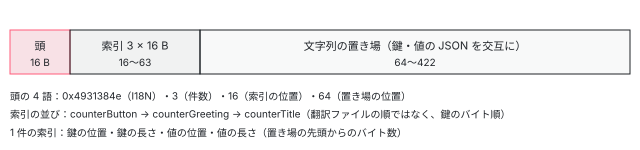

[目次](../README.md) › [tools/esbuild の読み残し：束ね方の設定・JS の後処理・watch・i18n の差し込み・スタイル・コンパイラプラグインの残りを行で埋める](README.md) › 第 4 回 / 全 7 回

# I18nInliner：ビルドの後で $localize に翻訳を差し込む

> tools/esbuild/i18n-inliner.ts・i18n-inliner-worker.ts・i18n-translation-encoder.ts と reader の未読の行：.map の照らし合わせ、翻訳を SharedArrayBuffer に詰める形（頭・索引・置き場）と Blob の道、ロケールの窓とキャッシュの鍵、大きいファイルから配る仕事と結果の組み直し、ワーカーが覚える解析と翻訳とそれを捨てる 3 つの合図、壊れたエスケープとソースマップのつなぎ直し、HMR の inlineTemplateUpdate。

angular/angular-cli · 読了 約 13 分 · 発展 · [サイトで読む（デモが動きます）](https://angular-deep-dive-cyan.vercel.app/chapter/esb-i18n-inliner)

---

この章で分かること：`I18nInliner` が、ビルドの出力を「書き換えるファイル」と「そのまま複製するファイル」に分けたあと、翻訳をどう直列化してワーカーに渡し、ロケールの窓とキャッシュの鍵をどう作り、ワーカーの返事をロケールごとの出力にどう組み直すか。ワーカー側では、ファイルの解析と翻訳の辞書をどう覚えて使い回し、どこで捨てるか。最後に、ソースマップをどうつなぎ直すか。

読む対象は angular-cli（44129f66a3）の `packages/angular/build/src/tools/esbuild/` の `i18n-inliner.ts`・`i18n-inliner-worker.ts`・`i18n-translation-encoder.ts`・`i18n-translation-reader.ts` と、呼び出し側の `builders/application/i18n.ts` の残りです。i18n の全体の流れ（翻訳ファイルの読み込み、`$localize` を含むファイルの選び方、`localesPerBatch` の決め方、oxc で呼び出しを探す所、置き換えの規則、ロケールのデータ）は [cli-i18n の章](../cli/09-cli-i18n.md)で読んだので繰り返しません。`$localize` そのものと翻訳の形（`ɵParsedTranslation`）は [loc-translate-tool の章](../loc/18-loc-translate-tool.md)と [loc-runtime-translations の章](../loc/14-loc-runtime-translations.md)、ディスクのキャッシュの仕組みは [abl-cache の章](../abl/04-abl-cache.md)にあります。

1. [1. 束ね方の設定を作る関数](01-esb-code-bundle.md)
2. [2. JavaScriptTransformer](02-esb-js-transformer.md)
3. [3. watcher](03-esb-watcher.md)
4. **4. I18nInliner**（この章）
5. [5. スタイルのプラグイン](05-esb-styles.md)
6. [6. compiler-plugin の残り](06-esb-compiler-rest.md)
7. [7. spec と issue](07-esb-tests-issues.md)

> [!NOTE]
> **ポイント**
>
> サイトの依存の `@angular/build` 22.2.7 は 22.2.x の枝の版で、読んでいる 44129f66a3 の後の直しが入っています。ファイルは `src/tools/i18n/` に移り（e7ebbcdc25）、ワーカーは `@angular/localize/tools` を読まずに `@angular/localize` の `ɵtranslate` を直接呼び（c51efdabe1）、1 ファイルに割り当てるワーカーの数に上限が付きました（90ee193bd1・5ea36fe8b8）。本文は 44129f66a3 の行を読み、デモの記録は 22.2.7 で録りました。違いが出る所はその都度書きます。

## 0. 全体の流れ

1. **呼び出し側が全ロケールを 1 回で渡す**

   `i18n.ts` が `inlineAll(出力, ロケールの一覧)` を 1 回呼ぶ（cli-i18n の 4 節）。HMR のテンプレートの更新だけは別に `inlineTemplateUpdate` を呼ぶ（1 節）。
2. **出力を振り分ける**

   `$localize` を含む .js・.mjs と、その .map を「書き換える側」に、残りを「そのまま」に入れる（2 節）。
3. **翻訳を直列化する**

   ロケールごとの翻訳を `SharedArrayBuffer`（ワーカーのスレッドと同じメモリを共有できるバイト列）に詰める。使えなければ `Blob` にする（3 節）。
4. **窓ごとにキャッシュを引き、残りをワーカーに配る**

   ロケールを 8 個以上ずつの窓に切り、ファイル × ロケールの組ごとにディスクのキャッシュを引く。外れた組だけを、ファイルの大きさで割ってワーカーに投げる（4・5 節）。
5. **ワーカーが置き換える**

   ファイルの解析と翻訳の辞書を覚えながら、ロケールの数だけ `inlineLocalize` を回し、ソースマップをつなぎ直す（6・7 節）。
6. **ロケールごとに組み直す**

   ロケールの順・ファイルの順に出力を並べ、警告とエラーを分け、そのままのファイルを複製して足す（4 節の終わり）。

## 1. 呼び出し側の残り：テンプレートの更新と close

📄 `angular-cli/packages/angular/build/src/builders/application/i18n.ts` L157–186 （▶ の行: 158, 161, 163, 166, 169, 176, 184）

```ts
157 │     // Inline any template updates if present
158 ▶     if (executionResult.templateUpdates?.size) {
159 │       // The development server only allows a single locale but issue a warning if used programmatically (experimental)
160 │       // with multiple locales and template HMR.
161 ▶       if (localesToInline.length > 1) {
162 │         inlineResult.warnings.push(
163 ▶           `Component HMR updates can only be inlined with a single locale. The first locale will be used.`,
164 │         );
165 │       }
166 ▶       const targetLocale = localesToInline[0];
167 │ 
168 │       for (const [id, content] of executionResult.templateUpdates) {
169 ▶         const templateUpdateResult = await inliner.inlineTemplateUpdate(
170 │           targetLocale.locale,
171 │           targetLocale.translation,
172 │           content,
173 │           id,
174 │           targetLocale.translationIntegrity,
175 │         );
176 ▶         executionResult.templateUpdates.set(id, templateUpdateResult.code);
177 │         inlineResult.errors.push(...templateUpdateResult.errors);
178 │         inlineResult.warnings.push(...templateUpdateResult.warnings);
179 │       }
180 │     }
181 │ 
182 │     return inlineResult;
183 │   } finally {
184 ▶     await inliner.close();
185 │   }
186 │ }
```

158 行目、`ng serve` でコンポーネントのテンプレートだけが変わったとき（HMR）の更新のコードは、出力のファイルとは別の `templateUpdates` に入っています。161〜164 行目、ロケールが 2 つ以上なら警告を足し、166 行目で最初のロケールだけを使います。dev-server は 1 つのロケールしか扱わないからです（159 行目のコメント）。169 行目で 1 つずつ `inlineTemplateUpdate`（6 節）に渡し、176 行目で書き換えた後のコードに差し替えます。184 行目、成功しても失敗しても `close` でワーカーを止めます。ビルドのたびに `I18nInliner` を作り直すので、ワーカーの中の覚え書き（7 節）は次のビルドに持ち越されません。

## 2. クラスの形と、振り分けの残り

📄 `angular-cli/packages/angular/build/src/tools/esbuild/i18n-inliner.ts` L9–39 （▶ の行: 13, 17, 24, 27–28, 30–31, 35）

```ts
 9 │ import type { ɵParsedTranslation } from '@angular/localize';
10 │ import assert from 'node:assert';
11 │ import { createRequire } from 'node:module';
12 │ import { extname, join } from 'node:path';
13 ▶ import { serialize } from 'node:v8';
14 │ import { calculateHash, createContentHash, initializeHash } from '../../utils/hash';
15 │ import { WorkerPool } from '../../utils/worker-pool';
16 │ import { type BuildOutputFile, BuildOutputFileType, createOutputFile } from './bundler-files';
17 ▶ import { type Cache, type PersistentCacheStore, createPersistentCacheStore } from './cache';
18 │ import type {
19 │   InlineCodeRequest,
20 │   InlineCodeResult,
21 │   InlineFileBatchRequest,
22 │   InlineFileBatchResult,
23 │ } from './i18n-inliner-worker';
24 ▶ import { encodeTranslationToBuffer } from './i18n-translation-encoder';
25 │ 
26 │ // TODO: Convert to import.meta usage during ESM transition
27 ▶ const localRequire = createRequire(__filename);
28 ▶ const INLINER_WORKER_PATH = localRequire.resolve('./i18n-inliner-worker');
29 │ 
30 ▶ interface WorkerTaskMap {
31 ▶   inlineFileBatch: {
32 │     request: InlineFileBatchRequest;
33 │     result: InlineFileBatchResult;
34 │   };
35 ▶   inlineCode: {
36 │     request: InlineCodeRequest;
37 │     result: InlineCodeResult;
38 │   };
39 │ }
```

📄 `angular-cli/packages/angular/build/src/tools/esbuild/i18n-inliner.ts` L47–63 （▶ の行: 48–49, 51, 57, 63）

```ts
47 │ /**
48 ▶  * The baseline number of locales to process concurrently in a single sliding window.
49 ▶  * This caps peak worker memory on low-core machines while maintaining multi-locale batching throughput.
50 │  */
51 ▶ const DEFAULT_LOCALE_WINDOW_SIZE = 8;
52 │ 
53 │ /**
54 │  * Minimum byte size threshold for a file to be eligible for multi-batch sharding.
55 │  * Files below this threshold (< 100 KB) are processed in a single batch to minimize IPC overhead.
56 │  */
57 ▶ const SMALL_FILE_FLOOR_BYTES = 100 * 1024;
58 │ 
59 │ /**
60 │  * Ratio of the maximum file size in a window to consider a file "dominant".
61 │  * Files within 70% of the largest file are sharded across all workers for maximum concurrency.
62 │  */
63 ▶ const DOMINANT_FILE_RATIO = 0.7;
```

27〜28 行目、ワーカーのスクリプトの場所をこのファイルの隣から探します。30〜39 行目、ワーカーに頼む仕事は `inlineFileBatch`（1 ファイル × 複数ロケール）と `inlineCode`（HMR の 1 片）の 2 つだけです。13 行目の `serialize` は Node の v8 の直列化で、3 節の Blob の道で使います。51・57・63 行目の 3 つの数が分け方を決めます。窓のロケールの数の下限 8、分けない小さいファイルの上限 100KB、「大きいファイル」とみなす境目（いちばん大きいファイルの 70%）です。

📄 `angular-cli/packages/angular/build/src/tools/esbuild/i18n-inliner.ts` L122–161 （▶ の行: 123, 129–131, 141, 146, 151, 158–160）

```ts
122 │ export interface I18nInlinerOptions {
123 ▶   missingTranslation: 'error' | 'warning' | 'ignore';
124 │ 
125 │   /**
126 │    * The maximum number of concurrent translation inlining operations.
127 │    * When omitted, concurrency defaults to the available worker pool threads.
128 │    */
129 ▶   maxConcurrency?: number;
130 ▶   persistentCachePath?: string;
131 ▶   localizeVersion?: string;
132 │ }
133 │ 
134 │ /**
135 │  * Options for inlining a specific locale.
136 │  */
137 │ export interface LocaleInlineOptions {
138 │   /**
139 │    * The locale specifier string.
140 │    */
141 ▶   locale: string;
142 │ 
143 │   /**
144 │    * The translation messages for the locale, or undefined for the source/untranslated locale.
145 │    */
146 ▶   translation?: Record<string, ɵParsedTranslation>;
147 │ 
148 │   /**
149 │    * An optional content integrity hash of the translation file(s) for fast cache key calculation.
150 │    */
151 ▶   translationIntegrity?: string;
152 │ }
153 │ 
154 │ /**
155 │  * Result of inlining for a specific locale.
156 │  */
157 │ export interface LocaleInlineResult {
158 ▶   outputFiles: BuildOutputFile[];
159 ▶   errors: string[];
160 ▶   warnings: string[];
161 │ }
```

📄 `angular-cli/packages/angular/build/src/tools/esbuild/i18n-inliner.ts` L163–180 （▶ の行: 168–170, 177–179）

```ts
163 │ /**
164 │  * Transformation result for a single file and locale combination.
165 │  */
166 │ interface TransformedFileResult {
167 │   file: string;
168 ▶   code?: string;
169 ▶   map?: string;
170 ▶   messages: { type: 'error' | 'warning'; message: string }[];
171 │ }
172 │ 
173 │ /**
174 │  * An uncached transformation request entry for a file within a specific locale.
175 │  */
176 │ interface UncachedLocaleEntry {
177 ▶   locale: string;
178 ▶   cacheKey?: string;
179 ▶   translation?: Blob | SharedArrayBuffer;
180 │ }
```

123〜131 行目が呼び出し側の 48〜53 行目で渡す 4 つです。146 行目、元の言語のロケールは翻訳を持たず `undefined` です。151 行目の `translationIntegrity` は翻訳ファイルの中身のハッシュで、キャッシュの鍵を速く作るのに使います（4 節）。168〜170 行目、1 つのファイル × 1 つのロケールの結果は、書き換えたコード・ソースマップ・メッセージです。`code` が無いのは「書き換えなかった」の意味です。177〜179 行目は、キャッシュに無かった組の 1 件で、ロケール・キャッシュの鍵・直列化した翻訳を持ちます。

📄 `angular-cli/packages/angular/build/src/tools/esbuild/i18n-inliner.ts` L183–214 （▶ の行: 194, 196–197, 201–203, 205, 208, 211–212）

```ts
183 │  * A class that performs i18n translation inlining of JavaScript code.
184 │  * A worker pool is used to distribute the transformation actions and allow
185 │  * parallel processing. Inlining is only performed on code that contains the
186 │  * localize function (`$localize`).
187 │  */
188 │ export class I18nInliner {
189 │   #cacheInitFailed = false;
190 │   #workerPool: WorkerPool;
191 │   #cacheStore: PersistentCacheStore | undefined;
192 │   #transformedFileCache: Cache<TransformedFileResult> | undefined;
193 │   #translationCache: Cache<Uint8Array> | undefined;
194 ▶   #generation = 0;
195 │ 
196 ▶   get #maxConcurrency(): number {
197 ▶     return this.options.maxConcurrency ?? (this.#workerPool.maxThreads || 1);
198 │   }
199 │ 
200 │   constructor(private readonly options: I18nInlinerOptions) {
201 ▶     if (
202 ▶       options.maxConcurrency !== undefined &&
203 ▶       (!Number.isInteger(options.maxConcurrency) || options.maxConcurrency < 1)
204 │     ) {
205 ▶       throw new RangeError('options.maxConcurrency must be an integer greater than or equal to 1.');
206 │     }
207 │ 
208 ▶     // Piscina uses object spread against default options internally. Only define
209 │     // maxThreads when specified to avoid overwriting Piscina's default thread count
210 │     // with undefined.
211 ▶     this.#workerPool = new WorkerPool({
212 ▶       ...(options.maxConcurrency !== undefined && { maxThreads: options.maxConcurrency }),
213 │     });
214 │   }
```

197 行目、並べる数は `maxConcurrency`、無ければワーカーのプールのスレッド数です。201〜206 行目で 1 以上の整数でなければ投げます。211〜213 行目、`maxConcurrency` があるときだけ `maxThreads` を渡します。208〜210 行目のコメントのとおり、Piscina（ワーカーのスレッドのプール）は既定の値に渡された値を上書きで混ぜるので、`maxThreads: undefined` を渡すと既定のスレッド数が消えるからです。194 行目の `#generation` は `inlineAll` の回数で、7 節でワーカーの覚え書きを捨てる合図に使います。

📄 `angular-cli/packages/angular/build/src/tools/esbuild/i18n-inliner.ts` L258–270 （▶ の行: 260–263, 265）

```ts
258 │ 
259 │     // Check if any pending map files should be processed by checking if the parent JS file is present
260 ▶     for (const file of pendingMaps) {
261 ▶       const jsPath = file.path.slice(0, -4);
262 ▶       if (localizeFiles.has(jsPath)) {
263 ▶         localizeMaps.set(jsPath, file);
264 │       } else {
265 ▶         unmodifiedFiles.push(file);
266 │       }
267 │     }
268 │ 
269 │     return { filenames, localizeFiles, localizeMaps, unmodifiedFiles };
270 │   }
```

振り分けの前半（`$localize` の文字列の有無で .js を分ける所）は cli-i18n の 4 節です。.map は後回しの一覧に入っていて、ここで扱います。261 行目、末尾の `.map` の 4 文字を落として .js の名前にし、262 行目でその .js が書き換える側にあれば、263 行目で「書き換える .js の .map」に入れます。無ければ 265 行目で「そのまま」です。.js より先に .map が来ても取りこぼさないように、全部のファイルを見終えてから照らし合わせます。

## 3. 翻訳を直列化する：SharedArrayBuffer と Blob

📄 `angular-cli/packages/angular/build/src/tools/esbuild/i18n-inliner.ts` L77–92 （▶ の行: 82–83, 86–87, 90–91）

```ts
77 │ async function serializeTranslation(
78 │   translation: Record<string, ɵParsedTranslation> | undefined,
79 │   translationIntegrity?: string,
80 │   translationCache?: Cache<Uint8Array>,
81 │ ): Promise<SharedArrayBuffer | Blob | undefined> {
82 ▶   if (!translation) {
83 ▶     return undefined;
84 │   }
85 │ 
86 ▶   if (typeof SharedArrayBuffer !== 'undefined') {
87 ▶     if (translationIntegrity && translationCache) {
88 │       // Look up or generate binary translation data in the persistent cache.
89 │       // A Uint8Array view is stored in the cache store to allow binary persistence.
90 ▶       const binaryData = await translationCache.getOrCreate(translationIntegrity, () => {
91 ▶         return new Uint8Array(encodeTranslationToBuffer(translation));
92 │       });
```

📄 `angular-cli/packages/angular/build/src/tools/esbuild/i18n-inliner.ts` L93–117 （▶ の行: 96–99, 101, 106–107, 113, 116）

```ts
 93 │ 
 94 │       // On a cache miss, getOrCreate returns the newly created Uint8Array backed by the
 95 │       // original SharedArrayBuffer. Return it directly to avoid an unnecessary allocation and copy.
 96 ▶       if (
 97 ▶         binaryData.buffer instanceof SharedArrayBuffer &&
 98 ▶         binaryData.byteOffset === 0 &&
 99 ▶         binaryData.byteLength === binaryData.buffer.byteLength
100 │       ) {
101 ▶         return binaryData.buffer;
102 │       }
103 │ 
104 │       // On a warm cache hit, the restored data is backed by a standard ArrayBuffer from disk.
105 │       // Copy it into a SharedArrayBuffer so worker threads can access it via zero-copy shared memory.
106 ▶       const buffer = new SharedArrayBuffer(binaryData.byteLength);
107 ▶       new Uint8Array(buffer).set(binaryData);
108 │ 
109 │       return buffer;
110 │     }
111 │ 
112 │     // When persistent caching is not configured, encode directly into a SharedArrayBuffer.
113 ▶     return encodeTranslationToBuffer(translation);
114 │   }
115 │ 
116 ▶   return new Blob([serialize(translation)]);
117 │ }
```

1. **82〜84 行目：翻訳が無ければ何も送らない**

   元の言語のロケールは `undefined` のまま。ワーカー側は 6 節で「無い」として扱う。
2. **87〜92 行目：ディスクのキャッシュから引く**

   翻訳ファイルのハッシュとキャッシュがあれば、ハッシュを鍵に `getOrCreate`。無ければ 91 行目でエンコードして入れる。
3. **96〜102 行目：作った直後ならそのまま返す**

   作ったばかりの `Uint8Array` は `SharedArrayBuffer` の上にあるので、その中身全体を指していれば 101 行目で下の buffer を返す。
4. **106〜109 行目：ディスクから戻したときは写す**

   ディスクから読んだ値は普通の `ArrayBuffer` なので、同じ大きさの `SharedArrayBuffer` を作って写す。
5. **113 行目：キャッシュが無ければその場でエンコード**
6. **116 行目：SharedArrayBuffer が無い環境**

   v8 の直列化で `Blob` に入れる。ワーカーへは参照で渡り、7 節で読み戻す。ただし Piscina 5.3.2 はワーカーを起こすときに自分で `SharedArrayBuffer` を作るので、この道を通るのは「ワーカーが起きた後で SharedArrayBuffer が消えた」ときだけです（テストと直し方）。

📄 `angular-cli/packages/angular/build/src/tools/esbuild/i18n-translation-encoder.ts` L24–47 （▶ の行: 28, 41–42, 45）

```ts
24 │ export function encodeTranslationToBuffer<T = ɵParsedTranslation>(
25 │   translation: Record<string, T>,
26 │ ): SharedArrayBuffer {
27 │   const encoder = new TextEncoder();
28 ▶   const entries = Object.entries(translation);
29 │   const entryCount = entries.length;
30 │ 
31 │   // Pre-encode string keys and JSON-serialized string values
32 │   const encodedEntries: {
33 │     keyBytes: Uint8Array;
34 │     valBytes: Uint8Array;
35 │   }[] = new Array(entryCount);
36 │ 
37 │   let stringPoolByteSize = 0;
38 │ 
39 │   for (let i = 0; i < entryCount; i++) {
40 │     const [key, val] = entries[i];
41 ▶     const keyBytes = encoder.encode(key);
42 ▶     const valBytes = encoder.encode(JSON.stringify(val));
43 │ 
44 │     encodedEntries[i] = { keyBytes, valBytes };
45 ▶     stringPoolByteSize += keyBytes.byteLength + valBytes.byteLength;
46 │   }
47 │ 
```

📄 `angular-cli/packages/angular/build/src/tools/esbuild/i18n-translation-encoder.ts` L48–83 （▶ の行: 51, 57, 63, 66–68, 71, 79–82）

```ts
48 │   // Sort entries lexicographically by UTF-8 byte comparison.
49 │   // Lexicographical byte comparison matches the binary search reader's byte comparison,
50 │   // ensuring deterministic and zero-allocation lookups across all runtimes regardless of UTF-16 surrogate pairs.
51 ▶   encodedEntries.sort((a, b) => {
52 │     const aBytes = a.keyBytes;
53 │     const bBytes = b.keyBytes;
54 │     const minLen = Math.min(aBytes.length, bBytes.length);
55 │ 
56 │     for (let i = 0; i < minLen; i++) {
57 ▶       const diff = aBytes[i] - bBytes[i];
58 │       if (diff !== 0) {
59 │         return diff;
60 │       }
61 │     }
62 │ 
63 ▶     return aBytes.length - bBytes.length;
64 │   });
65 │ 
66 ▶   const indexByteSize = entryCount * 16;
67 ▶   const headerByteSize = 16;
68 ▶   const stringPoolOffset = headerByteSize + indexByteSize;
69 │ 
70 │   const totalByteSize = stringPoolOffset + stringPoolByteSize;
71 ▶   const buffer = new SharedArrayBuffer(totalByteSize);
72 │ 
73 │   // Set up views over the SharedArrayBuffer
74 │   const uint32Header = new Uint32Array(buffer, 0, 4);
75 │   const uint32Index = new Uint32Array(buffer, headerByteSize, entryCount * 4);
76 │   const uint8Pool = new Uint8Array(buffer, stringPoolOffset);
77 │ 
78 │   // Write Header: Magic, EntryCount, IndexOffset, StringPoolOffset
79 ▶   uint32Header[0] = I18N_MAGIC_ID;
80 ▶   uint32Header[1] = entryCount;
81 ▶   uint32Header[2] = headerByteSize;
82 ▶   uint32Header[3] = stringPoolOffset;
83 │ 
```

📄 `angular-cli/packages/angular/build/src/tools/esbuild/i18n-translation-encoder.ts` L84–112 （▶ の行: 92, 97, 106–109）

```ts
 84 │   // Write Index Table and String Pool entries
 85 │   let currentPoolOffset = 0;
 86 │ 
 87 │   for (let i = 0; i < entryCount; i++) {
 88 │     const { keyBytes, valBytes } = encodedEntries[i];
 89 │ 
 90 │     const keyOffset = currentPoolOffset;
 91 │     const keyLen = keyBytes.byteLength;
 92 ▶     uint8Pool.set(keyBytes, keyOffset);
 93 │     currentPoolOffset += keyLen;
 94 │ 
 95 │     const valOffset = currentPoolOffset;
 96 │     const valLen = valBytes.byteLength;
 97 ▶     uint8Pool.set(valBytes, valOffset);
 98 │     currentPoolOffset += valLen;
 99 │ 
100 │     // Index entry format (4 uint32 words / 16 bytes):
101 │     // [0]: keyOffset (uint32)
102 │     // [1]: keyLength (uint32)
103 │     // [2]: valOffset (uint32)
104 │     // [3]: valLength (uint32)
105 │     const idx = i * 4;
106 ▶     uint32Index[idx] = keyOffset;
107 ▶     uint32Index[idx + 1] = keyLen;
108 ▶     uint32Index[idx + 2] = valOffset;
109 ▶     uint32Index[idx + 3] = valLen;
110 │   }
111 │ 
112 │   return buffer;
```

エンコードの形は 3 つの区画です。79〜82 行目の頭（16 バイト：目印 `0x4931384e`＝"I18N"、件数、索引の位置、文字列の置き場の位置）、66 行目の索引（1 件 16 バイト：鍵の位置と長さ、値の位置と長さ）、そして文字列の置き場です。41〜42 行目、鍵（メッセージの ID）はそのまま、値（`ɵParsedTranslation`）は JSON にしてから UTF-8 のバイトにします。51〜64 行目、索引は**鍵のバイトの並び**で並べます。読む側が 2 分探索で同じ比べ方をするためです。92・97 行目で鍵と値を置き場に続けて書き、106〜109 行目で索引の 4 つの数を書きます。



*ja の翻訳（3 件）をエンコードした 423 バイト（デモの記録の値）。*

読む側はワーカーの中で動きます。

📄 `angular-cli/packages/angular/build/src/tools/esbuild/i18n-translation-reader.ts` L47–81 （▶ の行: 53, 56, 61, 69–70, 72–73, 79–80）

```ts
47 │ export class SharedTranslationDictionary<T = ɵParsedTranslation> {
48 │   private readonly entryCount: number;
49 │   private readonly uint32Index: Uint32Array;
50 │   private readonly uint8Pool: Uint8Array;
51 │   private readonly decoder = new TextDecoder();
52 │   private readonly encoder = new TextEncoder();
53 ▶   private readonly lazyCache = new Map<string, T | typeof NOT_FOUND>();
54 │ 
55 │   constructor(buffer: SharedArrayBuffer) {
56 ▶     if (buffer.byteLength < 16) {
57 │       throw new Error('Invalid SharedArrayBuffer translation header: buffer too small.');
58 │     }
59 │ 
60 │     const uint32Header = new Uint32Array(buffer, 0, 4);
61 ▶     if (uint32Header[0] !== I18N_MAGIC_ID) {
62 │       throw new Error('Invalid SharedArrayBuffer translation header magic identifier.');
63 │     }
64 │ 
65 │     this.entryCount = uint32Header[1];
66 │     const headerByteSize = uint32Header[2];
67 │     const stringPoolOffset = uint32Header[3];
68 │ 
69 ▶     if (
70 ▶       headerByteSize < 16 ||
71 │       headerByteSize % 4 !== 0 ||
72 ▶       headerByteSize + this.entryCount * 16 > buffer.byteLength ||
73 ▶       stringPoolOffset < headerByteSize + this.entryCount * 16 ||
74 │       stringPoolOffset > buffer.byteLength
75 │     ) {
76 │       throw new Error('Invalid SharedArrayBuffer translation header offsets.');
77 │     }
78 │ 
79 ▶     this.uint32Index = new Uint32Array(buffer, headerByteSize, this.entryCount * 4);
80 ▶     this.uint8Pool = new Uint8Array(buffer, stringPoolOffset);
81 │   }
```

📄 `angular-cli/packages/angular/build/src/tools/esbuild/i18n-translation-reader.ts` L100–135 （▶ の行: 101, 107–108, 117–118, 121–122, 130–131, 133）

```ts
100 │     while (low <= high) {
101 ▶       const mid = (low + high) >>> 1;
102 │       const idx = mid * 4;
103 │ 
104 │       const keyOffset = this.uint32Index[idx];
105 │       const keyLen = this.uint32Index[idx + 1];
106 │ 
107 ▶       const cmp = compareBytes(targetBytes, this.uint8Pool, keyOffset, keyLen);
108 ▶       if (cmp === 0) {
109 │         const valOffset = this.uint32Index[idx + 2];
110 │         const valLen = this.uint32Index[idx + 3];
111 │         if (valOffset < 0 || valOffset + valLen > this.uint8Pool.length) {
112 │           this.lazyCache.set(targetKey, NOT_FOUND);
113 │ 
114 │           return undefined;
115 │         }
116 │ 
117 ▶         const valBytes = this.uint8Pool.subarray(valOffset, valOffset + valLen);
118 ▶         const valJson = this.decoder.decode(valBytes);
119 │ 
120 │         try {
121 ▶           const val = JSON.parse(valJson) as T;
122 ▶           this.lazyCache.set(targetKey, val);
123 │ 
124 │           return val;
125 │         } catch {
126 │           this.lazyCache.set(targetKey, NOT_FOUND);
127 │ 
128 │           return undefined;
129 │         }
130 ▶       } else if (cmp < 0) {
131 ▶         high = mid - 1;
132 │       } else {
133 ▶         low = mid + 1;
134 │       }
135 │     }
```

📄 `angular-cli/packages/angular/build/src/tools/esbuild/i18n-translation-reader.ts` L154–178 （▶ の行: 157, 159–160, 164, 170, 173）

```ts
154 │ export function createSharedTranslationProxy<T = ɵParsedTranslation>(
155 │   buffer: SharedArrayBuffer,
156 │ ): Record<string, T> {
157 ▶   const dictionary = new SharedTranslationDictionary<T>(buffer);
158 │ 
159 ▶   return new Proxy(
160 ▶     {},
161 │     {
162 │       get(target, prop: string | symbol) {
163 │         if (typeof prop === 'string') {
164 ▶           const value = dictionary.get(prop);
165 │           if (value !== undefined) {
166 │             return value;
167 │           }
168 │         }
169 │ 
170 ▶         return Reflect.get(target, prop);
171 │       },
172 │       has(target, prop: string | symbol) {
173 ▶         if (typeof prop === 'string' && dictionary.get(prop) !== undefined) {
174 │           return true;
175 │         }
176 │ 
177 │         return Reflect.has(target, prop);
178 │       },
```

56〜77 行目、頭の大きさ・目印・位置が buffer の範囲に収まるかを確かめてから、79〜80 行目で索引と置き場の見方を作ります。中身は写しません。101〜107 行目は 2 分探索で、見つかったら 117〜121 行目で**その 1 件の値だけ**を UTF-8 から戻して JSON を読みます。122 行目と 53 行目の `lazyCache` で、同じ ID は 2 度目から探しません。159 行目、`@angular/localize` の `translate` に「普通のオブジェクト」として渡すため、空のオブジェクトに `Proxy` をかぶせ、164 行目でプロパティの読み取りを辞書の検索に変えます。170 行目、辞書に無い名前は空のオブジェクトの読み取りに回します。空のオブジェクトにも `Object.prototype` があるので、`constructor` のような名前は関数が返ります（デモの「翻訳の直列化」で見られます）。

## 4. inlineAll：窓・キャッシュの鍵・組み直し

📄 `angular-cli/packages/angular/build/src/tools/esbuild/i18n-inliner.ts` L272–311 （▶ の行: 286, 288, 292, 296, 300, 306–308, 310）

```ts
272 │   /**
273 │    * Performs inlining of translations across multiple locales in parallel.
274 │    *
275 │    * An adaptive 2D task-partitioning algorithm distributes (files x locales) work units
276 │    * across all worker threads while caching AST metadata and sourcemaps in worker memory.
277 │    *
278 │    * @param files The build output files to transform.
279 │    * @param locales The locales and translations to inline.
280 │    * @returns A map of locale names to their inlined output files and diagnostics.
281 │    */
282 │   async inlineAll(
283 │     files: Iterable<BuildOutputFile>,
284 │     locales: Iterable<LocaleInlineOptions>,
285 │   ): Promise<Map<string, LocaleInlineResult>> {
286 ▶     await this.initCache();
287 │ 
288 ▶     const generation = ++this.#generation;
289 │     const { missingTranslation, localizeVersion } = this.options;
290 │     const localeList = Array.from(locales);
291 │ 
292 ▶     if (localeList.length === 0) {
293 │       return new Map();
294 │     }
295 │ 
296 ▶     const { filenames, localizeFiles, localizeMaps, unmodifiedFiles } = this.#partitionFiles(files);
297 │ 
298 │     const fileResultsByLocale = new Map<string, Map<string, TransformedFileResult>>();
299 │     for (const { locale } of localeList) {
300 ▶       assert(!fileResultsByLocale.has(locale), 'Duplicate locale provided to inliner: ' + locale);
301 │       fileResultsByLocale.set(locale, new Map());
302 │     }
303 │ 
304 │     // Process locales in sliding windows to cap peak worker memory.
305 │     // Ensure the window has at least enough locales to saturate all available workers on high-core machines.
306 ▶     const windowSize = Math.max(DEFAULT_LOCALE_WINDOW_SIZE, this.#maxConcurrency);
307 ▶     for (let i = 0; i < localeList.length; i += windowSize) {
308 ▶       const windowLocales = localeList.slice(i, i + windowSize);
309 │       const activeLocales = windowLocales.map((item) => item.locale);
310 ▶       const isLastWindow = i + windowSize >= localeList.length;
311 │ 
```

286 行目でディスクのキャッシュを用意し（[abl-cache の章](../abl/04-abl-cache.md)の 674〜703 行目）、288 行目で回数を 1 つ進めます。300 行目、同じロケールが 2 回あれば assert で止めます。306 行目、窓の大きさは「8」と「並べる数」の大きい方です。ロケールが 20 でワーカーが 2 なら、8・8・4 の 3 つの窓を順に処理します。一度に全部のロケールを配らないのは、ワーカーの中に翻訳の辞書と解析済みのファイルが溜まるからです（48〜49 行目のコメント）。310 行目、最後の窓かどうかを 5 節の `ephemeral` に使います。

📄 `angular-cli/packages/angular/build/src/tools/esbuild/i18n-inliner.ts` L312–340 （▶ の行: 316, 318, 323, 325, 328, 330–333）

```ts
312 │       // Pre-calculate cache key bases and serialized Blobs for each locale in this window
313 │       const localeCacheBases = new Map<string, string>();
314 │       const localeBlobs = new Map<string, Blob | SharedArrayBuffer | undefined>();
315 │ 
316 ▶       await Promise.all(
317 │         windowLocales.map(async ({ locale, translation, translationIntegrity }) => {
318 ▶           const serialized = await serializeTranslation(
319 │             translation,
320 │             translationIntegrity,
321 │             this.#translationCache,
322 │           );
323 ▶           localeBlobs.set(locale, serialized);
324 │ 
325 ▶           if (this.#cacheStore) {
326 │             localeCacheBases.set(
327 │               locale,
328 ▶               calculateHash(
329 │                 JSON.stringify({
330 ▶                   locale,
331 ▶                   translation: translationIntegrity || translation,
332 ▶                   missingTranslation,
333 ▶                   localizeVersion,
334 │                 }),
335 │               ),
336 │             );
337 │           }
338 │         }),
339 │       );
340 │ 
```

316〜323 行目、窓のロケールの翻訳を並べて直列化します（3 節）。325〜336 行目、キャッシュがあれば、ロケール・翻訳（331 行目、ハッシュがあればハッシュ、無ければ翻訳の中身そのもの）・`missingTranslation`・`@angular/localize` の版をまとめた 1 つのハッシュを作ります。翻訳を直したり、`i18nMissingTranslation` を変えたり、`@angular/localize` を上げたりすると、このハッシュが変わり、キャッシュは当たらなくなります。

📄 `angular-cli/packages/angular/build/src/tools/esbuild/i18n-inliner.ts` L341–377 （▶ の行: 343, 351, 356–359, 363–365, 369, 371）

```ts
341 │       const uncachedByFile = new Map<string, UncachedLocaleEntry[]>();
342 │ 
343 ▶       if (this.#transformedFileCache) {
344 │         const cache = this.#transformedFileCache;
345 │         const cacheChecks: Promise<void>[] = [];
346 │ 
347 │         for (const filename of filenames) {
348 │           const file = localizeFiles.get(filename);
349 │           assert(file !== undefined, 'Localize file must exist: ' + filename);
350 │ 
351 ▶           const fileEntriesPromises = windowLocales.map(
352 │             async ({ locale }): Promise<UncachedLocaleEntry | undefined> => {
353 │               const fileCacheKeyBase = localeCacheBases.get(locale);
354 │               assert(fileCacheKeyBase !== undefined, 'Cache base must exist for locale: ' + locale);
355 │ 
356 ▶               const hasher = createContentHash();
357 ▶               hasher.update(file.hash);
358 ▶               hasher.update(filename);
359 ▶               hasher.update(fileCacheKeyBase);
360 │               const cacheKey = hasher.digest();
361 │ 
362 │               try {
363 ▶                 const result = await cache.get(cacheKey);
364 ▶                 if (result) {
365 ▶                   fileResultsByLocale.get(locale)?.set(filename, result);
366 │ 
367 │                   return;
368 │                 }
369 ▶               } catch {}
370 │ 
371 ▶               return {
372 │                 locale,
373 │                 cacheKey,
374 │                 translation: localeBlobs.get(locale),
375 │               };
376 │             },
377 │           );
```

📄 `angular-cli/packages/angular/build/src/tools/esbuild/i18n-inliner.ts` L378–415 （▶ の行: 380–381, 383, 389–390, 394, 403–404）

```ts
378 │ 
379 │           cacheChecks.push(
380 ▶             Promise.all(fileEntriesPromises).then((entries) => {
381 ▶               const filtered = entries.filter((e): e is UncachedLocaleEntry => e !== undefined);
382 │               if (filtered.length > 0) {
383 ▶                 uncachedByFile.set(filename, filtered);
384 │               }
385 │             }),
386 │           );
387 │         }
388 │ 
389 ▶         await Promise.all(cacheChecks);
390 ▶       } else {
391 │         for (const filename of filenames) {
392 │           uncachedByFile.set(
393 │             filename,
394 ▶             windowLocales.map(({ locale }) => ({
395 │               locale,
396 │               translation: localeBlobs.get(locale),
397 │             })),
398 │           );
399 │         }
400 │       }
401 │ 
402 │       // Adaptive 2D Sharding for uncached tasks in this window
403 ▶       if (uncachedByFile.size > 0) {
404 ▶         await this.#processUncachedBatches(
405 │           localizeFiles,
406 │           localizeMaps,
407 │           uncachedByFile,
408 │           fileResultsByLocale,
409 │           activeLocales,
410 │           isLastWindow,
411 │           generation,
412 │         );
413 │       }
414 │     }
415 │ 
```

356〜360 行目、1 つの組の鍵は「出力のファイルの中身のハッシュ」「ファイル名」「上のロケールのハッシュ」の 3 つです。363〜368 行目で当たれば、そのまま結果の表に入れ、ワーカーには送りません。369 行目、キャッシュの読み取りの失敗は黙って外れ扱いにします。380〜385 行目、外れた組だけを残し、1 つも無いファイルは表から消えます。390〜399 行目、キャッシュが無いときは全部の組が外れです。403 行目、外れが残っていれば 5 節に渡します。デモの「2 回目（キャッシュあり）」では、すべての組がここで当たり、ワーカーへの仕事が 0 件になります。

📄 `angular-cli/packages/angular/build/src/tools/esbuild/i18n-inliner.ts` L416–447 （▶ の行: 419, 426, 430–431, 436–437, 439, 443–444, 446）

```ts
416 │     // Assemble final results in deterministic order per locale
417 │     const resultsByLocale = new Map<string, LocaleInlineResult>();
418 │ 
419 ▶     for (const { locale } of localeList) {
420 │       const fileResults = fileResultsByLocale.get(locale);
421 │       const outputFiles: BuildOutputFile[] = [];
422 │       const errors: string[] = [];
423 │       const warnings: string[] = [];
424 │ 
425 │       if (fileResults) {
426 ▶         for (const filename of filenames) {
427 │           const originalFile = localizeFiles.get(filename);
428 │           assert(originalFile !== undefined, 'Localize file must exist: ' + filename);
429 │ 
430 ▶           const fileResult = fileResults.get(filename);
431 ▶           if (!fileResult) {
432 │             continue;
433 │           }
434 │ 
435 │           const type = originalFile.type;
436 ▶           if (fileResult.code != undefined) {
437 ▶             outputFiles.push(createOutputFile(filename, fileResult.code, type));
438 │           } else {
439 ▶             outputFiles.push(originalFile.clone());
440 │           }
441 │ 
442 │           const originalMap = localizeMaps.get(filename);
443 ▶           if (fileResult.map !== undefined) {
444 ▶             outputFiles.push(createOutputFile(filename + '.map', fileResult.map, type));
445 │           } else if (originalMap !== undefined) {
446 ▶             outputFiles.push(originalMap.clone());
447 │           }
```

📄 `angular-cli/packages/angular/build/src/tools/esbuild/i18n-inliner.ts` L448–470 （▶ の行: 449–451, 453, 460, 462）

```ts
448 │ 
449 ▶           for (const message of fileResult.messages) {
450 ▶             if (message.type === 'error') {
451 ▶               errors.push(message.message);
452 │             } else {
453 ▶               warnings.push(message.message);
454 │             }
455 │           }
456 │         }
457 │       }
458 │ 
459 │       // Include cloned unmodified files for every locale
460 ▶       outputFiles.push(...unmodifiedFiles.map((file) => file.clone()));
461 │ 
462 ▶       resultsByLocale.set(locale, {
463 │         outputFiles,
464 │         errors,
465 │         warnings,
466 │       });
467 │     }
468 │ 
469 │     return resultsByLocale;
470 │   }
```

組み直しは、渡されたロケールの順（419 行目）と、振り分けたファイルの順（426 行目）で回すので、ワーカーが返した順に関係なく毎回同じ並びになります（ab6d7dfb3a）。436〜440 行目、書き換えたコードがあれば新しいファイルを、無ければ元のファイルの写しを入れます。443〜447 行目のソースマップも同じです。449〜455 行目、メッセージを `type` でエラーと警告に分けます。キャッシュに入るのは 168〜170 行目の形なので、2 回目のビルドでも警告は同じように出ます。460 行目、そのままのファイル（CSS・画像・`$localize` を含まない .js）は、ロケールごとに写しを作って足します。

## 5. #processUncachedBatches：大きいファイルを先に、結果を表とキャッシュに

📄 `angular-cli/packages/angular/build/src/tools/esbuild/i18n-inliner.ts` L472–507 （▶ の行: 481, 485, 488–489, 496, 499, 505–506）

```ts
472 │   async #processUncachedBatches(
473 │     localizeFiles: Map<string, BuildOutputFile>,
474 │     localizeMaps: Map<string, BuildOutputFile>,
475 │     uncachedByFile: Map<string, UncachedLocaleEntry[]>,
476 │     fileResultsByLocale: Map<string, Map<string, TransformedFileResult>>,
477 │     activeLocales?: string[],
478 │     isLastWindow = true,
479 │     generation?: number,
480 │   ): Promise<void> {
481 ▶     const workerCount = this.#maxConcurrency;
482 │ 
483 │     // Extract file data and identify the heaviest file size in a single pass
484 │     let maxFileSize = 0;
485 ▶     const sortedFiles = Array.from(uncachedByFile, ([filename, entries]) => {
486 │       const codeFile = localizeFiles.get(filename);
487 │       assert(codeFile !== undefined, 'Localize file must exist: ' + filename);
488 ▶       const fileSize = codeFile.contents.byteLength;
489 ▶       if (fileSize > maxFileSize) {
490 │         maxFileSize = fileSize;
491 │       }
492 │ 
493 │       return { filename, entries, codeFile, fileSize };
494 │     });
495 │ 
496 ▶     // Sort files descending by byte size (Longest Processing Time First / LPT).
497 │     // Heavy files (e.g. main.js) are queued first to saturate all worker threads immediately,
498 │     // while small files act as gap fillers near the window barrier to prevent tail stragglers.
499 ▶     sortedFiles.sort((a, b) => b.fileSize - a.fileSize);
500 │ 
501 │     const workerTasks: Promise<void>[] = [];
502 │ 
503 │     for (const { filename, entries, codeFile, fileSize } of sortedFiles) {
504 │       const mapFile = localizeMaps.get(filename);
505 ▶       const codeBlob = new Blob([codeFile.contents]);
506 ▶       const mapBlob = mapFile ? new Blob([mapFile.contents]) : undefined;
507 │ 
```

485〜494 行目でファイルの大きさを集め、いちばん大きい値を覚えます。499 行目、大きい順に並べます。main.js のような重いファイルを先に配って全ワーカーをすぐ埋め、小さいファイルは最後のすき間に入れる、という意図です（496〜498 行目のコメント）。505〜506 行目、1 ファイルにつき 1 回だけ `Blob` を作り、そのファイルのすべての仕事で使い回します（799f332c96）。このあと、1 回に何ロケールずつ送るかを決めてワーカーに投げます（この間の 508〜536 行目は cli-i18n の章の 4 節の引用）。

📄 `angular-cli/packages/angular/build/src/tools/esbuild/i18n-inliner.ts` L537–576 （▶ の行: 538–539, 541, 545–546, 549, 552, 555–557, 566, 569, 571）

```ts
537 │ 
538 ▶           if (batchResult.unmodified) {
539 ▶             const unmodifiedResult: TransformedFileResult = {
540 │               file: filename,
541 ▶               messages: batchResult.messages,
542 │             };
543 │ 
544 │             const cachePromises: Promise<unknown>[] = [];
545 ▶             for (const { locale, cacheKey } of batchEntries) {
546 ▶               fileResultsByLocale.get(locale)?.set(filename, unmodifiedResult);
547 │ 
548 │               if (this.#transformedFileCache && cacheKey) {
549 ▶                 cachePromises.push(this.#transformedFileCache.put(cacheKey, unmodifiedResult));
550 │               }
551 │             }
552 ▶             await Promise.allSettled(cachePromises);
553 │           } else {
554 │             const cachePromises: Promise<unknown>[] = [];
555 ▶             for (const res of batchResult.results) {
556 ▶               const matchingEntry = batchEntries.find((e) => e.locale === res.locale);
557 ▶               const cacheKey = matchingEntry?.cacheKey;
558 │               const fileResult: TransformedFileResult = {
559 │                 file: filename,
560 │                 code: res.code,
561 │                 map: res.map,
562 │                 messages: res.messages,
563 │               };
564 │ 
565 │               if (this.#transformedFileCache && cacheKey) {
566 ▶                 cachePromises.push(this.#transformedFileCache.put(cacheKey, fileResult));
567 │               }
568 │ 
569 ▶               fileResultsByLocale.get(res.locale)?.set(filename, fileResult);
570 │             }
571 ▶             await Promise.allSettled(cachePromises);
572 │           }
573 │         })();
574 │ 
575 │         workerTasks.push(task);
576 │       }
```

📄 `angular-cli/packages/angular/build/src/tools/esbuild/i18n-inliner.ts` L577–590 （▶ の行: 579, 586–588）

```ts
577 │     }
578 │ 
579 ▶     await Promise.all(workerTasks);
580 │   }
581 │ 
582 │   #runWorkerTask<T extends keyof WorkerTaskMap>(
583 │     name: T,
584 │     request: WorkerTaskMap[T]['request'],
585 │   ): Promise<WorkerTaskMap[T]['result']> {
586 ▶     return this.#workerPool.run(request, {
587 ▶       filename: INLINER_WORKER_PATH,
588 ▶       name,
589 │     }) as Promise<WorkerTaskMap[T]['result']>;
590 │   }
```

538 行目、ワーカーが「書き換える所が無い」と返したら（7 節の速い道）、541 行目のメッセージだけの結果を、その仕事のすべてのロケールに入れ、549 行目で 1 件ずつキャッシュに入れます。555〜570 行目、書き換えたときはロケールごとの結果を、556 行目で仕事の一覧から鍵を探してキャッシュに入れます。552・571 行目は `allSettled` なので、キャッシュの書き込みの失敗はビルドを止めません。586〜589 行目、Piscina の `run` にはワーカーのスクリプトの場所（`filename`）と関数の名前（`name`）を毎回渡します（c35b43c25b）。

## 6. 1 つのロケールだけの入口：inlineForLocale と inlineTemplateUpdate

📄 `angular-cli/packages/angular/build/src/tools/esbuild/i18n-inliner.ts` L592–612 （▶ の行: 607, 609）

```ts
592 │   /**
593 │    * Performs inlining of translations for the provided locale and translations.
594 │    *
595 │    * @param files The build output files to transform.
596 │    * @param locale The string representing the locale to inline.
597 │    * @param translation The translation messages to use when inlining.
598 │    * @param translationIntegrity An optional integrity value for the translation messages to use for caching.
599 │    * @returns A promise that resolves to an array of OutputFiles representing a translated result.
600 │    */
601 │   async inlineForLocale(
602 │     files: Iterable<BuildOutputFile>,
603 │     locale: string,
604 │     translation: Record<string, ɵParsedTranslation> | undefined,
605 │     translationIntegrity?: string,
606 │   ): Promise<LocaleInlineResult> {
607 ▶     const results = await this.inlineAll(files, [{ locale, translation, translationIntegrity }]);
608 │     const result = results.get(locale);
609 ▶     assert(result !== undefined, `Result for locale '${locale}' should be present.`);
610 │ 
611 │     return result;
612 │   }
```

📄 `angular-cli/packages/angular/build/src/tools/esbuild/i18n-inliner.ts` L614–641 （▶ の行: 621, 623, 625, 631–632, 636）

```ts
614 │   async inlineTemplateUpdate(
615 │     locale: string,
616 │     translation: Record<string, ɵParsedTranslation> | undefined,
617 │     templateCode: string,
618 │     templateId: string,
619 │     translationIntegrity?: string,
620 │   ): Promise<{ code: string; errors: string[]; warnings: string[] }> {
621 ▶     const hasLocalize = templateCode.includes(LOCALIZE_KEYWORD);
622 │ 
623 ▶     if (!hasLocalize) {
624 │       return {
625 ▶         code: templateCode,
626 │         errors: [],
627 │         warnings: [],
628 │       };
629 │     }
630 │ 
631 ▶     const { output, messages } = await this.#runWorkerTask('inlineCode', {
632 ▶       code: templateCode,
633 │       filename: templateId,
634 │       locale,
635 │       missingTranslation: this.options.missingTranslation,
636 ▶       translation: await serializeTranslation(
637 │         translation,
638 │         translationIntegrity,
639 │         this.#translationCache,
640 │       ),
641 │     });
```

📄 `angular-cli/packages/angular/build/src/tools/esbuild/i18n-inliner.ts` L642–666 （▶ の行: 645–647, 653, 665）

```ts
642 │ 
643 │     const errors: string[] = [];
644 │     const warnings: string[] = [];
645 ▶     for (const message of messages) {
646 ▶       if (message.type === 'error') {
647 ▶         errors.push(message.message);
648 │       } else {
649 │         warnings.push(message.message);
650 │       }
651 │     }
652 │ 
653 ▶     return {
654 │       code: output,
655 │       errors,
656 │       warnings,
657 │     };
658 │   }
659 │ 
660 │   /**
661 │    * Stops all active transformation tasks and shuts down all workers.
662 │    * @returns A void promise that resolves when closing is complete.
663 │    */
664 │   async close(): Promise<void> {
665 ▶     await Promise.allSettled([this.#cacheStore?.close(), this.#workerPool.destroy()]);
666 │   }
```

607 行目、`inlineForLocale` は 1 つのロケールで `inlineAll` を呼ぶだけです。`inlineTemplateUpdate` は窓もキャッシュも使いません。621 行目で `$localize` の文字列が無ければ 625 行目でそのまま返し、あれば 631 行目で `inlineCode` の仕事を 1 つ投げます。636 行目、翻訳の直列化は 3 節と同じ関数です。665 行目の `close` は、キャッシュの store を閉じるのとワーカーのプールを壊すのを並べて待ちます。

## 7. ワーカー：覚え書きと、それを捨てる合図

📄 `angular-cli/packages/angular/build/src/tools/esbuild/i18n-inliner-worker.ts` L9–18 （▶ の行: 9, 12, 14–15, 18）

```ts
 9 ▶ import remapping, { type DecodedSourceMap, type SourceMapInput } from '@ampproject/remapping';
10 │ import type { ɵParsedTranslation } from '@angular/localize';
11 │ import type { Node } from '@oxc-project/types';
12 ▶ import { MagicString } from 'magic-string';
13 │ import assert from 'node:assert';
14 ▶ import { deserialize } from 'node:v8';
15 ▶ import { parseSync } from 'oxc-parser';
16 │ import { traversePostOrder } from '../oxc/traversal';
17 │ import { loadLocaleData } from './i18n-locale-plugin';
18 ▶ import { createSharedTranslationProxy } from './i18n-translation-reader';
```

📄 `angular-cli/packages/angular/build/src/tools/esbuild/i18n-inliner-worker.ts` L60–99 （▶ の行: 72, 77, 82, 87, 93, 99）

```ts
60 │ /**
61 │  * The options passed to the inliner for a batch file request
62 │  */
63 │ export interface InlineFileBatchRequest {
64 │   /**
65 │    * The filename that should be processed.
66 │    */
67 │   filename: string;
68 │ 
69 │   /**
70 │    * The file content as a Blob.
71 │    */
72 ▶   code: Blob;
73 │ 
74 │   /**
75 │    * Optional sourcemap content as a Blob.
76 │    */
77 ▶   map?: Blob;
78 │ 
79 │   /**
80 │    * The locale specifiers and optional translations to use during the inlining process of the file.
81 │    */
82 ▶   locales: ReadonlyMap<string, Blob | SharedArrayBuffer | undefined>;
83 │ 
84 │   /**
85 │    * How to handle missing translations.
86 │    */
87 ▶   missingTranslation?: 'error' | 'warning' | 'ignore';
88 │ 
89 │   /**
90 │    * Whether the file data should be treated as ephemeral and not cached long-term in the Worker.
91 │    * Typically true when all remaining locales for the file are processed in a single batch.
92 │    */
93 ▶   ephemeral?: boolean;
94 │ 
95 │   /**
96 │    * The list of active locales in the current inlining window. Any cached translation dictionaries
97 │    * not present in this list will be evicted from the Worker's memory cache.
98 │    */
99 ▶   activeLocales?: string[];
```

📄 `angular-cli/packages/angular/build/src/tools/esbuild/i18n-inliner-worker.ts` L100–131 （▶ の行: 105, 121, 124, 129–130）

```ts
100 │ 
101 │   /**
102 │    * The current inlining generation counter. When a request with a new generation is received,
103 │    * all long-term worker caches are cleared.
104 │    */
105 ▶   generation?: number;
106 │ }
107 │ 
108 │ /**
109 │  * The result for a single locale within a batch file request.
110 │  */
111 │ export interface InlineLocaleResult {
112 │   locale: string;
113 │   code?: string;
114 │   map?: string;
115 │   messages: { type: 'error' | 'warning'; message: string }[];
116 │ }
117 │ 
118 │ /**
119 │  * The response returned from a batch file request.
120 │  */
121 ▶ export type InlineFileBatchResult =
122 │   | {
123 │       file: string;
124 ▶       unmodified: true;
125 │       messages: { type: 'error' | 'warning'; message: string }[];
126 │     }
127 │   | {
128 │       file: string;
129 ▶       unmodified?: false;
130 ▶       results: InlineLocaleResult[];
131 │     };
```

1 回の `inlineFileBatch` の頼みは、1 ファイルの中身（72 行目、Blob）とその .map（77 行目）、ロケール → 直列化した翻訳の表（82 行目）、そして覚え書きの扱いを決める 3 つ（93・99・105 行目）です。返事は 121〜131 行目の 2 通りで、「書き換えなし（124 行目）とメッセージ」か「ロケールごとの結果の配列（130 行目）」です。1 片だけの `inlineCode` の頼みと返事は次の 20〜58 行目です。

📄 `angular-cli/packages/angular/build/src/tools/esbuild/i18n-inliner-worker.ts` L20–58 （▶ の行: 27, 37, 44, 49, 56–57）

```ts
20 │ /**
21 │  * The options passed to the inliner for each code request
22 │  */
23 │ export interface InlineCodeRequest {
24 │   /**
25 │    * The code that should be processed.
26 │    */
27 ▶   code: string;
28 │ 
29 │   /**
30 │    * The filename to use in error and warning messages for the provided code.
31 │    */
32 │   filename: string;
33 │ 
34 │   /**
35 │    * The locale specifier that should be used during the inlining process of the file.
36 │    */
37 ▶   locale: string;
38 │ 
39 │   /**
40 │    * The serialized translation messages for the locale that should be used during the inlining
41 │    * process of the file. A SharedArrayBuffer or Blob is used so that the messages are shared with
42 │    * the Worker by reference instead of being copied into it for every request.
43 │    */
44 ▶   translation?: Blob | SharedArrayBuffer;
45 │ 
46 │   /**
47 │    * How to handle missing translations.
48 │    */
49 ▶   missingTranslation?: 'error' | 'warning' | 'ignore';
50 │ }
51 │ 
52 │ /**
53 │  * The response returned from a code request.
54 │  */
55 │ export interface InlineCodeResult {
56 ▶   output: string;
57 ▶   messages: { type: 'error' | 'warning'; message: string }[];
58 │ }
```

📄 `angular-cli/packages/angular/build/src/tools/esbuild/i18n-inliner-worker.ts` L133–154 （▶ の行: 144, 149, 154）

```ts
133 │ /**
134 │  * Cached file data including code and extracted localization metadata.
135 │  */
136 │ interface CachedFileData {
137 │   code: string;
138 │   metadata: FileLocalizeMetadata;
139 │ }
140 │ 
141 │ /**
142 │  * Cache of file data promises keyed by filename.
143 │  */
144 ▶ const fileDataCache = new Map<string, Promise<CachedFileData>>();
145 │ 
146 │ /**
147 │  * Cache of deserialized translation messages keyed by locale.
148 │  */
149 ▶ const deserializedTranslations = new Map<string, Promise<Record<string, ɵParsedTranslation>>>();
150 │ 
151 │ /**
152 │  * The current inlining generation for this worker.
153 │  */
154 ▶ let currentGeneration: number | undefined;
```

📄 `angular-cli/packages/angular/build/src/tools/esbuild/i18n-inliner-worker.ts` L156–192 （▶ の行: 168–171, 174, 178–179, 184–186, 188）

```ts
156 │ /**
157 │  * Retrieves the file data for a filename, loading and extracting localization metadata.
158 │  * If `cache` is true, the result is cached in `fileDataCache` across requests in this Worker.
159 │  * If `cache` is false (ephemeral), the result is not retained in `fileDataCache`, allowing it
160 │  * to be garbage-collected once the batch request finishes.
161 │  *
162 │  * @param filename The name of the file to load.
163 │  * @param codeBlob The source code file as a Blob.
164 │  * @param cache Whether to cache the loaded file data in the Worker's long-term cache.
165 │  * @returns The cached or newly extracted code and localization metadata.
166 │  */
167 │ function loadFileData(filename: string, codeBlob: Blob, cache = true): Promise<CachedFileData> {
168 ▶   const existing = fileDataCache.get(filename);
169 ▶   if (existing) {
170 ▶     if (!cache) {
171 ▶       fileDataCache.delete(filename);
172 │     }
173 │ 
174 ▶     return existing;
175 │   }
176 │ 
177 │   const fileDataPromise = (async () => {
178 ▶     const code = await codeBlob.text();
179 ▶     const metadata = extractLocalizeMetadata(filename, code);
180 │ 
181 │     return { code, metadata };
182 │   })();
183 │ 
184 ▶   if (cache) {
185 ▶     fileDataPromise.catch(() => {
186 ▶       fileDataCache.delete(filename);
187 │     });
188 ▶     fileDataCache.set(filename, fileDataPromise);
189 │   }
190 │ 
191 │   return fileDataPromise;
192 │ }
```

📄 `angular-cli/packages/angular/build/src/tools/esbuild/i18n-inliner-worker.ts` L194–226 （▶ の行: 205, 209, 211, 214, 216, 220, 222）

```ts
194 │ /**
195 │  * Deserializes or wraps the translation messages for a locale, reusing the result for any
196 │  * subsequent request that targets the same locale.
197 │  * @param locale The locale identifier.
198 │  * @param translation Optional serialized translation messages (SharedArrayBuffer or Blob).
199 │  * @returns The translation messages, or undefined if the locale has no translations.
200 │  */
201 │ function loadTranslation(
202 │   locale: string,
203 │   translation?: Blob | SharedArrayBuffer,
204 │ ): Promise<Record<string, ɵParsedTranslation>> | undefined {
205 ▶   if (!translation) {
206 │     return undefined;
207 │   }
208 │ 
209 ▶   let messagesPromise = deserializedTranslations.get(locale);
210 │   if (!messagesPromise) {
211 ▶     if (translation instanceof Blob) {
212 │       messagesPromise = translation
213 │         .arrayBuffer()
214 ▶         .then((buffer) => deserialize(new Uint8Array(buffer)) as Record<string, ɵParsedTranslation>)
215 │         .catch((error) => {
216 ▶           deserializedTranslations.delete(locale);
217 │           throw error;
218 │         });
219 │     } else {
220 ▶       messagesPromise = Promise.resolve(createSharedTranslationProxy(translation));
221 │     }
222 ▶     deserializedTranslations.set(locale, messagesPromise);
223 │   }
224 │ 
225 │   return messagesPromise;
226 │ }
```

ワーカーの中のモジュールの変数（144・149・154 行目）が、頼みをまたいで残る覚え書きです。Piscina のワーカーは 1 つの仕事が終わってもスレッドが残るので、次の仕事でも同じ表が見えます。

1. **168〜175 行目：解析済みのファイルを使い回す**

   ファイル名で表を引く。同じファイルを別のロケールの組で受けたら、解析し直さない。170〜172 行目、今回が使い捨て（`cache = false`）なら表から外し、この仕事が終われば捨てられるようにする。
2. **177〜182 行目：無ければ読んで解析**

   Blob を文字列に戻し、[cli-i18n の 5 節](../cli/09-cli-i18n.md)の `extractLocalizeMetadata` で呼び出しの位置を集める。
3. **184〜189 行目：promise のまま覚える**

   解析が終わる前に同じファイルの次の頼みが来ても、同じ promise を待つ。失敗したら表から消す。
4. **209〜222 行目：翻訳はロケール名で覚える**

   Blob なら v8 の `deserialize` で読み戻し、`SharedArrayBuffer` なら 3 節の `Proxy` をかぶせる（220 行目）。こちらは中身を写さないので、ワーカーが何本あってもメモリは 1 つ分。

📄 `angular-cli/packages/angular/build/src/tools/esbuild/i18n-inliner-worker.ts` L228–251 （▶ の行: 237–240, 243, 246–247）

```ts
228 │ /**
229 │  * Inlines multiple locales and translations into a JavaScript file that contains `$localize` usage.
230 │  *
231 │  * @param request An InlineFileBatchRequest object representing the options for inlining.
232 │  * @returns An object containing the inlined results for each requested locale.
233 │  */
234 │ export async function inlineFileBatch(
235 │   request: InlineFileBatchRequest,
236 │ ): Promise<InlineFileBatchResult> {
237 ▶   if (request.generation !== undefined && request.generation !== currentGeneration) {
238 ▶     currentGeneration = request.generation;
239 ▶     fileDataCache.clear();
240 ▶     deserializedTranslations.clear();
241 │   }
242 │ 
243 ▶   if (request.activeLocales) {
244 │     const activeSet = new Set(request.activeLocales);
245 │     for (const locale of deserializedTranslations.keys()) {
246 ▶       if (!activeSet.has(locale)) {
247 ▶         deserializedTranslations.delete(locale);
248 │       }
249 │     }
250 │   }
251 │ 
```

237〜241 行目、頼みの回数（`inlineAll` の何回目か）が前と違えば、2 つの表を空にします（d0324d3dde）。同じ `I18nInliner` で 2 回 `inlineAll` を呼ぶと、ファイル名が同じで中身が違うことがあり、古い解析を使わないためです（spec の 875 行目の it）。ng build は 1 節のとおり毎回作り直すので、この値はいつも 1 です（デモの記録も 1）。243〜250 行目、今の窓に無いロケールの翻訳を捨てます（4 節の窓の意味はここで効きます）。252 行目、使い捨てかどうかは頼みの `ephemeral`（93 行目）の反対です。親は「最後の窓で、このファイルの残りのロケールを全部 1 回で送る」ときに `ephemeral` を true にします（cli-i18n の章で引いた 523 行目）。

📄 `angular-cli/packages/angular/build/src/tools/esbuild/i18n-inliner-worker.ts` L266–299 （▶ の行: 269–271, 274–276, 281, 288–290）

```ts
266 │   // Parse the sourcemap once for the entire batch if provided.
267 │   // It will naturally be garbage-collected after this batch action returns.
268 │   let map: SourceMapInput | undefined;
269 ▶   if (request.map) {
270 ▶     const rawMap = await request.map.text();
271 ▶     map = rawMap ? (JSON.parse(rawMap) as SourceMapInput) : undefined;
272 │   }
273 │ 
274 ▶   const results = await Promise.all(
275 ▶     Array.from(request.locales, async ([locale, translation]) => {
276 ▶       const result = await inlineLocalize(
277 │         code,
278 │         map,
279 │         metadata,
280 │         locale,
281 ▶         await loadTranslation(locale, translation),
282 │         request.filename,
283 │         request.missingTranslation,
284 │       );
285 │ 
286 │       return {
287 │         locale,
288 ▶         code: result.code,
289 ▶         map: result.map,
290 ▶         messages: result.diagnostics.messages,
291 │       };
292 │     }),
293 │   );
294 │ 
295 │   return {
296 │     file: request.filename,
297 │     results,
298 │   };
299 │ }
```

書き換える所があれば（その手前の速い道は cli-i18n の章の 5 節）、269〜272 行目でソースマップを 1 回だけ JSON として読み、274〜293 行目でロケールの数だけ `inlineLocalize` を並べます。44129f66a3 は `Promise.all` で並べていますが、22.2.7 では 1 つずつ順に回す形に変わっています（41b353856b）。

📄 `angular-cli/packages/angular/build/src/tools/esbuild/i18n-inliner-worker.ts` L301–324 （▶ の行: 309, 312, 315, 321）

```ts
301 │ /**
302 │  * Inlines the provided locale and translation into JavaScript code that contains `$localize` usage.
303 │  * This function is a secondary entry primarily for use with component HMR update modules.
304 │  *
305 │  * @param request An InlineRequest object representing the options for inlining
306 │  * @returns An object containing the inlined code.
307 │  */
308 │ export async function inlineCode(request: InlineCodeRequest): Promise<InlineCodeResult> {
309 ▶   const metadata = extractLocalizeMetadata(request.filename, request.code);
310 │   const result = await inlineLocalize(
311 │     request.code,
312 ▶     undefined,
313 │     metadata,
314 │     request.locale,
315 ▶     await loadTranslation(request.locale, request.translation),
316 │     request.filename,
317 │     request.missingTranslation,
318 │   );
319 │ 
320 │   return {
321 ▶     output: result.code ?? request.code,
322 │     messages: result.diagnostics.messages,
323 │   };
324 │ }
```

309 行目、`inlineCode` は覚え書きを使わず毎回解析し、312 行目、ソースマップは扱いません。321 行目、書き換えなかったら元のコードを返します。

## 8. 置き換えの前と後：壊れたエスケープ、記号の扱い、ソースマップ

📄 `angular-cli/packages/angular/build/src/tools/esbuild/i18n-inliner-worker.ts` L326–349 （▶ の行: 335, 346）

```ts
326 │ /**
327 │  * A Type representing the localize tools module.
328 │  */
329 │ type LocalizeUtilityModule = typeof import('@angular/localize/tools');
330 │ 
331 │ /**
332 │  * Cached instance of the `@angular/localize/tools` module.
333 │  * This is used to remove the need to repeatedly import the module per file translation.
334 │  */
335 ▶ let localizeToolsModule: LocalizeUtilityModule | undefined;
336 │ 
337 │ /**
338 │  * Attempts to load the `@angular/localize/tools` module containing the functionality to
339 │  * perform the file translations.
340 │  * This module must be dynamically loaded as it is an ESM module and this file is CommonJS.
341 │  */
342 │ async function loadLocalizeTools(): Promise<LocalizeUtilityModule> {
343 │   // Load ESM `@angular/localize/tools` using the TypeScript dynamic import workaround.
344 │   // Once TypeScript provides support for keeping the dynamic import this workaround can be
345 │   // changed to a direct dynamic import.
346 ▶   localizeToolsModule ??= await import('@angular/localize/tools');
347 │ 
348 │   return localizeToolsModule;
349 │ }
```

📄 `angular-cli/packages/angular/build/src/tools/esbuild/i18n-inliner-worker.ts` L351–369 （▶ の行: 357–359, 366–368）

```ts
351 │ /**
352 │  * Metadata for a `$localize` tagged template expression extracted from the AST.
353 │  */
354 │ interface LocalizeCallSite {
355 │   start: number;
356 │   end: number;
357 ▶   messageParts: TemplateStringsArray;
358 ▶   expressions: { start: number; end: number }[];
359 ▶   expressionIndexes: number[];
360 │ }
361 │ 
362 │ /**
363 │  * Metadata extracted from a JavaScript file AST needed for localization inlining.
364 │  */
365 │ interface FileLocalizeMetadata {
366 ▶   callSites: LocalizeCallSite[];
367 ▶   localeInsertSites: { start: number; end: number }[];
368 ▶   diagnostics?: string[];
369 │ }
```

📄 `angular-cli/packages/angular/build/src/tools/esbuild/i18n-inliner-worker.ts` L398–435 （▶ の行: 403–406, 408, 415–416, 420, 422）

```ts
398 │         const cooked: string[] = [];
399 │         const raw: string[] = [];
400 │         let hasMalformedEscape = false;
401 │ 
402 │         for (const q of node.quasi.quasis) {
403 ▶           if (q.value.cooked === null || q.value.cooked === undefined) {
404 ▶             hasMalformedEscape = true;
405 ▶             (diagnostics ??= []).push(
406 ▶               `Malformed escape sequence in $localize template literal in file "${filename}".`,
407 │             );
408 ▶             break;
409 │           }
410 │           cooked.push(q.value.cooked);
411 │           raw.push(q.value.raw);
412 │         }
413 │ 
414 │         if (!hasMalformedEscape) {
415 ▶           const messageParts = Object.assign(cooked, { raw });
416 ▶           const expressions = node.quasi.expressions.map((expr) => ({
417 │             start: expr.start,
418 │             end: expr.end,
419 │           }));
420 ▶           const expressionIndexes = expressions.map((_, index) => index);
421 │ 
422 ▶           callSites.push({
423 │             start: node.start,
424 │             end: node.end,
425 │             messageParts,
426 │             expressions,
427 │             expressionIndexes,
428 │           });
429 │         }
430 │       }
431 │     }
432 │   });
433 │ 
434 │   return { callSites, localeInsertSites, diagnostics };
435 │ }
```

346 行目、`@angular/localize/tools` は ESM なので、初めて要るときに 1 回だけ動的 import してワーカーの中に覚えます（22.2.7 ではこれ自体を読まなくなりました）。403〜408 行目、テンプレートリテラルの文字列の部分に壊れたエスケープ（`\u` のあとが 16 進でないなど）があると、oxc は `cooked`（エスケープを解いた値）を `null` にします。そのときは位置を集めずにエラーを 1 つ足します。415 行目、`cooked` に `raw` を足して、タグ付きテンプレートが受け取る `TemplateStringsArray` と同じ形にします。420 行目の番号の並びは、翻訳で式の順番が入れ替わったときに元の式を探す表です（4182b96abc）。

📄 `angular-cli/packages/angular/build/src/tools/esbuild/i18n-inliner-worker.ts` L437–446 （▶ の行: 443–445）

```ts
437 │ /**
438 │  * Escapes a template literal string part for insertion into an ES template literal (backticks).
439 │  * Uses JSON.stringify for base escaping of control characters and backslashes, then unescapes
440 │  * double quotes and escapes backticks and `${` expression delimiters in a single pass.
441 │  */
442 │ function escapeTemplatePart(part: string): string {
443 ▶   return JSON.stringify(part)
444 ▶     .slice(1, -1)
445 ▶     .replace(/\\"|`|\$\{/g, (match) => (match === '\\"' ? '"' : '\\' + match));
446 │ }
```

📄 `angular-cli/packages/angular/build/src/tools/esbuild/i18n-inliner-worker.ts` L448–478 （▶ の行: 467, 469–471, 473–475）

```ts
448 │ /**
449 │  * Inlines translations into code using previously extracted localization metadata.
450 │  *
451 │  * @param code The source code to transform.
452 │  * @param map Optional source map for the source code.
453 │  * @param metadata Extracted localization metadata.
454 │  * @param locale The target locale identifier.
455 │  * @param translation The translation messages dictionary, or undefined for untranslated locale.
456 │  * @param filename The name of the file being transformed.
457 │  * @param missingTranslation How to handle missing translations.
458 │  * @returns The transformed code, optional remapped source map, and diagnostics.
459 │  */
460 │ async function inlineLocalize(
461 │   code: string,
462 │   map: SourceMapInput | undefined,
463 │   metadata: FileLocalizeMetadata,
464 │   locale: string,
465 │   translation: Record<string, ɵParsedTranslation> | undefined,
466 │   filename: string,
467 ▶   missingTranslation: 'error' | 'warning' | 'ignore' = 'warning',
468 │ ) {
469 ▶   const magicString = new MagicString(code);
470 ▶   const { Diagnostics, translate } = await loadLocalizeTools();
471 ▶   const diagnostics = new Diagnostics();
472 │ 
473 ▶   if (metadata.diagnostics) {
474 ▶     for (const message of metadata.diagnostics) {
475 ▶       diagnostics.error(message);
476 │     }
477 │   }
478 │ 
```

443〜445 行目、翻訳の文字列をテンプレートリテラル（バッククォート）に入れるとき、まず `JSON.stringify` で改行やバックスラッシュをエスケープし、両端の `"` を落とし、`\"` を `"` に戻し、`` ` `` と `${` の前に `\` を足します（1 回の置き換えで 3 つ：85794f0c9a）。467 行目、`missingTranslation` の既定は `'warning'`。473〜477 行目、解析で見つけた壊れたエスケープは、ここで `Diagnostics` のエラーに積み直します。

📄 `angular-cli/packages/angular/build/src/tools/esbuild/i18n-inliner-worker.ts` L527–555 （▶ の行: 528, 530, 536, 539, 542–545, 547, 552）

```ts
527 │ 
528 ▶   if (!magicString.hasChanged()) {
529 │     return {
530 ▶       code: undefined,
531 │       map: undefined,
532 │       diagnostics,
533 │     };
534 │   }
535 │ 
536 ▶   const outputCode = magicString.toString();
537 │   let outputMap;
538 │   if (map) {
539 ▶     // A decoded map is generated here rather than an encoded one because remapping decodes its
540 │     // inputs. Encoding the mappings only for remapping to immediately decode them again doubles
541 │     // the peak memory of the largest structure involved in inlining a file.
542 ▶     const rawMap = magicString.generateDecodedMap({
543 ▶       source: filename,
544 ▶       includeContent: true,
545 ▶       hires: 'boundary',
546 │     });
547 ▶     outputMap = remapping([{ ...rawMap, version: 3 } satisfies DecodedSourceMap, map], () => null);
548 │   }
549 │ 
550 │   return {
551 │     code: outputCode,
552 ▶     map: outputMap && JSON.stringify(outputMap),
553 │     diagnostics,
554 │   };
555 │ }
```

528〜534 行目、1 か所も書き換えなかったら `code` も `map` も `undefined` にし、4 節の 439 行目で元のファイルの写しが使われます。542〜547 行目、MagicString の書き換えの対応表を「デコードした形」で作り、esbuild が出した元のソースマップと `remapping` で重ねて、元の .ts まで届く 1 枚にします。エンコードした文字列を作ってすぐ remapping がデコードし直すと、いちばん大きいデータが 2 倍になるので、最初からデコードした形で渡します（539〜541 行目のコメント、194be20885）。

> **🧪 DEMO — 本物の ng build の中の I18nInliner（@angular/build 22.2.7）**
>
> カウンターのコピーに `i18n` の印と `$localize` を足し、en-US（元の言語）・ja・fr の 3 つで `localize: true` のビルドをしました。ja には `counterHint` の翻訳をわざと入れていません。値は下のスクリプトが書いた JSON です（パスは &lt;app&gt; などに置き換え）。
>
> 「ワーカー 2」では main.js（1.1 MB）を 3 つのロケールまとめて 1 回で送っています。22.2.7 は大きいファイルに使うワーカーを「全体 − 1」までに抑える（90ee193bd1・5ea36fe8b8）ので、ワーカー 2 なら 1 本です。44129f66a3 の規則（cli-i18n の章で引いた 515〜517 行目）のままなら、`Math.ceil(3 / 2)` = 2 ロケールずつの 2 回になります。「ワーカー 4」では 1 ロケールずつ 3 回に分かれ、残りが分かれているので `ephemeral` は false です。
>
> ▶ [このデモはサイトで動かせます](https://angular-deep-dive-cyan.vercel.app/chapter/esb-i18n-inliner)

どう録ったか：

1. **アプリ**

   `<work>/esb-demo/b/i18n-app` に、カウンターと次の 2 つの翻訳ファイルを置き、`node_modules` はサイトのものを symlink で借りました。
2. **フック**

   `NODE_OPTIONS="--require hook-inliner.cjs" npx ng build` で、`I18nInliner.prototype.inlineAll` と `WorkerPool.prototype.run` を包み、渡った出力・ワーカーへの仕事・返った出力の `$localize` の行を JSON に書きました。
3. **4 回**

   `.angular` を消して `NG_BUILD_MAX_WORKERS=2`、そのままもう 1 回、`--i18n-missing-translation error`、`.angular` を消して `NG_BUILD_MAX_WORKERS=4`。
4. **直列化と HMR の 1 片**

   22.2.7 の `encodeTranslationToBuffer`・`createSharedTranslationProxy`・`inlineTemplateUpdate` を Node から直接呼びました。

📄 `i18n-app/src/app/counter.ts`

```ts
import { Component, signal } from '@angular/core';

@Component({
  selector: 'app-counter',
  template: `
    <h1 i18n="@@counterTitle">Counter</h1>
    <button (click)="inc()" i18n="@@counterButton">Clicked {{ count() }} times</button>
    <p i18n="@@counterHint">Press the button</p>
    <p>{{ greeting }}</p>
  `,
})
export class Counter {
  count = signal(0);
  greeting = $localize`:@@counterGreeting:Hello, ${'Angular'}:name:!`;
  inc() {
    this.count.update((c) => c + 1);
  }
}

```

📄 `i18n-app/src/locale/messages.ja.json`

```json
{
  "locale": "ja",
  "translations": {
    "counterTitle": "カウンター",
    "counterButton": "{$INTERPOLATION} 回押しました",
    "counterGreeting": "こんにちは、{$name}！"
  }
}
```

📄 `i18n-app/src/locale/messages.fr.json`

```json
{
  "locale": "fr",
  "translations": {
    "counterTitle": "Compteur",
    "counterButton": "Cliqué {$INTERPOLATION} fois",
    "counterHint": "Appuyez sur le bouton",
    "counterGreeting": "Bonjour, {$name} !"
  }
}
```

📄 `<work>/esb-demo/b/hook-inliner.cjs`

```js
// ng build の中の I18nInliner.inlineAll を包み、渡ったものと返ったものを JSON に書く。
const fs = require('node:fs');
const path = require('node:path');
const SITE = '~/angular-research/angular-deep-dive/node_modules/@angular/build';
const mod = require(SITE + '/src/tools/i18n/i18n-inliner.js');
const OUT = process.env.REC_OUT;
const { WorkerPool } = require(SITE + '/src/utils/worker-pool.js');
let tasks = [];
const origRun = WorkerPool.prototype.run;
WorkerPool.prototype.run = function (req, opts) {
  const t0 = performance.now();
  const entry = { name: opts && opts.name, worker: opts && opts.filename ? require('node:path').basename(opts.filename) : undefined };
  if (req && req.locales instanceof Map) {
    entry.filename = req.filename;
    entry.locales = Array.from(req.locales, ([l, t]) => l + (t ? (t instanceof SharedArrayBuffer ? '(SAB ' + t.byteLength + 'B)' : '(Blob)') : '(なし)'));
    entry.ephemeral = req.ephemeral; entry.activeLocales = req.activeLocales; entry.generation = req.generation;
    entry.hasMap = !!req.map;
  }
  tasks.push(entry);
  const p = origRun.call(this, req, opts);
  p.then((r) => { entry.ms = Math.round(performance.now() - t0); if (r && 'unmodified' in r) entry.unmodified = !!r.unmodified; });
  return p;
};
const proto = mod.I18nInliner.prototype;
const orig = proto.inlineAll;
const text = (f) => Buffer.from(f.contents).toString('utf8');
function pick(code) {
  const lines = code.split('\n');
  const idx = [];
  lines.forEach((l, i) => {
    if (l.includes('$localize`') || l.includes('___NG_LOCALE_INSERT___')) idx.push(i);
  });
  return { lines, idx };
}
proto.inlineAll = async function (files, locales) {
  const fileList = Array.from(files);
  const localeList = Array.from(locales);
  const inputs = fileList.map((f) => ({ path: f.path, type: f.type, bytes: f.contents.byteLength, hasLocalize: text(f).includes('$localize') }));
  const picked = {};
  for (const f of fileList) {
    if (!/\.m?js$/.test(f.path)) continue;
    const p = pick(text(f));
    if (p.idx.length) picked[f.path] = p;
  }
  tasks = [];
  const t0 = performance.now();
  const result = await orig.call(this, fileList, localeList);
  const ms = performance.now() - t0;
  const perLocale = [];
  for (const [locale, r] of result) {
    const changes = [];
    for (const [file, p] of Object.entries(picked)) {
      const out = r.outputFiles.find((o) => o.path === file);
      const outLines = out ? text(out).split('\n') : [];
      // ロケールのデータが入ると行がずれるので、目印の行は中身で探す
      for (const i of p.idx) {
        const before = p.lines[i];
        let after = outLines[i];
        let extra = 0;
        if (before.includes('___NG_LOCALE_INSERT___')) {
          const key = before.split('___NG_LOCALE_INSERT___')[0];
          const j = outLines.findIndex((l) => l.startsWith(key));
          after = outLines[j];
          extra = outLines.length - p.lines.length;
        }
        changes.push({ file, line: i + 1, before: before.trim(), after: (after ?? '').trim(), addedLines: extra });
      }
    }
    perLocale.push({
      locale,
      outputs: r.outputFiles.map((o) => ({ path: o.path, bytes: o.contents.byteLength })),
      changes,
      warnings: r.warnings,
      errors: r.errors,
    });
  }
  const rec = {
    options: { ...this.options, persistentCachePath: this.options.persistentCachePath ? '<app>/.angular/cache/…' : undefined },
    locales: localeList.map((l) => ({ locale: l.locale, keys: l.translation ? Object.keys(l.translation).length : null, integrity: l.translationIntegrity ? l.translationIntegrity.slice(0, 16) + '…' : null })),
    inputs,
    ms: Math.round(ms),
    tasks,
    perLocale,
  };
  fs.writeFileSync(OUT, JSON.stringify(rec, null, 1));
  return result;
};

```

📄 `<work>/esb-demo/b/rec-encoder.mjs`

```js
import { createRequire } from 'node:module';
import { readFileSync, writeFileSync } from 'node:fs';
const require = createRequire('~/angular-research/angular-deep-dive/package.json');
const B = '~/angular-research/angular-deep-dive/node_modules/@angular/build/src/tools/i18n/';
const { encodeTranslationToBuffer } = require(B + 'i18n-translation-encoder.js');
const { createSharedTranslationProxy } = require(B + 'i18n-translation-reader.js');
const { ɵparseTranslation } = await import(require.resolve('@angular/localize'));
const out = {};
for (const loc of ['ja', 'fr']) {
  const json = JSON.parse(readFileSync(process.argv[2] + '/messages.' + loc + '.json', 'utf8'));
  const translation = {};
  for (const [k, v] of Object.entries(json.translations)) translation[k] = ɵparseTranslation(v);
  const buf = encodeTranslationToBuffer(translation);
  const h = new Uint32Array(buf, 0, 4);
  const n = h[1];
  const idx = new Uint32Array(buf, h[2], n * 4);
  const pool = new Uint8Array(buf, h[3]);
  const dec = new TextDecoder();
  const entries = [];
  for (let i = 0; i < n; i++) {
    const [ko, kl, vo, vl] = idx.slice(i * 4, i * 4 + 4);
    entries.push({ i, keyOffset: ko, keyLen: kl, valOffset: vo, valLen: vl, key: dec.decode(pool.subarray(ko, ko + kl)), value: dec.decode(pool.subarray(vo, vo + vl)) });
  }
  const proxy = createSharedTranslationProxy(buf);
  const lookups = ['counterTitle', 'counterHint', 'constructor'].map((k) => {
    const v = proxy[k];
    return { key: k, inOp: k in proxy, hasOwn: Object.prototype.hasOwnProperty.call(proxy, k), get: v === undefined ? 'undefined' : typeof v === 'function' ? 'function ' + v.name + '()' : 'text: ' + JSON.stringify(v.text) };
  });
  out[loc] = { byteLength: buf.byteLength, isShared: buf instanceof SharedArrayBuffer, header: Array.from(h).map((x, i) => i === 0 ? '0x' + x.toString(16) : x), entries, lookups, keysOrder: Object.keys(json.translations) };
}
writeFileSync(process.argv[3], JSON.stringify(out, null, 1));
console.log(JSON.stringify(out, null, 1).slice(0, 2500));

```

📄 `<work>/esb-demo/b/rec-template-update.mjs`

```js
import { createRequire } from 'node:module';
import { writeFileSync } from 'node:fs';
const require = createRequire('~/angular-research/angular-deep-dive/package.json');
const B = '~/angular-research/angular-deep-dive/node_modules/@angular/build/src/tools/i18n/';
const { I18nInliner } = require(B + 'i18n-inliner.js');
const { ɵparseTranslation } = await import(require.resolve('@angular/localize'));
const ja = { counterTitle: ɵparseTranslation('カウンター'), counterGreeting: ɵparseTranslation('こんにちは、{$name}！') };
const cases = [
  ['翻訳あり', 'ja', ja, 'const t = $localize`:@@counterTitle:Counter`;'],
  ['式の入れ替え', 'ja', ja, 'const g = $localize`:@@counterGreeting:Hello, ${user}:name:!`;'],
  ['翻訳なし（ロケールに辞書が無い）', 'en-US', undefined, 'const t = $localize`:@@counterTitle:Counter`;'],
  ['$localize がコメントだけ', 'ja', ja, '// $localize は使っていない\nconst t = "Counter";'],
  ['ID が constructor で翻訳が無い', 'ja', ja, 'const c = $localize`:@@constructor:Hi`;'],
];
const out = [];
for (const missing of ['warning']) {
  const inliner = new I18nInliner({ missingTranslation: missing, maxConcurrency: 1 });
  for (const [label, locale, tr, code] of cases) {
    const t0 = performance.now();
    try {
      const r = await inliner.inlineTemplateUpdate(locale, tr, code, 'demo.ts@Counter');
      out.push({ label, locale, input: code, output: r.code, errors: r.errors, warnings: r.warnings, ms: Math.round(performance.now() - t0) });
    } catch (e) {
      out.push({ label, locale, input: code, thrown: String(e && e.message || e), ms: Math.round(performance.now() - t0) });
    }
  }
  await inliner.close();
}
writeFileSync(process.argv[2], JSON.stringify(out, null, 1));
console.log(JSON.stringify(out, null, 1));

```

## 呼び出しの連なり

- `inlineI18n` — builders/application/i18n.ts L48, L92
  - `I18nInliner.inlineAll(files, locales)` — i18n-inliner.ts L282
    - `#partitionFiles` — L216〜270 — *.map は後で照らし合わせる*
    - `窓ごと：serializeTranslation → encodeTranslationToBuffer` — L318、encoder L24
    - `窓ごと：cache.get(file.hash + filename + ロケールのハッシュ)` — L356〜369
    - `#processUncachedBatches → #runWorkerTask('inlineFileBatch')` — L472、L527、L582
      - `inlineFileBatch：generation と activeLocales で覚え書きを捨てる` — worker L237〜250
      - `loadFileData → extractLocalizeMetadata` — worker L167、L378
      - `loadTranslation → createSharedTranslationProxy` — worker L201、reader L154
      - `inlineLocalize → translate → escapeTemplatePart → remapping` — worker L460、L442、L547
    - `cache.put / fileResultsByLocale.set` — L549、L566
    - `ロケールの順・ファイルの順に組み直し + そのままのファイルの写し` — L416〜467
  - `inlineTemplateUpdate → #runWorkerTask('inlineCode')` — i18n.ts L169、L614、worker L308
  - `close` — i18n.ts L184、L664

## テストと直し方

| spec | describe / it と行 | この章のどこ |
| --- | --- | --- |
| tools/esbuild/i18n-inliner\_spec.ts | describe I18nInliner（58 行目、it 42 件）。翻訳の無いロケール（122 行目）、missingTranslation の 3 つ（135・148・161 行目）、窓をまたぐ 20 ロケール（607 行目）、キャッシュの当たりと外れ（535 行目）、重複したロケール（861 行目）、同じインスタンスで 2 回（875 行目）、記号のエスケープ（904 行目）、maxConcurrency の検証（1010 行目の describe）、inlineTemplateUpdate（218 行目の describe） | 2・4・5・6・7・8 節 |
| tools/esbuild/i18n-translation-encoder\_spec.ts | describe SharedArrayBuffer Translation Encoder & Reader（15 行目、it 8 件）。Proxy と in（34 行目）、hasOwnProperty（51 行目）、サロゲートペア（78 行目）、頭の検証（114 行目）、壊れた索引（150 行目） | 3 節 |
| builders/application/tests/options/i18n-missing-translation\_spec.ts | describe Option: "i18nMissingTranslation"（13 行目、it 6 件） | 4 節の 449〜455 行目まで通した結果 |

走らせたのは ../angular-cli で `pnpm bazel test //packages/angular/build:test --nocache_test_results --test_output=all '--test_arg=--filter=^(I18nInliner|SharedArrayBuffer Translation Encoder|Stylesheet Global Config Hash) '` です（target は BUILD.bazel の 159 行目の `jasmine_test(name = "test", shard_count = 4)`）。4 つの shard の「Ran N of M specs」は 13・14・14・14 で計 55 件、PASSED（4.0 秒）。I18nInliner 42 件・エンコーダー 8 件・次の章の stylesheet-cache-key 5 件の和と同じです。i18nMissingTranslation の 6 件は `//packages/angular/build:application_integration_tests` を describe の名前で絞って走らせ、通りました（第 7 回にまとめます）。

固めていない所と、足すならどこか：

- 116 行目の Blob の道。spec は `SharedArrayBuffer` のある Node でしか走らないので、一度も通っていません。練習用の作業木（44129f66a3）で 116 行目を `return undefined;` に変えても、I18nInliner の 42 件はすべて通りました。そこで i18n-inliner\_spec.ts の 1010 行目（maxConcurrency の describe の前）に、`globalThis.SharedArrayBuffer` を一時的に `undefined` にして fr を inline し、`"Bonjour"` になることを確かめる it を足しました。最初の版は「TypeError: SharedArrayBuffer is not a constructor」で落ちました。Piscina がワーカーを起こすとき自分で `SharedArrayBuffer` を作るからです。つまり 116 行目は、ワーカーがまだ起きていない状態では通りようがありません。先に 1 回 inline してワーカーを起こしてから消す形にすると、元の 116 行目では通り（43 件）、`return undefined;` では「Expected 'export const greeting = "Hello";' to contain '"Bonjour"'」で落ちました。
- キャッシュで当たった組をワーカーに送らないこと（363〜368 行目）。作業木で 343 行目の if を常に偽にしても、I18nInliner の it はすべて通りました（第 7 回の 4 節）。spec の 535 行目の it は出力の中身と順だけを見ています。
- 何ロケールずつ送るか（508〜521 行目）。spec は出力の中身しか見ていないので、分け方を変えても落ちません。デモのように `WorkerPool.prototype.run` に spy を付け、仕事の数と `locales` の大きさを確かめる it が書けます。
- ID が `constructor` などの名前のメッセージ（デモの最後の行）。辞書を引く所は reader の 170 行目と、@angular/localize の `packages/localize/src/utils/src/translations.ts` の 62 行目 `translations[message.id]` です。直すなら後者を `Object.hasOwn` で確かめる形にし、spec は angular リポジトリの localize の translations の spec に足します。

## 聞かれそうな質問

**Q. ロケールを 30 個にしたら、ワーカーのメモリはどうなりますか？**

306 行目の窓の大きさ（8 と並べる数の大きい方）ずつ処理するので、一度に配るのは最大でも窓の分だけです。ワーカーは窓が変わると、今の窓に無いロケールの翻訳を 243〜250 行目で捨てます。翻訳は `SharedArrayBuffer` なので、ワーカーの数だけ写しができることもありません（220 行目）。

**Q. 翻訳ファイルを直さずに 2 回ビルドすると、2 回目は何をしますか？**

356〜360 行目の鍵（出力のハッシュ・ファイル名・ロケールのハッシュ）がすべて同じなので、363〜368 行目で全部当たり、ワーカーへの仕事は 0 件です。デモの「2 回目」は 12 ms でした。警告もキャッシュに入った `messages` から 449〜455 行目で同じように出ます。

**Q. i18nMissingTranslation を error にすると、どこで変わりますか？**

入口の 123 行目からワーカーへの頼みの `missingTranslation`（ワーカーの 87 行目）を通って、`inlineLocalize` の `translate` に渡ります。見つからないメッセージは警告ではなくエラーとして返り、449〜451 行目でエラーの側に入ります。325〜336 行目のハッシュにも入るので、warning のときのキャッシュは当たりません。

**Q. .map の中にも「$localize」の文字があるのに、書き換えられないのはなぜですか？**

.map は振り分けの最初の拡張子の判定で後回しの一覧に入り（cli-i18n の章で引いた前半）、260〜267 行目で対の .js が書き換える側にあるかだけで決まります。書き換えるときは 542〜547 行目で作り直した 1 枚になります。デモの main.js.map も中身の文字列は「あり」ですが、扱いは .js に従っています。

**Q. HMR でテンプレートを直したとき、2 つ目のロケールは使えますか？**

使えません。i18n.ts の 161〜166 行目で警告を出して最初のロケールだけを使い、`inlineTemplateUpdate` は窓もキャッシュも使わずに 1 片ずつワーカーに送ります（614〜641 行目）。

## 読み終えて

- 翻訳は `SharedArrayBuffer` に「頭・索引・置き場」の形で詰められ、ワーカーは `Proxy` 越しに 2 分探索で 1 件ずつ読む。
- `inlineAll` はロケールを 8 個以上の窓に切り、ファイル × ロケールの組ごとに「出力のハッシュ + ファイル名 + ロケールのハッシュ」でキャッシュを引き、外れだけをワーカーに送る。
- ワーカーは解析済みのファイルと翻訳を覚え、`generation` と `activeLocales` と `ephemeral` の 3 つで捨てる。
- 組み直しはロケールの順・ファイルの順で決まり、そのままのファイルはロケールごとに写される。
- サイトの 22.2.7 は 44129f66a3 より後の直し（置き場所、localize/tools を読まない、ワーカーの上限）が入っているので、記録と行を見比べるときは版に気をつける。

---

← 前: [watcher：ファイルの変更を拾って ChangedFiles にまとめるまで](03-esb-watcher.md)  
次: [スタイルのプラグイン：StylesheetPluginFactory と Sass・Less・PostCSS の結果](05-esb-styles.md) →
