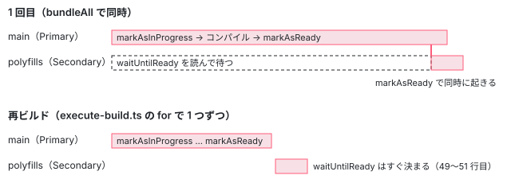

[目次](../README.md) › [tools/esbuild の読み残し：束ね方の設定・JS の後処理・watch・i18n の差し込み・スタイル・コンパイラプラグインの残りを行で埋める](README.md) › 第 6 回 / 全 7 回

# compiler-plugin の残り：コンパイルの状態・JIT のコールバック・コンポーネントのスタイル

> tools/esbuild/angular/compiler-plugin.ts の未読の行（初期化と emit の失敗、プログラムに無いファイル、JSON の置き換え、Web Worker、片付け）、compilation-state.ts（Primary と Secondary の文脈、markAsReady と待ち合わせ）、FileReferenceTracker、jit-plugin-callbacks.ts、component-stylesheets.ts の残り、rewrite-bazel-paths.ts。

angular/angular-cli · 読了 約 12 分 · 発展 · [サイトで読む（デモが動きます）](https://angular-deep-dive-cyan.vercel.app/chapter/esb-compiler-rest)

---

Angular のコンパイラのプラグイン（`compiler-plugin.ts`）は、ブラウザ・polyfills・サーバーの束の esbuild に 1 つずつ差さります。TypeScript のプログラムは 1 つだけで、それを持つのはブラウザの束のプラグイン（Primary）です。ほかのプラグイン（Secondary）は、Primary が終わるのを待って同じ結果を使います。この章では、その待ち合わせ（`compilation-state.ts`）、JIT のときにテンプレートとスタイルを読む esbuild のコールバック（`jit-plugin-callbacks.ts`）、スタイルの参照を追う `FileReferenceTracker`、それに compiler-plugin.ts と component-stylesheets.ts の、これまでの章で読んでいない行を読みます。

読む対象は ../angular-cli（44129f66a3）の `packages/angular/build/src/tools/esbuild/angular/` の `compiler-plugin.ts`・`compilation-state.ts`・`jit-plugin-callbacks.ts`・`component-stylesheets.ts`・`file-reference-tracker.ts`・`rewrite-bazel-paths.ts` です。onStart の流れ（160〜178 行目・319〜345 行目）と onLoad の頭は [application builder の章](../boot/04-boot-application-build.md)、AngularCompilation の初期化と emit は [Angular のコンパイルの章](../cli/03-cli-angular-compilation.md)、スタイルの束ね方は [コンポーネントのスタイルの章](../cli/04-cli-component-styles.md)、JIT の URI を作る変換と JIT の onResolve は [TypeScript の変換の章](../oxc/04-oxc-ts-transformers.md)、SourceFileCache は [キャッシュと watch の章](../cli/10-cli-cache-watch.md)で読みました。

1. [1. 束ね方の設定を作る関数](01-esb-code-bundle.md)
2. [2. JavaScriptTransformer](02-esb-js-transformer.md)
3. [3. watcher](03-esb-watcher.md)
4. [4. I18nInliner](04-esb-i18n-inliner.md)
5. [5. スタイルのプラグイン](05-esb-styles.md)
6. **6. compiler-plugin の残り**（この章）
7. [7. spec と issue](07-esb-tests-issues.md)

## 1. compilation-state：Primary と Secondary

📄 `angular-cli/packages/angular/build/src/tools/esbuild/angular/compilation-state.ts` L9–38 （▶ の行: 12–16, 19–20, 24, 26, 29, 33）

```ts
 9 │ import type { CompilerOptions } from '@angular/compiler-cli';
10 │ import type { AngularCompilation } from '../../angular/compilation';
11 │ 
12 ▶ export abstract class AngularCompilationContext {
13 ▶   abstract readonly compilation?: AngularCompilation;
14 ▶   abstract isPrimary(): this is PrimaryCompilationContext;
15 ▶   abstract readonly waitUntilReady: Promise<boolean>;
16 ▶   abstract getCompilerOptions(): Promise<CompilerOptions>;
17 │   abstract dispose(): Promise<void>;
18 │ 
19 ▶   createSecondaryContext(): AngularCompilationContext {
20 ▶     return new SecondaryCompilationContext(this);
21 │   }
22 │ }
23 │ 
24 ▶ export class PrimaryCompilationContext extends AngularCompilationContext {
25 │   readonly #compilation: AngularCompilation;
26 ▶   #pendingCompilation = true;
27 │   #resolveCompilationReady: ((value: boolean) => void) | undefined;
28 │   #compilationReadyPromise: Promise<boolean> | undefined;
29 ▶   #hasErrors = true;
30 │ 
31 │   #compilerOptions: CompilerOptions | undefined;
32 │   #resolveCompilerOptions: ((options: CompilerOptions) => void) | undefined;
33 ▶   #compilerOptionsPromise: Promise<CompilerOptions> | undefined;
34 │ 
35 │   constructor(compilation: AngularCompilation) {
36 │     super();
37 │     this.#compilation = compilation;
38 │   }
```

12〜22 行目の抽象クラス `AngularCompilationContext` が、プラグインから見た「コンパイルの文脈」の形です。15 行目の `waitUntilReady` は「この回のコンパイルが終わったら、エラーがあったかを返す Promise」、16 行目の `getCompilerOptions` は tsconfig を読んだ結果の compilerOptions です。19〜21 行目、どの文脈からでも `createSecondaryContext()` で、自分を親にした Secondary を作れます（[1 回目](01-esb-code-bundle.md)の setup-bundling.ts が polyfills とサーバーの束に渡す物）。この形は d070c2c322（2026-06）で入り、f3291745b4（2026-08）で何もしないコンパイル（NoopCompilation）を Secondary に置き換えました。

Primary は 26 行目で「コンパイル中」、29 行目で「エラーあり」から始まります。どちらも、まだ一度もコンパイルしていない状態を安全側に倒した初期値です。

📄 `angular-cli/packages/angular/build/src/tools/esbuild/angular/compilation-state.ts` L39–59 （▶ の行: 48–50, 53–54, 57）

```ts
39 │ 
40 │   override isPrimary(): this is PrimaryCompilationContext {
41 │     return true;
42 │   }
43 │ 
44 │   override get compilation(): AngularCompilation {
45 │     return this.#compilation;
46 │   }
47 │ 
48 ▶   override get waitUntilReady(): Promise<boolean> {
49 ▶     if (!this.#pendingCompilation) {
50 ▶       return Promise.resolve(this.#hasErrors);
51 │     }
52 │ 
53 ▶     this.#compilationReadyPromise ??= new Promise((resolve) => {
54 ▶       this.#resolveCompilationReady = resolve;
55 │     });
56 │ 
57 ▶     return this.#compilationReadyPromise;
58 │   }
59 │ 
```

📄 `angular-cli/packages/angular/build/src/tools/esbuild/angular/compilation-state.ts` L60–82 （▶ の行: 60–62, 65–66, 69–70, 73, 76–80）

```ts
60 ▶   override getCompilerOptions(): Promise<CompilerOptions> {
61 ▶     if (this.#compilerOptions) {
62 ▶       return Promise.resolve(this.#compilerOptions);
63 │     }
64 │ 
65 ▶     if (!this.#pendingCompilation) {
66 ▶       return Promise.resolve({});
67 │     }
68 │ 
69 ▶     this.#compilerOptionsPromise ??= new Promise((resolve) => {
70 ▶       this.#resolveCompilerOptions = resolve;
71 │     });
72 │ 
73 ▶     return this.#compilerOptionsPromise;
74 │   }
75 │ 
76 ▶   setCompilerOptions(options: CompilerOptions): void {
77 ▶     this.#compilerOptions = options;
78 ▶     this.#resolveCompilerOptions?.(options);
79 ▶     this.#resolveCompilerOptions = undefined;
80 ▶     this.#compilerOptionsPromise = undefined;
81 │   }
82 │ 
```

1. **終わっていれば、すぐ答える**

   49〜51 行目。コンパイル中でなければ、前の回の `hasErrors` で決まった Promise を返します。
2. **コンパイル中なら、1 つの Promise を分け合う**

   53〜57 行目。最初に聞いた人が Promise を作り、resolve を 54 行目で覚えます。あとから聞いた人も同じ Promise を受け取ります（`??=`）。
3. **compilerOptions も同じ作り**

   60〜74 行目。もう知っていればそれ（61〜63 行目）、コンパイル中でなければ空のオブジェクト（65〜67 行目）、コンパイル中なら Promise（69〜73 行目）。
4. **setCompilerOptions で待っている人を起こす**

   76〜81 行目。compiler-plugin.ts の 341 行目（初期化のすぐ後）から呼ばれます。コンパイル全体の終わりを待たずに、tsconfig の中身だけ先に渡せます。

📄 `angular-cli/packages/angular/build/src/tools/esbuild/angular/compilation-state.ts` L83–117 （▶ の行: 83–88, 90–91, 97–99, 106, 110, 112, 114）

```ts
 83 ▶   markAsReady(hasErrors: boolean): void {
 84 ▶     this.#hasErrors = hasErrors;
 85 ▶     this.#resolveCompilationReady?.(hasErrors);
 86 ▶     this.#resolveCompilationReady = undefined;
 87 ▶     this.#compilationReadyPromise = undefined;
 88 ▶     this.#pendingCompilation = false;
 89 │ 
 90 ▶     if (this.#resolveCompilerOptions) {
 91 ▶       this.#resolveCompilerOptions(this.#compilerOptions ?? {});
 92 │       this.#resolveCompilerOptions = undefined;
 93 │       this.#compilerOptionsPromise = undefined;
 94 │     }
 95 │   }
 96 │ 
 97 ▶   markAsInProgress(): void {
 98 ▶     this.#pendingCompilation = true;
 99 ▶     this.#compilerOptions = undefined;
100 │   }
101 │ 
102 │   #disposal: Promise<void> | undefined;
103 │ 
104 │   override dispose(): Promise<void> {
105 │     // Reuse any in progress disposal to ensure all callers can await completion
106 ▶     return (this.#disposal ??= this.#close());
107 │   }
108 │ 
109 │   async #close(): Promise<void> {
110 ▶     this.markAsReady(true);
111 │     try {
112 ▶       await this.#compilation.close?.();
113 │     } catch {
114 ▶       // Suppress closure errors to avoid unhandled rejections during teardown.
115 │     }
116 │   }
117 │ }
```

83〜95 行目の `markAsReady` は、待っている `waitUntilReady` を 85 行目で起こし、88 行目で「コンパイル中でない」にします。90〜94 行目、まだ compilerOptions を待っている人がいれば、知っている値か `{}` で起こします。初期化に失敗したときに Secondary を永久に待たせないためです。97〜100 行目の `markAsInProgress` は、Primary の onStart の頭（compiler-plugin.ts の 177 行目）で呼ばれ、前の回の compilerOptions を捨てます。104〜107 行目の `dispose` は、何度呼ばれても同じ Promise を返し、110 行目で待っている人をエラーありで起こしてから、112 行目でコンパイル（ワーカーなど）を閉じます。閉じるときのエラーは 113〜115 行目で握りつぶします。

📄 `angular-cli/packages/angular/build/src/tools/esbuild/angular/compilation-state.ts` L118–143 （▶ の行: 120, 128–129, 132–133, 136–137, 140–141）

```ts
118 │ 
119 │ export class SecondaryCompilationContext extends AngularCompilationContext {
120 ▶   constructor(private readonly primaryContext?: AngularCompilationContext) {
121 │     super();
122 │   }
123 │ 
124 │   override isPrimary(): this is PrimaryCompilationContext {
125 │     return false;
126 │   }
127 │ 
128 ▶   override get compilation(): undefined {
129 ▶     return undefined;
130 │   }
131 │ 
132 ▶   override get waitUntilReady(): Promise<boolean> {
133 ▶     return this.primaryContext?.waitUntilReady ?? Promise.resolve(false);
134 │   }
135 │ 
136 ▶   override getCompilerOptions(): Promise<CompilerOptions> {
137 ▶     return this.primaryContext?.getCompilerOptions() ?? Promise.resolve({});
138 │   }
139 │ 
140 ▶   override async dispose(): Promise<void> {
141 ▶     // No-op for secondary context to avoid disposing the primary compilation worker
142 │   }
143 │ }
```

Secondary は自分では何も持たず、133・137 行目で親に聞くだけです。親が無ければ（120 行目の `?`）、エラーなし・空の options。140〜142 行目の `dispose` は何もしません。Secondary が先に片付けられても、Primary のコンパイルのワーカーを閉じないためです（141 行目のコメント）。



*1 回目のビルド（全部の束を同時に）と、再ビルド（TypeScript の束を 1 つずつ）での待ち合わせ。記録の AOT の時刻を丸めた物です。*

## 2. compiler-plugin の options と、文脈の受け取り方

📄 `angular-cli/packages/angular/build/src/tools/esbuild/angular/compiler-plugin.ts` L42–66 （▶ の行: 43, 45, 53, 55, 58–63）

```ts
42 │ export interface CompilerPluginOptions {
43 ▶   sourcemap: boolean | 'external';
44 │   tsconfig: string;
45 ▶   jit?: boolean;
46 │ 
47 │   /**
48 │    * Include class metadata and JIT information in built code.
49 │    * The Angular TestBed APIs require additional metadata for the Angular aspects of the application
50 │    * such as Components, Modules, Pipes, etc.
51 │    * TestBed may also leverage JIT capabilities during testing (e.g., overrideComponent).
52 │    */
53 ▶   includeTestMetadata?: boolean;
54 │ 
55 ▶   advancedOptimizations?: boolean;
56 │   thirdPartySourcemaps?: boolean;
57 │   fileReplacements?: Record<string, string>;
58 ▶   sourceFileCache?: SourceFileCache;
59 ▶   loadResultCache?: LoadResultCache;
60 ▶   incremental: boolean;
61 ▶   externalRuntimeStyles?: boolean;
62 ▶   instrumentForCoverage?: (request: string) => boolean;
63 ▶   templateUpdates?: Map<string, string>;
64 │ }
65 │ 
66 │ // eslint-disable-next-line max-lines-per-function
```

`CompilerPluginOptions` は compiler-plugin-options.ts が normalize 済みの options から作ります。47〜53 行目の `includeTestMetadata` は ng test のための印で、TestBed が使うクラスのメタデータと JIT の情報を出力に残します（114 行目で変換のクラスの `jit` にも効きます）。58〜59 行目の 2 つのキャッシュ、60 行目の incremental、61 行目の外部のランタイムのスタイル（dev-server の HMR）、62 行目のカバレッジの判定、63 行目のテンプレートの HMR の Map は、それぞれ下の節で使われます。

📄 `angular-cli/packages/angular/build/src/tools/esbuild/angular/compiler-plugin.ts` L129–159 （▶ の行: 129–132, 134, 138–140, 143, 149, 152, 154, 157）

```ts
129 ▶           : new PrimaryCompilationContext(
130 ▶               typeof compilationContextOrCompilation === 'function'
131 ▶                 ? await compilationContextOrCompilation()
132 ▶                 : compilationContextOrCompilation,
133 │             );
134 ▶       const compilation: AngularCompilation | undefined = angularCompilationContext.compilation;
135 │ 
136 │       // The in-memory cache of TypeScript file outputs will be used during the build in `onLoad` callbacks for TS files.
137 │       // A string value indicates direct TS/NG output and a Uint8Array indicates fully transformed code.
138 ▶       const typeScriptFileCache =
139 ▶         pluginOptions.sourceFileCache?.typeScriptFileCache ??
140 ▶         new Map<string, string | Uint8Array>();
141 │ 
142 │       // The resources from component stylesheets and web workers that will be added to the build results output files
143 ▶       const additionalResults = new Map<
144 │         string,
145 │         { outputFiles?: OutputFile[]; metafile?: Metafile; errors?: PartialMessage[] }
146 │       >();
147 │ 
148 │       // Compilation is initially assumed to have errors until emitted
149 ▶       let hasCompilationErrors = true;
150 │ 
151 │       // Determines if TypeScript should process JavaScript files based on tsconfig `allowJs` option
152 ▶       let shouldTsIgnoreJs = true;
153 │       // Determines if transpilation should be handle by TypeScript or esbuild
154 ▶       let useTypeScriptTranspilation = true;
155 │ 
156 │       // To fully invalidate files, track resource referenced files and their referencing source
157 ▶       const referencedFileTracker = new FileReferenceTracker();
158 │ 
159 │       // eslint-disable-next-line max-lines-per-function
```

69〜70 行目（[application builder の章](../boot/04-boot-application-build.md)の引用）のとおり、2 つめの引数は文脈・コンパイル・コンパイルを作る関数のどれでも受け取れます。124〜125 行目のコメントのとおり private API の互換のためで、文脈でなければ 129〜133 行目で Primary に包みます。134 行目、Secondary なら `compilation` は `undefined` です。138〜140 行目、TypeScript の出力のキャッシュは SourceFileCache のものを使い、無ければこのプラグインだけの Map を作ります。149・152・154 行目は「エラーあり」「allowJs なし」「TypeScript で変換する」を初期値にし、onStart のたびに 161 行目と 169〜172 行目（Secondary）・342〜344 行目（Primary）で上書きされます。157 行目の `FileReferenceTracker` は 5 節で読みます。

## 3. onStart の残り：初期化の失敗、emit の失敗、終わり方

📄 `angular-cli/packages/angular/build/src/tools/esbuild/angular/compiler-plugin.ts` L353–384 （▶ の行: 353–355, 359, 366–367, 369, 372, 374–375）

```ts
353 ▶         } catch (error) {
354 ▶           (result.errors ??= []).push({
355 ▶             text: 'Angular compilation initialization failed.',
356 │             location: null,
357 │             notes: [
358 │               {
359 ▶                 text: error instanceof Error ? (error.stack ?? error.message) : `${error}`,
360 │                 location: null,
361 │               },
362 │             ],
363 │           });
364 │ 
365 │           // Initialization failure prevents further compilation steps
366 ▶           hasCompilationErrors = true;
367 ▶           angularCompilationContext.markAsReady(true);
368 │ 
369 ▶           return result;
370 │         }
371 │ 
372 ▶         if (externalStylesheets) {
373 │           // Process any new external stylesheets
374 ▶           for (const [stylesheetFile, externalId] of externalStylesheets) {
375 ▶             await bundleExternalStylesheet(
376 │               stylesheetBundler,
377 │               stylesheetFile,
378 │               externalId,
379 │               result,
380 │               additionalResults,
381 │             );
382 │           }
383 │         }
384 │ 
```

`compilation.initialize`（tsconfig を読み、プログラムを作る）が投げたら、354〜363 行目でスタックつきのエラーにし、367 行目で `markAsReady(true)` を呼んでから返ります。これが無いと、1 節の Secondary が待ち続けます。372〜383 行目、外部のランタイムのスタイル（dev-server がつけた印）があれば、ここでコンポーネントの CSS を 1 つずつ束ねます（[HMR の章](../cli/11-cli-hmr.md)）。

📄 `angular-cli/packages/angular/build/src/tools/esbuild/angular/compiler-plugin.ts` L393–404 （▶ の行: 393–395, 399）

```ts
393 ▶           } catch (error) {
394 ▶             (result.errors ??= []).push({
395 ▶               text: 'Angular compilation emit failed.',
396 │               location: null,
397 │               notes: [
398 │                 {
399 ▶                   text: error instanceof Error ? (error.stack ?? error.message) : `${error}`,
400 │                   location: null,
401 │                 },
402 │               ],
403 │             });
404 │           }
```

emit（386〜392 行目）が投げたら、同じ形のエラーを足します。こちらは返らずに先に進み、診断（406〜421 行目）も始めます。

📄 `angular-cli/packages/angular/build/src/tools/esbuild/angular/compiler-plugin.ts` L422–448 （▶ の行: 425–427, 432–435, 439, 442, 444）

```ts
422 │ 
423 │         // Add errors from failed additional results.
424 │         // This must be done after emit to capture latest web worker results.
425 ▶         for (const { errors } of additionalResults.values()) {
426 ▶           if (errors) {
427 ▶             (result.errors ??= []).push(...errors);
428 │           }
429 │         }
430 │ 
431 │         // Store referenced files for updated file watching if enabled
432 ▶         if (pluginOptions.sourceFileCache) {
433 ▶           pluginOptions.sourceFileCache.referencedFiles = [
434 ▶             ...referencedFiles,
435 ▶             ...referencedFileTracker.referencedFiles,
436 │           ];
437 │         }
438 │ 
439 ▶         hasCompilationErrors = !!result.errors?.length;
440 │ 
441 │         // Reset the setup warnings so that they are only shown during the first build.
442 ▶         setupWarnings = undefined;
443 │ 
444 ▶         angularCompilationContext.markAsReady(hasCompilationErrors);
445 │ 
446 │         return result;
447 │       });
448 │ 
```

1. **Web Worker のエラーを足す**

   425〜429 行目。emit の中で Web Worker を束ねたとき（286 行目）の失敗は additionalResults に入っているので、emit の**後**で集めます（423〜424 行目のコメント）。
2. **監視するファイルを SourceFileCache に渡す**

   432〜437 行目。TypeScript のプログラムのファイルと、5 節の tracker が知っている参照先（スタイルの partial など）を合わせて `referencedFiles` にします。この一覧は ExecutionResult の `watchFiles`（bundler-execution-result.ts）に入り、build-action.ts がそれを watcher に足します（[3 回目](03-esb-watcher.md)）。
3. **警告は 1 回目だけ**

   442 行目で `setupWarnings` を `undefined` にし、次の回の 165 行目からは何も出ません。
4. **Secondary を起こす**

   444 行目の `markAsReady`。onEnd の 624〜626 行目でもう一度呼ぶのは、onStart が途中で投げたときのためです（623 行目のコメント）。デモでも、1 回のビルドで markAsReady が 2 回記録されています。

> [!WARNING]
> **ハマりどころ**
>
> 442 行目を通るのは Primary だけです。Secondary は 168〜175 行目（[application builder の章](../boot/04-boot-application-build.md)の引用）で先に返るので、`setupWarnings` が残り、毎回の onStart の 165 行目で同じ警告を返します。デモの「AOT・永続キャッシュの場所が作れない」は、LMDB も SQLite も読めない状態にして 84〜104 行目の「Unable to initialize JavaScript cache storage.」を出したもので、main の束は 1 回目だけ、polyfills の束は 3 回とも警告を返しました。22.2.7 と新しい本家でも、この 2 か所は同じです。

## 4. onLoad の残り：プログラムに無いファイル、JSON の置き換え、終わりの片付け

📄 `angular-cli/packages/angular/build/src/tools/esbuild/angular/compiler-plugin.ts` L468–497 （▶ の行: 469–470, 472–474, 478, 481–482, 495）

```ts
468 │           try {
469 ▶             directContents = await readFile(request, 'utf-8');
470 ▶             const transformResult = await compilation.transformFile(request, directContents);
471 │             if (transformResult) {
472 ▶               contents = transformResult.contents;
473 ▶               if (transformResult.watchFiles) {
474 ▶                 referencedFileTracker.add(request, transformResult.watchFiles);
475 │               }
476 │             }
477 │           } catch (error) {
478 ▶             return {
479 │               errors: [
480 │                 {
481 ▶                   text: 'Angular compilation transform failed.',
482 ▶                   location: { file: request },
483 │                   notes: [
484 │                     {
485 │                       text: error instanceof Error ? (error.stack ?? error.message) : `${error}`,
486 │                       location: null,
487 │                     },
488 │                   ],
489 │                 },
490 │               ],
491 │             };
492 │           }
493 │         }
494 │ 
495 ▶         if (contents === undefined) {
496 │           // If the Angular compilation had errors the file may not have been emitted.
497 │           // To avoid additional errors about missing files, return empty contents.
```

467 行目（[application builder の章](../boot/04-boot-application-build.md)の引用）の条件、つまりキャッシュに無く、コンパイルが `transformFile` を持つとき（ファイルごとにその場で変換する作り）の道が 468〜493 行目です。495 行目からは、それでも中身が無いときです。473〜475 行目、変換が返した `watchFiles` を tracker に足し、そのファイルが変わったら `request` も変わったことにします。

📄 `angular-cli/packages/angular/build/src/tools/esbuild/angular/compiler-plugin.ts` L498–525 （▶ の行: 498–499, 504–505, 512–515, 517, 523–524）

```ts
498 ▶           if (hasCompilationErrors) {
499 ▶             return { contents: '', loader: 'js' };
500 │           }
501 │ 
502 │           // No TS result indicates the file is not part of the TypeScript program.
503 │           // If allowJs is enabled and the file is JS then defer to the next load hook.
504 ▶           if (!shouldTsIgnoreJs && isJS) {
505 ▶             return undefined;
506 │           }
507 │ 
508 │           const diangosticRoot = build.initialOptions.absWorkingDir ?? '';
509 │ 
510 │           // Evaluate whether the file requires the Angular compiler transpilation.
511 │           // If not, issue a warning but allow bundler to process the file (no type-checking).
512 ▶           directContents ??= await readFile(request, 'utf-8');
513 ▶           if (!requiresAngularCompiler(directContents)) {
514 ▶             return {
515 ▶               warnings: [createMissingFileDiagnostic(request, args.path, diangosticRoot, false)],
516 │               contents: directContents,
517 ▶               loader: 'ts',
518 │               resolveDir: path.dirname(request),
519 │             };
520 │           }
521 │ 
522 │           // Otherwise return an error
523 ▶           return {
524 ▶             errors: [createMissingFileDiagnostic(request, args.path, diangosticRoot, true)],
525 │           };
```

1. **コンパイルにエラーがあれば空**

   498〜500 行目。emit されなかったファイルについて「見つからない」を重ねて出さないためです。
2. **allowJs の JS は次の onLoad へ**

   504〜506 行目。558 行目の JS 用の onLoad が拾います。
3. **Angular のメタデータが無ければ警告だけ**

   512〜520 行目。782 行目の正規表現（`@angular/core` や `@Component` など）に当たらなければ、型チェックなしで esbuild に `ts` として渡し、「not found in TypeScript compilation」の警告を付けます。
4. **当たればエラー**

   523〜525 行目。tsconfig の files / include に入れる案内つき（753〜758 行目）。

📄 `angular-cli/packages/angular/build/src/tools/esbuild/angular/compiler-plugin.ts` L743–772 （▶ の行: 750, 753, 756–757, 762, 767–768, 770）

```ts
743 │ 
744 │ function createMissingFileDiagnostic(
745 │   request: string,
746 │   original: string,
747 │   root: string,
748 │   angular: boolean,
749 │ ): PartialMessage {
750 ▶   const relativeRequest = path.relative(root, request);
751 │   const notes: PartialNote[] = [];
752 │ 
753 ▶   if (angular) {
754 │     notes.push({
755 │       text:
756 ▶         `Files containing Angular metadata ('@Component'/'@Directive'/etc.) must be part of the TypeScript compilation.` +
757 ▶         ` You can ensure the file is part of the TypeScript program via the 'files' or 'include' property.`,
758 │     });
759 │   } else {
760 │     notes.push({
761 │       text:
762 ▶         `The file will be bundled and included in the output but will not be type-checked at build time.` +
763 │         ` To remove this message you can add the file to the TypeScript program via the 'files' or 'include' property.`,
764 │     });
765 │   }
766 │ 
767 ▶   const relativeOriginal = path.relative(root, original);
768 ▶   if (relativeRequest !== relativeOriginal) {
769 │     notes.push({
770 ▶       text: `File is requested from a file replacement of '${relativeOriginal}'.`,
771 │     });
772 │   }
```

📄 `angular-cli/packages/angular/build/src/tools/esbuild/angular/compiler-plugin.ts` L773–786 （▶ の行: 775, 782, 785）

```ts
773 │ 
774 │   const diagnostic = {
775 ▶     text: `File '${relativeRequest}' not found in TypeScript compilation.`,
776 │     notes,
777 │   };
778 │ 
779 │   return diagnostic;
780 │ }
781 │ 
782 ▶ const POTENTIAL_METADATA_REGEX = /@angular\/core|@Component|@Directive|@Injectable|@Pipe|@NgModule/;
783 │ 
784 │ function requiresAngularCompiler(contents: string): boolean {
785 ▶   return POTENTIAL_METADATA_REGEX.test(contents);
786 │ }
```

767〜772 行目、fileReplacements で置き換えた先のファイルなら、元のファイル名も添えます。

📄 `angular-cli/packages/angular/build/src/tools/esbuild/angular/compiler-plugin.ts` L550–557 （▶ の行: 551–554）

```ts
550 │ 
551 ▶         return {
552 ▶           contents,
553 ▶           loader,
554 ▶           resolveDir: path.dirname(request),
555 │         };
556 │       });
557 │ 
```

📄 `angular-cli/packages/angular/build/src/tools/esbuild/angular/compiler-plugin.ts` L588–621 （▶ の行: 590–592, 594–597, 600–602, 607, 613–614）

```ts
588 │ 
589 │       // Add a load handler if there are file replacement option entries for JSON files
590 ▶       if (
591 ▶         pluginOptions.fileReplacements &&
592 ▶         Object.keys(pluginOptions.fileReplacements).some((value) => value.endsWith('.json'))
593 │       ) {
594 ▶         build.onLoad(
595 ▶           { filter: /\.json$/ },
596 ▶           createCachedLoad(pluginOptions.loadResultCache, async (args) => {
597 ▶             const replacement = pluginOptions.fileReplacements?.[path.normalize(args.path)];
598 │             if (replacement) {
599 │               return {
600 ▶                 contents: await readFile(path.normalize(replacement)),
601 ▶                 loader: 'json' as const,
602 ▶                 watchFiles: [replacement],
603 │               };
604 │             }
605 │ 
606 │             // If no replacement defined, let esbuild handle it directly
607 ▶             return null;
608 │           }),
609 │         );
610 │       }
611 │ 
612 │       // Setup bundling of component templates and stylesheets when in JIT mode
613 ▶       if (pluginOptions.jit) {
614 ▶         setupJitPluginCallbacks(
615 │           build,
616 │           stylesheetBundler,
617 │           additionalResults,
618 │           pluginOptions.loadResultCache,
619 │         );
620 │       }
621 │ 
```

590〜610 行目、fileReplacements に `.json` の項目があるときだけ、JSON の onLoad を足します。置き換えがあれば中身を読み、602 行目で置き換え先を watchFiles に入れます。無ければ 607 行目の `null` で esbuild に任せます。613〜620 行目、JIT なら 6 節のコールバックを登録します。

📄 `angular-cli/packages/angular/build/src/tools/esbuild/angular/compiler-plugin.ts` L659–666 （▶ の行: 661–664）

```ts
659 │       });
660 │ 
661 ▶       build.onDispose(() => {
662 ▶         void angularCompilationContext.dispose();
663 ▶         void javascriptTransformer.close();
664 ▶         void cacheStore?.close();
665 │       });
666 │ 
```

esbuild の context を捨てるときに、文脈（Primary ならコンパイルのワーカーも）・変換のワーカー・永続キャッシュを閉じます。どれも待たずに投げっぱなし（`void`）です。

📄 `angular-cli/packages/angular/build/src/tools/esbuild/angular/compiler-plugin.ts` L714–742 （▶ の行: 721–723, 728–729, 732, 734, 737–738）

```ts
714 │ 
715 │ function bundleWebWorker(
716 │   build: PluginBuild,
717 │   pluginOptions: CompilerPluginOptions,
718 │   workerFile: string,
719 │ ) {
720 │   try {
721 ▶     return build.esbuild.buildSync({
722 ▶       ...build.initialOptions,
723 ▶       platform: 'browser',
724 │       write: false,
725 │       bundle: true,
726 │       metafile: true,
727 │       format: 'esm',
728 ▶       entryNames: 'worker-[hash]',
729 ▶       entryPoints: [workerFile],
730 │       sourcemap: pluginOptions.sourcemap,
731 │       // Zone.js is not used in Web workers so no need to disable
732 ▶       supported: undefined,
733 │       // Plugins are not supported in sync esbuild calls
734 ▶       plugins: undefined,
735 │     });
736 │   } catch (error) {
737 ▶     if (error && typeof error === 'object' && 'errors' in error && 'warnings' in error) {
738 ▶       return error as BuildFailure;
739 │     }
740 │     throw error;
741 │   }
742 │ }
```

Web Worker は、TypeScript の変換の中から同期で呼ばれるので（270〜272 行目のコメント）、`buildSync` で束ねます。722 行目でアプリの束の options をそのまま広げ、732・734 行目で supported と plugins を外します。同期の esbuild はプラグインを受け付けないからです。737〜739 行目、esbuild の失敗（errors と warnings を持つ物）は投げずに結果として返し、273〜290 行目でエラーとして足されます。22.2.7 ではここに `chunkNames: 'worker-chunk-[hash]'` が足されています（a9bec13b58）。

## 5. FileReferenceTracker：スタイルの参照先から、変わったコンポーネントを逆に引く

📄 `angular-cli/packages/angular/build/src/tools/esbuild/angular/file-reference-tracker.ts` L9–35 （▶ の行: 12, 14–15, 18–19, 22–23, 27, 29, 31）

```ts
 9 │ import { normalize } from 'node:path';
10 │ 
11 │ export class FileReferenceTracker {
12 ▶   #referencingFiles = new Map<string, Set<string>>();
13 │ 
14 ▶   get referencedFiles() {
15 ▶     return this.#referencingFiles.keys();
16 │   }
17 │ 
18 ▶   add(containingFile: string, referencedFiles: Iterable<string>): void {
19 ▶     const normalizedContainingFile = normalize(containingFile);
20 │     for (const file of referencedFiles) {
21 │       const normalizedReferencedFile = normalize(file);
22 ▶       if (normalizedReferencedFile === normalizedContainingFile) {
23 ▶         // Containing file is already known to the AOT compiler
24 │         continue;
25 │       }
26 │ 
27 ▶       const referencing = this.#referencingFiles.get(normalizedReferencedFile);
28 │       if (referencing === undefined) {
29 ▶         this.#referencingFiles.set(normalizedReferencedFile, new Set([normalizedContainingFile]));
30 │       } else {
31 ▶         referencing.add(normalizedContainingFile);
32 │       }
33 │     }
34 │   }
35 │ 
```

📄 `angular-cli/packages/angular/build/src/tools/esbuild/angular/file-reference-tracker.ts` L36–60 （▶ の行: 40, 42, 45, 47, 49, 51, 54, 58）

```ts
36 │   /**
37 │    *
38 │    * @param changed The set of changed files.
39 │    */
40 ▶   update(changed: Set<string>): Set<string> {
41 │     // Lazily initialized to avoid unneeded copying if there are no additions to return
42 ▶     let allChangedFiles: Set<string> | undefined;
43 │ 
44 │     // Add referencing files to fully notify the AOT compiler of required component updates
45 ▶     for (const modifiedFile of changed) {
46 │       const normalizedModifiedFile = normalize(modifiedFile);
47 ▶       const referencing = this.#referencingFiles.get(normalizedModifiedFile);
48 │       if (referencing) {
49 ▶         allChangedFiles ??= new Set(changed);
50 │         for (const referencingFile of referencing) {
51 ▶           allChangedFiles.add(referencingFile);
52 │         }
53 │         // Cleanup the stale record which will be updated by new resource transforms
54 ▶         this.#referencingFiles.delete(normalizedModifiedFile);
55 │       }
56 │     }
57 │ 
58 ▶     return allChangedFiles ?? changed;
59 │   }
60 │ }
```

AOT のコンパイラは、コンポーネントの `styleUrl` のファイルは知っていますが、その中の `@use 'vars'` の先（`_vars.scss`）は知りません。tracker は 12 行目の Map に「参照されるファイル → それを参照するファイルの集合」を持ちます。

1. **スタイルを束ねるたびに add**

   compiler-plugin.ts の 259〜263 行目（[スタイルの章](../cli/04-cli-component-styles.md)の引用）で、コンポーネントの .ts と、外部のスタイルファイル自身の 2 つを「参照する側」として add します。22〜25 行目、自分自身は飛ばします。
2. **再ビルドの頭で update**

   189 行目で、変わったファイルの集合を渡します。47〜52 行目、参照する側を足した新しい集合を作り（49 行目、要るときだけ写す）、54 行目でその記録を消します。次の変換で 1 の add がもう一度書くからです。
3. **広げた集合で無効化**

   190〜197 行目で SourceFileCache・スタイル・additionalResults を、201 行目で AOT のコンパイルを、この集合で無効にします。

デモの AOT で `_vars.scss` を変えると、update は `[_vars.scss] → [_vars.scss, counter.ts, counter.scss]` を返しました。`counter.html` を変えたときは `[counter.html]` のままです。テンプレートは AOT のコンパイラ自身が知っているので、tracker の出番がありません。JIT では、スタイルは 6 節の onLoad で esbuild が直接読むので、tracker には何も入らず、update は `[_vars.scss]` のままでした。代わりに esbuild の watchFiles に `_vars.scss` が入ります。

## 6. jit-plugin-callbacks：angular:jit:style と angular:jit:template

📄 `angular-cli/packages/angular/build/src/tools/esbuild/angular/jit-plugin-callbacks.ts` L9–20 （▶ の行: 13–16, 18）

```ts
 9 │ import type { Metafile, OutputFile, PluginBuild } from 'esbuild';
10 │ import { readFile } from 'node:fs/promises';
11 │ import { dirname, join, relative } from 'node:path';
12 │ import {
13 ▶   JIT_NAMESPACE_REGEXP,
14 ▶   JIT_STYLE_NAMESPACE,
15 ▶   JIT_TEMPLATE_NAMESPACE,
16 ▶   parseJitUri,
17 │ } from '../../angular/uri';
18 ▶ import { LoadResultCache, createCachedLoad } from '../load-result-cache';
19 │ import { ComponentStylesheetBundler } from './component-stylesheets';
20 │ 
```

📄 `angular-cli/packages/angular/build/src/tools/esbuild/angular/jit-plugin-callbacks.ts` L21–52 （▶ の行: 32, 35, 37–38, 41–42, 46, 50）

```ts
21 │ /**
22 │  * Loads/extracts the contents from a load callback Angular JIT entry.
23 │  * An Angular JIT entry represents either a file path for a component resource or base64
24 │  * encoded data for an inline component resource.
25 │  * @param entry The value that represents content to load.
26 │  * @param root The absolute path for the root of the build (typically the workspace root).
27 │  * @param skipRead If true, do not attempt to read the file; if false, read file content from disk.
28 │  * This option has no effect if the entry does not originate from a file. Defaults to false.
29 │  * @returns An object containing the absolute path of the contents and optionally the actual contents.
30 │  * For inline entries the contents will always be provided.
31 │  */
32 ▶ async function loadEntry(
33 │   entry: string,
34 │   root: string,
35 ▶   skipRead?: boolean,
36 │ ): Promise<{ path: string; contents?: string }> {
37 ▶   if (entry.startsWith('inline:')) {
38 ▶     const [importer, data] = entry.slice(7).split(';', 2);
39 │ 
40 │     return {
41 ▶       path: join(root, importer),
42 ▶       contents: Buffer.from(data, 'base64').toString(),
43 │     };
44 │   }
45 │ 
46 ▶   const path = join(root, entry);
47 │ 
48 │   return {
49 │     path,
50 ▶     contents: skipRead ? undefined : await readFile(path, 'utf-8'),
51 │   };
52 │ }
```

📄 `angular-cli/packages/angular/build/src/tools/esbuild/angular/jit-plugin-callbacks.ts` L53–70 （▶ の行: 63–67, 69）

```ts
53 │ 
54 │ /**
55 │  * Sets up esbuild resolve and load callbacks to support Angular JIT mode processing
56 │  * for both Component stylesheets and templates. These callbacks work alongside the JIT
57 │  * resource TypeScript transformer to convert and then bundle Component resources as
58 │  * static imports.
59 │  * @param build An esbuild {@link PluginBuild} instance used to add callbacks.
60 │  * @param styleOptions The options to use when bundling stylesheets.
61 │  * @param additionalResultFiles A Map where stylesheet resources will be added.
62 │  */
63 ▶ export function setupJitPluginCallbacks(
64 ▶   build: PluginBuild,
65 ▶   stylesheetBundler: ComponentStylesheetBundler,
66 ▶   additionalResultFiles: Map<string, { outputFiles?: OutputFile[]; metafile?: Metafile }>,
67 ▶   loadCache?: LoadResultCache,
68 │ ): void {
69 ▶   const root = build.initialOptions.absWorkingDir ?? '';
70 │ 
```

JIT のとき、TypeScript の変換（[TypeScript の変換の章](../oxc/04-oxc-ts-transformers.md)）は `templateUrl: './counter.html'` を `import … from 'angular:jit:template:file;./counter.html'` に書き換えます。74〜98 行目の onResolve（同じ章の引用）が、それを名前空間とワークスペースからの相対パスに直します。デモでは `angular:jit:template:file;./counter.html` が `namespace angular:jit:template・path src/app/counter.html` になりました。`loadEntry` は、`inline:` で始まれば 38 行目で「含むファイル;base64 の中身」に割ってデコードし、そうでなければ 46 行目でワークスペースの根につないで読みます（50 行目、`skipRead` なら読まない）。

📄 `angular-cli/packages/angular/build/src/tools/esbuild/angular/jit-plugin-callbacks.ts` L99–125 （▶ の行: 101–103, 106, 111–112, 114, 118–119, 122）

```ts
 99 │ 
100 │   // Add a load callback to handle Component stylesheets (both inline and external)
101 ▶   build.onLoad(
102 ▶     { filter: /./, namespace: JIT_STYLE_NAMESPACE },
103 ▶     createCachedLoad(loadCache, async (args) => {
104 │       // skipRead is used here because the stylesheet bundling will read a file stylesheet
105 │       // directly either via a preprocessor or esbuild itself.
106 ▶       const entry = await loadEntry(args.path, root, true /* skipRead */);
107 │ 
108 │       let stylesheetResult;
109 │ 
110 │       // Stylesheet contents only exist for internal stylesheets
111 ▶       if (entry.contents === undefined) {
112 ▶         stylesheetResult = await stylesheetBundler.bundleFile(entry.path);
113 │       } else {
114 ▶         stylesheetResult = await stylesheetBundler.bundleInline(entry.contents, entry.path);
115 │       }
116 │ 
117 │       const { errors, warnings, referencedFiles } = stylesheetResult;
118 ▶       if (stylesheetResult.errors) {
119 ▶         return {
120 │           errors,
121 │           warnings,
122 ▶           watchFiles: referencedFiles && [...referencedFiles],
123 │         };
124 │       }
125 │ 
```

📄 `angular-cli/packages/angular/build/src/tools/esbuild/angular/jit-plugin-callbacks.ts` L126–139 （▶ の行: 128, 130, 134–135）

```ts
126 │       const { contents, outputFiles, metafile } = stylesheetResult;
127 │ 
128 ▶       additionalResultFiles.set(entry.path, { outputFiles, metafile });
129 │ 
130 ▶       return {
131 │         errors,
132 │         warnings,
133 │         contents,
134 ▶         loader: 'text',
135 ▶         watchFiles: referencedFiles && [...referencedFiles],
136 │       };
137 │     }),
138 │   );
139 │ 
```

1. **読み込みキャッシュに包む**

   103 行目。同じ名前空間とパスは、watchFiles が変わらない限り使い回します。
2. **ファイルは読まずに束ねる側に任せる**

   106 行目の `skipRead`。Sass などの前処理や esbuild 自身が読むからです（104〜105 行目）。112 行目でファイルとして、114 行目でインラインとして束ねます。
3. **CSS の出力を覚えて、中身は text で返す**

   128 行目、束ねた CSS の出力を additionalResults に入れ（onEnd で全体の出力に足す）、130〜136 行目で CSS の文字列を `loader: 'text'` で返します。コンポーネントは `styles: [import した文字列]` として受け取ります。
4. **参照先を watchFiles に**

   135 行目。デモでは `counter.scss, _vars.scss` が入りました。118〜124 行目、失敗しても watchFiles は返すので、直したら再ビルドされます。

## 7. component-stylesheets の残り

📄 `angular-cli/packages/angular/build/src/tools/esbuild/angular/component-stylesheets.ts` L9–25 （▶ の行: 14–15, 21–23）

```ts
 9 │ import assert from 'node:assert';
10 │ import path from 'node:path';
11 │ import { createContentHash } from '../../../utils/hash';
12 │ import { BundleContextResult, BundlerContext } from '../bundler-context';
13 │ import { type BuildOutputFile, BuildOutputFileType } from '../bundler-files';
14 ▶ import { MemoryCache } from '../cache';
15 ▶ import { MemoryLoadResultCache } from '../load-result-cache';
16 │ import {
17 │   BundleStylesheetOptions,
18 │   createStylesheetBundleOptions,
19 │ } from '../stylesheets/bundle-options';
20 │ 
21 ▶ export type ComponentStylesheetResult = BundleContextResult & {
22 ▶   contents: string;
23 ▶   referencedFiles: Set<string> | undefined;
24 │ };
25 │ 
```

📄 `angular-cli/packages/angular/build/src/tools/esbuild/angular/component-stylesheets.ts` L36–58 （▶ の行: 42–44, 50–51, 56–57）

```ts
36 │   /**
37 │    * @param options An object containing the stylesheet bundling options.
38 │    * @param defaultInlineLanguage The default language to use for inline component styles.
39 │    * @param incremental True if incremental watch mode is enabled.
40 │    */
41 │   constructor(
42 ▶     private readonly options: BundleStylesheetOptions,
43 ▶     private readonly defaultInlineLanguage: string,
44 ▶     private readonly incremental: boolean,
45 │   ) {}
46 │ 
47 │   /**
48 │    * Bundle a file-based component stylesheet for use within an AOT compiled Angular application.
49 │    * @param entry The file path of the stylesheet.
50 ▶    * @param externalId Either an external identifier string for initial bundling or a boolean for rebuilds, if external.
51 ▶    * @param direct If true, the output will be used directly by the builder; false if used inside the compiler plugin.
52 │    * @returns A component bundle result object.
53 │    */
54 │   async bundleFile(
55 │     entry: string,
56 ▶     externalId?: string | boolean,
57 ▶     direct?: boolean,
58 │   ): Promise<ComponentStylesheetResult> {
```

21〜24 行目、結果の形は BundlerContext の結果に、CSS の中身（`contents`）と参照したファイル（`referencedFiles`）を足した物です。5 節の tracker と 6 節の watchFiles が使うのは、この `referencedFiles` です。42〜44 行目、インラインのスタイルの既定の言語（angular.json の `inlineStyleLanguage`）と incremental を持ちます。56〜57 行目の `externalId` と `direct` は、dev-server の外部のランタイムのスタイルのための引数です。

📄 `angular-cli/packages/angular/build/src/tools/esbuild/angular/component-stylesheets.ts` L99–108 （▶ の行: 101, 103–104）

```ts
 99 │   }
100 │ 
101 ▶   bundleAllFiles(external: boolean, direct: boolean) {
102 │     return Promise.all(
103 ▶       Array.from(this.#fileContexts.entries()).map(([entry]) =>
104 ▶         this.bundleFile(entry, external, direct),
105 │       ),
106 │     );
107 │   }
108 │ 
```

📄 `angular-cli/packages/angular/build/src/tools/esbuild/angular/component-stylesheets.ts` L171–192 （▶ の行: 173–175, 180–182, 184）

```ts
171 │           return buildOptions;
172 │         },
173 ▶         /* useContext */ false,
174 ▶         /* initialFilter */ undefined,
175 ▶         this.#loadCache,
176 │       );
177 │     });
178 │ 
179 │     // Extract the result of the bundling from the output files
180 ▶     return this.extractResult(
181 ▶       await bundlerContext.bundle(),
182 ▶       bundlerContext.watchFiles,
183 │       !!externalId,
184 ▶       false,
185 │     );
186 │   }
187 │ 
188 │   /**
189 │    * Invalidates both file and inline based component style bundling state for a set of modified files.
190 │    * @param files The group of files that have been modified
191 │    * @returns An array of file based stylesheet entries if any were invalidated; otherwise, undefined.
192 │    */
```

`bundleAllFiles` は、覚えているファイルのスタイルを全部束ね直します（execute-build.ts の再ビルドで、外部のランタイムのスタイルのとき）。インラインのスタイルの BundlerContext は、173 行目で esbuild の context を使わず、175 行目で全部の context が 1 つの読み込みキャッシュを分け合います（その副作用は [BundlerContext の章](../abl/03-abl-context-post.md)の 6 節）。22.2.7 では、180 行目の前で束ねた結果のエラーの場所 `angular:styles/component:…` をコンポーネントのファイル名に書き換え、incremental でエラーなら含むファイルを watchFiles に足します（648aff9ebb）。

📄 `angular-cli/packages/angular/build/src/tools/esbuild/angular/component-stylesheets.ts` L230–262 （▶ の行: 231, 233–234, 240–241, 244, 246, 259–260）

```ts
230 │ 
231 ▶   collectReferencedFiles(): string[] {
232 │     const files = [];
233 ▶     for (const context of this.#fileContexts.values()) {
234 ▶       files.push(...context.watchFiles);
235 │     }
236 │ 
237 │     return files;
238 │   }
239 │ 
240 ▶   async dispose(): Promise<void> {
241 ▶     const contexts = [...this.#fileContexts.values(), ...this.#inlineContexts.values()];
242 │     this.#fileContexts.clear();
243 │     this.#inlineContexts.clear();
244 ▶     this.#loadCache.clear();
245 │ 
246 ▶     await Promise.allSettled(contexts.map((context) => context.dispose()));
247 │   }
248 │ 
249 │   private extractResult(
250 │     result: BundleContextResult,
251 │     referencedFiles: Set<string> | undefined,
252 │     external: boolean,
253 │     direct: boolean,
254 │   ): ComponentStylesheetResult {
255 │     let contents = '';
256 │     const outputFiles: BuildOutputFile[] = [];
257 │ 
258 │     const { errors, warnings } = result;
259 ▶     if (errors) {
260 ▶       return { errors, warnings, referencedFiles, contents: '' };
261 │     }
262 │ 
```

📄 `angular-cli/packages/angular/build/src/tools/esbuild/angular/component-stylesheets.ts` L311–324 （▶ の行: 315, 318, 321）

```ts
311 │ 
312 │     return {
313 │       errors,
314 │       warnings,
315 ▶       contents,
316 │       outputFiles,
317 │       metafile,
318 ▶       referencedFiles,
319 │       externalImports: result.externalImports,
320 │       platform: result.platform,
321 ▶       initialFiles: new Map(),
322 │     };
323 │   }
324 │ }
```

231〜238 行目の `collectReferencedFiles` は、外部のランタイムのスタイルのとき execute-build.ts が watcher に足す一覧です。44129f66a3 ではファイルの context しか見ず、インラインのスタイルが `@use` した partial が入りません。22.2.7 は 978351af71 でインラインの context も足しています。259〜261 行目、エラーなら中身は空で、referencedFiles だけは返します。321 行目の `initialFiles` は、コンポーネントのスタイルは初期の読み込みに入らないので、いつも空です。

## 8. rewrite-bazel-paths：Bazel の中で動くときだけのパスの付け替え

📄 `angular-cli/packages/angular/build/src/tools/esbuild/angular/rewrite-bazel-paths.ts` L9–30 （▶ の行: 11–13, 19–23, 26, 28）

```ts
 9 │ import { join, relative, sep } from 'node:path';
10 │ 
11 ▶ const bazelBinDirectory = process.env['BAZEL_BINDIR'];
12 ▶ const bazelExecRoot = process.env['JS_BINARY__EXECROOT'];
13 ▶ const execRootMarker = `${sep}execroot${sep}`;
14 │ 
15 │ /**
16 │  * Sandboxed actions run in a copy of the execroot whose absolute path differs from
17 │  * `JS_BINARY__EXECROOT`, so the effective execroot is derived from the working directory.
18 │  */
19 ▶ function effectiveExecRoot(): string | undefined {
20 ▶   const cwd = process.cwd();
21 ▶   const markerIndex = cwd.indexOf(execRootMarker);
22 ▶   if (markerIndex === -1) {
23 ▶     return bazelExecRoot;
24 │   }
25 │ 
26 ▶   const workspaceEnd = cwd.indexOf(sep, markerIndex + execRootMarker.length);
27 │ 
28 ▶   return workspaceEnd === -1 ? cwd : cwd.slice(0, workspaceEnd);
29 │ }
30 │ 
```

📄 `angular-cli/packages/angular/build/src/tools/esbuild/angular/rewrite-bazel-paths.ts` L31–60 （▶ の行: 32–33, 36, 38–39, 43–45, 50–52, 55）

```ts
31 │ export function rewriteForBazel(path: string): string {
32 ▶   if (!bazelBinDirectory || !bazelExecRoot) {
33 ▶     return path;
34 │   }
35 │ 
36 ▶   const execRoot = effectiveExecRoot() ?? bazelExecRoot;
37 │ 
38 ▶   const fromExecRoot = relative(execRoot, path);
39 ▶   if (!fromExecRoot.startsWith('..')) {
40 │     return path;
41 │   }
42 │ 
43 ▶   const fromBinDirectory = relative(bazelBinDirectory, path);
44 ▶   if (!fromBinDirectory.startsWith('..')) {
45 ▶     return join(execRoot, fromBinDirectory);
46 │   }
47 │ 
48 │   // A path that realpath resolved out of a symlink-staged sandbox into the
49 │   // unsandboxed execroot: re-anchor its execroot-relative tail.
50 ▶   const markerIndex = path.indexOf(execRootMarker);
51 ▶   if (markerIndex !== -1) {
52 ▶     const tail = path.slice(markerIndex + execRootMarker.length);
53 │     const workspaceEnd = tail.indexOf(sep);
54 │     if (workspaceEnd !== -1) {
55 ▶       return join(execRoot, tail.slice(workspaceEnd + 1));
56 │     }
57 │   }
58 │ 
59 │   return path;
60 │ }
```

compiler-plugin.ts の 450 行目と 561 行目（onLoad の頭）で、esbuild が渡したパスを通します。11〜12 行目の 2 つの環境変数（Bazel の js\_binary が渡す）が無ければ、32〜34 行目で何もしません。ふつうの ng build ではいつもこの道です。Bazel の sandbox（入力を symlink で並べた別の execroot の写し）の中では、esbuild が symlink を realpath でたどって sandbox の外の本当の execroot のパスを返し、TypeScript のプログラムは sandbox のパスで持っているので、「プログラムに無いファイル」になります（6469b5f1f5）。19〜29 行目で、作業フォルダの `/execroot/` から sandbox の execroot を割り出し、50〜56 行目で、パスの `/execroot/<ワークスペース名>/` の後ろを sandbox の execroot につなぎ直します。

| 条件 | 環境変数 | 作業フォルダ | 入力 | 戻り値 |
| --- | --- | --- | --- | --- |
| 環境変数なし | （なし） | `<tmp>/output/execroot/_main` | `<tmp>/output/execroot/_main/bazel-out/darwin_arm64-fastbuild/bin/src/app.js` | `<tmp>/output/execroot/_main/bazel-out/darwin_arm64-fastbuild/bin/src/app.js` |
| execroot の中のソース | BAZEL\_BINDIR=bazel-out/darwin\_arm64-fastbuild/bin、JS\_BINARY\_\_EXECROOT=&lt;tmp&gt;/output/execroot/\_main | `<tmp>/output/execroot/_main` | `<tmp>/output/execroot/_main/src/app.ts` | `<tmp>/output/execroot/_main/src/app.ts` |
| bin の下（execroot からの相対の bin） | BAZEL\_BINDIR=bazel-out/darwin\_arm64-fastbuild/bin、JS\_BINARY\_\_EXECROOT=&lt;tmp&gt;/output/execroot/\_main | `<tmp>/output/execroot/_main/bazel-out/darwin_arm64-fastbuild/bin` | `<tmp>/output/execroot/_main/bazel-out/darwin_arm64-fastbuild/bin/src/app.ts` | `<tmp>/output/execroot/_main/bazel-out/darwin_arm64-fastbuild/bin/src/app.ts` |
| sandbox で動き、realpath で execroot に出たパス | BAZEL\_BINDIR=bazel-out/darwin\_arm64-fastbuild/bin、JS\_BINARY\_\_EXECROOT=&lt;tmp&gt;/output/execroot/\_main | `<tmp>/output/sandbox/darwin-sandbox/7/execroot/_main` | `<tmp>/output/execroot/_main/src/app.ts` | `<tmp>/output/sandbox/darwin-sandbox/7/execroot/_main/src/app.ts` |
| sandbox の中のパス | BAZEL\_BINDIR=bazel-out/darwin\_arm64-fastbuild/bin、JS\_BINARY\_\_EXECROOT=&lt;tmp&gt;/output/execroot/\_main | `<tmp>/output/sandbox/darwin-sandbox/7/execroot/_main` | `<tmp>/output/sandbox/darwin-sandbox/7/execroot/_main/src/app.ts` | `<tmp>/output/sandbox/darwin-sandbox/7/execroot/_main/src/app.ts` |

表は、22.2.7 の dist の `rewriteForBazel` を、環境変数と作業フォルダを変えた子プロセスで呼んだ記録です（環境変数は 11〜12 行目でモジュールを読んだときに読まれるため）。`<tmp>` は一時フォルダです。書き換わったのは「sandbox で動き、realpath で execroot に出たパス」の 1 行だけで、sandbox の execroot の下に付け替えられました。

## 9. デモ：本物の compiler-plugin を通す小さなビルド

> **🧪 DEMO — @angular/build 22.2.7 の compiler-plugin の 3 回のビルド（記録）**
>
> カウンターのアプリ（templateUrl の counter.html と、`@use 'vars'` する counter.scss）に、polyfills として `src/polyfills.ts` を足しました。ブラウザの束（main）が Primary、polyfills の束が Secondary の compiler-plugin を持ちます。1 回目は execute-build.ts と同じく `BundlerContext.bundleAll` で同時に、2・3 回目は再ビルドと同じく SourceFileCache に聞いてから 1 つずつ束ねました。時刻はその回の頭からのミリ秒です。
>
> この回の SourceFileCache の referencedFiles（ワークスペースの中だけ）：src/main.server.ts、src/app/counter.ts、src/app/counter.html、src/app/counter.scss、src/main.ts、src/polyfills.ts、src/server.ts、src/environments/environment.prod.ts、src/environments/environment.ts、src/app/counter.scss、src/app/\_vars.scss
>
> ▶ [このデモはサイトで動かせます](https://angular-deep-dive-cyan.vercel.app/chapter/esb-compiler-rest)

1 回目では、polyfills の束の onStart が main より先に始まり、`waitUntilReady` を読んで待ちます。Primary の `markAsReady` と同じ時刻に Secondary の Promise が決まり、続けて compilerOptions も決まって、2 つの onStart が同じミリ秒に終わりました。2・3 回目は main が先に終わっているので、Secondary の `waitUntilReady` は読んだその場で決まります（1 節の 49〜51 行目）。JIT の 2 回目（\_vars.scss）は、SourceFileCache の invalidate が `false` でした。JIT では 432〜437 行目の referencedFiles にスタイルが入らないからです。それでも main の束が束ね直されるのは、esbuild の watchFiles に `_vars.scss` があり、BundlerContext の invalidate が真になるからです。

## 10. どう録ったか

スクリプトは `<work>/esb-demo/a/` に置き、Node v24.22.1 で、サイトの node\_modules の @angular/build 22.2.7 の dist を require しました。normalizeOptions → createComponentStyleBundler → SourceFileCache → createAngularCompilation → PrimaryCompilationContext → setupBundlerContexts の順は execute-build.ts と同じです。記録は、PrimaryCompilationContext と SecondaryCompilationContext の prototype のメソッドとゲッター、FileReferenceTracker の add と update を包み、compiler-plugin の `createCompilerPlugin` を包んで、esbuild の build を Proxy で渡して onStart・onEnd・JIT の名前空間の onResolve・onLoad を記録しました。3 つめの設定は、`require.cache` に 2 つのキャッシュのストアのモジュールを中身なしで先に入れ、本物の `createPersistentCacheStore` が両方の `new` で失敗するようにしたものです。

📄 `記録のスクリプト（rec-compiler.mjs）`

```
// 本物の compiler-plugin（サイトの node_modules の @angular/build 22.2.7）を、execute-build.ts と同じ組み立てで小さなアプリに当てる。
// polyfills に .ts を入れて、ブラウザの束（Primary）と polyfills の束（Secondary）の 2 つの compiler-plugin を同時に走らせ、
// compilation-state の呼び出し・JIT の名前空間の解決・FileReferenceTracker の add / update を時刻つきで記録する。
// 使い方: node rec-compiler.mjs <サイトのディレクトリ> <出力 JSON>
import { createRequire } from 'node:module';
import { readFileSync, writeFileSync, mkdirSync, rmSync } from 'node:fs';
import path from 'node:path';

const [site, out] = process.argv.slice(2);
const here = path.dirname(new URL(import.meta.url).pathname);
const app = path.join(here, 'app3');
const require = createRequire(path.join(site, 'package.json'));
const B = path.join(site, 'node_modules/@angular/build/src');
const r = (p) => require(path.join(B, p));
const { normalizeOptions } = r('builders/application/options.js');
const { setupBundlerContexts, createComponentStyleBundler } = r('builders/application/setup-bundling.js');
const { BundlerContext } = r('tools/esbuild/bundler-context.js');
const { SourceFileCache } = r('tools/esbuild/angular/source-file-cache.js');
const state = r('tools/esbuild/angular/compilation-state.js');
const { FileReferenceTracker } = r('tools/esbuild/angular/file-reference-tracker.js');
const compilerPluginModule = r('tools/esbuild/angular/compiler-plugin.js');
const { createAngularCompilation } = r('tools/angular/compilation/index.js');
const { getSupportedBrowsers } = r('utils/supported-browsers.js');
const { transformSupportedBrowsersToTargets } = r('tools/esbuild/target.js');

const hide = (s) => String(s).replaceAll(app, '<app>').replaceAll(site, '~/angular-research/angular-deep-dive');
let t0 = 0;
let log = [];
const now = () => +(performance.now() - t0).toFixed(1);
const ev = (who, what, detail) => {
  log.push({ t: now(), who, what, detail: detail === undefined ? null : hide(detail) });
  if (process.env.DEBUGREC) console.error(now(), who, what, detail ?? '');
};

// compilation-state の呼び出しを横から記録する
const P = state.PrimaryCompilationContext.prototype;
const S2 = state.SecondaryCompilationContext.prototype;
for (const name of ['markAsInProgress', 'markAsReady', 'setCompilerOptions']) {
  const orig = P[name];
  P[name] = function (...args) {
    ev('Primary', name, name === 'markAsReady' ? `hasErrors = ${args[0]}` : name === 'setCompilerOptions' ? `allowJs = ${!!args[0]?.allowJs}` : undefined);
    return orig.apply(this, args);
  };
}
const secWait = Object.getOwnPropertyDescriptor(S2, 'waitUntilReady').get;
Object.defineProperty(S2, 'waitUntilReady', { get() {
  ev('Secondary', 'waitUntilReady を読む');
  const p = secWait.call(this);
  p.then((v) => ev('Secondary', 'waitUntilReady が決まる', `hasErrors = ${v}`));
  return p;
} });
const secOpts = S2.getCompilerOptions;
S2.getCompilerOptions = function () {
  const p = secOpts.call(this);
  p.then((o) => ev('Secondary', 'getCompilerOptions が決まる', `keys = ${Object.keys(o).length}`));
  return p;
};
// FileReferenceTracker
const FA = FileReferenceTracker.prototype.add;
FileReferenceTracker.prototype.add = function (containing, refs) {
  ev('Tracker', 'add', `${path.relative(app, containing)} ← ${[...refs].map((f) => path.relative(app, f)).join(', ')}`);
  return FA.call(this, containing, refs);
};
const FU = FileReferenceTracker.prototype.update;
FileReferenceTracker.prototype.update = function (changed) {
  const result = FU.call(this, changed);
  ev('Tracker', 'update', `[${[...changed].map((f) => path.relative(app, f)).join(', ')}] → [${[...result].map((f) => path.relative(app, f)).join(', ')}]`);
  return result;
};
// compiler-plugin の onStart / onEnd と、JIT の名前空間の onResolve / onLoad
const origCreate = compilerPluginModule.createCompilerPlugin;
compilerPluginModule.createCompilerPlugin = function (...args) {
  const plugin = origCreate.apply(this, args);
  const setup = plugin.setup;
  plugin.setup = (build) => {
    const who = Object.keys(build.initialOptions.entryPoints ?? {}).join(',') + ' の束';
    const proxy = new Proxy(build, { get(target, prop) {
      if (prop === 'onStart') return (cb) => target.onStart(async () => { ev(who, 'onStart 開始'); const res = await cb(); ev(who, 'onStart 終わり', `errors ${res?.errors?.length ?? 0}・warnings ${res?.warnings?.length ?? 0}`); return res; });
      if (prop === 'onEnd') return (cb) => target.onEnd(async (result) => { ev(who, 'onEnd'); return cb(result); });
      if (prop === 'onResolve') return (opts, cb) => target.onResolve(opts, async (a) => {
        const res = await cb(a);
        if (String(opts.filter).includes('jit')) ev(who, 'onResolve（JIT）', `${a.path} → ${res ? `namespace ${res.namespace}・path ${res.path}` : 'undefined'}`);
        return res;
      });
      if (prop === 'onLoad') return (opts, cb) => target.onLoad(opts, async (a) => {
        const res = await cb(a);
        if (opts.namespace && opts.namespace.startsWith('angular:jit')) ev(who, 'onLoad（JIT）', `${a.namespace} ${a.path} → loader ${res?.loader}・${String(res?.contents ?? '').length} 文字・watchFiles ${(res?.watchFiles ?? []).map((f) => path.relative(app, f)).join(', ')}`);
        return res;
      });
      const v = Reflect.get(target, prop);
      return typeof v === 'function' ? v.bind(target) : v;
    } });
    return setup(proxy);
  };
  return plugin;
};

const project = JSON.parse(readFileSync(path.join(app, 'angular.json'), 'utf8')).projects.demo;
const runs = [];
for (const variant of [
  { id: 'aot', label: 'AOT', options: {} },
  { id: 'jit', label: 'JIT（aot: false）', options: { aot: false } },
  { id: 'badcache', label: 'AOT・永続キャッシュの場所が作れない', options: {}, badCache: true },
]) {
  writeFileSync(path.join(app, 'src/app/_vars.scss'), '$accent: #c3002f;\n');
  writeFileSync(path.join(app, 'src/app/counter.html'), '<button (click)="inc()">{{ count() }}</button>\n');
  const logger = { warn: () => {}, info: () => {}, error: () => {}, debug: () => {}, log: () => {} };
  const context = { workspaceRoot: app, target: { project: 'demo', target: 'build' }, logger, getProjectMetadata: async () => project };
  const options = await normalizeOptions(context, 'demo', {
    browser: 'src/main.ts', tsConfig: 'tsconfig.app.json', polyfills: ['src/polyfills.ts'], optimization: false, sourceMap: false, watch: true, ...variant.options,
  });
  const target = transformSupportedBrowsersToTargets(getSupportedBrowsers(options.projectRoot, logger));
  const styleBundler = createComponentStyleBundler(options, target);
  let cachePath;
  if (variant.badCache) {
    // LMDB も SQLite も使えない環境の代わりに、2 つのストアのモジュールを「中身の無いモジュール」として先に require.cache に入れる。
    // 本物の createPersistentCacheStore は new LmdbCacheStore(...) と new SqliteCacheStore(...) の両方で TypeError になり、
    // 「Unable to initialize JavaScript cache storage.」を投げる。
    for (const f of ['utils/cache/lmdb-cache-store.js', 'utils/cache/sqlite-cache-store.js']) {
      const filename = path.join(B, f);
      require.cache[filename] = { id: filename, filename, loaded: true, exports: {} };
    }
    cachePath = path.join(here, 'tmp-cache');
  }
  const cache = new SourceFileCache(cachePath);
  const compilation = await createAngularCompilation(!!options.jit, true);
  const ctx = new state.PrimaryCompilationContext(compilation);
  const { typescriptContexts } = setupBundlerContexts(options, target, cache, styleBundler, ctx, undefined);
  const steps = [];
  const step = async (label, change) => {
    log = [];
    t0 = performance.now();
    const results = [];
    if (!change) {
      // execute-build.ts の 1 回目と同じく、全部の束を同時に
      results.push(...(await BundlerContext.bundleAll(typescriptContexts)));
    } else {
      // execute-build.ts の再ビルドと同じく、SourceFileCache に聞いてから TypeScript の束を 1 つずつ
      change();
      const changed = new Set(change.files.map((f) => path.join(app, f)));
      const force = cache.invalidate(changed);
      ev('execute-build', 'SourceFileCache.invalidate', `${[...changed].map((f) => path.relative(app, f)).join(', ')} → ${force}`);
      for (const c of typescriptContexts) {
        c.invalidate(changed);
        results.push(await c.bundle(force));
      }
    }
    const per = results.map((res, i) => ({
      bundle: i === 0 ? 'main' : 'polyfills',
      errors: (res.errors ?? []).map((e) => hide(e.text)),
      warnings: (res.warnings ?? []).map((w) => hide(w.text)),
    }));
    steps.push({ label, log, per, ms: now(), referencedFiles: (cache.referencedFiles ?? []).map((f) => path.relative(app, f)).filter((f) => !f.startsWith('..')) });
  };
  await step('1 回目のビルド');
  const vars = () => writeFileSync(path.join(app, 'src/app/_vars.scss'), '$accent: #ff5c7a;\n');
  vars.files = ['src/app/_vars.scss'];
  await step('_vars.scss を変える', vars);
  const tpl = () => writeFileSync(path.join(app, 'src/app/counter.html'), '<button (click)="inc()">count: {{ count() }}</button>\n');
  tpl.files = ['src/app/counter.html'];
  await step('counter.html を変える', tpl);
  for (const c of typescriptContexts) await c.dispose();
  await ctx.dispose();
  runs.push({ id: variant.id, label: variant.label, steps });
  rmSync(path.join(here, 'tmp-cache'), { recursive: true, force: true });
}
writeFileSync(out, JSON.stringify({ version: require(path.join(B, '../package.json')).version, node: process.version, runs }, null, 1));
console.log('ok');
process.exit(0); // Sass のワーカーなどが残ってプロセスが終わらないので

```

📄 `記録のスクリプト（rec-bazel.mjs）`

```
// rewriteForBazel（22.2.7 の dist）を、Bazel の環境変数と作業フォルダを変えた子プロセスで呼んで記録する。
// 環境変数はモジュールを読み込んだ時（11〜12 行目）に読まれるので、条件ごとに別のプロセスにする。
// 使い方: node rec-bazel.mjs <サイトのディレクトリ> <出力 JSON>
import { execFileSync } from 'node:child_process';
import { mkdirSync, realpathSync, rmSync, writeFileSync } from 'node:fs';
import path from 'node:path';

const [site, out] = process.argv.slice(2);
const here = path.dirname(new URL(import.meta.url).pathname);
const root = path.join(here, 'bz');
const execroot = path.join(root, 'output/execroot/_main');
const sandbox = path.join(root, 'output/sandbox/darwin-sandbox/7/execroot/_main');
for (const d of [execroot, sandbox, path.join(execroot, 'bazel-out/darwin_arm64-fastbuild/bin')]) mkdirSync(d, { recursive: true });
const real = realpathSync(root);
const mod = path.join(site, 'node_modules/@angular/build/src/tools/esbuild/angular/rewrite-bazel-paths.js');
const bin = 'bazel-out/darwin_arm64-fastbuild/bin';
const cases = [
  { label: '環境変数なし', env: {}, cwd: execroot, input: path.join(execroot, bin, 'src/app.js') },
  { label: 'execroot の中のソース', env: { BAZEL_BINDIR: bin, JS_BINARY__EXECROOT: execroot }, cwd: execroot, input: path.join(execroot, 'src/app.ts') },
  { label: 'bin の下（execroot からの相対の bin）', env: { BAZEL_BINDIR: bin, JS_BINARY__EXECROOT: execroot }, cwd: path.join(execroot, bin), input: path.join(path.join(execroot, bin), 'src/app.ts') },
  { label: 'sandbox で動き、realpath で execroot に出たパス', env: { BAZEL_BINDIR: bin, JS_BINARY__EXECROOT: execroot }, cwd: sandbox, input: path.join(execroot, 'src/app.ts') },
  { label: 'sandbox の中のパス', env: { BAZEL_BINDIR: bin, JS_BINARY__EXECROOT: execroot }, cwd: sandbox, input: path.join(sandbox, 'src/app.ts') },
];
const hide = (s) => s.replaceAll(real, '<tmp>').replaceAll(root, '<tmp>');
const rows = cases.map((c) => {
  const outp = execFileSync(process.execPath, ['-e', `process.stdout.write(require(${JSON.stringify(mod)}).rewriteForBazel(${JSON.stringify(c.input)}))`], {
    cwd: c.cwd, env: { PATH: process.env.PATH, ...c.env },
  }).toString();
  return { label: c.label, env: Object.fromEntries(Object.entries(c.env).map(([k, v]) => [k, hide(v)])), cwd: hide(realpathSync(c.cwd)), input: hide(c.input), output: hide(outp), changed: outp !== c.input };
});
rmSync(root, { recursive: true, force: true });
writeFileSync(out, JSON.stringify(rows, null, 1));
console.log(JSON.stringify(rows, null, 1));

```

## ここまでの呼び出し

- `new PrimaryCompilationContext(await createAngularCompilation(jit, browserOnly))` — execute-build.ts
- `setupBundlerContexts(…, ctx)` — setup-bundling.ts — *polyfills・サーバーには ctx.createSecondaryContext()*
  - `createCompilerPlugin(pluginOptions, ctx, stylesheetBundler)` — compiler-plugin.ts 67
    - `setup(build)`：`new FileReferenceTracker()` — 157
    - `onStart`（Secondary）：`await ctx.waitUntilReady`・`getCompilerOptions()` — 168〜175 → compilation-state.ts 132〜138
    - `onStart`（Primary）：`markAsInProgress()` — 177 → 97
      - `referencedFileTracker.update(modifiedFiles)` — 189 → file-reference-tracker.ts 40
      - `compilation.initialize(…)` → `setCompilerOptions(…)` — 324 → 341 → 76 — *失敗したら 367 行目で markAsReady(true)*
      - `transformStylesheet` → `referencedFileTracker.add(…)` — 208 → 259
      - `sourceFileCache.referencedFiles = […]`・`markAsReady(hasErrors)` — 433・444 → 83
    - `setupJitPluginCallbacks(build, …)` — 614 → jit-plugin-callbacks.ts 63 — *JIT のとき*
      - `onLoad(angular:jit:style)` → `loadEntry` → `bundleFile / bundleInline` — 101〜138
    - `onDispose`：`ctx.dispose()` — 661 → 104

## テストと直し方

| spec | describe / it と行 | この章のどこ |
| --- | --- | --- |
| tools/esbuild/angular/compilation-state\_spec.ts | describe compilation-state（13 行目）。PrimaryCompilationContext（23 行目、it 9 件）：準備の状態の移り変わり（52 行目）、dispose（73 行目）、markAsReady で compilerOptions の待ちを起こす（83 行目）、markAsInProgress で捨てる（102 行目）。SecondaryCompilationContext（131 行目、it 5 件）：親に聞く（140・150 行目）、dispose で親を閉じない（160 行目） | 1 節 |
| builders/application/tests/behavior/component-stylesheets\_spec.ts・rebuild-component\_styles\_spec.ts | Behavior: "Component Stylesheets"・"Rebuilds when component stylesheets change" | 5・7 節 |
| behavior/component-templates\_spec.ts・rebuild-errors\_spec.ts・web-workers-application\_spec.ts・rebuild-web-workers\_spec.ts・options/file-replacements\_spec.ts | テンプレート、再ビルドのエラー、Web Worker、fileReplacements | 3・4 節 |
| （無い） | compiler-plugin.ts・jit-plugin-callbacks.ts・file-reference-tracker.ts・rewrite-bazel-paths.ts の単体の spec | 2〜6・8 節 |

../angular-cli で compilation-state\_spec は [2 回目](02-esb-js-transformer.md)のテストの節の 75 件の中で 14 件が通りました。builder を丸ごと動かす側は、`//packages/angular/build:application_integration_tests` を `"--test_arg=--filter=(Behavior: .Component Stylesheets.|Behavior: .Component Templates.|Behavior: .Rebuilds when component stylesheets change.|Behavior: .Rebuilds when Web Worker files change.|Behavior: .Bundles web worker files|Option: .fileReplacements.|Behavior: .Rebuild Error Detection.)"` で絞って、17 件、0 failures、PASSED でした（1 回目の章の 40 件と合わせて走らせた 57 件から、1 回目の分を引いた数）。

直すとしたら、ファイルと関数は次のとおりです。

- Secondary の警告の繰り返し：`compiler-plugin.ts` の onStart の 168〜175 行目で、返す前に `setupWarnings = undefined` にするか、165 行目で `warnings` に渡したあとに消す形です。固めるなら、compiler-plugin の単体の spec が無いので、新しく `compiler-plugin_spec.ts` を作り、esbuild の context に Secondary の文脈つきのプラグインを差して rebuild を 2 回し、2 回目の warnings が空であることを見る形になります。キャッシュのストアを失敗させるには、このデモと同じく `createPersistentCacheStore` が投げる状態を作る必要があります。
- インラインのスタイルの参照先：`component-stylesheets.ts` の `collectReferencedFiles`（231 行目）に `#inlineContexts` を足す形で、22.2.7 の 978351af71 がそうしています。固める it は rebuild-component\_styles\_spec.ts に、外部のランタイムのスタイルでインラインの `@use` 先を変える形です。

## 聞かれそうな質問

**Q. SSR のときも TypeScript のコンパイルは 1 回ですか？**

1 回です。setup-bundling.ts がサーバーの束に Secondary の文脈を渡すので、サーバーの束の compiler-plugin は 168〜175 行目で Primary の `waitUntilReady` を待ち、同じ TypeScript の出力のキャッシュ（138〜140 行目、SourceFileCache の Map）から読みます。134 行目、Secondary の `compilation` は `undefined` です。

**Q. Primary の初期化が失敗したら、ほかの束は止まったままになりませんか？**

なりません。367 行目で `markAsReady(true)` を呼んでから返り、compilation-state.ts の 85 行目で待っている Secondary を「エラーあり」で起こし、90〜94 行目で compilerOptions の待ちも `{}` で起こします。onEnd の 624〜626 行目でももう一度呼びます。

**Q. SCSS の partial を変えただけで、コンポーネントの .ts まで変わったことになるのはなぜですか？**

AOT のコンパイラは partial を知らないので、FileReferenceTracker が「\_vars.scss → counter.ts と counter.scss」を覚えていて、189 行目の update で変わったファイルに足すからです（5 節のデモ）。そうしないと、コンパイラはスタイルを持つコンポーネントを解析し直しません。

**Q. JIT ではテンプレートはどこで読まれますか？**

esbuild の onLoad です。変換が `angular:jit:template:file;./counter.html` を import に書き、74〜98 行目の onResolve が名前空間に直し、143〜154 行目の onLoad が `loadEntry` で読んで `loader: 'text'` で返します。watchFiles にそのファイルが入るので、変えれば esbuild の側の無効化で束ね直されます。

**Q. tsconfig に入っていない .ts を import するとどうなりますか？**

495〜525 行目です。Angular のメタデータらしい文字（782 行目）が無ければ、型チェックなしで束ねて「not found in TypeScript compilation」の警告、あればエラーです。コンパイルにエラーがある回は、重ねて出さないよう 498〜500 行目で空の中身を返します。

## 読み終えて

- TypeScript のコンパイルを持つのは Primary の文脈だけで、Secondary は waitUntilReady と getCompilerOptions を親に聞く。1 回目は同時に走って待ち合わせ、再ビルドは 1 つずつなので待たない。
- markAsReady は初期化の失敗・onStart の終わり・onEnd の 3 か所で呼ばれ、待っている人を必ず起こす。
- FileReferenceTracker は「参照先 → 参照する側」を持ち、再ビルドの頭で変わったファイルに参照する側を足す。テンプレートと JIT のスタイルは tracker を使わない。
- JIT のスタイルとテンプレートは名前空間の onLoad で読み、中身は text の文字列、CSS の出力は additionalResults に入る。
- Secondary は setupWarnings を消さないので、セットアップの警告を毎回返す。インラインのスタイルの参照先は 22.2.7 で watch の一覧に入った。

---

← 前: [スタイルのプラグイン：StylesheetPluginFactory と Sass・Less・PostCSS の結果](05-esb-styles.md)  
次: [spec と issue を読む：tools/esbuild の読み残しを固めているテスト](07-esb-tests-issues.md) →
