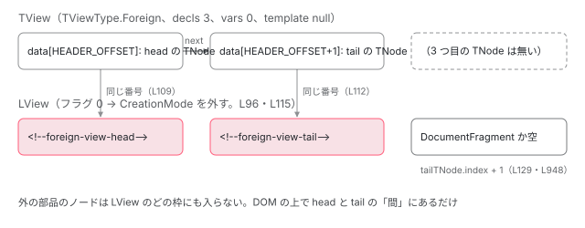

[目次](../README.md) › [外のコンポーネント：foreignImports と foreign view](README.md) › 第 2 回 / 全 6 回

# foreign view：head と tail のコメントで囲むビュー

> createForeignView が 3 つの枠の TView（TViewType.Foreign）を作り、head と tail のコメントを置き、切り離されたビューの根に置かれたときは DocumentFragment に入れる行。ノードを集める collect\_native\_nodes と、DOM に出し入れする node\_manipulation の applyForeignNodes が Foreign の型をどう扱うか。renderer の呼び出しの記録、foreign\_view\_spec.ts の 4 つの it、330e209c692 の開発モードの文字。

angular/angular · 読了 約 12 分 · 発展 · [サイトで読む（デモが動きます）](https://angular-deep-dive-cyan.vercel.app/chapter/fgn-foreign-view)

---

この章で分かること：外の部品が返した DOM ノードを、Angular がどんな「ビュー」に入れて管理しているか。`createForeignView` が 3 つの枠の `TView`（`TViewType.Foreign`）を作り、head と tail の 2 つのコメントを置き、親が DOM に付いていないときは `DocumentFragment` に入れておく行を 1 つずつ読みます。そのビューを、ノードを集める `collectNativeNodes` と、DOM から出し入れする `applyView` が、型を見てどう分かれて扱うかも読みます。

読む対象は `packages/core/src/render3/foreign_view.ts`（全部）、`collect_native_nodes.ts`、`node_manipulation.ts`、`packages/core/test/render3/foreign_view_spec.ts` と、2 つのコミット 0a9b19454d0・330e209c692 です。ビューを差し込む入れ物の `LContainer` は [Ivy シリーズの LContainer の章](../ivy/11-ivy-lcontainer.md)と[あとからビューを差し込む場所の章](../template/04-view-container.md)で、DOM を出し入れする層の全体は [DOM の章](../template/05-dom.md)で読みました。

1. [1. 契約と歩み](01-fgn-contract-history.md)
2. **2. foreign view**（この章）
3. [3. ɵɵforeignComponent の中](03-fgn-instruction.md)
4. [4. @content と後始末](04-fgn-content.md)
5. [5. コンパイラと ngtsc](05-fgn-compiler.md)
6. [6. spec と PR](06-fgn-tests-issues.md)

## 1. 最初のコミット：0a9b19454d0

シリーズでいちばん古いコミットです。`ɵɵforeignComponent` もコンパイラの対応もまだ無い段階で、「Angular が中身を知らないノードの並びを、ビューとして扱う」部品だけを先に入れました。本文は「foreign view は head と tail のコメントで囲まれ、Angular のものではない動的な DOM ノードを持てる」「ノードの出し入れの層を、foreign view とその中身の挿入・切り離し・移動に対応させる」です。

📄 `git show 0a9b19454d0（stat と interfaces/view.ts）`

```
$ git show 0a9b19454d0 --stat
0a9b19454d0 Alex Rickabaugh 2026-03-25（main に入ったのは 2026-05-15）
refactor(core): add internal API for creating foreign views

 packages/core/src/render3/collect_native_nodes.ts  |  17 ++-
 packages/core/src/render3/foreign_view.ts          | 130 +++++++++++++++++
 packages/core/src/render3/interfaces/view.ts       |   5 +
 packages/core/src/render3/node_manipulation.ts     |  57 +++++++-
 .../bundle.golden_symbols.json（8 つ）             |   1 + ずつ（"applyForeignNodes"）
 packages/core/test/render3/foreign_view_spec.ts    | 160 +++++++++++++++++++++
 13 files changed, 371 insertions(+), 6 deletions(-)

$ git show 0a9b19454d0 -- packages/core/src/render3/interfaces/view.ts
@@ -599,6 +599,11 @@ export const enum TViewType {
    * can have zero or more `Embedded` `TView`s.
    */
   Embedded = 2,
+
+  /**
+   * Foreign `TView` associated with a range of nodes between `head` and `tail` comment nodes.
+   */
+  Foreign = 3,
 }
```

`TViewType` に 4 番目の値 `Foreign = 3` が足されました（`Root`・`Component`・`Embedded` の 3 つは [TView の章](../ivy/05-ivy-tview.md)）。8 つの `bundle.golden_symbols.json` に 1 行ずつ足されたのは `applyForeignNodes` です。この関数は 4 節の `applyView` から呼ばれるので、外の部品を使わないアプリの束にも必ず入ります。

📄 `記録：../angular（8576f161ae4）`

```
$ git grep -n "applyForeignNodes" -- packages/core/test/bundling
packages/core/test/bundling/animations-standalone/bundle.golden_symbols.json:333:      "applyForeignNodes",
packages/core/test/bundling/create_component/bundle.golden_symbols.json:259:      "applyForeignNodes",
packages/core/test/bundling/defer/bundle.golden_symbols.json:305:      "applyForeignNodes",
packages/core/test/bundling/forms_reactive/bundle.golden_symbols.json:381:      "applyForeignNodes",
packages/core/test/bundling/forms_template_driven/bundle.golden_symbols.json:382:      "applyForeignNodes",
packages/core/test/bundling/hydration/bundle.golden_symbols.json:370:      "applyForeignNodes",
packages/core/test/bundling/router/bundle.golden_symbols.json:422:      "applyForeignNodes",
packages/core/test/bundling/standalone_bootstrap/bundle.golden_symbols.json:240:      "applyForeignNodes",
```

## 2. createForeignView を上から読む

### ForeignViewRef：head と tail を返すだけの ViewRef

📄 `angular/packages/core/src/render3/foreign_view.ts` L27–39 （▶ の行: 27–28, 31, 34, 37）

```ts
27 ▶ export class ForeignViewRef<T> extends ViewRef<T> {
28 ▶   get head(): any {
29 │     const lView = this._lView;
30 │     const tView = lView[TVIEW];
31 ▶     return lView[tView.firstChild!.index];
32 │   }
33 │ 
34 ▶   get tail(): any {
35 │     const lView = this._lView;
36 │     const tView = lView[TVIEW];
37 ▶     return lView[tView.firstChild!.next!.index];
38 │   }
39 │ }
```

27 行目、普通の `ViewRef`（`detectChanges` や `onDestroy` を持つ）を継いで、2 つの getter だけを足しています。31 行目の `head` は「TView の最初の子の TNode の番号」の場所、37 行目の `tail` は「その次の TNode の番号」の場所を、LView から取り出します。番号を決めるのは次の引用の TNode です。`ɵɵforeignComponent` は `tail` の前に外のノードを差し込みます（[第 3 回](03-fgn-instruction.md)）。

### 1 つ目：3 つの枠の TView

📄 `angular/packages/core/src/render3/foreign_view.ts` L48–66 （▶ の行: 48–50, 53, 55–59）

```ts
48 ▶ export function createForeignView(lContainer: LContainer, index: number): ForeignViewRef<unknown> {
49 ▶   const declLView = lContainer[PARENT] as LView;
50 ▶   const declTNode = lContainer[T_HOST];
51 │   const renderer = declLView[RENDERER];
52 │ 
53 ▶   // 1. Create TView with 3 slots (head, tail, fragment)
54 │   const tView = createTView(
55 ▶     TViewType.Foreign,
56 ▶     declTNode, // link to container host
57 ▶     null, // templateFn (safe! Checked by renderView)
58 ▶     3, // decls
59 ▶     0, // vars
60 │     null,
61 │     null,
62 │     null,
63 │     null,
64 │     null,
65 │     null,
66 │   );
```

1. **49〜51 行目：宣言した LView・コンテナのホストの TNode・renderer を、コンテナから取る**

   引数は `LContainer` と、その中の何番目に入れるかだけです。renderer は親のものをそのまま使います。
2. **54〜66 行目：`createTView(TViewType.Foreign, ..., null, 3, 0, ...)`**

   57 行目、テンプレートの関数は `null`。コメントは「安全。`renderView` が確かめる」です。58 行目の decls（スロットの数）は 3、59 行目の vars（束縛の数）は 0。53 行目のコメントのとおり、3 つの枠は head・tail・fragment です。普通の TView はコンパイラが出した `decls` と `vars` で作られますが、ここでは手で決めています。

### 2 つ目：head と tail の TNode をつなぐ

📄 `angular/packages/core/src/render3/foreign_view.ts` L68–89 （▶ の行: 69, 72–74, 77, 81, 87–89）

```ts
68 │   // 2. Create TNodes for head and tail to make them addressable
69 ▶   const headTNode = (tView.data[HEADER_OFFSET] = createTNode(
70 │     tView,
71 │     null,
72 ▶     TNodeType.Element,
73 ▶     HEADER_OFFSET,
74 ▶     '',
75 │     null,
76 │   ));
77 ▶   const tailTNode = (tView.data[HEADER_OFFSET + 1] = createTNode(
78 │     tView,
79 │     null,
80 │     TNodeType.Element,
81 ▶     HEADER_OFFSET + 1,
82 │     '',
83 │     null,
84 │   ));
85 │ 
86 │   // 3. Link them in the view
87 ▶   tView.firstChild = headTNode;
88 ▶   headTNode.next = tailTNode;
89 ▶   tailTNode.prev = headTNode;
```

69 行目と 77 行目で、`tView.data` の `HEADER_OFFSET` と `HEADER_OFFSET + 1` に TNode を置きます。72 行目の型は `TNodeType.Element`、74 行目のタグ名は空文字です。実際に入れるのはコメントなので、要素という型は「アドレスを持つための形」です。87〜89 行目で `firstChild` → `next` とつなぎ、これが `ForeignViewRef` の 31・37 行目の道になります。3 つ目の枠（fragment）には TNode を作りません。番号は `tailTNode.index + 1` で求めます（5 節）。

### 3 つ目：LView を作り、2 つのコメントを入れ、コンテナに挿す

📄 `angular/packages/core/src/render3/foreign_view.ts` L91–119 （▶ の行: 92, 96, 100, 109–110, 112–113, 115, 118–119）

```ts
 91 │   // 4. Create LView
 92 ▶   const lView = createLView(
 93 │     declLView,
 94 │     tView,
 95 │     null,
 96 ▶     0 as LViewFlags, // Do not set CheckAlways for foreign views
 97 │     null,
 98 │     null,
 99 │     null,
100 ▶     renderer, // pass it through
101 │     null,
102 │     null,
103 │     null,
104 │   );
105 │ 
106 │   // 5. "Render" the view by creating the head and tail nodes, populating their slots, and marking
107 │   // the view as created. This last step is normally handled by `renderView()` for native Angular
108 │   // views with template functions.
109 ▶   const headComment = (lView[headTNode.index] = renderer.createComment(
110 ▶     ngDevMode ? 'foreign-view-head' : '',
111 │   ));
112 ▶   const tailComment = (lView[tailTNode.index] = renderer.createComment(
113 ▶     ngDevMode ? 'foreign-view-tail' : '',
114 │   ));
115 ▶   lView[FLAGS] &= ~LViewFlags.CreationMode;
116 │ 
117 │   // 6. Insert the view into the container
118 ▶   const viewRef = new ForeignViewRef(lView);
119 ▶   addLViewToLContainer(lContainer, lView, index);
```

1. **96 行目：フラグは `0`。`CheckAlways` を付けない**

   変更検知は、`CheckAlways` か `Dirty` の印があるビューだけを更新します（[detectChangesInView の章](../cd/02-cd-detect-changes-in-view.md)）。foreign view には更新するテンプレートが無いので、印を付けずに素通りさせます。spec の「ホストで変更検知を回しても壊れない」（7 節）がこれを確かめています。
2. **109〜114 行目：head と tail のコメントを作って、LView の枠に入れる**

   110 行目と 113 行目、開発モードなら `'foreign-view-head'` と `'foreign-view-tail'`、本番なら空文字です（3 節）。106〜108 行目のコメントのとおり、普通のビューでは `renderView()` がテンプレートの関数を呼んでノードを作りますが、ここでは手で作ります。
3. **115 行目：`CreationMode` の印を外す**

   作成の回を「済んだ」ことにします。`renderView` を通らないので、自分で外しています。
4. **118〜119 行目：`ForeignViewRef` を作り、`addLViewToLContainer` でコンテナに挿す**

   挿す関数は `@if` や `ViewContainerRef` と同じです（[LContainer の章](../ivy/11-ivy-lcontainer.md)）。コンテナの親の要素が DOM の中で見つかれば、ここで head と tail が DOM に入ります（4 節の `applyView` の Insert）。



*foreign view の TView と LView。HEADER\_OFFSET から 3 つの枠を持ち、TNode は head と tail の 2 つだけ。fragment の枠は tail の次の番号*

### 最後：親が DOM に付いていなければ DocumentFragment に入れておく

📄 `angular/packages/core/src/render3/foreign_view.ts` L121–134 （▶ の行: 121–122, 125–130）

```ts
121 ▶   // If the head node has no parent, this means we've inserted it into a view container at the root
122 ▶   // of a view that is currently detached from the DOM. In this case, we need to eagerly create a
123 │   // fragment to hold the head and tail nodes to ensure that any foreign content inserted into this
124 │   // view is retained until attached to the DOM.
125 ▶   if (!headComment.parentNode) {
126 ▶     const fragment = document.createDocumentFragment();
127 ▶     fragment.appendChild(headComment as unknown as Comment);
128 ▶     fragment.appendChild(tailComment as unknown as Comment);
129 ▶     const fragmentSlotIndex = tailTNode.index + 1;
130 ▶     lView[fragmentSlotIndex] = fragment;
131 │   }
132 │ 
133 │   return viewRef;
134 │ }
```

125 行目、119 行目で挿したあとも head に親が無いときだけです。121〜124 行目のコメントは「DOM から切り離されたビューの根にあるコンテナに挿したとき。挿した中身を、DOM に付くまで持っておくため」。126 行目でフラグメントを作り、127〜128 行目で head と tail を入れ、129〜130 行目で 3 つ目の枠（`tailTNode.index + 1`）にしまいます。いつそうなるのかは 5 節で、実際の呼び出しを記録して確かめます。

## 3. 開発モードの文字（330e209c692）

📄 `git show 330e209c692`

```
$ git show 330e209c692 -- packages/core/src/render3/foreign_view.ts
330e209c692 leonsenft 2026-05-21（main に入ったのは 2026-06-03）
refactor(core): add dev mode descriptions to foreign view boundaries

-  const headComment = (lView[headTNode.index] = renderer.createComment(''));
-  const tailComment = (lView[tailTNode.index] = renderer.createComment(''));
+  const headComment = (lView[headTNode.index] = renderer.createComment(
+    ngDevMode ? 'foreign-view-head' : '',
+  ));
+  const tailComment = (lView[tailTNode.index] = renderer.createComment(
+    ngDevMode ? 'foreign-view-tail' : '',
+  ));

（同じコミットで foreign_view_spec.ts 125〜137 行目の期待する HTML が
 '<!----><span></span><span></span><!---->' から
 '<!--foreign-view-head--><span></span><span></span><!--foreign-view-tail-->' に変わった）
```

110 行目と 113 行目の `ngDevMode ? ... : ''` は、このコミットで入りました。本文は「デバッグを助けるため、開発モードで head と tail のコメントに説明の文字を付ける」です。同じ形は `ɵɵforeignComponent` の目印（`'foreign-component'`）にも、`@if` の目印（`'container'`）にもあります。本番のビルドでは `ngDevMode` が `false` に置き換わるので、どれも `<!---->` になります。jsdom の上で、22.1.6 を開発モードと `ngDevMode = false` で動かした記録の冒頭を並べます。

📄 `記録：22.1.6、ngDevMode = false（本番と同じ）`

```
# 22.1.6-prod: @angular/compiler-cli 22.1.6 でコンパイル、diagnostics 0 件
  出力: i0.ɵɵforeignComponent(0, 0, () => ({ tag: "b", n: 1 }));
  出力: i0.ɵɵforeignComponent(1, 0, () => ({ tag: "c", n: 1 }));
  出力: i0.ɵɵforeignComponent(1, 0, () => ({ tag: "a", n: 2 }));
# 実行: @angular/core 22.1.6（ngDevMode = false）
   1. get Symbol(Symbol.toPrimitive)
   2. get toString
   3. get Symbol(Symbol.toStringTag)
   4.   renderer.appendChild(<div#root>, <div#a>)
   5.   renderer.createComment("")
   6.   renderer.appendChild(<div#a>, <!---->)
   7.   renderer.createComment("")
   8.   renderer.createComment("")
   9.   renderer.insertBefore(<div#a>, <!---->, <!---->)
  10.   renderer.insertBefore(<div#a>, <!---->, <!---->)
  11.   renderer.createComment("")
  12.   renderer.appendChild(<div#root>, <!---->)
  13.   renderer.createComment("")
  14.   renderer.appendChild(<div#root>, <!---->)
  15. --- 作成 + whenStable
  16. get Symbol(RENDER)
  17. RENDER tag=a が 2 個返す
  18.   renderer.insertBefore(<div#a>, <span>, <!---->)
  19.   renderer.insertBefore(<div#a>, <span>, <!---->)
  20. DOM: <div id="a"><!----><span>a1</span><span>a2</span><!----><!----></div><!----><!---->
  21. --- rootShow.set(true)（@if の直下に置いたもの）
  22.   renderer.createComment("")
  23.   renderer.createComment("")
  24.   renderer.createComment("")
  25.   renderer.insertBefore(<div#root>, <!---->, <!---->)
  26.   renderer.insertBefore(<div#root>, #fragment[<!---->,<!---->], <!---->)
  27. get Symbol(RENDER)
  28. RENDER tag=b が 1 個返す
  29.   renderer.insertBefore(<div#root>, <span>, <!---->)
  30. --- wrapShow.set(true)（@if の中の <section> の中に置いたもの）
  31.   renderer.createComment("")
  32.   renderer.appendChild(<section#c>, <!---->)
  33.   renderer.createComment("")
  34.   renderer.createComment("")
  35.   renderer.insertBefore(<section#c>, <!---->, <!---->)
  36.   renderer.insertBefore(<section#c>, <!---->, <!---->)
  37.   renderer.insertBefore(<div#root>, <section#c>, <!---->)
  38. get Symbol(RENDER)
  39. RENDER tag=c が 1 個返す
  40.   renderer.insertBefore(<section#c>, <span>, <!---->)
  41. DOM: <div id="a"><!----><span>a1</span><span>a2</span><!----><!----></div><!----><span>b1</span><!----><!----><!----><section id="c"><!----><span>c1</span><!----><!----></section><!---->
  42. --- rootShow.set(false) と wrapShow.set(false)
  43.   renderer.removeChild(null, <!---->)
  44. dispose
  45.   renderer.removeChild(null, <section#c>)
  46. dispose
  47. <span> の parentNode = <div#a>
  48. <span> の parentNode = <div#a>
  49. <span> の parentNode = #fragment[<!---->,<span>,<!---->]
  50. <span> の parentNode = <section#c>
  51. dispose
```

## 4. TViewType.Foreign を見て分かれる 2 か所

### collectNativeNodes：head から tail まで、兄弟を順にたどる

📄 `angular/packages/core/src/render3/collect_native_nodes.ts` L28–50 （▶ の行: 35, 38–39, 41, 43–45, 47, 50）

```ts
28 │ export function collectNativeNodes(
29 │   tView: TView,
30 │   lView: LView,
31 │   tNode: TNode | null,
32 │   result: any[],
33 │   isProjection: boolean = false,
34 │ ): any[] {
35 ▶   if (tView.type === TViewType.Foreign) {
36 │     const headTNode = tView.firstChild!;
37 │     const tailTNode = headTNode.next!;
38 ▶     const head = unwrapRNode(lView[headTNode.index]);
39 ▶     const tail = unwrapRNode(lView[tailTNode.index]);
40 │ 
41 ▶     let current: RNode | null = head;
42 │     while (current !== null) {
43 ▶       result.push(current);
44 ▶       if (current === tail) break;
45 ▶       current = current.nextSibling;
46 │     }
47 ▶     return result;
48 │   }
49 │ 
50 ▶   while (tNode !== null) {
```

35 行目、ビューの型が `Foreign` なら、TNode の木（50 行目からの普通の道）を歩きません。38〜39 行目で head と tail の DOM ノードを取り、41〜46 行目で head から `nextSibling` を順にたどって、tail まで全部を結果に入れます。**Angular が知らないノードも、DOM の上で head と tail の間にあれば集める**、という決め方です。`ViewRef.rootNodes` や `@content` のノードを外に渡す行（[第 4 回](04-fgn-content.md)）がこの関数を使います。

### applyView：Insert・Create と Detach の 2 つだけを扱う

📄 `angular/packages/core/src/render3/node_manipulation.ts` L920–933 （▶ の行: 928–929, 931）

```ts
920 │ export function applyView(
921 │   tView: TView,
922 │   lView: LView,
923 │   renderer: Renderer,
924 │   action: WalkTNodeTreeAction,
925 │   parentRElement: RElement | null,
926 │   beforeNode: RNode | null,
927 │ ): void {
928 ▶   if (tView.type === TViewType.Foreign) {
929 ▶     applyForeignNodes(renderer, action, lView, parentRElement, beforeNode);
930 │   } else {
931 ▶     applyNodes(renderer, action, tView.firstChild, lView, parentRElement, beforeNode, false);
932 │   }
933 │ }
```

📄 `angular/packages/core/src/render3/node_manipulation.ts` L935–959 （▶ の行: 945–946, 948–949, 951–954, 956–957）

```ts
935 │ function applyForeignNodes(
936 │   renderer: Renderer,
937 │   action: WalkTNodeTreeAction,
938 │   lView: LView,
939 │   parent: RElement | null,
940 │   beforeNode: RNode | null,
941 │ ) {
942 │   const tView = lView[TVIEW];
943 │   const headTNode = tView.firstChild!;
944 │   const tailTNode = headTNode.next!;
945 ▶   const head = unwrapRNode(lView[headTNode.index]);
946 ▶   const tail = unwrapRNode(lView[tailTNode.index]);
947 │ 
948 ▶   const fragmentSlotIndex = tailTNode.index + 1;
949 ▶   let fragment = lView[fragmentSlotIndex] as any;
950 │ 
951 ▶   if (action === WalkTNodeTreeAction.Insert || action === WalkTNodeTreeAction.Create) {
952 ▶     if (parent !== null) {
953 ▶       if (fragment && fragment.hasChildNodes()) {
954 ▶         nativeInsertBefore(renderer, parent, fragment, beforeNode, true);
955 │       } else {
956 ▶         nativeInsertBefore(renderer, parent, head!, beforeNode, true);
957 ▶         nativeInsertBefore(renderer, parent, tail!, beforeNode, true);
958 │       }
959 │     }
```

📄 `angular/packages/core/src/render3/node_manipulation.ts` L960–976 （▶ の行: 960–963, 965–966, 968, 970–972）

```ts
960 ▶   } else if (action === WalkTNodeTreeAction.Detach) {
961 ▶     if (!fragment) {
962 ▶       fragment = document.createDocumentFragment();
963 ▶       lView[fragmentSlotIndex] = fragment;
964 │     }
965 ▶     if (head && head.parentNode === fragment) {
966 ▶       return;
967 │     }
968 ▶     let current: RNode | null = head;
969 │     while (current !== null) {
970 ▶       const next: RNode | null = current.nextSibling;
971 ▶       fragment.appendChild(current);
972 ▶       if (current === tail) break;
973 │       current = next;
974 │     }
975 │   }
976 │ }
```

1. **928 行目：`applyView` の入口で型を見て、`applyForeignNodes` へ**

   `applyView` は、ビューを DOM に入れる・外す・壊すときに必ず通る関数です（[ビューの破棄の章](../ivy/17-ivy-destroy.md)）。普通のビューは 931 行目で TNode の木を歩きます。
2. **948〜949 行目：3 つ目の枠からフラグメントを取る**

   2 節の 129 行目と同じ「tail の次の番号」です。
3. **951〜959 行目：Insert と Create**

   953〜954 行目、フラグメントに子があれば、フラグメントを丸ごと挿します。DOM の決まりで、フラグメントを挿すと中の子が全部移り、フラグメントは空になります。子が無ければ 956〜957 行目で head と tail を 1 つずつ挿します。このときは head と tail の**間のノードは動きません**。
4. **960〜975 行目：Detach**

   961〜964 行目、フラグメントが無ければ作って 3 つ目の枠にしまいます。965 行目、head がもうフラグメントの中なら何もしません。968〜974 行目で head から tail まで、`nextSibling` を先に覚えてから、1 つずつフラグメントへ移します。外の部品のノードも一緒に移ります。
5. **Destroy は何もしない**

   951 行目と 960 行目のどちらにも当たらないので、976 行目で終わります。ノードはその前の Detach でフラグメントに入っています。

> [!NOTE]
> **ポイント**
>
> Insert の 956〜957 行目は head と tail しか動かさないので、「中身があるのに、フラグメントに入っていない」状態で挿すと、中身が置き去りになります。それを起こさないために、2 節の 125 行目は「最初から DOM に付いていない」ときにフラグメントを作り、960 行目からの Detach は外すたびに中身ごとフラグメントへ移します。2 つの行は対になっています。

## 5. DocumentFragment の枠は、いつ要るのか

jsdom の上で 22.1.6 を動かし、`DomRenderer` を包んで `createComment`・`appendChild`・`insertBefore`・`removeChild` の呼び出しを記録しました。外の部品を (a) コンポーネントのテンプレートの `<div>` の中、(b) `@if` の直下、(c) `@if` の中の `<section>` の中、の 3 か所に置いています。記録の各行の頭の数字は記録の通し番号です（ソースの行番号ではありません）。`renderer.` で始まるものが renderer の呼び出し、`get` と `RENDER` は手作りの橋の記録です。

📄 `記録：22.1.6（開発モード）、renderer の呼び出しと外の部品`

```
# 22.1.6: @angular/compiler-cli 22.1.6 でコンパイル、diagnostics 0 件
  出力: i0.ɵɵforeignComponent(0, 0, () => ({ tag: "b", n: 1 }));
  出力: i0.ɵɵforeignComponent(1, 0, () => ({ tag: "c", n: 1 }));
  出力: i0.ɵɵforeignComponent(1, 0, () => ({ tag: "a", n: 2 }));
# 実行: @angular/core 22.1.6
   1. get Symbol(Symbol.toPrimitive)
   2. get toString
   3. get Symbol(Symbol.toStringTag)
   4.   renderer.appendChild(<div#root>, <div#a>)
   5.   renderer.createComment("foreign-component")
   6.   renderer.appendChild(<div#a>, <!--foreign-component-->)
   7.   renderer.createComment("foreign-view-head")
   8.   renderer.createComment("foreign-view-tail")
   9.   renderer.insertBefore(<div#a>, <!--foreign-view-head-->, <!--foreign-component-->)
  10.   renderer.insertBefore(<div#a>, <!--foreign-view-tail-->, <!--foreign-component-->)
  11.   renderer.createComment("container")
  12.   renderer.appendChild(<div#root>, <!--container-->)
  13.   renderer.createComment("container")
  14.   renderer.appendChild(<div#root>, <!--container-->)
  15. --- 作成 + whenStable
  16. get Symbol(RENDER)
  17. RENDER tag=a が 2 個返す
  18.   renderer.insertBefore(<div#a>, <span>, <!--foreign-view-tail-->)
  19.   renderer.insertBefore(<div#a>, <span>, <!--foreign-view-tail-->)
  20. DOM: <div id="a"><!--foreign-view-head--><span>a1</span><span>a2</span><!--foreign-view-tail--><!--foreign-component--></div><!--container--><!--container-->
  21. --- rootShow.set(true)（@if の直下に置いたもの）
  22.   renderer.createComment("foreign-component")
  23.   renderer.createComment("foreign-view-head")
  24.   renderer.createComment("foreign-view-tail")
  25.   renderer.insertBefore(<div#root>, <!--foreign-component-->, <!--container-->)
  26.   renderer.insertBefore(<div#root>, #fragment[<!--foreign-view-head-->,<!--foreign-view-tail-->], <!--foreign-component-->)
  27. get Symbol(RENDER)
  28. RENDER tag=b が 1 個返す
  29.   renderer.insertBefore(<div#root>, <span>, <!--foreign-view-tail-->)
  30. --- wrapShow.set(true)（@if の中の <section> の中に置いたもの）
  31.   renderer.createComment("foreign-component")
  32.   renderer.appendChild(<section#c>, <!--foreign-component-->)
  33.   renderer.createComment("foreign-view-head")
  34.   renderer.createComment("foreign-view-tail")
  35.   renderer.insertBefore(<section#c>, <!--foreign-view-head-->, <!--foreign-component-->)
  36.   renderer.insertBefore(<section#c>, <!--foreign-view-tail-->, <!--foreign-component-->)
  37.   renderer.insertBefore(<div#root>, <section#c>, <!--container-->)
  38. get Symbol(RENDER)
  39. RENDER tag=c が 1 個返す
  40.   renderer.insertBefore(<section#c>, <span>, <!--foreign-view-tail-->)
  41. DOM: <div id="a"><!--foreign-view-head--><span>a1</span><span>a2</span><!--foreign-view-tail--><!--foreign-component--></div><!--foreign-view-head--><span>b1</span><!--foreign-view-tail--><!--foreign-component--><!--container--><section id="c"><!--foreign-view-head--><span>c1</span><!--foreign-view-tail--><!--foreign-component--></section><!--container-->
  42. --- rootShow.set(false) と wrapShow.set(false)
  43.   renderer.removeChild(null, <!--foreign-component-->)
  44. dispose
  45.   renderer.removeChild(null, <section#c>)
  46. dispose
  47. <span> の parentNode = <div#a>
  48. <span> の parentNode = <div#a>
  49. <span> の parentNode = #fragment[<!--foreign-view-head-->,<span>,<!--foreign-view-tail-->]
  50. <span> の parentNode = <section#c>
  51. dispose
```

1. **(a) 記録の 5〜10 番：親の `<div>` がある。head と tail は 1 つずつ挿される**

   目印のコメントを div に入れ（6 番）、head と tail をその前に 1 つずつ挿します（9〜10 番）。親があるので、2 節の 125 行目は通りません。
2. **(b) 記録の 22〜26 番：`@if` の直下。フラグメントで挿される**

   22〜24 番でコメントを 3 つ作りますが、`appendChild` がありません。`@if` のビューを作っている途中で、そのビューの根のノードはまだどこにも付いていないからです。そこで 125 行目の枠が働き、head と tail はフラグメントに入ります（`fragment.appendChild` は renderer を通らないので記録に出ません）。`@if` がビューを DOM に挿すとき、25 番で目印を、26 番で head と tail の入ったフラグメントを 1 回で挿します。外の span は、そのあとビューの effect の中で tail の前に入ります（29 番）。
3. **(c) 記録の 31〜37 番：`@if` の中でも、要素の中なら (a) と同じ**

   `<section>` はまだ DOM に付いていませんが、head の親（section）はあるので 125 行目は通りません。37 番で section ごと DOM に入ります。フラグメントが要るのは「切り離されたビューの根」に置かれたときだけ、ということが分かります。
4. **記録の 42〜50 番：外したあと、(b) の外のノードはフラグメントの中にいる**

   (b) は 43 番で目印だけが `removeChild` され、head・外の `<span>`・tail は Detach（968〜974 行目）でフラグメントへ移りました（49 番）。(c) は section ごと外れるので、外の `<span>` の親は section のまま（50 番）。どちらの場合も、そのあと `RENDER` が返した後始末（`dispose`）が呼ばれます（44・46 番）。

### サーバーで描くと

126 行目の `document.createDocumentFragment()` と 962 行目は、renderer ではなく大域の `document` を使っています。同じ (b) の置き方を `@angular/platform-server` の `renderApplication` で描いた記録です（22.1.6 と 22.2.6）。Node には大域の `document` がありません。

📄 `記録：22.1.6、platform-server の renderApplication（(a) の div と (b) の @if 直下）`

```
# 22.1.6: @angular/core 22.1.6、platform-server の renderApplication
typeof globalThis.document = undefined
ERROR ReferenceError: document is not defined
    at createForeignView (<node_modules>/@angular/core/fesm2022/_debug_node-chunk.mjs:15041:22)
    at Module.ɵɵforeignComponent (<node_modules>/@angular/core/fesm2022/_debug_node-chunk.mjs:15070:19)
HTML: <app-root ng-version="22.1.6" ng-server-context="other"><div id="a"><!--foreign-view-head--><!--foreign-view-tail--><!--foreign-component--></div><!--container--></app-root>
  1. get Symbol(Symbol.toPrimitive)
  2. get toString
  3. get Symbol(Symbol.toStringTag)
```

📄 `記録：22.2.6、同じ入力`

```
# 22.2.6: @angular/core 22.2.6、platform-server の renderApplication
typeof globalThis.document = undefined
ERROR ReferenceError: document is not defined
    at createForeignView (<node_modules>/@angular/core/fesm2022/_debug_node-chunk.mjs:15567:22)
    at Module.ɵɵforeignComponent (<node_modules>/@angular/core/fesm2022/_debug_node-chunk.mjs:15596:19)
HTML: <app-root ng-version="22.2.6" ng-server-context="other"><div id="a"><!--foreign-view-head--><!--foreign-view-tail--><!--foreign-component--></div><!--container--></app-root>
  1. get Symbol(Symbol.toPrimitive)
  2. get toString
  3. get Symbol(Symbol.toStringTag)
```

どちらの版も、`createForeignView` の 126 行目にあたる行（記録の `at createForeignView` の行が指す、束の中の `document.createDocumentFragment()`）で `ReferenceError: document is not defined` になり、`@if` の中身は HTML に出ません。同じ回の変更検知が途中で止まるので、(a) の div の中の外の部品の `RENDER` も呼ばれていません（記録に `get Symbol(RENDER)` が無い）。`@if` を外して (a) だけにすると、`RENDER` は呼ばれました（同じスクリプトで確かめた）。このサイトのデモは、ボタンを押したときだけ外の部品を出すので、ビルドのときの事前描画（prerender）ではこの行を通りません。

## 6. デモ：このページの上の foreign view を読む

この章のデモも、[第 1 回](01-fgn-contract-history.md)と同じ手作りの橋（Proxy、**本家の使い方ではない**）で、外の部品を `@if` の直下に置きます。置き直すたびに枠の `childNodes` を読んで、誰が置いたノードかを並べます。「外す」のあとは、外の部品が返したノードの `parentNode` を読みます。

DEMO — foreign view の周りの DOM を読む 下の枠は `<div class="fgv-stage">@if (shown()) {<MiniList [count]="count()" />}</div>` です。`MiniList` は手作りの橋（Proxy）で `foreignImports` に入れた「外の部品」で、`count` 個の `<span>` を返します。ボタンを押すと、置き直したあと `appRef.whenStable()` を待ち、枠の `childNodes` を順に読みます。このページの `isDevMode()` = #枠の childNodes誰が置いたか（まだ読んでいません）

1. **head・外の span・tail・目印・`@if` の目印の順**

   外の span は tail の前に入ります。目印（`ɵɵforeignComponent` が置くコメント）は foreign view の後ろです。`LContainer` のビューは目印の前に挿されるからです（[あとからビューを差し込む場所の章](../template/04-view-container.md)）。
2. **1 個・2 個・3 個で置き直すと、head と tail の間の数だけが変わる**

   Angular が置くコメントは、外の部品が何個返しても 4 つのままです。
3. **本番のビルドでは、4 つのコメントがどれも `<!---->`**

   このサイトは本番のビルドなので `isDevMode()` は `false` です。`ng serve` の開発のビルドで開くと `<!--foreign-view-head-->` などが見えます。
4. **「外す」と、外の span の親は `#document-fragment`**

   5 節の (b) と同じく、Detach で head から tail までがフラグメントに移っています。

## 7. foreign\_view\_spec.ts の 4 つの it

📄 `angular/packages/core/test/render3/foreign_view_spec.ts` L25–52 （▶ の行: 30–32, 36, 42–43）

```ts
25 │ @Directive({
26 │   selector: '[foreign]',
27 │ })
28 │ class ForeignDirective {
29 │   constructor(vcr: ViewContainerRef) {
30 ▶     const lContainer = (vcr as any)._lContainer;
31 ▶     const viewRef = createForeignView(lContainer, 0);
32 ▶     const head = viewRef.head;
33 │ 
34 │     const span = document.createElement('span');
35 │     span.textContent = 'foreign node';
36 ▶     head.after(span);
37 │   }
38 │ }
39 │ 
40 │ @Component({
41 │   template: `
42 ▶     <ng-template #tmpl>
43 ▶       <ng-container foreign></ng-container>
44 │     </ng-template>
45 │     <div #target></div>
46 │   `,
47 │   imports: [ForeignDirective],
48 │ })
49 │ class TestTemplateComponent {
50 │   @ViewChild('tmpl', {read: TemplateRef, static: true}) tmpl!: TemplateRef<any>;
51 │   @ViewChild('target', {read: ViewContainerRef, static: true}) target!: ViewContainerRef;
52 │ }
```

この spec は `ɵɵforeignComponent` を使いません。30 行目、`ViewContainerRef` の内側の `_lContainer` を取り出し、31 行目で `createForeignView` を直接呼びます。36 行目は外の部品の代わりに、head のすぐ後ろに span を置いています。42〜43 行目、このディレクティブを `<ng-template>` の中の `<ng-container>` に付けます。

📄 `angular/packages/core/test/render3/foreign_view_spec.ts` L54–83 （▶ の行: 64, 69, 73, 76, 79, 82）

```ts
54 │ describe('foreign views', () => {
55 │   it('should create a foreign view inside a ViewContainerRef', () => {
56 │     TestBed.configureTestingModule({});
57 │     const fixture = TestBed.createComponent(TestComponent);
58 │     fixture.detectChanges();
59 │ 
60 │     const vcr = fixture.componentInstance.vcr;
61 │     expect(vcr).toBeDefined();
62 │ 
63 │     const lContainer = (vcr as any)._lContainer;
64 ▶     const viewRef = createForeignView(lContainer, 0);
65 │     const foreignLView = (viewRef as any)._lView; // internal LView!
66 │ 
67 │     expect(foreignLView).toBeDefined();
68 │     const tView = foreignLView[TVIEW];
69 ▶     expect(tView.type).toBe(TViewType.Foreign);
70 │ 
71 │     // Verify slots
72 │     const headTNode = tView.firstChild!;
73 ▶     expect(headTNode.index).toBe(HEADER_OFFSET);
74 │ 
75 │     const tailTNode = headTNode.next!;
76 ▶     expect(tailTNode.index).toBe(HEADER_OFFSET + 1);
77 │ 
78 │     const headComment = foreignLView[headTNode.index];
79 ▶     expect(headComment).toBeDefined();
80 │ 
81 │     const tailComment = foreignLView[tailTNode.index];
82 ▶     expect(tailComment).toBeDefined();
83 │   });
```

1 つ目は形の確認です。69 行目で型が `Foreign`、73・76 行目で head と tail の TNode の番号が `HEADER_OFFSET` と `+1`、79・82 行目でコメントが入っていることを確かめます。

📄 `angular/packages/core/test/render3/foreign_view_spec.ts` L85–114 （▶ の行: 110–111）

```ts
 85 │   it('should support moving foreign views between containers', () => {
 86 │     TestBed.configureTestingModule({});
 87 │     const fixture = TestBed.createComponent(TestComponent);
 88 │     fixture.detectChanges();
 89 │ 
 90 │     const vcr = fixture.componentInstance.vcr;
 91 │     const vcr2 = fixture.componentInstance.vcr2;
 92 │     expect(vcr).toBeDefined();
 93 │     expect(vcr2).toBeDefined();
 94 │ 
 95 │     const lContainer = (vcr as any)._lContainer;
 96 │     const viewRef = createForeignView(lContainer, 0);
 97 │     const foreignLView = (viewRef as any)._lView; // internal LView!
 98 │ 
 99 │     const tView = foreignLView[TVIEW];
100 │     const tailTNode = tView.firstChild!.next!;
101 │     const headComment = foreignLView[tView.firstChild!.index];
102 │     const tailComment = foreignLView[tailTNode.index];
103 │ 
104 │     // Mock some foreign elements between head and tail
105 │     const doc = (foreignLView[0] as any).ownerDocument;
106 │     const span1 = doc.createElement('span');
107 │     const span2 = doc.createElement('span');
108 │     const parentNode = (headComment as any).parentNode;
109 │ 
110 ▶     parentNode.insertBefore(span1, tailComment);
111 ▶     parentNode.insertBefore(span2, tailComment);
112 │ 
113 │     const initialParentCount = parentNode.childNodes.length;
114 │ 
```

📄 `angular/packages/core/test/render3/foreign_view_spec.ts` L115–138 （▶ の行: 118, 120, 123, 125, 132–134）

```ts
115 │     // 1. Detach view using public API
116 │     const retrievedViewRef = vcr.get(0)!;
117 │     expect(retrievedViewRef).toBeDefined();
118 ▶     vcr.detach(0);
119 │ 
120 ▶     expect(parentNode.childNodes.length).toBe(initialParentCount - 4); // minus head, span1, span2, tail
121 │ 
122 │     // 2. Reattach view to container2
123 ▶     vcr2.insert(viewRef);
124 │ 
125 ▶     expect(fixture.nativeElement.innerHTML).toBe(
126 │       '' +
127 │         '<div></div>' +
128 │         // First <div> container
129 │         '<!--container-->' +
130 │         '<div></div>' +
131 │         // Foreign view
132 ▶         '<!--foreign-view-head-->' +
133 ▶         '<span></span><span></span>' +
134 ▶         '<!--foreign-view-tail-->' +
135 │         // Second <div> container
136 │         '<!--container-->',
137 │     );
138 │   });
```

2 つ目は移動です。110〜111 行目で tail の前に span を 2 つ置き、118 行目の `vcr.detach(0)` で 4 節の Detach を通します。120 行目、親の子が 4 つ（head・span・span・tail）減ります。123 行目で別のコンテナに `insert` すると Insert の 953〜954 行目（フラグメントを丸ごと挿す）を通り、132〜134 行目のとおり 2 つ目の div の後ろに中身ごと並びます。330e209c692 が書き換えたのは、この期待する HTML です（3 節）。

📄 `angular/packages/core/test/render3/foreign_view_spec.ts` L140–151 （▶ の行: 147, 150）

```ts
140 │   it('should not break when triggering change detection on host', () => {
141 │     TestBed.configureTestingModule({});
142 │     const fixture = TestBed.createComponent(TestComponent);
143 │     fixture.detectChanges();
144 │ 
145 │     const vcr = fixture.componentInstance.vcr;
146 │     const lContainer = (vcr as any)._lContainer;
147 ▶     createForeignView(lContainer, 0);
148 │ 
149 │     // Trigger change detection again - should not throw
150 ▶     expect(() => fixture.detectChanges()).not.toThrow();
151 │   });
```

3 つ目、foreign view を挿したあとで変更検知を回しても投げないこと（150 行目）。2 節の 96 行目（フラグ 0）と 57 行目（テンプレートの関数が null）の組み合わせを確かめています。

📄 `angular/packages/core/test/render3/foreign_view_spec.ts` L153–170 （▶ の行: 159, 163, 166, 168）

```ts
153 │   it('should support foreign views inside ng-template', () => {
154 │     TestBed.configureTestingModule({});
155 │     const fixture = TestBed.createComponent(TestTemplateComponent);
156 │     fixture.detectChanges();
157 │ 
158 │     const comp = fixture.componentInstance;
159 ▶     const viewRef = comp.target.createEmbeddedView(comp.tmpl);
160 │     fixture.detectChanges();
161 │ 
162 │     // Verify the foreign element is there
163 ▶     expect(fixture.nativeElement.innerHTML).toContain('<span>foreign node</span>');
164 │ 
165 │     // Verify rootNodes of the outer embedded view includes the span!
166 ▶     const rootNodes = viewRef.rootNodes;
167 │     const hasSpan = rootNodes.some((node: any) => node.nodeName === 'SPAN');
168 ▶     expect(hasSpan).toBeTrue();
169 │   });
170 │ });
```

4 つ目が 2 節の 121〜131 行目の枠の it です。159 行目で `createEmbeddedView` すると、ビューを作る途中で `ForeignDirective` のコンストラクタが走り、まだどこにも付いていないビューの根の `<ng-container>` のコンテナに foreign view が入ります。head の親が無いのでフラグメントが作られ、36 行目の span もその中に入ります。163 行目は DOM に span が出ること、166〜168 行目は外側のビューの `rootNodes` に span が入ること（4 節の `collectNativeNodes` の 35 行目の道）です。

## テストと直し方

### spec と it

| ファイル | describe / it | 行 | この章のどこ |
| --- | --- | --- | --- |
| render3/foreign\_view\_spec.ts | `foreign views` › `should create a foreign view inside a ViewContainerRef` | 55 | 2 節 |
| render3/foreign\_view\_spec.ts | `should support moving foreign views between containers` | 85 | 3・4 節 |
| render3/foreign\_view\_spec.ts | `should not break when triggering change detection on host` | 140 | 2 節の 96 行目 |
| render3/foreign\_view\_spec.ts | `should support foreign views inside ng-template` | 153 | 2 節の 121〜131 行目、4 節 |
| render3/foreign\_component\_spec.ts | `ɵɵforeignComponent` › `should render foreign view between sibling elements`・`... as a child of a parent element` | 125・159 | 6 節の並び順 |

### 手元で走らせた結果

../angular で `pnpm bazel test //packages/core/test/render3:render3 --test_arg=--filter="^foreign views " --nocache_test_results --test_output=all` は「Ran 4 of 574 specs」「4 specs, 0 failures」でした（2026-11-15）。次に、8576f161ae4 から作った別の作業木で 121〜131 行目の枠を消して、同じ spec と acceptance を走らせました。

📄 `記録：作業木で 121〜131 行目を消したとき`

```
$ git diff        # 作業木（8576f161ae4）で foreign_view.ts の 121〜131 行目を消した
@@ -118,17 +118,5 @@ export function createForeignView(lContainer: LContainer, index: number): Foreig
   const viewRef = new ForeignViewRef(lView);
   addLViewToLContainer(lContainer, lView, index);

-  // If the head node has no parent, this means we've inserted it into a view container at the root
-  ...
-  if (!headComment.parentNode) {
-    const fragment = document.createDocumentFragment();
-    fragment.appendChild(headComment as unknown as Comment);
-    fragment.appendChild(tailComment as unknown as Comment);
-    const fragmentSlotIndex = tailTNode.index + 1;
-    lView[fragmentSlotIndex] = fragment;
-  }
-
   return viewRef;

$ bazelisk test //packages/core/test/render3:render3 --test_arg=--filter="^foreign views " --nocache_test_results --test_output=all
1) foreign views should support foreign views inside ng-template
  Message:
    Expected '<!--container--><div></div><!--foreign-view-head--><!--foreign-view-tail--><!--ng-container--><!--container-->' to contain '<span>foreign node</span>'.
  Message:
    Expected false to be true.
4 specs, 1 failure

$ bazelisk test //packages/core/test/acceptance/foreign_component:foreign_component --nocache_test_results --test_output=all
1) foreign components content projection should support nested callbacks
2) foreign components content projection should support projecting a foreign component into a foreign component
3) foreign component context should pass parent context to dynamic children
4) foreign component context should pass parent context to static children
5) foreign component context should receive context from nearest ancestor
36 specs, 5 failures
```

render3 では 153 行目の it だけが落ち、期待する `<span>foreign node</span>` がありません。フラグメントが無いと head に親が無いままなので、36 行目の `head.after(span)` は何もしません（親の無いノードの `after` は DOM の決まりで何もしない）。span はどこにも入りませんでした。acceptance では、外の部品の中に外の部品を入れる it、`@content` の中に外の部品がある it、context の it の 5 つが落ちました（36 個中）。どれも「外の部品の子（`children` や `@content`）のビューの根に、別の外の部品がある」形で、そのビューも作られる途中は DOM に付いていません（[第 4 回](04-fgn-content.md)）。

### 直すとしたら

- 5 節のサーバーでの `ReferenceError` は、`foreign_view.ts` の `createForeignView`（126 行目）と `node_manipulation.ts` の `applyForeignNodes`（962 行目）が大域の `document` を使っていることから来ています。直す場所はこの 2 行で、spec は platform-server で描く形のものが要ります。core の render3 の spec は domino の上で動きますが、大域の `document` がある状態なので、この差は出ません。
- Destroy の action を受けない（4 節）ことは、`renderer.destroyNode` を持つ renderer で、外のノードに対して `destroyNode` が呼ばれないということです。確かめる spec は今はありません。足すなら render3 の foreign\_view\_spec.ts に、`destroyNode` を数える renderer で foreign view を壊す it を書く形です。

## 聞かれそうな質問

**Q. foreign view の LView は、外の部品のノードを持っているのですか？**

持っていません。LView の枠は head（109 行目）・tail（112 行目）・フラグメント（130 行目）の 3 つだけです。外のノードは DOM の上で head と tail の間にあるだけで、集めるときも移すときも、`nextSibling` を tail までたどって見つけます（collect\_native\_nodes.ts 41〜46 行目、node\_manipulation.ts 968〜974 行目）。

**Q. 変更検知は foreign view を更新しますか？**

しません。96 行目でフラグを 0 にして `CheckAlways` を付けず、57 行目でテンプレートの関数も持ちません。foreign\_view\_spec.ts 140〜151 行目の it は、変更検知を回しても投げないことを確かめています。外の部品の中身を更新するのは外の側の仕事です（[第 3 回](03-fgn-instruction.md)）。

**Q. なぜ DocumentFragment が要るのですか？**

Insert（956〜957 行目）は、フラグメントが無いと head と tail だけを挿すからです。切り離されたビューの根に置かれて head に親が無いとき（125 行目）、その間に入れた中身を持っておく所がフラグメントです。消すと foreign\_view\_spec.ts の 153 行目の it と、acceptance の 5 つの it が落ちました（テストと直し方の節）。

**Q. 本番のビルドで foreign view の境目は見分けられますか？**

コメントの文字では見分けられません。110・113 行目の `ngDevMode ? ... : ''` で、本番ではどちらも空のコメント `<!---->` です。並びの位置（目印のコメントの前の 2 つ）で分かるだけです。文字は 330e209c692 で開発モードのために足されました。

**Q. サーバーで描くとどうなりますか？**

要素の中に置いたものは描けました。`@if` などのビューの根に置いたものは、126 行目の `document.createDocumentFragment()` で `ReferenceError: document is not defined` になりました（22.1.6・22.2.6、5 節の記録）。

## 読み終えて

- foreign view は `TViewType.Foreign` の TView（decls 3、vars 0、テンプレートの関数なし）と、head・tail・フラグメントの 3 つの枠の LView
- head と tail は `ForeignViewRef` の getter で取り出す。外のノードは LView に入らず、DOM の上で 2 つのコメントの間にあるだけ
- `collectNativeNodes` と `applyView` は型が Foreign なら TNode の木を歩かず、head から tail まで兄弟をたどる
- フラグメントは「切り離されたビューの根」に置かれたときに作られ、Detach のたびに中身ごと移す入れ物になる。どちらも大域の `document` を使う

---

← 前: [契約と歩み：4 つの Symbol と g3-only の印](01-fgn-contract-history.md)  
次: [ɵɵforeignComponent の中：props と描く時機](03-fgn-instruction.md) →
