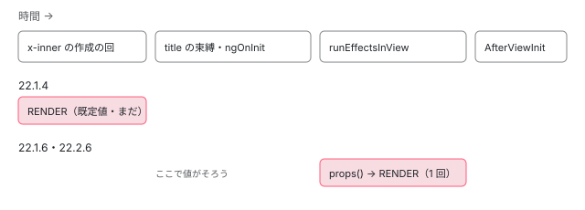

[目次](../README.md) › [外のコンポーネント：foreignImports と foreign view](README.md) › 第 3 回 / 全 6 回

# ɵɵforeignComponent の中：props と描く時機

> ɵɵforeignComponent の形が 6981cd782a1 の空の命令から 34817da7354 までどう変わったか。props の関数と外の render を、作成の回ではなく更新の回のビューの effect の中で 1 回だけ呼ぶ行と、render を囲む setActiveConsumer(null) が守るもの（外すと NG0602）。再利用のときの currentTNode（0c07356c5c9）、JIT で断る行（915a03ae856）。22.1.4・22.1.6・22.2.6 を並べて動かした記録。

angular/angular · 読了 約 13 分 · 発展 · [サイトで読む（デモが動きます）](https://angular-deep-dive-cyan.vercel.app/chapter/fgn-instruction)

---

この章で分かること：`ɵɵforeignComponent` が、いつ props の関数を呼び、いつ外の `render` を呼ぶのか。2026 年 6 月の最初の形（作成の回にすぐ描く）から、8 月の 34817da7354（更新の回のあとのビューの effect の中で 1 回だけ描く）まで、命令の形がどう変わったかをコミットの順に読みます。再利用のときの `currentTNode`（0c07356c5c9）、JIT で断る行（915a03ae856）、render を囲む `setActiveConsumer(null)` が何を守っているかは、行を消して spec を走らせて確かめます。

読む対象は `packages/core/src/render3/instructions/foreign_component.ts` の前半（`ɵɵforeignComponent` まで）、`packages/core/src/render3/jit/util.ts`、`packages/core/test/render3/foreign_component_spec.ts`、`packages/core/test/acceptance/foreign_component/foreign_component_spec.ts`、`packages/core/test/render3/ivy/jit_spec.ts` です。命令の本体を上から読む説明は [standalone-foreign-imports の 6 節](../standalone/14-standalone-foreign-imports.md)にあるので、この章では引かず、差分と spec と記録で読みます。命令が作る foreign view は[第 2 回](02-fgn-foreign-view.md)、ビューの effect がいつ走るかは [effect はいつ走るかの章](../cd/09-cd-effects.md)です。

1. [1. 契約と歩み](01-fgn-contract-history.md)
2. [2. foreign view](02-fgn-foreign-view.md)
3. **3. ɵɵforeignComponent の中**（この章）
4. [4. @content と後始末](04-fgn-content.md)
5. [5. コンパイラと ngtsc](05-fgn-compiler.md)
6. [6. spec と PR](06-fgn-tests-issues.md)

## 1. 命令の形はどう変わってきたか

📄 `git show（ɵɵforeignComponent の形が変わった 5 つのコミット、抜粋）`

```
$ git show 6981cd782a1 -- packages/core/src/render3/instructions/foreign_component.ts   # 05-27、新しいファイル
+export function ɵɵforeignComponent<TProps>(
+  index: number,
+  foreignComponent: ForeignComponent,
+  props: TProps,
+): void {
+  // No-op for now!
+}

$ git show e678955eacd -- ...   # 06-03、中身が入る（作成の回に描く）
+  // 5. Call the RENDER function to get the nodes and DisposeFn
+  const injector = new NodeInjector(tNode, lView);
+  const [nodes, dispose] = runInInjectionContext(injector, () => foreignComponent[RENDER](props));

$ git show 25c744c4d0a -- ...   # 06-08、2 番目の引数が consts の添字に
- * @param foreignComponent The matched foreign component.
+ * @param foreignComponentIndex The index of the matched foreign component in the constant pool.
-  foreignComponent: ForeignComponent<any>,
+  foreignComponentIndex: number,
+  const foreignComponent = getConstant<ForeignComponent<any>>(tView.consts, foreignComponentIndex)!;

$ git show 555fc20af04 -- ...   # 06-29、注入の文脈をやめて context を渡す（getOrCreateInjectable の 6 行を 1 行にまとめた）
-  const injector = new NodeInjector(tNode, lView);
-  const [nodes, dispose] = runInInjectionContext(injector, () => foreignComponent[RENDER](props));
+  const context = getOrCreateInjectable(tNode, lView, FOREIGN_CONTEXT, InternalInjectFlags.Optional);
+  const [nodes, dispose] = foreignComponent[RENDER](props, context ?? undefined);

$ git show 34817da7354 -- ...   # 08-27、props を関数で受け、ビューの effect の中で 1 回だけ描く
- * @param props Aggregate properties and static attributes.
+ * @param props A factory function returning aggregate properties/static attributes.
-  props?: any,
+  props?: (() => any) | null,
+  // 5. Create a run-once view effect to render the foreign component during runEffectsInView
+  const node = createViewEffect(lView, lView[ENVIRONMENT].changeDetectionScheduler!, () => {
+    // Destroy this effect the first time it's called to ensure it doesn't run more than once.
+    node.destroy();
+    if (isDestroyed(lView)) {
+      return;
+    }
+    const prevConsumer = setActiveConsumer(null);
+    try {
+      const resolvedProps = props ? props() : undefined;
       ...
+    } finally {
+      setActiveConsumer(prevConsumer);
+    }
+  });
```

1. **6981cd782a1（05-27）：空の命令**

   コンパイラが命令を出せるように、名前と引数だけを先に置きました。2 番目の引数は外の部品のオブジェクトそのもの、3 番目は props のオブジェクトです。
2. **e678955eacd（06-03）：作成の回に描く**

   `LContainer` と foreign view を作り、その場で `RENDER(props)` を呼びました。`NodeInjector` の注入の文脈の中で呼んでいたので、外の render の中で `inject()` が使えました。
3. **25c744c4d0a（06-08）：2 番目の引数を `consts` の添字に**

   本文は「外の部品を局所のスコープや export されない所で定義すると、トップレベルに出るテンプレートの関数から見えず、参照のエラーになる」。式を `consts` に入れ、命令は添字を受けるように変えました。[第 1 回](01-fgn-contract-history.md)の 4 節で、`consts` の中身が `getComponentId` に読まれたのは、この変更のあとの形だからです。
4. **555fc20af04（06-29）：注入の文脈をやめ、`context` を 2 番目の引数で渡す**

   `runInInjectionContext` が消え、`FOREIGN_CONTEXT` を任意で探して渡す形になりました（[第 4 回](04-fgn-content.md)）。
5. **34817da7354（08-27）：props を関数で受け、ビューの effect の中で 1 回だけ描く**

   4 節で読みます。

今のファイルの先頭です。どの差分が何を連れてきたかが、import に残っています。

📄 `angular/packages/core/src/render3/instructions/foreign_component.ts` L9–40 （▶ の行: 9, 23, 25–26, 31–32, 34–35）

```ts
 9 ▶ import {setActiveConsumer} from '../../../primitives/signals';
10 │ import {Injector} from '../../di/injector';
11 │ import {InternalInjectFlags} from '../../di/interface/injector';
12 │ import {
13 │   CONTENT_ADAPTER,
14 │   ForeignComponent,
15 │   GET_CONTEXT,
16 │   ON_DESTROY,
17 │   RENDER,
18 │ } from '../../interface/foreign_component';
19 │ import {assertDefined, assertNotSame} from '../../util/assert';
20 │ import {assertLContainer} from '../assert';
21 │ import {collectNativeNodes} from '../collect_native_nodes';
22 │ import {attachPatchData} from '../context_discovery';
23 ▶ import {getOrCreateInjectable} from '../di';
24 │ import {nativeInsertBefore} from '../dom_node_manipulation';
25 ▶ import {FOREIGN_CONTEXT} from '../foreign_context';
26 ▶ import {createForeignView} from '../foreign_view';
27 │ import {CONTAINER_HEADER_OFFSET, LContainer, LContainerFlags} from '../interfaces/container';
28 │ import {TContainerNode, TNodeType} from '../interfaces/node';
29 │ import {Renderer} from '../interfaces/renderer';
30 │ import {RNode} from '../interfaces/renderer_dom';
31 ▶ import {isDestroyed} from '../interfaces/type_checks';
32 ▶ import {ENVIRONMENT, FLAGS, HEADER_OFFSET, LView, RENDERER, TVIEW} from '../interfaces/view';
33 │ import {appendChild} from '../node_manipulation';
34 ▶ import {createViewEffect} from '../reactivity/effect';
35 ▶ import {getLView, getTView, setCurrentTNode, setCurrentTNodeAsNotParent} from '../state';
36 │ import {getOrCreateTNode} from '../tnode_manipulation';
37 │ import {getConstant} from '../util/view_utils';
38 │ import {addToEndOfViewTree} from '../view/construction';
39 │ import {addLViewToLContainer, createLContainer, removeLViewFromLContainer} from '../view/container';
40 │ import {createAndRenderEmbeddedLView} from '../view_manipulation';
```

📄 `angular/packages/core/src/render3/instructions/foreign_component.ts` L42–49 （▶ の行: 43, 46–48）

```ts
42 │ /**
43 ▶  * Creation phase instruction to render a foreign component.
44 │  *
45 │  * @param index The index of the container in the data array.
46 ▶  * @param foreignComponentIndex The index of the matched foreign component in the constant pool.
47 ▶  * @param props A factory function returning aggregate properties/static attributes.
48 ▶  * @codeGenApi
49 │  */
```

9 行目の `setActiveConsumer`、32 行目の `ENVIRONMENT`、34 行目の `createViewEffect`、31 行目の `isDestroyed` は 34817da7354 で入りました。23 行目の `getOrCreateInjectable` と 25 行目の `FOREIGN_CONTEXT` は 555fc20af04、35 行目の `setCurrentTNode` は 0c07356c5c9 です。43 行目のコメントは今も「作成の回の命令」で、47 行目の `props` の説明だけが「props を返す関数」に変わりました。命令が呼ばれるのは作成の回（`rf & 1`）ですが、描くのはその回ではありません。48 行目の `@codeGenApi` は「コンパイラが出すコードのための API」の印です。

## 2. 再利用のときの currentTNode（0c07356c5c9）

同じテンプレートの 2 つ目のインスタンスでは、`tView.firstCreatePass` が `false` で、TNode は作らずに `tView.data` から取り出します（[firstCreatePass の章](../ivy/08-ivy-first-create-pass.md)）。0c07356c5c9 の本文は「最初の回は `getOrCreateTNode` が `currentTNode` を設定するが、再利用の回は設定しなかった。そのため前の命令の `currentTNode` が残り、親の要素を閉じる `ɵɵelementEnd` で違う親を閉じようとして assert に落ちた」です。直したあとの形は、最初の回なら `setCurrentTNodeAsNotParent()`、再利用の回なら `setCurrentTNode(tNode, false)` を呼びます（[前の章の 6 節](../standalone/14-standalone-foreign-imports.md)で引いた、TNode を取る分かれ道）。このコミットが足した spec です。

📄 `angular/packages/core/test/render3/foreign_component_spec.ts` L193–227 （▶ の行: 202–205, 220, 224, 226）

```ts
193 │   it('should support reusing the same template between multiple view instances', () => {
194 │     const foreignComp1 = foreignImport(
195 │       () => {
196 │         return [[document.createTextNode('foreign content')]];
197 │       },
198 │       noopOnDestroy,
199 │       eagerContentAdapter,
200 │     );
201 │ 
202 ▶     const createFn = () => {
203 ▶       ɵɵelementStart(0, 'div');
204 ▶       ɵɵforeignComponent(1, 0);
205 ▶       ɵɵelementEnd();
206 │     };
207 │     const expectedHtml =
208 │       '' +
209 │       '<div>' +
210 │       '<!--foreign-view-head-->foreign content<!--foreign-view-tail-->' +
211 │       '<!--foreign-component-->' +
212 │       '</div>';
213 │ 
214 │     const fixture = new ViewFixture({
215 │       decls: 2,
216 │       vars: 0,
217 │       consts: [foreignComp1],
218 │       create: createFn,
219 │     });
220 ▶     fixture.update(() => {});
221 │     expect(fixture.host.innerHTML).toContain(expectedHtml);
222 │ 
223 │     // Create second instance reusing the TView
224 ▶     const host2 = renderSecondInstance(fixture);
225 │     expect(fixture.host.innerHTML).toContain(expectedHtml);
226 ▶     expect(host2.innerHTML).toContain(expectedHtml);
227 │   });
```

📄 `angular/packages/core/test/render3/foreign_component_spec.ts` L385–408 （▶ の行: 385, 391, 393, 405–406）

```ts
385 ▶ function renderSecondInstance(fixture: ViewFixture): HTMLElement {
386 │   const hostLView = fixture.lView[PARENT] as LView;
387 │   const hostTNode = fixture.lView[T_HOST];
388 │   const hostRenderer = hostLView[RENDERER];
389 │   const host = hostRenderer.createElement('host-element') as HTMLElement;
390 │ 
391 ▶   const lView = createLView(
392 │     hostLView,
393 ▶     fixture.tView,
394 │     {},
395 │     LViewFlags.CheckAlways,
396 │     host,
397 │     hostTNode,
398 │     null,
399 │     null,
400 │     null,
401 │     null,
402 │     null,
403 │   );
404 │ 
405 ▶   renderView(fixture.tView, lView, {});
406 ▶   refreshView(fixture.tView, lView, fixture.tView.template, {});
407 │   return host;
408 │ }
```

202〜206 行目、`<div>` の中に外の部品を置くテンプレートです。224 行目の `renderSecondInstance` は、391 行目で同じ `fixture.tView` から 2 つ目の LView を作り、405 行目で作成の回、406 行目で更新の回を走らせます。406 行目の `refreshView` は 34817da7354 で足された行で、描くのが更新の回のあとになったので、これが無いと外の部品が描かれません。

作業木で、この修正の行を 2 通りに戻して走らせた記録です。

📄 `記録：作業木で 0c07356c5c9 の行を戻したとき`

```
# 作業木（8576f161ae4 から）で instructions/foreign_component.ts を書き換えて、render3 の spec を走らせた
# 実験 A：else の中の setCurrentTNode(tNode, false) だけを消す
$ bazelisk test //packages/core/test/render3:render3 --test_arg=--filter="^ɵɵforeignComponent " --nocache_test_results --test_output=all
Ran 9 of 574 specs
9 specs, 0 failures

# 実験 B：0c07356c5c9 の前の形に戻す（どちらの道でも、後ろで setCurrentTNodeAsNotParent() だけを呼ぶ）
@@ -64,12 +64,11 @@ export function ɵɵforeignComponent(
   if (tView.firstCreatePass) {
     tNode = getOrCreateTNode(tView, adjustedIndex, TNodeType.Container, null, null);
-    // `getOrCreateTNode` unconditionally sets the current node as a parent node, which it is not.
-    setCurrentTNodeAsNotParent();
   } else {
     tNode = tView.data[adjustedIndex] as TContainerNode;
-    setCurrentTNode(tNode, false);
   }
+  // `getOrCreateTNode` unconditionally sets the current node as a parent node, which it is not.
+  setCurrentTNodeAsNotParent();
$ bazelisk test //packages/core/test/render3:render3 --test_arg=--filter="^ɵɵforeignComponent " --nocache_test_results --test_output=all
1) ɵɵforeignComponent should support reusing the same template between multiple view instances
  Message:
    Error: ASSERTION ERROR: currentTNode should have a parent [Expected=> null != null <=Actual]
        at assertHasParent (./packages/core/src/render3/assert.ts:101:3)
        at elementLikeEndShared (./packages/core/src/render3/instructions/shared.ts:628:18)
        at ɵɵelementEnd (./packages/core/src/render3/instructions/element.ts:168:24)
        at createFn (./packages/core/test/render3/foreign_component_spec.ts:205:7)
Ran 9 of 574 specs
9 specs, 1 failure
# 同じ形で acceptance（36 specs）は 0 failures
```

1. **実験 B（修正の前の形）：205 行目の `ɵɵelementEnd` が assert に落ちる**

   修正の前は、再利用の回でも `setCurrentTNodeAsNotParent()` だけを呼んでいました。`currentTNode` は 203 行目の div のまま、「親ではない」の印だけが付きます。`ɵɵelementEnd` は「親でなければ、今の TNode の親へ上がる」ので、div の親（ビューの根なので無い）へ上がろうとし、`currentTNode should have a parent` で止まりました（[DOM を組む命令の章](../ivy/09-ivy-create-instructions.md)の `elementLikeEndShared`）。
2. **実験 A（`setCurrentTNode` だけを消す）：落ちない**

   再利用の回に何も呼ばないと、`currentTNode` は div、「親である」の印のままです。`ɵɵelementEnd` はその div を正しく閉じるので、9 個の it は全部通りました。この spec が固めているのは「修正の前の形に戻らないこと」で、`setCurrentTNode(tNode, false)` の 1 行そのものではありません。

## 3. JIT で断る（915a03ae856）

本文は「foreign component は AOT だけで使える。JIT では、黙って失敗したり、未知の要素のエラーやテンプレートの取り込みの失敗のような分かりにくいエラーになったりしていた」。2 か所に検査を足しました。1 つ目の `compileComponent` の中で `foreignImports` があれば投げる行は [前の章の 2 節](../standalone/14-standalone-foreign-imports.md)で読みました。2 つ目が `imports` に外の部品を入れた場合です。

📄 `angular/packages/core/src/render3/jit/util.ts` L9–20 （▶ の行: 11, 18–19）

```ts
 9 │ import {isForwardRef, resolveForwardRef} from '../../di/forward_ref';
10 │ import {ModuleWithProviders} from '../../di/interface/provider';
11 ▶ import {ForeignComponent, RENDER} from '../../interface/foreign_component';
12 │ import {Type} from '../../interface/type';
13 │ import {NgModuleDef} from '../../metadata/ng_module_def';
14 │ import {getComponentDef, getDirectiveDef, getPipeDef, getNgModuleDef} from '../def_getters';
15 │ import type {ComponentType, DirectiveType, PipeType} from '../interfaces/definition';
16 │ import {stringifyForError} from '../util/stringify_utils';
17 │ 
18 ▶ export function isForeignComponent(value: any): value is ForeignComponent {
19 ▶   return typeof value === 'object' && value !== null && RENDER in value;
20 │ }
```

📄 `angular/packages/core/src/render3/jit/util.ts` L77–90 （▶ の行: 77, 83–84, 87）

```ts
77 ▶       if (isModuleWithProviders(depType)) {
78 │         throw new Error(
79 │           `A module with providers was imported from "${stringifyForError(
80 │             importingType,
81 │           )}". Modules with providers are not supported in standalone components imports.`,
82 │         );
83 ▶       } else if (isForeignComponent(depType)) {
84 ▶         throw new Error(
85 │           `A foreign component, imported from "${stringifyForError(
86 │             importingType,
87 ▶           )}", cannot be imported using 'imports'. Foreign components are only supported in AOT mode and must be registered in 'foreignImports'.`,
88 │         );
89 │       } else {
90 │         throw new Error(
```

19 行目、外の部品かどうかは「オブジェクトで、`RENDER` のキーを持つか」で決めます。ほかの 3 つのキーは見ません。83 行目、`imports` に並んだものが Angular の定義も `ModuleWithProviders` でもなく、外の部品なら、87 行目の「`foreignImports` に登録しなさい」というエラーにします。この関数は standalone の `imports` を確かめる `verifyStandaloneImport` の中で、JIT で依存を解くときに呼ばれます（[standalone の imports の章](../ngmodule/13-ngmodule-standalone-imports.md)）。

📄 `angular/packages/core/test/render3/ivy/jit_spec.ts` L551–578 （▶ の行: 552–553, 569–570, 574, 576）

```ts
551 │   describe('foreign components', () => {
552 ▶     function fooImport<TProps>(component: (props: TProps) => Node[]) {
553 ▶       return foreignImport<TProps>(
554 │         (props) => [component(props)],
555 │         () => {},
556 │         (producer) => producer(),
557 │       );
558 │     }
559 │ 
560 │     function FooComponent(props: {children?: Node[]}): Node[] {
561 │       return [];
562 │     }
563 │ 
564 │     it('should error when foreignImports is specified on a component in JIT mode', () => {
565 │       expect(() => {
566 │         @Component({
567 │           selector: 'test-cmp',
568 │           template: 'test',
569 ▶           // @ts-ignore
570 ▶           foreignImports: [fooImport(FooComponent)],
571 │         })
572 │         class SomeCmp {}
573 │ 
574 ▶         const _ = (SomeCmp as any).ɵcmp;
575 │       }).toThrowError(
576 ▶         `Foreign components are not supported in JIT mode. Component 'SomeCmp' cannot specify 'foreignImports'.`,
577 │       );
578 │     });
```

📄 `angular/packages/core/test/render3/ivy/jit_spec.ts` L580–595 （▶ の行: 584, 588, 590, 592）

```ts
580 │     it('should error when a foreign component is imported via imports array in JIT mode', () => {
581 │       @Component({
582 │         selector: 'test-cmp',
583 │         template: 'test',
584 ▶         imports: [fooImport(FooComponent) as any],
585 │       })
586 │       class SomeCmp {}
587 │ 
588 ▶       const cmpDef = (SomeCmp as any).ɵcmp as ComponentDef<SomeCmp>;
589 │       expect(() => {
590 ▶         (cmpDef.directiveDefs! as () => unknown)();
591 │       }).toThrowError(
592 ▶         /A foreign component, imported from "SomeCmp", cannot be imported using 'imports'\. Foreign components are only supported in AOT mode and must be registered in 'foreignImports'\./,
593 │       );
594 │     });
595 │   });
```

574 行目、`ɵcmp` を読んだ瞬間（JIT のコンパイルが走る所）に投げることを確かめます。2 つ目の it は 584 行目で `imports` に入れ、590 行目で依存の関数を呼んだときに 592 行目のエラーになることを確かめます。jit\_spec.ts は `//packages/core/test/render3/ivy:ivy` の対象で、`"foreign components"` で絞ると 2 specs が通りました。

## 4. 描く時機を移す（34817da7354）

本文の要点です。「`ɵɵforeignComponent` は、テンプレートの作成の回（`rf & 1`）にすぐ描いていた。そのため、親から束縛される入力（`@Input()`・`input()`・`input.required()`）、`ngOnInit()` で初期化するプロパティ、引いて読むビューのクエリ（`viewChild()`）は、まだ初期化されていない」。そこで、描くのを `createViewEffect` のビューの effect にし（`refreshView` の中の `runEffectsInView` で走る）、`setActiveConsumer(null)` で反応の文脈を漏らさず、最初の 1 回で effect を壊します。命令は props を関数（`() => props`）か `null` だけで受け、コンパイラは props を `() => ({ ... })` で包み、`ɵɵforeignContent` は `ɵɵforeignComponent` の前の変数に出すようにした。

📄 `記録：3 つの版の d.ts`

```ts
$ grep -n "declare function ɵɵforeignComponent" .../@angular/core/types/core.d.ts
22.1.4: declare function ɵɵforeignComponent(index: number, foreignComponentIndex: number, props?: any): void;
22.1.6: declare function ɵɵforeignComponent(index: number, foreignComponentIndex: number, props?: (() => any) | null): void;
22.2.6: declare function ɵɵforeignComponent(index: number, foreignComponentIndex: number, props?: (() => any) | null): void;
```

このコミットと同じ差分が 22.1.5 にも入ったので（[第 1 回](01-fgn-contract-history.md)の 5 節）、前の形が見られるのは 22.1.4 です。同じ 2 つのコンポーネントを、22.1.4・22.1.6・22.2.6 の compiler-cli でコンパイルし、それぞれの `@angular/core` で jsdom の上に描いた記録を並べます。外の部品は第 1 回と同じ手作りの橋（Proxy）です。記録の頭の数字は記録の通し番号です。

### 記録 1：@Input() と ngOnInit で入れた値を props に渡す

📄 `記録：x-outer の中の x-inner が <TitleWidget [title]="title" [init]="init" /> を描く`

```
# 22.1.4: @angular/compiler-cli 22.1.4 でコンパイル、diagnostics 0 件
  出力: i0.ɵɵforeignComponent(0, 0, { title: ctx.title, init: ctx.init });
# 実行: @angular/core 22.1.4
   1. get Symbol(Symbol.toPrimitive)
   2. get toString
   3. get Symbol(Symbol.toStringTag)
   4. --- createComponent(Outer) と attachView
   5. get Symbol(RENDER)
   6. RENDER title="既定値" init="(まだ)"
   7. --- await appRef.whenStable()
   8. Inner ngOnInit
   9. DOM: <x-inner><!--foreign-view-head--><span>既定値 / (まだ)</span><!--foreign-view-tail--><!--foreign-component--></x-inner>
  10. dispose

# 22.1.6: @angular/compiler-cli 22.1.6 でコンパイル、diagnostics 0 件
  出力: i0.ɵɵforeignComponent(0, 0, () => ({ title: ctx.title, init: ctx.init }));
# 実行: @angular/core 22.1.6
   1. get Symbol(Symbol.toPrimitive)
   2. get toString
   3. get Symbol(Symbol.toStringTag)
   4. --- createComponent(Outer) と attachView
   5. --- await appRef.whenStable()
   6. Inner ngOnInit
   7. get Symbol(RENDER)
   8. RENDER title="親から" init="ngOnInit で入れた値"
   9. DOM: <x-inner><!--foreign-view-head--><span>親から / ngOnInit で入れた値</span><!--foreign-view-tail--><!--foreign-component--></x-inner>
  10. dispose

# 22.2.6: @angular/compiler-cli 22.2.6 でコンパイル、diagnostics 0 件
  出力: i0.ɵɵforeignComponent(0, 0, () => ({ title: ctx.title, init: ctx.init }));
# 実行: @angular/core 22.2.6
   1. get Symbol(Symbol.toPrimitive)
   2. get toString
   3. get Symbol(Symbol.toStringTag)
   4. --- createComponent(Outer) と attachView
   5. --- await appRef.whenStable()
   6. Inner ngOnInit
   7. get Symbol(RENDER)
   8. RENDER title="親から" init="ngOnInit で入れた値"
   9. DOM: <x-inner><!--foreign-view-head--><span>親から / ngOnInit で入れた値</span><!--foreign-view-tail--><!--foreign-component--></x-inner>
  10. dispose
```

1. **出力：22.1.4 はオブジェクト、22.1.6 と 22.2.6 は関数**

   22.1.4 のコンパイラは `{ title: ctx.title, init: ctx.init }` を作成の回にその場で作り、22.1.6 からは `() => ({ ... })` で包みます。
2. **22.1.4：`createComponent` の中で描かれ、値は「既定値」と「(まだ)」**

   記録の 5〜6 番、`RENDER` は `createComponent` の途中（x-inner のビューの作成の回）で呼ばれました。親からの `title` はまだ束縛されず、`ngOnInit`（8 番）もまだです。外の部品は 1 回しか描かれないので、最後まで「既定値 / (まだ)」のままでした（9 番）。
3. **22.1.6・22.2.6：`ngOnInit` のあとで描かれる**

   6 番で `ngOnInit`、7〜8 番で `RENDER`。値は「親から / ngOnInit で入れた値」です。x-inner の `ngOnInit` は親の x-outer のビューを更新する回で呼ばれ、そのあと x-inner 自身のビューを更新する回の中の `runEffectsInView` で、外の部品のビューの effect が走ります（[refreshView の章](../cd/03-cd-refresh-view.md)）。

### 記録 2：input.required() と、signal そのものを渡す

📄 `記録：<TitleWidget [title]="title()" [init]="init" [live]="live" />、title は input.required()`

```
# 22.1.4: @angular/compiler-cli 22.1.4 でコンパイル、diagnostics 0 件
  出力: i0.ɵɵforeignComponent(0, 0, { title: ctx.title(), init: ctx.init, live: ctx.live });
# 実行: @angular/core 22.1.4
   1. get Symbol(Symbol.toPrimitive)
   2. get toString
   3. get Symbol(Symbol.toStringTag)
   4. --- createComponent(Outer) と attachView
   5. Inner constructor
   6. createComponent が投げた: NG0950: Input "title" is required but no value is available yet. Find more at https://v22.angular.dev/errors/NG0950
   7. --- await appRef.whenStable()
   8. DOM: <x-inner></x-inner>

# 22.1.6: @angular/compiler-cli 22.1.6 でコンパイル、diagnostics 0 件
  出力: i0.ɵɵforeignComponent(0, 0, () => ({ title: ctx.title(), init: ctx.init, live: ctx.live }));
# 実行: @angular/core 22.1.6
   1. get Symbol(Symbol.toPrimitive)
   2. get toString
   3. get Symbol(Symbol.toStringTag)
   4. --- createComponent(Outer) と attachView
   5. Inner constructor
   6. --- await appRef.whenStable()
   7. Inner ngOnInit
   8. get Symbol(RENDER)
   9. RENDER #1 title="親から" init="ngOnInit で入れた値" live()="v1"
  10. DOM: <x-inner><!--foreign-view-head--><span>親から / ngOnInit で入れた値 / v1</span><!--foreign-view-tail--><!--foreign-component--></x-inner>
  11. --- Inner.live.set("v2") と whenStable
  12. DOM: <x-inner><!--foreign-view-head--><span>親から / ngOnInit で入れた値 / v1</span><!--foreign-view-tail--><!--foreign-component--></x-inner>
  13. --- Outer.t.set("親から 2") と whenStable
  14. DOM: <x-inner><!--foreign-view-head--><span>親から / ngOnInit で入れた値 / v1</span><!--foreign-view-tail--><!--foreign-component--></x-inner>
  15. --- ref.destroy()
  16. dispose

# 22.2.6: @angular/compiler-cli 22.2.6 でコンパイル、diagnostics 0 件
  出力: i0.ɵɵforeignComponent(0, 0, () => ({ title: ctx.title(), init: ctx.init, live: ctx.live }));
# 実行: @angular/core 22.2.6
   1. get Symbol(Symbol.toPrimitive)
   2. get toString
   3. get Symbol(Symbol.toStringTag)
   4. --- createComponent(Outer) と attachView
   5. Inner constructor
   6. --- await appRef.whenStable()
   7. Inner ngOnInit
   8. get Symbol(RENDER)
   9. RENDER #1 title="親から" init="ngOnInit で入れた値" live()="v1"
  10. DOM: <x-inner><!--foreign-view-head--><span>親から / ngOnInit で入れた値 / v1</span><!--foreign-view-tail--><!--foreign-component--></x-inner>
  11. --- Inner.live.set("v2") と whenStable
  12. DOM: <x-inner><!--foreign-view-head--><span>親から / ngOnInit で入れた値 / v1</span><!--foreign-view-tail--><!--foreign-component--></x-inner>
  13. --- Outer.t.set("親から 2") と whenStable
  14. DOM: <x-inner><!--foreign-view-head--><span>親から / ngOnInit で入れた値 / v1</span><!--foreign-view-tail--><!--foreign-component--></x-inner>
  15. --- ref.destroy()
  16. dispose
```

1. **22.1.4：NG0950 で、x-inner の中身が作られない**

   作成の回に `ctx.title()` を読むので、親がまだ値を入れていない `input.required()` は `NG0950: Input "title" is required but no value is available yet` を投げます。props のオブジェクトを作る途中で投げるので、`RENDER` は読まれもしません（記録に `get Symbol(RENDER)` が無い）。DOM は `<x-inner></x-inner>` のままです。
2. **22.1.6・22.2.6：描けるが、描くのは 1 回だけ**

   9 番で `RENDER #1`。そのあと x-inner の `live` を変えても（11 番）、親の `t` を変えて `title` が変わっても（13 番）、`RENDER #2` はありません。DOM の文字も最初のままです。props の関数と `RENDER` はビューの effect の中で 1 回だけ呼ばれ、その effect は最初に自分を壊すからです。
3. **15〜16 番：`ref.destroy()` で `RENDER` が返した後始末が呼ばれる**

   後始末は foreign view の `onDestroy` に登録されています（[第 4 回](04-fgn-content.md)）。



*x-outer の中の x-inner が外の部品を持つときの順番。22.1.4 は x-inner のビューの作成の回に描き、22.1.6 と 22.2.6 は x-inner のビューの更新の回の runEffectsInView で描く*

34817da7354 が足した spec のうち、時機を固めているものです。

📄 `angular/packages/core/test/render3/foreign_component_spec.ts` L55–71 （▶ の行: 64, 67, 69–70）

```ts
55 │   it('should pass props to a foreign component', () => {
56 │     const render = jasmine.createSpy('render').and.returnValue([[]]);
57 │     const foreignComp = foreignImport<{name: string}>(render, noopOnDestroy, eagerContentAdapter);
58 │ 
59 │     const fixture = new ViewFixture({
60 │       decls: 1,
61 │       vars: 0,
62 │       consts: [foreignComp],
63 │       create: () => {
64 ▶         ɵɵforeignComponent(0, 0, () => ({name: 'Angular'}));
65 │       },
66 │     });
67 ▶     expect(render).not.toHaveBeenCalled();
68 │ 
69 ▶     fixture.update(() => {});
70 ▶     expect(render).toHaveBeenCalledOnceWith({name: 'Angular'}, /* context= */ undefined);
71 │   });
```

📄 `angular/packages/core/test/render3/foreign_component_spec.ts` L73–96 （▶ の行: 85, 89–90, 92, 94–95）

```ts
73 │   it('should support passing props as a factory function and evaluate during update pass', () => {
74 │     const render = jasmine.createSpy('render').and.returnValue([[]]);
75 │     const propsFactory = jasmine
76 │       .createSpy('propsFactory')
77 │       .and.returnValue({name: 'Deferred Angular'});
78 │     const foreignComp = foreignImport<{name: string}>(render, noopOnDestroy, eagerContentAdapter);
79 │ 
80 │     const fixture = new ViewFixture({
81 │       decls: 1,
82 │       vars: 0,
83 │       consts: [foreignComp],
84 │       create: () => {
85 ▶         ɵɵforeignComponent(0, 0, propsFactory);
86 │       },
87 │     });
88 │ 
89 ▶     expect(propsFactory).not.toHaveBeenCalled();
90 ▶     expect(render).not.toHaveBeenCalled();
91 │ 
92 ▶     fixture.update(() => {});
93 │ 
94 ▶     expect(propsFactory).toHaveBeenCalledTimes(1);
95 ▶     expect(render).toHaveBeenCalledOnceWith({name: 'Deferred Angular'}, /* context= */ undefined);
96 │   });
```

render3 の spec です。67 行目と 89〜90 行目、作成の回（`ViewFixture` を作った時点）では props の関数も `RENDER` も呼ばれていません。69 行目・92 行目の `fixture.update()`（更新の回）のあとで、94 行目のとおり props の関数がちょうど 1 回、70 行目・95 行目のとおり `RENDER` がちょうど 1 回呼ばれます。

📄 `angular/packages/core/test/render3/foreign_component_spec.ts` L98–123 （▶ の行: 102, 116, 118, 120, 122）

```ts
 98 │   it('should call the dispose function when the containing view is destroyed', () => {
 99 │     const dispose = jasmine.createSpy();
100 │     const foreignComp = foreignImport(
101 │       () => {
102 ▶         return [[], dispose];
103 │       },
104 │       noopOnDestroy,
105 │       eagerContentAdapter,
106 │     );
107 │ 
108 │     const fixture = new ViewFixture({
109 │       decls: 1,
110 │       vars: 0,
111 │       consts: [foreignComp],
112 │       create: () => {
113 │         ɵɵforeignComponent(0, 0);
114 │       },
115 │     });
116 ▶     fixture.update(() => {});
117 │ 
118 ▶     expect(dispose).toHaveBeenCalledTimes(0);
119 │ 
120 ▶     destroyLView(fixture.tView, fixture.lView);
121 │ 
122 ▶     expect(dispose).toHaveBeenCalledTimes(1);
123 │   });
```

102 行目の後始末の関数は、116 行目で描いたあと、120 行目でビューを壊すと 1 回だけ呼ばれます（122 行目）。

📄 `angular/packages/core/test/acceptance/foreign_component/foreign_component_spec.ts` L1221–1260 （▶ の行: 1225, 1236, 1239, 1241, 1243）

```ts
1221 │   describe('deferred rendering and property initialization', () => {
1222 │     function TitleWidget(props: {title: string}): Node[] {
1223 │       const span = document.createElement('span');
1224 │       span.id = 'title-display';
1225 ▶       span.textContent = props.title ?? 'UNDEFINED';
1226 │       return [span];
1227 │     }
1228 │ 
1229 │     function QueryWidget(props: {target: any}): Node[] {
1230 │       const span = document.createElement('span');
1231 │       span.id = 'query-display';
1232 │       span.textContent = props.target ? 'HAS_TARGET' : 'NO_TARGET';
1233 │       return [span];
1234 │     }
1235 │ 
1236 ▶     function ReactiveTitleWidget(props: {title: () => string; injector: Injector}): Node[] {
1237 │       const span = document.createElement('span');
1238 │       span.id = 'title-display';
1239 ▶       effect(
1240 │         () => {
1241 ▶           span.textContent = props.title();
1242 │         },
1243 ▶         {injector: props.injector},
1244 │       );
1245 │       return [span];
1246 │     }
1247 │ 
1248 │     function ReactiveQueryWidget(props: {target: () => any; injector: Injector}): Node[] {
1249 │       const span = document.createElement('span');
1250 │       span.id = 'query-display';
1251 │       effect(
1252 │         () => {
1253 │           const target = props.target();
1254 │           span.textContent = target ? 'HAS_TARGET' : 'NO_TARGET';
1255 │         },
1256 │         {injector: props.injector},
1257 │       );
1258 │       return [span];
1259 │     }
1260 │ 
```

📄 `angular/packages/core/test/acceptance/foreign_component/foreign_component_spec.ts` L1261–1287 （▶ の行: 1264, 1269, 1274, 1285）

```ts
1261 │     it('should support passing required inputs to foreign component props', async () => {
1262 │       @Component({
1263 │         selector: 'foreign-host',
1264 ▶         template: `<TitleWidget [title]="title()" />`,
1265 │         // @ts-ignore
1266 │         foreignImports: [frameworkImport(TitleWidget)],
1267 │       })
1268 │       class ForeignHost {
1269 ▶         readonly title = input.required<string>();
1270 │       }
1271 │ 
1272 │       @Component({
1273 │         imports: [ForeignHost],
1274 ▶         template: `<foreign-host [title]="parentTitle()" />`,
1275 │       })
1276 │       class App {
1277 │         readonly parentTitle = signal('Required Title');
1278 │       }
1279 │ 
1280 │       const fixture = TestBed.createComponent(App);
1281 │       await fixture.whenStable();
1282 │ 
1283 │       const span = fixture.nativeElement.querySelector('#title-display');
1284 │       expect(span).toBeTruthy();
1285 ▶       expect(span.textContent).toBe('Required Title');
1286 │     });
1287 │ 
```

📄 `angular/packages/core/test/acceptance/foreign_component/foreign_component_spec.ts` L1288–1319 （▶ の行: 1291, 1296–1297, 1315, 1318）

```ts
1288 │     it('should support passing raw input.required signal to foreign component props and track reactively', async () => {
1289 │       @Component({
1290 │         selector: 'foreign-host',
1291 ▶         template: `<ReactiveTitleWidget [title]="title" [injector]="injector" />`,
1292 │         // @ts-ignore
1293 │         foreignImports: [frameworkImport(ReactiveTitleWidget)],
1294 │       })
1295 │       class ForeignHost {
1296 ▶         readonly title = input.required<string>();
1297 ▶         readonly injector = inject(Injector);
1298 │       }
1299 │ 
1300 │       @Component({
1301 │         imports: [ForeignHost],
1302 │         template: `<foreign-host [title]="parentTitle()" />`,
1303 │       })
1304 │       class App {
1305 │         readonly parentTitle = signal('Initial Title');
1306 │       }
1307 │ 
1308 │       const fixture = TestBed.createComponent(App);
1309 │       await fixture.whenStable();
1310 │ 
1311 │       const span = fixture.nativeElement.querySelector('#title-display');
1312 │       expect(span).toBeTruthy();
1313 │       expect(span.textContent).toBe('Initial Title');
1314 │ 
1315 ▶       fixture.componentInstance.parentTitle.set('Updated Title');
1316 │       await fixture.whenStable();
1317 │ 
1318 ▶       expect(span.textContent).toBe('Updated Title');
1319 │     });
```

acceptance の spec は AOT でコンパイルされて動きます。1264 行目と 1269 行目は記録 2 の 22.1.4 で NG0950 になった形そのもので、1285 行目で親の値が描かれることを確かめます。1291 行目は `title` を呼ばずに signal のまま渡し、1236〜1246 行目の `ReactiveTitleWidget` が 1239 行目で `effect` を作って追います。1243 行目の `{injector: props.injector}` のために、1297 行目で `inject(Injector)` を props に渡しています。1315 行目で親の値を変えると、1318 行目で描き直しではなく effect が文字を変えます。

📄 `angular/packages/core/test/acceptance/foreign_component/foreign_component_spec.ts` L1469–1492 （▶ の行: 1474, 1481–1482, 1490）

```ts
1469 │     it('should attach foreign component DOM before ngAfterViewInit', async () => {
1470 │       let textInAfterViewInit = '';
1471 │ 
1472 │       @Component({
1473 │         selector: 'test-cmp',
1474 ▶         template: `<TitleWidget title="Rendered Before ViewInit" />`,
1475 │         // @ts-ignore
1476 │         foreignImports: [frameworkImport(TitleWidget)],
1477 │       })
1478 │       class TestCmp implements AfterViewInit {
1479 │         private readonly elementRef = inject(ElementRef);
1480 │ 
1481 ▶         ngAfterViewInit() {
1482 ▶           const span = this.elementRef.nativeElement.querySelector('#title-display');
1483 │           textInAfterViewInit = span?.textContent ?? '';
1484 │         }
1485 │       }
1486 │ 
1487 │       const fixture = TestBed.createComponent(TestCmp);
1488 │       await fixture.whenStable();
1489 │ 
1490 ▶       expect(textInAfterViewInit).toBe('Rendered Before ViewInit');
1491 │     });
1492 │   });
```

描くのを遅らせても、ホストの `ngAfterViewInit` より前には DOM に入っています（1490 行目）。`runEffectsInView` はビューを更新する回の途中で走り、`ngAfterViewInit` はその回の最後のほうで呼ばれるからです。

> [!TIP]
> **新卒エンジニアへ**
>
> 「作成の回の命令なのに、描くのは更新の回」。命令の中で作るのは effect の予約だけで、本当の仕事はあとで走る、と覚えておくと、spec に `fixture.update()` が要る理由（render3 の spec の 69・92 行目）も、406 行目の `refreshView` が足された理由も説明できます。

## 5. render を囲む setActiveConsumer(null) が守っているもの

ビューの effect の中は「反応の文脈」（signal を読むと依存として記録される場所）です。34817da7354 は render の前後を `setActiveConsumer(null)` と `setActiveConsumer(prevConsumer)` で囲みました（[前の章の 6 節](../standalone/14-standalone-foreign-imports.md)で引いた行）。作業木でこの 2 行を外して spec を走らせた記録です。

📄 `記録：作業木で setActiveConsumer の 2 行を外したとき`

```
# 作業木で、render を囲む setActiveConsumer(null) / setActiveConsumer(prevConsumer) を外した
-    const prevConsumer = setActiveConsumer(null);
     try {
       const resolvedProps = props ? props() : undefined;
 ...
     } finally {
-      setActiveConsumer(prevConsumer);
     }
$ bazelisk test //packages/core/test/acceptance/foreign_component:foreign_component --nocache_test_results --test_output=all
1) foreign components deferred rendering and property initialization should support passing raw input.required signal to foreign component props and track reactively
  Message:
    Error: NG0602: effect() cannot be called from within a reactive context. Call `effect` outside of a reactive context. ...
        at assertNotInReactiveContext (./packages/core/src/render3/reactivity/asserts.ts:26:11)
        at effect (./packages/core/src/render3/reactivity/effect.ts:142:5)
        at ReactiveTitleWidget (./packages/core/test/acceptance/foreign_component/foreign_component_spec.ts:1239:7)
        ...
        at runEffectsInView (./packages/core/src/render3/reactivity/view_effect_runner.ts:31:16)
        at refreshView (./packages/core/src/render3/instructions/change_detection.ts:273:5)
2) ... should support passing raw viewChild signal to foreign component props and track reactively when query changes
3) ... should support passing raw viewChild.required signal to foreign component props and track reactively
4) foreign components lifecycle should integrate lifecycle of dynamic content
5) foreign components lifecycle should integrate lifecycle of static content
36 specs, 5 failures            （5 つとも同じ NG0602）
$ bazelisk test //packages/core/test/render3:render3 --test_arg=--filter="^ɵɵforeignComponent " ...
9 specs, 0 failures
```

1. **落ちたのは、render の中で `effect()` を作る 5 つの it**

   `effect()` は作るときに「反応の文脈の中ではないか」を確かめ、中なら `NG0602` を投げます。4 節の `ReactiveTitleWidget`（1239 行目）のように、外の部品が Angular の signal を追うために `effect` を作る形は、この 1 行が無いと使えません。
2. **render3 の 9 個の it は通る**

   どれも render の中で signal を読んだり effect を作ったりしないからです。依存を記録しないことそのものを確かめる it はありません。
3. **読んだ signal は依存にならない**

   記録 2 の 22.1.6 で、render の中で `props.live()` を読んでいても、`live` を変えたあとに描き直されなかった（11〜12 番）のは、この行で反応の文脈を外しているのと、effect が最初に自分を壊すのと、両方のためです。外の側で更新したいなら、signal を渡して、外の側が自分で追います。

## 6. デモ：signal を渡して、render の回数を数える

このサイトの 22.2.6 で、ページの上で確かめます（記録 2 のとおり 22.1.6 と同じ形です）。外の部品は第 1 回と同じ手作りの橋（Proxy、**本家の使い方ではない**）で、`value` には `readN()` の値を、`live` には signal の `n` そのものを、`injector` にはデモの部品の注入器を渡します。外の部品は render の中で `live()` を 1 回読み、さらに `effect` で `live()` を追います。

DEMO — props に値と signal を渡して、render が何回呼ばれるかを数える 枠の中は `<MiniCounter [value]="readN()" [live]="n" [injector]="injector" />` です。`readN()` は `n()` を返す前に回数を数えるので、props を作る関数（コンパイラが出す `() => ({...})`）が何回呼ばれたかが分かります。数えたもの回数n()（Angular の側の値）props を作る関数が readN() を呼んだ回数外の render（RENDER）が呼ばれた回数外の effect が走った回数

1. **「置く」：props の関数 1 回、render 1 回、外の effect 1 回**

   3 つの文字はどれも `0` です。
2. **「n を +1」を何回押しても、props の関数と render は 1 回のまま**

   変わるのは外の effect が書く 3 つ目の文だけで、外の effect の回数が押した数だけ増えます。1 つ目の文（値で受けた `value`）と 2 つ目の文（render の中で読んだ `live()`）は最初の `0` のままです。
3. **「外す」→「置く」で、もう 1 回描かれる**

   新しい `@if` のビューに新しい命令とビューの effect が作られるので、props の関数も render も 1 回ずつ増え、その時点の `n` で描かれます。

## ここまでの呼び出し

- 👤 `<MiniCounter [value]="readN()" [live]="n" />` — テンプレート（AOT）
  - `ɵɵforeignComponent(0, 0, () => ({value: ctx.readN(), live: ctx.n, ...}))` — 作成の回（rf & 1） — *TNode・目印・LContainer・foreign view を作り、ビューの effect を予約するだけ*
    - `createViewEffect(lView, scheduler, fn)` — reactivity/effect.ts — *effect をビューに登録して汚れにする（cd-effects の章）*
  - `refreshView(...)` — instructions/change\_detection.ts — *更新の回、子のディレクティブの ngOnInit のあと*
    - `runEffectsInView(lView)` — reactivity/view\_effect\_runner.ts
      - `node.destroy()` → `setActiveConsumer(null)` — instructions/foreign\_component.ts — *1 回だけ。反応の文脈を外す*
      - `props()` → `foreignComponent[RENDER](props, context)` — instructions/foreign\_component.ts — *外の部品が Node を返す。中で effect を作ってよい*
      - `nativeInsertBefore(..., tail)`・`viewRef.onDestroy(dispose)` — instructions/foreign\_component.ts

## テストと直し方

### spec と it

| ファイル | describe / it | 行 | この章のどこ |
| --- | --- | --- | --- |
| render3/foreign\_component\_spec.ts | `ɵɵforeignComponent` › `should pass props to a foreign component` | 55 | 4 節 |
| render3/foreign\_component\_spec.ts | `should support passing props as a factory function and evaluate during update pass` | 73 | 4 節（34817da7354 が足した） |
| render3/foreign\_component\_spec.ts | `should call the dispose function when the containing view is destroyed` | 98 | 4 節 |
| render3/foreign\_component\_spec.ts | `should support reusing the same template between multiple view instances` | 193 | 2 節（0c07356c5c9 が足した） |
| acceptance/foreign\_component/foreign\_component\_spec.ts | `deferred rendering and property initialization` の 9 個の it | 1221〜1492 | 4・5 節（34817da7354 が足した） |
| render3/ivy/jit\_spec.ts | `render3 jit` › `foreign components` の 2 個の it | 564・580 | 3 節（915a03ae856 が足した） |

### 手元で走らせた結果

../angular で、`pnpm bazel test //packages/core/test/render3:render3 --test_arg=--filter="^ɵɵforeignComponent " --nocache_test_results --test_output=all` が「Ran 9 of 574 specs」「9 specs, 0 failures」、`//packages/core/test/acceptance/foreign_component:foreign_component` が「36 specs, 0 failures」、`//packages/core/test/render3/ivy:ivy` に `--test_arg=--filter="foreign components"` で「2 specs, 0 failures」でした（2026-11-15）。2 節と 5 節の記録は、8576f161ae4 から作った別の作業木で行を書き換えて同じ target を走らせたもので、終わったあと作業木は消しました。

### 直すとしたら

- 2 節の実験 A のとおり、`setCurrentTNode(tNode, false)` の 1 行を消しても今の spec は通ります。この行を固めるなら、render3 の foreign\_component\_spec.ts の 193 行目の it の近くに、再利用の回のあとで `getCurrentTNode()` が外の部品の TNode を指していることを確かめる it を足す形です。
- 5 節の「render の中で読んだ signal を依存にしない」ことは、どの spec も直接は確かめていません。足すなら render3 の spec に、render の中で signal を読み、その signal を変えて `fixture.update()` しても render が 1 回のままであることを確かめる it です。今は acceptance の 5 つが、`effect()` を作れることの側から間接に固めています。
- 描く時機を変えるときは、`instructions/foreign_component.ts` の `ɵɵforeignComponent` と、コンパイラの `resolve_foreign_content` と `reify`（props を関数で包む・`ɵɵforeignContent` を前に出す、[第 5 回](05-fgn-compiler.md)）を同じコミットで変える必要があります。記録 1・2 のとおり、出力の形（オブジェクトか関数か）と命令の受け方がそろっていないと動きません。

## 聞かれそうな質問

**Q. props の関数は、変更検知のたびに呼ばれますか？**

呼ばれません。props の関数と `RENDER` はビューの effect の中で 1 回だけ呼ばれ、その effect は最初に自分を壊します。render3 の spec の 94 行目が「ちょうど 1 回」を確かめ、6 節のデモでも `n` を何回変えても 1 回のままでした。コンパイラは更新の回の命令も出しません（[前の章の 5 節](../standalone/14-standalone-foreign-imports.md)）。

**Q. 外の部品を Angular の signal に合わせて更新するには？**

signal を呼ばずに props に渡し、外の側で追います。acceptance の spec の 1291 行目と 1236〜1246 行目の形で、外の部品が `effect(..., {injector: props.injector})` を作ります。render の中で `effect()` を作れるのは、render を `setActiveConsumer(null)` で囲んでいるからで、外すと NG0602 になりました（5 節）。

**Q. なぜ作成の回に描くのをやめたのですか？**

作成の回には、親からの入力・`ngOnInit` で入れる値・`viewChild()` の結果がまだ無いからです（34817da7354 の本文）。22.1.4 では、`@Input()` が既定値のまま描かれ、`input.required()` は NG0950 で x-inner の中身ごと作られませんでした（4 節の記録 1・2）。

**Q. TestBed のテストで foreign component を使えますか？**

テストのコードを AOT でコンパイルすれば使えます。本家の acceptance の spec がそうで、`TestBed.createComponent` に AOT でできた `ɵcmp` を渡しています。JIT でコンパイルすると、`foreignImports` があれば `compileComponent` の中で、`imports` に入れれば jit/util.ts の 83〜88 行目で投げます（3 節）。

**Q. 0c07356c5c9 の spec は、何を固めていますか？**

同じ TView の 2 つ目のインスタンスで、外の部品の後ろの `ɵɵelementEnd` が正しく閉じられること（193〜227 行目）です。修正の前の形に戻すと assert で落ちますが、`setCurrentTNode(tNode, false)` の 1 行だけを消しても通ります（2 節の実験 A と B）。

## 読み終えて

- `ɵɵforeignComponent` は作成の回の命令だが、描くのはその回ではなく、同じビューの更新の回の中の `runEffectsInView`（34817da7354）
- props の関数と `RENDER` は 1 回だけ。読んだ signal は `setActiveConsumer(null)` で依存にならず、その 1 行が render の中で `effect()` を作れるようにしている
- 22.1.6 と 22.2.6 は同じ形。22.1.4 は作成の回に描き、`input.required()` が NG0950 になる
- 再利用の回は `setCurrentTNode(tNode, false)`（0c07356c5c9）。JIT は `RENDER in value` で外の部品を見分けて断る（915a03ae856）

---

← 前: [foreign view：head と tail のコメントで囲むビュー](02-fgn-foreign-view.md)  
次: [@content と後始末：Angular のビューを外へ渡す](04-fgn-content.md) →
