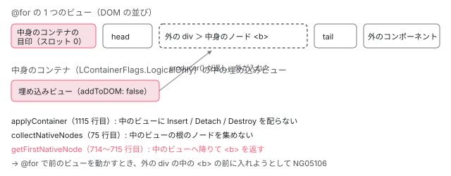

[目次](../README.md) › [外のコンポーネント：foreignImports と foreign view](README.md) › 第 4 回 / 全 6 回

# @content と後始末：Angular のビューを外へ渡す

> ɵɵforeignContent と ɵɵforeignContentFn が、同じスロットのテンプレートの LContainer に LogicalOnly を立て（56607967dbb）、埋め込みビューを DOM に足さずに作ってノードだけ返す producer を CONTENT\_ADAPTER に渡す行。外が呼び返す破棄の関数（11b206b9190）、遅れて描く（4847c0e07b1）、ForeignContextInjector（555fc20af04）。ページの上の本物の外のコンポーネントで、破棄の関数を呼んだとき・呼ばなかったときに Angular の子の ngOnDestroy がいつ走るかを記録し、LogicalOnly を見ない getFirstNativeNode のせいで @for の並べ替えが NG05106 になる記録も読む。

angular/angular · 読了 約 13 分 · 発展 · [サイトで読む（デモが動きます）](https://angular-deep-dive-cyan.vercel.app/chapter/fgn-content)

---

外のコンポーネントの子に書いた Angular のテンプレート（`@content` ブロックと、名前の無い子）は、**埋め込みビューとして作られるのに DOM には足されず、ノードだけが外へ手渡されます**。この章では、手渡すための 2 つの命令 `ɵɵforeignContent` と `ɵɵforeignContentFn` の行、そのビューを入れるコンテナに立つ `LContainerFlags.LogicalOnly` が Angular の DOM 操作のどこを飛ばし、どこを飛ばさないか、外が呼び返す破棄の関数を呼んだとき・呼ばなかったときに何が残るかを、コミットの差分 → 今の行 → spec → 実際に動かした記録の順に読みます。

読む対象は `packages/core/src/render3/instructions/foreign_component.ts` の 124〜264 行目、`node_manipulation.ts`・`collect_native_nodes.ts` の LogicalOnly の行、`packages/core/test/acceptance/foreign_component/` の 2 つの spec です。契約の 4 つの Symbol と `ɵɵforeignContent`（172〜210 行目）の全体は [standalone シリーズの foreignImports の章](../standalone/14-standalone-foreign-imports.md)の 1 節と 7 節で引用したので、ここでは引かずに参照します。foreign view そのものは[第 2 回](02-fgn-foreign-view.md)、`ɵɵforeignComponent` の本体と描く時機は[第 3 回](03-fgn-instruction.md)です。

1. [1. 契約と歩み](01-fgn-contract-history.md)
2. [2. foreign view](02-fgn-foreign-view.md)
3. [3. ɵɵforeignComponent の中](03-fgn-instruction.md)
4. **4. @content と後始末**（この章）
5. [5. コンパイラと ngtsc](05-fgn-compiler.md)
6. [6. spec と PR](06-fgn-tests-issues.md)

> [!WARNING]
> **ハマりどころ**
>
> `foreignImports` は公開 API ではありません（`@internal // 3p-only`）。この章のデモの `miniImport` は**本家の使い方ではなく、仕組みを見るために手で作った橋**です。npm の `@angular/core` には `foreignImport()` も 4 つの Symbol も出ていないので、Angular が読みに来るキーを `Proxy` の `get` で受け、Symbol の `description`（`'RENDER'` など）で振り分けています。

## 1. 歩み：子を渡す道は 1 か月で 5 回変わった

子コンテンツの道を変えたコミットを日付順に並べます（../angular の `git log`。どれも 22.1.0 に入っていて、このサイトの 22.2.6 にもあります）。

| 日付 | コミット | 子コンテンツの道で変わったこと |
| --- | --- | --- |
| 05-28 | f89d0e4c8fc | 名前の無い子を `children` として渡す。`ɵɵforeignContent(index)` がその場で埋め込みビューを作り、`Node[]` を返す |
| 05-28 | f19bbe59dd9 | `@content (名前)` ブロックを足し、同じ名前の props に渡す（コンパイラの `resolve_foreign_content`。[第 5 回](05-fgn-compiler.md)） |
| 05-29 | 56607967dbb | `LContainerFlags.LogicalOnly`。中身を入れるコンテナを Angular の DOM 操作から外す（4 節） |
| 06-01 | b399f78c347 | `@content (名前; let a, b)` と `ɵɵforeignContentFn`。「引数を受けて、呼ぶたびに新しいビューを作る関数」を渡す |
| 06-06 | 11b206b9190 | `ON_DESTROY`。外が後で呼び返す破棄の関数を預ける（このときは `ɵɵforeignContentFn` だけ） |
| 06-24 | 555fc20af04 | `GET_CONTEXT` と `ForeignContextInjector`。`render` を注入の文脈の中で呼ぶのをやめる（6 節） |
| 06-26 | 4847c0e07b1 | `CONTENT_ADAPTER`。名前の無い子も `producer` にして、呼ばれるまでビューを作らない。名前の無い子にも破棄の関数を預ける（5 節） |

差分を 2 つ見ます。最初の `ɵɵforeignContentFn` は、呼ばれるたびにビューを作ってノードを返すだけで、後始末の口がありませんでした。

📄 `b399f78c347 が足した ɵɵforeignContentFn（最初の形）`

```
--- packages/core/src/render3/instructions/foreign_component.ts（git show b399f78c347 の抜粋）
@@ -115,3 +115,39 @@ export function ɵɵforeignContent(index: number): any[] {
   const embeddedTView = embeddedLView[TVIEW];
   return collectNativeNodes(embeddedTView, embeddedLView, embeddedTView.firstChild, []);
 }
+
+/**
+ * Creation phase instruction to return a function for rendering foreign content dynamically
+ * with arguments.
+ *
+ * @param index The index of the container in the data array.
+ * @codeGenApi
+ */
+export function ɵɵforeignContentFn(index: number): (...args: any[]) => any[] {
+  const lView = getLView();
+  const adjustedIndex = index + HEADER_OFFSET;
+
+  // The template is already declared at adjustedIndex, so lContainer must exist.
+  const lContainer = lView[adjustedIndex] as LContainer;
+  ngDevMode && assertLContainer(lContainer);
+  lContainer[FLAGS] |= LContainerFlags.LogicalOnly;
+
+  const tView = getTView();
+  const tNode = tView.data[adjustedIndex] as TContainerNode;
+
+  return (...args: any[]) => {
+    // When the function is called, instantiate and render a new embedded view inside the container.
+    // The arguments are passed directly as the context of the view.
+    const embeddedLView = createAndRenderEmbeddedLView(lView, tNode, args);
+    addLViewToLContainer(
+      lContainer,
+      embeddedLView,
+      lContainer.length - CONTAINER_HEADER_OFFSET,
+      /* addToDOM */ false,
+    );
+
+    // Extract and return the root nodes of the created view
+    const embeddedTView = embeddedLView[TVIEW];
+    return collectNativeNodes(embeddedTView, embeddedLView, embeddedTView.firstChild, []);
+  };
+}
```

1 週間後の 11b206b9190 が、ノードを返す前に `onDestroy(() => …)` で「このビューをコンテナから外して壊す関数」を外へ預ける行を足しました。コミット本文は「外が子を外しても Angular のビューが生き続け、メモリが漏れ、後始末の lifecycle が走らなかった」と書いています。

📄 `11b206b9190 の抜粋`

```
--- packages/core/src/render3/instructions/foreign_component.ts（git show 11b206b9190 の抜粋）
@@ -148,6 +160,14 @@ export function ɵɵforeignContentFn(index: number): (...args: any[]) => any[] {
       /* addToDOM */ false,
     );
 
+    onDestroy(() => {
+      if (!isDestroyed(embeddedLView)) {
+        const embeddedLViewIndex = lContainer.indexOf(embeddedLView, CONTAINER_HEADER_OFFSET);
+        ngDevMode && assertNotSame(embeddedLViewIndex, -1, 'Embedded view not found in container');
+        removeLViewFromLContainer(lContainer, embeddedLViewIndex - CONTAINER_HEADER_OFFSET);
+      }
+    });
+
     // Extract and return the root nodes of the created view
     const embeddedTView = embeddedLView[TVIEW];
     return collectNativeNodes(embeddedTView, embeddedLView, embeddedTView.firstChild, []);
```

## 2. 2 つの命令の共通の入口：resolveForeignContentContainer

📄 `angular/packages/core/src/render3/instructions/foreign_component.ts` L125–162 （▶ の行: 129, 133, 140, 147–150, 153–157, 161）

```ts
125 │ /**
126 │  * Reusable injector class that intercepts requests for {@link FOREIGN_CONTEXT} during
127 │  * embedded view creation and returns the captured runtime context.
128 │  */
129 ▶ class ForeignContextInjector implements Injector {
130 │   constructor(private context: unknown) {}
131 │ 
132 │   get(token: any, notFoundValue?: any): any {
133 ▶     return token === FOREIGN_CONTEXT ? this.context : notFoundValue;
134 │   }
135 │ }
136 │ 
137 │ /**
138 │  * Resolves container and foreign component metadata for foreign content projection instructions.
139 │  */
140 ▶ function resolveForeignContentContainer(
141 │   index: number,
142 │   foreignComponentConstIndex: number,
143 │ ): [LView, LContainer, TContainerNode, ForeignComponent<any, any>] {
144 │   const lView = getLView();
145 │   const adjustedIndex = index + HEADER_OFFSET;
146 │ 
147 ▶   // The template is already declared at adjustedIndex, so lContainer must exist.
148 ▶   const lContainer = lView[adjustedIndex] as LContainer;
149 ▶   ngDevMode && assertLContainer(lContainer);
150 ▶   lContainer[FLAGS] |= LContainerFlags.LogicalOnly;
151 │ 
152 │   const tView = getTView();
153 ▶   const tNode = tView.data[adjustedIndex] as TContainerNode;
154 ▶   const foreignComponent = getConstant<ForeignComponent<any, any>>(
155 ▶     tView.consts,
156 ▶     foreignComponentConstIndex,
157 ▶   )!;
158 │   ngDevMode &&
159 │     assertDefined(foreignComponent, 'Foreign component must be defined in constant pool.');
160 │ 
161 ▶   return [lView, lContainer, tNode, foreignComponent];
162 │ }
```

1. **148 行目：コンテナはもうある**

   コンパイラは中身を先に `ɵɵdomTemplate`（または `ɵɵtemplate`）で宣言し、その同じスロット番号でこの命令を呼びます（出力の形は[第 5 回](05-fgn-compiler.md)）。147 行目のコメントのとおり、`lView[adjustedIndex]` はそのテンプレートの `LContainer` です。149 行目は開発モードだけの確かめです。
2. **150 行目：LogicalOnly を立てる**

   `|=` なので、何度呼ばれても立ったままです。立てるのはこの命令だけで、`grep -rn "LogicalOnly" packages/core/src` は この行と、読む側の 2 か所（4 節）と、定義（interfaces/container.ts の `LContainerFlags` の最後。[ビューの木の章](../ivy/12-ivy-view-tree.md)で引用した enum）の 4 行です。
3. **153〜157 行目：TNode と、consts の中の外のコンポーネント**

   第 2 引数は `ɵɵforeignComponent` と同じ consts の添字です。中身の命令が外のコンポーネントのオブジェクトを自分で引くのは、`CONTENT_ADAPTER`・`ON_DESTROY`・`GET_CONTEXT` を読むためです。
4. **129〜135 行目：`ForeignContextInjector`**

   133 行目、聞かれたトークンが `FOREIGN_CONTEXT` のときだけ預かった値を返し、それ以外は `notFoundValue`。埋め込みビューの注入器として使い、見つからないものは宣言側のノード注入器へ進みます（6 節）。

## 3. ɵɵforeignContentFn：呼ばれるたびにビューを作り、ノードだけ返す

📄 `angular/packages/core/src/render3/instructions/foreign_component.ts` L212–231 （▶ の行: 220, 224, 228–230）

```ts
212 │ /**
213 │  * Creation phase instruction to return a function for rendering foreign content dynamically
214 │  * with arguments.
215 │  *
216 │  * @param index The index of the container in the data array.
217 │  * @param foreignComponentConstIndex The index of the matched foreign component in the constant pool.
218 │  * @codeGenApi
219 │  */
220 ▶ export function ɵɵforeignContentFn(
221 │   index: number,
222 │   foreignComponentConstIndex: number,
223 │ ): (...args: any[]) => any {
224 ▶   const [lView, lContainer, tNode, foreignComponent] = resolveForeignContentContainer(
225 │     index,
226 │     foreignComponentConstIndex,
227 │   );
228 ▶   const adapter = foreignComponent[CONTENT_ADAPTER];
229 ▶   const onDestroy = foreignComponent[ON_DESTROY];
230 ▶   const getContext = foreignComponent[GET_CONTEXT];
231 │ 
```

📄 `angular/packages/core/src/render3/instructions/foreign_component.ts` L232–264 （▶ の行: 232–236, 240, 242, 245–246, 249–251, 254, 258–259, 262）

```ts
232 ▶   return (...args: any[]) => {
233 ▶     const producer = () => {
234 ▶       const options = getContext
235 ▶         ? {embeddedViewInjector: new ForeignContextInjector(getContext())}
236 ▶         : undefined;
237 │ 
238 │       // When the function is called, instantiate and render a new embedded view inside the container.
239 │       // The arguments are passed directly as the context of the view.
240 ▶       const embeddedLView = createAndRenderEmbeddedLView(lView, tNode, args, options);
241 │ 
242 ▶       addLViewToLContainer(
243 │         lContainer,
244 │         embeddedLView,
245 ▶         lContainer.length - CONTAINER_HEADER_OFFSET,
246 ▶         /* addToDOM */ false,
247 │       );
248 │ 
249 ▶       onDestroy(() => {
250 ▶         if (!isDestroyed(embeddedLView)) {
251 ▶           const embeddedLViewIndex = lContainer.indexOf(embeddedLView, CONTAINER_HEADER_OFFSET);
252 │           ngDevMode &&
253 │             assertNotSame(embeddedLViewIndex, -1, 'Embedded view not found in container');
254 ▶           removeLViewFromLContainer(lContainer, embeddedLViewIndex - CONTAINER_HEADER_OFFSET);
255 │         }
256 │       });
257 │ 
258 ▶       const embeddedTView = embeddedLView[TVIEW];
259 ▶       return collectNativeNodes(embeddedTView, embeddedLView, embeddedTView.firstChild, []);
260 │     };
261 │ 
262 ▶     return adapter(producer);
263 │   };
264 │ }
```

1. **228〜230 行目：契約の 3 つを先に読む**

   作成の命令の中で 1 回だけ読みます。デモの記録でも、Angular が読んだキーは `CONTENT_ADAPTER, ON_DESTROY, GET_CONTEXT, RENDER` の順でした（7 節）。`RENDER` は[第 3 回](03-fgn-instruction.md)の、更新のあとのビューの effect が読みます。
2. **232 行目：引数を受ける関数を返す（ここではまだ何も作らない）**

   `@content (row; let item, i)` の `row` に入るのは、この関数を `CONTENT_ADAPTER` に通したものです。引数の無い版 `ɵɵforeignContent` は 232 行目の外側が無く、`producer` を直接 `adapter` に渡します（standalone シリーズの章の 7 節で引用）。
3. **240 行目：埋め込みビューを作って最初の作成まで済ませる**

   第 3 引数の `args` がそのままビューの文脈になります。コンパイラは `let item, i` を `ctx[0]`・`ctx[1]` と読むコードを出します（[第 5 回](05-fgn-compiler.md)の記録）。234〜236 行目、`GET_CONTEXT` があるときだけ注入器を渡します。
4. **242〜247 行目：コンテナに入れるが、DOM には足さない**

   246 行目の `/* addToDOM */ false`。`addLViewToLContainer` は、変更検知の木に入れる `insertView` は必ず呼び、DOM に足す枝は `addToDOM` が true のときだけ通ります（[LContainer の章](../ivy/11-ivy-lcontainer.md)で引用した関数）。だからこのビューは**変更検知され、クエリにも見えるのに、DOM のどこにも付いていません**。245 行目、入れる位置はいつも末尾です。
5. **249〜256 行目：破棄の関数を外へ預ける**

   預けるのは「まだ壊れていなければ、コンテナの中の位置を `indexOf` で探して（251 行目）`removeLViewFromLContainer` する」関数です。位置を作ったときに覚えずに毎回探すのは、ほかのビューが先に外れると位置がずれるからです。`removeLViewFromLContainer` の中身（外す → `destroyLView`）は[ビューの破棄の章](../ivy/17-ivy-destroy.md)です。
6. **258〜262 行目：根のノードを集めて、adapter に通したものを返す**

   `collectNativeNodes` はビューの一番上の TNode から兄弟をたどり、DOM のノードを配列に積みます（4 節で中を読みます）。262 行目、`producer` そのものではなく `adapter(producer)` を返すので、いつ作るかは外が決めます（5 節）。

## 4. LogicalOnly：飛ばす 2 か所と、飛ばさない 1 か所

56607967dbb は、2 つの関数に同じ確かめを 1 行ずつ足しました。

📄 `56607967dbb の抜粋（node_manipulation.ts と collect_native_nodes.ts）`

```
--- packages/core/src/render3/node_manipulation.ts（git show 56607967dbb の抜粋）
@@ -1082,6 +1088,9 @@ function applyContainer(
       beforeNode,
     );
   }
+  if ((lContainer[FLAGS] & LContainerFlags.LogicalOnly) !== 0) {
+    return;
+  }
   for (let i = CONTAINER_HEADER_OFFSET; i < lContainer.length; i++) {
     const lView = lContainer[i] as LView;
     applyView(lView[TVIEW], lView, renderer, action, parentRElement, anchor);

--- packages/core/src/render3/collect_native_nodes.ts（git show 56607967dbb の抜粋）
@@ -60,7 +68,7 @@ export function collectNativeNodes(
     // A given lNode can represent either a native node or a LContainer (when it is a host of a
     // ViewContainerRef). When we find a LContainer we need to descend into it to collect root nodes
     // from the views in this container.
-    if (isLContainer(lNode)) {
+    if (isLContainer(lNode) && !(lNode[FLAGS] & LContainerFlags.LogicalOnly)) {
       collectNativeNodesInLContainer(lNode, result);
     }
```

### applyContainer：コンテナの中のビューに DOM 操作を配らない

📄 `angular/packages/core/src/render3/node_manipulation.ts` L1091–1121 （▶ の行: 1100, 1115–1118, 1120）

```ts
1091 │   ngDevMode && assertLContainer(lContainer);
1092 │   const anchor = lContainer[NATIVE]; // LContainer has its own before node.
1093 │   const native = unwrapRNode(lContainer);
1094 │   // An LContainer can be created dynamically on any node by injecting ViewContainerRef.
1095 │   // Asking for a ViewContainerRef on an element will result in a creation of a separate anchor
1096 │   // node (comment in the DOM) that will be different from the LContainer's host node. In this
1097 │   // particular case we need to execute action on 2 nodes:
1098 │   // - container's host node (this is done in the executeActionOnElementOrContainer)
1099 │   // - container's host node (this is done here)
1100 ▶   if (anchor !== native) {
1101 │     // This is very strange to me (Misko). I would expect that the native is same as anchor. I
1102 │     // don't see a reason why they should be different, but they are.
1103 │     //
1104 │     // If they are we need to process the second anchor as well.
1105 │     applyToElementOrContainer(
1106 │       action,
1107 │       renderer,
1108 │       injector,
1109 │       parentRElement,
1110 │       anchor,
1111 │       tNode,
1112 │       beforeNode,
1113 │     );
1114 │   }
1115 ▶   if ((lContainer[FLAGS] & LContainerFlags.LogicalOnly) !== 0) {
1116 ▶     return;
1117 ▶   }
1118 ▶   for (let i = CONTAINER_HEADER_OFFSET; i < lContainer.length; i++) {
1119 │     const lView = lContainer[i] as LView;
1120 ▶     applyView(lView[TVIEW], lView, renderer, action, parentRElement, anchor);
1121 │   }
```

`applyContainer` は、親のビューを DOM に入れる・外す・壊すとき（`WalkTNodeTreeAction` の Create / Insert / Detach / Destroy）に、木をたどって出会ったコンテナごとに呼ばれます。1118〜1121 行目がふつうの道で、中のビューを 1 つずつ `applyView` して同じ操作を配ります。**1115〜1117 行目、LogicalOnly なら配らずに戻ります**。その前の 1100〜1114 行目（目印のコメントの扱い）は通るので、コンテナの目印（`<!--container-->`）は親と一緒に動き、中のビューのノードは外が置いた場所に残ります。

### collectNativeNodes：入れ子の中身を二重に数えない

📄 `angular/packages/core/src/render3/collect_native_nodes.ts` L63–85 （▶ の行: 65–66, 75–76, 81）

```ts
63 │     const lNode = lView[tNode.index];
64 │     if (lNode !== null) {
65 ▶       if (isLContainer(lNode)) {
66 ▶         const anchor = lNode[NATIVE];
67 │         // If this is a dynamic container (ViewContainerRef on an element), the HOST element is a
68 │         // distinct element node and must be pushed first (before the views are collected) to
69 │         // preserve DOM order.
70 │         if (anchor !== lNode[HOST]) {
71 │           result.push(unwrapRNode(lNode));
72 │         }
73 │ 
74 │         // Collect the root nodes from the views in this container.
75 ▶         if (!(lNode[FLAGS] & LContainerFlags.LogicalOnly)) {
76 ▶           collectNativeNodesInLContainer(lNode, result);
77 │         }
78 │ 
79 │         // The container's anchor comment node is always physically positioned after any views
80 │         // rendered inside the container, so we always push it here at the end.
81 ▶         result.push(anchor);
82 │       } else {
83 │         result.push(unwrapRNode(lNode));
84 │       }
85 │     }
```

3 節の 259 行目が呼ぶ関数です。コンテナに出会うと、ふつうは 76 行目で中のビューの根のノードも集めます。外のコンポーネントの中身に、さらに外のコンポーネントがあるとき、その内側の中身のノードはもう内側の外のコンポーネントのものです。75 行目でそれを飛ばし、81 行目で目印のコメントだけを積みます。

### spec が固めていること

📄 `angular/packages/core/test/acceptance/foreign_component/foreign_component_spec.ts` L164–200 （▶ の行: 164, 168–170, 182, 185–189, 192, 194）

```ts
164 ▶     it('should not reparent content to next to its original container when added to the DOM', async () => {
165 │       @Component({
166 │         selector: 'test-cmp',
167 │         template: `
168 ▶           @if (true) {
169 ▶             <FancyButton>
170 ▶               <span>⭐</span>
171 │             </FancyButton>
172 │           }
173 │         `,
174 │         // @ts-ignore
175 │         foreignImports: [frameworkImport(FancyButton)],
176 │       })
177 │       class TestNoReparenting {}
178 │ 
179 │       const fixture = TestBed.createComponent(TestNoReparenting);
180 │ 
181 │       // Change detection triggers insertion of the @if view, which contains the foreign component.
182 ▶       await fixture.whenStable();
183 │ 
184 │       expect(fixture.nativeElement.innerHTML).toBe(
185 ▶         '' +
186 ▶           // The container in which @content is initially rendered.
187 ▶           '<!--container-->' +
188 ▶           // The start of the foreign view created for the foreign component.
189 ▶           '<!--foreign-view-head-->' +
190 │           '<button>' +
191 │           '<span>⭐</span>' +
192 ▶           '</button>' +
193 │           // The end of the foreign view created for the foreign component.
194 ▶           '<!--foreign-view-tail-->' +
195 │           // The container in which the foreign view is rendered.
196 │           '<!--foreign-component-->' +
197 │           // The container anchor for the @if block.
198 │           '<!--container-->',
199 │       );
200 │     });
```

外のコンポーネントを `@if` の中に置き、`@if` のビューが DOM に入ったあとの形を確かめます。185 行目の `<!--container-->` が中身のコンテナの目印で、中身の `<span>` は 187〜189 行目の外の `<button>` の中にあります。名前どおり「目印の隣に戻されない」ことです。このファイルの先頭の `frameworkImport` は adapter が `(producer) => producer()` なので、中身は外の `render` より先に作られています。

### 飛ばさない所：getFirstNativeNode

📄 `angular/packages/core/src/render3/node_manipulation.ts` L699–716 （▶ の行: 699, 714–716）

```ts
699 ▶ export function getFirstNativeNode(lView: LView, tNode: TNode | null): RNode | null {
700 │   if (tNode !== null) {
701 │     ngDevMode &&
702 │       assertTNodeType(
703 │         tNode,
704 │         TNodeType.AnyRNode |
705 │           TNodeType.AnyContainer |
706 │           TNodeType.Icu |
707 │           TNodeType.Projection |
708 │           TNodeType.LetDeclaration,
709 │       );
710 │ 
711 │     const tNodeType = tNode.type;
712 │     if (tNodeType & TNodeType.AnyRNode) {
713 │       return getNativeByTNode(tNode, lView);
714 ▶     } else if (tNodeType & TNodeType.Container) {
715 ▶       return getBeforeNodeForView(-1, lView[tNode.index]);
716 ▶     } else if (tNodeType & TNodeType.ElementContainer) {
```

`getFirstNativeNode` は「このビューの最初の DOM ノード」を返す関数で、ビューを動かすときに「どのノードの前に入れるか」を決める `getBeforeNodeForView`（[LContainer の章](../ivy/11-ivy-lcontainer.md)で引用）が、次のビューに対して呼びます。714〜715 行目、最初の TNode がコンテナなら、そのコンテナの最初のビューへ降ります。**ここには LogicalOnly の確かめがありません**。外のコンポーネントのビューでは、最初の TNode は中身のテンプレート（スロット 0 の `ɵɵdomTemplate`）です。中身がもう作られていると、返るのは外が自分の DOM に入れた中身のノードです。

これを `@for` の並べ替えで確かめた記録です（このあとの「記録の再生」に全部あります）。`a`・`b` の 2 つの外のコンポーネントを `['b', 'a']` に並べ替えると、中身をまだ作っていない `Lazy` と、中身の無い `Plain` は並べ替わります。中身をもう作った `LazyOpen`（`render` の中で `producer` を呼ぶ）と `Eager`（adapter が呼ぶ）は、platform-browser の `DomRenderer.insertBefore` が `NG05106`（「`B ("a")` の前に入れようとしたが、それはもう `DIV ("a")` の子ではない」）を投げ、`box-b` が DOM から消えたままになります。22.1.6 と 22.2.6、開発モードと本番の 4 通りで同じでした。714〜715 行目の枝に「LogicalOnly ならコンテナの目印 `lContainer[NATIVE]` を返す」1 行を足した写しでは、4 つとも並べ替わりました。



*外のコンポーネントのビュー。中身のコンテナ（LogicalOnly）の目印は親の DOM にあり、中身のノードは外の DOM の中にある。applyContainer と collectNativeNodes は中身に降りない。getFirstNativeNode は降りる。*

## 5. 遅れて描く（4847c0e07b1）と、破棄の関数を呼ぶ・呼ばない

📄 `4847c0e07b1 の抜粋（ɵɵforeignContent）`

```
--- packages/core/src/render3/instructions/foreign_component.ts（git show 4847c0e07b1 の抜粋）
@@ -109,15 +115,35 @@ export function ɵɵforeignContent(index: number): any[] {
 
   const tView = getTView();
   const tNode = tView.data[adjustedIndex] as TContainerNode;
+  const foreignComponent = getConstant<ForeignComponent<any>>(
+    tView.consts,
+    foreignComponentConstIndex,
+  )!;
+  const adapter = foreignComponent[CONTENT_ADAPTER];
+  const onDestroy = foreignComponent[ON_DESTROY];
+
+  const producer = () => {
+    const embeddedLView = createAndRenderEmbeddedLView(lView, tNode, null);
+    addLViewToLContainer(
+      lContainer,
+      embeddedLView,
+      lContainer.length - CONTAINER_HEADER_OFFSET,
+      /* addToDOM */ false,
+    );
+
+    onDestroy(() => {
+      if (!isDestroyed(embeddedLView)) {
+        const embeddedLViewIndex = lContainer.indexOf(embeddedLView, CONTAINER_HEADER_OFFSET);
+        ngDevMode && assertNotSame(embeddedLViewIndex, -1, 'Embedded view not found in container');
+        removeLViewFromLContainer(lContainer, embeddedLViewIndex - CONTAINER_HEADER_OFFSET);
+      }
+    });
 
-  // Instantiate and render the embedded view inside the container, but do not add its elements to
-  // the DOM at the container anchor since the nodes will be projected into a foreign view.
-  const embeddedLView = createAndRenderEmbeddedLView(lView, tNode, null);
-  addLViewToLContainer(lContainer, embeddedLView, 0, /* addToDOM */ false);
+    const embeddedTView = embeddedLView[TVIEW];
+    return collectNativeNodes(embeddedTView, embeddedLView, embeddedTView.firstChild, []);
+  };
 
-  // Extract and return the root nodes of the created view
-  const embeddedTView = embeddedLView[TVIEW];
-  return collectNativeNodes(embeddedTView, embeddedLView, embeddedTView.firstChild, []);
+  return adapter(producer);
 }
 
 /**
```

これより前の `ɵɵforeignContent` は、作成の命令の中ですぐビューを作り、`Node[]` を返していました。4847c0e07b1 から、作る仕事は `producer` に包まれ、`adapter(producer)` の戻り値が props に入ります。adapter が `producer` をそのまま返せば、外が呼ぶまでビューは作られません。その場で呼べば前と同じです。コミット本文は「隠れている中身や外されている中身のために、ビューと DOM を先に作るのは無駄」と書いています。

📄 `angular/packages/core/test/acceptance/foreign_component/foreign_component_spec.ts` L1028–1061 （▶ の行: 1033, 1035, 1040, 1046, 1048–1050, 1057）

```ts
1028 │     function frameworkImport<TProps>(
1029 │       component: (props: TProps) => Node[],
1030 │     ): ForeignComponent<TProps> {
1031 │       return foreignImport(
1032 │         (props) => [component(props)],
1033 ▶         (callback) => Context.active.onDestroy(callback),
1034 │         // Do *not* render nodes eagerly. Return the node producer function directly.
1035 ▶         (producer) => producer,
1036 │       );
1037 │     }
1038 │ 
1039 │     it('should integrate lifecycle of static content', async () => {
1040 ▶       function StaticIf(props: {injector: Injector; cond: () => boolean; children: () => Node[]}) {
1041 │         const container = document.createElement('div');
1042 │         const context = new Context();
1043 │ 
1044 │         effect(
1045 │           (onCleanup) => {
1046 ▶             onCleanup(() => context.destroy());
1047 │ 
1048 ▶             if (props.cond()) {
1049 ▶               context.run(() => {
1050 ▶                 const nodes = untracked(() => props.children());
1051 │                 for (const node of nodes) {
1052 │                   container.appendChild(node);
1053 │                 }
1054 │               });
1055 │             }
1056 │           },
1057 ▶           {injector: props.injector},
1058 │         );
1059 │ 
1060 │         return [container];
1061 │       }
```

acceptance の `lifecycle` の describe が使う橋です。1033 行目、預かった破棄の関数を外の「いま描いている場所」（`Context.active`）に登録し、1035 行目、`producer` をそのまま返します。外のコンポーネント `StaticIf` は `cond` が true のときだけ 1050 行目で `children()` を呼び、1046 行目の `onCleanup` で場所ごと壊します。1057 行目で `effect` に Angular の `Injector` を渡しているのは、555fc20af04 から `render` が注入の文脈の外で呼ばれるからです（6 節）。

📄 `angular/packages/core/test/acceptance/foreign_component/foreign_component_spec.ts` L1100–1122 （▶ の行: 1104, 1112–1113, 1120–1121）

```ts
1100 │       // Toggle visible to true: this renders <child>.
1101 │       fixture.componentInstance.visible.set(true);
1102 │       await fixture.whenStable();
1103 │ 
1104 ▶       expect(ngOnInitSpy).toHaveBeenCalledTimes(1);
1105 │       expect(ngOnDestroySpy).not.toHaveBeenCalled();
1106 │       expect(fixture.nativeElement.textContent).toBe('child');
1107 │ 
1108 │       // Toggle visible back to false: this destroys the previously rendered <child>.
1109 │       fixture.componentInstance.visible.set(false);
1110 │       await fixture.whenStable();
1111 │ 
1112 ▶       expect(ngOnInitSpy).toHaveBeenCalledTimes(1);
1113 ▶       expect(ngOnDestroySpy).toHaveBeenCalledTimes(1);
1114 │       expect(fixture.nativeElement.textContent).toBe('');
1115 │ 
1116 │       // Toggle visible to true again: this renders a new <child>.
1117 │       fixture.componentInstance.visible.set(true);
1118 │       await fixture.whenStable();
1119 │ 
1120 ▶       expect(ngOnInitSpy).toHaveBeenCalledTimes(2);
1121 ▶       expect(ngOnDestroySpy).toHaveBeenCalledTimes(1);
1122 │       expect(fixture.nativeElement.textContent).toBe('child');
```

1104 行目、出すと `ngOnInit` が 1 回。1113 行目、消すと `ngOnDestroy` が 1 回。1120 行目、もう一度出すと **新しいビュー**なので `ngOnInit` が 2 回目です。この spec は「外が破棄の関数を呼ぶ」場合だけを確かめています。呼ばない場合は、このページのデモと記録で見ます（7 節）。

1. **外が呼んだ：その場で壊れる**

   249〜256 行目の関数が `removeLViewFromLContainer` を呼び、ビューはコンテナから外れて `destroyLView` されます。記録では「Child #1 ngOnDestroy」が、外の「破棄の関数を 1 個呼んだ」より先に並びます。外の関数の中で、同期に走るからです。
2. **外が呼ばずに捨てた：ビューは残り、変更検知され続ける**

   ノードは外が DOM から外しても、ビューはコンテナの中に残ります。記録では、外した Child #2 の `n` が、DOM のどこにも付いていないまま 1 → 2 に更新されました。もう一度出すと Child #3 が作られ、生きている Child は 2 つになります。
3. **Angular が親ごと壊した：残っていたものも壊れる**

   `@if` を false にすると、「Child #2 ngOnDestroy」「Child #3 ngOnDestroy」のあとに、外の dispose（`RENDER` が返した関数）が走りました。親のビューを壊す道（`destroyViewTree`、[ビューの破棄の章](../ivy/17-ivy-destroy.md)）は、LogicalOnly を見ずにコンテナの中のビューもたどるからです。つまり呼ばなかった分は、**外のコンポーネントを置いた Angular のビューが壊れるまで**残ります。dispose の中で外が #3 の関数を呼んでも、250 行目の `isDestroyed` で何もしません。

## 6. 文脈：GET\_CONTEXT と ForeignContextInjector（555fc20af04）

📄 `555fc20af04 の抜粋（ɵɵforeignComponent。このときはまだ作成の命令の中で render を呼んでいた）`

```
--- packages/core/src/render3/instructions/foreign_component.ts（git show 555fc20af04 の抜粋）
@@ -77,9 +83,16 @@ export function ɵɵforeignComponent(
   // 4. Create the Foreign View and insert it at index 0 of the container
   const viewRef = createForeignView(lContainer, 0);
 
-  // 5. Call the RENDER function to get the nodes and DisposeFn
-  const injector = new NodeInjector(tNode, lView);
-  const [nodes, dispose] = runInInjectionContext(injector, () => foreignComponent[RENDER](props));
+  // 5. Resolve context and call the RENDER function to get the nodes and DisposeFn
+  // Context is optional because foreign components may not require context or a FOREIGN_CONTEXT
+  // provider might not be configured in the component/element injector hierarchy.
+  const context = getOrCreateInjectable(
+    tNode,
+    lView,
+    FOREIGN_CONTEXT,
+    InternalInjectFlags.Optional,
+  );
+  const [nodes, dispose] = foreignComponent[RENDER](props, context ?? undefined);
 
   // 6. Insert the returned nodes into the foreign view, between its head and tail comment anchors.
   const tail = viewRef.tail as RNode;
```

555fc20af04 は、`render` を `runInInjectionContext(new NodeInjector(...))` の中で呼ぶのをやめ、代わりに `FOREIGN_CONTEXT` を任意で探して第 2 引数に渡すようにしました。コミット本文の最後の段落、「外の render は Angular の注入の文脈の中では走らない。外の文脈の仕組みを直接使うことを期待する」です。中身の側は、3 節の 234〜236 行目のとおり、`GET_CONTEXT` があれば **producer が呼ばれたときの**外の文脈を `ForeignContextInjector` に入れて、埋め込みビューの注入器にします。その中に別の外のコンポーネントがあれば、その `ɵɵforeignComponent` が `FOREIGN_CONTEXT` を探して、この値を受け取ります。

📄 `angular/packages/core/test/acceptance/foreign_component/foreign_component_context_spec.ts` L34–63 （▶ の行: 38–39, 41, 43, 47–48, 53, 55）

```ts
34 │ function microImport<TProps>(
35 │   component: (props: TProps) => Node[],
36 │ ): ForeignComponent<TProps, string | undefined> {
37 │   return foreignImport(
38 ▶     (props, context) => {
39 ▶       const previousContext = microFramework.pushContext(context);
40 │       try {
41 ▶         return [component(props)];
42 │       } finally {
43 ▶         microFramework.popContext(previousContext);
44 │       }
45 │     },
46 │     () => {}, // No cleanup necessary.
47 ▶     (producer) => ({render: producer}),
48 ▶     () => microFramework.context,
49 │   );
50 │ }
51 │ 
52 │ function Provider(props: {context: string; children: Content}): Node[] {
53 ▶   const previousContext = microFramework.pushContext(props.context);
54 │   try {
55 ▶     return props.children.render();
56 │   } finally {
57 │     microFramework.popContext(previousContext);
58 │   }
59 │ }
60 │ 
61 │ function Consumer(): Node[] {
62 │   return [document.createTextNode(microFramework.context ?? '<no context>')];
63 │ }
```

📄 `angular/packages/core/test/acceptance/foreign_component/foreign_component_context_spec.ts` L116–144 （▶ の行: 116, 118, 120, 130–131, 143）

```ts
116 ▶   it('should pass parent context to dynamic children', async () => {
117 │     function DynamicProvider(props: {context: string; children: () => Content}): Node[] {
118 ▶       const previousContext = microFramework.pushContext(props.context);
119 │       try {
120 ▶         return props.children().render();
121 │       } finally {
122 │         microFramework.popContext(previousContext);
123 │       }
124 │     }
125 │ 
126 │     @Component({
127 │       selector: 'test-app',
128 │       template: `
129 │         <DynamicProvider context="Parent context">
130 ▶           @content (children; let _) {
131 ▶             <Consumer />
132 │           }
133 │         </DynamicProvider>
134 │       `,
135 │       // @ts-ignore
136 │       foreignImports: [microImport(DynamicProvider), microImport(Consumer)],
137 │     })
138 │     class TestApp {}
139 │ 
140 │     const fixture = TestBed.createComponent(TestApp);
141 │     await fixture.whenStable();
142 │ 
143 ▶     expect(fixture.nativeElement.textContent).toBe('Parent context');
144 │   });
```

小さな外のフレームワークの `render` は、受け取った文脈を 39 行目で積み、43 行目で戻します。48 行目の `GET_CONTEXT` は「いまの文脈」を返すだけです。`Provider` は 53 行目で自分の文脈を積んでから 55 行目で中身を描くので、中身の `Consumer` は `'Parent context'` を受け取ります（it `should pass parent context to static children`）。116〜144 行目は引数のある版で、130 行目の `@content (children; let _)` は、引数の無い `@content (children)` が NG8027 で禁じられているので、使わない引数を 1 つ書いて `ɵɵforeignContentFn` を通しています（[第 5 回](05-fgn-compiler.md)）。ルートの文脈を DI に置く `provideForeignRootContext` は standalone シリーズの章の 6 節で引用しました。

## 7. デモ：外の側で中身を出したり消したりする

> **🧪 DEMO — Angular の子の ngOnInit / ngOnDestroy は、いつ呼ばれるか**
>
> このページのコンポーネントは、サイトのビルド（AOT、@angular/compiler-cli 22.2.6）で `foreignImports: [miniImport(Drawer)]` ごとコンパイルされ、本物の `ɵɵforeignComponent` と `ɵɵforeignContent` で動いています。`Drawer` は素の DOM で書いた外のコンポーネントで、赤い点線の枠の中のボタンは外の DOM のボタンです。中に渡す Angular のコンポーネント `fgn-ct-child` は、作られたとき・`ngOnInit`・`ngOnDestroy` を記録に書きます（黒が Angular、赤が外）。外から Angular へ知らせる `notify` は props で渡した関数です（`(click)` などのイベント束縛は NG8025 で書けません）。
>
> ▶ [このデモはサイトで動かせます](https://angular-deep-dive-cyan.vercel.app/chapter/fgn-content)

押してみると、次の順になります（下の記録と同じです）。

- 「Angular: 外のコンポーネントを置く」では Child はまだ作られません（`producer` を返すだけの adapter なので）。
- 「外: 中身を出す」で `constructor` → 外の記録 → `ngOnInit` の順。ビューは `producer()` の中で作られ、最初の更新（`ngOnInit`）は次の変更検知です。外のボタンは Angular のリスナーではないので、このデモでは `notify` が記録の signal を書き換えたことで変更検知が予約されます（[zoneless の章](../zoneless/01-zoneless-default.md)）。
- チェックを外して「外: 中身を消す」と、`ngOnDestroy` は呼ばれず、「生きている Child」に「DOM に無い」が残ります。「n を進める」とその数も進みます。
- 「Angular: @if で外のコンポーネントごと消す」で、残っていたものも含めて全部の `ngOnDestroy` が呼ばれます。
- 「DOM を写す」の目印のコメントは、このサイトが本番のビルドなので中身が空（`<!---->`）です。開発モードの名前（`container`・`foreign-view-head` など）は下の記録の方に出ます。

### 記録の再生：同じ操作を Node と domino で

デモと同じ 2 つのファイル（`fgn-content.demo-mini.ts` と `fgn-content.demo-host.ts`）を、手元の作業フォルダの記録スクリプトが ngc と同じ道でコンパイルし、domino の上でボタンを順に押しました。@angular/core 22.1.6 の記録です。22.2.6 でも 同じ記録でした。ErrorHandler に届いたエラーは 0 件です。

1. \[ng\] Angular: @if を true にした
2. \[ng\] Angular が読んだキー: CONTENT\_ADAPTER, ON\_DESTROY, GET\_CONTEXT, RENDER

生きている Child: なし

📄 `この段のあとのデモの枠の中（innerHTML。_ngcontent と style を省いた）`

```
<!--container--><!--foreign-view-head--><div data-mini="drawer"><div>外のコンポーネント Drawer（素の DOM）</div><button>…</button><button>…</button><div data-mini="area"></div></div><!--foreign-view-tail--><!--foreign-component--><!--container-->
```

### 記録の再生：@for の並べ替え（4 節）

| コンポーネント | 並べ替えの前の box | names.set(\['b', 'a'\]) のあとの box | ErrorHandler に届いたもの |
| --- | --- | --- | --- |
| `Plain` | 2 | 2 | なし |
| `Lazy` | 2 | 2 | なし |
| `LazyOpen` | 2 | 1 | NG05106: Angular could not insert a node before B ("a") because it is no longer a child of DIV ("a") |
| `Eager` | 2 | 1 | NG05106: Angular could not insert a node before B ("a") because it is no longer a child of DIV ("a") |

22.1.6（dev）の Eager のあと: &lt;!--container--&gt;&lt;!--foreign-view-head--&gt;&lt;div class="box-a"&gt;&lt;b&gt;a&lt;/b&gt;&lt;/div&gt;&lt;!--foreign-view-tail--&gt;&lt;!--foreign-component--&gt;&lt;!--container--&gt;

「1 か所足した写し」は、22.1.6 の `@angular/core` を 作業用フォルダに写し、`getFirstNativeNode` のコンテナの枝（4 節の 714〜715 行目）の先頭に 「`lContainer[FLAGS] & 4`（LogicalOnly）なら `lContainer[NATIVE]` を返す」を足したものです。../angular は変えていません。

## ここまでの呼び出し

- 👤 `<Drawer [notify]="notify"><fgn-ct-child [n]="n()" /></Drawer>` — テンプレート（AOT）
  - `ɵɵdomTemplate(0, …Children_0_Template)` — コンパイラの出力 — *中身のテンプレートの LContainer（第 5 回）*
  - `ɵɵforeignContent(0, constIndex)` — instructions/foreign\_component.ts L172
    - `resolveForeignContentContainer()` — L140 — *L150 LogicalOnly を立てる。consts から外のコンポーネント*
    - `adapter(producer)` — CONTENT\_ADAPTER — *戻り値が props.children*
  - `ɵɵforeignComponent(1, constIndex, () => props)` — 第 3 回 — *更新のあとのビューの effect で RENDER*
- 👤 外のボタン「中身を出す」 — 外の DOM
  - `producer()` — L181 / L233
    - `createAndRenderEmbeddedLView(lView, tNode, args, options)` — L240 — *constructor がここで走る*
    - `addLViewToLContainer(…, addToDOM = false)` — L242〜247
    - `ON_DESTROY(() => removeLViewFromLContainer(…))` — L249〜256
    - `collectNativeNodes(…)` — collect\_native\_nodes.ts — *L75 入れ子の LogicalOnly は飛ばす*
- 👤 外が預かった関数を呼ぶ — 外の DOM
  - `removeLViewFromLContainer(lContainer, i)` — view/container.ts — *同期に ngOnDestroy*
- 👤 Angular が親のビューを壊す — @if を false
  - `applyContainer()` — node\_manipulation.ts L1115 — *中身のノードには触らない。残っていたビューも destroyViewTree で壊れる*

## テストと直し方

### spec と it

| ファイル | describe / it | 行 | この章のどこ |
| --- | --- | --- | --- |
| acceptance/foreign\_component/foreign\_component\_spec.ts | `content projection` › `should not reparent content to next to its original container when added to the DOM` | 163・164 | 4 節 |
| 同 | `content projection` › `should support projecting a foreign component into a foreign component` | 357 | 4 節（collectNativeNodes の 75 行目） |
| 同 | `should support zero parameter callback`・`single`・`multiple`・`nested callbacks` | 441・480・519・560 | 3 節 |
| 同 | `control flow` › `should support foreign components in @for blocks` | 732 | 4 節（並べ替えるが、中身の無い外のコンポーネントだけ） |
| 同 | `queries` › `should support querying elements inside projected foreign content` | 916 | 3 節（DOM に無くてもクエリに見える） |
| 同 | `lifecycle` › `should integrate lifecycle of static content`・`… dynamic content` | 987・1039・1125 | 5 節 |
| acceptance/foreign\_component/foreign\_component\_context\_spec.ts | `foreign component context` の 5 つ | 65〜146 | 6 節 |
| render3/foreign\_component\_spec.ts | `ɵɵforeignComponent` › `should support passing ɵɵforeignContent to props`・`… ɵɵforeignContentFn to props` | 229・320 | 3 節（命令を直接呼ぶ） |

### 手元で走らせた結果

📄 `走らせたコマンド`

```
cd ~/angular-research/angular
pnpm bazel test //packages/core/test/acceptance/foreign_component:foreign_component \
  --nocache_test_results --test_output=all
pnpm bazel test //packages/core/test/render3:render3 --nocache_test_results --test_output=all \
  "--test_arg=--filter=ɵɵforeignComponent|foreign views"
```

📄 `結果（2026-11-15、2 回目以降でビルド済み）`

```
//packages/core/test/acceptance/foreign_component:foreign_component
36 specs, 0 failures
//packages/core/test/acceptance/foreign_component:foreign_component      PASSED in 0.9s

//packages/core/test/render3:render3
Ran 13 of 574 specs
13 specs, 0 failures
//packages/core/test/render3:render3                                     PASSED in 0.8s
```

acceptance の 36 は、foreign\_component\_spec.ts の it 31 個と context の 5 個の合計です（`grep -c "^\s*it("` で数えた数と同じ）。render3 の 13 は foreign\_component\_spec.ts の 9 個と foreign\_view\_spec.ts の 4 個です。web の suite（`:foreign_component_web`）は走らせていません。

### 直すとしたら

- 4 節の並べ替えは、node\_manipulation.ts の `getFirstNativeNode` のコンテナの枝（714〜715 行目）で、LogicalOnly のコンテナなら中へ降りずに目印を返す形が、記録の写しで確かめた直し方です。`getBeforeNodeForView` の側で確かめる形もあり、どちらにするかは `ElementContainer` の枝（716 行目から）がコンテナを持つ場合も含めて読む必要があります。spec は acceptance の `control flow` の describe（639 行目）に、「中身を持ち、中身をもう作った外のコンポーネントを `@for` で並べ替える」it を足す形です。732 行目の it は中身が無いので通ります。
- 5 節の「呼ばなかった」場合を確かめる it はありません。呼ばないのは外の不具合ですが、残ったビューが Angular の親と一緒に壊れることは、`lifecycle` の describe に足せます。

## 聞かれそうな質問

**Q. @content の中身は、いつ Angular のビューになりますか？**

外が `producer` を呼んだときです。`ɵɵforeignContentFn` は 232 行目で関数を返すだけで、ビューは 240 行目の `createAndRenderEmbeddedLView` で作られます。adapter が 1035 行目（spec）のように `producer` をそのまま返せば遅れて、その場で呼べば作成の命令の中で作られます。どちらでも、最初の更新（`ngOnInit` など）は次の変更検知です。

**Q. DOM に足さないなら、変更検知やクエリは効きますか？**

効きます。246 行目の `addToDOM` が false でも、`addLViewToLContainer` は変更検知の木に入れる `insertView` を呼びます。デモの記録では、外が DOM から外したあとの Child #2 の `n` も 1 → 2 に更新されました。クエリは acceptance の `queries` の it（テストの表）が確かめています。

**Q. LogicalOnly は何を飛ばしますか？**

`applyContainer` が中のビューに DOM 操作を配る行（1115〜1117 行目で戻る）と、`collectNativeNodes` が中のビューのノードを集める行（75 行目）の 2 か所です。変更検知、破棄（`destroyViewTree`）、`getFirstNativeNode`（714〜715 行目）は見ません。最後のものが、4 節の並べ替えの NG05106 です。

**Q. 外が破棄の関数を呼ばなかったら、漏れ続けますか？**

外のコンポーネントを置いた Angular のビューが壊れるまでは残り、変更検知もされ続けます。そのビューが壊れると、残っていたものも `ngOnDestroy` まで走ります（デモの記録の最後の段）。外のコンポーネントがずっと出ている画面で、外が中身を出し入れするたびに呼び忘れると、その数だけビューが増えます。

**Q. 呼んだときは何が走りますか？**

249〜256 行目の関数です。250 行目でまだ壊れていないことを確かめ、251 行目でコンテナの中の位置を探し、254 行目の `removeLViewFromLContainer` で外して `destroyLView`。外の関数の中で同期に `ngOnDestroy` まで走ります。2 回呼んでも 250 行目で何もしません。

**Q. 外の render の中で `inject()` は使えますか？**

使えません。555fc20af04 で `runInInjectionContext` が外れました（6 節の差分）。spec は `Injector` を props で渡し、`effect(…, {injector})` と書いています（1057 行目）。外の文脈は `GET_CONTEXT` と `FOREIGN_CONTEXT` で渡します。

## 読み終えて

- `ɵɵforeignContent(Fn)` は、同じスロットのテンプレートの LContainer に LogicalOnly を立て（150 行目）、「ビューを作り、DOM に足さずに、ノードを返す」`producer` を adapter に通して渡す
- ビューは変更検知の木に入るので、DOM に無くても更新される。外へ預けた関数を呼ぶと `removeLViewFromLContainer` で同期に壊れる
- LogicalOnly を見るのは `applyContainer`（1115 行目）と `collectNativeNodes`（75 行目）の 2 か所だけ。`getFirstNativeNode` は見ないので、中身を作った外のコンポーネントを `@for` で並べ替えると NG05106 になった（22.1.6・22.2.6）
- 外が呼ばなかったビューは、外のコンポーネントを置いた Angular のビューが壊れるまで残る
- 遅れて描く（4847c0e07b1）と文脈（555fc20af04）で、いつ作るか・どの文脈で作るかは外が決める形になった

---

← 前: [ɵɵforeignComponent の中：props と描く時機](03-fgn-instruction.md)  
次: [コンパイラと ngtsc：テンプレートから命令まで](05-fgn-compiler.md) →
