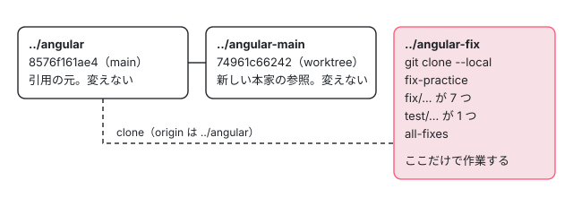

[目次](../README.md) › [見つけた不具合を手元で直す](README.md) › 第 1 回 / 全 10 回

# 直す前の準備：手元の複製と 1 つの直しの流れ

> git clone --local で複製を作り、pnpm install と bazel test を手元で走らせるまで。テストのターゲットの探し方（BUILD.bazel の名前、別のターゲットに分かれた spec）、--test\_arg=--filter が効くものと効かないもの（Node の jasmine とブラウザの web test runner）、shard、1 つの不具合に 1 つの枝、コミットのときに動くフック（ng-dev format staged と commit-message の検査）。

angular/angular · 読了 約 12 分 · 基礎 · [サイトで読む（デモが動きます）](https://angular-deep-dive-cyan.vercel.app/chapter/fix-overview)

---

これまでのシリーズの最終回で見つけた本家の不具合のうち 8 つを、このシリーズで手元で直します。この回では、その 8 つの一覧と、直す前の準備（手元の複製・依存・最初の `bazel test`）、テストのターゲットの探し方、走らせるときのフラグの罠、枝の切り方、コミットのときに動くフックを、手元で走らせた記録と実物のファイルの行で確かめます。

読む対象は `packages/platform-server/test/BUILD.bazel`、`packages/compiler-cli/test/ngtsc/BUILD.bazel`、`.bazelrc`、`.husky/pre-commit` と `.husky/commit-msg` です。ソースは `../angular` の 8576f161ae4（22.2.0-next.7）です。

1. **1. 準備と流れ**（この章）
2. [2. enum の値](02-fix-enum.md)
3. [3. 消えた修正を戻す](03-fix-defer-immediate.md)
4. [4. 修正の取りこぼし](04-fix-event-replay-clickmod.md)
5. [5. 安定しないアプリ](05-fix-defer-error-stable.md)
6. [6. spec を直す](06-fix-spec-assertions.md)
7. [7. 一部しか直らない](07-fix-declare-field.md)
8. [8. 覚えたままの出力](08-fix-elements-outputs.md)
9. [9. 直せても出さない](09-fix-elements-reconnect.md)
10. [10. 出す前の点検](10-fix-before-issue.md)

> [!NOTE]
> **ポイント**
>
> このシリーズでは PR も issue も出しません。「出せる状態まで手元で仕上げる」までが範囲です。なぜ出さないのかは[最終回](10-fix-before-issue.md)に書きます。

## 1. 直す 8 つの不具合

どれも、前のシリーズの章でソースの行を根拠に見つけたもので、このシリーズで失敗する spec を書いて手元で確かめ直します。この表の「直しの大きさ」は、手元の枝のコミットで変えた src の行の数で、括弧の中が spec の行の数です。

| 回 | 不具合 | 見つけた章 | パッケージ | 直しの大きさ | 結果 |
| --- | --- | --- | --- | --- | --- |
| [2](02-fix-enum.md) | 初期値の無い enum のメンバーの値が、前のメンバー + 1 でなく「並びの番号」になる | [partial evaluator](../ngtsc/05-ngtsc-partial-evaluator.md)・[ngtsc の issue](../ngtsc/20-ngtsc-issues.md) | compiler-cli | interpreter.ts +5 -2（spec +15） | 直った。周りの 4 ターゲットも PASSED |
| [3](03-fix-defer-immediate.md) | `@defer (on immediate)` に `@loading` があると、サーバーの描画で placeholder が出ない | [defer の issue](../defer/20-defer-issues.md) | core | defer/instructions.ts 1 行（spec +22） | 直った。2024 年の修正が落ちていたのを戻した |
| [4](04-fix-event-replay-clickmod.md) | ハイドレーションの前の Shift クリックなどが再生されない | [jsaction の spec と issue](../jsaction/12-jsaction-tests-issues.md) | core | event\_replay.ts 1 行 + 整形 1 行（spec +28） | 直った。整形のフックが関係の無い行も変えた |
| [5](05-fix-defer-error-stable.md) | `@error` の無い塊の読み込みが失敗すると、アプリが安定しない | [defer の issue](../defer/20-defer-issues.md) | core | defer/rendering.ts +10 -8（spec +56） | 直った。関係する開いた issue と PR が本家にある |
| [6](06-fix-spec-assertions.md) | インクリメンタルハイドレーションの 4 つの it が、要素名の違いで空回りしている | [defer の issue](../defer/20-defer-issues.md) | platform-server（spec だけ） | incremental\_hydration\_spec.ts +5 -5 | 直した。直したら別の誤り（泡立たないイベント）が出た |
| [7](07-fix-declare-field.md) | デコレーターの付いたクラスの `declare` のフィールドが出力に出る | [Ivy の変換](../ngtsc/12-ngtsc-ivy-transform.md)・[ngtsc の issue](../ngtsc/20-ngtsc-issues.md) | compiler-cli | transform.ts +6 -1（spec +23） | 一部だけ直った |
| [8](08-fix-elements-outputs.md) | Angular Elements が、壊したコンポーネントの出力を覚えたままにする | [Elements の spec と issue](../elements/08-elements-tests-issues.md) | elements | component-factory-strategy.ts +2（spec +13） | 直った |
| [9](09-fix-elements-reconnect.md) | 壊したあとにつなぎ直すと、コンポーネントが 1 回おきにしか作られない（#38778） | [Elements の spec と issue](../elements/08-elements-tests-issues.md)・[切り離しと破棄](../elements/07-elements-disconnect.md) | elements | component-factory-strategy.ts +1（spec +10） | 手元では直ったが、出さないと決めた |

8 つを全部重ねた枝 `all-fixes` では、9 つのターゲット（11 のテスト）がすべて PASSED でした。Elements の 2 つだけは spec の同じ場所に it を足しているので、重ねるときに衝突しました（両方の it を残して解きました）。[最終回](10-fix-before-issue.md)で、新しい本家の上に 1 つずつ載せ直した結果と一緒に扱います。

## 2. 手元の複製を作る

本家の木 `../angular` は、これまでのシリーズ全部の引用の元です。ここを変えると、ほかの章の引用（cuts）が原文と合わなくなります。だから直す作業は、別のディレクトリに作った複製の中だけでします。



*3 つの木。../angular-main は ../angular の worktree なので、枝やコミットを ../angular の .git と共有する。../angular-fix は複製なので、作った枝は ../angular に出てこない。*

1. **git clone --local --no-hardlinks angular angular-fix**

   `--local` は、元がこの機械の上のディレクトリなので、ネットワークを通さずにオブジェクト（コミットやファイルの中身）を写す指定です。`--local` だけだと git はオブジェクトのファイルを hardlink（同じ中身を 2 つの名前で指す）にします。`--no-hardlinks` を付けると、本当に別のファイルとして写すので、複製の中で何をしても元のファイルに触りません。複製の `origin` は `~/angular-research/angular` を指します（`git remote -v` で確かめました）。
2. **worktree にしなかった理由**

   `git worktree add` でも別のディレクトリで作業できます。実際 `../angular-main` は `../angular` の worktree です（`git worktree list` に出ます）。ただし worktree は、枝・コミット・設定を元の `.git` と共有します。そこで `fix/…` の枝を 8 つ作ると、それが `../angular` の枝にもなり、`../angular/.git/worktrees/` にも情報が足されます。`../angular-main` は読むだけで枝を作らないので worktree で足り、`../angular-fix` は枝を作るので複製にしました。
3. **git checkout -b fix-practice**

   複製の中に練習用の枝を作ります。基点は 8576f161ae4 で、`../angular` の HEAD と同じです。8 つの枝はどれもここから切ります。
4. **pnpm install --frozen-lockfile**

   `--frozen-lockfile` は、lock ファイル（pnpm-lock.yaml）を書き換えずに、書いてあるとおりの版を入れる指定です。記録では 4.5 秒（pnpm 12.3.4）でした。この機械には pnpm のストアがもうあったので、ダウンロードはほとんどありませんでした。手元の準備そのもの（Node・pnpm・Bazel をそろえる）は[準備の章](../contrib/03-contrib-setup.md)にあります。
5. **最初の pnpm bazel test**

   `pnpm bazel` は node\_modules の bazelisk（`.bazelversion` に書かれた版の Bazel を取ってくる薄い包み）を通して、Bazel 8.8.0 を動かします。最初の `//packages/compiler-cli/src/ngtsc/partial_evaluator/test:test` は 23.2 秒、756 の処理（action）でした。Bazel はディレクトリごとに出力先（output base）を分けるので、複製では `../angular` の作業の結果を使い回さず、最初から作ります。

## 3. テストのターゲットを探す

spec（`describe` と `it` でテストを書いた `*_spec.ts`）を足したら、それを含むテストのターゲット（`bazel test` に渡す名前）を探します。ラベルの読み方そのものは[Bazel の読み方](../contrib/04-contrib-bazel.md)にあります。ここでは手順だけを、第 3 回と第 4 回で使った `packages/platform-server/test/BUILD.bazel` で追います。

1. **spec と同じディレクトリの BUILD.bazel を開く**

   `full_app_hydration_spec.ts` も `event_replay_spec.ts` も `packages/platform-server/test/` にあります。同じディレクトリの `BUILD.bazel` が、そのファイルをどのターゲットに入れるかを決めます。
2. **ts\_project の srcs と exclude を見る**

   📄 `angular/packages/platform-server/test/BUILD.bazel` L18–28 （▶ の行: 19, 21–22, 24）

   ```python
   18 │ ts_project(
   19 ▶     name = "test_lib",
   20 │     testonly = True,
   21 ▶     srcs = glob(
   22 ▶         ["*.ts"],
   23 │         exclude = [
   24 ▶             "event_replay_spec.ts",
   25 │             "hydration_utils.ts",
   26 │             "dom_utils.ts",
   27 │         ],
   28 │     ),
   ```

   19 行目の `test_lib` は、21〜22 行目の `glob(["*.ts"])` でディレクトリの ts を全部集めます。ただし 24 行目で `event_replay_spec.ts` を外しています。だから `full_app_hydration_spec.ts` は `test_lib` に入り、`event_replay_spec.ts` は入りません。
3. **その ts\_project を data に持つテストのルールを探す**

   📄 `angular/packages/platform-server/test/BUILD.bazel` L69–75 （▶ の行: 69–70, 72）

   ```python
   69 ▶ angular_jasmine_test(
   70 ▶     name = "test",
   71 │     data = [
   72 ▶         ":test_lib",
   73 │         "//packages/core/primitives/event-dispatch:contract_bundle_min",
   74 │     ],
   75 │ )
   ```

   69〜70 行目の `angular_jasmine_test` の名前が `test` で、72 行目で `:test_lib` を持ちます。ラベルは「ディレクトリ:名前」なので `//packages/platform-server/test:test` です。外された `event_replay_spec.ts` は、同じファイルの別の `zoneless_jasmine_test`（`event_replay_test`）に入っています。それは[第 4 回](04-fix-event-replay-clickmod.md)で引用します。
4. **走らせて「Ran N of M specs」を見る**

   ラベルが正しいかは、走らせた出力の件数で確かめます。次の節の罠のとおり、PASSED だけでは確かめたことになりません。

## 4. 走らせるときのフラグと罠

このシリーズで使ったフラグは 4 つです。走らせ方の基本は[テストを 1 本走らせる](../contrib/05-contrib-run-tests.md)にあるので、ここでは手元で出会ったことだけを書きます。

| フラグ | 何をするか | 手元で分かったこと |
| --- | --- | --- |
| `--test_arg=--filter=…` | テストの実行ファイルに `--filter` を渡す。jasmine は名前がそれに合う it だけを走らせる | Node の jasmine（`angular_jasmine_test`・`zoneless_jasmine_test`・`jasmine_test`）では効く。ブラウザで走るもの（`ng_web_test_suite`、web test runner）の elements と event-dispatch では効かず、全部走る |
| `--nocache_test_results` | 前の結果を使い回さず、必ずもう一度走らせる | 直す前・直したあとの比べ合いで毎回付けた。付けないと、入力が同じなら前の PASSED がそのまま出る |
| `--test_output=errors` / `all` | テストの出力を、落ちたときだけ出すか、いつも出すか | 既定は下の `.bazelrc` のとおり errors。通ったときの「Ran N of M specs」を見るには all が要る |
| shard | 1 つのターゲットの it を何個かの実行に分けて並べて走らせる | `//packages/compiler-cli/test/ngtsc:ngtsc` は 4 つに分かれる（下の引用） |

📄 `angular/.bazelrc` L94–95 （▶ の行: 95）

```
94 │ # By default, failing tests don't print any output, it goes to the log file
95 ▶ test --test_output=errors
```

95 行目で、`bazel test` の既定が `--test_output=errors` になっています。94 行目のコメントのとおり、これが無いと落ちたテストの出力もログのファイルにしか出ません。逆に言うと、通ったテストの出力は既定では見えません。

📄 `angular/packages/compiler-cli/test/ngtsc/BUILD.bazel` L36–39 （▶ の行: 38）

```python
36 │         "//packages/forms:npm_package",
37 │     ],
38 ▶     shard_count = 4,
39 │ )
```

38 行目の `shard_count = 4` で、ngtsc の大きな spec の集まりは 4 つの実行に分かれます。走らせている途中の表示は「(shard 1 of 4)」のようになり、結果は 1 つのターゲットとして PASSED か FAILED になります。

> [!WARNING]
> **ハマりどころ**
>
> **絞り込みが何にも当たらなくても PASSED になります。** 第 4 回で、`event_replay_spec.ts` に足した it を `//packages/platform-server/test:test` に `'modifier key'` で絞って走らせたら、「Ran 0 of 399 specs / 0 specs, 0 failures」で PASSED でした。3 節の 24 行目のとおり、その spec は `:test` に入っていないからです。`--test_output=errors`（既定）のままだと、この 0 件の行も見えません。直す前に**落ちる**ことを確かめるのは、この罠に気づくためでもあります。

## 5. 1 つの不具合に 1 つの枝

8 つの不具合は、どれも `fix-practice`（8576f161ae4）から別々の枝に切りました。1 つの枝には 1 つのコミットだけを置きます。こうすると、1 つの直しの差分が、ほかの直しと混ざりません。あとで 1 つだけ捨てる、1 つだけ新しい本家に載せ直す（cherry-pick：1 つのコミットの差分を別の枝の上にもう一度当てる）ことができます。

- 名前は、コミットの type と同じ言葉で始めます。直しは `fix/…`（例 `fix/enum-auto-increment`）、spec だけを直すものは `test/…`（`test/incremental-hydration-trigger-assertions`）。
- 後ろは「何が起きないようにするか」を短い英語にします（`fix/defer-immediate-ssr-placeholder`・`fix/event-replay-modified-click`）。
- 全部を重ねた確かめは、別の枝 `all-fixes` でします。1 つずつの枝は変えません。

## 6. コミットのときに動くフック

`../angular` の package.json の `prepare` が `husky` なので、`pnpm install` のあと `git commit` のたびに `.husky/` のスクリプトが動きます。フック（git が決まった場面で呼ぶスクリプト）は 2 つ見ておきます。

📄 `angular/.husky/pre-commit` L3–8 （▶ の行: 3, 5, 8）

```
3 ▶ pnpm --silent ng-dev format staged 2>/dev/null
4 │ if [ $? -ne 0 ]; then
5 ▶   echo "WARNING: failed to run file formatting (ng-dev format staged)"
6 │ fi
7 │ 
8 ▶ exit 0;
```

📄 `angular/.husky/commit-msg` L3–8 （▶ の行: 3, 5, 8）

```
3 ▶ pnpm --silent ng-dev commit-message pre-commit-validate --file $1 2>/dev/null
4 │ if [ $? -ne 0 ]; then
5 ▶   echo "WARNING: failed to run commit message validation (ng-dev commit-mesage pre-commit-validate)"
6 │ fi
7 │ 
8 ▶ exit 0;
```

1. **pre-commit の 3 行目：ng-dev format staged**

   コミットに入れる（stage した）ファイルを prettier で整形し、整形した結果をそのままコミットに入れます。記録の出力は「Formatting 2 file(s) / ✔ Formatting complete.」でした。整形は**ファイル全体**にかかるので、自分が変えていない行も変わることがあります。第 4 回でそれが起きました。
2. **commit-msg の 3 行目：ng-dev commit-message pre-commit-validate**

   `$1`（git が渡すメッセージのファイル）を、`.ng-dev/commit-message.mjs` の決まりで検査します。記録の出力は「✔ Valid commit message」でした。決まりの中身は[第 2 回](02-fix-enum.md)で読みます。
3. **どちらも 8 行目で exit 0**

   3 行目で失敗すると 5 行目で WARNING を出しますが、8 行目で必ず 0 を返すので、**コミットは止まりません**。3 行目の `2>/dev/null` でエラーの出力も捨てています。だから「コミットできた」は「検査に通った」ではありません。出力に ✔ の行があるかを見ます。

## テストと直し方：手元で走らせた記録

> **🧪 準備の記録：複製・依存・最初の bazel test・絞り込みで 0 件・フック**
>
> これは手元の複製で走らせた記録の再生です。ボタンを押すと、そのときのコマンドと出力（要るところだけ）が出ます。「4. 絞り込みで 0 件」は、PASSED なのに 1 件も走っていない記録です。
>
> ▶ [このデモはサイトで動かせます](https://angular-deep-dive-cyan.vercel.app/chapter/fix-overview)

第 2 回からは、どの回も同じ形の記録です。「spec を足す」→「直す前に走らせる」（落ちる）→「直す」→「直したあと」→「周りのテスト」→「コミット」。この形を、手順として 1 本に並べると次のようになります。

- `git checkout -b fix/… fix-practice` — ../angular-fix — *1 つの不具合に 1 つの枝*
  - 👤 `*_spec.ts に it を足す` — 隣の describe に — *本家と同じ書き方で*
  - `pnpm bazel test //…:… --nocache_test_results --test_arg=--filter=…` — BUILD.bazel で探したラベル — *落ちることと、件数が 0 でないことを確かめる*
  - 👤 `src の行を直す` — 最小の差分 — *採らなかった案も記録する*
  - `pnpm bazel test …` — 同じコマンド — *通ることを確かめる*
  - `pnpm bazel test （周りのターゲット）` — 同じパッケージ・使う側 — *壊していないことを確かめる*
  - `git commit -F msg.txt` — .husky/pre-commit・commit-msg — *format staged と commit-message の検査*

## 聞かれそうな質問

**Q. なぜ ../angular の中で枝を切って直さないのですか？**

../angular はサイト全部の引用の元で、cuts は行の番号で原文と照らし合わせています。そこを変えると、ほかの章の引用が合わなくなります。worktree も枝を ../angular の .git と共有するので、枝を作る作業は `git clone --local --no-hardlinks` の複製でしています（2 節）。

**Q. spec を足して走らせたら PASSED でした。これで「直す前は落ちる」は確かめられていますか？**

まだです。PASSED でも、絞り込みに当たる it が 0 件のことがあります。`--test_output=all` で「Ran N of M specs」の N が 0 でないことを見ます。platform-server の `event_replay_spec.ts` は BUILD.bazel の 24 行目で `:test` から外されていて、`:test` に絞ると 0 件で PASSED でした（4 節）。

**Q. どのターゲットを走らせればよいかは、どう決めますか？**

spec と同じディレクトリの BUILD.bazel で、srcs と exclude（21〜24 行目）を見て spec を含む ts\_project を探し、それを data に持つテストのルール（69〜72 行目）の名前をラベルにします（3 節）。

**Q. コミットのフックが失敗したら、コミットは止まりますか？**

止まりません。`.husky/pre-commit` も `.husky/commit-msg` も 8 行目で `exit 0` です。失敗すると 5 行目の WARNING が出るだけなので、出力の「✔ Valid commit message」を見て確かめます（6 節）。

**Q. `--test_arg=--filter` はいつでも使えますか？**

Node の jasmine で走るターゲット（angular\_jasmine\_test・zoneless\_jasmine\_test・jasmine\_test）では効きます。ブラウザで走る elements と event-dispatch のターゲットでは効かず、全部の it が走りました（4 節の表）。

## 読み終えて

- 直す作業は ../angular の複製 ../angular-fix の中だけでする。worktree は枝を元の .git と共有するので、枝を作る作業には使わない。
- spec を足したら、同じディレクトリの BUILD.bazel の srcs・exclude とテストのルールからラベルを決める。exclude で別のターゲットに分かれている spec がある。
- PASSED だけで安心しない。`--test_output=all` で件数を見て、直す前に落ちることを確かめる。
- 1 つの不具合に 1 つの枝、1 つのコミット。名前は `fix/…` か `test/…`。
- コミットのフックは整形と検査をするが、失敗してもコミットは止めない。整形はファイル全体にかかる。

---

← 前: [spec と issue を読む：Angular Elements の今](../elements/08-elements-tests-issues.md)  
次: [enum の値がずれる：partial evaluator の 1 行](02-fix-enum.md) →
