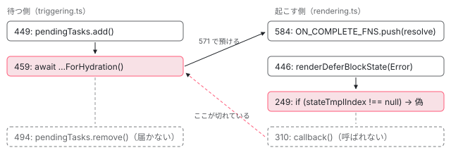

[目次](../README.md) › [見つけた不具合を手元で直す](README.md) › 第 5 回 / 全 10 回

# アプリが安定しない：@error の無い塊の読み込みの失敗

> インクリメンタルハイドレーションが ON\_COMPLETE\_FNS の呼び出しを待つのに、その呼び出しが「状態のテンプレートがあるとき」の中にあったため、@error の無い塊の読み込みが失敗すると PendingTasks が戻らなかった件。whenStable を時間で区切って「安定しない」を spec にする書き方と、呼び出しを if の外へ出す直し。

angular/angular · 読了 約 13 分 · 発展 · [サイトで読む（デモが動きます）](https://angular-deep-dive-cyan.vercel.app/chapter/fix-defer-error-stable)

---

この章では、`@error` を書いていない hydrate の塊の読み込みが失敗すると、アプリがいつまでも安定しない件を、手元の複製で直します。原因は「待っている側」ではなく「起こす側」にあります。ハイドレーションは `ON_COMPLETE_FNS` が呼ばれるのを待っているのに、その呼び出しが「その状態のテンプレートがあるとき」の if の中にありました。「起きないこと」（安定しないこと）を spec で確かめる書き方と、その書き方の弱さ、同じ関数を直している承認済みの PR #71798 との関係まで書きます。

読む対象は `packages/core/src/defer/rendering.ts`・`packages/core/src/defer/triggering.ts` と、spec の `packages/platform-server/test/incremental_hydration_spec.ts` です。

1. [1. 準備と流れ](01-fix-overview.md)
2. [2. enum の値](02-fix-enum.md)
3. [3. 消えた修正を戻す](03-fix-defer-immediate.md)
4. [4. 修正の取りこぼし](04-fix-event-replay-clickmod.md)
5. **5. 安定しないアプリ**（この章）
6. [6. spec を直す](06-fix-spec-assertions.md)
7. [7. 一部しか直らない](07-fix-declare-field.md)
8. [8. 覚えたままの出力](08-fix-elements-outputs.md)
9. [9. 直せても出さない](09-fix-elements-reconnect.md)
10. [10. 出す前の点検](10-fix-before-issue.md)

> [!NOTE]
> **ポイント**
>
> このシリーズでは PR も issue も出しません。本家に出せる形（spec・直し・コミット）まで手元で仕上げ、出すかどうかは最終回で戦略として決めます。

## 1. 不具合の形

見つけたのは @defer シリーズの[ハイドレーションの順番待ちの章](../defer/17-defer-hydration-queue.md)の 7 節です。[@defer のテストの章](../defer/19-defer-tests.md)の 7 節で、spec と同じ手順を Node で動かして確かめ、[不具合の表](../defer/20-defer-issues.md)に載せました。

症状はこうです。`@defer (hydrate on interaction)` のような hydrate の塊に `@error` を書かず、その塊の依存（遅れて読み込むコンポーネントのファイル）の読み込みが失敗すると、NG0750 のエラーが `ErrorHandler` に届いたあと、`appRef.whenStable()` がいつまでも解けません。安定を待ってから動くもの（テストの `whenStable` など）が、そこで止まります。`@error` を書いた塊では起きません。

## 2. 原因の行：待つ側と起こす側

まず待つ側です。ハイドレーションの順番待ち `triggerHydrationForBlockQueue` は、最初に `PendingTasks`（「まだ終わっていない仕事」の数。0 にならないとアプリは安定しない。[PendingTasks と isStable の章](../zoneless/09-zoneless-pending-tasks.md)）を 1 つ足します。

📄 `angular/packages/core/src/defer/triggering.ts` L447–449 （▶ の行: 449）

```ts
447 │   // Indicate that we have some pending async work.
448 │   const pendingTasks = injector.get(PendingTasksInternal);
449 ▶   const taskId = pendingTasks.add();
```

449 行目で足します。戻すのは関数の終わりの近くです。

📄 `angular/packages/core/src/defer/triggering.ts` L490–494 （▶ の行: 491, 494）

```ts
490 │   // Await hydration completion for the last block.
491 ▶   await blocksBeingHydrated.get(lastBlockName)?.promise;
492 │ 
493 │   // All async work is done, remove the taskId from the registry.
494 ▶   pendingTasks.remove(taskId);
```

494 行目で戻します。その前の 491 行目までに、塊ごとの `await` がいくつもあります。いちばん先にあるのが読み込みの待ちです。

📄 `angular/packages/core/src/defer/triggering.ts` L456–460 （▶ の行: 459–460）

```ts
456 │     if (dehydratedDeferBlock != null) {
457 │       // trigger the block resources and await next render for hydration. This should result
458 │       // in the next block ɵɵdefer instruction being called and that block being added to the dehydrated registry.
459 ▶       await triggerResourceLoadingForHydration(dehydratedDeferBlock);
460 ▶       await nextRender(injector);
```

459 行目の `triggerResourceLoadingForHydration` は、次の Promise を返します。

📄 `angular/packages/core/src/defer/triggering.ts` L570–573 （▶ の行: 571–572）

```ts
570 │   return new Promise<void>((resolve) => {
571 ▶     onDeferBlockCompletion(lDetails, resolve);
572 ▶     triggerDeferBlock(TriggerType.Hydrate, lView, tNode);
573 │   });
```

571 行目で、この Promise の `resolve` を「塊が終わったら呼ぶ関数」として預け、572 行目で塊を起こします。預け先はこれです。

📄 `angular/packages/core/src/defer/triggering.ts` L580–585 （▶ の行: 584）

```ts
580 │ function onDeferBlockCompletion(lDetails: LDeferBlockDetails, callback: VoidFunction) {
581 │   if (!Array.isArray(lDetails[ON_COMPLETE_FNS])) {
582 │     lDetails[ON_COMPLETE_FNS] = [];
583 │   }
584 ▶   lDetails[ON_COMPLETE_FNS].push(callback);
585 │ }
```

584 行目で、塊の実行時の記録（`LDeferBlockDetails`。[塊の記録の章](../defer/03-defer-details.md)）の `ON_COMPLETE_FNS` の配列に積むだけです。つまり 459 行目の `await` が解けるのは、だれかが `ON_COMPLETE_FNS` の関数を呼んだときだけです。

次に起こす側です。読み込みが失敗すると、`tDetails` に FAILED を書きます。

📄 `angular/packages/core/src/defer/triggering.ts` L249–252 （▶ の行: 250, 252）

```ts
249 │     if (failed) {
250 ▶       tDetails.loadingState = DeferDependenciesLoadingState.FAILED;
251 │ 
252 ▶       if (tDetails.errorTmplIndex === null) {
```

250 行目で FAILED にし、252 行目で `@error` が無いときだけ NG0750 を作って `ErrorHandler` に渡します（[読み込みの章](../defer/06-defer-resource-loading.md)）。そのあと、読み込みの Promise の続きで Error の状態を描こうとします。

📄 `angular/packages/core/src/defer/rendering.ts` L445–447 （▶ の行: 445–446）

```ts
445 ▶     } else if (tDetails.loadingState === DeferDependenciesLoadingState.FAILED) {
446 ▶       renderDeferBlockState(DeferBlockState.Error, tNode, lContainer);
447 │     }
```

446 行目の `renderDeferBlockState(DeferBlockState.Error, …)` は、状態を切り替える `applyDeferBlockState` に進みます（[状態の描き分けの章](../defer/04-defer-render-state.md)）。そこで最初に、その状態のテンプレートの番号を引きます。

📄 `angular/packages/core/src/defer/rendering.ts` L247–250 （▶ の行: 247, 249–250）

```ts
247 ▶   const stateTmplIndex = getTemplateIndexForState(newState, hostLView, tNode);
248 │ 
249 ▶   if (stateTmplIndex !== null) {
250 ▶     lDetails[DEFER_BLOCK_STATE] = newState;
```

📄 `angular/packages/core/src/defer/utils.ts` L86–87 （▶ の行: 86–87）

```ts
86 ▶     case DeferBlockState.Error:
87 ▶       return tDetails.errorTmplIndex;
```

utils.ts の 86〜87 行目で、Error の状態の番号は `errorTmplIndex` です。`@error` を書いていなければ `null` です。すると rendering.ts の 249 行目の if に入りません。250 行目の `DEFER_BLOCK_STATE` の書き換えも、この if の中です。そして `ON_COMPLETE_FNS` を呼ぶ行も、同じ if の中にあります。

📄 `angular/packages/core/src/defer/rendering.ts` L305–311 （▶ の行: 305–307, 309–310）

```ts
305 ▶     if (
306 ▶       (newState === DeferBlockState.Complete || newState === DeferBlockState.Error) &&
307 ▶       Array.isArray(lDetails[ON_COMPLETE_FNS])
308 │     ) {
309 ▶       for (const callback of lDetails[ON_COMPLETE_FNS]) {
310 ▶         callback();
311 │       }
```

305〜307 行目の条件は「Complete か Error で、配列があれば」です。条件そのものは Error も含んでいます。ところが字下げを見てください。305 行目は 249 行目の if より 1 段深いところにあります（このあと配列を `null` に戻し、249 行目の if が閉じます）。だから `@error` が無い塊が Error になっても、310 行目の `callback()` は呼ばれず、預けた `resolve` は呼ばれないままです。

### 待ちの連なり

- 👤 `click` — 利用者の操作 — *hydrate on interaction の塊を押す*
  - `triggerHydrationForBlockQueue()` — triggering.ts — *順番待ちを始める*
    - `pendingTasks.add()` — triggering.ts 449 — *安定しなくなる*
    - `await triggerResourceLoadingForHydration()` — triggering.ts 459 — *ここで止まる*
      - `onDeferBlockCompletion(lDetails, resolve)` — triggering.ts 571 → 584 — *ON\_COMPLETE\_FNS に resolve を積む*
      - `triggerDeferBlock()` — triggering.ts 572 — *依存の読み込みを始める*
        - `loadingState = FAILED` — triggering.ts 250 — *@error が無いので NG0750（252）*
        - `renderDeferBlockState(Error)` — rendering.ts 446 — *読み込みの Promise の続き*
          - `applyDeferBlockState()` — rendering.ts 247 → 249 — *errorTmplIndex が null（utils.ts 87）。if に入らない*
          - `callback()` — rendering.ts 310 — *呼ばれない → 459 が解けない → 494 の remove に届かない*



*待つ側（左）と起こす側（右）。resolve は ON\_COMPLETE\_FNS を通ってしか届かない。@error が無いと、右の 249 行目の if で道が切れる。*

### なぜそうなったか：履歴を読む

`git -C ../angular-fix log -S 'ON_COMPLETE_FNS' -- packages/core/src/defer/` で、この配列を足したり消したりしたコミットを探し、`git show` で読みました（`-S` は「その文字列の数が変わったコミット」を探す指定です）。

1. **d760cbe71b2（2024-10-15、#58206）**

   当時の instructions.ts の `applyDeferBlockState` の**末尾、if の外**に「Complete なら `ON_COMPLETE_FNS` を呼ぶ」を足した。
2. **95449302e95（2024-10-21 に入る、#58193）**

   インクリメンタルハイドレーションの土台。if の**中**にも同じ呼び出しを足し、その上に `TODO(incremental-hydration): should we also invoke if newState === DeferBlockState.Error?`（Error のときも呼ぶべきか）と書いた。この時点で呼び出しは if の中と外の 2 か所。
3. **bd08d1ddacb（2024-11-18、#58722）**

   後始末の競走を直すコミットで、if の外の呼び出し（Complete だけ）を消した。Complete の本体のテンプレート（`primaryTmplIndex`）はいつもあるので、Complete については外でも中でも同じで、重複を消した形になる。
4. **d8f08f44c1e（2024-12-03、#59032「incremental hydration TODO cleanup」）**

   TODO を消し、if の中の条件に `|| newState === DeferBlockState.Error` を足した。本文は「error の状態が**描かれたとき**にも complete の関数を呼ぶ」。描くテンプレートが無い Error は、この時から今まで、呼ばれない道に残っている。

Complete だけを考えていたときは、if の中に置いても困りませんでした。あとから Error を足したとき、条件は直したものの、置き場所は if の中のままだった、というのが履歴から読める流れです。

## 3. 失敗する spec を書く

### どこに足すか

incremental\_hydration\_spec.ts の describe `control flow` の中の、`should render an error block when loading fails and cleanup the original content`（[テストの章](../defer/19-defer-tests.md)の 5 節で引用）の直後です。この it は `@error` を**書いた**塊で読み込みを失敗させ、`@error` が出ることを確かめています。今回はその裏返し（`@error` を書かない）なので、隣に置くと読む人が 2 つを見比べられます。

📄 `angular/packages/platform-server/test/incremental_hydration_spec.ts` L2558–2564 （▶ の行: 2561–2562）

```ts
2558 │ 
2559 │       expect(appHostNode.outerHTML).not.toContain('Rendering primary block');
2560 │       expect(appHostNode.outerHTML).toContain('Rendering error block');
2561 ▶     });
2562 ▶   });
2563 │ 
2564 │   describe('cleanup', () => {
```

2561 行目で元の it が閉じ、2562 行目で describe `control flow` が閉じます。新しい it はこの 2 行のあいだに入れました。読み込みの失敗の作り方は、ファイルの先頭にある道具をそのまま使いました。

📄 `angular/packages/platform-server/test/incremental_hydration_spec.ts` L79–91 （▶ の行: 79, 81, 89–90）

```ts
79 ▶ function failedDynamicImport(): Promise<void> {
80 │   return new Promise((_, reject) => {
81 ▶     setTimeout(() => reject());
82 │   });
83 │ }
84 │ 
85 │ /**
86 │  * Helper function to await all pending dynamic imports
87 │  * emulated using `dynamicImportOf` function.
88 │  */
89 ▶ function allPendingDynamicImports() {
90 ▶   return dynamicImportOf(null, 101);
91 │ }
```

79〜83 行目の `failedDynamicImport` は、遅れを指定しない `setTimeout` のあとで reject する Promise を返します。依存の関数の差し替えは `ɵDEFER_BLOCK_DEPENDENCY_INTERCEPTOR`（塊の依存を読み込む関数を、テストで差し替えるためのトークン）に `intercept() { return () => [failedDynamicImport()]; }` を渡します。89〜90 行目の `allPendingDynamicImports` は 101 ms 待つだけの道具です。

### 「起きないこと」をどう確かめるか

確かめたいのは「安定しない」ことです。ふつうに `await appRef.whenStable()` と書くと、直す前はこの await がいつまでも解けず、it は jasmine の時間切れで落ちます。落ちはしますが、出てくるのは「時間切れ」だけで、何が起きなかったのかが分かりません。そこで、`whenStable` と 100 ms のタイマーを競わせました（デモの「1. spec を足す」の差分の最後の 6 行。it の全文もそこにあります）。

1. **Promise.race で区切る**

   `whenStable().then(() => true)` と、100 ms 後に `false` で解ける Promise を `Promise.race` に渡します。先に解けた方の値が返ります。
2. **真偽で比べる**

   `expect(isStable).toBeTrue()`。直す前は「Expected false to be true.」と、何が起きなかったかが 1 行で出ます。
3. **失敗の前に 1 度安定させる**

   クリックの前に `appRef.tick()` と `await appRef.whenStable()` を置き、ハイドレーションの最初の描画が済んで安定していることを先に確かめます。安定しないのが「クリックのあと」だと分かるようにするためです。

> [!WARNING]
> **ハマりどころ**
>
> **100 ms という数の弱さ。** 読み込みの失敗そのものは `failedDynamicImport` の遅れなしの `setTimeout` で起き、spec はそれを `allPendingDynamicImports` の 101 ms で待ってから `appRef.tick()` します。100 ms は、そのあと `whenStable` が解けるまでの猶予です。直す前は、`whenStable` は何秒待っても解けないので、100 ms をどれだけ延ばしても結果は同じ `false` です。つまり時間の目安がずれて困るのは**直したあと**だけで、遅い機械で 100 ms に間に合わなければ、直っているのに落ちる（たまに落ちるテスト）ことになります。手元の記録では、直したあとの it 1 つが「Finished in 0.161 seconds」で、その中に 101 ms の待ちが入っています。CI のような遅い機械で 100 ms が足りるかは確かめていません。レビューで聞かれたら、時間を延ばしても直す前の結果は変わらないこと、を答えにします。

## テストと直し方：手元で走らせた記録

> **🧪 記録の再生：spec を足す → 落ちる → 直す → 通る → PR #71798 と並べる → 周り → コミット**
>
> これは手元の複製で走らせた記録の再生です。ブラウザの中で bazel を動かしているのではありません。出力は記録から要るところだけ抜き、長い行は「…（略）」で切っています。
>
> ▶ [このデモはサイトで動かせます](https://angular-deep-dive-cyan.vercel.app/chapter/fix-defer-error-stable)

### 直す前の出力の読み方

「2. 直す前に走らせる」では、`--test_arg=--filter=without an error block` で it を 1 つだけ選び（Node の jasmine のターゲットなので効きます）、「Ran 1 of 400 specs」「1 spec, 1 failure」「Expected false to be true.」でした。その上の `ERROR RuntimeError: NG0750` は、252 行目の分岐で `ErrorHandler` に届いたもので、spec を落とした原因ではありません。直したあとの出力（「4. 直したあと」）にも同じものが出ています。「Ran 1 of 400」と、0 件ではなく 1 件走ったことも先に見ます。絞り込みが何にも当たらなくても PASSED になるからです（[第 4 回](04-fix-event-replay-clickmod.md)）。

### 最小の直し

「3. 直す」の差分です。`ON_COMPLETE_FNS` を呼ぶ 305 行目からのかたまりを、249 行目の if の**外**、`profiler(ProfilerEvent.DeferBlockStateEnd)` の前へ出しました。中身（Complete か Error で、配列があれば呼んで `null` に戻す）は 1 文字も変えていません。変えた行が多く見えるのは、字下げが 1 段浅くなったからです。

- **`DEFER_BLOCK_STATE` は if の中のまま。**250 行目の状態の書き換えは、テンプレートを描いたときだけにしています。`@error` が無ければ画面は前の状態（ハイドレーションではサーバーが描いた中身）のままなので、記録の状態だけを Error にすると、画面と記録が食い違います。直したいのは「待っている人に知らせる」ことだけです。
- **採らなかった案：triggering.ts の側で待ち方を変える。**たとえば読み込みの失敗を別の道で知らせる、時間で打ち切る、などです。待つ側を変えると、`ON_COMPLETE_FNS` を使うほかの道まで考え直すことになります。起こす側の 1 か所を直せば、待つ側は今のままで動きます。
- **採らなかった案：`@error` が無いとき空の Error のテンプレートを作る。**コンパイラの出力が変わり、変更が packages/compiler まで広がります。

### 周りのテスト

「7. 周りのテスト」では、直した rendering.ts を通る道の spec を持つ 4 つのターゲット（bazel のテストの単位）を、絞り込まずに走らせました。

| ターゲット | なぜ選んだか | 結果 |
| --- | --- | --- |
| `//packages/platform-server/test:test` | incremental\_hydration\_spec.ts（足した it を含む）と、SSR の @defer の spec | 400 specs, 0 failures |
| `//packages/platform-server/test:event_replay_test` | ハイドレーションのあとのイベントの再生（順番待ちの最後に呼ぶ再生の関数の先） | 23 specs, 0 failures |
| `//packages/core/test/acceptance:acceptance` | defer\_spec.ts など、ブラウザ側の @defer の振る舞い | 2693 specs, 0 failures, 3 pending |
| `//packages/core/test:test` | core の単体の spec。4 つの shard（テストを 4 つに分けて同時に走らせる単位） | 351・350・350・350 specs、すべて 0 failures |

### PR #71798 と並べる

gh で「defer whenStable never」と探すと、同じ関数の issue が見つかりました。#71769（2026-11-02、開いている、area: core「Unguarded Map access and leaked PendingTask in triggerHydrationForBlockQueue」）です。次の 478 行目の `!` が、登録簿から消えた塊で投げると、449 行目で足した PendingTasks が戻らない、という報告で、本文に「再現は作れなかった」と書いてあります。

📄 `angular/packages/core/src/defer/triggering.ts` L476–478 （▶ の行: 478）

```ts
476 │       // The defer block has not errored and we've finished fetching resources and rendering.
477 │       // At this point it is safe to resolve the hydration promise.
478 ▶       blocksBeingHydrated.get(dehydratedBlockId)!.resolve();
```

これを直す PR #71798（2026-11-03、JeanMeche、開いている）があり、thePunderWoman が APPROVED（「LGTM」）を付けています。PR は `?.resolve()` にし、ループと 491 行目の `await` を `try/finally` で包んで、`finally` で `pendingTasks.remove(taskId)` を呼びます。

「PR で私たちの件も直るのでは」と考えて、一時的な枝で確かめました。

1. **5. PR #71798 だけを当てる**

   PR の triggering.ts と、私たちの spec だけ。私たちの it は「Expected false to be true.」で落ちたままでした（Ran 1 of 400 specs）。`try/finally` の `finally` は、例外が投げられたときか、`try` の中が終わったときに動きます。私たちの件は投げるのではなく、459 行目の Promise が**いつまでも解けない**ので、`try` の中が終わらず、`finally` にも届きません。
2. **6. PR と私たちの直しを両方**

   PR の triggering.ts と spec、私たちの rendering.ts と spec を全部当て、2 つの it の名前で絞りました。「Ran 2 of 401 specs」「2 specs, 0 failures」。PR の it が 1 つ増えて全部で 401 です。2 つの直しは別の道を直していて、一緒に当てても 2 つの it はどちらも通りました（この組み合わせで周りのテストは走らせていません）。確かめたあと、この一時的な枝は消しました。

コードは rendering.ts（私たち）と triggering.ts（PR）で分かれていますが、spec は同じ incremental\_hydration\_spec.ts に足します。PR が先に入れば、私たちの枝はそのあとの main の上に rebase（自分のコミットを新しい土台の上に積み直すこと）し、spec をもう一度走らせることになります。なお、2026-10-30 の main（74961c66242）の上に cherry-pick（別の枝のコミットを 1 つ写すこと）すると衝突は出ませんでした。main ではテストを走らせていません。main の rendering.ts でも、この呼び出しは if の中のままです。

## 4. コミットの書き方

デモの「8. コミット」の文です。

- **見出し：``fix(core): finish incremental hydration when a block without `@error` fails to load``**。利用者に見える不具合を直すので type は `fix`、直したファイルは packages/core なので scope は `core`。命令形・小文字始まり・末尾に点を付けない、は[コミットメッセージの章](../contrib/09-contrib-commit-messages.md)の決まりです。
- **本文**は「何が」（ハイドレーションは `ON_COMPLETE_FNS` を通して Complete か Error を待つ）、「なぜ」（状態のテンプレートがあるときだけ呼んでいた）、「その結果」（PendingTasks が戻らず、アプリが安定しない）の順です。本文は 20 文字以上が要ります（`.ng-dev/commit-message.mjs` の `minBodyLength: 20`）。
- **Fixes の行は書いていません。**この件そのものの issue はまだ無いからです。#71769 は別の道（478 行目が投げる形）の報告なので、`Fixes #71769` と書くと、PR #71798 が閉じるはずの issue を別のコミットが閉じたことになります。決まりの文は次のとおりで、footer は閉じる issue か「関係する」issue・PR を書く場所です。

📄 `angular/contributing-docs/commit-message-guidelines.md` L116–117 （▶ の行: 116）

```md
116 ▶ The footer can contain information about breaking changes and deprecations and is also the place to reference GitHub issues and other PRs that this commit closes or is related to.
117 │ For example:
```

116 行目のとおり、関係するだけの issue は footer に書けます。この件の issue を立てた場合は、その番号で `Fixes #番号` と書き、#71769 には本文で触れる形になります。コミットのたびに .husky のフックが `ng-dev format staged` と `ng-dev commit-message pre-commit-validate` を走らせ、「Valid commit message」が出ました。

## 5. issue を出す前に確かめること

出すと決めたときに迷わないよう、確かめたことと、書く中身をここに残します。

1. **同じ報告が無いか**

   `gh api search/issues` で「hydrate error block stable」「incremental hydration loading fails」「defer whenStable never」を探しました。同じ形（`@error` が無い塊の読み込みの失敗で安定しない）の報告は見つからず、近いのは #71769 と PR #71798 だけでした。
2. **書くとしたら何を書くか**

   再現は上の spec（`@error` の無い `hydrate on interaction` の塊、`failedDynamicImport`、interceptor）。原因は rendering.ts 249 行目の if の中にある 305 行目からの呼び出し。#71769 と PR #71798 に触れ、「`try/finally` でも直らない、Promise が解けない別の道」であることと、PR を当てても私たちの spec が落ちる記録を書きます。#71769 が「再現は作れなかった」と書いているので、PendingTasks が戻らない**再現できる道**を 1 つ示せる、という点がこの issue の値打ちです。
3. **レビューで聞かれそうなこと**

   (1) なぜ `DEFER_BLOCK_STATE` を Error にしないのか（上の「最小の直し」）。(2) 100 ms で足りるのか（3 節の注意）。(3) 直したあと、この塊はどの道を通るのか（下の質問）。(4) 足した it と前の it のあいだに空行が無い（デモの「1. spec を足す」の差分の先頭。ほかの it のあいだには空行がある。format staged は空行を足さなかった）。最後のものは出す前に直しておけます。

## 聞かれそうな質問

**Q. 305 行目の条件にはもう Error が入っているのに、なぜ呼ばれないのですか？**

条件の外側に、もう 1 つ条件があるからです。305〜311 行目は 249 行目の `if (stateTmplIndex !== null)` の中にあり、Error の状態の番号は utils.ts 87 行目の `errorTmplIndex` です。`@error` を書いていなければこれが `null` なので、305 行目まで来ません。Error を足した d8f08f44c1e は内側の条件だけを直しました。

**Q. なぜ PR #71798 の `try/finally` では直らないのですか？**

`finally` は `try` の中が投げるか、終わるかしないと動かないからです。この件では 459 行目の `await` の Promise（570〜573 行目）がいつまでも解けず、`try` の中がそこで止まったままになります。記録でも、PR だけを当てると私たちの spec は「Expected false to be true.」で落ちました。

**Q. 直したあと、`@error` の無い塊は順番待ちのどの道を通りますか？**

コードを読むと、成功の道です。310 行目の `callback()` で 459 行目が解け、460 行目の次の描画を待ったあと、`deferBlockHasErrored` を見ます。これは次のとおり `DEFER_BLOCK_STATE` が Error かを見るだけで、直したあとも 250 行目は if の中なので Error になっていません。

📄 `angular/packages/core/src/defer/triggering.ts` L510–515 （▶ の行: 512–513）

```ts
510 │ export function deferBlockHasErrored(deferBlock: DehydratedDeferBlock): boolean {
511 │   return (
512 ▶     getLDeferBlockDetails(deferBlock.lView, deferBlock.tNode)[DEFER_BLOCK_STATE] ===
513 ▶     DeferBlockState.Error
514 │   );
515 │ }
```

だから 478 行目の `resolve()`（「PR #71798 と並べる」の引用）、491 行目、494 行目の `remove` と進みます。`@error` がある塊のような後始末（`removeDehydratedViewList`）には入りません。直したあとに登録簿や `hydrating` が空になるかは、spec では確かめていません。issue やレビューで「失敗した塊を成功の道で片付けてよいか」を聞かれたら、ここが論点になります。

**Q. spec を `await appRef.whenStable()` のままにして、時間切れで落とすのではだめですか？**

落ちはしますが、jasmine の時間切れまで待ったうえで、出るのは時間切れだけです。`Promise.race` で 100 ms に区切ると、直す前は 0.3 秒ほどで（記録は「Finished in 0.267 seconds」）「Expected false to be true.」が出ます。代わりに 100 ms という数の弱さを抱えるので、3 節のとおり、その弱さが出るのは直したあとだけであることを説明できるようにしておきます。

**Q. NG0750 のエラーが出ているのに、なぜ直したあとの記録は PASSED なのですか？**

NG0750 は、triggering.ts 252 行目の分岐で `ErrorHandler` に渡されたもので、jasmine の失敗ではないからです。`@error` を書かずに読み込みが失敗したことを知らせる、意図どおりのエラーです。直したあとも同じものが出て、it は通ります。

## 読み終えて

- ハイドレーションの順番待ちは、459 行目で `ON_COMPLETE_FNS` に預けた `resolve` を待つ。それを呼ぶ 310 行目が 249 行目の if の中にあったため、`@error` の無い塊の失敗で PendingTasks が戻らなかった。
- 履歴では、Complete だけのときは if の中でも困らず、あとで Error を条件に足したとき置き場所がそのままだった。
- 「安定しない」は `Promise.race` で 100 ms に区切って真偽で確かめた。時間の目安が効くのは直したあとだけ、という弱さを説明できる。
- 直しは呼び出しを if の外へ出すだけで、`DEFER_BLOCK_STATE` は変えない。承認済みの PR #71798 とは別の道で、両方当てると両方の spec が通る。

---

← 前: [同じ修正の取りこぼし：Shift クリックが再生されない](04-fix-event-replay-clickmod.md)  
次: [spec を直す：何も確かめていない expect を見つける](06-fix-spec-assertions.md) →
