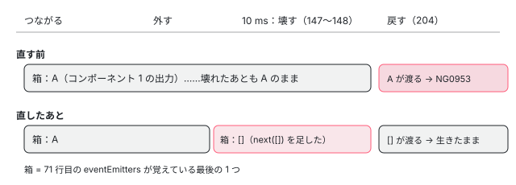

[目次](../README.md) › [見つけた不具合を手元で直す](README.md) › 第 8 回 / 全 10 回

# 覚えたままの出力：Elements の ReplaySubject

> ComponentNgElementStrategy の eventEmitters（ReplaySubject(1)）が、壊したコンポーネントの出力を覚えたままで、つなぎ直したときの購読が NG0953 で閉じる件。strategy の単体の spec で「壊したあとに購読してもエラーにならない」を確かめ、壊すときに空の配列を流す 1 行の直し。

angular/angular · 読了 約 11 分 · 中核 · [サイトで読む（デモが動きます）](https://angular-deep-dive-cyan.vercel.app/chapter/fix-elements-outputs)

---

Angular Elements の要素を外して 10 ms 以上待ってから戻すと、それから先は出力のイベントが届かなくなります。この章では、その原因の行（`ReplaySubject(1)` が壊れたコンポーネントの出力を覚えたままになる）を 1 ステップずつ追い、失敗する spec を書き、壊すときに空の配列を流す 1 行で直すまでを、手元の複製で走らせた記録と一緒に見ます。

読む対象は `packages/elements/src/component-factory-strategy.ts`・`packages/elements/src/create-custom-element.ts`・ `packages/core/src/authoring/output/output_emitter_ref.ts` と、spec の `packages/elements/test/component-factory-strategy_spec.ts` です。引用は直す前の木（../angular、8576f161ae4）の行です。

1. [1. 準備と流れ](01-fix-overview.md)
2. [2. enum の値](02-fix-enum.md)
3. [3. 消えた修正を戻す](03-fix-defer-immediate.md)
4. [4. 修正の取りこぼし](04-fix-event-replay-clickmod.md)
5. [5. 安定しないアプリ](05-fix-defer-error-stable.md)
6. [6. spec を直す](06-fix-spec-assertions.md)
7. [7. 一部しか直らない](07-fix-declare-field.md)
8. **8. 覚えたままの出力**（この章）
9. [9. 直せても出さない](09-fix-elements-reconnect.md)
10. [10. 出す前の点検](10-fix-before-issue.md)

## 1. 不具合の形

見つけたのは Elements のシリーズの [出力とイベント](../elements/06-elements-outputs.md) の「テストと直し方」の節です。そこでは、このサイトの本番ビルドの上で、`output()` を持つコンポーネントの要素を外して 50 ms 待って戻すのを 3 回繰り返し、戻すたびにコンソールに NG0953 が出て、作り直されたコンポーネントのボタンを押しても何も届かないことを記録しました。

症状を短く言うと次のとおりです。**要素を外して、コンポーネントが壊れるまで待ってから戻すと、要素の出力の購読がエラーで閉じる。そのあとは、作り直したコンポーネントの出力も届かない。** 要素をすぐ戻した（10 ms 以内）ときは起きません。

> [!NOTE]
> **ポイント**
>
> このシリーズでは PR も issue も出しません。手元の複製（../angular-fix）で「出せる状態」まで仕上げるところまでを書きます。理由は [第 10 回](10-fix-before-issue.md) に書きます。

## 2. 原因の行：覚えている箱と、壊れた出力

まず、strategy（要素とコンポーネントの間に入るオブジェクト。`ComponentNgElementStrategy`）が出力をどう持っているかです。

📄 `angular/packages/elements/src/component-factory-strategy.ts` L70–74 （▶ の行: 71, 74）

```ts
70 │   // Subject of `NgElementStrategyEvent` observables corresponding to the component's outputs.
71 ▶   private eventEmitters = new ReplaySubject<Observable<NgElementStrategyEvent>[]>(1);
72 │ 
73 │   /** Merged stream of the component's output events. */
74 ▶   readonly events = this.eventEmitters.pipe(switchMap((emitters) => merge(...emitters)));
```

71 行目の `eventEmitters` は `ReplaySubject(1)` です。ReplaySubject は「流れた値を覚えておき、あとから購読した人にもすぐ渡す」Subject で、引数の 1 は「最後の 1 つだけ覚える」という意味です。流れる値は「出力ごとの Observable の配列」です。74 行目の `events` は、その配列を `switchMap`（新しい値が来たら前の内側の購読をやめ、新しい内側に乗り換える演算子）で受け取り、`merge(...emitters)` で 1 本にまとめたものです。要素はこの `events` を購読します。

配列を流すのは、コンポーネントを作ったときの `initializeOutputs` です（関数の全体は [出力とイベント](../elements/06-elements-outputs.md) の 2 節）。

📄 `angular/packages/elements/src/component-factory-strategy.ts` L235–241 （▶ の行: 236, 241）

```ts
235 │       return new Observable((observer) => {
236 ▶         const sub = emitter.subscribe((value) => observer.next({name: templateName, value}));
237 │         return () => sub.unsubscribe();
238 │       });
239 │     });
240 │ 
241 ▶     this.eventEmitters.next(eventEmitters);
```

236 行目、配列の 1 つ 1 つは「購読されたら、そのときに `emitter.subscribe` を呼ぶ」Observable です。つまり、**出力の本体（`OutputEmitterRef` や `EventEmitter`）の subscribe は、配列を作ったときではなく、誰かが `events` を購読して merge が内側を購読したときに呼ばれます**。241 行目でその配列を `eventEmitters` に流します。

次に、壊すときです。要素が外れて 10 ms たつと、この予定の関数が走ります（予定の立て方は [切り離しと破棄](../elements/07-elements-disconnect.md) の 1 節）。

📄 `angular/packages/elements/src/component-factory-strategy.ts` L145–150 （▶ の行: 147–148）

```ts
145 │       this.scheduledDestroyFn = scheduler.schedule(() => {
146 │         if (this.componentRef !== null) {
147 ▶           this.componentRef.destroy();
148 ▶           this.componentRef = null;
149 │         }
150 │       }, DESTROY_DELAY);
```

147 行目で `componentRef.destroy()`、148 行目で `componentRef = null`。**`eventEmitters` には何もしていません**。だから 71 行目の箱は、壊れたコンポーネントの出力の配列を覚えたままです。

壊れた `OutputEmitterRef` を subscribe すると、こうなります。

📄 `angular/packages/core/src/authoring/output/output_emitter_ref.ts` L52–58 （▶ の行: 52–54）

```ts
52 ▶     if (this.destroyed) {
53 ▶       throw new RuntimeError(
54 ▶         RuntimeErrorCode.OUTPUT_REF_DESTROYED,
55 │         ngDevMode &&
56 │           'Unexpected subscription to destroyed `OutputRef`. ' +
57 │             'The owning directive/component is destroyed.',
58 │       );
```

52 行目で `destroyed` なら、53〜54 行目で `RuntimeError`（`OUTPUT_REF_DESTROYED`、コードは NG0953）を投げます。`destroyed` は、コンポーネントが壊れたときに `DestroyRef` の後片付けで true になります。

最後に要素の側です。戻したとき（`connectedCallback`）、要素は `connect` の**前に**購読します。

📄 `angular/packages/elements/src/create-custom-element.ts` L202–208 （▶ の行: 202, 204, 208）

```ts
202 ▶       if (this.ngElementStrategy.events) {
203 │         // `events` are already available: Subscribe to it asap.
204 ▶         this.subscribeToEvents();
205 │         subscribedToEvents = true;
206 │       }
207 │ 
208 ▶       this.ngElementStrategy.connect(this);
```

📄 `angular/packages/elements/src/create-custom-element.ts` L230–236 （▶ の行: 232）

```ts
230 │     private subscribeToEvents(): void {
231 │       // Listen for events from the strategy and dispatch them as custom events.
232 ▶       this.ngElementEventsSubscription = this.ngElementStrategy.events.subscribe((e) => {
233 │         const customEvent = new CustomEvent(e.name, {detail: e.value});
234 │         this.dispatchEvent(customEvent);
235 │       });
236 │     }
```

202 行目で `events` があるので、204 行目で購読し、そのあと 208 行目で `connect` します。232 行目の購読は next の受け手（関数 1 つ）だけを渡していて、error の受け手がありません。また、外したとき（`disconnectedCallback`）は、この購読をやめます。

📄 `angular/packages/elements/src/create-custom-element.ts` L221–227 （▶ の行: 221, 224–225）

```ts
221 ▶         this._ngElementStrategy.disconnect();
222 │       }
223 │ 
224 ▶       if (this.ngElementEventsSubscription) {
225 ▶         this.ngElementEventsSubscription.unsubscribe();
226 │         this.ngElementEventsSubscription = null;
227 │       }
```

221 行目で strategy に外れたことを伝え（ここで 10 ms の予定が立つ）、224〜225 行目で要素の購読をやめます。

### 1 ステップずつ：外して、待って、戻す

1. **つながる**

   204 行目で `events` を購読します。箱はまだ空です。208 行目の `connect` でコンポーネントが作られ、241 行目で配列 A（コンポーネント 1 の出力）が流れます。switchMap が merge(A) を購読し、236 行目で出力の本体が subscribe されます。ここまでは正常です。
2. **外す**

   221 行目で壊す予定が立ち、224〜225 行目で要素の購読をやめます。switchMap の内側も一緒にやめるので、出力の本体の購読も外れます。**箱は A を覚えたまま**です。
3. **10 ms たつ**

   147〜148 行目でコンポーネント 1 が壊れます。A の中の `OutputEmitterRef` は `destroyed` になります。箱はまだ A です。
4. **戻す：購読した瞬間に A が渡る**

   204 行目で購読すると、ReplaySubject(1) は覚えている A をその場で渡します。switchMap が merge(A) を購読し、236 行目で壊れた出力を subscribe して、52〜54 行目の例外が出ます。Observable の中で投げられた例外は error として流れ、232 行目の購読は error で閉じます（受け手が無いので、コンソールに NG0953 が出ます）。
5. **そのあとは何も届かない**

   コンポーネントがあとで作り直されて 241 行目で配列 B が流れても、要素の購読はもう閉じています。次にまた外して戻しても、204 行目の購読は箱の中の古い配列でまた落ちます。



*eventEmitters（ReplaySubject(1)）の中身と要素の購読。壊したあとも A が残り、戻したときの購読に A が渡って落ちる。直したあとは壊すときに \[\] が入る*

### なぜこうなったか：別々に正しい 2 つの変更

`git log -S 'ReplaySubject' -- packages/elements/src/component-factory-strategy.ts` で探すと、71 行目の箱は 2020-06 の eba9dd364e5（#37570、Fixes #36141）で入っています。コミットの本文によると、目的は「コンポーネントを作る前から `events` を購読できるようにし、初期化のフック（ngOnInit など）の中で出した出力も取りこぼさない」ことでした。204 行目の「connect の前に購読する」も同じコミットです。

一方、壊れた出力の subscribe が投げる 52〜58 行目は、`git log -S 'OUTPUT_REF_DESTROYED'` で見ると 2024-02 の 9ce627746c9（#54650、`OutputRef` を作った変更）からです。それまでの出力は `EventEmitter`（RxJS の Subject）で、壊れたあとに subscribe しても例外にはなりません（[出力とイベント](../elements/06-elements-outputs.md) の記録でも、EventEmitter だけのコンポーネントでは落ちませんでした）。2020 年の箱は、2024 年に「壊れた出力に触ると投げる」出力ができたところで、初めて目に見える不具合になりました。

## 3. 失敗する spec を書く

spec を足す場所は `component-factory-strategy_spec.ts` の `describe('disconnect')` の中、既にある「10 ms で壊れる」の it のすぐ後ろにしました。

📄 `angular/packages/elements/test/component-factory-strategy_spec.ts` L316–322 （▶ の行: 317, 319–320）

```ts
316 │ 
317 ▶       strategy.disconnect();
318 │       expect(destroyed).toBeFalse();
319 ▶       await new Promise((resolve) => setTimeout(resolve, 10));
320 ▶       expect(destroyed).toBeTrue();
321 │     });
322 │   });
```

317 行目で外し、319 行目で本物の `setTimeout` を 10 ms 待ち、320 行目で壊れたことを確かめています。足す it はこの「壊れたあと」の続きなので、同じ待ち方（`await new Promise(...)`）をそのまま使えます。`describe('disconnect')` の中の it の全体は [切り離しと破棄](../elements/07-elements-disconnect.md) の「テストと直し方」で読みました。

### なぜ要素まで作る spec ではなく、strategy の単体の spec か

要素（`NgElementImpl`）まで作る spec は `create-custom-element_spec.ts` にあります。ところが、そこで使う strategy は偽物です。

📄 `angular/packages/elements/test/create-custom-element_spec.ts` L405–411 （▶ の行: 405, 410）

```ts
405 ▶   class TestStrategy implements NgElementStrategy {
406 │     connectedElement: HTMLElement | null = null;
407 │     disconnectCalled = false;
408 │     inputs = new Map<string, any>();
409 │ 
410 ▶     events = new Subject<NgElementStrategyEvent>();
411 │ 
```

405 行目の `TestStrategy` は、410 行目で `events` を素の `Subject` にしています。**原因の 71 行目の ReplaySubject がこの spec には無い**ので、ここに it を足しても今回の不具合は再現しません。本物の strategy を使っているのは `component-factory-strategy_spec.ts` だけです。そして、そこで使うコンポーネントには `output()` と同じ本体の出力が 1 つあります。

📄 `angular/packages/elements/test/component-factory-strategy_spec.ts` L383–386 （▶ の行: 384–386）

```ts
383 │ export class TestComponent {
384 ▶   @Output('templateOutput1') output1 = new Subject();
385 ▶   @Output('templateOutput2') output2 = new Subject();
386 ▶   @Output('templateOutput3') output3 = new OutputEmitterRef();
```

384〜385 行目の 2 つは `Subject` で、壊れたあとに subscribe しても投げません。386 行目の `new OutputEmitterRef()` があるので、このコンポーネントのまま 52〜54 行目の例外を起こせます。テスト用のコンポーネントを新しく作る必要はありません。

### 書き方の工夫

1. **前提を先に確かめる**

   10 ms 待ったあと `getComponentRef(strategy)` が null であることを expect します。これが外れると「壊れる前に購読した」ことになり、何を確かめたのか分からなくなるからです。
2. **要素のすることを真似る**

   要素は戻ったときに 204 行目で `events` を購読するだけです。だから spec では `strategy.events.subscribe(...)` を呼びます（spec の中に「要素がもう一度つながったときにすること」というコメントを付けた）。connect はしません。connect を呼ぶと、[第 9 回](09-fix-elements-reconnect.md) の不具合（#38778）にも触れてしまうからです。
3. **error の受け手を spy にする**

   232 行目の購読は error の受け手を持たないので、spec では `{error: errorSpy}` を渡して、呼ばれないことを確かめます。加えて `subscription.closed` が false（購読が生きている）であることも見ます。どちらも subscribe の直後に同期で決まるので、待つ必要はありません。

## テストと直し方：手元で走らせた記録

> **🧪 fix/elements-outputs-after-destroy の手順**
>
> これは手元の複製で走らせた記録の再生です。ボタンを押すと、その手順のコマンドと出力（要るところだけ）が出ます。ページの中で bazel が走るわけではありません。
>
> ▶ [このデモはサイトで動かせます](https://angular-deep-dive-cyan.vercel.app/chapter/fix-elements-outputs)

### 「2. 直す前に走らせる」

ターゲットは `//packages/elements/test:test` です。Elements の spec は Web Test Runner の上の Jasmine で、Chromium と Firefox の 2 つのターゲット（`test_chromium`・`test_firefox`）になります。ブラウザのテストでは `--test_arg=--filter` が効かないので、絞らずに全部を走らせています（[第 1 回](01-fix-overview.md)）。

結果は 2 つとも FAILED、Chromium は「59 passed, 1 failed, 5 skipped」でした。落ちたのは足した it で、メッセージは「Expected spy error not to have been called.」です。つまり、壊れたあとに購読した瞬間に error が流れました。2 節の 4 つ目のステップが、そのまま spec で起きています。

### 「3. 直す」：壊すときに空の配列を流す

直しは、148 行目の `this.componentRef = null;` のすぐ後ろに `this.eventEmitters.next([]);` を足す 1 行（とコメント 1 行）です。差分はデモの「3. 直す」にあります。

1. **壊すとき**

   147〜148 行目で壊したあと、71 行目の箱に空の配列が入ります。ReplaySubject(1) は最後の 1 つだけ覚えるので、A は忘れられます。
2. **戻して購読したとき**

   箱の `[]` が渡り、74 行目の switchMap が `merge()`（引数なし）を購読します。引数の無い merge は何も流さずにすぐ終わります。外側の箱（ReplaySubject）は終わっていないので、要素の購読は閉じずに生きています。
3. **コンポーネントが作り直されたとき**

   241 行目で新しい配列 B が流れ、switchMap が merge(B) に乗り換えます。今度は生きた出力なので、イベントが要素に届きます。

「4. 直したあと」で、2 つのターゲットとも PASSED、Chromium は「60 passed, 0 failed, 5 skipped」になりました。周りのテストとして選んだのはこの `:test` だけです。Elements の spec はこの 1 つのバンドルに全部入っているので、これで Elements の it はすべて走っています。公開 API の比較（`elements_api`）などほかのターゲットは走らせていません（公開の型は変えていません）。8 つの直しを重ねた枝で関係するテストをまとめて走らせた結果は [第 10 回](10-fix-before-issue.md) にあります。

### 採らなかった案

| 案 | どうなるか | 採らなかった理由 |
| --- | --- | --- |
| ReplaySubject をやめて、素の Subject にする | 覚えないので、戻したときに古い配列が渡らない | 10 ms 以内に戻す（DOM の中で要素を移す）ときに困る。224〜225 行目で購読をやめ、204 行目で購読し直すが、connect は壊す予定を取り消して戻るだけで、241 行目はもう一度は走らない（[切り離しと破棄](../elements/07-elements-disconnect.md) の 2 節）。覚えていないと、移した要素の出力が届かなくなる |
| 購読の側でエラーを捕まえる（232 行目に error の受け手を足す、events に catchError を足す など） | NG0953 で購読が閉じなくなる | 壊れた出力を覚えている、という原因は残り、エラーを隠すだけになる。create-custom-element.ts は自作の strategy でも使う共通の側なので、そこで握りつぶすと、ほかの strategy の本当のエラーも消える |
| 236 行目の内側で、コンポーネントが壊れていたら subscribe しない | 壊れた出力には触らない | 出力 1 つごとの包みに条件を足すことになり、古い配列は箱に残る。`OutputEmitterRef` の `destroyed` は private なので、別の印で判断する必要もある。壊したその場所で箱を空にするほうが、変える場所が 1 か所で済む |

### 「5. コミット」

要約は `fix(elements): do not replay outputs of a destroyed component` です。type は不具合の直しなので `fix`、scope は `elements`（.ng-dev/commit-message.mjs の scope の一覧にある名前。決まりは [コミットメッセージ](../contrib/09-contrib-commit-messages.md)）。要約は小文字で始め、命令形にし、句点を付けません。

本文には「何が」（strategy が ReplaySubject で出力を覚えている）、「なぜ」（壊れたあとも覚えているので、戻したときの購読が壊れた `OutputEmitterRef` を subscribe し、NG0953 で閉じる）を書きました。この件には issue が無いので、`Fixes #…` の行はありません。コミットのときはフックが ng-dev format staged と commit-message の検査を走らせました（[第 1 回](01-fix-overview.md)）。

読み返して気づいたことも書いておきます。本文は「どう直したか」（壊すときに空の配列を流す）を一言も書いていません。差分を見れば分かるとはいえ、ガイドラインは本文に前後の振る舞いの比較を書いてよいとしているので（[第 10 回](10-fix-before-issue.md) の 3 節）、出す前に 1 文足す候補です。

### issue を出す前に確かめること

- gh（読むだけ）で「elements output reattach」「elements events reconnect」「NG0953」を探しました（2026-11-06）。Elements で出力が届かなくなる報告は見つかりませんでした。出てきた #38778 は第 9 回の件（作り直されない）、#70727（NG0953 を抑えたい、開いている）などは Elements とは別の場面です。一覧は [第 10 回](10-fix-before-issue.md) のデモの「4. gh で同じ報告を探す」にあります。
- レビューで聞かれそうなこと 1：「#38778 が直っていないのに、これだけ直して意味があるか」。この直しだけでは、待って戻した 1 回目はコンポーネントが作られません（第 9 回）。それでも要素の購読はもう閉じないので、作られた回からは出力が届きます。これは、あとで一時的な it で確かめました（strategy に、要素と同じ順番で「購読 → connect → 出力 → disconnect → 購読の解除 → 10 ms 待つ」を 3 回させた。コミットには入れていない）。この直しだけを当てると、2 回目に作られたコンポーネントの出力が届き、購読は閉じませんでした。直す前は、3 回とも購読がエラーで閉じ、2 回目に作られたコンポーネントの出力も届きませんでした（Chromium と Firefox で同じ）。
- レビューで聞かれそうなこと 2：「壊して作り直すという今の設計の上の直しではないか」。そのとおりです。#64229（Angular Elements Lifecycle is Broken、開いている）は、外したときは壊さずに `detachView` するよう提案しています。その形になれば出力は壊れないので、この直しは要らなくなります。設計の話は [第 9 回](09-fix-elements-reconnect.md) で読みます。

## ここまでの流れ

- 👤 `element.remove()` — 利用者のコード — *要素を外す*
  - `disconnectedCallback()` — create-custom-element.ts 221・224〜225 — *壊す予定を立て、購読をやめる*
    - `scheduledDestroyFn` の中 — component-factory-strategy.ts 147〜148 — *10 ms 後に壊す。箱は A のまま*
- 👤 `parent.append(element)` — 利用者のコード — *戻す*
  - `connectedCallback()` → `subscribeToEvents()` — create-custom-element.ts 204・232 — *connect の前に購読*
    - `eventEmitters` が A を渡す → `switchMap` → `merge(...A)` — component-factory-strategy.ts 71・74 — *覚えていた古い配列*
      - `emitter.subscribe(...)` — component-factory-strategy.ts 236
        - `OutputEmitterRef.subscribe` が NG0953 を投げる — output\_emitter\_ref.ts 52〜54 — *購読が error で閉じる*

## 聞かれそうな質問

**Q. なぜ 10 ms 以内に戻したときは起きないのですか？**

10 ms 以内なら 147 行目の destroy がまだ走っていないので、箱の A の出力は壊れていません。204 行目で購読し直すと A が渡り、236 行目の subscribe は普通に成功します。だから箱が「覚えている」こと自体は、移す場合には必要な仕組みです（採らなかった案の 1 つ目）。

**Q. @Output() と EventEmitter だけのコンポーネントでも起きますか？**

この形では起きません。例外を投げるのは 52〜54 行目の `OutputEmitterRef.subscribe` で、EventEmitter（Subject）は壊れたあとに subscribe しても投げないからです。spec のコンポーネントでも、例外の元になれるのは 386 行目の `new OutputEmitterRef()` だけで、384〜385 行目の Subject の出力ではありません。

**Q. next(\[\]) で空の配列を流すと、switchMap ごと終わってしまいませんか？**

終わりません。`merge()` が終わるのは switchMap の内側だけです。switchMap が終わるのは外側（71 行目の ReplaySubject）が終わったときで、この strategy は ReplaySubject を complete しません。だから要素の購読は生きたまま、次に 241 行目で流れる配列に乗り換えます。

**Q. なぜ create-custom-element\_spec.ts に it を足さなかったのですか？**

そこで使う strategy は 405 行目の `TestStrategy` で、410 行目の `events` は素の Subject です。原因の ReplaySubject が無いので、再現しません。本物の strategy と `OutputEmitterRef` の出力（386 行目）がそろっているのは component-factory-strategy\_spec.ts だけです。

**Q. spec は 1 件だけ走らせられましたか？**

いいえ。Elements の spec はブラウザ（Web Test Runner）で走るので `--test_arg=--filter` が効かず、60 件すべてを Chromium と Firefox で走らせました。全体でも Chromium は 1 秒ほどで終わります（記録の「PASSED in 0.9s」）。

## 読み終えて

- 原因は、71 行目の `ReplaySubject(1)` が壊れたコンポーネントの出力の配列を覚えたままになり、戻したときの購読（204 行目）にそれを渡すことです。
- 2020 年の箱（eba9dd364e5）と 2024 年の「壊れた出力は投げる」（9ce627746c9）は、それぞれは正しく、組み合わさって不具合になりました。
- spec は本物の strategy を使う component-factory-strategy\_spec.ts の `describe('disconnect')` に足しました。要素の spec の strategy は偽物の Subject だからです。
- 直しは壊したその場所で `eventEmitters.next([])` を流す 1 行で、Chromium・Firefox とも 60 passed になりました。
- これも「壊して作り直す」今の設計の上の直しです。設計そのものの話は [第 9 回](09-fix-elements-reconnect.md) で読みます。

---

← 前: [一部しか直らない直し：declare のフィールドと NodeFlags.Ambient](07-fix-declare-field.md)  
次: [直せても出さない：#38778 と閉じた 2 つの PR](09-fix-elements-reconnect.md) →
