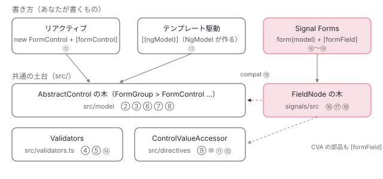

[目次](../README.md) › [フォームの内側](README.md) › 第 1 回 / 全 20 回

# forms の全体像：3 つの API と packages/forms の地図

> リアクティブ・テンプレート駆動・Signal Forms の 3 つが同じパッケージのどこにあるか（src/model・src/directives・signals/）、エントリポイント（@angular/forms と @angular/forms/signals、compat）、ReactiveFormsModule と FormsModule が何を宣言するか。テストの置き場所（test/ の \*\_spec.ts、signals/test/node と web）と bazel のターゲット、このマシンで走らせた件数と時間。

angular/angular · 読了 約 12 分 · 基礎 · [サイトで読む（デモが動きます）](https://angular-deep-dive-cyan.vercel.app/chapter/forms-overview)

---

Angular のフォームには、書き方が 3 つあります。`FormControl` を自分で作る**リアクティブ**、テンプレートに `[(ngModel)]` を書く**テンプレート駆動**、v21 で experimental として入った `form(model)` の**Signal Forms** です。この章では、3 つが `packages/forms` のどのディレクトリにあり、どのエントリポイント（import するときのパッケージ名）から出ていて、`ReactiveFormsModule` と `FormsModule` が何を宣言しているかを、ソースの行で確かめます。最後に、テストの置き場所と bazel のターゲット、このマシンで走らせた件数と時間をまとめます。

読む対象は `packages/forms/src/form_providers.ts`・`src/directives.ts`・`src/forms.ts`・ `signals/public_api.ts`・`signals/compat/public_api.ts`・`signals/test/node/BUILD.bazel` です（angular リポジトリ、v22.2.0-next.7）。

1. **1. 全体像**（この章）
2. [2. AbstractControl](02-forms-abstract-control.md)
3. [3. updateValueAndValidity](03-forms-update-value-validity.md)
4. [4. Validators](04-forms-validators.md)
5. [5. 非同期の検証](05-forms-async-validators.md)
6. [6. events](06-forms-control-events.md)
7. [7. FormGroup と FormArray](07-forms-form-group-array.md)
8. [8. 型付きフォームと FormBuilder](08-forms-typed-forms.md)
9. [9. ControlValueAccessor](09-forms-value-accessor.md)
10. [10. 双方向の配線](10-forms-setup-control.md)
11. [11. 組み込みの accessor](11-forms-builtin-accessors.md)
12. [12. リアクティブのディレクティブ](12-forms-reactive-directives.md)
13. [13. NgModel と NgForm](13-forms-ng-model.md)
14. [14. 検証のディレクティブ](14-forms-validator-directives.md)
15. [15. 状態クラス](15-forms-status-classes.md)
16. [16. Signal Forms のスキーマ](16-forms-sf-schema.md)
17. [17. Signal Forms の検証](17-forms-sf-validation.md)
18. [18. 状態ルールと metadata](18-forms-sf-rules-metadata.md)
19. [19. submit と相互運用](19-forms-sf-submit-compat.md)
20. [20. issue と PR を読む](20-forms-issues.md)

## 1. 3 つの API と、共通の土台



*3 つの API が使う部品。リアクティブとテンプレート駆動は同じ AbstractControl の木を使い、Signal Forms は別の木（FieldNode）を持つ。丸数字はこのシリーズの回。*

1. **リアクティブ：木を自分で作る**

   `new FormGroup({ name: new FormControl('') })` のように、値と状態を持つ木（`AbstractControl` の木）をクラスの中で組み立て、`[formGroup]`・`[formControl]`・`formControlName` で入力欄に渡します。木の節は[第 2 回](02-forms-abstract-control.md)、ディレクティブは[第 12 回](12-forms-reactive-directives.md)。
2. **テンプレート駆動：同じ木を NgModel が作る**

   `[(ngModel)]` を書くと、`NgModel` が自分の中で `FormControl` を作り、`<form>` の中なら `NgForm` の `FormGroup` に登録します（[第 13 回](13-forms-ng-model.md)）。木はリアクティブと**同じクラス**です。違うのは、誰が木を作るかだけです。
3. **入力欄との間は ControlValueAccessor**

   どちらの書き方でも、木と入力欄の間には `ControlValueAccessor`（入力欄の値を読み書きする通訳。[第 9 回](09-forms-value-accessor.md)）が入り、`setUpControlValueAccessor` が両方向の配線をします（[第 10 回](10-forms-setup-control.md)）。
4. **Signal Forms：別の木を持つ**

   `form(model)` は `AbstractControl` を使いません。値は渡した signal（`model`）にあり、状態は `FieldNode` の木が signal で持ちます （[signals シリーズの Signal Forms の回](../signals/17-signal-forms.md)）。既存の木とは `@angular/forms/signals/compat` でつながります（[第 19 回](19-forms-sf-submit-compat.md)）。

## 2. ReactiveFormsModule と FormsModule が宣言するもの

📄 `angular/packages/forms/src/form_providers.ts` L32–58 （▶ の行: 33–34, 45, 52–53）

```ts
32 │ @NgModule({
33 ▶   declarations: TEMPLATE_DRIVEN_DIRECTIVES,
34 ▶   exports: [InternalFormsSharedModule, TEMPLATE_DRIVEN_DIRECTIVES],
35 │ })
36 │ export class FormsModule {
37 │   /**
38 │    * @description
39 │    * Provides options for configuring the forms module.
40 │    *
41 │    * @param opts An object of configuration options
42 │    * * `callSetDisabledState` Configures whether to `always` call `setDisabledState`, which is more
43 │    * correct, or to only call it `whenDisabled`, which is the legacy behavior.
44 │    */
45 ▶   static withConfig(opts: {
46 │     callSetDisabledState?: SetDisabledStateOption;
47 │   }): ModuleWithProviders<FormsModule> {
48 │     return {
49 │       ngModule: FormsModule,
50 │       providers: [
51 │         {
52 ▶           provide: CALL_SET_DISABLED_STATE,
53 ▶           useValue: opts.callSetDisabledState ?? setDisabledStateDefault,
54 │         },
55 │       ],
56 │     };
57 │   }
58 │ }
```

📄 `angular/packages/forms/src/form_providers.ts` L60–73 （▶ の行: 70–71）

```ts
60 │ /**
61 │  * Exports the required infrastructure and directives for reactive forms,
62 │  * making them available for import by NgModules that import this module.
63 │  *
64 │  * @see [Forms Overview](guide/forms)
65 │  * @see [Reactive Forms Guide](guide/forms/reactive-forms)
66 │  *
67 │  * @publicApi
68 │  */
69 │ @NgModule({
70 ▶   declarations: [REACTIVE_DRIVEN_DIRECTIVES],
71 ▶   exports: [InternalFormsSharedModule, REACTIVE_DRIVEN_DIRECTIVES],
72 │ })
73 │ export class ReactiveFormsModule {
```

33 行目、`FormsModule` が宣言するのは `TEMPLATE_DRIVEN_DIRECTIVES`、70 行目、`ReactiveFormsModule` は `REACTIVE_DRIVEN_DIRECTIVES` です。34 行目と 71 行目の `exports` を見ると、どちらも **`InternalFormsSharedModule` を一緒に export** しています。45〜57 行目の `withConfig` は、52 行目で `CALL_SET_DISABLED_STATE` トークン（`setDisabledState` をいつ呼ぶか）を provide するだけです。53 行目、渡さなければ既定値 `setDisabledStateDefault` です。

📄 `angular/packages/forms/src/directives.ts` L74–106 （▶ の行: 74, 78, 82, 85, 87, 97, 99–102）

```ts
 74 ▶ export const SHARED_FORM_DIRECTIVES: Type<any>[] = [
 75 │   NgNoValidate,
 76 │   NgSelectOption,
 77 │   NgSelectMultipleOption,
 78 ▶   DefaultValueAccessor,
 79 │   NumberValueAccessor,
 80 │   RangeValueAccessor,
 81 │   CheckboxControlValueAccessor,
 82 ▶   SelectControlValueAccessor,
 83 │   SelectMultipleControlValueAccessor,
 84 │   RadioControlValueAccessor,
 85 ▶   NgControlStatus,
 86 │   NgControlStatusGroup,
 87 ▶   RequiredValidator,
 88 │   MinLengthValidator,
 89 │   MaxLengthValidator,
 90 │   PatternValidator,
 91 │   CheckboxRequiredValidator,
 92 │   EmailValidator,
 93 │   MinValidator,
 94 │   MaxValidator,
 95 │ ];
 96 │ 
 97 ▶ export const TEMPLATE_DRIVEN_DIRECTIVES: Type<any>[] = [NgModel, NgModelGroup, NgForm];
 98 │ 
 99 ▶ export const REACTIVE_DRIVEN_DIRECTIVES: Type<any>[] = [
100 ▶   FormControlDirective,
101 ▶   FormGroupDirective,
102 ▶   FormArrayDirective,
103 │   FormControlName,
104 │   FormGroupName,
105 │   FormArrayName,
106 │ ];
```

📄 `angular/packages/forms/src/directives.ts` L108–117 （▶ の行: 111–113, 117）

```ts
108 │ /**
109 │  * Internal module used for sharing directives between FormsModule and ReactiveFormsModule
110 │  */
111 ▶ @NgModule({
112 ▶   declarations: SHARED_FORM_DIRECTIVES,
113 ▶   exports: SHARED_FORM_DIRECTIVES,
114 │ })
115 │ export class ɵInternalFormsSharedModule {}
116 │ 
117 ▶ export {ɵInternalFormsSharedModule as InternalFormsSharedModule};
```

| 配列（directives.ts） | 入っているもの | 扱う回 |
| --- | --- | --- |
| `SHARED_FORM_DIRECTIVES`（74〜95 行目） | 組み込みの accessor（78〜84 行目）、状態クラス（85〜86 行目）、検証のディレクティブ（87〜94 行目）、`NgNoValidate` | [⑪](11-forms-builtin-accessors.md)[⑮](15-forms-status-classes.md)[⑭](14-forms-validator-directives.md) |
| `TEMPLATE_DRIVEN_DIRECTIVES`（97 行目） | `NgModel`・`NgModelGroup`・`NgForm` | [⑬](13-forms-ng-model.md) |
| `REACTIVE_DRIVEN_DIRECTIVES`（99〜106 行目） | `FormControlDirective`・`FormGroupDirective`・`FormArrayDirective`・`FormControlName`・`FormGroupName`・`FormArrayName` | [⑫](12-forms-reactive-directives.md) |

111〜115 行目、共有の 20 個は `ɵInternalFormsSharedModule` という 1 つの NgModule が宣言し、117 行目で `InternalFormsSharedModule` の名前でも出しています。つまり `DefaultValueAccessor` や `RequiredValidator` は、リアクティブでもテンプレート駆動でも**同じクラス**が働きます。`[formControl]` に `required` 属性を書いても `[(ngModel)]` に書いても、同じ `RequiredValidator` が付くのはこのためです。

> [!TIP]
> **新卒エンジニアへ**
>
> NgModule（`@NgModule`）は、standalone が入る前の「ディレクティブをまとめて配る箱」です。forms のディレクティブは今も `standalone: false` で宣言されているので、standalone のコンポーネントでは個々のクラスではなく `ReactiveFormsModule` や `FormsModule` を `imports` に書きます。

## 3. エントリポイント：@angular/forms・/signals・/signals/compat

📄 `angular/packages/forms/src/forms.ts` L79–118 （▶ の行: 80, 82, 84–89, 100, 107, 115–116）

```ts
 79 │ export {
 80 ▶   AbstractControl,
 81 │   AbstractControlOptions,
 82 ▶   ControlEvent,
 83 │   FormControlStatus,
 84 ▶   FormResetEvent,
 85 ▶   FormSubmittedEvent,
 86 ▶   PristineChangeEvent,
 87 ▶   StatusChangeEvent,
 88 ▶   TouchedChangeEvent,
 89 ▶   ValueChangeEvent,
 90 │   ɵCoerceStrArrToNumArr,
 91 │   ɵGetProperty,
 92 │   ɵNavigate,
 93 │   ɵRawValue,
 94 │   ɵTokenize,
 95 │   ɵTypedOrUntyped,
 96 │   ɵValue,
 97 │   ɵWriteable,
 98 │ } from './model/abstract_model';
 99 │ export {
100 ▶   FormArray,
101 │   isFormArray,
102 │   UntypedFormArray,
103 │   ɵFormArrayRawValue,
104 │   ɵFormArrayValue,
105 │ } from './model/form_array';
106 │ export {
107 ▶   FormControl,
108 │   FormControlOptions,
109 │   FormControlState,
110 │   isFormControl,
111 │   UntypedFormControl,
112 │   ɵFormControlCtor,
113 │ } from './model/form_control';
114 │ export {
115 ▶   FormGroup,
116 ▶   FormRecord,
117 │   isFormGroup,
118 │   isFormRecord,
```

`@angular/forms` の入口は `src/forms.ts` です。80 行目の `AbstractControl`、107 行目の `FormControl`、115 行目の `FormGroup`、116 行目の `FormRecord`、100 行目の `FormArray` が木のクラス、82〜89 行目の 8 つが[第 6 回](06-forms-control-events.md)で読む `events` の型です。頭に `ɵ` が付いた名前（90〜97 行目など）は、型の計算のために外へ出しているだけの非公開 API です。この入口に、どの名前を出すかが golden ファイルで見張られている話は [contrib シリーズの公開 API の回](../contrib/08-contrib-public-api.md)にあります。

📄 `angular/packages/forms/signals/public_api.ts` L9–26 （▶ の行: 17, 21, 24–25）

```ts
 9 │ /**
10 │  * @module
11 │  * @description
12 │  * Entry point for all public APIs of this package.
13 │  */
14 │ export * from './src/api/assertions';
15 │ export * from './src/api/control';
16 │ export * from './src/api/di';
17 ▶ export * from './src/api/rules';
18 │ export * from './src/api/rules/debounce';
19 │ export * from './src/api/rules/metadata';
20 │ export * from './src/api/rules/validation/validation_errors';
21 ▶ export * from './src/api/structure';
22 │ export * from './src/api/transformed_value';
23 │ export * from './src/api/types';
24 ▶ export * from './src/directive/form_field';
25 ▶ export * from './src/directive/form_root';
26 │ export * from './src/webmcp';
```

📄 `angular/packages/forms/signals/compat/public_api.ts` L9–18 （▶ の行: 14, 18）

```ts
 9 │ /**
10 │  * @module
11 │  * @description
12 │  * Entry point for all public APIs of this package.
13 │  */
14 ▶ export * from './src/api/compat_form';
15 │ export {extractValue} from './src/api/extract';
16 │ export {CompatValidationError} from '../src/compat/validation_errors';
17 │ export * from './src/api/di';
18 ▶ export {SignalFormControl} from './src/signal_form_control/signal_form_control';
```

`@angular/forms/signals` の入口は `signals/public_api.ts`。21 行目の `api/structure` に `form()`、17 行目の `api/rules` に `required` などのルール、24 行目の `directive/form_field` に `[formField]` ディレクティブ（`FormField`）があります。`@angular/forms/signals/compat` は 14 行目の `compatForm`（既存の `FormControl` を Signal Forms の木に入れる）と、18 行目の `SignalFormControl`（Signal Forms を `AbstractControl` として見せる）の 2 方向です。ビルドされた npm パッケージでは、この 3 つが `fesm2022/forms.mjs`・`signals.mjs`・`signals-compat.mjs` になります。

## 4. ディレクトリの地図

| ディレクトリ（packages/forms/） | 中身 | 扱う回 |
| --- | --- | --- |
| `src/model/` | `abstract_model.ts`（`AbstractControl`・イベントのクラス）、`form_control.ts`・`form_group.ts`（`FormRecord` も）・`form_array.ts` | ② ③ ⑥ ⑦ ⑧ |
| `src/validators.ts`・`src/form_builder.ts` | `Validators` と合成の関数 / `FormBuilder` | ④ ⑤ / ⑧ |
| `src/directives/` | `control_value_accessor.ts`、組み込みの accessor、`shared.ts`（配線）、`ng_model.ts`・`ng_form.ts`、`validators.ts`（検証のディレクティブ）、`ng_control_status.ts` | ⑨ ⑩ ⑪ ⑬ ⑭ ⑮ |
| `src/directives/reactive_directives/` | `form_control_directive.ts`・`form_group_directive.ts`・`form_array_directive.ts`・`form_control_name.ts`・`form_group_name.ts`・共通の親 `abstract_form.directive.ts` | ⑫ |
| `signals/src/api/` | `form()`・`schema`・`apply`、ルール（`rules/`）、型 | ⑯ ⑰ ⑱ |
| `signals/src/field/` | `FieldNode`（`node.ts`）、状態（`state.ts`）、検証（`validation.ts`）、`submit.ts` | ⑯ ⑰ ⑱ ⑲ |
| `signals/src/schema/` | `LogicNode`（`logic_node.ts`）・`FieldPathNode`（`path_node.ts`） | ⑯ |
| `signals/src/directive/` | `[formField]`（`form_field.ts`）、ネイティブ要素・CVA との橋渡し | ⑲、[Signal Forms の回](../signals/17-signal-forms.md) |
| `signals/compat/` | `compatForm`・`SignalFormControl` | ⑲ |
| `test/`・`signals/test/node/`・`signals/test/web/` | spec（6 節） | 各回の「テストと直し方」 |

## 5. 3 つを並べて動かす

> **🧪 DEMO — 同じ「名前（必須）」を 3 つの API で**
>
> この章のコンポーネントが `ReactiveFormsModule`・`FormsModule`・`FormField` を全部 import しています（サイトに入っている `@angular/forms` は 22.1.6）。空のときは 3 つとも invalid です。リアクティブとテンプレート駆動の入力欄の赤い枠は、`NgControlStatus` が付けた `ng-invalid` クラスです。
>
> ボタンは 1 では `reactiveName.setValue`、2 では自分の signal の `set`（`NgModel` が拾って中の `FormControl` に書く）、3 では `model.set` を呼んでいます。1 と 2 は `FormControl` に値をコピーして持ち、3 は `model` そのものを読みます。
>
> ▶ [このデモはサイトで動かせます](https://angular-deep-dive-cyan.vercel.app/chapter/forms-overview)

## 6. テストの地図

forms のテストは 2 か所にあります。`packages/forms/test/` が `src/`（リアクティブとテンプレート駆動）の spec、`packages/forms/signals/test/` が Signal Forms の spec で、DOM が要らない `node/` と、ブラウザで走らせる `web/` に分かれています。

| spec（packages/forms/test/） | 一番外の describe | 試しているもの |
| --- | --- | --- |
| `form_control_spec.ts` | `describe('FormControl')`（:34） | 値・検証・`reset()`・`disable() & enable()`・`valueChanges & statusChanges`。ほとんどの it は木の節を new して呼ぶだけ |
| `form_group_spec.ts` / `form_array_spec.ts` | `describe('FormGroup')`（:45）/ `describe('FormArray')`（:29） | 子を束ねる値、`dirty`・`touched` の伝わり方、子の追加と削除 |
| `validators_spec.ts` | `describe('Validators')`（:49） | `required`・`minLength`・`compose` などの関数 |
| `form_builder_spec.ts` / `typed_integration_spec.ts` | `describe('Form Builder')`（:28）/ `describe('Typed Class')`（:26） | `FormBuilder` と型付きフォームの型 |
| `directives_spec.ts` | `describe('Form Directives')`（:62） | `selectValueAccessor`・`FormGroupDirective`・`NgForm` などのディレクティブのクラス |
| `reactive_integration_spec.ts` | `describe('reactive forms integration tests')`（:148） | テンプレートと組み合わせたリアクティブ。`unified form state change`（:1151）が `events` |
| `template_integration_spec.ts` | `describe('template-driven forms integration tests')`（:46） | `ngModel`・`updateOn`・検証のディレクティブ・`IME events` |
| `value_accessor_integration_spec.ts` | `describe('value accessors')`（:46） | number・select・radio・range の accessor |
| `ng_control_status_spec.ts` | `describe('status host binding classes')`（:13） | `ng-valid` などのクラス |

📄 `angular/packages/forms/signals/test/node/BUILD.bazel` L1–27 （▶ の行: 3, 6, 14–15, 22–23）

```python
 1 │ load("//tools:defaults.bzl", "ng_project", "zoneless_jasmine_test")
 2 │ 
 3 ▶ ng_project(
 4 │     name = "test_lib",
 5 │     testonly = True,
 6 ▶     srcs = glob(["**/*.spec.ts"]),
 7 │     deps = [
 8 │         "//packages/common/http",
 9 │         "//packages/common/http/testing",
10 │         "//packages/core",
11 │         "//packages/core/testing",
12 │         "//packages/forms",
13 │         "//packages/forms:node_modules/zod",
14 ▶         "//packages/forms/signals",
15 ▶         "//packages/forms/signals/compat",
16 │         "//packages/platform-browser",
17 │         "//packages/platform-browser/testing",
18 │         "//packages/private/testing",
19 │     ],
20 │ )
21 │ 
22 ▶ zoneless_jasmine_test(
23 ▶     name = "test",
24 │     data = [
25 │         ":test_lib",
26 │     ],
27 │ )
```

6 行目、`signals/test/node/` の下の `*.spec.ts` を全部集め、14〜15 行目で `signals` と `signals/compat` の両方に依存します。22〜23 行目の `zoneless_jasmine_test` が、`test` という名前のターゲットを作ります。`packages/forms/test/BUILD.bazel` も同じ形で、さらに同じ spec をブラウザで走らせる `zoneless_web_test_suite` の `test_web` を持ちます（BUILD の読み方は [contrib シリーズの Bazel の回](../contrib/04-contrib-bazel.md)）。

| ターゲット | 中身 | このマシンでの結果（2026-11-01） |
| --- | --- | --- |
| `//packages/forms/test:test` | `test/*_spec.ts` を Node の jasmine で | 1153 specs, 0 failures / Finished in 0.544 seconds / PASSED in 1.4s（ビルド済み） |
| `//packages/forms/test:test_web` | 同じ spec をブラウザで | 走らせていない |
| `//packages/forms/signals/test/node:test` | Signal Forms の Node の spec | 539 specs, 0 failures / 0.267 seconds / 初回 168 actions |
| `//packages/forms/signals/test/web:test` | Signal Forms の DOM を使う spec（`form_field.spec.ts` など） | 走らせていない |

📄 `ターミナル`

```
cd ~/angular-research/angular

# src/ の spec（test/*_spec.ts）を Node の jasmine で全部
pnpm bazel test //packages/forms/test:test

# Signal Forms の Node の spec を全部
pnpm bazel test //packages/forms/signals/test/node:test

# 1 つの describe だけ（--filter は「describe と it をつないだ名前」への正規表現）
pnpm bazel test //packages/forms/test:test --test_arg=--filter="FormControl reset" --test_output=all
```

📄 `出力（抜粋。~/angular-research/angular で実行）`

```
$ pnpm bazel test //packages/forms/test:test
1153 specs, 0 failures
Finished in 0.544 seconds
//packages/forms/test:test                    PASSED in 1.4s

$ pnpm bazel test //packages/forms/signals/test/node:test
539 specs, 0 failures
Finished in 0.267 seconds
INFO: Build completed successfully, 168 total actions
//packages/forms/signals/test/node:test       PASSED in 1.5s
```

## テストと直し方

このシリーズの各回の終わりに、同じ形でこの節を置きます。その前に、全部の回で使う落とし穴を 1 つ。

📄 `出力（抜粋）：--filter が 1 本も一致しなくても PASSED`

```
$ pnpm bazel test //packages/forms/test:test --test_arg=--filter="FormControl reset" --test_output=all
Ran 21 of 1153 specs
21 specs, 0 failures
//packages/forms/test:test                    PASSED in 1.0s

$ pnpm bazel test //packages/forms/test:test --test_arg=--filter=updateValueAndValidity --test_output=all
Ran 0 of 1153 specs
0 specs, 0 failures
//packages/forms/test:test                    PASSED in 0.9s
```

> [!WARNING]
> **ハマりどころ**
>
> `--test_arg=--filter=` に渡した文字列は、jasmine で **describe と it をスペースでつないだフルネーム**への正規表現として使われます。2 本目の `updateValueAndValidity` は、メソッド名としてはソースにありますが、spec の名前には出てきません。だから `Ran 0 of 1153 specs` で 1 本も走らず、それでも bazel は **PASSED** と出します。`--filter` を使ったら、必ず `--test_output=all` を付けて `Ran N of 1153 specs` の N を見てください。名前は `describe('FormControl')` の中の `describe('reset()')` なら `FormControl reset` のように、spec ファイルを開いて実物から作ります。

1. **直す場所がどこかで、足す spec が決まる**

   `src/model/` の挙動なら `form_control_spec.ts`・`form_group_spec.ts`・`form_array_spec.ts`（ほとんどの it は TestBed を使わず、new して呼ぶだけ）。ディレクティブやテンプレートが絡むなら `reactive_integration_spec.ts`・`template_integration_spec.ts`、accessor なら `value_accessor_integration_spec.ts`。Signal Forms は、DOM が要らなければ `signals/test/node/`、`[formField]` のように DOM が要れば `signals/test/web/` です。
2. **まず 1 つの describe だけを走らせる**

   上のコマンドの形で、触りたい describe だけを走らせて `Ran N` を確かめます。全体は `--filter` なしで 1 本（ビルド済みなら数秒）。
3. **手元で壊して確かめる**

   読んだ行が本当に効いているかは、その行をわざと変えて spec が落ちるのを見るのが一番早い確かめ方です（手順は [contrib シリーズのテストを書く回](../contrib/07-contrib-writing-a-test.md)）。このシリーズでは本家に PR を出すことは勧めません。issue を読むときに「どの spec のどの名前を走らせれば再現するか」を言えるようになるのが目標です（[第 20 回](20-forms-issues.md)）。

## 聞かれそうな質問

**Q. リアクティブ・テンプレート駆動・Signal Forms のどれを使えばよいですか？**

仕組みで言うと、リアクティブとテンプレート駆動は同じ `AbstractControl` の木を使い、違いは「木を自分で作るか（リアクティブ）、`NgModel` が作るか」です。値の変化を RxJS で扱いたい、フォームの形をコードで組み立てたいならリアクティブ、テンプレートだけで済む小さなフォームならテンプレート駆動です。Signal Forms は値を自分の signal に持ち、フォームはコピーを持たない別の設計です（[Signal Forms の回](../signals/17-signal-forms.md)）。Signal Forms は v21 では experimental でしたが、ソースの `signals/src/api/structure.ts` の `form()` の doc コメントには `@publicApi 22.0` とあり、v22 で公開 API になっています。既存のフォームを持つアプリには、3 節の compat で少しずつ移す道が用意されています。

**Q. 混ぜて使えますか？**

リアクティブとテンプレート駆動は、同じ要素に `[formControl]` と `[(ngModel)]` を一緒に書く使い方が非推奨です（`ReactiveFormsModule.withConfig` の `warnOnNgModelWithFormControl` がその警告の設定）。別々の入力欄で使うのは問題ありません。Signal Forms とリアクティブは、`signals/compat/public_api.ts` 14 行目の `compatForm` で `FormControl` を Signal Forms の木に入れるか、18 行目の `SignalFormControl` で Signal Forms を `AbstractControl` として既存の `FormGroup` に入れるかで混ぜられます（[第 19 回](19-forms-sf-submit-compat.md)）。

**Q. FormsModule と ReactiveFormsModule を両方 import するとどうなりますか？**

何も重複しません。form\_providers.ts 34 行目と 71 行目で、どちらも同じ `InternalFormsSharedModule` を export しているので、`DefaultValueAccessor` などの共有の 20 個は 1 つの NgModule（directives.ts 111〜115 行目）から 1 回だけ来ます。追加されるのは、33 行目の 3 個と 70 行目の 6 個です。このページのデモがまさにその状態で、1 つのコンポーネントで 3 つの書き方が動いています。

**Q. --filter を付けて PASSED と出たのに、テストが走っていないことがあるのはなぜですか？**

jasmine は、フィルタに一致する spec が 0 本でも失敗にしないからです。6 節の出力のとおり `Ran 0 of 1153 specs` / `0 specs, 0 failures` でも bazel は `PASSED` と出します。`--test_output=all` で `Ran N` を見るのが確かめ方です。

## 読み終えて

- リアクティブとテンプレート駆動は、同じ `AbstractControl` の木・同じ `ControlValueAccessor`・同じ検証のディレクティブを使う。違いは木を作る人。
- `FormsModule` と `ReactiveFormsModule` は、自分の 3 個 / 6 個に加えて、共有の 20 個を持つ `InternalFormsSharedModule` を export する。
- 入口は `@angular/forms`（`src/forms.ts`）・`@angular/forms/signals`・`@angular/forms/signals/compat` の 3 つ。Signal Forms は `FieldNode` の別の木を持ち、compat が 2 方向の橋。
- テストは `//packages/forms/test:test`（1153 specs）と `//packages/forms/signals/test/node:test`（539 specs）。`--filter` は 0 本でも PASSED なので `Ran N` を見る。

---

← 前: [最初の PR の通し練習：手引きの図の食い違いを直す](../contrib/15-contrib-first-pr.md)  
次: [AbstractControl：値と状態を持つ木の節](02-forms-abstract-control.md) →
