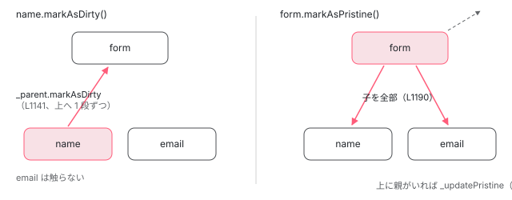

[目次](../README.md) › [フォームの内側](README.md) › 第 2 回 / 全 20 回

# AbstractControl：値と状態を持つ木の節

> FormControl・FormGroup・FormArray の共通の親 AbstractControl が持つもの（value、status、pristine / touched、errors、parent、validator）。status・pristine・touched が内部では signal で持たれ、getter は untracked で読み、\_status などの computed をテンプレートの状態クラスが読む仕組み。markAsTouched / markAsDirty が親へ伝わる順。

angular/angular · 読了 約 13 分 · 中核 · [サイトで読む（デモが動きます）](https://angular-deep-dive-cyan.vercel.app/chapter/forms-abstract-control)

---

`FormControl`・`FormGroup`・`FormArray` は、どれも `AbstractControl` を継承した「木の節」です。この章では、その節が何を持っているか（`value`・`status`・`pristine` / `touched`・`errors`・`parent`・検証関数）、`status` などが内部では signal なのに公開の getter からは signal として読めない理由、`markAsTouched` / `markAsDirty` が親へ上り、`markAsPristine` / `markAsUntouched` が子へ下りてから親を計算し直す順番を、行で追います。

読む対象は `packages/forms/src/model/abstract_model.ts` の `AbstractControl` クラス（481 行目から）です。

1. [1. 全体像](01-forms-overview.md)
2. **2. AbstractControl**（この章）
3. [3. updateValueAndValidity](03-forms-update-value-validity.md)
4. [4. Validators](04-forms-validators.md)
5. [5. 非同期の検証](05-forms-async-validators.md)
6. [6. events](06-forms-control-events.md)
7. [7. FormGroup と FormArray](07-forms-form-group-array.md)
8. [8. 型付きフォームと FormBuilder](08-forms-typed-forms.md)
9. [9. ControlValueAccessor](09-forms-value-accessor.md)
10. [10. 双方向の配線](10-forms-setup-control.md)
11. [11. 組み込みの accessor](11-forms-builtin-accessors.md)
12. [12. リアクティブのディレクティブ](12-forms-reactive-directives.md)
13. [13. NgModel と NgForm](13-forms-ng-model.md)
14. [14. 検証のディレクティブ](14-forms-validator-directives.md)
15. [15. 状態クラス](15-forms-status-classes.md)
16. [16. Signal Forms のスキーマ](16-forms-sf-schema.md)
17. [17. Signal Forms の検証](17-forms-sf-validation.md)
18. [18. 状態ルールと metadata](18-forms-sf-rules-metadata.md)
19. [19. submit と相互運用](19-forms-sf-submit-compat.md)
20. [20. issue と PR を読む](20-forms-issues.md)

## 1. 節が持つフィールド

📄 `angular/packages/forms/src/model/abstract_model.ts` L481–510 （▶ の行: 481, 487, 498, 504, 507, 509–510）

```ts
481 ▶ export abstract class AbstractControl<
482 │   TValue = any,
483 │   TRawValue extends TValue = TValue,
484 │   TValueWithOptionalControlStates = any,
485 │ > {
486 │   /** @internal */
487 ▶   _pendingDirty = false;
488 │ 
489 │   /**
490 │    * Indicates that a control has its own pending asynchronous validation in progress.
491 │    * It also stores if the control should emit events when the validation status changes.
492 │    *
493 │    * @internal
494 │    */
495 │   _hasOwnPendingAsyncValidator: null | {emitEvent: boolean; shouldHaveEmitted: boolean} = null;
496 │ 
497 │   /** @internal */
498 ▶   _pendingTouched = false;
499 │ 
500 │   /** @internal */
501 │   _onCollectionChange = () => {};
502 │ 
503 │   /** @internal */
504 ▶   _updateOn?: FormHooks;
505 │ 
506 │   /** @internal */
507 ▶   _hasRequired = signal(false);
508 │ 
509 ▶   private _parent: FormGroup | FormArray | null = null;
510 ▶   private _asyncValidationSubscription: Subscription | undefined;
```

481 行目、`AbstractControl` は抽象クラスです。`new AbstractControl()` はできず、具体的な節は `FormControl`（葉）と `FormGroup`・`FormArray`（子を持つ節）です。509 行目の `_parent` が親への参照で、これが木を下から上へたどる唯一の道です。親から子へは、子を持つ節が自分の `controls` を持っています（[第 7 回](07-forms-form-group-array.md)）。

- 487・498 行目の `_pendingDirty` / `_pendingTouched` は、`updateOn: 'submit'` などで「まだ反映していない dirty / touched」を覚えておく旗です（[第 10 回](10-forms-setup-control.md)）。
- 504 行目の `_updateOn` は `'change' | 'blur' | 'submit'`。自分に無ければ親の値を使います。
- 507 行目の `_hasRequired` は「`Validators.required` を持っているか」の signal です（[第 4 回](04-forms-validators.md)）。
- 510 行目の `_asyncValidationSubscription` は、走っている非同期の検証の購読です（[第 5 回](05-forms-async-validators.md)）。

📄 `angular/packages/forms/src/model/abstract_model.ts` L549–577 （▶ の行: 553, 557, 561, 575–576）

```ts
549 │   /**
550 │    * The current value of the control.
551 │    *
552 │    * * For a `FormControl`, the current value.
553 ▶    * * For an enabled `FormGroup`, the values of enabled controls as an object
554 │    * with a key-value pair for each member of the group.
555 │    * * For a disabled `FormGroup`, the values of all controls as an object
556 │    * with a key-value pair for each member of the group.
557 ▶    * * For an enabled `FormArray`, the values of enabled controls as an array.
558 │    * * For a disabled `FormArray`, the values of all controls as an array.
559 │    *
560 │    */
561 ▶   public readonly value!: TValue;
562 │ 
563 │   /**
564 │    * Initialize the AbstractControl instance.
565 │    *
566 │    * @param validators The function or array of functions that is used to determine the validity of
567 │    *     this control synchronously.
568 │    * @param asyncValidators The function or array of functions that is used to determine validity of
569 │    *     this control asynchronously.
570 │    */
571 │   constructor(
572 │     validators: ValidatorFn | ValidatorFn[] | null,
573 │     asyncValidators: AsyncValidatorFn | AsyncValidatorFn[] | null,
574 │   ) {
575 ▶     this._assignValidators(validators);
576 ▶     this._assignAsyncValidators(asyncValidators);
577 │   }
```

561 行目、`value` は `readonly` のただのプロパティで、signal ではありません。書き換えるのは `FormControl.setValue` や子を持つ節の `_updateValue` で、型の上の `readonly` を外す `Writable` を通して代入します（[第 3 回](03-forms-update-value-validity.md)）。553・557 行目の doc のとおり、`FormGroup` と `FormArray` の `value` には **enabled な子の値だけ**が入ります。575〜576 行目、コンストラクタは検証関数を受け取って合成して覚えるだけで、値も状態もまだ決めません（決めるのは子クラスのコンストラクタの最後の `updateValueAndValidity`）。

## 2. status：内部は signal、getter は untracked

📄 `angular/packages/forms/src/model/abstract_model.ts` L604–640 （▶ の行: 607–608, 619–620, 622–623, 626–627, 637–638）

```ts
604 │   /**
605 │    * The parent control.
606 │    */
607 ▶   get parent(): FormGroup | FormArray | null {
608 ▶     return this._parent;
609 │   }
610 │ 
611 │   /**
612 │    * The validation status of the control.
613 │    *
614 │    * @see {@link FormControlStatus}
615 │    *
616 │    * These status values are mutually exclusive, so a control cannot be
617 │    * both valid AND invalid or invalid AND disabled.
618 │    */
619 ▶   get status(): FormControlStatus {
620 ▶     return untracked(this.statusReactive)!;
621 │   }
622 ▶   private set status(v: FormControlStatus) {
623 ▶     untracked(() => this.statusReactive.set(v));
624 │   }
625 │   /** @internal */
626 ▶   readonly _status = computed(() => this.statusReactive());
627 ▶   private readonly statusReactive = signal<FormControlStatus | undefined>(undefined);
628 │ 
629 │   /**
630 │    * A control is `valid` when its `status` is `VALID`.
631 │    *
632 │    * @see {@link AbstractControl.status}
633 │    *
634 │    * @returns True if the control has passed all of its validation tests,
635 │    * false otherwise.
636 │    */
637 ▶   get valid(): boolean {
638 ▶     return this.status === VALID;
639 │   }
640 │ 
```

1. **627 行目：本体は private な signal**

   `statusReactive` は `signal<FormControlStatus | undefined>(undefined)`。初期値は `undefined` で、子クラスのコンストラクタが `updateValueAndValidity` を呼んだときに `'VALID'` などが入ります。
2. **619〜621 行目：公開の getter は untracked で読む**

   `untracked(this.statusReactive)` は「signal を読むが、いま走っている `computed` や `effect` の依存には登録しない」読み方です。だから `effect(() => control.status)` と書いても、その effect は status の変化で走り直しません。637 行目の `valid` も中で `this.status` を読むので同じです。
3. **622〜624 行目：setter は private**

   書けるのはクラスの中だけです。書き込みも `untracked(() => this.statusReactive.set(v))` と untracked の中で行います。
4. **626 行目：内部用の computed**

   `_status` は `@internal` の `computed` で、`untracked` を通さずに読みます。これを読むのが `NgControlStatus` のホストバインディング（`ng-valid` などのクラス）です。ホストバインディングが signal を読むので、zoneless でも状態が変わるとその view が描画し直されます（[第 15 回](15-forms-status-classes.md)）。

> [!NOTE]
> **ポイント**
>
> この形は、コミット 00bde8b1c2d「fix(forms): Make `NgControlStatus` host bindings `OnPush` compatible (#55720)」で入りました。コミットメッセージには「forms に新しい API を出さないのは意図どおり。目的は、開発者には防げない `ExpressionChangedAfterItHasBeenCheckedError` を消すことだけ」とあります （PR 番号からの読み方は[第 20 回](20-forms-issues.md)）。だから公開の API から状態の変化を受け取る道は、今も `events` と `statusChanges`（Observable）です（[第 6 回](06-forms-control-events.md)）。

📄 `angular/packages/forms/src/model/abstract_model.ts` L693–725 （▶ の行: 697, 706–707, 713–714, 723–724）

```ts
693 │   /**
694 │    * An object containing any errors generated by failing validation,
695 │    * or null if there are no errors.
696 │    */
697 ▶   public readonly errors!: ValidationErrors | null;
698 │ 
699 │   /**
700 │    * A control is `pristine` if the user has not yet changed
701 │    * the value in the UI.
702 │    *
703 │    * @returns True if the user has not yet changed the value in the UI; compare `dirty`.
704 │    * Programmatic changes to a control's value do not mark it dirty.
705 │    */
706 ▶   get pristine(): boolean {
707 ▶     return untracked(this.pristineReactive);
708 │   }
709 │   private set pristine(v: boolean) {
710 │     untracked(() => this.pristineReactive.set(v));
711 │   }
712 │   /** @internal */
713 ▶   readonly _pristine = computed(() => this.pristineReactive());
714 ▶   private readonly pristineReactive = signal(true);
715 │ 
716 │   /**
717 │    * A control is `dirty` if the user has changed the value
718 │    * in the UI.
719 │    *
720 │    * @returns True if the user has changed the value of this control in the UI; compare `pristine`.
721 │    * Programmatic changes to a control's value do not mark it dirty.
722 │    */
723 ▶   get dirty(): boolean {
724 ▶     return !this.pristine;
725 │   }
```

📄 `angular/packages/forms/src/model/abstract_model.ts` L727–751 （▶ の行: 733–734, 740–741, 749–750）

```ts
727 │   /**
728 │    * True if the control is marked as `touched`.
729 │    *
730 │    * A control is marked `touched` once the user has triggered
731 │    * a `blur` event on it.
732 │    */
733 ▶   get touched(): boolean {
734 ▶     return untracked(this.touchedReactive);
735 │   }
736 │   private set touched(v: boolean) {
737 │     untracked(() => this.touchedReactive.set(v));
738 │   }
739 │   /** @internal */
740 ▶   readonly _touched = computed(() => this.touchedReactive());
741 ▶   private readonly touchedReactive = signal(false);
742 │ 
743 │   /**
744 │    * True if the control has not been marked as touched
745 │    *
746 │    * A control is `untouched` if the user has not yet triggered
747 │    * a `blur` event on it.
748 │    */
749 ▶   get untouched(): boolean {
750 ▶     return !this.touched;
751 │   }
```

`pristine`（706〜714 行目）と `touched`（733〜741 行目）も `status` と同じ 4 点の形です：private な signal、untracked の getter、private の setter、`@internal` の computed。714 行目、`pristine` の初期値は `true`、741 行目、`touched` は `false`。signal で持っているのは `pristine` と `touched` の**片方だけ**で、723〜724 行目の `dirty` は `!this.pristine`、749〜750 行目の `untouched` は `!this.touched` と計算します。697 行目の `errors` は `value` と同じくただの `readonly` プロパティです。

## 3. 上へ伝わる：markAsTouched と markAsDirty

📄 `angular/packages/forms/src/model/abstract_model.ts` L999–1013 （▶ の行: 1002–1003, 1005–1007, 1010–1011）

```ts
 999 │   markAsTouched(
1000 │     opts: {onlySelf?: boolean; emitEvent?: boolean; sourceControl?: AbstractControl} = {},
1001 │   ): void {
1002 ▶     const changed = this.touched === false;
1003 ▶     this.touched = true;
1004 │ 
1005 ▶     const sourceControl = opts.sourceControl ?? this;
1006 ▶     if (!opts.onlySelf) {
1007 ▶       this._parent?.markAsTouched({...opts, sourceControl});
1008 │     }
1009 │ 
1010 ▶     if (changed && opts.emitEvent !== false) {
1011 ▶       this._events.next(new TouchedChangeEvent(true, sourceControl));
1012 │     }
1013 │   }
```

1. **1002 行目：変わるかを先に覚える**

   もう `touched` なら `changed` は `false`。あとでイベントを出すかどうかに使います。
2. **1003 行目：自分を touched に**

   2 節の private の setter で signal に書きます。
3. **1005 行目：「誰が起こしたか」を決める**

   引数に `sourceControl` が無ければ自分。親に渡すときは `{...opts, sourceControl}` なので、親から見ても「起こしたのはこの子」になります（[第 6 回](06-forms-control-events.md)の `source`）。
4. **1006〜1007 行目：onlySelf でなければ親の markAsTouched を呼ぶ**

   親も同じ関数を走るので、根まで 1 段ずつ上ります。親が子の状態を見に来るのではなく、**子が親に「あなたも touched」と言う**形です。
5. **1010〜1011 行目：最後に自分のイベント**

   親を呼んだ**あと**にイベントを出すので、`events` は根の節から先に出ます。

📄 `angular/packages/forms/src/model/abstract_model.ts` L1133–1147 （▶ の行: 1136–1137, 1140–1141, 1144–1145）

```ts
1133 │   markAsDirty(
1134 │     opts: {onlySelf?: boolean; emitEvent?: boolean; sourceControl?: AbstractControl} = {},
1135 │   ): void {
1136 ▶     const changed = this.pristine === true;
1137 ▶     this.pristine = false;
1138 │ 
1139 │     const sourceControl = opts.sourceControl ?? this;
1140 ▶     if (!opts.onlySelf) {
1141 ▶       this._parent?.markAsDirty({...opts, sourceControl});
1142 │     }
1143 │ 
1144 ▶     if (changed && opts.emitEvent !== false) {
1145 ▶       this._events.next(new PristineChangeEvent(false, sourceControl));
1146 │     }
1147 │   }
```

`markAsDirty` は `markAsTouched` と同じ形です。1137 行目で自分を `pristine = false` にし、1140〜1141 行目で親の `markAsDirty` を呼びます。「子が 1 つでも dirty なら親も dirty」は、毎回数え直すのではなく、**子が dirty になった瞬間に親も dirty にする**ことで保たれています。

## 4. 下へ伝わってから上を計算し直す：markAsPristine と markAsUntouched

📄 `angular/packages/forms/src/model/abstract_model.ts` L1180–1200 （▶ の行: 1184–1185, 1188, 1190, 1193–1194, 1197–1198）

```ts
1180 │   markAsPristine(
1181 │     opts: {onlySelf?: boolean; emitEvent?: boolean; sourceControl?: AbstractControl} = {},
1182 │   ): void {
1183 │     const changed = this.pristine === false;
1184 ▶     this.pristine = true;
1185 ▶     this._pendingDirty = false;
1186 │ 
1187 │     const sourceControl = opts.sourceControl ?? this;
1188 ▶     this._forEachChild((control: AbstractControl) => {
1189 │       /** We don't propagate the source control downwards */
1190 ▶       control.markAsPristine({onlySelf: true, emitEvent: opts.emitEvent});
1191 │     });
1192 │ 
1193 ▶     if (!opts.onlySelf) {
1194 ▶       this._parent?._updatePristine(opts, sourceControl);
1195 │     }
1196 │ 
1197 ▶     if (changed && opts.emitEvent !== false) {
1198 ▶       this._events.next(new PristineChangeEvent(true, sourceControl));
1199 │     }
1200 │   }
```

1. **1184〜1185 行目：自分を pristine に**

   ついでに、まだ反映していない dirty（`_pendingDirty`）も捨てます。
2. **1188〜1191 行目：子を全部 pristine に**

   `_forEachChild` で子の `markAsPristine` を `onlySelf: true` で呼びます。子は自分の子へ下りますが、親（いまの節）には戻ってきません。1189 行目のコメントのとおり、子には `sourceControl` を渡しません。
3. **1193〜1194 行目：親は \_updatePristine で計算し直す**

   親を一律に pristine にはしません。兄弟がまだ dirty かもしれないからです。
4. **1197〜1198 行目：自分のイベント**

📄 `angular/packages/forms/src/model/abstract_model.ts` L1084–1103 （▶ の行: 1088–1089, 1092–1093, 1096–1097）

```ts
1084 │   markAsUntouched(
1085 │     opts: {onlySelf?: boolean; emitEvent?: boolean; sourceControl?: AbstractControl} = {},
1086 │   ): void {
1087 │     const changed = this.touched === true;
1088 ▶     this.touched = false;
1089 ▶     this._pendingTouched = false;
1090 │ 
1091 │     const sourceControl = opts.sourceControl ?? this;
1092 ▶     this._forEachChild((control: AbstractControl) => {
1093 ▶       control.markAsUntouched({onlySelf: true, emitEvent: opts.emitEvent, sourceControl});
1094 │     });
1095 │ 
1096 ▶     if (!opts.onlySelf) {
1097 ▶       this._parent?._updateTouched(opts, sourceControl);
1098 │     }
1099 │ 
1100 │     if (changed && opts.emitEvent !== false) {
1101 │       this._events.next(new TouchedChangeEvent(false, sourceControl));
1102 │     }
1103 │   }
```

`markAsUntouched` も同じ順です。1088〜1089 行目で自分を戻し、1092〜1094 行目で子を全部 `onlySelf: true` で untouched にし、1096〜1097 行目で親の `_updateTouched` を呼びます。こちらは子にも `sourceControl` を渡しています（1093 行目）。

📄 `angular/packages/forms/src/model/abstract_model.ts` L1732–1755 （▶ の行: 1734–1736, 1739, 1742–1743, 1749–1750, 1753）

```ts
1732 │   /** @internal */
1733 │   _updatePristine(opts: {onlySelf?: boolean}, changedControl: AbstractControl): void {
1734 ▶     const newPristine = !this._anyControlsDirty();
1735 ▶     const changed = this.pristine !== newPristine;
1736 ▶     this.pristine = newPristine;
1737 │ 
1738 │     if (!opts.onlySelf) {
1739 ▶       this._parent?._updatePristine(opts, changedControl);
1740 │     }
1741 │ 
1742 ▶     if (changed) {
1743 ▶       this._events.next(new PristineChangeEvent(this.pristine, changedControl));
1744 │     }
1745 │   }
1746 │ 
1747 │   /** @internal */
1748 │   _updateTouched(opts: {onlySelf?: boolean} = {}, changedControl: AbstractControl): void {
1749 ▶     this.touched = this._anyControlsTouched();
1750 ▶     this._events.next(new TouchedChangeEvent(this.touched, changedControl));
1751 │ 
1752 │     if (!opts.onlySelf) {
1753 ▶       this._parent?._updateTouched(opts, changedControl);
1754 │     }
1755 │   }
```

1. **1734 行目：子を数え直す**

   `!this._anyControlsDirty()`、つまり「dirty な子が 1 つも無ければ pristine」。`FormGroup` の `_anyControls` は enabled な子だけを見ます（[第 7 回](07-forms-form-group-array.md)）。
2. **1739 行目：そのまた親へ**

   根まで同じ計算を続けます。
3. **1742〜1743 行目：変わったときだけイベント**
4. **1749〜1750 行目：\_updateTouched はいつもイベントを出す**

   `_updateTouched` には `changed` の判定がなく、1750 行目で値が同じでも `TouchedChangeEvent` を出します。`_updatePristine` と形が揃っていないところで、[第 6 回](06-forms-control-events.md)でもう一度出てきます。



*markAsDirty は子から親へ同じ関数を呼んで上る。markAsPristine は子へ下りて全部を pristine にし、親は \_updatePristine で子を数え直す。*

## 5. root：親をたどって一番上へ

📄 `angular/packages/forms/src/model/abstract_model.ts` L1650–1661 （▶ の行: 1653, 1656–1657, 1660）

```ts
1650 │   /**
1651 │    * Retrieves the top-level ancestor of this control.
1652 │    */
1653 ▶   get root(): AbstractControl {
1654 │     let x: AbstractControl = this;
1655 │ 
1656 ▶     while (x._parent) {
1657 ▶       x = x._parent;
1658 │     }
1659 │ 
1660 ▶     return x;
1661 │   }
```

1656〜1658 行目、`_parent` が `null` になるまで上ります。親を持たない節は自分自身が `root` です。

## 6. 動かして確かめる

> **🧪 DEMO — 本物の FormGroup で markAs\* を呼ぶ**
>
> `form = new FormGroup({ name: new FormControl(''), email: new FormControl('') })` です。表は章のテンプレートが公開の getter を読んで描いています。
>
> onlySelf を付けずに name.markAsDirty → form も dirty。name.markAsDirty と email.markAsDirty のあとで name.markAsPristine → form は email が dirty なので dirty のまま（1734 行目）。onlySelf を付けて name.markAsDirty → form は pristine のまま（1140 行目）。
>
> ▶ [このデモはサイトで動かせます](https://angular-deep-dive-cyan.vercel.app/chapter/forms-abstract-control)

> **🧪 DEMO — getter は untracked、ホストバインディングは signal を読む**
>
> 下の入力欄は子コンポーネントの中の `<input [formControl]="form.controls.name">` です。dirty になると `ng-dirty` クラスで枠が赤くなります。「1 秒後に markAsDirty」は、クリックの処理ではなく `setTimeout` の中で `name.markAsDirty()` を呼び、章の signal には何も書きません。先に上の表で name を pristine に戻してから押してください。
>
> 1 秒後、入力欄の枠と、子コンポーネントの中の「dirty = true」は変わります。子の view にある `NgControlStatus` のホストバインディングが `_pristine()` を読んでいるので、その view が描画し直されるからです。上の表（章の view）は古いままです。章のテンプレートは untracked の getter しか読んでいないので、signal が変わっても章の view は描画し直されません。「何もしないボタン」で表が追いつきます。effect の回数は何をしても 1 のままです（619〜621 行目と同じ形の 706〜708 行目）。
>
> ▶ [このデモはサイトで動かせます](https://angular-deep-dive-cyan.vercel.app/chapter/forms-abstract-control)

## テストと直し方

📄 `angular/packages/forms/test/form_group_spec.ts` L320–356 （▶ の行: 320, 332–333, 335, 339, 351–352, 354）

```ts
320 ▶     describe('dirty', () => {
321 │       let c: FormControl, g: FormGroup;
322 │ 
323 │       beforeEach(() => {
324 │         c = new FormControl('value');
325 │         g = new FormGroup({'one': c});
326 │       });
327 │ 
328 │       it('should be false after creating a control', () => {
329 │         expect(g.dirty).toEqual(false);
330 │       });
331 │ 
332 ▶       it('should be true after changing the value of the control', () => {
333 ▶         c.markAsDirty();
334 │ 
335 ▶         expect(g.dirty).toEqual(true);
336 │       });
337 │     });
338 │ 
339 ▶     describe('touched', () => {
340 │       let c: FormControl, g: FormGroup;
341 │ 
342 │       beforeEach(() => {
343 │         c = new FormControl('value');
344 │         g = new FormGroup({'one': c});
345 │       });
346 │ 
347 │       it('should be false after creating a control', () => {
348 │         expect(g.touched).toEqual(false);
349 │       });
350 │ 
351 ▶       it('should be true after control is marked as touched', () => {
352 ▶         c.markAsTouched();
353 │ 
354 ▶         expect(g.touched).toEqual(true);
355 │       });
356 │     });
```

3 節の「子が親に伝える」を確かめているのが `form_group_spec.ts` の `describe('FormGroup')`（form\_group\_spec.ts:45）の中の 320 行目 `describe('dirty')` と 339 行目 `describe('touched')` です。333 行目で子の `markAsDirty()` を呼び、335 行目で親の `dirty` を見ています。`form_control_spec.ts` にも `describe('dirty')`（form\_control\_spec.ts:698）・`describe('touched')`（:711）があり、こちらは同じことを `FormControl` の側から書いています。

📄 `ターミナル`

```
cd ~/angular-research/angular
pnpm bazel test //packages/forms/test:test --test_arg=--filter="FormGroup (dirty|touched)" --test_output=all
```

📄 `出力（抜粋。2026-11-01 に実行）`

```
Ran 4 of 1153 specs
4 specs, 0 failures
//packages/forms/test:test                    PASSED in 0.8s
```

1. **名前の作り方**

   フルネームは `FormGroup dirty should be true after changing the value of the control` のように describe と it をつないだものです。`--filter` は正規表現なので `"FormGroup (dirty|touched)"` で 2 つの describe をまとめて選べます。結果は `Ran 4 of 1153 specs`（320〜356 行目の it 4 本）。0 本でも PASSED になる落とし穴は[第 1 回](01-forms-overview.md)のとおりです。
2. **直すとしたら**

   dirty / touched の伝わり方は `abstract_model.ts` の `markAsDirty`（1133 行目）・`markAsTouched`（999 行目）・`markAsPristine`（1180 行目）・`markAsUntouched`（1084 行目）と、親の計算の `_updatePristine` / `_updateTouched`（1733・1748 行目）です。値の確かめは `form_group_spec.ts` の `dirty` / `touched` の describe に、イベントの順番や `source` の確かめは `reactive_integration_spec.ts` の `unified form state change`（[第 6 回](06-forms-control-events.md)）に足すのが入口です。
3. **手元で壊して確かめる**

   たとえば 1141 行目の `this._parent?.markAsDirty(...)` を消すと、親の `pristine` は `true` のまま残るので、335 行目の `expect(g.dirty).toEqual(true)` が落ちます。この章では実際には壊していません。壊す・戻すの手順は [contrib シリーズのテストを書く回](../contrib/07-contrib-writing-a-test.md)で済んでいるので、このシリーズでは ../angular を書き換えません。

## 聞かれそうな質問

**Q. control.status を effect や computed で読んでも反応しないのはなぜですか？**

公開の getter が 620 行目で `untracked(this.statusReactive)` と読んでいるからです。中身は signal ですが、untracked で読むと依存に登録されません。`valid`（638 行目）・`pristine`（707 行目）・`touched`（734 行目）も同じです。デモの effect の回数が 1 のままなのがその確かめです。signal として読めるのは `@internal` の `_status`（626 行目）などで、これは状態クラスのホストバインディングのためのものです。公開の API で変化を受けるなら `events` か `statusChanges` です。

**Q. pristine と dirty はどちらが本物ですか？**

`pristine` です。714 行目の `pristineReactive = signal(true)` だけが状態を持ち、`dirty` は 724 行目で `!this.pristine` と計算します。`touched` と `untouched` も同じで、本物は 741 行目の `touchedReactive`、`untouched` は 750 行目の `!this.touched` です。

**Q. onlySelf は何を止めますか？**

**親へ向かう呼び出しだけ**です。`markAsDirty` では 1140〜1141 行目の親の `markAsDirty`、`markAsPristine` では 1193〜1194 行目の親の `_updatePristine` が止まります。子へ向かう 1188〜1191 行目は `onlySelf` に関係なく走るので、`form.markAsPristine({ onlySelf: true })` でも子は全部 pristine になります。自分のイベント（1144・1197 行目）も止まりません。止めたいときは `emitEvent: false` です。

**Q. markAsTouched の events は、子と親のどちらが先に出ますか？**

親が先です。1007 行目で親の `markAsTouched` を呼んでから、1011 行目で自分のイベントを出すので、根 → … → 子の順になります。`markAsDirty` も 1141 行目 → 1145 行目で同じです。値の変化（`updateValueAndValidity`）は逆に子が先で、それは[第 3 回](03-forms-update-value-validity.md)で読みます。

**Q. root と parent の違いは何ですか？**

`parent` は 608 行目で `_parent` を返すだけの 1 段上、`root` は 1656〜1658 行目で `_parent` が無くなるまで上った一番上です。木が 2 段なら同じ節を指します。

## 読み終えて

- `value` と `errors` はただのプロパティ。`status`・`pristine`・`touched` は private な signal で持ち、`dirty`・`untouched` はその否定。
- 公開の getter は `untracked` で読むので、effect / computed の依存にならない。signal として読むのは `@internal` の `_status` などで、状態クラスがそれを使う。
- `markAsDirty` / `markAsTouched` は子が親の同じ関数を呼んで上る。イベントは親から先に出る。
- `markAsPristine` / `markAsUntouched` は子へ全部下りてから、親を `_updatePristine` / `_updateTouched` で数え直す。`onlySelf` が止めるのは親へ向かう呼び出しだけ。

---

← 前: [forms の全体像：3 つの API と packages/forms の地図](01-forms-overview.md)  
次: [updateValueAndValidity：値と検証が親へ伝わる全手順](03-forms-update-value-validity.md) →
