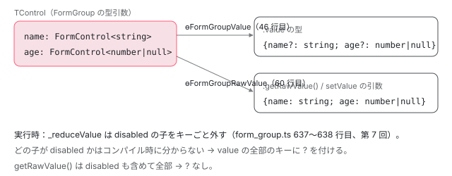

[目次](../README.md) › [フォームの内側](README.md) › 第 8 回 / 全 20 回

# 型付きフォームと FormBuilder

> FormControl&lt;T&gt; の型引数と nonNullable（reset が初期値に戻るか null になるか）、FormGroup の値の型を作る ɵFormGroupValue・ɵRawValue などの型の計算、UntypedFormControl が any の別名であること。FormBuilder の group / control / array の引数の解釈と、NonNullableFormBuilder（fb.nonNullable）。

angular/angular · 読了 約 13 分 · 中核 · [サイトで読む（デモが動きます）](https://angular-deep-dive-cyan.vercel.app/chapter/forms-typed-forms)

---

v14 からリアクティブフォームは型を持ちます。`new FormControl('')` は `FormControl<string | null>` になり、`FormGroup` の `value` は `Partial` になります。この章では、その型がどの型の計算から出てくるかを 1 つずつ追い、`nonNullable` が型だけでなく実行時の `reset` をどう変えるか、`FormBuilder` が引数をどう読んで control を作るかを見ます。

読む対象は `packages/forms/src/model/form_control.ts`（型とコンストラクタの宣言）、`form_group.ts` と `form_array.ts` の先頭の型、`abstract_model.ts` の `ɵTypedOrUntyped`・`ɵValue`・`ɵRawValue`、`packages/forms/src/form_builder.ts` です。型の主張は、このサイトに入っている @angular/forms 22.1.6 と TypeScript 6.0.3 で `tsc` にかけて確かめました（7 節）。

1. [1. 全体像](01-forms-overview.md)
2. [2. AbstractControl](02-forms-abstract-control.md)
3. [3. updateValueAndValidity](03-forms-update-value-validity.md)
4. [4. Validators](04-forms-validators.md)
5. [5. 非同期の検証](05-forms-async-validators.md)
6. [6. events](06-forms-control-events.md)
7. [7. FormGroup と FormArray](07-forms-form-group-array.md)
8. **8. 型付きフォームと FormBuilder**（この章）
9. [9. ControlValueAccessor](09-forms-value-accessor.md)
10. [10. 双方向の配線](10-forms-setup-control.md)
11. [11. 組み込みの accessor](11-forms-builtin-accessors.md)
12. [12. リアクティブのディレクティブ](12-forms-reactive-directives.md)
13. [13. NgModel と NgForm](13-forms-ng-model.md)
14. [14. 検証のディレクティブ](14-forms-validator-directives.md)
15. [15. 状態クラス](15-forms-status-classes.md)
16. [16. Signal Forms のスキーマ](16-forms-sf-schema.md)
17. [17. Signal Forms の検証](17-forms-sf-validation.md)
18. [18. 状態ルールと metadata](18-forms-sf-rules-metadata.md)
19. [19. submit と相互運用](19-forms-sf-submit-compat.md)
20. [20. issue と PR を読む](20-forms-issues.md)

## 1. 型付きと型なしを 1 つのクラスで：ɵTypedOrUntyped

📄 `angular/packages/forms/src/model/abstract_model.ts` L295–304 （▶ の行: 296, 304）

```ts
295 │ // IsAny checks if T is `any`, by checking a condition that couldn't possibly be true otherwise.
296 ▶ export type ɵIsAny<T, Y, N> = 0 extends 1 & T ? Y : N;
297 │ 
298 │ /**
299 │  * `TypedOrUntyped` allows one of two different types to be selected, depending on whether the Forms
300 │  * class it's applied to is typed or not.
301 │  *
302 │  * This is for internal Angular usage to support typed forms; do not directly use it.
303 │  */
304 ▶ export type ɵTypedOrUntyped<T, Typed, Untyped> = ɵIsAny<T, Untyped, Typed>;
```

296 行目の `ɵIsAny<T, Y, N>` は「`T` が `any` なら `Y`、違えば `N`」です。`0 extends 1 & T` は、`T` が `any` のときだけ `1 & any` が `any` になって成り立つ、という TypeScript の性質を使っています。304 行目の `ɵTypedOrUntyped<T, Typed, Untyped>` はそれを並べ替えただけで、型引数が `any` なら型なしの型、そうでなければ型付きの型を選びます。

これがあるので、型引数を書かない古いコード（`FormGroup` は型引数の既定が `any`）は今までどおり `{[key: string]: any}` として扱われ、型引数があるコードだけが厳しく検査されます。型付きフォームが入っても古いコードがコンパイルできたのは、この分かれ道のおかげです。

## 2. FormControl&lt;T&gt;：nonNullable で null が消える

📄 `angular/packages/forms/src/model/form_control.ts` L379–407 （▶ の行: 383, 394, 396–397, 405, 407）

```ts
379 │ export interface ɵFormControlCtor {
380 │   /**
381 │    * Construct a FormControl with no initial value or validators.
382 │    */
383 ▶   new (): FormControl<any>;
384 │ 
385 │   /**
386 │    * Creates a new `FormControl` instance.
387 │    *
388 │    * @param value Initializes the control with an initial value,
389 │    * or an object that defines the initial value and disabled state.
390 │    *
391 │    * @param opts A `FormControlOptions` object that contains validation functions and a
392 │    * validation trigger. `nonNullable` have to be `true`
393 │    */
394 ▶   new <T = any>(
395 │     value: FormControlState<T> | T,
396 ▶     opts: FormControlOptions & {nonNullable: true},
397 ▶   ): FormControl<T>;
398 │ 
399 │   /**
400 │    * @deprecated Use `nonNullable` instead.
401 │    */
402 │   new <T = any>(
403 │     value: FormControlState<T> | T,
404 │     opts: FormControlOptions & {
405 ▶       initialValueIsDefault: true;
406 │     },
407 ▶   ): FormControl<T>;
```

📄 `angular/packages/forms/src/model/form_control.ts` L409–441 （▶ の行: 412, 416, 430, 432, 434）

```ts
409 │   /**
410 │    * @deprecated When passing an `options` argument, the `asyncValidator` argument has no effect.
411 │    */
412 ▶   new <T = any>(
413 │     value: FormControlState<T> | T,
414 │     opts: FormControlOptions,
415 │     asyncValidator: AsyncValidatorFn | AsyncValidatorFn[],
416 ▶   ): FormControl<T | null>;
417 │ 
418 │   /**
419 │    * Creates a new `FormControl` instance.
420 │    *
421 │    * @param value Initializes the control with an initial value,
422 │    * or an object that defines the initial value and disabled state.
423 │    *
424 │    * @param validatorOrOpts A synchronous validator function, or an array of
425 │    * such functions, or a `FormControlOptions` object that contains validation functions
426 │    * and a validation trigger.
427 │    *
428 │    * @param asyncValidator A single async validator or array of async validator functions
429 │    */
430 ▶   new <T = any>(
431 │     value: FormControlState<T> | T,
432 ▶     validatorOrOpts?: ValidatorFn | ValidatorFn[] | FormControlOptions | null,
433 │     asyncValidator?: AsyncValidatorFn | AsyncValidatorFn[] | null,
434 ▶   ): FormControl<T | null>;
435 │ 
436 │   /**
437 │    * The presence of an explicit `prototype` property provides backwards-compatibility for apps that
438 │    * manually inspect the prototype chain.
439 │    */
440 │   prototype: FormControl<any>;
441 │ }
```

`new FormControl(…)` の型は、この interface の `new` の宣言（オーバーロード）のどれに当たるかで決まります。`FormControl` の値（クラス）は、すぐ下の 453 行目で `ɵFormControlCtor` 型の定数として公開されているので（`export const FormControl: ɵFormControlCtor = class …`）、ここが型の入口です。

1. **383 行目：引数なし → FormControl&lt;any&gt;**

   `new FormControl()` は型なしになります。
2. **394〜397 行目：opts に `nonNullable: true` → FormControl&lt;T&gt;**

   396 行目の `FormControlOptions & {nonNullable: true}` に当たると、397 行目で `null` の付かない `FormControl<T>`。402〜407 行目は古い名前 `initialValueIsDefault` の同じ宣言です。
3. **430〜434 行目：それ以外 → FormControl&lt;T | null&gt;**

   検証関数だけ、または `nonNullable` の無い options なら、434 行目で `T | null`。`T` は初期値から推論されるので `new FormControl('')` は `FormControl<string | null>`。**`new FormControl<string>('')` と型引数を書いても `| null` は付きます**（434 行目の戻り値の型が `T | null` だから）。
4. **なぜ null が付くのか**

   `reset()` を引数なしで呼ぶと、`nonNullable` の無い control は `null` になるからです（次の 3 節）。型はその実行時の挙動に合わせてあります。412〜416 行目は「options と 3 つ目の引数を両方渡す」古い書き方で、`@deprecated` です（3 つ目は捨てられる。[第 5 回](05-forms-async-validators.md) 1 節）。

## 3. nonNullable は実行時に何をするか：defaultValue

📄 `angular/packages/forms/src/model/form_control.ts` L28–55 （▶ の行: 44–47, 49, 52, 54）

```ts
28 │ export interface FormControlState<T> {
29 │   value: T;
30 │   disabled: boolean;
31 │ }
32 │ 
33 │ /**
34 │  * Interface for options provided to a `FormControl`.
35 │  *
36 │  * This interface extends all options from {@link AbstractControlOptions}, plus some options
37 │  * unique to `FormControl`.
38 │  *
39 │  * @publicApi
40 │  */
41 │ export interface FormControlOptions extends AbstractControlOptions {
42 │   /**
43 │    * @description
44 ▶    * Whether to use the initial value used to construct the `FormControl` as its default value
45 ▶    * as well. If this option is false or not provided, the default value of a FormControl is `null`.
46 ▶    * When a FormControl is reset without an explicit value, its value reverts to
47 ▶    * its default value.
48 │    */
49 ▶   nonNullable?: boolean;
50 │ 
51 │   /**
52 ▶    * @deprecated Use `nonNullable` instead.
53 │    */
54 ▶   initialValueIsDefault?: boolean;
55 │ }
```

44〜47 行目の doc のとおり、`nonNullable` の本当の意味は「初期値を既定値（default value）にもする」です。既定値は `reset()` を引数なしで呼んだときに戻る値で、指定しなければ `null` です。

📄 `angular/packages/forms/src/model/form_control.ts` L489–495 （▶ の行: 489, 492, 494）

```ts
489 ▶       (validatorOrOpts.nonNullable || validatorOrOpts.initialValueIsDefault)
490 │     ) {
491 │       if (isFormControlState(formState)) {
492 ▶         this.defaultValue = formState.value;
493 │       } else {
494 ▶         this.defaultValue = formState;
495 │       }
```

コンストラクタの最後で、489 行目の条件（`nonNullable` か `initialValueIsDefault`）を満たしたときだけ `defaultValue` に初期値を入れます。492 行目、初期値が `{value, disabled}` の箱（`FormControlState`）なら中の `value` だけ。満たさなければ `defaultValue` はフィールドの初期値の `null` のままです（form\_control.ts 458 行目、コンストラクタ全体は[第 3 回](03-forms-update-value-validity.md)）。`reset` は引数の既定値が `this.defaultValue`（532 行目、[contrib-writing-a-test](../contrib/07-contrib-writing-a-test.md) で引用済み）なので、ここで入れた値に戻ります。

📄 `angular/packages/forms/src/model/form_control.ts` L303–315 （▶ の行: 303–304, 315）

```ts
303 ▶   reset(
304 ▶     formState?: TValue | FormControlState<TValue>,
305 │     options?: {
306 │       onlySelf?: boolean;
307 │       emitEvent?: boolean;
308 │       overwriteDefaultValue?: boolean;
309 │     },
310 │   ): void;
311 │ 
312 │   /**
313 │    * For a simple FormControl, the raw value is equivalent to the value.
314 │    */
315 ▶   getRawValue(): TValue;
```

304 行目、`reset` の引数の型は `TValue | FormControlState<TValue>`。`FormControl<string>` に `reset(null)` は型エラーです。315 行目、単体の control の `getRawValue()` は `value` と同じ `TValue` です。

## 4. FormGroup の値の型：Partial になる理由

📄 `angular/packages/forms/src/model/form_group.ts` L189–195 （▶ の行: 190, 192–194）

```ts
189 │ export class FormGroup<
190 ▶   TControl extends {[K in keyof TControl]: AbstractControl<any>} = any,
191 │ > extends AbstractControl<
192 ▶   ɵTypedOrUntyped<TControl, ɵFormGroupValue<TControl>, any>,
193 ▶   ɵTypedOrUntyped<TControl, ɵFormGroupRawValue<TControl>, any>,
194 ▶   ɵTypedOrUntyped<TControl, ɵFormGroupArgumentValue<TControl>, any>
195 │ > {
```

190 行目、`FormGroup` の型引数 `TControl` は「キーごとの control の型」のオブジェクトです（値の型ではありません）。192〜194 行目で `AbstractControl` の 3 つの型引数（`value` の型・`getRawValue()` の型・`reset` などに渡せる値の型）を、それぞれ別の型の計算で作ります。

📄 `angular/packages/forms/src/model/form_group.ts` L37–71 （▶ の行: 40, 44, 46, 58, 60, 69–70）

```ts
37 │ export type ɵFormGroupArgumentValue<T extends {[K in keyof T]?: AbstractControl<any>}> =
38 │   ɵTypedOrUntyped<
39 │     T,
40 ▶     Partial<{[K in keyof T]: ɵValue<T[K]> | FormControlState<ɵValue<T[K]>>}>,
41 │     {[key: string]: any}
42 │   >;
43 │ 
44 ▶ export type ɵFormGroupValue<T extends {[K in keyof T]?: AbstractControl<any>}> = ɵTypedOrUntyped<
45 │   T,
46 ▶   Partial<{[K in keyof T]: ɵValue<T[K]>}>,
47 │   {[key: string]: any}
48 │ >;
49 │ 
50 │ /**
51 │  * FormGroupRawValue extracts the type of `.getRawValue()` from a FormGroup's inner object type. The
52 │  * untyped case falls back to {[key: string]: any}.
53 │  *
54 │  * Angular uses this type internally to support Typed Forms; do not use it directly.
55 │  *
56 │  * For internal use only.
57 │  */
58 ▶ export type ɵFormGroupRawValue<T extends {[K in keyof T]?: AbstractControl<any>}> = ɵTypedOrUntyped<
59 │   T,
60 ▶   {[K in keyof T]: ɵRawValue<T[K]>},
61 │   {[key: string]: any}
62 │ >;
63 │ 
64 │ /**
65 │  * OptionalKeys returns the union of all optional keys in the object.
66 │  *
67 │  * Angular uses this type internally to support Typed Forms; do not use it directly.
68 │  */
69 ▶ export type ɵOptionalKeys<T> = {
70 ▶   [K in keyof T]-?: undefined extends T[K] ? K : never;
71 │ }[keyof T];
```

📄 `angular/packages/forms/src/model/abstract_model.ts` L356–396 （▶ の行: 358–359, 391, 393–394）

````ts
356 │  * **Internal: not for public use.**
357 │  */
358 ▶ export type ɵValue<T extends AbstractControl | undefined> =
359 ▶   T extends AbstractControl<any, any> ? T['value'] : never;
360 │ 
361 │ /**
362 │  * RawValue gives the raw value type corresponding to a control type.
363 │  *
364 │  * Note that the resulting type will follow the same rules as `.getRawValue()` on your control,
365 │  * group, or array. This means that all controls inside a group will be required, not optional,
366 │  * regardless of their disabled state.
367 │  *
368 │  * You may also wish to use {@link ɵValue}, which will have `undefined` in group keys (which can be
369 │  * disabled).
370 │  *
371 │  * @usageNotes
372 │  *
373 │  * ### `FormGroup` raw value type
374 │  *
375 │  * Imagine you have an interface defining the controls in your group. You can extract the shape of
376 │  * the raw values as follows:
377 │  *
378 │  * ```ts
379 │  * interface PartyFormControls {
380 │  *   address: FormControl<string>;
381 │  * }
382 │  *
383 │  * // RawValue operates on controls; the object must be wrapped in a FormGroup.
384 │  * type PartyFormValues = RawValue<FormGroup<PartyFormControls>>;
385 │  * ```
386 │  *
387 │  * The resulting type is `{address: string}`. (Note the absence of `undefined`.)
388 │  *
389 │  *  **Internal: not for public use.**
390 │  */
391 ▶ export type ɵRawValue<T extends AbstractControl | undefined> =
392 │   T extends AbstractControl<any, any>
393 ▶     ? T['setValue'] extends (v: infer R) => void
394 ▶       ? R
395 │       : never
396 │     : never;
````

1. **358〜359 行目：ɵValue&lt;C&gt; は C\['value'\]**

   `FormControl<string>` なら `string`、入れ子の `FormGroup` ならその `value` の型（それ自体が Partial）。
2. **46 行目：ɵFormGroupValue は全部のキーに Partial**

   キーごとに `ɵValue` を取ったオブジェクトを `Partial` で包みます。全部のキーに `?` が付きます。理由は実行時の `_reduceValue` です。[第 7 回](07-forms-form-group-array.md)で見たとおり、disabled の子は `value` からキーごと消えます（form\_group.ts 637〜638 行目）。どの子が disabled かはコンパイル時には分からないので、どのキーも「無いかもしれない」と型に書くしかありません。
3. **391〜394 行目・60 行目：ɵRawValue は setValue の引数の型から取る**

   393 行目、`ɵRawValue<C>` は「`C['setValue']` の引数の型」を `infer R` で取り出します。`setValue` は全部の値を要求する（第 7 回の `assertAllValuesPresent`）ので、その引数の型が「全部そろった値」の型になっています。60 行目の `ɵFormGroupRawValue` はキーごとに `ɵRawValue` を取り、`Partial` で包みません。
4. **40 行目：reset などに渡せる値は、値か箱で、Partial**

   `ɵFormGroupArgumentValue` は、キーごとに値か `FormControlState`（`{value, disabled}`）を許し、全体を `Partial` にします。`reset({})` が通るのはこのためです。
5. **69〜70 行目：ɵOptionalKeys は「undefined を取りうるキー」**

   `-?` で一度 optional を外し、`undefined extends T[K]`（そのキーの型が `undefined` を含む）キーだけを残します。`{nick?: FormControl<string>}` の `nick` のように、group の型で `?` を付けたキーです。次の引用で使われます。

📄 `angular/packages/forms/src/model/form_group.ts` L299–311 （▶ の行: 300, 307）

```ts
299 │   removeControl(
300 ▶     this: FormGroup<{[key: string]: AbstractControl<any>}>,
301 │     name: string,
302 │     options?: {
303 │       emitEvent?: boolean;
304 │     },
305 │   ): void;
306 │   removeControl<S extends string>(
307 ▶     name: ɵOptionalKeys<TControl> & S,
308 │     options?: {
309 │       emitEvent?: boolean;
310 │     },
311 │   ): void;
```

307 行目、型付きの group の `removeControl` は `ɵOptionalKeys<TControl>` のキーしか受け取りません。`?` の無いキーを消すと、型の上では「必ずある」はずの値が無くなるからです。300 行目は型なしの group（`this` が `{[key: string]: AbstractControl}`）のための宣言で、どの文字列でも通ります。



*FormGroup の型引数（control の型）から、value と getRawValue() の型が作られる。value に ? が付くのは、disabled の子がキーごと消えるから。*

## 5. FormArray の値の型と、Untyped の別名

📄 `angular/packages/forms/src/model/form_array.ts` L33–49 （▶ の行: 35, 47）

```ts
33 │ export type ɵFormArrayValue<T extends AbstractControl<any>> = ɵTypedOrUntyped<
34 │   T,
35 ▶   Array<ɵValue<T>>,
36 │   any[]
37 │ >;
38 │ 
39 │ /**
40 │  * FormArrayRawValue extracts the type of `.getRawValue()` from a FormArray's element type, and
41 │  * wraps it in an array. The untyped case falls back to any[].
42 │  *
43 │  * Angular uses this type internally to support Typed Forms; do not use it directly.
44 │  */
45 │ export type ɵFormArrayRawValue<T extends AbstractControl<any>> = ɵTypedOrUntyped<
46 │   T,
47 ▶   Array<ɵRawValue<T>>,
48 │   any[]
49 │ >;
```

📄 `angular/packages/forms/src/model/form_array.ts` L116–125 （▶ の行: 122–124）

```ts
116 │  *
117 │  * @see [FormArray: Dynamic, Homogenous Collections](guide/forms/typed-forms#formarray-dynamic-homogenous-collections)
118 │  * @see [Creating dynamic forms](guide/forms/reactive-forms#creating-dynamic-forms)
119 │  *
120 │  * @publicApi
121 │  */
122 ▶ export class FormArray<TControl extends AbstractControl<any> = any> extends AbstractControl<
123 ▶   ɵTypedOrUntyped<TControl, ɵFormArrayValue<TControl>, any>,
124 ▶   ɵTypedOrUntyped<TControl, ɵFormArrayRawValue<TControl>, any>
125 │ > {
```

FormArray の型引数は「要素 1 つの control の型」で、35 行目の `value` の型は `Array<ɵValue<T>>`、47 行目の生の値も配列です。FormArray の `value` も disabled の子を外しますが、外すと**配列が短くなる**だけ（第 7 回の 532〜534 行目）なので、要素の型は変わらず、`Partial` は要りません。要素ごとに型が違う並び（タプル）は表せないので、決まった形なら FormGroup を使います。

📄 `angular/packages/forms/src/model/form_control.ts` L607–628 （▶ の行: 626, 628）

```ts
607 │ interface UntypedFormControlCtor {
608 │   new (): UntypedFormControl;
609 │ 
610 │   new (
611 │     formState?: any,
612 │     validatorOrOpts?: ValidatorFn | ValidatorFn[] | FormControlOptions | null,
613 │     asyncValidator?: AsyncValidatorFn | AsyncValidatorFn[] | null,
614 │   ): UntypedFormControl;
615 │ 
616 │   /**
617 │    * The presence of an explicit `prototype` property provides backwards-compatibility for apps that
618 │    * manually inspect the prototype chain.
619 │    */
620 │   prototype: FormControl<any>;
621 │ }
622 │ 
623 │ /**
624 │  * UntypedFormControl is a non-strongly-typed version of `FormControl`.
625 │  */
626 ▶ export type UntypedFormControl = FormControl<any>;
627 │ 
628 ▶ export const UntypedFormControl: UntypedFormControlCtor = FormControl;
```

626 行目、`UntypedFormControl` は型としては `FormControl<any>` の別名で、628 行目、値としては `FormControl` そのものです（同じクラス）。1 節の `ɵTypedOrUntyped` が `any` を見て型なしの側を選ぶので、`UntypedFormControl` の `value` は `any` です。`UntypedFormGroup`（form\_group.ts）、`UntypedFormArray`（form\_array.ts）も、それぞれのファイルの末尾で同じ形に定義されています。

## 6. FormBuilder：引数の形を読み分けて control を作る

📄 `angular/packages/forms/src/form_builder.ts` L272–287 （▶ の行: 276, 278, 280–281, 283–284, 286）

```ts
272 │   group(
273 │     controls: {[key: string]: any},
274 │     options: AbstractControlOptions | {[key: string]: any} | null = null,
275 │   ): FormGroup {
276 ▶     const reducedControls = this._reduceControls(controls);
277 │     let newOptions: FormControlOptions = {};
278 ▶     if (isAbstractControlOptions(options)) {
279 │       // `options` are `AbstractControlOptions`
280 ▶       newOptions = options;
281 ▶     } else if (options !== null) {
282 │       // `options` are legacy form group options
283 ▶       newOptions.validators = (options as any).validator;
284 ▶       newOptions.asyncValidators = (options as any).asyncValidator;
285 │     }
286 ▶     return new FormGroup(reducedControls, newOptions);
287 │   }
```

📄 `angular/packages/forms/src/form_builder.ts` L22–31 （▶ の行: 27–29）

```ts
22 │ function isAbstractControlOptions(
23 │   options: AbstractControlOptions | {[key: string]: any} | null | undefined,
24 │ ): options is AbstractControlOptions {
25 │   return (
26 │     !!options &&
27 ▶     ((options as AbstractControlOptions).asyncValidators !== undefined ||
28 ▶       (options as AbstractControlOptions).validators !== undefined ||
29 ▶       (options as AbstractControlOptions).updateOn !== undefined)
30 │   );
31 │ }
```

276 行目でまず中身を `_reduceControls` で control に直し、278 行目で 2 つ目の引数が新しい形の options（27〜29 行目、`asyncValidators`・`validators`・`updateOn` のどれかのキーがある）かを見ます。そうでなく `null` でもなければ、281〜284 行目で古い形（`{validator, asyncValidator}`、単数形のキー）として読み替えます。286 行目で最後は `new FormGroup` です。

📄 `angular/packages/forms/src/form_builder.ts` L400–419 （▶ の行: 405, 407, 415–416）

```ts
400 │   array<T>(
401 │     controls: Array<T>,
402 │     validatorOrOpts?: ValidatorFn | ValidatorFn[] | AbstractControlOptions | null,
403 │     asyncValidator?: AsyncValidatorFn | AsyncValidatorFn[] | null,
404 │   ): FormArray<ɵElement<T, null>> {
405 ▶     const createdControls = controls.map((c) => this._createControl(c));
406 │     // Cast to `any` because the inferred types are not as specific as Element.
407 ▶     return new FormArray(createdControls, validatorOrOpts, asyncValidator) as any;
408 │   }
409 │ 
410 │   /** @internal */
411 │   _reduceControls<T>(controls: {
412 │     [k: string]: T | ControlConfig<T> | FormControlState<T> | AbstractControl<T>;
413 │   }): {[key: string]: AbstractControl} {
414 │     const createdControls: {[key: string]: AbstractControl} = {};
415 ▶     Object.keys(controls).forEach((controlName) => {
416 ▶       createdControls[controlName] = this._createControl(controls[controlName]);
417 │     });
418 │     return createdControls;
419 │   }
```

📄 `angular/packages/forms/src/form_builder.ts` L422–443 （▶ の行: 425, 427, 430, 432, 434, 436–437, 440）

```ts
422 │   _createControl<T>(
423 │     controls: T | FormControlState<T> | ControlConfig<T> | FormControl<T> | AbstractControl<T>,
424 │   ): FormControl<T> | FormControl<T | null> | AbstractControl<T> {
425 ▶     if (controls instanceof FormControl) {
426 │       return controls as FormControl<T>;
427 ▶     } else if (controls instanceof AbstractControl) {
428 │       // A control; just return it
429 │       return controls;
430 ▶     } else if (Array.isArray(controls)) {
431 │       // ControlConfig Tuple
432 ▶       const value: T | FormControlState<T> = controls[0];
433 │       const validator: ValidatorFn | ValidatorFn[] | null =
434 ▶         controls.length > 1 ? controls[1]! : null;
435 │       const asyncValidator: AsyncValidatorFn | AsyncValidatorFn[] | null =
436 ▶         controls.length > 2 ? controls[2]! : null;
437 ▶       return this.control<T>(value, validator, asyncValidator);
438 │     } else {
439 │       // T or FormControlState<T>
440 ▶       return this.control<T>(controls);
441 │     }
442 │   }
443 │ }
```

1. **425〜429 行目：control の実物ならそのまま**

   `new FormControl(…)` や `fb.array(…)` で作ったものは、何もせずに使います。
2. **430〜437 行目：配列なら \[値, 同期の検証, 非同期の検証\]**

   432 行目、配列の 0 番目が初期値、434 行目で 1 番目が同期の検証関数、436 行目で 2 番目が非同期の検証関数です。`fb.group({age: [0, Validators.required]})` の `[0, Validators.required]` はこの形です。**配列そのものを初期値にしたいときは、もう 1 段包みます**（`{tags: [['a', 'b']]}` で `FormControl<string[] | null>`）。
3. **440 行目：それ以外は値（または {value, disabled} の箱）**

   `this.control(controls)` に渡します。`fb.array` も 405 行目で要素ごとに同じ `_createControl` を通ります。

📄 `angular/packages/forms/src/form_builder.ts` L366–384 （▶ の行: 372–373, 375, 377, 380–381, 383）

```ts
366 │   control<T>(
367 │     formState: T | FormControlState<T>,
368 │     validatorOrOpts?: ValidatorFn | ValidatorFn[] | FormControlOptions | null,
369 │     asyncValidator?: AsyncValidatorFn | AsyncValidatorFn[] | null,
370 │   ): FormControl {
371 │     let newOptions: FormControlOptions = {};
372 ▶     if (!this.useNonNullable) {
373 ▶       return new FormControl(formState, validatorOrOpts, asyncValidator);
374 │     }
375 ▶     if (isAbstractControlOptions(validatorOrOpts)) {
376 │       // If the second argument is options, then they are copied.
377 ▶       newOptions = validatorOrOpts;
378 │     } else {
379 │       // If the other arguments are validators, they are copied into an options object.
380 ▶       newOptions.validators = validatorOrOpts;
381 ▶       newOptions.asyncValidators = asyncValidator;
382 │     }
383 ▶     return new FormControl<T>(formState, {...newOptions, nonNullable: true});
384 │   }
```

372〜373 行目、ふつうの `FormBuilder`（`useNonNullable` が `false`）は、受け取った引数をそのまま `new FormControl` に渡すので、作られる control は nullable です。`useNonNullable` が `true` なら、375〜382 行目で検証関数を options の形にそろえ、383 行目で `nonNullable: true` を足して作ります。

📄 `angular/packages/forms/src/form_builder.ts` L176–189 （▶ の行: 176, 178–179, 182, 186–187）

````ts
176 ▶    * let nnfb = new FormBuilder().nonNullable;
177 │    * // FormGroup<{who: FormControl<string|null>}>
178 ▶    * let name = nnfb.group({who: new FormControl('Alex')});
179 ▶    * name.reset(); console.log(name); // {who: null}
180 │    * ```
181 │    *
182 ▶    * Because the inner control is constructed explicitly by the caller, the builder has
183 │    * no control over how it is created, and cannot exclude the `null`.
184 │    */
185 │   get nonNullable(): NonNullableFormBuilder {
186 ▶     const nnfb = new FormBuilder();
187 ▶     nnfb.useNonNullable = true;
188 │     return nnfb as NonNullableFormBuilder;
189 │   }
````

📄 `angular/packages/forms/src/form_builder.ts` L454–464 （▶ の行: 454, 464）

```ts
454 ▶ @Service({factory: () => inject(FormBuilder).nonNullable})
455 │ export abstract class NonNullableFormBuilder {
456 │   /**
457 │    * Similar to `FormBuilder#group`, except any implicitly constructed `FormControl`
458 │    * will be non-nullable (i.e. it will have `nonNullable` set to true). Note
459 │    * that already-constructed controls will not be altered.
460 │    */
461 │   abstract group<T extends {}>(
462 │     controls: T,
463 │     options?: AbstractControlOptions | null,
464 ▶   ): FormGroup<ɵNonNullableFormControls<T>>;
```

1. **186〜187 行目：nonNullable は読むたびに新しい FormBuilder**

   getter の中で `new FormBuilder()` して `useNonNullable = true` にして返します。`fb.nonNullable === fb.nonNullable` は `false` です。
2. **176〜183 行目：もう作られた control は変えない**

   doc のとおり、`fb.nonNullable.group({who: new FormControl('Alex')})` の `who` は nullable のままです。同じ理由で、`fb.nonNullable.group` の中に**ふつうの `fb.array([…])`** を書くと、その配列の要素は 373 行目で nullable に作られています。427 行目でそのまま使われるので、`reset()` すると要素が `null` になります（下のデモ）。中も `fb.nonNullable.array` にします。
3. **454 行目：NonNullableFormBuilder を inject すると**

   `factory: () => inject(FormBuilder).nonNullable` なので、`inject(NonNullableFormBuilder)` は「注入器の `FormBuilder` の `nonNullable`」です。464 行目のように、`group` の戻り値の型が `ɵNonNullableFormControls<T>` になります（次の引用）。`FormBuilder` と `NonNullableFormBuilder` は `@Service` デコレーターで書かれていて、インストール版 22.1.6 の fesm2022 でも同じく `ɵɵngDeclareService` と、この `factory` になっています。

📄 `angular/packages/forms/src/form_builder.ts` L56–75 （▶ の行: 60, 63, 71–74）

```ts
56 │ // Note: these two types have been extracted into type aliases to work around a .d.ts generation
57 │ // issue in TypeScript 5.7. See: https://github.com/Microsoft/TypeScript/issues/60506. The types
58 │ // have to be exported for the workaround to work.
59 │ /** A map of nullable form controls. */
60 ▶ export type ɵNullableFormControls<T> = {[K in keyof T]: ɵElement<T[K], null>};
61 │ 
62 │ /** A map of non-nullable form controls. */
63 ▶ export type ɵNonNullableFormControls<T> = {[K in keyof T]: ɵElement<T[K], never>};
64 │ 
65 │ /**
66 │  * ControlConfig<T> is a tuple containing a value of type T, plus optional validators and async
67 │  * validators.
68 │  *
69 │  * @publicApi
70 │  */
71 ▶ export type ControlConfig<T> = [
72 ▶   T | FormControlState<T>,
73 ▶   (ValidatorFn | ValidatorFn[])?,
74 ▶   (AsyncValidatorFn | AsyncValidatorFn[])?,
75 │ ];
```

📄 `angular/packages/forms/src/form_builder.ts` L86–125 （▶ の行: 88–89, 118–119, 121–123, 125）

```ts
 86 │   //
 87 │   // Identify FormControl container types.
 88 ▶   [T] extends [FormControl<infer U>]
 89 ▶     ? FormControl<U>
 90 │     : // Or FormControl containers that are optional in their parent group.
 91 │       [T] extends [FormControl<infer U> | undefined]
 92 │       ? FormControl<U>
 93 │       : // FormGroup containers.
 94 │         [T] extends [FormGroup<infer U>]
 95 │         ? FormGroup<U>
 96 │         : // Optional FormGroup containers.
 97 │           [T] extends [FormGroup<infer U> | undefined]
 98 │           ? FormGroup<U>
 99 │           : // FormRecord containers.
100 │             [T] extends [FormRecord<infer U>]
101 │             ? FormRecord<U>
102 │             : // Optional FormRecord containers.
103 │               [T] extends [FormRecord<infer U> | undefined]
104 │               ? FormRecord<U>
105 │               : // FormArray containers.
106 │                 [T] extends [FormArray<infer U>]
107 │                 ? FormArray<U>
108 │                 : // Optional FormArray containers.
109 │                   [T] extends [FormArray<infer U> | undefined]
110 │                   ? FormArray<U>
111 │                   : // Otherwise unknown AbstractControl containers.
112 │                     [T] extends [AbstractControl<infer U>]
113 │                     ? AbstractControl<U>
114 │                     : // Optional AbstractControl containers.
115 │                       [T] extends [AbstractControl<infer U> | undefined]
116 │                       ? AbstractControl<U>
117 │                       : // FormControlState object container, which produces a nullable control.
118 ▶                         [T] extends [FormControlState<infer U>]
119 ▶                         ? FormControl<U | N>
120 │                         : // A ControlConfig tuple, which produces a nullable control.
121 ▶                           [T] extends [PermissiveControlConfig<infer U>]
122 ▶                           ? FormControl<
123 ▶                               Exclude<U, ValidatorConfig | PermissiveAbstractControlOptions> | N
124 │                             >
125 ▶                           : FormControl<T | N>;
```

`fb.group({…})` の型は、キーごとに `ɵElement<値, N>` を通して作られます。60 行目の `FormBuilder` は `N = null`、63 行目の `NonNullableFormBuilder` は `N = never` を渡します。88〜89 行目、もう control なら型をそのまま（だから 176〜183 行目の「作られた control は変えない」が型にも出る）。121〜124 行目、`[値, 検証…]` の配列なら、配列の要素の型から検証関数と options の型を `Exclude` で引いた残りを値の型にし、`| N` を付けます。125 行目、それ以外の値は `FormControl<T | N>`。`N = never` なら `| never` は消えるので、`null` が付きません。

## 7. 型を tsc で確かめる

型はデモでは見えないので、scratchpad に小さな `.ts` を置き、このサイトの node\_modules の @angular/forms 22.1.6 を読ませて `tsc --noEmit`（`strict: true`）にかけました。`assertType<Equals<A, B>>()` は、A と B が同じ型でなければ型エラーになる小さな道具です。`@ts-expect-error` の行は「ここで型エラーになる」ことを確かめています（エラーにならなければ逆に tsc が落ちます）。

📄 `scratchpad/b-typecheck/typed.ts`

```ts
import {FormArray, FormBuilder, FormControl, FormGroup, UntypedFormControl, Validators} from '@angular/forms';

// 2 つの型が完全に同じなら true になる型。違えば assertType の呼び出しが型エラーになる。
type Equals<A, B> = (<T>() => T extends A ? 1 : 2) extends (<T>() => T extends B ? 1 : 2) ? true : false;
function assertType<T extends true>() {}

// 1. nonNullable の有無
const a = new FormControl('');
const b = new FormControl('', {nonNullable: true});
assertType<Equals<typeof a, FormControl<string | null>>>();
assertType<Equals<typeof b, FormControl<string>>>();
const explicit = new FormControl<string>('');            // 型引数を書いても
assertType<Equals<typeof explicit, FormControl<string | null>>>(); // null が足される
// @ts-expect-error nonNullable の control に null は渡せない
b.reset(null);

// 2. FormGroup の value は Partial、getRawValue は全部
const g = new FormGroup({
  name: new FormControl('', {nonNullable: true}),
  age: new FormControl<number | null>(null),
});
assertType<Equals<typeof g.value, Partial<{name: string; age: number | null}>>>();
assertType<Equals<ReturnType<typeof g.getRawValue>, {name: string; age: number | null}>>();
g.setValue({name: 'a', age: 1});
// @ts-expect-error setValue は全部のキーが要る
g.setValue({name: 'a'});
g.patchValue({name: 'a'});

// 3. removeControl は optional なキーだけ
const opt = new FormGroup<{name: FormControl<string>; nick?: FormControl<string>}>({
  name: new FormControl('', {nonNullable: true}),
});
opt.removeControl('nick');
// @ts-expect-error name は optional でない
opt.removeControl('name');

// 4. FormArray の value は配列（Partial にはならない）
const arr = new FormArray([new FormControl('', {nonNullable: true})]);
assertType<Equals<typeof arr.value, string[]>>();

// 5. UntypedFormControl と、型引数なしの new FormControl()
assertType<Equals<UntypedFormControl, FormControl<any>>>();
const any1 = new FormControl();
assertType<Equals<typeof any1, FormControl<any>>>();

// 6. FormBuilder と fb.nonNullable
const fb = new FormBuilder();
const fg = fb.group({name: '', age: [0, Validators.required], tags: fb.array([''])});
assertType<Equals<typeof fg.value, Partial<{name: string | null; age: number | null; tags: (string | null)[]}>>>();
const nfg = fb.nonNullable.group({name: '', age: [0, Validators.required]});
assertType<Equals<typeof nfg.value, Partial<{name: string; age: number}>>>();
// nonNullable の builder でも、中で別に作った fb.array は nullable のまま
const mixed = fb.nonNullable.group({name: '', tags: fb.array([''])});
assertType<Equals<typeof mixed.value, Partial<{name: string; tags: (string | null)[]}>>>();
```

📄 `ターミナル（2026-11-01）`

```
$ ~/angular-research/angular-deep-dive/node_modules/.bin/tsc -v
Version 6.0.3
$ ~/angular-research/angular-deep-dive/node_modules/.bin/tsc -p .   # strict: true、@angular/forms 22.1.6
$ echo $?
0

# 仕組みが本当に効くかの確かめ：わざと間違った型を書いた別ファイル
#   assertType<Equals<typeof g.value, {name: string}>>();   // Partial を外した
sanity.ts(5,12): error TS2344: Type 'false' does not satisfy the constraint 'true'.
```

> **🧪 DEMO — reset で初期値に戻るか、null になるか**
>
> @angular/forms 22.1.6 の本物の `FormControl` と `FormBuilder`（`inject(FormBuilder)`）です。型は見えないので、実行時の `value` だけを並べます。
>
> ▶ [このデモはサイトで動かせます](https://angular-deep-dive-cyan.vercel.app/chapter/forms-typed-forms)

試すと次のことが見えます。

- `reset()` で、左は `null`、右は `"はじめの値"` に戻る（489〜495 行目と 532 行目）。
- `fb.group` は全部 `null`、`fb.nonNullable` を中まで使うと全部初期値に戻る。中にふつうの `fb.array` や `new FormControl` を混ぜると、そこだけ `null`（373 行目と 427 行目）。
- `fb.nonNullable === fb.nonNullable` は `false`（186 行目）。

## テストと直し方

型は `packages/forms/test/typed_integration_spec.ts` が確かめています。冒頭の 9〜10 行目のコメントのとおり、このファイルは主に**コンパイル時**の型の検査です。

📄 `angular/packages/forms/test/typed_integration_spec.ts` L9–24 （▶ の行: 9–10, 12–13）

```ts
 9 ▶ // These tests mainly check the types of strongly typed form controls, which is generally enforced
10 ▶ // at compile time.
11 │ 
12 ▶ import {ɵRawValue} from '../index';
13 ▶ import {FormBuilder, NonNullableFormBuilder, UntypedFormBuilder} from '../src/form_builder';
14 │ import {
15 │   AbstractControl,
16 │   FormArray,
17 │   FormControl,
18 │   FormGroup,
19 │   UntypedFormArray,
20 │   UntypedFormControl,
21 │   UntypedFormGroup,
22 │   Validators,
23 │ } from '../src/forms';
24 │ import {FormRecord} from '../src/model/form_group';
```

📄 `angular/packages/forms/test/typed_integration_spec.ts` L185–211 （▶ の行: 185, 192–193, 195, 198–199）

```ts
185 ▶   describe('FormGroup', () => {
186 │     it('supports inferred groups', () => {
187 │       const c = new FormGroup({
188 │         c: new FormControl('', {nonNullable: true}),
189 │         d: new FormControl(0, {nonNullable: true}),
190 │       });
191 │       {
192 ▶         type ValueType = Partial<{c: string; d: number}>;
193 ▶         let t: ValueType = c.value;
194 │         let t1 = c.value;
195 ▶         t1 = null as unknown as ValueType;
196 │       }
197 │       {
198 ▶         type RawValueType = {c: string; d: number};
199 ▶         let t: RawValueType = c.getRawValue();
200 │         let t1 = c.getRawValue();
201 │         t1 = null as unknown as RawValueType;
202 │       }
203 │       c.registerControl('c', new FormControl('', {nonNullable: true}));
204 │       c.addControl('c', new FormControl('', {nonNullable: true}));
205 │       c.setControl('c', new FormControl('', {nonNullable: true}));
206 │       c.contains('c');
207 │       c.contains('foo'); // Contains checks always allowed
208 │       c.setValue({c: '', d: 0});
209 │       c.patchValue({c: ''});
210 │       c.reset({c: '', d: 0});
211 │     });
```

26 行目の `describe('Typed Class')` の中に `FormControl`（27 行目）・`FormGroup`（185 行目）・`FormRecord`（736 行目）・`FormArray`（837 行目）・`FormBuilder`（1120 行目）・`NonNullFormBuilder`（1631 行目）が並びます。192〜193 行目の書き方が型の検査の形で、`let t: ValueType = c.value` は「`c.value` を `ValueType` に入れられる」、195 行目の `t1 = null as unknown as ValueType` は「逆向きにも入れられる」を確かめます。両方向に入れられれば、ほぼ同じ型です。型が変わればこのファイルのコンパイル（BUILD.bazel の `ts_project`）が落ち、jasmine は走りません。

📄 `angular/packages/forms/test/typed_integration_spec.ts` L1631–1650 （▶ の行: 1635, 1640, 1647–1648）

```ts
1631 │   describe('NonNullFormBuilder', () => {
1632 │     let fb: NonNullableFormBuilder;
1633 │ 
1634 │     beforeEach(() => {
1635 ▶       fb = new FormBuilder().nonNullable;
1636 │     });
1637 │ 
1638 │     describe('should build FormControls', () => {
1639 │       it('non-nullably from values', () => {
1640 ▶         const c = fb.control('foo');
1641 │         {
1642 │           type RawValueType = string;
1643 │           let t: RawValueType = c.getRawValue();
1644 │           let t1 = c.getRawValue();
1645 │           t1 = null as unknown as RawValueType;
1646 │         }
1647 ▶         c.reset();
1648 ▶         expect(c.value).not.toBeNull();
1649 │       });
1650 │     });
```

1647〜1648 行目のように、実行時の挙動（`reset()` のあと `null` でない）も一緒に確かめている `it` があります。

📄 `ターミナル`

```
cd ~/angular-research/angular

# 型のテストは ts_project（test_lib）のコンパイルで確かめられる。
# 型が合わなければ jasmine が走る前の「ビルド」で落ちる。実行時の部分はこう絞れる:
pnpm bazel test //packages/forms/test:test \
  --test_arg=--filter="Typed Class NonNullFormBuilder" --test_output=all
#  （2026-11-01 の実行: Ran 15 of 1153 specs / 15 specs, 0 failures）
```

- **直すとしたら**：値の型は `form_group.ts` 37〜71 行目・`form_array.ts` 33〜49 行目・`abstract_model.ts` の `ɵValue` / `ɵRawValue`、FormBuilder の型は `form_builder.ts` の `ɵElement`。テストは `typed_integration_spec.ts` の該当する describe に、上の形（`let t: 型 = 値` と `@ts-expect-error`）で足します。
- これらの型は公開 API の型なので、変えると golden ファイル（[contrib-public-api](../contrib/08-contrib-public-api.md)）にも差分が出ます。型の変更は利用者のコンパイルを壊しうるので、手元で型を変えて `typed_integration_spec.ts` がどこで落ちるかを見るところまでにします。

## 聞かれそうな質問

**Q. FormGroup の value が Partial になるのはなぜですか？**

46 行目の `ɵFormGroupValue` が `Partial` で包んでいるからで、その理由は実行時の `_reduceValue` が disabled の子をキーごと外すことです（form\_group.ts 637〜638 行目）。どの子が disabled かはコンパイル時に分からないので、全部のキーを optional にしています。全部そろった型がほしいなら `getRawValue()`（60 行目の `ɵFormGroupRawValue`）を使います。

**Q. FormBuilder.group の \[value, validators\] の配列はどう読まれますか？**

`_createControl` の 430〜437 行目で、配列の 0 番目が初期値、1 番目が同期の検証関数（または配列）、2 番目が非同期の検証関数です。配列そのものを初期値にしたいなら `[['a', 'b']]` と 1 段包みます。型の側では 121〜124 行目が、配列の要素の型から検証関数の型を引いて値の型を決めます。

**Q. 型付きフォームに移行して困るのはどこですか？**

よく当たるのは 4 つです。(1) `new FormControl('')` が `string | null` になり、`string` の変数に入れられない（434 行目）。`nonNullable: true` か `fb.nonNullable` にする。(2) `form.value` が `Partial` で、送信用の型に入れられない（46 行目）。`getRawValue()` を使う。(3) あとからキーを足す form で `addControl` が型エラーになる。`FormRecord`（[第 7 回](07-forms-form-group-array.md)）にする。(4) `fb.nonNullable` にしたのに中の `fb.array` や `new FormControl` が nullable のまま（176〜183 行目、373 行目）。すぐに全部直せないところは `UntypedFormControl` などの別名（626 行目）で型なしのまま残せます。

**Q. new FormControl&lt;string&gt;('') と型引数を書けば null は付きませんか？**

付きます。`nonNullable` の無い呼び出しは 430〜434 行目の宣言に当たり、戻り値の型が `FormControl<T | null>` だからです。型は実行時の `reset()` が `null` に戻すことに合わせてあり、`null` を消すには `{nonNullable: true}`（394〜397 行目）が要ります。7 節の tsc で確かめています。

**Q. nonNullable の control に null を入れることはできますか？**

型の上ではできません（`setValue` も `reset` も 304 行目のように `TValue` を取る）。実行時は型を見ないので、`as any` で渡せば入ります。`nonNullable` が実行時に変えるのは 489〜495 行目の `defaultValue` だけです。

## 読み終えて

- `ɵTypedOrUntyped` が型引数 `any` を見分け、型なしの古いコードと型付きのコードを 1 つのクラスで両立させている
- `FormControl` の型はコンストラクタの宣言で決まり、`nonNullable: true` でないと `| null`。実行時に変わるのは `defaultValue`（`reset()` の戻り先）だけ
- FormGroup の `value` が `Partial` なのは disabled の子がキーごと消えるから。`ɵRawValue` は `setValue` の引数の型から取る
- `FormBuilder` は `_createControl` で「control の実物・\[値, 検証\]・値」を読み分け、`nonNullable` は新しい builder で `nonNullable: true` を足す。もう作られた control は変えない

---

← 前: [FormGroup と FormArray：子を束ねる](07-forms-form-group-array.md)  
次: [ControlValueAccessor：入力欄と control の通訳](09-forms-value-accessor.md) →
