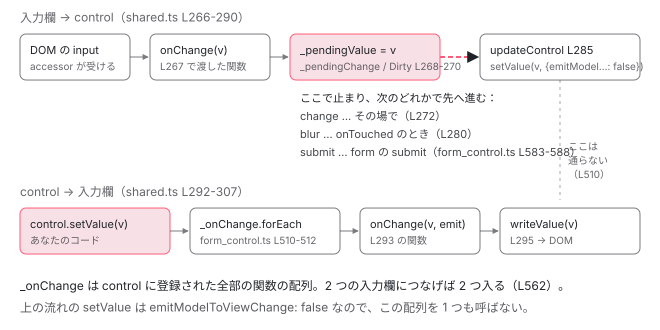

[目次](../README.md) › [フォームの内側](README.md) › 第 10 回 / 全 20 回

# setUpControlValueAccessor：control と入力欄を双方向につなぐ配線

> directives/shared.ts の setUpControlValueAccessor が行う手順（setUpValidators → writeValue → setDisabledState → setUpViewChangePipeline → setUpModelChangePipeline → setUpBlurPipeline → setUpDisabledChangeHandler）。updateOn が change / blur / submit のときの \_pendingValue と \_pendingChange、emitModelToViewChange で入力欄に書き戻さない理由、cleanUpControl の後片付け。

angular/angular · 読了 約 14 分 · 発展 · [サイトで読む（デモが動きます）](https://angular-deep-dive-cyan.vercel.app/chapter/forms-setup-control)

---

[前の回](09-forms-value-accessor.md)で、accessor は「関数を受け取るだけ」で自分からは control を触らないことを見ました。では、その関数を渡し、control の変更を accessor に届けているのは誰か。答えは `directives/shared.ts` の `setUpControlValueAccessor` です。この章では、この関数が呼ぶ 7 つの手順を 1 行ずつ追い、入力欄 → control と control → 入力欄の 2 本の流れ、`updateOn` が `change` / `blur` / `submit` のときに流れがどこで止まるか、そしてディレクティブが消えるときの `cleanUpControl` を読みます。

読む対象は `packages/forms/src/directives/shared.ts`（`setUpControlValueAccessor`・`cleanUpControl`・`setUpDisabledChangeHandler`・3 本の pipeline と `updateControl`）、`packages/forms/src/model/form_control.ts` の `registerOnChange` と `_syncPendingControls`、`abstract_control_directive.ts` の後片付けの関数、テストは `packages/forms/test/reactive_integration_spec.ts` です。

1. [1. 全体像](01-forms-overview.md)
2. [2. AbstractControl](02-forms-abstract-control.md)
3. [3. updateValueAndValidity](03-forms-update-value-validity.md)
4. [4. Validators](04-forms-validators.md)
5. [5. 非同期の検証](05-forms-async-validators.md)
6. [6. events](06-forms-control-events.md)
7. [7. FormGroup と FormArray](07-forms-form-group-array.md)
8. [8. 型付きフォームと FormBuilder](08-forms-typed-forms.md)
9. [9. ControlValueAccessor](09-forms-value-accessor.md)
10. **10. 双方向の配線**（この章）
11. [11. 組み込みの accessor](11-forms-builtin-accessors.md)
12. [12. リアクティブのディレクティブ](12-forms-reactive-directives.md)
13. [13. NgModel と NgForm](13-forms-ng-model.md)
14. [14. 検証のディレクティブ](14-forms-validator-directives.md)
15. [15. 状態クラス](15-forms-status-classes.md)
16. [16. Signal Forms のスキーマ](16-forms-sf-schema.md)
17. [17. Signal Forms の検証](17-forms-sf-validation.md)
18. [18. 状態ルールと metadata](18-forms-sf-rules-metadata.md)
19. [19. submit と相互運用](19-forms-sf-submit-compat.md)
20. [20. issue と PR を読む](20-forms-issues.md)

## 1. setUpControlValueAccessor：7 つの手順

`FormControlDirective`・`FormControlName`・`NgModel` は、使う accessor を決めたあと（[第 9 回の 6 節](09-forms-value-accessor.md)）、この関数を呼びます（呼ぶ場所は[第 12 回](12-forms-reactive-directives.md)・[第 13 回](13-forms-ng-model.md)）。

📄 `angular/packages/forms/src/directives/shared.ts` L82–109 （▶ の行: 82, 85, 88–89, 92, 94, 96–100, 103–104, 106, 108）

```ts
 82 ▶ export function setUpControlValueAccessor(
 83 │   control: FormControl,
 84 │   dir: NgControl,
 85 ▶   callSetDisabledState: SetDisabledStateOption = setDisabledStateDefault,
 86 │ ): void {
 87 │   if (typeof ngDevMode === 'undefined' || ngDevMode) {
 88 ▶     if (!control) _throwError(dir, 'Cannot find control with');
 89 ▶     if (!dir.valueAccessor) _throwMissingValueAccessorError(dir);
 90 │   }
 91 │ 
 92 ▶   setUpValidators(control, dir);
 93 │ 
 94 ▶   dir.valueAccessor!.writeValue(control.value);
 95 │ 
 96 ▶   // The legacy behavior only calls the CVA's `setDisabledState` if the control is disabled.
 97 ▶   // If the `callSetDisabledState` option is set to `always`, then this bug is fixed and
 98 ▶   // the method is always called.
 99 ▶   if (control.disabled || callSetDisabledState === 'always') {
100 ▶     dir.valueAccessor!.setDisabledState?.(control.disabled);
101 │   }
102 │ 
103 ▶   setUpViewChangePipeline(control, dir);
104 ▶   setUpModelChangePipeline(control, dir);
105 │ 
106 ▶   setUpBlurPipeline(control, dir);
107 │ 
108 ▶   setUpDisabledChangeHandler(control, dir);
109 │ }
```

1. **88〜89 行目：開発モードの確認**

   control が無ければ「Cannot find control with ...」、accessor が無ければ「No value accessor for form control ...」を投げます。本番のビルドでは確認しません。
2. **92 行目：setUpValidators**

   テンプレートに書いた `required` などのディレクティブの検証関数を control に足します。中身は[第 14 回](14-forms-validator-directives.md)。
3. **94 行目：writeValue（control → 入力欄、1 回目）**

   今の `control.value` を入力欄に書きます。`new FormControl('初期値')` の「初期値」が画面に出るのはこの行です。
4. **99〜100 行目：setDisabledState**

   control が無効なとき、または `callSetDisabledState` が `'always'` のときに呼びます。85 行目の既定値 `setDisabledStateDefault` は、このリポジトリでは `'always'` なので、有効な control でも `setDisabledState(false)` が 1 回呼ばれます。`?.` なので accessor が実装していなければ何もしません。
5. **103 行目：setUpViewChangePipeline（入力欄 → control）**

   accessor の `registerOnChange` に関数を渡します（2 節）。
6. **104 行目：setUpModelChangePipeline（control → 入力欄）**

   control の `registerOnChange` に関数を渡します（3 節）。名前は同じ `registerOnChange` ですが、こちらは **control 側**のメソッドです。
7. **106 行目：setUpBlurPipeline**

   accessor の `registerOnTouched` に関数を渡します（2 節）。
8. **108 行目：setUpDisabledChangeHandler**

   control の `disable()` / `enable()` を accessor の `setDisabledState` につなぎます（4 節）。

[第 9 回のデモ 1](09-forms-value-accessor.md)で、ページを開いた時点のログが `writeValue(null)` → `setDisabledState(false)` → `registerOnChange(fn)` → `registerOnTouched(fn)` の順だったのは、94・100・103・106 行目のこの順番です。104 行目と 108 行目は control 側に登録するので、accessor のログには出ません。

## 2. 入力欄 → control：view と blur の pipeline

📄 `angular/packages/forms/src/directives/shared.ts` L266–290 （▶ の行: 267–270, 272, 277–278, 280–281, 285–289）

```ts
266 │ function setUpViewChangePipeline(control: FormControl, dir: NgControl): void {
267 ▶   dir.valueAccessor!.registerOnChange((newValue: any) => {
268 ▶     control._pendingValue = newValue;
269 ▶     control._pendingChange = true;
270 ▶     control._pendingDirty = true;
271 │ 
272 ▶     if (control.updateOn === 'change') updateControl(control, dir);
273 │   });
274 │ }
275 │ 
276 │ function setUpBlurPipeline(control: FormControl, dir: NgControl): void {
277 ▶   dir.valueAccessor!.registerOnTouched(() => {
278 ▶     control._pendingTouched = true;
279 │ 
280 ▶     if (control.updateOn === 'blur' && control._pendingChange) updateControl(control, dir);
281 ▶     if (control.updateOn !== 'submit') control.markAsTouched();
282 │   });
283 │ }
284 │ 
285 ▶ function updateControl(control: FormControl, dir: NgControl): void {
286 ▶   if (control._pendingDirty) control.markAsDirty();
287 ▶   control.setValue(control._pendingValue, {emitModelToViewChange: false});
288 ▶   dir.viewToModelUpdate(control._pendingValue);
289 ▶   control._pendingChange = false;
290 │ }
```

1. **267〜270 行目：まず「保留」に入れる**

   accessor が `onChange(newValue)` を呼ぶと、この関数が動きます。値はすぐ `control.value` には入らず、`_pendingValue`（保留中の値）に入り、`_pendingChange`（保留中の変更あり）と `_pendingDirty`（保留中の dirty）が `true` になります。
2. **272 行目：updateOn が change なら、すぐ確定**

   既定の `'change'` では、その場で `updateControl` を呼びます。`'blur'` と `'submit'` では、ここで止まります。
3. **277〜278 行目：blur が来た**

   accessor が `onTouched()` を呼ぶと、まず `_pendingTouched = true`。
4. **280 行目：updateOn が blur で、保留中の変更があれば確定**

   何も打たずに blur しただけなら `_pendingChange` が `false` なので、`setValue` は呼ばれず、`valueChanges` も流れません。
5. **281 行目：submit 以外なら touched にする**

   `'submit'` のときは、blur しても touched にはなりません。submit まで `_pendingTouched` に残ります（5 節）。
6. **285〜289 行目：updateControl で確定**

   286 行目、保留中の dirty があれば `markAsDirty()`。287 行目で `setValue(_pendingValue, { emitModelToViewChange: false })`。288 行目、ディレクティブの `viewToModelUpdate` で `ngModelChange` などを出し、289 行目で保留を下ろします。

## 3. control → 入力欄：model の pipeline と emitModelToViewChange

📄 `angular/packages/forms/src/directives/shared.ts` L292–307 （▶ の行: 293, 295, 298, 300, 304–305）

```ts
292 │ function setUpModelChangePipeline(control: FormControl, dir: NgControl): void {
293 ▶   const onChange = (newValue?: any, emitModelEvent?: boolean) => {
294 │     // control -> view
295 ▶     dir.valueAccessor!.writeValue(newValue);
296 │ 
297 │     // control -> ngModel
298 ▶     if (emitModelEvent) dir.viewToModelUpdate(newValue);
299 │   };
300 ▶   control.registerOnChange(onChange);
301 │ 
302 │   // Register a callback function to cleanup onChange handler
303 │   // from a control instance when a directive is destroyed.
304 ▶   dir._registerOnDestroy(() => {
305 ▶     control._unregisterOnChange(onChange);
306 │   });
307 │ }
```

293 行目の関数を、300 行目で control に登録します。中身は 295 行目の `writeValue` と、298 行目の「`emitModelEvent` なら `viewToModelUpdate`」だけです。304〜305 行目は後片付けの予約で、6 節で使います。この関数を呼ぶのは `FormControl.setValue` です。`setValue` の全体は[第 3 回](03-forms-update-value-validity.md)で読むので、ここでは呼ぶ 3 行だけ見ます。

📄 `angular/packages/forms/src/model/form_control.ts` L510–512 （▶ の行: 510–512）

```ts
510 ▶       if (this._onChange.length && options.emitModelToViewChange !== false) {
511 ▶         this._onChange.forEach((changeFn) =>
512 ▶           changeFn(this.value, options.emitViewToModelChange !== false),
```

510 行目、`_onChange`（上の 300 行目で積まれた関数の配列）が空でなく、**`emitModelToViewChange` が `false` でなければ**、511〜512 行目で全部を呼びます。2 節の 287 行目は、ここに `false` を渡しています。入力欄から来た値で `setValue` するときは、**どの入力欄にも書き戻さない**ということです。512 行目の第 2 引数が上の 298 行目の `emitModelEvent` です。

📄 `angular/packages/forms/src/model/form_control.ts` L561–577 （▶ の行: 561–562, 566–567, 570–571, 575–576）

```ts
561 ▶   registerOnChange(fn: Function): void {
562 ▶     this._onChange.push(fn);
563 │   }
564 │ 
565 │   /** @internal */
566 ▶   _unregisterOnChange(fn: (value?: any, emitModelEvent?: boolean) => void): void {
567 ▶     removeListItem(this._onChange, fn);
568 │   }
569 │ 
570 ▶   registerOnDisabledChange(fn: (isDisabled: boolean) => void): void {
571 ▶     this._onDisabledChange.push(fn);
572 │   }
573 │ 
574 │   /** @internal */
575 ▶   _unregisterOnDisabledChange(fn: (isDisabled: boolean) => void): void {
576 ▶     removeListItem(this._onDisabledChange, fn);
577 │   }
```

control 側の登録は配列への `push` です（562 行目・571 行目）。1 つの control を 2 つの入力欄につなぐと、配列に関数が 2 つ入ります。外すときは 567 行目・576 行目で配列から取り除きます。



*2 本の流れ。上が入力欄 → control、下が control → 入力欄。上の流れは保留（\_pendingValue）を経て、updateOn に応じた場所で確定する。確定の setValue は emitModelToViewChange: false なので、下の流れには入らない。*

## 4. disable / enable を accessor へ：setUpDisabledChangeHandler

📄 `angular/packages/forms/src/directives/shared.ts` L164–177 （▶ の行: 165–167, 169, 173–174）

```ts
164 │ export function setUpDisabledChangeHandler(control: FormControl, dir: NgControl): void {
165 ▶   if (dir.valueAccessor!.setDisabledState) {
166 ▶     const onDisabledChange = (isDisabled: boolean) => {
167 ▶       dir.valueAccessor!.setDisabledState!(isDisabled);
168 │     };
169 ▶     control.registerOnDisabledChange(onDisabledChange);
170 │ 
171 │     // Register a callback function to cleanup disabled change handler
172 │     // from a control instance when a directive is destroyed.
173 ▶     dir._registerOnDestroy(() => {
174 ▶       control._unregisterOnDisabledChange(onDisabledChange);
175 │     });
176 │   }
177 │ }
```

165 行目、accessor が `setDisabledState` を持っているときだけ配線します。166〜167 行目の関数を 169 行目で control に登録し、control の `disable()` / `enable()` は登録された関数を `true` / `false` で呼びます（中身は[第 3 回](03-forms-update-value-validity.md)）。173〜174 行目は 3 節の 304〜305 行目と同じ後片付けの予約です。

## 5. updateOn: 'submit' はいつ確定するか

2 節で見たとおり、`'submit'` では 272 行目でも 280 行目でも確定せず、281 行目で touched にもなりません。確定させるのは、`<form [formGroup]>` の `FormGroupDirective.onSubmit` が呼ぶ `syncPendingControls` です（[第 12 回](12-forms-reactive-directives.md)）。それが `FormGroup` を経て、子の `FormControl` の次のメソッドを呼びます。

📄 `angular/packages/forms/src/model/form_control.ts` L579–593 （▶ の行: 583–589）

```ts
579 │   /** @internal */
580 │   override _forEachChild(cb: (c: AbstractControl) => void): void {}
581 │ 
582 │   /** @internal */
583 ▶   override _syncPendingControls(): boolean {
584 ▶     if (this.updateOn === 'submit') {
585 ▶       if (this._pendingDirty) this.markAsDirty();
586 ▶       if (this._pendingTouched) this.markAsTouched();
587 ▶       if (this._pendingChange) {
588 ▶         this.setValue(this._pendingValue, {onlySelf: true, emitModelToViewChange: false});
589 ▶         return true;
590 │       }
591 │     }
592 │     return false;
593 │   }
```

584 行目、`updateOn` が `'submit'` の control だけが動きます。585 行目で保留中の dirty を、586 行目で保留中の touched を反映し、587〜588 行目、保留中の変更があれば `setValue(_pendingValue, { onlySelf: true, emitModelToViewChange: false })`。ここでも入力欄には書き戻しません。`<form>` の無い単独の `[formControl]` に `updateOn: 'submit'` を付けると、この経路を呼ぶ人がいないので、値は永遠に保留のままです。

## 6. 後片付け：cleanUpControl

📄 `angular/packages/forms/src/directives/shared.ts` L111–148 （▶ の行: 112, 125, 127–131, 139–140, 142, 145–146）

```ts
111 │ /**
112 ▶  * Reverts configuration performed by the `setUpControl` control function.
113 │  * Effectively disconnects form control with a given form directive.
114 │  * This function is typically invoked when corresponding form directive is being destroyed.
115 │  *
116 │  * @param control Form control which should be cleaned up.
117 │  * @param dir Directive that should be disconnected from a given control.
118 │  * @param validateControlPresenceOnChange Flag that indicates whether onChange handler should
119 │  *     contain asserts to verify that it's not called once directive is destroyed. We need this flag
120 │  *     to avoid potentially breaking changes caused by better control cleanup introduced in #39235.
121 │  */
122 │ export function cleanUpControl(
123 │   control: FormControl | null,
124 │   dir: NgControl,
125 ▶   validateControlPresenceOnChange: boolean = true,
126 │ ): void {
127 ▶   const noop = () => {
128 ▶     if (validateControlPresenceOnChange && (typeof ngDevMode === 'undefined' || ngDevMode)) {
129 ▶       _noControlError(dir);
130 ▶     }
131 ▶   };
132 │ 
133 │   // The `valueAccessor` field is typically defined on FromControl and FormControlName directive
134 │   // instances and there is a logic in `selectValueAccessor` function that throws if it's not the
135 │   // case. We still check the presence of `valueAccessor` before invoking its methods to make sure
136 │   // that cleanup works correctly if app code or tests are setup to ignore the error thrown from
137 │   // `selectValueAccessor`. See https://github.com/angular/angular/issues/40521.
138 │ 
139 ▶   dir?.valueAccessor?.registerOnChange(noop);
140 ▶   dir?.valueAccessor?.registerOnTouched(noop);
141 │ 
142 ▶   cleanUpValidators(control, dir);
143 │ 
144 │   if (control) {
145 ▶     dir._invokeOnDestroyCallbacks();
146 ▶     control._registerOnCollectionChange(() => {});
147 │   }
148 │ }
```

1. **127〜131 行目：noop を用意**

   何もしない関数。ただし 125 行目の引数が `true` で開発モードなら、呼ばれた時点で「There is no FormControl instance attached ...」を投げます。
2. **139〜140 行目：accessor の関数を差し替える**

   accessor が覚えている `onChange` / `onTouched` を noop にします。消えたディレクティブの入力欄から値が届いても、control には行きません。
3. **142 行目：検証関数を外す**

   1 節の 92 行目で足した検証関数を外します（[第 14 回](14-forms-validator-directives.md)）。
4. **145 行目：予約しておいた後片付けを全部実行**

   3 節の 304〜305 行目と 4 節の 173〜174 行目で予約した関数が呼ばれ、control の `_onChange` と `_onDisabledChange` の配列から、このディレクティブの関数が抜けます。
5. **146 行目：コレクションの変更の通知を空にする**

   子の追加・削除を知らせる関数（`FormGroupDirective` が自分の form に登録するもの。第 12 回）を、何もしない関数に戻します。

📄 `angular/packages/forms/src/directives/abstract_control_directive.ts` L241–260 （▶ の行: 248–249, 257–259）

```ts
241 │   private _onDestroyCallbacks: (() => void)[] = [];
242 │ 
243 │   /**
244 │    * Internal function to register callbacks that should be invoked
245 │    * when directive instance is being destroyed.
246 │    * @internal
247 │    */
248 ▶   _registerOnDestroy(fn: () => void): void {
249 ▶     this._onDestroyCallbacks.push(fn);
250 │   }
251 │ 
252 │   /**
253 │    * Internal function to invoke all registered "on destroy" callbacks.
254 │    * Note: calling this function also clears the list of callbacks.
255 │    * @internal
256 │    */
257 ▶   _invokeOnDestroyCallbacks(): void {
258 ▶     this._onDestroyCallbacks.forEach((fn) => fn());
259 ▶     this._onDestroyCallbacks = [];
260 │   }
```

予約は 249 行目の配列への `push`、実行は 258 行目で全部呼んで 259 行目で空にするだけです。なお 112 行目の doc コメントは「`setUpControl` の設定を元に戻す」と書いていますが、今の関数名は `setUpControlValueAccessor`（82 行目）で、古い名前がコメントに残っています。

## 7. デモ：updateOn を切り替える

> **🧪 DEMO — 本物の FormControl と updateOn**
>
> ボタンで `new FormControl('', { updateOn })` を作り直し、`<form [formGroup]>` の中の 2 つの入力欄に `formControlName="name"` でつなぎます。入力欄 A に打ってから、B をクリックして blur、最後に「submit」を押して、`control.value` と `valueChanges` がいつ動くかを見てください。
>
> A に打っても **B は変わりません**（3 節の 510 行目）。「setValue」のボタンでは A と B の両方が変わります（511〜512 行目で 2 つの関数が呼ばれる）。`submit` のときは、`valueChanges` が `ngSubmit` より先に出ます。`onSubmit` が `syncPendingControls` を呼んでから `ngSubmit` を出すためです（第 12 回）。
>
> ▶ [このデモはサイトで動かせます](https://angular-deep-dive-cyan.vercel.app/chapter/forms-setup-control)

## ここまでの呼び出し

- `FormControlName / FormControlDirective / NgModel` — 第 12・13 回
  - `setUpControlValueAccessor(control, dir)` — shared.ts L82
    - `setUpValidators → writeValue → setDisabledState?.` — L92-100
    - `setUpViewChangePipeline → setUpModelChangePipeline → setUpBlurPipeline → setUpDisabledChangeHandler` — L103-108
- 👤 `（入力）accessor.onChange(v)` — 利用者の操作
  - `_pendingValue = v; if (updateOn === 'change') updateControl` — shared.ts L268-272
    - `control.setValue(v, { emitModelToViewChange: false })` — L287 — *入力欄には書き戻さない*
- 👤 `control.setValue(v)` — あなたのコード
  - `_onChange.forEach(fn)` — form\_control.ts L511
    - `dir.valueAccessor.writeValue(v)` — shared.ts L295
- `（submit）FormGroupDirective.onSubmit → syncPendingControls` — 第 12 回
  - `FormControl._syncPendingControls()` — form\_control.ts L583 — *dirty・touched・setValue*
- `（破棄）cleanUpControl(control, dir)` — shared.ts L122
  - `registerOnChange(noop) → cleanUpValidators → _invokeOnDestroyCallbacks` — L139-145

## 聞かれそうな質問

**Q. 入力欄から来た値を、なぜ writeValue で入力欄に書き戻さないのですか？**

2 節の 287 行目が `emitModelToViewChange: false` を渡し、3 節の 510 行目がそれを見て `_onChange` を呼ばないからです。もし書き戻すと、accessor が変換した値で入力欄が上書きされます。たとえば `type="number"` の `NumberValueAccessor` は文字列を `parseFloat` で数にするので （[第 11 回](11-forms-builtin-accessors.md)）、「007」と打った途中で `7` が書き戻され、入力欄の文字が「7」に変わってしまいます。HTML の仕様では `value` に違う値を代入するとカーソルが末尾へ移るので、打っている途中のカーソル位置も失われます。その代わり、同じ control を 2 つの入力欄につなぐと、片方に打っても他方は変わりません（7 節のデモ）。

**Q. updateOn: 'submit' の control の値は、いつ入りますか？**

`<form [formGroup]>`（または `ngForm`）が submit されたときです。`onSubmit` → `syncPendingControls` → 5 節の `_syncPendingControls` で、585〜586 行目で dirty と touched を、587〜588 行目で値を反映します。それまでは 268 行目の `_pendingValue` にあり、`control.value` は古いままです。blur しても 281 行目の条件で touched にならないので、「触ったらエラーを表示」も submit まで出ません。form の無い単独の `[formControl]` では、submit で呼んでくれるディレクティブが無いので、値は入りません。

**Q. ディレクティブが消えたあと（@if で入力欄を消したあと）に control を触ると、どうなりますか？**

control 自体は普通に動きます。`setValue` すれば `value` も `valueChanges` も変わり、control 自身の検証関数も動きます。変わるのは、消えた入力欄に何も届かなくなることです。6 節の 145 行目で予約が実行され、3 節の 305 行目で `_onChange` から関数が抜けているので、`setValue` しても `writeValue` は呼ばれません。`disable()` も 4 節の 174 行目で外れています。142 行目でテンプレート側の `required` なども外れます。`FormControlDirective` の破棄では 125 行目の引数に `false` を渡すので、古い accessor から何か来ても 128 行目の確認は動かず、黙って捨てられます。これを確かめているのが `reactive_integration_spec.ts` の `describe('cleanup')` の 「should clean up callbacks when FormControlDirective is destroyed (simple)」です。

**Q. 有効な control なのに setDisabledState(false) が呼ばれるのはなぜですか？**

1 節の 99 行目の条件が `control.disabled || callSetDisabledState === 'always'` で、85 行目の既定値が `'always'` だからです。96〜98 行目のコメントのとおり、無効のときだけ呼ぶのは古い挙動（legacy behavior）で、コメントはそれを bug と呼び、`'always'` で直ったと書いています。古い挙動に戻したいときは `ReactiveFormsModule.withConfig({ callSetDisabledState: 'whenDisabledForLegacyCode' })` を使います。

## テストと直し方

`updateOn` の挙動は、`reactive_integration_spec.ts` の `describe('reactive forms integration tests')` → `describe('updateOn options')` → `describe('on blur')` と `describe('on submit')` にまとまっています。最初の 1 本がこの章の 2 節そのものです。

📄 `angular/packages/forms/test/reactive_integration_spec.ts` L2005–2033 （▶ の行: 2007, 2012–2013, 2016–2018, 2023, 2026–2028）

```ts
2005 │       it('should not update value or validity based on user input until blur', async () => {
2006 │         const fixture = initTest(FormControlComp);
2007 ▶         const control = new FormControl('', {validators: Validators.required, updateOn: 'blur'});
2008 │         fixture.componentInstance.control = control;
2009 │         await fixture.whenStable();
2010 │ 
2011 │         const input = fixture.debugElement.query(By.css('input')).nativeElement;
2012 ▶         input.value = 'Nancy';
2013 ▶         dispatchEvent(input, 'input');
2014 │         await fixture.whenStable();
2015 │ 
2016 ▶         expect(control.value)
2017 ▶           .withContext('Expected value to remain unchanged until blur.')
2018 ▶           .toEqual('');
2019 │         expect(control.valid)
2020 │           .withContext('Expected no validation to occur until blur.')
2021 │           .toBe(false);
2022 │ 
2023 ▶         dispatchEvent(input, 'blur');
2024 │         await fixture.whenStable();
2025 │ 
2026 ▶         expect(control.value)
2027 ▶           .withContext('Expected value to change once control is blurred.')
2028 ▶           .toEqual('Nancy');
2029 │         expect(control.valid)
2030 │           .withContext('Expected validation to run once control is blurred.')
2031 │           .toBe(true);
2032 │       });
2033 │ 
```

2007 行目で `updateOn: 'blur'` の control を作り、2012〜2013 行目で `input` イベントを起こしても、2016〜2018 行目で値はまだ `''`。2023 行目で `blur` を起こすと、2026〜2028 行目で値が入ります。2 節の 272 行目では止まり、280 行目で確定する、という流れです。

📄 `ターミナル（../angular で実行）`

```
$ pnpm bazel test //packages/forms/test:test \
    --test_arg=--filter="updateOn options on blur" --test_output=all
...
==================== Test output for //packages/forms/test:test:
Randomized with seed 88003
Started
................

Ran 16 of 1153 specs
16 specs, 0 failures
Finished in 0.076 seconds
...
//packages/forms/test:test                                               PASSED in 0.9s
```

- `"updateOn options on blur"` は「describe 3 つ + it」をつないだ名前の途中に一致するので、`on blur` の 16 本だけが走りました（`Ran 16 of 1153 specs`）。submit の方は `"updateOn options on submit"` です。
- `--filter` は正規表現なので、「`... is destroyed (simple)`」のように**括弧を含む名前はそのまま渡すと一致しません**（`( )` がグループとして読まれ、括弧の文字そのものには一致しない）。括弧の手前までの `"cleanup should clean up callbacks when FormControlDirective is destroyed"` のように切って渡します。
- 直す場所の入口: 保留と確定は `shared.ts` の `setUpViewChangePipeline` / `setUpBlurPipeline` / `updateControl`、submit は `form_control.ts` の `_syncPendingControls`、後片付けは `cleanUpControl`。足すテストは上の `describe('updateOn options')` か `describe('cleanup')` です。
- 112 行目の古い名前のようなコメントの食い違いは、読むときの注意として覚えておけば十分です。本家への PR は勧めません。issue で「blur で値が入らない」「submit 前に touched にならない」といった報告を読むときに、272・280・281 行目のどれの話かを当てるのが、この章の使い道です（[第 20 回](20-forms-issues.md)）。

## 読み終えて

- `setUpControlValueAccessor` は「検証を足す → 書く → 無効を伝える → 4 本の配線」。accessor 側に 2 つ（onChange・onTouched）、control 側に 2 つ（onChange・onDisabledChange）登録する。
- 入力欄からの値はいったん `_pendingValue` に入り、`updateOn` が change ならその場、blur なら onTouched、submit なら form の submit で `updateControl` / `_syncPendingControls` が確定する。
- 確定の `setValue` は `emitModelToViewChange: false`。だから入力欄に書き戻さず、同じ control の別の入力欄も変わらない。
- 後片付けは「accessor の関数を noop に」「予約した登録解除を全部実行」。control そのものは消えた後も使える。

---

← 前: [ControlValueAccessor：入力欄と control の通訳](09-forms-value-accessor.md)  
次: [組み込みの value accessor：checkbox・number・select・radio](11-forms-builtin-accessors.md) →
