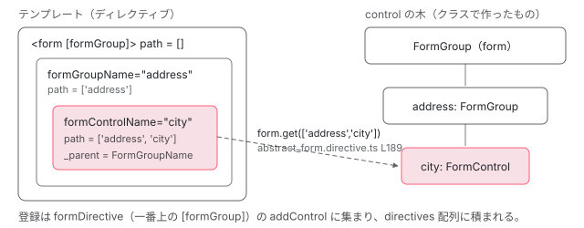

[目次](../README.md) › [フォームの内側](README.md) › 第 12 回 / 全 20 回

# リアクティブのディレクティブ：formControl・formGroup・formControlName

> FormControlDirective が ngOnChanges で setUpControlValueAccessor を呼ぶ行、FormGroupDirective（AbstractFormDirective）が子のディレクティブを directives の配列で持ち、form が差し替わると \_updateDomValue で付け直す仕組み、FormControlName が ControlContainer から自分の control を探す手順、ngSubmit と submitted、formControlName に対応する control が無いときのエラー。

angular/angular · 読了 約 14 分 · 中核 · [サイトで読む（デモが動きます）](https://angular-deep-dive-cyan.vercel.app/chapter/forms-reactive-directives)

---

`[formControl]`・`[formGroup]`・`formControlName` の 3 つは、テンプレートに書いた「名前」と、クラスで作った `FormControl` / `FormGroup` の「実物」を結びつけるディレクティブです。この章では、それぞれの `ngOnChanges` が何を呼び、`formControlName` が親の `[formGroup]` から自分の `FormControl` をどう探し、`[formGroup]` に別の `FormGroup` を渡したとき入力欄がどう付け直されるかを、行番号で追います。最後に、名前に対応する control が無いときのエラーと、その直し（#71177）が手元のソースに入っているかを確かめます。

読む対象は `packages/forms/src/directives/` の `reactive_directives/`（`form_control_directive.ts`・`form_group_directive.ts`・ `form_array_directive.ts`・`abstract_form.directive.ts`・`form_control_name.ts`）、`control_container.ts`・ `abstract_form_group_directive.ts`・`reactive_errors.ts`、`shared.ts` の一部です。

1. [1. 全体像](01-forms-overview.md)
2. [2. AbstractControl](02-forms-abstract-control.md)
3. [3. updateValueAndValidity](03-forms-update-value-validity.md)
4. [4. Validators](04-forms-validators.md)
5. [5. 非同期の検証](05-forms-async-validators.md)
6. [6. events](06-forms-control-events.md)
7. [7. FormGroup と FormArray](07-forms-form-group-array.md)
8. [8. 型付きフォームと FormBuilder](08-forms-typed-forms.md)
9. [9. ControlValueAccessor](09-forms-value-accessor.md)
10. [10. 双方向の配線](10-forms-setup-control.md)
11. [11. 組み込みの accessor](11-forms-builtin-accessors.md)
12. **12. リアクティブのディレクティブ**（この章）
13. [13. NgModel と NgForm](13-forms-ng-model.md)
14. [14. 検証のディレクティブ](14-forms-validator-directives.md)
15. [15. 状態クラス](15-forms-status-classes.md)
16. [16. Signal Forms のスキーマ](16-forms-sf-schema.md)
17. [17. Signal Forms の検証](17-forms-sf-validation.md)
18. [18. 状態ルールと metadata](18-forms-sf-rules-metadata.md)
19. [19. submit と相互運用](19-forms-sf-submit-compat.md)
20. [20. issue と PR を読む](20-forms-issues.md)

## 0. 全体の流れ

次のテンプレートが描画されるとき、内部で起きることを先に並べます。

1. **ディレクティブが作られる**

   `<form [formGroup]="form">` に `FormGroupDirective`、`<input formControlName="name">` に `FormControlName` と `DefaultValueAccessor`。`FormControlName` のコンストラクタは、注入で親の `ControlContainer`（＝`FormGroupDirective`）を受け取ります（2 節）。
2. **親の ngOnChanges**

   `FormGroupDirective` が、渡された `FormGroup` に自分の検証を足し、子の一覧（まだ空）を付け直します（4 節）。
3. **子の ngOnChanges**

   `FormControlName` が初回だけ `formDirective.addControl(this)` を呼びます。親は名前の配列（path）で `form.get(path)` を引き、見つけた `FormControl` と入力欄を `setUpControlValueAccessor` でつなぎます（5 節）。
4. **差し替え**

   `[formGroup]` に別の `FormGroup` が来ると、親が覚えている子の一覧をたどって 1 つずつ付け直します（7 節）。
5. **submit**

   `<form>` の submit イベントを host で聞き、`submitted` を立て、`ngSubmit` を出します（8 節）。

## 1. \[formControl\]：FormControlDirective

📄 `angular/packages/forms/src/directives/reactive_directives/form_control_directive.ts` L94–113 （▶ の行: 94, 100, 103, 110, 113）

```ts
 94 ▶   @Input('formControl') form!: FormControl;
 95 │ 
 96 │   /**
 97 │    * @description
 98 │    * Triggers a warning in dev mode that this input should not be used with reactive forms.
 99 │    */
100 ▶   @Input('disabled')
101 │   set isDisabled(isDisabled: boolean) {
102 │     if (typeof ngDevMode === 'undefined' || ngDevMode) {
103 ▶       console.warn(disabledAttrWarning);
104 │     }
105 │   }
106 │ 
107 │   // TODO(kara): remove next 4 properties once deprecation period is over
108 │ 
109 │   /** @deprecated as of v6 */
110 ▶   @Input('ngModel') model: any;
111 │ 
112 │   /** @deprecated as of v6 */
113 ▶   @Output('ngModelChange') update = new EventEmitter();
```

94 行目、`[formControl]` に渡したものはそのまま `form` というプロパティに入ります。100〜105 行目の `disabled` は、値を何にも使わず、開発モードで警告（`disabledAttrWarning`）を出すだけの入力です。リアクティブフォームでは無効にするかどうかを `FormControl` の側で決める、という方針がここに表れています。110・113 行目の `ngModel` と `ngModelChange` は v6 から非推奨のまま残っている入力と出力です（3 節）。

📄 `angular/packages/forms/src/directives/reactive_directives/form_control_directive.ts` L154–181 （▶ の行: 156–157, 159, 163, 165–166, 170, 172, 174）

```ts
154 │   /** @docs-private */
155 │   ngOnChanges(changes: SimpleChanges): void {
156 ▶     if (this._isControlChanged(changes)) {
157 ▶       const previousForm = changes['form'].previousValue as FormControl | null;
158 │       if (previousForm) {
159 ▶         cleanUpControl(previousForm, this, /* validateControlPresenceOnChange */ false);
160 │         this.removeParseErrorsValidator(previousForm);
161 │       }
162 │       // Only set up CVA if not using FVC
163 ▶       if (!this.isCustomControlBased) {
164 │         // Now that we know we're not using FVC, select the value accessor
165 ▶         this.valueAccessor ??= this.selectedValueAccessor;
166 ▶         setUpControlValueAccessor(this.form, this, this.callSetDisabledState);
167 │       } else {
168 │         // Set up FVC subscriptions when form changes - mark for check so
169 │         // ɵngControlUpdate runs and syncs values/status to the FVC
170 ▶         this.setupCustomControl();
171 │       }
172 ▶       this.form.updateValueAndValidity({emitEvent: false});
173 │     }
174 ▶     if (isPropertyUpdated(changes, this.viewModel)) {
175 │       if (typeof ngDevMode === 'undefined' || ngDevMode) {
176 │         _ngModelWarning('formControl', FormControlDirective, this, this._ngModelWarningConfig);
177 │       }
178 │       this.form.setValue(this.model);
179 │       this.viewModel = this.model;
180 │     }
181 │   }
```

1. **156 行目：form が変わったときだけ**

   `_isControlChanged` は `changes` に `form` キーがあるかを見るだけです（下の 218〜220 行目）。
2. **157〜161 行目：前の FormControl を外す**

   2 回目以降は `previousValue` に前の `FormControl` が入っています。159 行目の `cleanUpControl` で accessor のコールバックと検証を外します。3 番目の引数が `false` なのは、外したあとで accessor が呼ばれても例外を投げない設定です（7 節で違いが出ます）。
3. **163〜166 行目：accessor を選んでつなぐ**

   165 行目で、`NG_VALUE_ACCESSOR` で集めた accessor の中から 1 つ選び（選び方は[第 9 回](09-forms-value-accessor.md)）、166 行目の `setUpControlValueAccessor` で `FormControl` と入力欄を双方向につなぎます。中身は[第 10 回](10-forms-setup-control.md)です。
4. **170 行目：もう 1 つの道**

   `isCustomControlBased` が `true` のときは accessor を使わず `setupCustomControl()` に進みます。これは Signal Forms 向けに作られた部品（`value` などの model を持つコンポーネント）を `[formControl]` で使うための道で、下の `ngControlCreate` で決まります。
5. **172 行目：状態を計算し直す**

   `emitEvent: false` で `valueChanges` などは出さずに、ディレクティブ側の検証を足した状態で値と検証をやり直します （[第 3 回](03-forms-update-value-validity.md)）。

📄 `angular/packages/forms/src/directives/ng_control.ts` L215–228 （▶ の行: 216–217, 222, 227）

```ts
215 │   protected ngControlCreate(host: ControlDirectiveHost): void {
216 ▶     const hasNgNoCva = host.nativeElement.hasAttribute?.('ngNoCva');
217 ▶     const hasCva =
218 │       !hasNgNoCva &&
219 │       ((this.rawValueAccessors && this.rawValueAccessors.length > 0) ||
220 │         this.valueAccessor !== null);
221 │ 
222 ▶     if (hasCva || !host.customControl) {
223 │       // This control is using the CVA pattern, so ngControlCreate is a noop.
224 │       return;
225 │     }
226 │ 
227 ▶     this.isCustomControlBased = true;
228 │ 
```

`ngControlCreate` は、コンパイラが `ɵngControlCreate` を持つディレクティブに付ける仕組みから、ngOnChanges より先に呼ばれます。217〜220 行目、注入された accessor が 1 つでもあれば（216 行目の `ngNoCva` 属性が無い限り）CVA の道です。222 行目、CVA があるか、要素が Signal Forms のカスタムコントロールでなければ何もしません。ふつうの `<input>` は `DefaultValueAccessor` が付くので、227 行目には来ません。この章の残りは CVA の道だけを追います。

📄 `angular/packages/forms/src/directives/reactive_directives/form_control_directive.ts` L207–220 （▶ の行: 213–215, 219）

```ts
207 │   /**
208 │    * @description
209 │    * Sets the new value for the view model and emits an `ngModelChange` event.
210 │    *
211 │    * @param newValue The new value for the view model.
212 │    */
213 ▶   override viewToModelUpdate(newValue: any): void {
214 ▶     this.viewModel = newValue;
215 ▶     this.update.emit(newValue);
216 │   }
217 │ 
218 │   private _isControlChanged(changes: {[key: string]: any}): boolean {
219 ▶     return Object.hasOwn(changes, 'form');
220 │   }
```

`viewToModelUpdate` は、入力欄で値が変わったときに `setUpControlValueAccessor` が組んだ流れから呼ばれます（[第 10 回](10-forms-setup-control.md)の `updateControl`）。214 行目で `viewModel` に覚え、215 行目で `ngModelChange` を出します。`ngModel` を一緒に使っていなければ、誰も購読していない出力です。

### ngModel と一緒に使ったとき

📄 `angular/packages/forms/src/directives/shared.ts` L371–378 （▶ の行: 373, 376–377）

```ts
371 │ 
372 │ export function isPropertyUpdated(changes: {[key: string]: any}, viewModel: any): boolean {
373 ▶   if (!Object.hasOwn(changes, 'model')) return false;
374 │   const change = changes['model'];
375 │ 
376 ▶   if (change.isFirstChange()) return true;
377 ▶   return !Object.is(viewModel, change.currentValue);
378 │ }
```

`isPropertyUpdated` は「`ngModel` 入力が今回変わり、しかもそれが自分で入力欄から書き戻した値と違うか」を判定します。373 行目で `model` の変更が無ければ `false`、376 行目で初回は必ず `true`、377 行目で `viewModel`（入力欄から来た最後の値）と `Object.is` で比べます。入力欄から来た値がそのまま `[(ngModel)]` で戻ってきただけなら、もう一度 `setValue` しません。`true` なら、1 節の 178 行目で `this.form.setValue(this.model)` です。

📄 `angular/packages/forms/src/directives/shared.ts` L443–460 （▶ の行: 450, 453–454, 456–458）

```ts
443 │ // TODO(kara): remove after deprecation period
444 │ export function _ngModelWarning(
445 │   name: string,
446 │   type: {_ngModelWarningSentOnce: boolean},
447 │   instance: {_ngModelWarningSent: boolean},
448 │   warningConfig: string | null,
449 │ ) {
450 ▶   if (warningConfig === 'never') return;
451 │ 
452 │   if (
453 ▶     ((warningConfig === null || warningConfig === 'once') && !type._ngModelWarningSentOnce) ||
454 ▶     (warningConfig === 'always' && !instance._ngModelWarningSent)
455 │   ) {
456 ▶     console.warn(ngModelWarning(name));
457 ▶     type._ngModelWarningSentOnce = true;
458 ▶     instance._ngModelWarningSent = true;
459 │   }
460 │ }
```

その直前、176 行目で警告を出します。設定は `NG_MODEL_WITH_FORM_CONTROL_WARNING` トークンです。`ReactiveFormsModule` をそのまま import したときは provide されず `null`、`ReactiveFormsModule.withConfig({ warnOnNgModelWithFormControl })` を使うとその値（省くと `'always'`。form\_providers.ts の `withConfig`）になります。450 行目 `'never'` なら出さない。453 行目、既定（`null`）か `'once'` なら、クラスの静的プロパティ `_ngModelWarningSentOnce` を見て**アプリ全体で 1 回だけ**、454 行目 `'always'` ならインスタンスごとに 1 回です。457 行目で静的プロパティを立てるので、既定のままでは 2 つ目以降の `[formControl]` + `ngModel` では何も出ません。

## 2. 親を探す仕組み：ControlContainer

📄 `angular/packages/forms/src/directives/control_container.ts` L19–41 （▶ の行: 19, 30–31, 38–39）

```ts
19 ▶ export abstract class ControlContainer extends AbstractControlDirective {
20 │   /**
21 │    * @description
22 │    * The name for the control
23 │    */
24 │   name!: string | number | null;
25 │ 
26 │   /**
27 │    * @description
28 │    * The top-level form directive for the control.
29 │    */
30 ▶   get formDirective(): Form | null {
31 ▶     return null;
32 │   }
33 │ 
34 │   /**
35 │    * @description
36 │    * The path to this group.
37 │    */
38 ▶   override get path(): string[] | null {
39 ▶     return null;
40 │   }
41 │ }
```

`ControlContainer` は「子を持つディレクティブ」の抽象クラスです。19 行目、`AbstractControlDirective`（`value` や `valid` の getter を持つ親）を継承し、30 行目の `formDirective`（一番上のフォームのディレクティブ）と 38 行目の `path`（一番上からの名前の配列）を、子クラスが上書きします。子のディレクティブは、具体的なクラスではなくこの抽象クラスを DI のトークンにして親を探します。

📄 `angular/packages/forms/src/directives/reactive_directives/form_group_directive.ts` L9–19 （▶ の行: 16–18）

```ts
 9 │ import {Directive, EventEmitter, forwardRef, Input, Output, Provider} from '@angular/core';
10 │ 
11 │ import {FormGroup} from '../../model/form_group';
12 │ import {ControlContainer} from '../control_container';
13 │ 
14 │ import {AbstractFormDirective} from './abstract_form.directive';
15 │ 
16 ▶ const formDirectiveProvider: Provider = {
17 ▶   provide: ControlContainer,
18 ▶   useExisting: forwardRef(() => FormGroupDirective),
19 │ };
```

16〜19 行目、`FormGroupDirective` は `ControlContainer` というトークンで**自分自身**を provide します（`useExisting`）。`FormGroupName`・`FormArrayName`・`NgForm`・`NgModelGroup` も同じ形で、それぞれ自分を `ControlContainer` として出しています。

📄 `angular/packages/forms/src/directives/reactive_directives/form_control_name.ts` L158–176 （▶ の行: 159, 165, 173）

```ts
158 │   constructor(
159 ▶     @Optional() @Host() @SkipSelf() parent: ControlContainer,
160 │     @Optional() @Self() @Inject(NG_VALIDATORS) validators: (Validator | ValidatorFn)[],
161 │     @Optional()
162 │     @Self()
163 │     @Inject(NG_ASYNC_VALIDATORS)
164 │     asyncValidators: (AsyncValidator | AsyncValidatorFn)[],
165 ▶     @Optional() @Self() @Inject(NG_VALUE_ACCESSOR) valueAccessors: ControlValueAccessor[],
166 │     @Optional()
167 │     @Inject(NG_MODEL_WITH_FORM_CONTROL_WARNING)
168 │     private _ngModelWarningConfig: string | null,
169 │     @Optional() renderer?: Renderer2,
170 │     @Optional() injector?: Injector,
171 │   ) {
172 │     super(injector, renderer, valueAccessors);
173 ▶     this._parent = parent;
174 │     this._setValidators(validators);
175 │     this._setAsyncValidators(asyncValidators);
176 │   }
```

159 行目、`FormControlName` は `@Optional() @Host() @SkipSelf()` で `ControlContainer` を受け取ります。`@SkipSelf()` は自分の要素を飛ばして上から探す、`@Host()` は自分のコンポーネントのテンプレートの外までは探さない、という指定です （修飾子の意味は [DI の章](../di/10-di.md)）。テンプレートで一番近い `[formGroup]` か `formGroupName` が見つかり、173 行目で `_parent` に入ります。165 行目の `NG_VALUE_ACCESSOR` は `@Self()` なので、同じ要素に付いた accessor だけです。

> [!WARNING]
> **ハマりどころ**
>
> `@Host()` のため、`formControlName` を子コンポーネントのテンプレートに書くと、親コンポーネントの `[formGroup]` は見つかりません。`_parent` は `null` になり、5 節の `checkParentType` でエラーになります。子コンポーネント側で `viewProviders: [{ provide: ControlContainer, useExisting: FormGroupDirective }]` を書くと、親のものを子のテンプレートに渡せます。

## 3. \[formGroup\] と \[formArray\]：AbstractFormDirective

📄 `angular/packages/forms/src/directives/reactive_directives/form_group_directive.ts` L45–72 （▶ の行: 46–49, 52, 57, 63）

```ts
45 │ @Directive({
46 ▶   selector: '[formGroup]',
47 ▶   providers: [formDirectiveProvider],
48 ▶   host: {'(submit)': 'onSubmit($event)', '(reset)': 'onReset()'},
49 ▶   exportAs: 'ngForm',
50 │   standalone: false,
51 │ })
52 ▶ export class FormGroupDirective extends AbstractFormDirective {
53 │   /**
54 │    * @description
55 │    * Tracks the `FormGroup` bound to this directive.
56 │    */
57 ▶   @Input('formGroup') override form: FormGroup = null!;
58 │ 
59 │   /**
60 │    * @description
61 │    * Emits an event when the form submission has been triggered.
62 │    */
63 ▶   @Output() override ngSubmit = new EventEmitter();
64 │ 
65 │   /**
66 │    * @description
67 │    * Returns the `FormGroup` bound to this directive.
68 │    */
69 │   override get control(): FormGroup {
70 │     return this.form;
71 │   }
72 │ }
```

`FormGroupDirective` 自身はほとんど空です。46 行目のセレクタ、48 行目で `<form>` の `submit` と `reset` を host で聞き、49 行目で `#f="ngForm"` の名前で参照できるようにし、57 行目で入力を `form` に受けるだけ。中身は 52 行目の親 `AbstractFormDirective` にあります。

📄 `angular/packages/forms/src/directives/reactive_directives/form_array_directive.ts` L43–70 （▶ の行: 44, 50, 55）

```ts
43 │ @Directive({
44 ▶   selector: '[formArray]',
45 │   providers: [formDirectiveProvider],
46 │   host: {'(submit)': 'onSubmit($event)', '(reset)': 'onReset()'},
47 │   exportAs: 'ngForm',
48 │   standalone: false,
49 │ })
50 ▶ export class FormArrayDirective extends AbstractFormDirective {
51 │   /**
52 │    * @description
53 │    * Tracks the `FormArray` bound to this directive.
54 │    */
55 ▶   @Input('formArray') override form: FormArray = null!;
56 │ 
57 │   /**
58 │    * @description
59 │    * Emits an event when the form submission has been triggered.
60 │    */
61 │   @Output() override ngSubmit = new EventEmitter();
62 │ 
63 │   /**
64 │    * @description
65 │    * Returns the `FormArray` bound to this directive.
66 │    */
67 │   override get control(): FormArray {
68 │     return this.form;
69 │   }
70 │ }
```

`FormArrayDirective`（`[formArray]`）も同じ形で、違いは 55 行目の型が `FormArray` であることだけです。一番上が `FormGroup` ではなく `FormArray` のフォームを、`<form [formArray]="arr">` と書けるようにするために足されたクラスで、2 つが共通の親 `AbstractFormDirective` を持つ形になっています。

📄 `angular/packages/forms/src/directives/reactive_directives/abstract_form.directive.ts` L56–91 （▶ の行: 57, 64–65, 68–69, 72–73, 79, 85, 91）

```ts
56 │ export abstract class AbstractFormDirective
57 ▶   extends ControlContainer
58 │   implements Form, OnChanges, OnDestroy
59 │ {
60 │   /**
61 │    * @description
62 │    * Reports whether the form submission has been triggered.
63 │    */
64 ▶   get submitted() {
65 ▶     return untracked(this._submittedReactive);
66 │   }
67 │   // TODO(atscott): Remove once invalid API usage is cleaned up internally
68 ▶   private set submitted(value: boolean) {
69 ▶     this._submittedReactive.set(value);
70 │   }
71 │   /** @internal */
72 ▶   readonly _submitted = computed(() => this._submittedReactive());
73 ▶   private readonly _submittedReactive = signal(false);
74 │ 
75 │   /**
76 │    * Reference to an old form group input value, which is needed to cleanup
77 │    * old instance in case it was replaced with a new one.
78 │    */
79 ▶   private _oldForm: AbstractControl | undefined;
80 │ 
81 │   /**
82 │    * Callback that should be invoked when controls in FormGroup or FormArray collection change
83 │    * (added or removed). This callback triggers corresponding DOM updates.
84 │    */
85 ▶   private readonly _onCollectionChange = () => this._updateDomValue();
86 │ 
87 │   /**
88 │    * @description
89 │    * Tracks the list of added `FormControlName` instances
90 │    */
91 ▶   directives: FormControlName[] = [];
```

- **64〜73 行目 `submitted`**：中身は 73 行目の `signal(false)` です。公開の getter（64〜66 行目）は `untracked` で読むので、テンプレートで `f.submitted` と書いても signal の依存にはなりません。依存にしたいフレームワーク内部（状態クラスの `ng-submitted`）は 72 行目の `_submitted`（computed）を読みます（[第 15 回](15-forms-status-classes.md)）。68 行目の setter は private で、8 節の `onSubmit` だけが使います。
- **79 行目 `_oldForm`**：差し替えの前の form。検証と登録を外すのに使います。
- **85 行目 `_onCollectionChange`**：`FormGroup` に `addControl` などで子が増減したときに呼ばれ、7 節の `_updateDomValue` を走らせます。
- **91 行目 `directives`**：登録された `FormControlName` の配列。差し替えのときにこの配列をたどります。

## 4. \[formGroup\] の ngOnChanges

📄 `angular/packages/forms/src/directives/reactive_directives/abstract_form.directive.ts` L120–139 （▶ の行: 121–122, 132–137）

```ts
120 │   /** @nodoc */
121 ▶   ngOnChanges(changes: SimpleChanges): void {
122 ▶     this.onChanges(changes);
123 │   }
124 │ 
125 │   /** @nodoc */
126 │   ngOnDestroy() {
127 │     this.onDestroy();
128 │   }
129 │ 
130 │   /** @nodoc */
131 │   protected onChanges(changes: SimpleChanges): void {
132 ▶     this._checkFormPresent();
133 ▶     if (Object.hasOwn(changes, 'form')) {
134 ▶       this._updateValidators();
135 ▶       this._updateDomValue();
136 ▶       this._updateRegistrations();
137 ▶       this._oldForm = this.form;
138 │     }
139 │   }
```

📄 `angular/packages/forms/src/directives/reactive_directives/abstract_form.directive.ts` L369–385 （▶ の行: 370–371, 375, 377, 382–383）

```ts
369 │   private _updateRegistrations() {
370 ▶     this.form._registerOnCollectionChange(this._onCollectionChange);
371 ▶     this._oldForm?._registerOnCollectionChange(() => {});
372 │   }
373 │ 
374 │   private _updateValidators() {
375 ▶     setUpValidators(this.form, this);
376 │     if (this._oldForm) {
377 ▶       cleanUpValidators(this._oldForm, this);
378 │     }
379 │   }
380 │ 
381 │   private _checkFormPresent() {
382 ▶     if (!this.form && (typeof ngDevMode === 'undefined' || ngDevMode)) {
383 ▶       throw missingFormException();
384 │     }
385 │   }
```

1. **132 行目：form があるか**

   `_checkFormPresent`（382〜384 行目）は、`form` が無ければ `missingFormException`（「formGroup expects a FormGroup instance」）を投げます。開発モードだけの確認です。
2. **134 行目：検証を足し替える**

   375 行目で `<form>` に付いた検証ディレクティブ（あれば）を新しい form に足し、377 行目で前の form から外します。足し方は[第 14 回](14-forms-validator-directives.md)の `setUpValidators` です。
3. **135 行目：子を付け直す**

   最初の描画ではまだ子が 1 つも登録されていないので、何もしません。差し替えのときに効きます（7 節）。
4. **136 行目：増減の通知を受ける**

   370 行目で新しい form に `_onCollectionChange` を渡し、371 行目で前の form には空の関数を渡して通知を切ります。

親の要素のフックは子の要素より先に呼ばれるので、`<form [formGroup]>` の `ngOnChanges` はいつも、中の `formControlName` の `ngOnChanges` より前に終わっています（フックの順番は[ivy-hooks](../ivy/13-ivy-hooks.md)）。

## 5. formControlName：名前で自分の control を探す

📄 `angular/packages/forms/src/directives/reactive_directives/form_control_name.ts` L178–203 （▶ の行: 183–184, 186–187, 194–196, 201）

```ts
178 │   /**
179 │    * Sets up the control with the form, handling FVC vs CVA branching.
180 │    * Called by AbstractFormDirective.addControl.
181 │    * @internal
182 │    */
183 ▶   _setupWithForm(control: FormControl, callSetDisabledState?: SetDisabledStateOption): void {
184 ▶     (this as Writable<FormControlName>).control = control;
185 │     if (!this.isCustomControlBased) {
186 ▶       this.valueAccessor ??= this.selectedValueAccessor;
187 ▶       setUpControlValueAccessor(control, this, callSetDisabledState);
188 │     } else {
189 │       this.setupCustomControl();
190 │     }
191 │   }
192 │ 
193 │   /** @docs-private */
194 ▶   ngOnChanges(changes: SimpleChanges) {
195 ▶     if (!this._added) this._setUpControl();
196 ▶     if (isPropertyUpdated(changes, this.viewModel)) {
197 │       if (typeof ngDevMode === 'undefined' || ngDevMode) {
198 │         _ngModelWarning('formControlName', FormControlName, this, this._ngModelWarningConfig);
199 │       }
200 │       this.viewModel = this.model;
201 ▶       this.formDirective.updateModel(this, this.model);
202 │     }
203 │   }
```

195 行目、`ngOnChanges` は**まだ登録していないときだけ**`_setUpControl` を呼びます。196〜201 行目は `ngModel` を一緒に使ったときの非推奨の道で、1 節と同じ `isPropertyUpdated` を使い、値は親の `updateModel`（`setValue`）経由で入れます。

> [!WARNING]
> **ハマりどころ**
>
> 195 行目が `!this._added` だけを見ているので、`[formControlName]="key()"` の `key` を描画のあとで変えても、つながる `FormControl` は変わりません（`ngOnChanges` は呼ばれますが、何もしません）。別の control につなぎたいときは、`@if` や `@for` の `track` で要素ごと作り直すか、`[formControl]` に実物を渡します。

📄 `angular/packages/forms/src/directives/reactive_directives/form_control_name.ts` L221–244 （▶ の行: 227, 235, 238, 240, 242–243）

```ts
221 │   /**
222 │    * @description
223 │    * Returns an array that represents the path from the top-level form to this control.
224 │    * Each index is the string name of the control on that level.
225 │    */
226 │   override get path(): string[] {
227 ▶     return controlPath(this.name == null ? this.name : this.name.toString(), this._parent!);
228 │   }
229 │ 
230 │   /**
231 │    * @description
232 │    * The top-level directive for this group if present, otherwise null.
233 │    */
234 │   get formDirective(): any {
235 ▶     return this._parent ? this._parent.formDirective : null;
236 │   }
237 │ 
238 ▶   private _setUpControl() {
239 │     if (typeof ngDevMode === 'undefined' || ngDevMode) {
240 ▶       checkParentType(this._parent, this.name);
241 │     }
242 ▶     (this as Writable<this>).control = this.formDirective.addControl(this);
243 ▶     this._added = true;
244 │   }
```

1. **240 行目：親の種類を確かめる**

   開発モードでは、`_parent` が正しい種類か（下の `checkParentType`）を確かめます。
2. **242 行目：一番上のフォームに登録を頼む**

   `formDirective`（234〜236 行目）は `_parent.formDirective` です。`FormGroupDirective` は自分を返し（AbstractFormDirective の `get formDirective() { return this; }`）、`FormGroupName` はさらに親に聞くので、どこに置いても一番上の `[formGroup]` に届きます。
3. **227 行目：path**

   `controlPath(name, parent)` は `[...parent.path, name]` です。`[formGroup]` の path は `[]`、`formGroupName="address"` の中の `formControlName="city"` なら `['address', 'city']` になります。
4. **243 行目：登録済みにする**

   以後の `ngOnChanges` では 195 行目で何もしません。



*テンプレートの木（左）と control の木（右）。formControlName は親をたどって path を作り、一番上の \[formGroup\] が form.get(path) で右の木から引く。*

📄 `angular/packages/forms/src/directives/reactive_directives/form_control_name.ts` L277–287 （▶ の行: 278–279, 281–283, 285）

```ts
277 │ function checkParentType(parent: ControlContainer | null, name: string | number | null) {
278 ▶   if (!(parent instanceof FormGroupName) && parent instanceof AbstractFormGroupDirective) {
279 ▶     throw ngModelGroupException();
280 │   } else if (
281 ▶     !(parent instanceof FormGroupName) &&
282 ▶     !(parent instanceof AbstractFormDirective) &&
283 ▶     !(parent instanceof FormArrayName)
284 │   ) {
285 ▶     throw controlParentException(name);
286 │   }
287 │ }
```

📄 `angular/packages/forms/src/directives/reactive_errors.ts` L20–42 （▶ の行: 20, 22–23, 41）

```ts
20 ▶ export function controlParentException(nameOrIndex: string | number | null): Error {
21 │   return new RuntimeError(
22 ▶     RuntimeErrorCode.FORM_CONTROL_NAME_MISSING_PARENT,
23 ▶     `formControlName must be used with a parent formGroup or formArray directive. You'll want to add a formGroup/formArray
24 │       directive and pass it an existing FormGroup/FormArray instance (you can create one in your class).
25 │ 
26 │       ${describeFormControl(nameOrIndex)}
27 │ 
28 │     Example:
29 │ 
30 │     ${formControlNameExample}`,
31 │   );
32 │ }
33 │ 
34 │ function describeFormControl(nameOrIndex: string | number | null): string {
35 │   if (nameOrIndex == null || nameOrIndex === '') {
36 │     return '';
37 │   }
38 │ 
39 │   const valueType = typeof nameOrIndex === 'string' ? 'name' : 'index';
40 │ 
41 ▶   return `Affected Form Control ${valueType}: "${nameOrIndex}"`;
42 │ }
```

278 行目、親が `ngModelGroup`（テンプレート駆動の `AbstractFormGroupDirective`）なら `ngModelGroupException`。281〜283 行目、親が `FormGroupName`・`AbstractFormDirective`・`FormArrayName` のどれでもない（`null` も含む）なら `controlParentException` です。reactive\_errors.ts 22 行目のコード `FORM_CONTROL_NAME_MISSING_PARENT` は 1050 で、メッセージは「NG01050: formControlName must be used with a parent formGroup or formArray directive.」から始まり、41 行目で「Affected Form Control name: "…"」と名前を添えます。

📄 `angular/packages/forms/src/directives/reactive_directives/abstract_form.directive.ts` L181–215 （▶ の行: 188–193, 212–214）

```ts
181 │   /**
182 │    * @description
183 │    * Method that sets up the control directive in this group, re-calculates its value
184 │    * and validity, and adds the instance to the internal list of directives.
185 │    *
186 │    * @param dir The `FormControlName` directive instance.
187 │    */
188 ▶   addControl(dir: FormControlName): FormControl {
189 ▶     const ctrl = this.form.get(dir.path) as FormControl;
190 ▶     dir._setupWithForm(ctrl, this.callSetDisabledState);
191 ▶     ctrl.updateValueAndValidity({emitEvent: false});
192 ▶     this.directives.push(dir);
193 ▶     return ctrl;
194 │   }
195 │ 
196 │   /**
197 │    * @description
198 │    * Retrieves the `FormControl` instance from the provided `FormControlName` directive
199 │    *
200 │    * @param dir The `FormControlName` directive instance.
201 │    */
202 │   getControl(dir: FormControlName): FormControl {
203 │     return <FormControl>this.form.get(dir.path);
204 │   }
205 │ 
206 │   /**
207 │    * @description
208 │    * Removes the `FormControlName` instance from the internal list of directives
209 │    *
210 │    * @param dir The `FormControlName` directive instance.
211 │    */
212 ▶   removeControl(dir: FormControlName): void {
213 ▶     cleanUpControl(dir.control || null, dir, /* validateControlPresenceOnChange */ false);
214 ▶     removeListItem(this.directives, dir);
215 │   }
```

1. **189 行目：path で引く**

   `this.form.get(['address', 'city'])`。見つからなければ `null` です（9 節）。
2. **190 行目：つなぐ**

   `_setupWithForm`（form\_control\_name.ts 183〜191 行目）が 184 行目で `control` に入れ、186 行目で accessor を選び、187 行目で `setUpControlValueAccessor`。`[formControl]` の 166 行目と同じ関数です。
3. **191〜192 行目：計算し直して覚える**

   191 行目で値と検証をやり直し、192 行目で `directives` に積みます。7 節の差し替えと 8 節の submit はこの配列を使います。
4. **212〜215 行目：外すとき**

   `FormControlName` の `ngOnDestroy` から呼ばれ、213 行目で `cleanUpControl`、214 行目で配列から抜きます。

## 6. formGroupName と formArrayName

📄 `angular/packages/forms/src/directives/abstract_form_group_directive.ts` L26–62 （▶ の行: 26, 36–37, 39, 52–53, 60–61）

```ts
26 ▶ export class AbstractFormGroupDirective extends ControlContainer implements OnInit, OnDestroy {
27 │   /**
28 │    * @description
29 │    * The parent control for the group
30 │    *
31 │    * @internal
32 │    */
33 │   _parent!: ControlContainer;
34 │ 
35 │   /** @docs-private */
36 ▶   ngOnInit(): void {
37 ▶     this._checkParentType();
38 │     // Register the group with its parent group.
39 ▶     this.formDirective!.addFormGroup(this);
40 │   }
41 │ 
42 │   /** @docs-private */
43 │   ngOnDestroy(): void {
44 │     // Remove the group from its parent group.
45 │     this.formDirective?.removeFormGroup(this);
46 │   }
47 │ 
48 │   /**
49 │    * @description
50 │    * The `FormGroup` bound to this directive.
51 │    */
52 ▶   override get control(): FormGroup {
53 ▶     return this.formDirective!.getFormGroup(this);
54 │   }
55 │ 
56 │   /**
57 │    * @description
58 │    * The path to this group from the top-level directive.
59 │    */
60 ▶   override get path(): string[] {
61 ▶     return controlPath(this.name == null ? this.name : this.name.toString(), this._parent);
62 │   }
```

`FormGroupName` は `AbstractFormGroupDirective` を継承します（`NgModelGroup` も同じ親です）。違いは登録のタイミングで、`FormControlName` が `ngOnChanges` で登録するのに対し、こちらは 36 行目の `ngOnInit` で 39 行目の `addFormGroup` を呼びます。52〜54 行目、`control` は持っておかず、読まれるたびに `formDirective.getFormGroup(this)`（`form.get(path)`）で引きます。`FormArrayName` も `ngOnInit` で `addFormArray` を呼ぶ同じ形です。

📄 `angular/packages/forms/src/directives/shared.ts` L316–337 （▶ の行: 320–322, 336）

```ts
316 │ export function setUpFormContainer(
317 │   control: FormGroup | FormArray,
318 │   dir: AbstractFormGroupDirective | FormArrayName,
319 │ ) {
320 ▶   if (control == null && (typeof ngDevMode === 'undefined' || ngDevMode))
321 ▶     _throwError(dir, 'Cannot find control with');
322 ▶   setUpValidators(control, dir);
323 │ }
324 │ 
325 │ /**
326 │  * Reverts the setup performed by the `setUpFormContainer` function.
327 │  *
328 │  * @param control FormGroup or FormArray instance that should be cleaned up.
329 │  * @param dir Directive that provided view validators.
330 │  * @returns true if a control was updated as a result of this action.
331 │  */
332 │ export function cleanUpFormContainer(
333 │   control: FormGroup | FormArray,
334 │   dir: AbstractFormGroupDirective | FormArrayName,
335 │ ): boolean {
336 ▶   return cleanUpValidators(control, dir);
337 │ }
```

`addFormGroup` / `addFormArray` が呼ぶ `setUpFormContainer` は、322 行目で検証を足すだけです。グループには入力欄が無いので、accessor とのつなぎ込みはありません。320 行目、path に対応するものが無ければ「Cannot find control with …」を投げます（開発モード）。

## 7. \[formGroup\] を差し替える：\_updateDomValue

📄 `angular/packages/forms/src/directives/reactive_directives/abstract_form.directive.ts` L324–346 （▶ の行: 326–329, 332, 339–340, 345）

```ts
324 │   /** @internal */
325 │   _updateDomValue() {
326 ▶     this.directives.forEach((dir) => {
327 ▶       const oldCtrl = dir.control;
328 ▶       const newCtrl = this.form.get(dir.path);
329 ▶       if (oldCtrl !== newCtrl) {
330 │         // Note: the value of the `dir.control` may not be defined, for example when it's a first
331 │         // `FormControl` that is added to a `FormGroup`/`FormArray` instance (via `addControl` call).
332 ▶         cleanUpControl(oldCtrl || null, dir);
333 │ 
334 │         // Check whether new control at the same location inside the corresponding `FormGroup`/`FormArray` is an
335 │         // instance of `FormControl` and perform control setup only if that's the case.
336 │         // Note: we don't need to clear the list of directives (`this.directives`) here, it would be
337 │         // taken care of in the `removeControl` method invoked when corresponding `formControlName`
338 │         // directive instance is being removed (invoked from `FormControlName.ngOnDestroy`).
339 ▶         if (isFormControl(newCtrl)) {
340 ▶           dir._setupWithForm(newCtrl, this.callSetDisabledState);
341 │         }
342 │       }
343 │     });
344 │ 
345 ▶     this.form._updateTreeValidity({emitEvent: false});
346 │   }
```

1. **326〜328 行目：子ごとに新旧を比べる**

   `directives` の 1 つずつについて、今つながっている `dir.control`（古い form の control）と、新しい form で同じ path を引いた control を比べます。
2. **332 行目：古い方を外す**

   `cleanUpControl(oldCtrl || null, dir)`。3 番目の引数を省いているので既定の `true` で、accessor には 「呼ばれたら開発モードで例外を投げる」関数が `registerOnChange` で渡されます（[第 10 回](10-forms-setup-control.md)の `cleanUpControl`）。
3. **339〜341 行目：新しい方につなぐ**

   新しい form のその場所が `FormControl` なら `_setupWithForm`。つまり `setUpControlValueAccessor` がもう一度走り、最初に `writeValue(新しい値)` で入力欄が書き直されます。
4. **345 行目：木全体の状態を計算し直す**

   `_updateTreeValidity` で、子から順に値と検証をやり直します（`emitEvent: false`）。

> **🧪 DEMO — \[formGroup\] を差し替えると、accessor に何が呼ばれるか**
>
> 本物の `ReactiveFormsModule`（@angular/forms 22.1.6）です。`name` はふつうの `<input>`（`DefaultValueAccessor`）、`city` は呼ばれたメソッドをログに出す自作の `ControlValueAccessor` です。差し替えると、332 行目の `cleanUpControl`（`registerOnChange(noop)`）→ 340 行目の `setUpControlValueAccessor`（`writeValue` が最初）の順に並びます。
>
> 入力欄に打ってから差し替え、もう一度戻すと、打った値は元の `FormGroup` に残っていて、戻したときの `writeValue` で入力欄に戻ります。`registerOnTouched(…)` は、外すときの noop と、つなぐときの本物の関数が同じ形なので見分けていません。（この並びは、同じコンポーネントを vitest + jsdom で動かして確かめました。）
>
> ▶ [このデモはサイトで動かせます](https://angular-deep-dive-cyan.vercel.app/chapter/forms-reactive-directives)

## 8. submit と reset

📄 `angular/packages/forms/src/directives/reactive_directives/abstract_form.directive.ts` L286–322 （▶ の行: 290–291, 301–302, 312–316, 321）

```ts
286 │   /**
287 │    * @description
288 │    * Method called when the "reset" event is triggered on the form.
289 │    */
290 ▶   onReset(): void {
291 ▶     this.resetForm();
292 │   }
293 │ 
294 │   /**
295 │    * @description
296 │    * Resets the form to an initial value and resets its submitted status.
297 │    *
298 │    * @param value The new value for the form.
299 │    */
300 │   resetForm(value: any = undefined, options: {onlySelf?: boolean; emitEvent?: boolean} = {}): void {
301 ▶     this.form.reset(value, options);
302 ▶     this._submittedReactive.set(false);
303 │   }
304 │ 
305 │   /**
306 │    * @description
307 │    * Method called with the "submit" event is triggered on the form.
308 │    * Triggers the `ngSubmit` emitter to emit the "submit" event as its payload.
309 │    *
310 │    * @param $event The "submit" event object
311 │    */
312 ▶   onSubmit($event: Event): boolean {
313 ▶     (this as {submitted: boolean}).submitted = true;
314 ▶     syncPendingControls(this.form, this.directives);
315 ▶     this.ngSubmit.emit($event);
316 ▶     this.form._events.next(new FormSubmittedEvent(this.control));
317 │ 
318 │     // Forms with `method="dialog"` have some special behavior that won't reload the page and that
319 │     // shouldn't be prevented. Note that we need to null check the `event` and the `target`, because
320 │     // some internal apps call this method directly with the wrong arguments.
321 ▶     return ($event?.target as HTMLFormElement | null)?.method === 'dialog';
322 │   }
```

1. **313 行目：submitted を立てる**

   3 節の private setter を通して `_submittedReactive.set(true)`。
2. **314 行目：updateOn: 'submit' の値を流す**

   下の `syncPendingControls` です。
3. **315〜316 行目：知らせる**

   `ngSubmit` を出してから、`form._events` に `FormSubmittedEvent` を流します（[第 6 回](06-forms-control-events.md)）。
4. **321 行目：戻り値**

   host のイベントハンドラが `false` を返すと、Angular はイベントの `preventDefault()` を呼びます。ふつうは `false` なのでページは再読み込みされず、`method="dialog"` の form のときだけ `true` を返して既定の動作（ダイアログを閉じる）を残します。
5. **290〜303 行目：reset**

   `<form>` の reset イベントで `form.reset()` を呼び、302 行目で `submitted` を `false` に戻します。

📄 `angular/packages/forms/src/directives/shared.ts` L386–398 （▶ の行: 390–391, 393–395）

```ts
386 │ export function syncPendingControls(
387 │   form: AbstractControl,
388 │   directives: Set<NgControl> | NgControl[],
389 │ ): void {
390 ▶   form._syncPendingControls();
391 ▶   directives.forEach((dir: NgControl) => {
392 │     const control = dir.control as FormControl;
393 ▶     if (control.updateOn === 'submit' && control._pendingChange) {
394 ▶       dir.viewToModelUpdate(control._pendingValue);
395 ▶       control._pendingChange = false;
396 │     }
397 │   });
398 │ }
```

390 行目、まず `form._syncPendingControls()` で、`updateOn: 'submit'` の control にためてある値を木全体で確定させます。391〜397 行目は 3 節の `directives` をたどり、まだ `ngModelChange` を出していない値（`_pendingChange`）があれば 394 行目で `viewToModelUpdate` を呼びます。ためる側は[第 10 回](10-forms-setup-control.md)の `setUpViewChangePipeline` です。

## 9. 名前に対応する control が無いとき

`formControlName="nope"` のように、`[formGroup]` の `FormGroup` に無い名前を書いたとします。5 節の 189 行目 `this.form.get(dir.path)` は `null` を返し、190 行目の `_setupWithForm(null)` から `setUpControlValueAccessor(null, dir)` に進みます。その最初の確認（開発モードだけ）が投げるのが次のエラーです。

📄 `angular/packages/forms/src/directives/shared.ts` L339–361 （▶ の行: 339–340, 343–345, 350–352）

```ts
339 ▶ function _noControlError(dir: NgControl) {
340 ▶   return _throwError(dir, 'There is no FormControl instance attached to form control element with');
341 │ }
342 │ 
343 ▶ function _throwError(dir: AbstractControlDirective, message: string): void {
344 ▶   const messageEnd = _describeControlLocation(dir);
345 ▶   throw new Error(`${message} ${messageEnd}`);
346 │ }
347 │ 
348 │ function _describeControlLocation(dir: AbstractControlDirective): string {
349 │   const path = dir.path;
350 ▶   if (path && path.length > 1) return `path: '${path.join(' -> ')}'`;
351 ▶   if (path?.[0]) return `name: '${path}'`;
352 ▶   return 'unspecified name attribute';
353 │ }
354 │ 
355 │ function _throwMissingValueAccessorError(dir: AbstractControlDirective) {
356 │   const loc = _describeControlLocation(dir);
357 │   throw new RuntimeError(
358 │     RuntimeErrorCode.NG_MISSING_VALUE_ACCESSOR,
359 │     `No value accessor for form control ${loc}.`,
360 │   );
361 │ }
```

`setUpControlValueAccessor` は `_throwError(dir, 'Cannot find control with')` を呼び、343〜346 行目で場所の説明を足して投げます。348〜353 行目、path が 2 段以上なら `path: 'address -> city'`（350 行目）、1 段なら `name: 'nope'`（351 行目）、名前が無ければ `unspecified name attribute`（352 行目）。339〜341 行目の `_noControlError`（「There is no FormControl instance attached to form control element with」）は、7 節の 332 行目で外したあとに accessor が古いコールバックを呼んだときに出るものです。

開発モードの確認が無い本番ビルドでは、`null` のまま `setUpValidators(null, dir)` に進み、control の `_rawValidators` を読もうとして `TypeError: Cannot read properties of null (reading '_rawValidators')` になります。何のフォームのどの名前かが分からないエラーです。

> **🧪 DEMO — 存在しない名前の formControlName**
>
> ボタンを押すと、`<form [formGroup]="group"><input formControlName="nope" /></form>`（group には `name` しか無い）を `createComponent` で作り、`detectChanges()` を try/catch で囲んで、投げられたものをそのまま出します。このページは `isDevMode()` = **false** で動いています。
>
> 開発モード（`ng serve`）なら「Cannot find control with name: 'nope'」、本番ビルドなら `TypeError` が出ます。
>
> ▶ [このデモはサイトで動かせます](https://angular-deep-dive-cyan.vercel.app/chapter/forms-reactive-directives)

> [!NOTE]
> **さらに深く**
>
> この本番での `TypeError` を直したのが PR #71177「fix(forms): don't crash when formControlName has no matching control」（2026-10-20 にマージ、コミット `63f4bd4c7eb`）です。この章が引いている `../angular`（8576f161ae4、2026-09-09）には**まだ入っていません**（`git log --grep=71177` が空で、5 節の 189 行目に null の確認が無い）。最新の main（`../angular-main`）では、`addControl` の `form.get` の直後に `if (!ctrl)` を置き、`ngDevMode` に関係なく `RuntimeError`（NG01055）を投げます。メッセージは開発モードだけで、同じ階層にある control の名前を並べます （「Controls that do exist at this level: …」）。issue と PR の読み方は[第 20 回](20-forms-issues.md)で扱います。

## ここまでの呼び出し

- 👤 `<form [formGroup]="form"><input formControlName="name">` — あなたのテンプレート
  - `new FormControlName(parent = FormGroupDirective, …)` — form\_control\_name.ts L158 — *@Host @SkipSelf で ControlContainer*
  - `FormGroupDirective.ngOnChanges → onChanges` — abstract\_form.directive.ts L121 / L131
    - `_checkFormPresent → _updateValidators → _updateDomValue → _updateRegistrations` — L132〜136 — *最初は directives が空*
  - `FormControlName.ngOnChanges` — form\_control\_name.ts L194 — *!\_added のときだけ*
    - `_setUpControl → checkParentType` — L238 / L277
    - `formDirective.addControl(this)` — abstract\_form.directive.ts L188
      - `this.form.get(dir.path)` — L189 — *path = \[...parent.path, name\]*
      - `dir._setupWithForm(ctrl) → setUpControlValueAccessor(ctrl, dir)` — form\_control\_name.ts L183 / shared.ts — *第 10 回*
      - `ctrl.updateValueAndValidity({ emitEvent: false }) → directives.push(dir)` — L191〜192
- 👤 `[formGroup] に別の FormGroup` — あなたのコード
  - `_updateDomValue → cleanUpControl(old) → _setupWithForm(new)` — abstract\_form.directive.ts L325 — *writeValue で入力欄を書き直す*
- 👤 `submit` — ブラウザ
  - `onSubmit → submitted = true → syncPendingControls → ngSubmit.emit → FormSubmittedEvent` — L312〜316

## テストと直し方

この章の仕組みを確かめている spec は `packages/forms/test/reactive_integration_spec.ts` にあります（一番外の describe は 148 行目の `'reactive forms integration tests'`）。

| 行 | describe / it | 確かめていること |
| --- | --- | --- |
| 225 | `re-bound form groups` | \[formGroup\] の差し替え（7 節）。中に 14 本 |
| 226 | `should update DOM elements initially` | 差し替えたあと入力欄が新しい値になる（\_updateDomValue の writeValue） |
| 239 | `should update model when UI changes` | 差し替えたあと、入力が新しい FormGroup に入り、逆向きも届く |
| 4212 | `errors` | 5・9 節のエラー |
| 4230 | `should throw if formControlName is used without a control container` | controlParentException（親が無い） |
| 4298 | `should throw if formControlName is used with NgModelGroup` | ngModelGroupException |
| 2996 | `ngModel interactions deprecation warnings` | 1 節の \_ngModelWarning（once / always / never） |

📄 `ターミナル（../angular で実行）`

```
cd ~/angular-research/angular
pnpm bazel test //packages/forms/test:test \
  --test_arg=--filter="reactive forms integration tests re-bound form groups" \
  --test_output=all

# 出力（抜粋。2026-11-01 に手元で実行）
# Ran 14 of 1153 specs
# 14 specs, 0 failures
# //packages/forms/test:test    PASSED in 0.9s

# エラーの describe だけ（2026-11-01 の実行: Ran 14 of 1153 specs / 14 specs, 0 failures）
pnpm bazel test //packages/forms/test:test \
  --test_arg=--filter="reactive forms integration tests errors" --test_output=all
```

`--filter` は describe と it をスペースでつないだ名前への部分一致です。上の名前で手元で走らせた結果は `Ran 14 of 1153 specs` / `14 specs, 0 failures` / `PASSED in 0.9s` でした。名前を 1 文字でも間違えると 0 本で PASSED になる落とし穴は[第 1 回](01-forms-overview.md)にあります。

- **直すとしたら**：登録と付け直しは `abstract_form.directive.ts` の `addControl`（188 行目）と `_updateDomValue`（325 行目）、名前の変化を見ていないのは `form_control_name.ts` の `ngOnChanges`（195 行目）です。#71177 も `addControl` を直しました。
- **spec を足す場所**：差し替えなら `describe('re-bound form groups')`、エラーなら `describe('errors')`（4212 行目。中の `getRenderError` で描画のエラーを受け取れます）。#71177 も `errors` に 1 本足しています。
- **手元で確かめるだけにする**：本家に PR を出す前に、手元のブランチで spec を足して走らせ、実装を一時的に壊して落ちることを確かめる、というやり方は [contrib-writing-a-test](../contrib/07-contrib-writing-a-test.md) のとおりです。

## 聞かれそうな質問

**Q. formControlName と \[formControl\] の違いは何ですか？**

どちらも最後は同じ `setUpControlValueAccessor` で入力欄とつながります（form\_control\_directive.ts 166 行目、form\_control\_name.ts 187 行目）。違うのは `FormControl` をどこから得るかです。`[formControl]` は入力に渡された実物（94 行目）をそのまま使い、親は要りません。`formControlName` は注入で親の `ControlContainer` を受け取り（159 行目）、一番上の `[formGroup]` に `addControl` を頼み、親が `form.get(path)` で探します（abstract\_form.directive.ts 189 行目）。そのため `formControlName` は親の `directives` に登録され、差し替え（\_updateDomValue）や submit（syncPendingControls）の対象になります。また、名前は最初の 1 回しか読まれません（195 行目）。

**Q. \[formGroup\] に別の FormGroup を代入すると何が起きますか？**

`FormGroupDirective` の `ngOnChanges` が 133 行目で `form` の変更を見つけ、検証を新しい form へ移し（375・377 行目）、`_updateDomValue` で登録済みの `formControlName` を 1 つずつ付け直します。付け直しは「古い control で `cleanUpControl`（332 行目）→ 新しい control で `setUpControlValueAccessor`（340 行目）」なので、入力欄は `writeValue` で新しい値に書き直されます。`formControlName` のディレクティブ自体は作り直されません。新しい form のその path が `FormControl` でなければ（339 行目）つながず、そのままです。

**Q. formControlName と \[(ngModel)\] を一緒に書くとどうなりますか？**

動きますが v6 から非推奨で、開発モードで警告が出ます。`ngModel` の値が変わると `isPropertyUpdated`（shared.ts 372 行目）が `true` になり、`_ngModelWarning` で警告を出してから（form\_control\_name.ts 198 行目）、親の `updateModel` で `setValue` します。警告は既定ではアプリ全体で 1 回だけです（shared.ts 453・457 行目）。出し方は `ReactiveFormsModule.withConfig({ warnOnNgModelWithFormControl: 'always' | 'never' })` で変えられます。なお `NgModel` 自身のセレクタは `:not([formControlName]):not([formControl])` なので、このとき `NgModel` ディレクティブは作られず、`ngModel` は `FormControlName` の入力として受け取られています。

**Q. \[disabled\]="true" を formControlName と一緒に書いても無効になりません。**

`[formControl]` の `disabled` 入力（100〜105 行目）は警告を出すだけで値を使いません。`formControlName` にも同じ入力があります。無効にするのは `new FormControl({ value: '', disabled: true })` か `control.disable()` です。この件は issue #48350 として長く議論されていて、[第 20 回](20-forms-issues.md)で読みます。

**Q. 差し替えのあとで「There is no FormControl instance attached to form control element with name: …」が出ました。**

7 節の 332 行目 `cleanUpControl(oldCtrl, dir)` は、accessor に「呼ばれたら投げる」関数を `registerOnChange` で渡します（エラーは shared.ts 339〜341 行目の `_noControlError`）。直後の `setUpControlValueAccessor` は `writeValue` を**先に**呼び、本物の `onChange` を登録するのはそのあとです（[第 10 回](10-forms-setup-control.md)）。自作の accessor が `writeValue` の中で `onChange` を呼んでいると、その瞬間はまだ投げる関数が登録されているので、このエラーになります。`writeValue` の中では `onChange` を呼ばない（model から来た値を model に返さない）のが正しい書き方です。この件も古い issue（#14057）として残っています。

## 読み終えて

- `[formControl]`・`formControlName` のどちらも、つなぐのは `setUpControlValueAccessor`。違いは control を「渡される」か「名前で探す」か。
- 子は `ControlContainer` トークンで親を探し（`@Host @SkipSelf`）、登録は一番上の `formDirective.addControl` に集まる。
- `formControlName` は最初の `ngOnChanges` で 1 回だけ登録し、名前があとで変わっても付け直さない。
- `[formGroup]` の差し替えは、覚えている `directives` を「cleanUp → setUp」で付け直し、`writeValue` で入力欄を書き直す。
- 名前に対応する control が無いと、開発モードでは「Cannot find control with name」、本番では `TypeError`。main では #71177 で NG01055 になった。

---

← 前: [組み込みの value accessor：checkbox・number・select・radio](11-forms-builtin-accessors.md)  
次: [テンプレート駆動：NgModel と NgForm の非同期な登録](13-forms-ng-model.md) →
